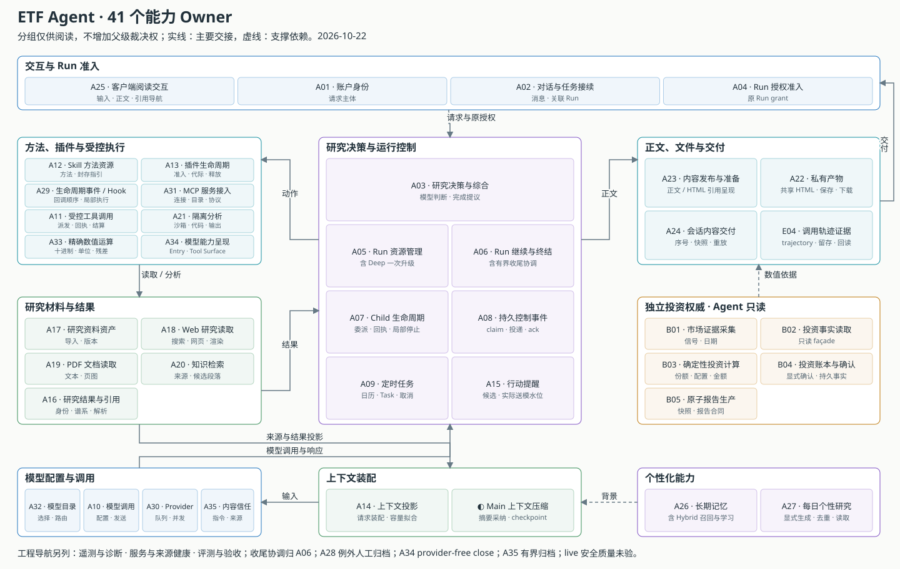

<div align="center">

# ETF Agent · Engineering Notes

**从真实开发与故障出发，读懂一套 Agent 系统如何运行、演化与交付。**

模块机制 × 架构思考 × AI Agent 研发工程 · **45 篇正文，三条主线**

[**模块维度**](https://hpoenixf.github.io/eff-agent-article/modules) · [**架构设计与系统思考**](https://hpoenixf.github.io/eff-agent-article/thinking) · [**AI Agent 研发工程实践**](https://hpoenixf.github.io/eff-agent-article/engineering) · [**金融科技 × Agent 专题**](https://hpoenixf.github.io/eff-agent-article/fintech) · [全部文章](https://hpoenixf.github.io/eff-agent-article/catalog) · [个人博客](https://hpoenixf.com/)

</div>

---

## 初次访问：90 秒找到最相关的工程证据

本仓库是一套**公开可读的 Agent 工程案例与技术文集**，而不是 ETF Agent 的可执行开源实现。作者的前端背景见[个人博客 About](https://hpoenixf.com/about)；下表按读者的关注点推荐最短路径。

| 关注方向 | 建议先读 | 可以观察到什么 |
| --- | --- | --- |
| **AI-native 前端与交互** | [渐进式回答](articles/agent-progressive-answer-coherence.md) → [异步研究的前端交付](articles/agent-asynchronous-research-time-bound-delivery.md) → [答案发布与版本](articles/019-agent-answer-publication.md) → [HTML/文件交付](articles/agent-html-evolution-challenges.md) | 分段正文、后台通知、重连重读、事件去重与 Host 交付边界；可另读[Relay 数据建模案例](https://hpoenixf.com/blog/relay-id-issue) |
| **Agent 应用开发** | [六层研究链路](articles/017-prompt-to-answer-six-layer-panorama.md) → [Subagent](articles/agent-subagent-context-specialization.md) → [Python 工作台](articles/agent-python-compute-workbench-evolution.md) | 工具调用、任务协作、资料处理、计算、错误恢复与产物交接 |
| **Agent 系统架构** | [模型/Runtime/MCP/Skill 分工](articles/agent-model-runtime-mcp-skill-boundaries.md) → [工具可见性与 A34](articles/agent-model-capability-presentation-tool-surface.md) → [A35 内容信任](articles/agent-content-trust-prompt-injection.md) → [授权与事实归属](articles/011-model-understands-code-authorizes.md) → [否决权治理](articles/agent-veto-authority-and-run-termination.md) → [架构演化与五不原则](articles/code-cheaper-systems-harder-to-evolve.md) | 为什么划分职责、如何控制局部失败影响、怎样降低长期复杂度 |
| **AI 辅助工程研发** | [Spec 与 Evidence](articles/026-agent-spec-evidence-workflow.md) → [分期交付](articles/agent-weekly-review-staged-delivery.md) → [知识退役](articles/027-agent-context-document-history.md) → [真实任务收敛](articles/032-ai-development-from-bug-loop-to-task-convergence.md) | 如何让 Coding Agent 从完整设计走向首份交付，同时不被旧规范与测试束缚 |

**公开证据的边界：** 本仓库的文章、架构图、目录源码与 [GitHub Pages 构建流程](.github/workflows/pages.yml) 可以直接查看；[博客站点源码](https://github.com/hpoenixf/myblog-v2)也公开。ETF Agent 的核心应用源码和完整运行证据**不在本公开仓库**。文章记录特定版本的真实案例或设计判断，但不等于第三方已经复核生产级性能、长期成功率、用户业务收益或 AI-native 前端的完整运行 Demo。

[从在线阅读站开始](https://hpoenixf.github.io/eff-agent-article/) · [博客与作者简介](https://hpoenixf.com/about) · [金融领域案例专题](fintech.md)

## 按问题选择阅读主线

| 阅读入口 | 回答的问题 | 范围 |
| --- | --- | --- |
| [模块维度](modules.md) | Agent 如何运行？ | **24 篇 / 4 组**，Entry、Web、PDF、MCP、Portfolio、Python、Memory、Runtime 与交付 |
| [架构设计与系统思考](thinking.md) | 为什么这样设计？ | **16 篇 / 3 组**，Owner、授权、复杂度、恢复与演化 |
| [AI Agent 研发工程实践](engineering.md) | 如何持续开发和验证？ | **5 篇 / 2 组**，Spec、分期交付、工程知识、History、假绿与任务收敛 |
| [金融科技 × Agent 专题](fintech.md) | 这些机制怎样进入金融业务？ | **7 篇跨分类精选**；不作为第四个一级分类，不重复正文 |



[交互式 Owner 架构图册](https://hpoenixf.github.io/eff-agent-article/gallery)：按完整能力及最终效果归属分类，保留已核实的专文与相关文章映射。研发规范文章不因涉及 Agent 就强行挂到运行时 Owner。

### 推荐起点

**原则与方法：** [八条核心判断、六组外围方法](https://hpoenixf.github.io/eff-agent-article/principles) · [现有文章深化与新题预告](https://hpoenixf.github.io/eff-agent-article/roadmap)。两者是阅读导航，不计入 45 篇正文；仍以 [book.mjs](book.mjs) 为唯一文章分类与顺序来源。

**模块：** [定时研究](articles/agent-autonomous-scheduled-research.md) · [Main 压缩](articles/agent-main-run-context-compaction.md) · [Python 计算工作台](articles/agent-python-compute-workbench-evolution.md) · [Memory 持久效果](articles/026-agent-memory-forget-durable-effects.md) · [Publication 独立发布](articles/019-agent-answer-publication.md)

**架构：** [模型会理解，代码才授权](articles/011-model-understands-code-authorizes.md) · [否决权与 Run 终结权](articles/agent-veto-authority-and-run-termination.md) · [架构演化与五不原则](articles/code-cheaper-systems-harder-to-evolve.md)

**研发：** [Spec 与 Evidence](articles/026-agent-spec-evidence-workflow.md) · [周报分期交付](articles/agent-weekly-review-staged-delivery.md) · [文档、History 与知识退役](articles/027-agent-context-document-history.md) · [任务收敛](articles/032-ai-development-from-bug-loop-to-task-convergence.md)

**金融：** [投顾与交易边界](articles/030-fintech-from-research-to-investment-advice.md) · [金融数字复算](articles/031-fintech-data-time-and-reproducible-numbers.md) · [Python 结果消费](articles/financial-agent-python-result-consumption.md) · [可信证据链](articles/financial-agent-trustworthy-evidence-chain.md) · [持续投资研究的历史与论点](articles/agent-weekly-thesis-history-continuous-research.md)

## 全部文章

阅读次序、侧栏与上一篇／下一篇的唯一结构来源是 [book.mjs](book.mjs)。同一读者问题由一篇主稿承接；旧链接保留合稿说明，不作为独立文章重复计数。

### 1 / 模块维度

[进入在线目录 →](https://hpoenixf.github.io/eff-agent-article/modules)

<details>
<summary><b>01 · 研究入口、阅读与计算</b>（8 篇）</summary>

- [Entry：为什么入口越来越简单](articles/022-agent-entry-from-intent-to-direct-research.md)
- [Web：从搜索到连续阅读](articles/021-agent-web-research-from-search-to-deep-reading.md)
- [PDF：从文本到证据](articles/024-agent-pdf-from-text-to-evidence.md)
- [Subagent：从隔离到专业化协作](articles/agent-subagent-context-specialization.md)
- [Adaptive Research 与 Python](articles/adaptive-research-python-workbench.md)
- [Python：从工具到计算工作台](articles/agent-python-compute-workbench-evolution.md)
- [把个人持仓接入 Agent：我们怎样设计一个只读金融 MCP](articles/portfolio-mcp-readonly-investment-data.md)
- [数据过期后的受控刷新](articles/unavailable-is-correct.md)

</details>

<details>
<summary><b>02 · 上下文、研究资产与知识</b>（4 篇）</summary>

- [结果外置与完整性：模型到底读到了多少](articles/tool-results-outside-model-context.md)
- [Main 压缩：摘要不改写原始事实](articles/agent-main-run-context-compaction.md)
- [Memory：遗忘已提交，回答却失败](articles/026-agent-memory-forget-durable-effects.md)
- [RAG：文档撤权与历史回放](articles/027-rag-revocation-publish-replay.md)

</details>

<details>
<summary><b>03 · 运行时、扩展与观测</b>（9 篇）</summary>

- [Extension Host：从功能机到智能机](articles/020-agent-extension-host-smartphone.md)
- [从接上 MCP 到真正用上工具：Agent 的接入链路怎样构建](articles/mcp-host-from-discovery-to-consumption.md)
- [Tool Surface：Agent 有工具，模型为什么看不到](articles/agent-model-capability-presentation-tool-surface.md)
- [A35 内容信任：Prompt Injection 不只是恶意文本](articles/agent-content-trust-prompt-injection.md)
- [多生态 Hook：Claude、Pi 与 Codex](articles/agent-multi-ecosystem-hook-execution.md)
- [工具调用到模型输入的观测链](articles/agent-tool-lifecycle-and-model-input.md)
- [Run 预算与约束治理](articles/agent-runtime-constraint-governance-v2.md)
- [定时研究：会话结束后继续](articles/agent-autonomous-scheduled-research.md)
- [Langfuse：从 Trace 到可信观测](articles/025-agent-langfuse-from-trace-to-trustworthy-observability.md)

</details>

<details>
<summary><b>04 · 答案、发布与恢复</b>（3 篇）</summary>

- [Publication：为什么需要独立发布系统](articles/019-agent-answer-publication.md)
- [渐进式回答如何保持连贯](articles/agent-progressive-answer-coherence.md)
- [异步研究：离开页面后怎样按时交付](articles/agent-asynchronous-research-time-bound-delivery.md)

</details>

### 2 / 架构设计与系统思考

[进入在线目录 →](https://hpoenixf.github.io/eff-agent-article/thinking)

<details>
<summary><b>01 · 系统全景与职责边界</b>（6 篇）</summary>

- [从一句问题到六层系统全景](articles/017-prompt-to-answer-six-layer-panorama.md)
- [模型会理解，代码才授权](articles/011-model-understands-code-authorizes.md)
- [别让模型当状态机](articles/runtime-model-protocol-boundary-agent-article-v2.md)
- [Model / Runtime / MCP / Skill 的分工](articles/agent-model-runtime-mcp-skill-boundaries.md)
- [Run 终结权、阶段预算与安全恢复](articles/agent-veto-authority-and-run-termination.md)
- [金融数据 MCP 为什么变成决策系统](articles/mcp-market-responsibility-retrospective.md)

</details>

<details>
<summary><b>02 · 可靠性、反馈与系统治理</b>（2 篇）</summary>

- [很多引用为什么不等于可靠](articles/ai-citations-do-not-prove-reliability.md)
- [别把每个失败都算给模型](articles/agent-failure-is-a-boundary-problem.md)

</details>

<details>
<summary><b>03 · 工程演化与金融边界</b>（8 篇）</summary>

- [代码越来越便宜，为什么系统却越来越难升级？](articles/code-cheaper-systems-harder-to-evolve.md)
- [HTML 保存了，为什么还是交付失败](articles/agent-html-evolution-challenges.md)
- [一个 ETF 投资助手的工程起点](articles/001-one-week-4-billion-tokens-etf-investment-agent.md)
- [从投资研究到投顾与交易的边界](articles/030-fintech-from-research-to-investment-advice.md)
- [金融数字的时点、口径与复算](articles/031-fintech-data-time-and-reproducible-numbers.md)
- [Python 算过了，投研报告为什么还会错](articles/financial-agent-python-result-consumption.md)
- [金融 Agent 的可信证据链](articles/financial-agent-trustworthy-evidence-chain.md)
- [周报历史：投资论点与用户修正](articles/agent-weekly-thesis-history-continuous-research.md)

</details>

### 3 / AI Agent 研发工程实践

[进入在线目录 →](https://hpoenixf.github.io/eff-agent-article/engineering)

<details>
<summary><b>01 · Spec、证据与工程记忆</b>（3 篇）</summary>

- [Spec、Evidence 与可验证研发关闭](articles/026-agent-spec-evidence-workflow.md)
- [周报做了整晚，为何首份交付还没完成？](articles/agent-weekly-review-staged-delivery.md)
- [工程知识：按需加载、长期记忆与退役](articles/027-agent-context-document-history.md)

</details>

<details>
<summary><b>02 · 真实验证与任务收敛</b>（2 篇）</summary>

- [测试与评测：绿灯究竟证明什么](articles/honest-agent-evaluation.md)
- [从 Bug 循环到完整任务收敛](articles/032-ai-development-from-bug-loop-to-task-convergence.md)

</details>

## 延伸阅读与边界

- [金融科技 × Agent 主题阅读](fintech.md)：跨分类精选，不另外生成文章副本。
- [Agent 架构原则速查](principles.md)：用于设计、重构与 Code Review 的判断清单，不计入 45 篇正文。
- [架构图册](gallery.md) · [工程选题预告](roadmap.md) · [六层系统图文版](https://hpoenixf.github.io/eff-agent-article/visuals/017-prompt-to-answer-six-layer-panorama/index.html)
- [个人博客](https://hpoenixf.com/)：按时间阅读的文章；此仓库用于主题与连续阅读。新收录的 Spec、History 文章保留博客原文链接。

正文记录特定时间点的工程事实、问题和验证边界；内部通过、正式关闭、公开发布和真实业务效果是不同事实。本文集不构成投资或法律建议。

### 本地检查

```bash
npm install
npm run check:catalog
npm run docs:build
```

## 已合并文章的旧链接

旧版 023 发布治理、runtime-natural-language-boundary 和 028 反馈专题仍保留指向现有主稿的合稿引导，**不另算正文**。不为分类调整创建旧文章副本。

## English editions / 双语发布

The Chinese originals remain at `/articles/<slug>`. Reviewed complete English translations use
`/en/articles/<slug>`; both editions share the same stable slug, canonical category and order in `book.mjs`.
`book.en.mjs` holds only English display labels and the list of **actually translated** slugs,
never a competing article index. The English catalog marks untranslated essays “Chinese original.”

- Open `?lang=en` or `?lang=zh` on a site page to set the language preference; the reader switcher stores
  `etf-agent:language` in localStorage. A URL parameter overrides storage. Direct `/en/` links select English.
- The language switch preserves equivalent article paths only when a complete translation exists.
  Otherwise the Chinese original remains visible with a clear availability notice, never a fake translation.
- For each newly approved article, publish and review both `articles/<slug>.md` and
  `en/articles/<slug>.md`, register its English title and translated slug in `book.en.mjs`,
  and run `npm run check:catalog && npm run docs:build`. English must preserve code,
  evidence status, warnings, dates, diagrams, and citation semantics. Do not label a placeholder translated.
- Existing Chinese-only articles are **not** claimed to have English translations.

### Bilingual diagrams and illustrations / 图表双语规则

Each English article is a full Markdown edition, not a summary. Mermaid source for each article is
localized **inside the corresponding language's Markdown**: Chinese diagram nodes and edge labels
in `articles/<slug>.md`, English nodes/edges in `en/articles/<slug>.md`. Technical identifiers
and stable field names remain unchanged; decision conditions, failure branches and connector counts
must match. Markdown table headings and cell descriptions are translated too.

Language-bearing `SVG`, `HTML` illustrations and image captions must be localized separately:
prefer `visuals/<slug>/...` for the Chinese edition and `visuals/en/<slug>/...` for English,
with the English article linking its localized asset. Truly language-neutral images may be shared;
do not link Chinese-labeled SVG/HTML from English pages. Diagram links, image URLs and figures
must survive GitHub Pages base-path resolution. Standalone interactive HTML visualizations need
independently localized UI labels and text; translating the linking article is not enough.

Run `npm run check:catalog` to validate canonical slugs, route tests and bilingual
visual structure (Mermaid blocks, table rows, image counts, and Chinese text in English
Mermaid/SVG/HTML). Review diagram semantics manually: structural checks cannot translate
embedded screenshots or certify semantic equivalence.

The first retrospective translation batch adds seven complete articles: long-term Memory,
RAG revocation, investment research authorization, coding-agent task convergence, the
project origin story, tool lifecycle tracing, and false-green test evidence. Combined with the
earlier tool-result essay there are **eight complete English article editions** in this batch's
snapshot; the authoritative live list is `book.en.mjs`, not this count.
