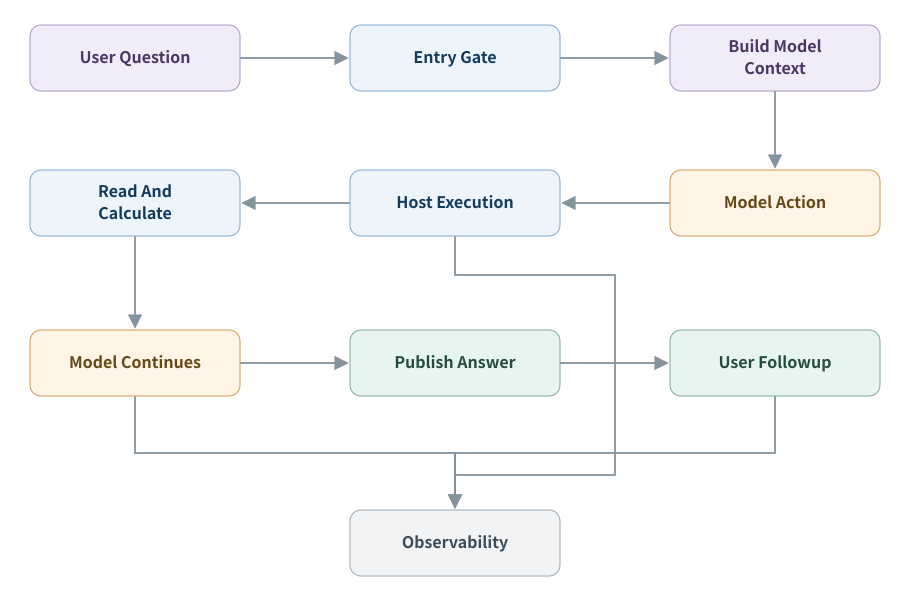

# ETF Agent 技术文章

围绕 ETF Agent 的系统设计、授权边界、研究流程、失败恢复、评测和答案交付。文章索引优先链接博客阅读页，并保留仓库内 Markdown 源码，方便离线阅读和复用。

## 全景导读

- [一句“帮我看看组合”，怎样走过 ETF Agent 的六层系统](https://hpoenixf.com/blog/017-prompt-to-answer-six-layer-panorama) · [Markdown 源码](articles/017-prompt-to-answer-six-layer-panorama.md)

## 四篇主线

- [010 一个 Agent 为什么必须先装刹车](https://hpoenixf.com/blog/010-agent-first-brakes) · [Markdown 源码](articles/010-agent-first-brakes.md)
- [011 模型会理解，代码才授权](https://hpoenixf.com/blog/011-model-understands-code-authorizes) · [Markdown 源码](articles/011-model-understands-code-authorizes.md)
- [别让兜底回答伪装成功：流式 Agent 的阶段预算、失败终态与安全恢复](https://hpoenixf.com/blog/honest-agent-failure-semantics) · [Markdown 源码](articles/honest-agent-failure-semantics.md)
- [大模型有返回等于 Agent 成功运行吗？](https://hpoenixf.com/blog/honest-agent-evaluation) · [Markdown 源码](https://hpoenixf.com/blog/honest-agent-evaluation) · [Markdown 源码](articles/honest-agent-evaluation.md)

## 专题文章

- [一个 ETF 投资助手，为什么先变成了工程问题](https://hpoenixf.com/blog/001-one-week-4-billion-tokens-etf-investment-agent) · [Markdown 源码](articles/001-one-week-4-billion-tokens-etf-investment-agent.md)
- [源端有 50 条，模型只看到了 20 条：一次 Agent 静默截断排查](https://hpoenixf.com/blog/partial-is-not-complete) · [Markdown 源码](https://hpoenixf.com/blog/partial-is-not-complete) · [Markdown 源码](articles/partial-is-not-complete.md)
- [数据过期后，Agent 应该怎样刷新，而不是反复重试？](https://hpoenixf.com/blog/unavailable-is-correct) · [Markdown 源码](articles/unavailable-is-correct.md)
- [绿了，但并不是真的：如何让测试无法伪造生产边界](https://hpoenixf.com/blog/green-tests-can-lie) · [Markdown 源码](articles/green-tests-can-lie.md)
- [别再把 Agent 失败都算给模型：一次从粗错误码到失败链的排查](https://hpoenixf.com/blog/agent-failure-is-a-boundary-problem) · [Markdown 源码](https://hpoenixf.com/blog/agent-failure-is-a-boundary-problem) · [Markdown 源码](articles/agent-failure-is-a-boundary-problem.md)
- [Agent 查了很多资料，为什么还是交不出答案？](https://hpoenixf.com/blog/agent-runtime-constraint-governance-v2) · [Markdown 源码](articles/agent-runtime-constraint-governance-v2.md)
- [Runtime 不知道的，不要因为能写一个规则，就假装它知道](https://hpoenixf.com/blog/runtime-natural-language-boundary-article-v2) · [Markdown 源码](https://hpoenixf.com/blog/runtime-natural-language-boundary-article-v2) · [Markdown 源码](articles/runtime-natural-language-boundary-article-v2.md)
- [为什么 AI 明明有很多引用，回答还是不够可靠？](https://hpoenixf.com/blog/ai-citations-do-not-prove-reliability) · [Markdown 源码](articles/ai-citations-do-not-prove-reliability.md)
- [从“搜得到”到“读得下去”：我们怎样让 Agent 学会浏览网页](https://hpoenixf.com/blog/021-agent-web-research-from-search-to-deep-reading) · [Markdown 源码](articles/021-agent-web-research-from-search-to-deep-reading.md)
- [为什么我们把 Agent 的 Entry 越做越简单？](https://hpoenixf.com/blog/022-agent-entry-from-intent-to-direct-research) · [Markdown 源码](articles/022-agent-entry-from-intent-to-direct-research.md)
- [别再让模型当状态机：一次 Agent 协议减负实践](https://hpoenixf.com/blog/runtime-model-protocol-boundary-agent-article-v2) · [Markdown 源码](https://hpoenixf.com/blog/runtime-model-protocol-boundary-agent-article-v2) · [Markdown 源码](articles/runtime-model-protocol-boundary-agent-article-v2.md)
- [从让模型少想一点，到让 Runtime 少管一点：重新理解 Agent、Runtime、MCP 与 Skill 的分工](https://hpoenixf.com/blog/agent-model-runtime-mcp-skill-boundaries) · [Markdown 源码](articles/agent-model-runtime-mcp-skill-boundaries.md)
- [一个金融数据 MCP，为什么长成了研究决策系统](https://hpoenixf.com/blog/mcp-market-responsibility-retrospective) · [Markdown 源码](articles/mcp-market-responsibility-retrospective.md)
- [工具查到的数据，为什么不一定要给大模型看？](https://hpoenixf.com/blog/tool-results-outside-model-context) · [Markdown 源码](articles/tool-results-outside-model-context.md)
- [从工具调用到模型输入：把 Agent 的观测链路接起来](https://hpoenixf.com/blog/agent-tool-lifecycle-and-model-input) · [Markdown 源码](articles/agent-tool-lifecycle-and-model-input.md)
- [从工具调用到自适应研究：让 Agent 边查、边算、边调整](https://hpoenixf.com/blog/adaptive-research-python-workbench) · [Markdown 源码](articles/adaptive-research-python-workbench.md)
- [Agent 扩展如何接入 Host：插件生命周期与运行时边界](https://hpoenixf.com/blog/020-agent-extension-host-smartphone) · [Markdown 源码](articles/020-agent-extension-host-smartphone.md)
- [Agent 已经生成答案，为什么还需要一个独立的发布系统？](https://hpoenixf.com/blog/019-agent-answer-publication) · [Markdown 源码](articles/019-agent-answer-publication.md)
- [Agent 发布治理为什么做了两次？问题不只是校验太严格](https://hpoenixf.com/blog/023-agent-publication-governance-retrospective) · [Markdown 源码](articles/023-agent-publication-governance-retrospective.md)
- [Agent 的渐进式回答：怎样保持研究过程连贯](https://hpoenixf.com/blog/agent-progressive-answer-coherence) · [Markdown 源码](articles/agent-progressive-answer-coherence.md)

- [从能读取到能研究：我们如何把 PDF 阅读升级为可追溯的多模态能力](https://hpoenixf.com/blog/024-agent-pdf-from-text-to-evidence) · [Markdown 源码](articles/024-agent-pdf-from-text-to-evidence.md)
- [从 Trace 到可信观测：我们的 Agent 可观测体系怎样一步步建立起来](https://hpoenixf.com/blog/025-agent-langfuse-from-trace-to-trustworthy-observability) · [Markdown 源码](articles/025-agent-langfuse-from-trace-to-trustworthy-observability.md)

## 架构图与图文版

[六层系统全景 HTML 图文版](https://hpoenixf.com/static/agent-articles/017-prompt-to-answer-six-layer-panorama.html) 可在线阅读；[HTML 源文件](visuals/017-prompt-to-answer-six-layer-panorama/index.html) 和 15 张 [SVG 架构图](visuals/017-prompt-to-answer-six-layer-panorama/diagrams/) 保留在仓库，便于下载与复用。

单图目录：

- [overview](visuals/017-prompt-to-answer-six-layer-panorama/diagrams/overview.svg)
- [identity](visuals/017-prompt-to-answer-six-layer-panorama/diagrams/identity.svg)
- [research](visuals/017-prompt-to-answer-six-layer-panorama/diagrams/research.svg)
- [subagent](visuals/017-prompt-to-answer-six-layer-panorama/diagrams/subagent.svg)
- [context](visuals/017-prompt-to-answer-six-layer-panorama/diagrams/context.svg)
- [background](visuals/017-prompt-to-answer-six-layer-panorama/diagrams/background.svg)
- [execution](visuals/017-prompt-to-answer-six-layer-panorama/diagrams/execution.svg)
- [hooks](visuals/017-prompt-to-answer-six-layer-panorama/diagrams/hooks.svg)
- [evidence](visuals/017-prompt-to-answer-six-layer-panorama/diagrams/evidence.svg)
- [calculation](visuals/017-prompt-to-answer-six-layer-panorama/diagrams/calculation.svg)
- [delivery](visuals/017-prompt-to-answer-six-layer-panorama/diagrams/delivery.svg)
- [continuity](visuals/017-prompt-to-answer-six-layer-panorama/diagrams/continuity.svg)
- [control](visuals/017-prompt-to-answer-six-layer-panorama/diagrams/control.svg)
- [observation](visuals/017-prompt-to-answer-six-layer-panorama/diagrams/observation.svg)
- [evaluation](visuals/017-prompt-to-answer-six-layer-panorama/diagrams/evaluation.svg)
