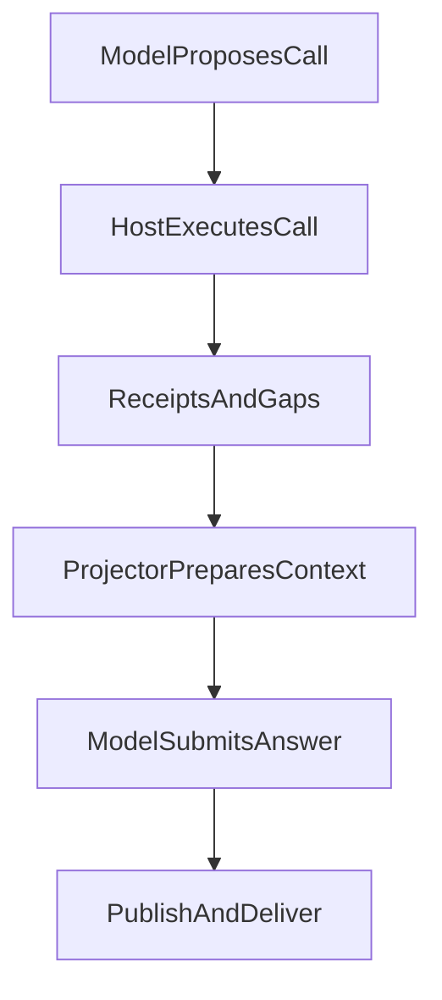
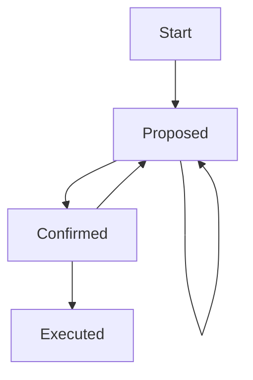

# 010 一个 Agent 为什么必须先装刹车

> 面向不了解本项目的工程读者。
> 回答一个问题：小系统为什么会长成证据、账本、模型、执行边界系统。
> 背景取自早期一周试错故事，但本文独立可读，不依赖旧文。

> 2026-10-11 校准：以下案例是教学场景，不作为真实事故记录；四类材料和 L1–L3 是解释视角，不是当前 Runtime 的固定授权状态机。

## 1 故事起点：一个很小的愿望

最初的愿望很小：每天看一眼指数，决定要不要定投。

输入是行情，输出是一句话：买，还是不买。

听起来一个脚本就够了。

这个设想很快会碰到几类工程问题：建议可能依赖过期数据，持仓金额可能与账本口径不一致，模型的一句话也可能被误解为执行确认。下面以教学场景说明为什么要把这些责任分开，不把它们编成同一次实盘事故。

## 2 小系统膨胀的四个方向

小系统会在四个方向上被迫长大。

第一是证据：建议从哪里来，能不能复查。

第二是账本：钱和份额到底是多少，谁说了算。

第三是模型：模型负责理解，不负责拍板。

第四是边界：什么能做，什么必须停下。

这四个方向，就是本文的骨架。

任何一个缺失，系统都会在实盘中付出学费。

## 3 历史故事的正确读法

早期故事里提到过很大的试错量级。

请把它当作历史故事与示例窗口来读。

它说明的是探索成本，而不是性能保证。

不要把它复刻为事实承诺。

真正值得保留的教训只有一句话。

> 聪明但不可复现的建议，在投资里等于零。

## 4 四类材料：追溯回答需要看什么

能力、实际结果、缺口和交付正文，是理解研究过程的四个视角。它们不必成为一个让模型每轮维护的固定对象，也不能凭字段齐全证明回答正确。

当前 Native 循环让模型提议工具动作，Host 保存实际调用与回执，Projector 组织本轮材料，Publication 接住正文。研究记录用于追溯，权限仍由身份、资源范围和当前治理决定。



## 5 可追溯，不等于系统替模型证明结论

知道资料进入了哪一轮请求，能帮助定位错误；它不能证明模型的推导成立。数字、时间和来源应当可核对，未知不填成成功，语义质量仍需要独立评审。

公开引用缺口按当前发布合同局部处理，受保护资料撤权则约束相关效果。不能用“材料不齐”一概抹去独立获准正文，也不能让流畅正文绕过权限。

## 6 四个问题：按任务取用，而非每次全部回答

组合研究通常会问市场状态、个人组合、行动约束和证据范围。但解释“指数是什么”不需要先读用户持仓；请求一个行业定义，也不需要回答可以买多少。

这四个问题是方法提示，不是 Runtime 要强制完成的四条流水线。模型根据用户任务选用方法，程序检查实际动作与权限。工具成功、正文提交和用户真正收到答案分别有记录，不能压成一个总成功。

## 7 份额乘净值：账本的唯一真理

组合账本有一条铁律。

份额才是真相，金额只是派生值。

持仓价值等于份额乘以当前净值。

不能用旧金额除以新净值反推份额。

否则分红、拆分、净值滞后都会污染账本。

这个规则看起来琐碎，却是全部信任的起点。

账本错一位，后续所有建议都错。

```json
{
  "holdingTruth": {
    "shares": 1000,
    "currentNav": 1.234,
    "holdingValue": 1234.0,
    "formula": "holdingValue = shares * currentNav"
  },
  "forbidden": "shares != staleAmount / newNav",
  "reason": "分红拆分与净值滞后会污染反推结果"
}
```

## 8 确认不等于执行：两道闸门

系统区分两个动作：确认和执行。

确认是用户说“我同意这个方向”。

执行是系统记录“已经按指令操作”。

确认不会改变账本估计。

显式执行指令仍须满足对应路径的身份、权限和确认合同；研究中的同意、建议或发布不会自动改变账本。

这个分离防止了“聊着聊着就成交了”。



**关系或转移条件：**

- **Start → Proposed**：系统生成。
- **Proposed → Confirmed**：用户明确同意。
- **Confirmed → Executed**：用户发出执行指令。
- **Proposed → Proposed**：用户追问不推进状态。
- **Confirmed → Proposed**：新证据推翻旧建议。

## 9 三层边界：L1、L2、L3

> 本文 L1-L3 采用 glossary 主线语义（事实/推断/行动），非测试 L0-L3。

L1–L3 用于解释责任递进，不表示代码能用三层标签认证事实、推断与行动。

L1 是事实层：行情、持仓、规则是否拿到。

L2 是推断层：基于事实能得出什么结论。

L3 是行动层：能否给出可执行操作。

每一层都有自己的放行条件。

某项关键事实缺失时，应限定依赖它的推断或行动，独立获准内容仍可回答。推断是否充分是语义判断，代码守住的是具体权限、来源依赖和效果。下面是教学检查表，不是现行运行协议。

```json
{
  "L1_fact": {
    "question": "证据齐了吗",
    "failAction": "声明缺口并停止推断"
  },
  "L2_inference": {
    "question": "推断站得住吗",
    "failAction": "只给事实不给结论"
  },
  "L3_action": {
    "question": "能执行吗",
    "failAction": "只给方向不给操作"
  }
}
```

## 10 教学场景一：行情缺失时买还是等

某天行情接口超时，市场状态拿不到。

旧做法是模型凭记忆补一个大概数字。

新做法是缺口显式声明行情缺失。

回答块只说当前无法判断，不给买入量。

对比很清楚：旧方案完整但虚假。

新方案残缺但诚实。

诚实在这里比完整更重要。

## 11 教学场景二：净值滞后时的账本诱惑

跨境品种净值经常滞后一天。

旧做法是用昨天金额除以今天估值反推份额。

结果份额每天抖动，账本对不上券商对账单。

新做法是坚持份额不变，只更新净值时间戳。

同时标注该品种存在滞后，结论降级。

对比说明：公式正确比数字好看重要。

账本宁可标注滞后，也不伪造精确。

## 12 教学场景三：用户说“可以买”算执行吗

用户说“听起来可以买”，系统不能记为已买。

这句话是确认，甚至只是闲聊。

只有明确的执行指令才能推进到已执行。

旧做法容易把语气当指令，把建议当成交。

新做法把状态机写死，不猜测用户意图。

对比说明：宁可多问一句，不擅自记一笔。

## 13 本轮核对的边界

| 对象 | 可复查依据 | 不能据此声称 |
| --- | --- | --- |
| 持仓与报告 | 原子组合报告规范及仓库账本约束 | 任意旧金额都可反推出新份额 |
| 工具与执行 | 当前工具面 | 工具可见就已经执行或获准交易 |
| 发布与交付 | 发布规范 | 发布获准就答案正确、用户已看到 |
| 本文教学场景 | 用于解释错误条件与责任 | 真实事故、生产指标或新测试通过 |

本轮只核对文档、当前实现与已有证据，没有重跑生产测试，也没有量化成功率、成本或投资收益。

## 14 从旧方案到当前方案：删除旧文后保留什么

旧方案曾经用大量试错讲“模型很努力”。

当前方案只保留三条知识，其余叙事可以删除。

第一条是可复现优先于聪明。

第二条是账本公式不可妥协。

第三条是停止也是一种正确回答。

旧文的情绪、量级、过程细节都可以归档。

这三条必须活在代码和检查里。

这就是删除旧文后不丢失的东西。

## 15 给新读者的三句话

先装刹车，再谈智能。

拿不到证据时，诚实比完整重要。

账本和执行边界，是 Agent 的生命线。

## 证据来源

- 早期一周试错故事：仅作背景与示例窗口，不作性能保证。
- 当前工具面与发布规范。
- 份额乘净值、确认与执行分离、三层边界的现行规则。
