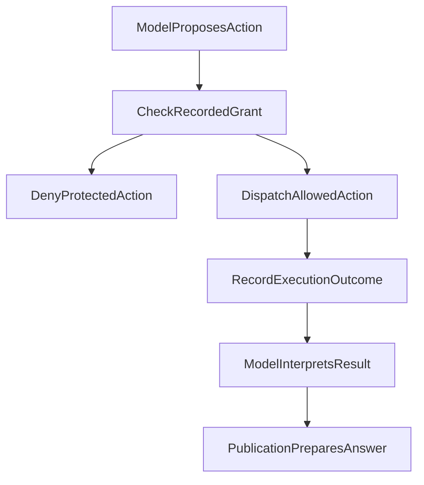

# 011 模型会理解，代码才授权

用户说：“这只基金好像不错，可以买一点。”模型可能理解了他的兴趣，甚至能够提出一个研究方向。但这句话没有证明账户里有多少钱，也没有说明一笔交易已经发生。

投资研究助手需要同时处理三种不同的事情：理解用户、形成分析，以及产生受控效果。模型可以解释问题、选择研究方法和提出动作；系统必须依据真实身份、已授予的范围和执行记录，决定具体动作是否允许、是否实际发生。

这也是“先装刹车”最值得保留的含义：**把权限和账本放在能够核对事实的地方，让模型在获准范围内自由研究。** 它不要求所有回答都经过一套固定检查表，更不意味着代码能够判断每句话是否正确。

本文合并了原《一个 Agent 为什么必须先装刹车》的账本与确认案例，并按 2026 年 10 月的 Run 授权合同校准旧表述。下文教学场景不是真实交易事故，研究能力也不代表真实交易通道已经开通。

## 一、理解可以形成提议，不能生成权限

早期设计曾尝试用一个较重的 Intent v2 对象，把意图理解、研究计划和执行安排一起表达。这个方案已经撤回，旧字段和固定流程不再是现行授权依据。

它留下的有效问题是：如何让模型对话语的理解，与系统真正允许的动作分开？

“用户似乎想买”“资料看起来公开”“模型认为信息已经足够”，都属于解释或判断。它们可以影响研究路线，却不能替代账户身份、资源范围、工具准入或实际执行回执。一个结构化字段即使通过了 Schema 校验，也不会因此获得授权能力。

因此，系统检查的是**模型提出的具体动作**：它要读取哪份资源、调用哪个工具、操作哪个账户，是否处于已授予的范围。程序不需要先用关键词把用户的话划成“安全”“确认”或“投资建议”，再根据这个标签创建权限。



超出已授予范围的动作在派发前被拒绝；通过范围检查的动作仍可能执行失败，回执须保留实际结果。模型可以解释成功或失败，正文交付也有自己的记录。任何一步都不能替后续步骤宣布成功。

## 二、授权跟随一次 Run，执行条件各自检查

这里的 Run 指一项逻辑研究运行。当前合同把 Host 记录的 Run grant 作为这次运行的权限依据：初次准入时确定来源和工具范围，同一次 Run 的后续读取、分析、发布、暂停与恢复继承这份授权。

这与旧稿的“每次使用都重新查当前权限”不同。**同一 Run 不因外部权限表后来变化而重新撤销已有 grant，也不在恢复时按当前 ACL 清空原来获准的材料。** 后续明确授予的范围可以追加；进入一个新 Run，则需要自己的准入，不能借旧对话、缓存或回执自动取得权限。

这并不取消执行检查。每次动作仍须核对所属账户、scope、Run、工具与来源身份，并遵守对应资源预算、显式取消和执行状态。检查动作是否符合已记录 grant，与重新查询当前权限，是两个不同问题。

| 条件变化 | 应如何处理 |
| --- | --- |
| 同一 Run 暂停后恢复 | 恢复原 grant 与执行记录，不重新查询当前 ACL |
| 请求读取原 grant 之外的资源 | 走既有的新增准入，模型声明不能扩权 |
| 新 Run 想使用过去读过的材料 | 取得新 Run 自己的授权，旧曝光记录不能代替 |
| 文件丢失、内容身份不符或计算失败 | 报告相应可用性或执行问题，不改写成“权限被撤回” |
| 预算耗尽或用户取消 | 由相应生命周期规则限制后续效果，不虚构成功 |

工具注册、模型可见和允许执行也要分开。工具面可以因阶段、已准入能力或资源限制而收窄；看到工具不证明调用成功，暂时没有工具也不意味着一般概念解释必须拒绝。来源曝光记录说明模型实际得到过什么，不负责授予或缩减权限。

这个设计有明确取舍：它选择同一研究及恢复过程中的授权稳定性。新 Run 的准入仍独立，原 Run 的账户与 scope 隔离也继续成立；它不是一套运行中即时撤权机制。

## 三、信息不完整时，限制依赖它的动作

用户说“帮我看看这个”，而现有上下文没有可识别对象时，模型应说明缺什么并询问用户。不能先猜一只基金，再用真实查询结果给这个猜测背书。

但“需要澄清”不等于“所有工具零查询”。获准资料可能已经包含对象，问题也可能只需要一般解释。缺少购买金额，可以阻止金额计算，却不一定阻止公开产品资料读取。

决定是否补读、先解释还是询问，是模型结合任务作出的判断；程序检查具体调用的资源、身份和参数。限制应落在对应动作上，独立可做的研究仍可继续。

个人持仓和研究文档也不是一项权限。用户不允许读取个人组合，并不自动禁止读取已获准的研究材料；能读研报，也不代表能读账户、确认计划或执行交易。所谓能力交集，指动作必须同时满足适用的客观约束，不是让模型维护一个“字段齐全即可放行”的对象。

## 四、份额乘净值：分析不能反过来改写账本

原“先装刹车”文章中，有一条具体规则比抽象的可靠性口号更重要：**份额是持仓事实，金额是由份额和相应净值派生的值。**

下面是合成的教学数据：

```json
{
  "holdingTruth": {
    "shares": 1000,
    "currentNav": 1.234,
    "holdingValue": 1234.0,
    "formula": "holdingValue = shares * currentNav"
  },
  "forbidden": "shares != staleAmount / newNav"
}
```

假设账户仍持有 1,000 份，新的净值到来后，可以重新计算持仓价值，但不能用旧金额除以新净值，反推出另一组份额。分红、拆分或报告时点变化都可能令这种反推失真；实际份额变化需要自己的账本依据。

再假设某只跨境基金的净值报告滞后。合适的处理是保留已知份额、记录净值日期和估值限制，而不是让份额跟着每日估值抖动。新的市场价格也不能自动刷新一个月前的账户快照。

因此，新鲜度、账户身份和计算口径要分别保留。数据不足时，可以解释方法或展示明确标注的假设情景；不能把假设金额写成当前账户事实，更不能据此赋予投资执行权。

## 五、确认方向、执行指令和执行结果是三件事

“这只好像不错，可以买”可能是评价，也可能是进一步讨论。单靠积极语气，不能推进账户的执行状态。

即使用户明确同意一项方案，**同意方案仍不等于交易已经发生**。一条明确的执行指令也只是执行前提；是否获准派发、是否实际完成，需要对应执行路径的记录。研究系统不能用自己发布的一段文字替代它们。

| 已有事实 | 可以记录什么 | 不能据此记录什么 |
| --- | --- | --- |
| 模型提出配置方向 | 一项待讨论的建议或假设情景 | 当前持仓已经改变 |
| 用户确认方案 | 用户对该方案的确认 | 交易已提交或已成交 |
| 用户发出明确执行指令 | 待按身份、权限和确认合同处理的请求 | 执行必然成功 |
| 执行路径取得实际回执 | 回执所证明的操作及状态 | 回执之外的成交、收益或其他效果 |

未确认建议不能改变组合估计；讨论中的假设情景也必须与账户事实分开。这张表解释事实之间的区别，不是一个凭四个标签即可完成交易的状态机，也不证明本文涉及的只读研究路径已经具有下单能力。

需要澄清时就澄清，但问题应指向缺失的执行条件。系统既不根据语气自动成交，也不要求用户为了查看普通资料而先完成交易确认。

## 六、来源身份和引用，不能代替结论质量

当前研究循环让模型提议工具动作，Host 保存实际调用与结果，上下文模块组织下一轮材料，Publication 接住普通助手正文和显式提交的答案。这些交接记录有助于追溯，但不能证明模型理解正确。

个人受控数值绑定只能来自获准的 Portfolio 结果。同值的网页数字、用户文字或模型自评，不会因此得到个人账本权威。模型当然可以讨论用户提供的数值，但必须保留它的身份，不能把它变成 Host 已核对的账户字段。

同样，来源存在、某段原文确已取得、原文支持主张、主张回答了问题，是四件不同的事。没有一套通用“可信根”或 `sourceVerified=true`，能够替所有研究结论盖章。

公开引用缺失、格式错误或附件容量不足，按发布合同局部处理，保留独立获准正文并说明来源限制。原 Run 未授予的私有来源则属于真实权限问题；不能删掉引用标记，就把实际依赖变成无权限要求的内容。**同一 Run 及其恢复使用原 grant，这里不重新引入运行中的撤权检查。**

例如只有研报搜索线索、没有取得原文时，可以说明找到了什么线索，也可以继续在授权范围内读取。不能编造摘录和页码，但也不应把“缺页码”变成拒绝整篇回答的通用规则。具体结论是否得到支持，仍需结合实际材料判断。

更完整的发布机制见 [Publication 专文](./019-agent-answer-publication.md)，主张与来源的关系见[引用可靠性专题](./ai-citations-do-not-prove-reliability.md)。本篇只讨论它们与授权的交接。

## 七、两条 PDF 路径，也不能互相证明成功

同样的区别适用于文档读取。系统的账单导入与研究 PDF 阅读有不同的消费目标：

| 路径 | 主要产出 | 成功不能证明什么 |
| --- | --- | --- |
| 账单导入 | 供账本核对的份额、金额及对应记录 | 研究检索或页图理解已经可用 |
| 研究 PDF 阅读 | 页段、摘录、表格或页图等研究材料 | 账单份额可信、账户已授权或研究结论正确 |

教学场景中，即使某份账单的份额完全对上，也不能据此断言另一份研报已被正确检索。两条路径各自保留结果与缺口，不互相借用通过状态。

PDF 页图阅读属于默认关闭的受控能力；本地接口成立并不等于真实视觉质量与生产启用已经验证。具体读取机制由 [PDF 专文](./024-agent-pdf-from-text-to-evidence.md)展开。

## 八、合并后保留的判断

| 问题 | 本篇采用的判断 |
| --- | --- |
| 模型理解了用户，是否即可执行？ | 理解形成提议；实际动作依身份、Run grant 与执行合同处理 |
| 信息缺失，是否全部停止？ | 不猜对象制造证据，限制依赖缺口的动作，保留独立可做的工作 |
| 每次调用是否重新查当前权限？ | 核对原 Run 已授予范围；同 Run/recover 不重复查询当前 ACL，新 Run 独立准入 |
| 字段和引用齐全，是否证明正确？ | 结构、来源身份、语义支持与交付分别判断 |
| 确认方案，是否可以改成已执行？ | 确认、指令和执行回执分别保留，假设情景不改写账户事实 |
| 一条文档路径通过，是否能给另一条背书？ | 各自保留证据范围，不互相晋升 |

这次合稿依据既有账本约束、现行 Run 授权与发布合同修正文意，保留原文的历史证据边界。没有重跑生产测试，也没有新增关于模型成功率、成本或投资收益的结论。

模型可以不断调整研究路线；系统需要稳定记录的是它获准做什么、实际做了什么，以及哪些事实还没有发生。把这些事情分开，才能在能力增长时继续解释每一次操作的依据。
