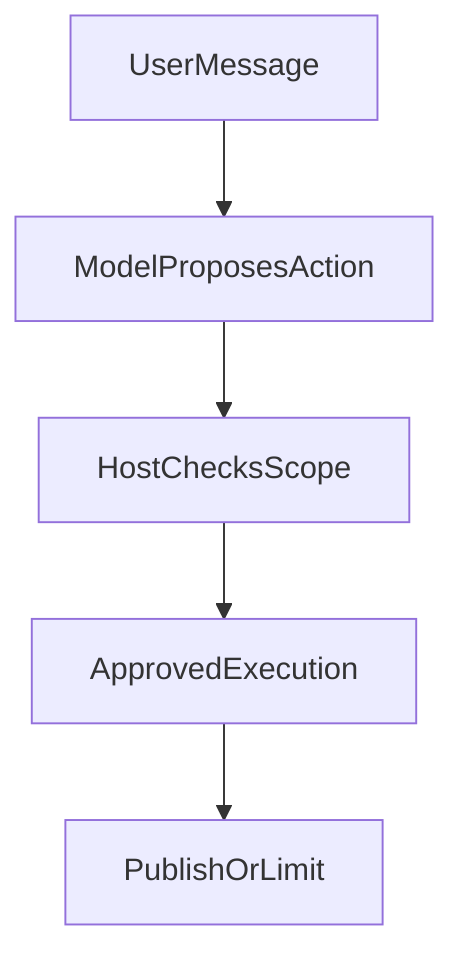
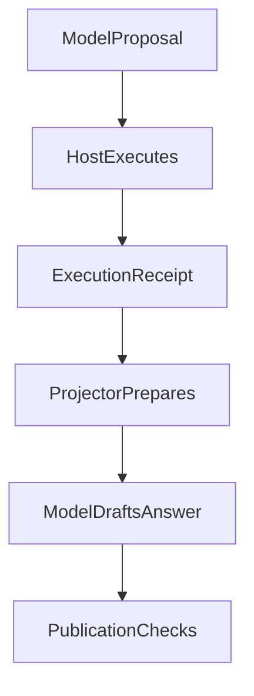
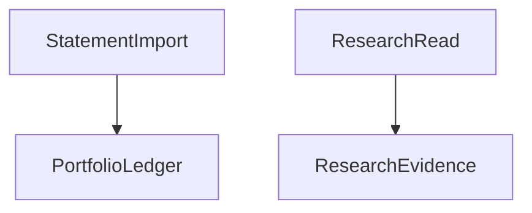

# 011 模型会理解，代码才授权

> 面向不了解本项目的工程读者，独立可读。
> 一句话：模型负责理解世界，代码负责决定能做什么。
> 本文吸收并替代旧的意图理解、双路由守卫与模型语义讨论。

> 2026-10-11 修订：移除旧稿中“四件套授权”、通用来源白名单和统一核验布尔值的现行表述。本文讨论授权责任，不授予投资执行能力；公开来源缺口、私人资源拒绝与回答质量分别处理。

## 1 核心主张

模型很会理解话语，但理解不等于授权。

用户说“买一点”，模型能听懂大概意思。

模型可以提出标的和金额建议；实际交易是否允许，必须由独立的身份、资源与确认/执行合同决定。研究能力本身不包含交易授权。

这就是标题的含义。

理解是柔性的，授权是刚性的。

## 2 为什么必须分开

如果让模型直接决定操作，会发生三件事。

第一是口径漂移：同样的话每次执行得不一样。

第二是证据漂移：没有证据时模型会脑补。

第三是责任漂移：出错后找不到哪一步错了。

分开之后，模型只产生理解建议。

代码只根据事实和规则放行。

## 3 旧 Intent v2 的撤回声明

旧方案曾经提出一个较重的意图版本。

它想把理解、计划、执行都装进意图对象。

这个版本已经撤回，不再作为现行标准。

撤回的原因是它把太多决定权交给了猜测。

新读者不需要学习它的字段和流程。

只需要记住撤回结论：不以猜测驱动执行。

## 4 旧方案中保留的三条思想

旧方案并非一无是处，有三条思想被保留。

第一是操作与言语行为分离。

第二是不以猜测的对象发起查询。

第三是能力交集。

这些原则继续适用，不意味着旧意图对象、字段或固定规划步骤仍在执行。

下面逐条解释它们今天的样子。

## 5 操作与言语行为分离

用户的每句话有两个层面。

言语行为是“他在做什么”：提问、确认、闲聊。

操作是“系统要改变什么”：查数据、下建议、记执行。

提问不等于下单，闲聊不等于确认。

模型理解话语并提议动作，Host 根据当前准入和实际参数检查调用。程序不需要先用自然语言分类器替用户意图创建权限。



言语行为走模型的理解能力。

操作走代码的授权检查。

两者不能混用一个分数。

## 6 澄清：不拿猜测的对象制造证据

“帮我看看这个”没有可识别对象时，模型应说明缺什么，再询问用户；不能先猜一只基金，再用真实查询结果替这个猜测背书。

但澄清不是所有信息不完整时都强制零查询。当前获准资料可能已经包含对象，问题也可能只需要一般解释。是否补读与何时询问由模型结合任务判断，程序检查具体工具的身份、范围和参数，不用关键词规则认定语义已经完整。

缺金额可以阻止金额计算，不一定阻止公开产品资料读取。限制应落在对应动作上，不能因为一个分支有缺口，把独立可做的工作一并拒绝。

## 7 能力交集：可见工具不等于执行授权

模型想调用、系统已注册、当前用户允许，是三个不同条件。每轮工具面根据 Host 能力准入、当前包治理、网络权限、阶段和预算收窄；执行端再次检查。模型能看到工具，不等于可以绕过后续拒绝。

工具面为空也不能直接推出“必须澄清或拒绝”。一般解释仍可能直接回答，受保护读取则必须停在权限边界。是否已有充分材料由模型判断，系统不把能力目录当成答案质量分数。

已批准的研究资料与个人持仓是两项独立能力。调用方拒绝个人数据读取时，仍可在授权 scope 内读取研究资料；研究资料权限也不授予持仓、确认或执行权限。参见当前工具面与 Evidence Workspace 边界。

## 8 运行事实与回答：字段不能创建权限

旧稿用“能力、观察、缺口、回答块”解释研究路径，这仍是有用的阅读视角，但它不是一套现行授权令牌，更不是所有回答必须经过的固定四步协议。

当前 Native 研究循环接收模型的工具提议，Host 持有准入与实际执行回执；Projector 组织下一轮材料；Publication 接住 `send_answer_part` 与普通助手正文。观察和缺口帮助模型解释已经取得什么，不能自行创建访问或交易权限。

数字有出处也不等于所有结论成立。个人数值的受控绑定只能来自获准 Portfolio 结果；同值的网页数字或用户文字不能因此获得 Portfolio 权威。公开来源未核验时可披露限制，不能把来源资格不足扩成全文语义认证。



每次交接保留自己的事实；正文提交成功也不自动证明答案质量或所有后续工作完成。

## 9 当前资格：授权、时效和覆盖分别检查

注册能力不等于这一刻能用：当前范围、撤权、预算和服务事实都可能让某次调用被拒绝。读到数据以后，还要保留时间、来源与覆盖缺口，不能用一条“成功”覆盖所有条件。

旧稿把“可信根”写成通用预批来源集合，容易让读者误以为所有公开研究来源都有统一白名单。当前治理必须按具体资源和合同解释：私有资源须有权限，公共来源须如实保留取得方式与资格，来源真实仍不证明它支持结论。某个特定接入的批准不能推广成全系统的来源认证。

来源过期也不会自动撤回所有工具能力。当前不合格的数值或附件需要相应标记和限制，合法的其他内容仍可继续使用。

## 10 引用核验：不能用一个布尔值代表可靠性

来源存在、页段取得、引用支持主张和主张回答问题是四件不同的事。旧稿所说“每段证据有代码核验标记，真就全对上”不应作为当前全系统合同；评测中的 `sourceVerified` 也不能扩成每段研究结论的真实性认证。

当前 Publication 对公开引用缺失、过期、格式错误或容量超限，局部降级对应附件，并给出 Host 提示，不让坏引用连带抹去独立获准正文。受保护来源的撤权则仍约束相关效果，删掉引用不能洗掉依赖。

这是两种责任：程序守住身份与授权，质量评审核对引用是否支持结论。详见发布规范与[引用可靠性专题](./ai-citations-do-not-prove-reliability.md)。

## 11 双路由：两条 PDF 路径不得互晋

系统处理 PDF 有两条完全不同的路径。

一条处理 portfolio 账单：解析份额与总额。

一条处理研究文档：检索页面与摘录。

账单解析成功，不能证明研究检索可用。研究检索到文字，不能证明账单份额可信。

两条路径的成功不得互相晋升。



混用两者是常见的错误捷径，当前方案用不同的状态和标记把它挡住。

## 12 页面与摘录：已取得的能力与仍需验证的质量

旧稿把页面与摘录读取整体写为“尚未闭环”，现在应收窄。文档阅读器已经提供可定位的研究材料；2026-10-11 PDF 页图的选定 provider-free 合同也已关闭，但 render 默认关闭，真实视觉质量与生产启用仍单独验收。

读到了页图不证明模型消费了它，拿到摘录不证明它支持答案。没有页码就不能编造页码，没有原文就不能把模型转述写成原文；公开引用的缺口按附件局部处理，私有来源权限不因正文可展示而放宽。

账单解析与研究读取仍不得互晋。详见 PDF 验收，其中的本地通过不等于任意文档都可正确理解。

## 13 新鲜度与可信组合

新鲜度回答证据是不是最新的，可信组合回答账本是不是可作为依据的，两者是不同的问题。

行情可能是十分钟前的，但账单可能是一个月前的。用新鲜行情无法让过期账单变得可信。

只有份额清晰、净值时间明确、来源可信的组合，才能支撑涉及金额的操作建议。

```json
{
  "freshness": "证据的时间状态，如行情延迟与净值滞后",
  "trustedPortfolio": "账本是否可作为操作依据",
  "rule": "新鲜度高不能弥补账本不可信",
  "failAction": "账本不可信时只谈方法不谈金额"
}
```

## 14 案例一：把闲聊听成下单

用户说“这只好像不错，可以买”。模型能理解这是积极评价。

但言语行为只是闲聊加提问，不是执行指令。旧做法容易把积极语气记成确认甚至成交。

现行做法是只给分析，不推进执行状态。必须等到明确的买入指令才进入下一闸门。

## 15 案例二：缺页码的研究结论

用户问某份研报说了什么。

系统找到了相关线索，但没有页码和摘录。

旧做法是让模型把线索扩写成结论。

现行做法是标记核验为假，只给线索级回答。

同时说明需要原文页码才能支撑操作。

这个降级保护了用户，也保护了系统。

## 16 案例三：用账单成功证明研报可信

某次账单解析很顺利，份额完全对上。

有人想顺手得出研报检索也没问题。

这是双路由互晋的典型诱惑。

现行做法是分别记录两条路径的状态。

账单成功只点亮账本分支，研究分支依然标缺口。

两张状态表不能互相盖章。

## 17 演进对比表

| 维度 | 旧方案 | 当前方案 |
| --- | --- | --- |
| 意图对象 | 重型意图驱动执行 | 已撤回，不作授权依据 |
| 理解与授权 | 常混在一起 | 言语行为与操作分离 |
| 信息缺失 | 猜测后查询 | 澄清零查询 |
| 能力判断 | 有什么就用什么 | 只用请求与所有的交集 |
| 授权依据 | 模型判断 | 四件套与有效能力 |
| 来源可信 | 模型自评 | 可信根与核验标记 |
| PDF 路径 | 容易混用 | 双路由不得互晋 |
| 缺口处理 | 沉默或脑补 | 显式声明并降级 |

## 18 从旧方案到当前方案：删除旧文后保留什么

旧的三篇讨论可以归档，但四条知识必须保留。

第一是操作与言语行为分离。

第二是澄清时不发起伪查询。

第三是只做能力交集，不做能力并集。

第四是双路由成功不得互相证明。

 Intent 重型设计、旧字段、旧流程都可以删除。

这四条必须活在代码门禁和检查里。

这就是替代旧文后不丢失的东西。

## 19 证据边界：本次修订核对了什么

| 事项 | 本次依据 | 能支持什么 | 不能推出什么 |
| --- | --- | --- | --- |
| 工具可见面 | 当前 `native-tool-surface.ts` | MCP 描述符与 Host 准入共同构成本轮工具面 | 模型可见就可以执行、全路径已通过 |
| 发布治理 | accepted `research-answer-publication` 规范 | 公开引用局部降级与受保护依赖分别治理 | 正文获准即语义正确 |
| PDF 页图 | 归档 verify 的选定 provider-free 结果 | 本地合同已关闭，默认关闭仍保留 | 生产启用或 live 视觉质量通过 |
| 双路由与私人数据 | 当前行为说明及上述 owner 合同 | 研究资料不创建账本或执行权限 | 任意账单、来源与环境均合格 |
| 本次检查 | 文档、代码与既有回执核对 | 修正旧文的范围与时间表述 | 本次重跑生产测试或实测模型收益 |

原稿的原则、历史方案与当时测试不能统一标成“今日已验证”。来源真实、运行成功、权限允许和答案质量继续分别判断。

## 20 给新读者的三句话

模型会理解，但只有代码能授权。

证据不足时，降级是最强的功能。

两条路径的成功，永远不能互相盖章。

## 证据来源

- 旧意图理解、双路由守卫、模型语义讨论：仅作演进背景。
- Intent 重型版本已撤回，以本文声明为准。
- 当前工具面实现：准入与可见性。
- Research Runtime 行为说明：Evidence Workspace 与个人数据
- 当前发布规范与 PDF 页图验收。
