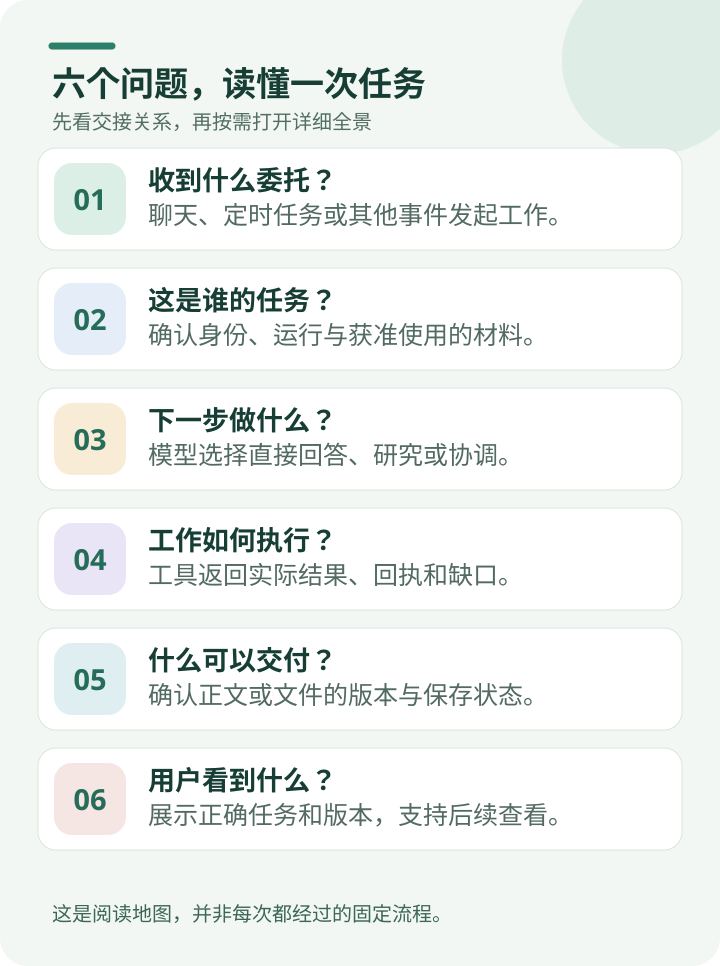
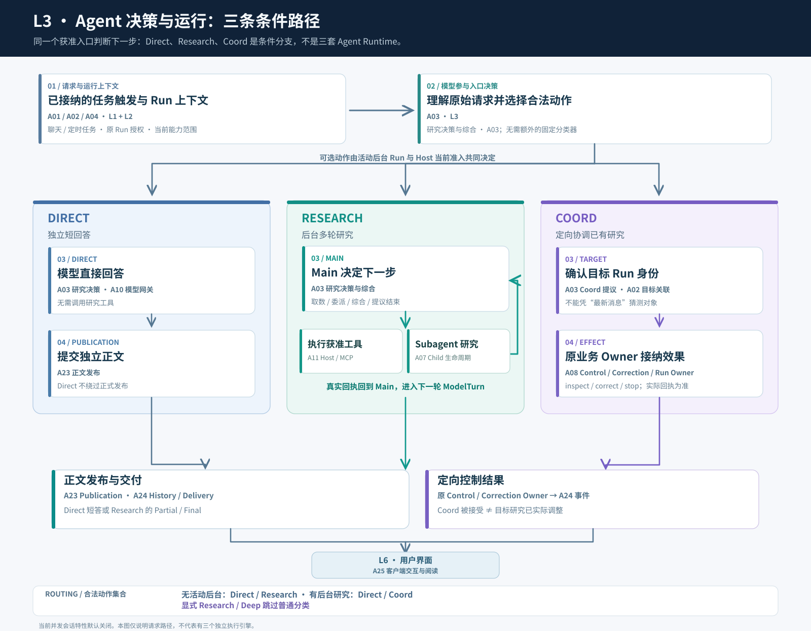
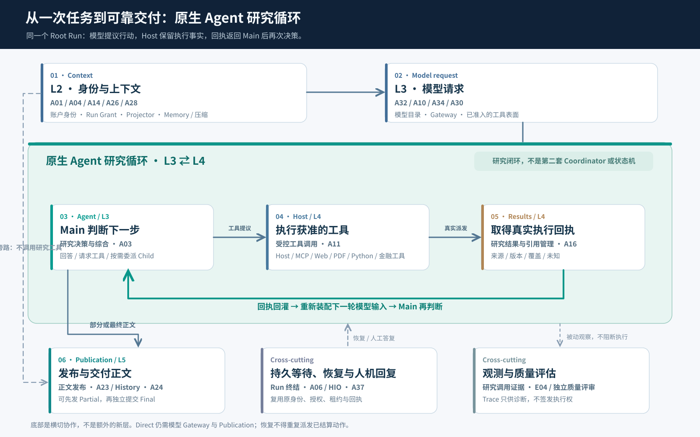

# 从一次提问到答案可见：ETF Agent 六层调用全景

<LearningPathNav />

**六层的价值，不是把模型套进一条固定流水线，而是分清每次交接：谁提出工作、谁判断下一步、谁真正执行，以及哪份结果已经交到用户手中。** 本文沿一次请求解释当前实现。六层是阅读地图，不是六个进程；跨层参与也不会改变各模块对权限、事实和效果的责任。

## 一、一次用户提问，为什么需要六个环节

下面用一个教学场景贯穿主链：用户在聊天框输入“分析我的基金组合，看看行业集中度和汇率风险”。它用于解释调用关系，不是一份投资结论或真实运行成绩。

从界面上看，只发生了一件事：发送消息，然后收到回答。从系统内部看，至少要解决六个不同问题：**工作由什么输入或事件触发；该触发归属哪个用户与 Run、允许使用什么上下文；模型准备如何处理；是否需要调用工具；哪些内容真正获准发布；用户界面如何显示或恢复它。**

读这张图，可以像追踪“输入 URL 到页面渲染”一样：**先沿请求前进，再放大有分支和回环的地方。** 普通概念问题可以直接回答，资料不足时进入研究；后台研究还在运行时，新消息又可能只是补充条件。这些情况共用底层能力，却不是同一条固定路径。

### 先不看 47 个模块：60 秒读懂六层

想象同事发来一句话：“帮我比较两份基金报告，告诉我差别，并保存下来。”从他点击发送到收到报告，可以先只记六件事：

| 日常说法 | 系统要确认的事 |
| --- | --- |
| **1. 收到委托** | 这次工作从聊天消息、定时任务，还是别的事件开始？ |
| **2. 确认谁的任务** | 这次可以使用哪些资料与工具，历史属于哪一次研究？ |
| **3. 决定下一步** | 直接解释就够了，还是要读报告、计算或补查？ |
| **4. 真正去做** | 工具有没有执行成功，拿到的是什么原始结果？ |
| **5. 保存可交付的答案** | 哪一版正文或附件已经被正式接纳、可以回读？ |
| **6. 让用户看见** | 页面显示的是正确任务、正确版本吗？断线回来还能打开吗？ |

如果第二份报告没读到，助手可以交代已经确认的部分，但不能把缺失的比较说成已完成。反过来，保存了报告也不意味着页面一定已经展示它。

**下面的大图是技术索引，不是阅读前置考试。** 第一次阅读可以先跳过 47 个模块名，只顺着这六个问题往下看；需要排查某一步时再点开对应模块。六层也不是每次请求都必须走完的固定审批流程。

<PanoramaViewer src="/eff-agent-article/visuals/017-prompt-to-answer-six-layer-panorama/diagrams/v3-owner-map-zh.svg" label="ETF Agent 六层全景：47 个可点击的 Owner 模块">

  <object class="v3-owner-map" type="image/svg+xml" data="/eff-agent-article/visuals/017-prompt-to-answer-six-layer-panorama/diagrams/v3-owner-map-zh.svg" role="img" aria-label="ETF Agent 六层全景：47 个可点击的 Owner 模块">
    <a href="https://hpoenixf.com/eff-agent-article/visuals/017-prompt-to-answer-six-layer-panorama/diagrams/v3-owner-map-zh.svg">打开 SVG 模块导航图</a>
  </object>

</PanoramaViewer>

**交互导航：** 点击主图中任意实线 Owner 标签，可直达其专文；尚无独立专文的模块会打开对应 [Owner 详情](https://hpoenixf.com/eff-agent-article/visuals/owner-architecture/index.html)。虚线流程说明不是独立模块。点击图上方的“全屏展开”，可适应屏幕、缩放或按原始尺寸滚动查看，按 Esc 或“退出全屏”返回正文；[正文模块索引](#capability-owner-links)也提供相同入口。

[打开可放大的 SVG 全景图](../visuals/017-prompt-to-answer-six-layer-panorama/diagrams/v3-owner-map-zh.svg)：9 个能力分组、47 个独立模块标签；研究工具与金融工具、身份与授权分别合列。

图中六条横带对应六个请求处理环节；每条彩色竖柱是为了阅读而聚合的一组能力。**每个实线标签代表独立 Owner 模块；浅色虚线框代表处理动作或使用说明，并在框内标明“来源：对应 Owner”。顶部的虚线列标题只是阅读分组，并非单一模块。** 纵向分组可以跨层、也可以断开，但不会因此增加授权或控制权。横向分层与纵向能力并不是彼此排斥的分类：一个 Owner 可以参与多层，但其事实归属不会因此复制。

| 环节 | 一句话 | 向下一环节交接什么 |
| --- | --- | --- |
| **L1 任务输入与触发** | 什么事情让 Agent 开始工作？ | 聊天请求、周报指令、定时 Task 或个性化研究触发意图 |
| **L2 身份、会话与上下文** | 谁的任务、是否合法、模型能拿到什么？ | 认证主体、稳定 Run 身份、原 Run Grant、获准材料与方法 |
| **L3 Agent 决策与运行** | 模型决定答、研究，还是协调已有任务？ | Direct 正文、研究动作或定向控制提议 |
| **L4 工具与领域能力** | 需要外部事实、代码执行或业务效果时，谁执行？ | 真实回执、材料、计算结果及缺口 |
| **L5 结果发布与交付** | 哪版内容被接纳、保存并送达？ | Publication 版本、SSE/History、通知或 Artifact |
| **L6 用户界面** | 用户实际看到哪次 Run 的哪版结果？ | 可阅读内容、任务状态和后续交互入口 |

这里的 L6 不是说界面只在最后出现。**发送按钮和模型选择也发生在 L6**，但 L1 不只接收聊天消息：已确认的定时 Task 也可触发 Research。随后 L2 对触发关联的身份、Run 和权限进行确定性核验。六层描述主链，不意味着每次都重新创建 Run。

## 二、L1 任务输入与触发：Agent 不一定从聊天框开始

把 L1 理解为**任务起点**，而不是 HTTP 认证层。用户点击“发送”是最常见的入口；用户主动要求生成周报、点击“今日研究”，或者已经确认的定时任务到期，都可能让同一 Agent 执行体系开始工作。L1 只回答“是谁或什么约定提出了一项工作”，不替后续模型决定研究计划，也不创建额外执行引擎。

| 输入或触发 | 当前适用能力 | L1 向后传什么 |
| --- | --- | --- |
| **聊天、明确的 Research / Deep 选择** | 客户端输入、对话消息接纳 | 原始请求和显式工作意图 |
| **主动生成周报或日报** | 用户触发的报告/每日个性研究入口 | 获选方法、用户请求、研究日期等候选上下文 |
| **定时 / 周期 / 条件任务** | 已确认的 Schedule / Task 机制 | 原 Task、Occurrence 与触发事实 |
| **关注主题（Follow）** | 已实现的关注字符串与每日研究选择器 | 用户明确选择的主题，供获准研究使用 |

**保存关注主题并不自动触发无人值守监控。** 已保存报告的定位和首页回读已有局部能力，订阅后持续生成、完整摘要和通知体验尚不能作为已交付产品来承诺。周报能生成，也不代表每一份周报都已经获准定时运行。

已确认的周期任务则有明确边界：中断后只在允许的宽限范围内接纳最近一期，不把所有错过的日期补成任务队列。是否完成研究、是否赶上约定时点、是否送出通知，分别读取原记录；时间过去本身不能补造成功。

非聊天入口与聊天入口最终复用原 Conversation/Task、Run、授权、Budget、Main/Child 和 Publication 机制。L1 的入口不同，并不产生第二套 Runtime。

## 三、L2 身份、会话与上下文：核对触发后准备任务

**[账户身份](https://hpoenixf.com/eff-agent-article/visuals/owner-architecture/index.html#owner=A01)**先核验触发归属的真实主体、会话范围和可信变更来源；定时执行使用已确认的 Task/账户身份与原始授权记录，不能绕过认证。**[对话接纳与任务接续](https://hpoenixf.com/eff-agent-article/visuals/owner-architecture/index.html#owner=A02)**再建立或复用消息与 Run，分开 Conversation 与单次执行身份。显式 Continue、普通追问、同消息重发以及已在运行的后台任务，不共享一种“继续”语义。

**[Run 授权与能力准入](/articles/011-model-understands-code-authorizes)**把来源、工具和能力范围绑定到原 Run。账户身份回答“是谁的任务”，Run 授权回答“这个 Run 具体可以做什么”，二者都在 L2 有自己的 Owner，任何一种入口都不得绕过。恢复后的同 Run 使用原获准事实，不让某次重新装配的上下文变成新的授权。

每次模型调用还需要准备材料。**[上下文投影与拟合](/articles/tool-results-outside-model-context)**组装本轮历史、已获准工具结果、来源身份与容量限制；**[长期记忆](/articles/026-agent-memory-forget-durable-effects)**提供受控的偏好或回忆；**[Main 上下文压缩](/articles/agent-main-run-context-compaction)**决定哪些已结算历史可生成摘要、采纳并恢复；**[行动提醒协调](https://hpoenixf.com/eff-agent-article/visuals/owner-architecture/index.html#owner=A15)**把资源或上下文压力转成不具有授权效果的建议。四者会相遇，但负责的事实不同。

**跨 Run 会话历史压缩**为新 Run 提供有来源的有损问答材料，保留用户原文；摘要必须对得回原问答，不能创造新的证据或权限。它与同 Run 的 Main 压缩不同，详见[A41 独立机制文](/articles/agent-conversation-history-compaction-source-boundaries)。

用户明确引用一份已提交研究时，新 Run 还可以绑定那份正文的确切版本及获准来源，而不是从整段聊天猜“上一份报告”。引用不可读或不合格，只省略对应材料，不阻断独立合法回答；旧研究也不会因此重新变成当前任务的执行状态。

方法也在这里装配：**[Skill 方法与资源](/articles/agent-skill-from-markdown-to-callable-research)**提供版本化研究方法，**[插件准入与生命周期](/articles/020-agent-extension-host-smartphone)**约束扩展包的激活和冻结版本，**[生命周期事件与 Hook 执行](/articles/agent-multi-ecosystem-hook-execution)**随后在相应生命周期点执行局部回调。Skill/Plugin 不是模型凭名称获得访问权限的捷径。

**[个人专家与组合](/articles/agent-custom-expert-from-prompt-to-recovery)**也在这里准备。用户可保存个人专家的方法与偏好；新 Run 固定当时采用的版本，Main 先看到简短目录，选中的 Child 再接收对应方法。偏好的工具和 Skill 只是建议，不增加权限；显式预加载仍受资源读取和上下文容量约束。

L2 不只发生一次。进入 Research 的下一次 ModelTurn，仍可能重新投影上下文、读取当前合格结果或触发压缩，**但不会因此重新创建 Run 或放大原授权**。

## 四、L3 Agent 决策与运行：先分支，再多轮执行

这一层是模型真正参加决策的地方。**[研究决策与综合](/articles/adaptive-research-python-workbench)**消费原问题与可见上下文，提出 Direct、Research 或 Coord；但可用分支由当前合法会话状态和资源条件决定，不能假定三种动作永远同时出现。

[放大查看 L3 条件分支图](../visuals/017-prompt-to-answer-six-layer-panorama/diagrams/v3-entry-routing-zh.svg)

### 4.1 Direct：调用模型，但跳过研究工具

“行业集中度是什么意思？”可以直接形成短回答。它仍要走**[模型目录与路由配置](https://hpoenixf.com/eff-agent-article/visuals/owner-architecture/index.html#owner=A32)**、**[模型调用与请求配置（Gateway）](/articles/agent-provider-architecture-and-admission)**和必要的 **[Provider 容量准入](/articles/agent-provider-admission-capacity-lease)**，但可以不执行 Web、PDF、Python 或金融工具。已有生产契约明确：Direct 内容也进入既有 Publication Owner，而非绕开正式发布机制。

模型选择需要看四个不同事实：客户端只能提出已配置的模型 ID；模型目录决定哪些路由与能力声明有效；本次 Gateway 绑定并发送实际配置；容量与 Run Budget 分别负责本次 Provider 资源和原 Run 的消耗。**Deep 由 Run 资源管理批准，不等于切换模型；思考强度属于具体模型请求配置，也不自动证明供应商实际采用了更深思考。**

### 4.2 Research：Main 与 Subagent 是执行主角

用户要求结合真实持仓与基金报告时，Main 在研究循环中选择下一步：取数、读资料、复算、要求 Child 探索、合成结论，或提出结束。模型决定研究方向，原运行时负责执行和结算；不需要为此再造一套 Supervisor 或通用 Workflow。

**[Child 执行生命周期](/articles/agent-subagent-context-specialization)**不是入口的小功能。Subagent 拥有自己的局部执行、重试、取消、结果身份和 Handoff；但继续共享 Root Run 的授权、资源与可靠恢复事实，不能因为独立执行就建立第二套投资账本或公共发布权。Main 消费 Child 的真实结果，负责综合和最终面向用户的正文。

Web/PDF/Python 类型的 Child 和投资视角 Child 可以共用这套执行机制；是否值得委派由 Main 按任务判断。Child 读过某份原文、Main 只看过它提交的摘要，代表不同的证据消费事实，不可混用。

Child 也不是只能照着最初任务执行。发现假设不成立时，它可以在阶段结果中修订后续任务、方法提示和协作关系说明，下一轮沿新描述继续。已发送请求、用户原文、权限和预算不会被改写；新增材料仍受原来源检查。关系说明也不会自动赋予它读取或控制另一个 Child 的能力。

**放大图：研究为什么是一个回环，而不是从 L1 到 L6 的单向流水线**

[放大阅读循环图](../visuals/017-prompt-to-answer-six-layer-panorama/diagrams/v3-native-loop-zh.svg)

主循环是 **Main 决策 → Host 执行 → 工具回执／研究结果 → 新一轮 Main 决策**。Main 可以在任何合规的研究时点委派 Child；Child 只提交本地结果和引用，Main 再决定是否补查或综合。**一次循环结束不代表整个 Run 已完成**，而在循环尚未结束时，已经成立的部分正文也可以经 Publication 独立提交。

图底部三条路径并不顺序执行：**Publication** 管内容版本，**Recovery/HIO** 区分合法等待唤醒与中断结算，**观测与评估**用独立证据解释错误。它们不能因为触及同一个 Run 就互相签发权限或重写事实。Direct 仍要调用模型 Gateway 和发布系统，只跳过研究工具。

### 4.2.1 研究如何继续、改道、等待与结束

上图放大的是**一次模型回合的决策与观察**。如果从完整任务看，还可以区分三个时间尺度；它们是同一架构的阅读视角，**不是三套嵌套的调度器**。

| 时间尺度 | 谁改变下一步 | 哪项事实不能被偷换 |
| --- | --- | --- |
| **回合内：观察驱动** | Main 看到 Host 已结算的工具结果后，决定再查、计算、委派 Child 或回答 | 工具返回成功不等于原问题已解决 |
| **同一 Run：研究判断** | Main 可以维护、修订或重新打开工作问题，发现反例时改变研究方向 | `researchNeeds` 是模型的工作笔记，不是证据覆盖、完成或发布硬门 |
| **跨时间：等待与继续** | 合法的人机/Child 等待由原控制通道唤醒；普通执行者丢失则结算中断，用户显式继续时另建关联 Run | 保存了回执，不等于可以在新进程复活旧执行图 |

例如，用户询问“我的基金行业集中度是否变化”。检索命中一篇**今天重新转载**的基金报告，其持仓截止日可能在数月前。Main 应区分转载日、披露日和数据 `as-of`，再决定补查原文、使用标明时点的历史数据，或说明无法确认变化。搜到了“最新文章”，不等于拿到了“最新持仓”。

这不是完全缺少时间基础能力。当前 **[A36 时间语义](/articles/agent-temporal-semantics-market-calendar)**已区分当前 UTC、不可变任务锚点和用户本地日期；时区按本次请求、账户偏好、设备提示依次取有效值，无可信来源就保留未知。账户保存和重启后的原请求重放已有真实持久化验证。美股日历也已有针对 **2026 年 Nasdaq 常规时段**的官方年历读取和有界解释：可以区分常规开闭市、休市和提前收盘，但**年历不证明市场实际开盘，也不覆盖临时紧急变更，更不代表行情数据已经更新**。普通真实模型研究实际消费日历的端到端验收仍未完成，不能把这套机制写成全自动时间判断已经可靠。

结束也是两个判断：**Main** 负责回答是否足够、需要哪些反证及不确定性解释；**CompletionGate/Publication** 处理合法的完成、资源耗尽、部分正文及实际发布。Run 终态不认证金融分析质量，`resolved` 也不等于任务已完成。Child、Reviewer 和多空视角可以在需要时参与，但不是每项研究都必经的外围循环。

研究循环怎样让观察改变下一步，另见[投研 Agent 的关键不是多调用工具：Model、Harness 与 Loop](/articles/etf-agent-model-harness-research-loop)。

### 4.3 Coord：协调原 Run，不是第三套 Agent

当同一个 Conversation 已有后台 Research，用户说“给刚才那项研究补上汇率因素”，普通新消息可以走 Coord。它必须关联合法的目标 Run，提出 `inspect`、`correct` 或 `stop` 等有界动作，再由原 **[持久控制事件](/articles/agent-control-events-durable-owner-adoption)**、Correction、Continue 或终结 Owner 接纳真正的效果。模糊目标只澄清，不靠最新消息猜对象。

当前默认容量配置下，**没有活动后台 Research 时普通 Entry 可选 Direct/Research；有活动后台 Research 时普通 Entry 可选 Direct/Coord**。这只是经准入的动作集合，而不是先按 `hasBackground` 做一轮固定分类。显式 Research/Deep 可跳过普通分类，但仍受后台容量、Scope 总额、Provider 租约和原预算约束。

Coord 消耗短交互资格；它可以独立回答问题，也可能请求调整原研究。**一个 Coord 消息接受了，不等于原 Research 已完成纠偏。** 只有目标 Owner 的实际回执能说明效果。

## 五、L4 工具与领域能力：把模型的“去查”变成可核对的回执

模型提出一次工具动作，并不说明外部执行已经发生。**[模型能力呈现与工具表面](/articles/agent-model-capability-presentation-tool-surface)**确认模型真正看到的可用工具与 Host 当次获准执行面一致；**[受控工具调用](/articles/agent-tool-lifecycle-and-model-input)**核对参数、执行、结算并留存回执；**[MCP 服务接入](/articles/mcp-host-from-discovery-to-consumption)**负责远端连接、目录与协议通信。它们的权限、发送与结果职责不能互相替代。

读研究资料时，可复用 **[Web 研究读取](/articles/021-agent-web-research-from-search-to-deep-reading)、[PDF 文档读取](/articles/024-agent-pdf-from-text-to-evidence)、[知识检索](https://hpoenixf.com/eff-agent-article/visuals/owner-architecture/index.html#owner=A20)、[研究资料资产](https://hpoenixf.com/eff-agent-article/visuals/owner-architecture/index.html#owner=A17)、[隔离分析](/articles/agent-python-compute-workbench-evolution)**。基金相关的数据与计算则通过“金融工具”族提供：市场证据采集、投资事实读取、确定性投资计算、投资账本与确认、原子报告生产。财务或时间敏感任务还会使用时间语义与市场 Session 解释，必要时使用精确数值运算。

因此，不应把“证据与计算”当作每次请求的必经关卡。它们是**L4 里可选、可组合的研究与领域工具能力**。普通 Direct 完全可以跳过；复杂投研可以反复取数、重读和计算。

但有两条责任不能隐藏：第一，**[研究结果与引用管理](/articles/tool-results-outside-model-context)**保留 ResultRef、版本和来源/派生谱系，不能因为模型改写摘要就把新断言变成原始事实；第二，**[投资账本与确认](https://hpoenixf.com/eff-agent-article/visuals/owner-architecture/index.html#owner=B04)**的真实写入仍由业务 Owner 和用户确认要求控制，不能把模型建议当成已获批准的交易效果。

### 5.1 四个容易混淆的交接

工具链中经常出现“上一环节成功，却被当作下一环节也成功”的误判。以基金资料研究为例：

| 交接 | 已经成立的事实 | 还不能据此认为 | 主要负责模块 |
| --- | --- | --- | --- |
| **模型 → Gateway** | 模型请求返回了正文或工具提议；完整性按真实协议检查 | 半截工具参数也能执行，或供应商内部思考强度已生效 | 模型调用与请求配置 |
| **工具目录 → Host** | MCP 能发现并描述工具，本次 Host 仍须核对参数与 Run Grant | 工具在目录中就是用户已经获准调用 | MCP 服务接入、受控工具调用、Run 授权 |
| **检索命中 → 阅读原文** | RAG 找到带来源的候选片段，或 PDF 定位到页码 | 已核对完整报告、适用条件或所有缺失页段 | 知识检索、研究资料资产、PDF 文档读取 |
| **执行回执 → 下一轮模型** | Python 或外部工具的真实结果带着身份、版本与来源可被消费 | 脚本成功就证明金融公式适用，或者 Child 摘要等同 Main 亲读原文 | 研究结果与引用管理、上下文投影与拟合 |

这里还有一个细小但重要的扩展约束：**调用后 Hook 允许收窄模型可见投影，但不能把保留下来的原始数值、来源和路径悄悄换成另一套事实**。Hook 的局部失败也不自动拥有整个 Run 的终结权。

当数据时点、覆盖率或金融口径不足时，正确结果可以是 Partial 或 Unknown。模型负责分析和解释缺口，确定性金融计算负责领域公式，Numeric 只执行合同规定的数值运算；三者并不互相认证。

## 六、L5 结果发布与交付：生成了内容，还不代表已经交给用户

**[正文发布与内容准备](/articles/019-agent-answer-publication)**负责候选正文、预览、版本修订、提交及其回执。Direct、Research 的部分结果与最终结果都要尊重它的内容处置权。**[私有产物保存、访问与分享](/articles/agent-html-evolution-challenges)**另管 HTML、图表等 Artifact 的字节身份和下载许可；**[会话事件与历史交付](/articles/agent-asynchronous-research-time-bound-delivery)**负责 SSE、顺序、History 重放和后台通知。

同一段文字可能经历不同事实：模型生成了正文、Publication 接纳了预览、数据库提交了修订、服务端推送了事件、客户端最终绘制了它。它们不是一个 `completed`。合法的部分正文可以先发布；后续工具失败不能把此前已提交的正文自动清空。

后台研究尤其需要这些区分。Research 可以不占住当前聊天输入，在另一个 Run 中持续执行、阶段性发布、到约定时点报告真实进度，最后提交 Final。`at` 和 `by` 的时间承诺、Research 完成时刻与消息通知时刻是不同事实；通知不会为了重发而重新跑一次研究。

### 6.1 一次“继续”，要先分清哪种情况

| 用户看到的情形 | 系统应该怎样处理 | 不允许偷换成什么 |
| --- | --- | --- |
| **Research 仍在后台运行** | 原 Run 继续工作，按需发布 Partial 或最终正文；新的短问有独立 Run | 一条新消息自动取消旧研究，或复用同一个全局 `busy` |
| **Run 因人机或 Child 交接而合法停放** | 经原控制通道接纳的唤醒恢复有限的当前格式状态，保留原预算、授权和回执 | 把任意进程重启都解释成合法唤醒，或刷新截止时间获得新额度 |
| **普通研究失去原执行者** | 原 Owner 核验租约与 fence 后结算中断，保留并回读已提交正文 | 在新进程自动重建旧执行图，再派发旧模型或工具请求 |
| **原 Run 已经终态，用户显式要求继续** | Conversation/Continue 建立有来源关联的新 Run，依法继承可继承的上下文与授权 | 把新一轮研究伪装成原 Run 从未结束 |

这也解释了为什么 **Run 结束、正文已提交、用户被通知、浏览器已经显示** 必须分成不同事实。观测应回到它们各自的真实回执，而不是依赖一条 `completed` 或最后一个 Trace Span。

## 七、L6 用户界面：交付对象必须能对回原 Run

**[客户端交互与阅读](https://hpoenixf.com/eff-agent-article/visuals/owner-architecture/index.html#owner=A25)**负责输入、消息时间线、Markdown 和引用卡片、研究面板、SSE 消费、历史重放，以及中途插话后的多个 Run 展示。

它不应该靠数组最后一条消息或一个全局 `busy` 决定所有消息归属。后台 Research A 尚未完成时，用户可以发起 Direct B；B 可以先完成，而 A 的阶段性结果和 Final 仍显示在 A 的研究视图下。History 快照也必须按照 Run 与 Publication revision 做有序还原，不把旧内容覆盖为新结果。

浏览器显示 `answer-preview` 不等于内容已经耐久保存；服务端说“事件已发送”也不等于浏览器完成绘制，更不等于用户真正阅读。L5 负责可交付的事实，L6 负责客户端实际呈现，两者分开是必要的。

界面也能把“选了谁”和“谁真的参与”分开：用户可搜索内置与个人专家，精确选择一位，或应用可编辑的多专家组合建议。协作区展示真正参与的 Child、公开 Peer 交流和受管 Reviewer 贡献，刷新后仍对应原 Run 与专家版本。选择不等于已调用，组合不是强制全员执行的工作流。

并非所有阅读都要重新研究。获准的组合首页可直接显示原报告的可配置组合总额、资产分组、估算与数据缺口，以及同份报告中的已确认策略版本；打开页面不会启动模型或投资写入。报告时点和未知状态必须保留，页面不能把旧快照包装成实时账户，也不能把策略展示说成新的投资批准。

## 八、用三次用户输入，走一遍交互分支

用户先说：“分析我的基金组合行业集中度，给出来源。”并显式开启后台研究。L1 形成任务输入，L2 认证并建立 Research A 和合法 grant；L3 Main 决定研究策略，可能委派 PDF Child 核对报告或 Python Child 做数据转换；L4 返回工具真实回执与来源；L5 可以先发布部分材料，再发布最终报告；L6 用 A 的身份显示研究卡片。

随后用户问：“行业集中度为什么重要？”新的短交互 B 可以由 L3 走 Direct，**不等待 A 结束，也不读取 A 未获准公开的内部状态**；短回答经过 Publication/History 到前端。

再随后用户说：“给刚才的 A 加上汇率风险。”新的短交互 C 经 L3 判断为 Coord，仅向明确的目标 Run 提出纠偏；原控制 Owner 接纳后，A 在合法安全点消费它，继续已有预算和恢复身份。C 不自己生成第二份金融分析账本。若 A 此时已结束，Coord 不能装作成功注入，用户可以再选择显式 Continue 建立关联的新 Run。

这套后台研究、短问、原目标纠偏与分开回读的路径，已有包含真实模型、持久 History 和浏览器的限定场景验证；但并发会话配置仍**默认关闭**。默认短交互/后台容量为 3/1，同时受 Scope 总额、交互实例容量和 Provider 容量约束。实例限制不是集群总限额，独立定时 worker 与控制唤醒另有各自的容量约束；这些局部验证也不等于生产部署或金融分析质量已经通过。

## 九、纵向能力柱为什么允许跨层，甚至断裂

六层是“什么时候需要完成什么交接”，Owner 是“谁对这项事实负责”。两种视角不是强制一一对应。

**账户身份**与 **Run 授权与能力准入**主要在 L2，但 L4 的 Host 执行和 L5 的来源相关处置都要消费原授权。**长期记忆、上下文投影、Main 上下文压缩**主要归 L2，却会在 L3 的下一次模型请求中再次出现。**模型目录与路由配置**、**[模型调用与请求配置](/articles/agent-provider-architecture-and-admission)**主要服务 L3，但模型选择从 L6 发起并经 L1/L2 验证或绑定。

**Child 执行生命周期**在 L3 形成核心协作，在 L4 触达真实工具；**研究结果与引用管理**贯穿工具结果与发布消费。**发布与交付**主要在 L5，用户界面通过 L6 消费其合法版本。它们可以在图中形成连续或断裂的纵向柱子，不要求调用总是沿着柱子上下执行。

跨层显示不能制造新的权限：一根柱子覆盖几层，仍然只有原来的 Owner 能接纳、拒绝和结算自己负责的效果。纵向聚合只是为了让读者先理解系统，而不是新设一个父级模块。

## 十、Recovery、治理、观测为什么没有第七、第八层

**Recovery 首先保住事实，不承诺复活任意执行。** 浏览器重连只等待或重放已有结果；普通 Root 失去原执行者时，系统核验租约与 fence，按已保存正文结算为中断后的部分结果或失败，不在新进程自动重建旧执行图。已提交回执、用量和未知外部效果继续保留。只有经原控制通道接纳的人机/Child 唤醒，才使用保留下来的有限当前格式状态；用户显式继续则建立关联的新 Run，复用合格材料而不是旧执行权限。各项效果仍由原控制、资源、授权、Child、发布和历史 Owner 负责。

**Authorization、Run Budget、Provider Capacity、内容信任、HIO**分别在多个环节提供约束或交接，而不是集中到一个“安全层”。HIO 已实现请求、认证回复及向原消费者的交接，生产 Human Park 仍默认关闭；“模型发问—用户答复”也不自动等于来源获准或业务效果已批准。

**研究调用证据留存与回读、Langfuse 和质量评估**属于跨层观测与离线反馈。Trace 可以帮助定位哪次模型请求没看到工具结果，评估可以复核真实发布的答案是否符合原题；它们不承担发布、授权、终结或业务真值的决定权。请求成功、工具返回、正文提交和金融结论正确，也不应合并为一个成功率。

## 十一、这张图能回答什么，不能回答什么

这张六层图能在一分钟内告诉读者：用户问题进入哪几个阶段；Direct 为什么能跳过研究工具；Main 与 Subagent 为什么是核心；模型选择、Gateway、Memory、压缩、授权、工具、发布、前端分别出现在哪里；后台研究为何可以持续运行而前台继续回答。

它**不能代替**完整 Owner 图谱、源码调用关系、部署拓扑、精确的执行时序或线上质量报告。为保持可读性，主图将相近能力放进纵向能力柱，将五项 B 类金融模块与研究工具放在同一列，同时保留每个模块自己的实线标签；完整名字与编号由权威清单索引，实际授权与事实不因视觉聚合改变。

设计和排查时，先问三件事：**模型此刻拿到了什么，哪个 Owner 真实接纳了效果，用户能回读哪份结果。** 这比沿六层各找一个“成功”更有用：工具成功不证明研究充分，进程重启不授予旧执行权，正文生成也不等于交付完成。

---

## 附录：能力 Owner 与六层的主归属索引 {#capability-owner-links}

> 正文与主图使用模块名称；编号便于定位 [模块详情](https://hpoenixf.com/eff-agent-article/visuals/owner-architecture/index.html)。下表的“主层”不表示只在该层运行。

### L1 · 任务输入与触发

| 编号 | 模块名称 | 跨层参与 |
| --- | --- | --- |
| A09 | [定时任务](/articles/agent-autonomous-scheduled-research) · [Owner 详情](https://hpoenixf.com/eff-agent-article/visuals/owner-architecture/index.html#owner=A09) | L2、L3、L5 |
| A27 | [每日个性研究](https://hpoenixf.com/eff-agent-article/visuals/owner-architecture/index.html#owner=A27) | L2、L3、L5 |

### L2 · 身份、会话与上下文

| 编号 | 模块名称 | 跨层参与 |
| --- | --- | --- |
| A01 | [账户身份](https://hpoenixf.com/eff-agent-article/visuals/owner-architecture/index.html#owner=A01) · [相关文章](/articles/011-model-understands-code-authorizes) | L1、L4 |
| A02 | [对话接纳与任务接续](https://hpoenixf.com/eff-agent-article/visuals/owner-architecture/index.html#owner=A02) · [相关文章](/articles/agent-veto-authority-and-run-termination) | L1、L5、L6 |
| A04 | [Run 授权与能力准入](/articles/011-model-understands-code-authorizes) · [Owner 详情](https://hpoenixf.com/eff-agent-article/visuals/owner-architecture/index.html#owner=A04) | L1、L3、L4、L5 |
| A08 | [持久控制事件](/articles/agent-control-events-durable-owner-adoption) · [Owner 详情](https://hpoenixf.com/eff-agent-article/visuals/owner-architecture/index.html#owner=A08) | L3、L5 |
| A12 | [Skill 方法与资源](/articles/agent-skill-from-markdown-to-callable-research) · [相关文章](/articles/agent-model-runtime-mcp-skill-boundaries) | L3、L4 |
| A13 | [插件准入与生命周期](/articles/020-agent-extension-host-smartphone) · [Owner 详情](https://hpoenixf.com/eff-agent-article/visuals/owner-architecture/index.html#owner=A13) | L3、L4 |
| A14 | [上下文投影与拟合](/articles/tool-results-outside-model-context) · [Owner 详情](https://hpoenixf.com/eff-agent-article/visuals/owner-architecture/index.html#owner=A14) | L3 |
| A15 | [行动提醒协调](https://hpoenixf.com/eff-agent-article/visuals/owner-architecture/index.html#owner=A15) · [专题文章](/articles/agent-action-reminder-coordination) | L3 |
| A26 | [长期记忆](/articles/026-agent-memory-forget-durable-effects) · [Owner 详情](https://hpoenixf.com/eff-agent-article/visuals/owner-architecture/index.html#owner=A26) | L3、L4 |
| A28 | [Main 上下文压缩](/articles/agent-main-run-context-compaction) · [Owner 详情](https://hpoenixf.com/eff-agent-article/visuals/owner-architecture/index.html#owner=A28) | L3 |
| A41 | [跨 Run 会话历史压缩](/articles/agent-conversation-history-compaction-source-boundaries) · [Owner 详情](https://hpoenixf.com/eff-agent-article/visuals/owner-architecture/index.html#owner=A41) | L3 |
| A35 | [内容安全策略与信任](/articles/agent-content-trust-prompt-injection) · [Owner 详情](https://hpoenixf.com/eff-agent-article/visuals/owner-architecture/index.html#owner=A35) | L3、L4 |
| A37 | [持久人机交互（HIO）](/articles/agent-durable-human-interaction-response-adoption) · [Owner 详情](https://hpoenixf.com/eff-agent-article/visuals/owner-architecture/index.html#owner=A37) | L3、L5、L6 |
| A39 | [用户专家配置与组合](/articles/agent-custom-expert-from-prompt-to-recovery) | L3、L4 |
| A38 | [个人 Credits 账户与用量归属](/articles/agent-personal-credits-shadow-accounting) | L3、L6 |

### L3 · Agent 决策与运行

| 编号 | 模块名称 | 跨层参与 |
| --- | --- | --- |
| A03 | [研究决策与综合](/articles/adaptive-research-python-workbench) · [Owner 详情](https://hpoenixf.com/eff-agent-article/visuals/owner-architecture/index.html#owner=A03) | L2、L4、L5 |
| A05 | [Run 资源管理（含 Deep）](/articles/agent-runtime-constraint-governance-v2) · [Owner 详情](https://hpoenixf.com/eff-agent-article/visuals/owner-architecture/index.html#owner=A05) | L2、L4、L5 |
| A06 | [Run 继续与终结](/articles/agent-veto-authority-and-run-termination) · [Owner 详情](https://hpoenixf.com/eff-agent-article/visuals/owner-architecture/index.html#owner=A06) | L2、L5 |
| A07 | [Child 执行生命周期](/articles/agent-subagent-context-specialization) · [Owner 详情](https://hpoenixf.com/eff-agent-article/visuals/owner-architecture/index.html#owner=A07) | L2、L4 |
| A10 | [模型调用与请求配置](/articles/agent-provider-architecture-and-admission) · [Owner 详情](https://hpoenixf.com/eff-agent-article/visuals/owner-architecture/index.html#owner=A10) | L2 |
| A29 | [生命周期事件与 Hook 执行](/articles/agent-multi-ecosystem-hook-execution) · [Owner 详情](https://hpoenixf.com/eff-agent-article/visuals/owner-architecture/index.html#owner=A29) | L2、L4 |
| A30 | [Provider 容量准入](/articles/agent-provider-admission-capacity-lease) · [Owner 详情](https://hpoenixf.com/eff-agent-article/visuals/owner-architecture/index.html#owner=A30) | L2 |
| A32 | [模型目录与路由配置](https://hpoenixf.com/eff-agent-article/visuals/owner-architecture/index.html#owner=A32) · [相关文章](/articles/agent-provider-architecture-and-admission) | L1、L2 |
| A34 | [模型能力呈现与工具表面](/articles/agent-model-capability-presentation-tool-surface) · [Owner 详情](https://hpoenixf.com/eff-agent-article/visuals/owner-architecture/index.html#owner=A34) | L2、L4 |
| E04 | [研究调用证据留存与回读](/articles/agent-research-evidence-store-lifecycle) · [相关文章](/articles/agent-tool-lifecycle-and-model-input) | L4、L5 |

### L4 · 工具与领域能力

| 编号 | 模块名称 | 跨层参与 |
| --- | --- | --- |
| A11 | [受控工具调用](/articles/agent-tool-lifecycle-and-model-input) · [Owner 详情](https://hpoenixf.com/eff-agent-article/visuals/owner-architecture/index.html#owner=A11) | L2、L3 |
| A16 | [研究结果与引用管理](/articles/tool-results-outside-model-context) · [Owner 详情](https://hpoenixf.com/eff-agent-article/visuals/owner-architecture/index.html#owner=A16) | L3、L5 |
| A17 | [研究资料资产](/articles/agent-research-assets-identity-version-lifecycle) · [相关文章](/articles/024-agent-pdf-from-text-to-evidence) | L2 |
| A18 | [Web 研究读取](/articles/021-agent-web-research-from-search-to-deep-reading) · [Owner 详情](https://hpoenixf.com/eff-agent-article/visuals/owner-architecture/index.html#owner=A18) | L3 |
| A19 | [PDF 文档读取](/articles/024-agent-pdf-from-text-to-evidence) · [Owner 详情](https://hpoenixf.com/eff-agent-article/visuals/owner-architecture/index.html#owner=A19) | L3 |
| A20 | [知识检索](https://hpoenixf.com/eff-agent-article/visuals/owner-architecture/index.html#owner=A20) · [相关文章](/articles/027-rag-revocation-publish-replay) | L3 |
| A21 | [隔离分析](/articles/agent-python-compute-workbench-evolution) · [Owner 详情](https://hpoenixf.com/eff-agent-article/visuals/owner-architecture/index.html#owner=A21) | L3、L5 |
| A31 | [MCP 服务接入](/articles/mcp-host-from-discovery-to-consumption) · [Owner 详情](https://hpoenixf.com/eff-agent-article/visuals/owner-architecture/index.html#owner=A31) | L2、L3 |
| A33 | [精确数值运算](/articles/agent-numeric-kernel-exact-units-rounding) · [相关文章](/articles/031-fintech-data-time-and-reproducible-numbers) | L3 |
| A36 | [时间语义与市场 Session 解释](/articles/agent-temporal-semantics-market-calendar) · [Owner 详情](https://hpoenixf.com/eff-agent-article/visuals/owner-architecture/index.html#owner=A36) | L2、L3 |
| B01 | [市场证据采集](/articles/mcp-market-responsibility-retrospective) · [Owner 详情](https://hpoenixf.com/eff-agent-article/visuals/owner-architecture/index.html#owner=B01) | L3 |
| B02 | [投资事实读取](/articles/portfolio-mcp-readonly-investment-data) · [Owner 详情](https://hpoenixf.com/eff-agent-article/visuals/owner-architecture/index.html#owner=B02) | L3 |
| B03 | [确定性投资计算](https://hpoenixf.com/eff-agent-article/visuals/owner-architecture/index.html#owner=B03) · [相关文章](/articles/031-fintech-data-time-and-reproducible-numbers) | L3 |
| B04 | [投资账本与确认](https://hpoenixf.com/eff-agent-article/visuals/owner-architecture/index.html#owner=B04) · [相关文章](/articles/030-fintech-from-research-to-investment-advice) | L6 |
| B05 | [原子报告生产](https://hpoenixf.com/eff-agent-article/visuals/owner-architecture/index.html#owner=B05) · [相关文章](/articles/portfolio-mcp-readonly-investment-data) | L3、L5 |

### L5 · 结果发布与交付

| 编号 | 模块名称 | 跨层参与 |
| --- | --- | --- |
| A22 | [私有产物保存、访问与分享](/articles/agent-html-evolution-challenges) · [Owner 详情](https://hpoenixf.com/eff-agent-article/visuals/owner-architecture/index.html#owner=A22) | L4、L6 |
| A23 | [正文发布与内容准备](/articles/019-agent-answer-publication) · [Owner 详情](https://hpoenixf.com/eff-agent-article/visuals/owner-architecture/index.html#owner=A23) | L3、L4、L6 |
| A24 | [会话事件与历史交付](/articles/agent-asynchronous-research-time-bound-delivery) · [Owner 详情](https://hpoenixf.com/eff-agent-article/visuals/owner-architecture/index.html#owner=A24) | L2、L6 |
| A40 | [用户回答反馈事实](/articles/agent-feedback-facts-not-automatic-learning) · [Owner 详情](https://hpoenixf.com/eff-agent-article/visuals/owner-architecture/index.html#owner=A40) | L2、L6 |

### L6 · 用户界面

| 编号 | 模块名称 | 跨层参与 |
| --- | --- | --- |
| A25 | [客户端交互与阅读](https://hpoenixf.com/eff-agent-article/visuals/owner-architecture/index.html#owner=A25) · [相关文章](/articles/agent-progressive-answer-coherence) | L1、L2、L5 |

工程导航 E01–E03 不计入上述 47 个生产能力 Owner。各模块是否已实施、限定验证、生产启用，仍以自身 Spec 与验收记录为准。

**贯穿全景的两条判断：** [模型负责语义、系统负责执行事实](/principles#principle-1)用来区分模型的研究提议与 Host 的授权和回执；[用户实际收到的结果才是任务终点](/principles#principle-8)要求把模型生成、正文提交和浏览器可见交付分别核验。六层是读懂交接的地图，而不是任何一层的自我成功声明。

[Owner 图册](https://hpoenixf.com/eff-agent-article/gallery) · [技术文章仓库（欢迎 Star）](https://github.com/hpoenixf/eff-agent-article)
