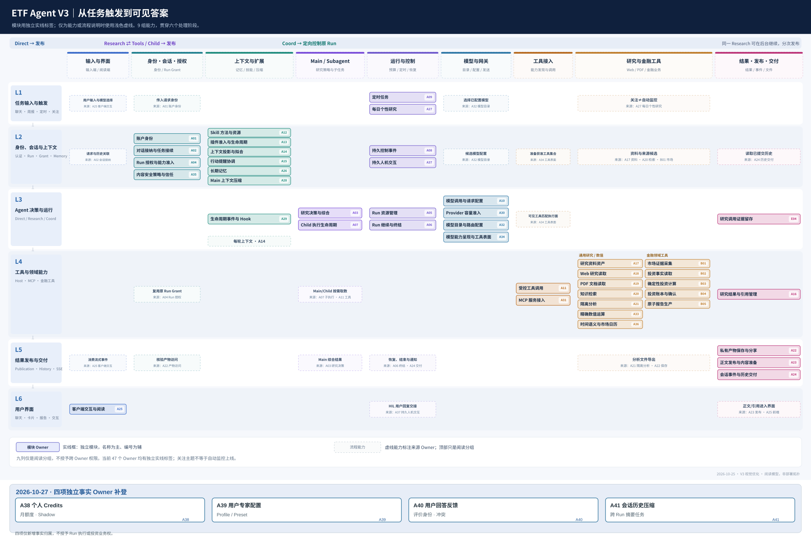
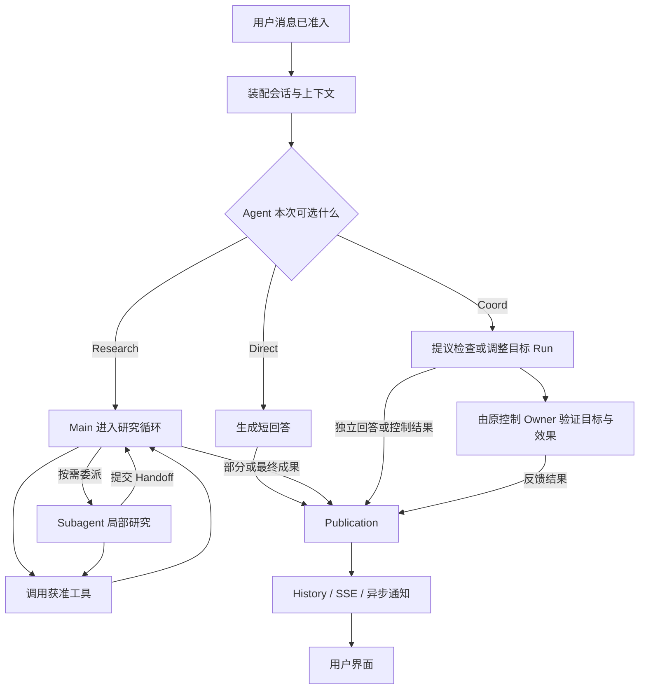

# 从一次提问到答案可见：ETF Agent 六层调用全景 · V3

> **架构阅读版本：2026-10-25。** 本文依据 `etf-agent` 的六层 V2、2026-10-24 的 43 项能力 Owner 清单及当前 `main` 中的 Native Runtime、并发会话与交付契约重写。它是一张**用户请求的阅读地图**，不是六个物理进程、严格单向调用栈，也不改变任何 Owner 的授权和事实归属。受控验证、真实模型质量和生产默认启用分别判断。
>
> **版本保留：** [V2：从一次提问到持续协作](https://hpoenixf.github.io/eff-agent-article/articles/017-prompt-to-answer-six-layer-panorama) · [V1：一句“帮我看看组合”](https://hpoenixf.github.io/eff-agent-article/articles/017-prompt-to-answer-six-layer-panorama-v1) · [原版图文存档](https://hpoenixf.github.io/eff-agent-article/visuals/017-prompt-to-answer-six-layer-panorama/v1.html)

## 一、一次用户提问，为什么需要六个环节

用户在聊天框输入：“分析我的基金组合，看看行业集中度和汇率风险。”

从界面上看，只发生了一件事：发送消息，然后收到回答。从系统内部看，至少要解决六个不同问题：**请求是谁发的；它关联哪个 Run、带着什么上下文；模型准备如何处理；是否需要调用工具；哪些内容真正获准发布；用户界面如何显示或恢复它。**

早期的六层文章按架构能力罗列模块，后来新增的后台 Research、Coord、Subagent、HIO、模型路由和异步交付很难放入原来的顺序，Subagent 甚至被挤成入口层的一小节。V3 改用“输入 URL 到页面渲染”式的讲法：**沿一次请求前进，再对有分支和回环的地方局部放大。**

图中六条横带对应六个请求处理环节；每条彩色竖柱是为了阅读而聚合的一组能力。**深色表示该组内某个模块的主要职责，浅色表示参与，断开说明该环节不直接承担这组责任。格子里写的是能力名称，而不是需要先背下来的编号。** 横向分层与纵向能力并不是彼此排斥的分类：一个 Owner 可以参与多层，但其事实归属不会因此复制。

| 环节 | 一句话 | 向下一环节交接什么 |
| --- | --- | --- |
| **L1 请求接入** | 这次请求是否合法？ | 已验证的主体、请求与 Scope |
| **L2 会话与上下文** | 这是哪个任务，模型应拿到什么？ | 稳定 Run 身份、获准材料与方法 |
| **L3 Agent 决策与运行** | 模型决定答、研究，还是协调已有任务？ | Direct 正文、研究动作或定向控制提议 |
| **L4 工具与领域能力** | 需要外部事实、代码执行或业务效果时，谁执行？ | 真实回执、材料、计算结果及缺口 |
| **L5 结果发布与交付** | 哪版内容被接纳、保存并送达？ | Publication 版本、SSE/History、通知或 Artifact |
| **L6 用户界面** | 用户实际看到哪次 Run 的哪版结果？ | 可阅读内容、任务状态和后续交互入口 |

这里的 L6 不是说界面只在最后出现。**发送按钮和模型选择也发生在 L6**，随后请求进入 L1；六层图描述的是服务端处理到浏览器呈现的主链，而不是所有事件的唯一发生顺序。

## 二、L1 请求接入：认证成功，不等于研究已经开始

输入从客户端经 HTTP 到达 API。**账户身份**核对请求主体、会话范围和可信请求来源；不合法的身份在这里拒绝，不交给模型推测。浏览器的 `clientMessageId`、可选模型 ID 或用户写出的“我有权限”都不能独立签发权限。

请求接入只完成确定性的接纳准备，不应该在这一层让模型判断 Direct 或 Research。发送失败、重复消息、冲突消息也是不同情况：同身份重试不能自动建一个新 Run，更不能因为浏览器没收到响应就重复执行收费或有副作用的工作。

## 三、L2 会话与上下文：把用户的一句话变成有身份的任务

**对话接纳与任务接续**建立或复用消息与 Run，分开 Conversation 与单次执行身份。显式 Continue、普通追问、同消息重发以及已在运行的后台任务，不共享一种“继续”语义。

**Run 授权与能力准入**把来源、工具和能力范围绑定到原 Run。它不同于 L1 的账户认证：前者回答“这个 Run 具体可以做什么”，后者回答“请求由谁发出”。恢复后的同 Run 使用原获准事实，不让某次重新装配的上下文变成新的授权。

每次模型调用还需要准备材料。**上下文投影与拟合**组装本轮历史、已获准工具结果、来源身份与容量限制；**长期记忆**提供受控的偏好或回忆；**Main 上下文压缩**决定哪些已结算历史可生成摘要、采纳并恢复；**行动提醒协调**把资源或上下文压力转成不具有授权效果的建议。四者会相遇，但负责的事实不同。

方法也在这里装配：**Skill 方法与资源**提供版本化研究方法，**插件准入与生命周期**约束扩展包的激活和冻结版本，**生命周期事件与 Hook 执行**随后在相应生命周期点执行局部回调。Skill/Plugin 不是模型凭名称获得访问权限的捷径。

L2 不只发生一次。进入 Research 的下一次 ModelTurn，仍可能重新投影上下文、读取当前合格结果或触发压缩，**但不会因此重新创建 Run 或放大原授权**。

## 四、L3 Agent 决策与运行：先分支，再多轮执行

这一层是模型真正参加决策的地方。**研究决策与综合**消费原问题与可见上下文，提出 Direct、Research 或 Coord；但可用分支由当前合法会话状态和资源条件决定，不能假定三种动作永远同时出现。

### 4.1 Direct：调用模型，但跳过研究工具

“行业集中度是什么意思？”可以直接形成短回答。它仍要走**模型目录与路由配置**、**模型调用与请求配置（Gateway）**和必要的 **Provider 容量准入**，但可以不执行 Web、PDF、Python 或金融工具。已有生产契约明确：Direct 内容也进入既有 Publication Owner，而非绕开正式发布机制。

模型选择需要看四个不同事实：客户端只能提出已配置的模型 ID；模型目录决定哪些路由与能力声明有效；本次 Gateway 绑定并发送实际配置；容量与 Run Budget 分别负责本次 Provider 资源和原 Run 的消耗。**Deep 由 Run 资源管理批准，不等于切换模型；思考强度属于具体模型请求配置，也不自动证明供应商实际采用了更深思考。**

### 4.2 Research：Main 与 Subagent 是执行主角

用户要求结合真实持仓与基金报告时，Main 在 Native Loop 中选择下一步：取数、读资料、复算、要求 Child 探索、合成结论，或提出结束。循环的底层执行语义仍由已有 `AgentTurn → ActionRuntime → CompletionGate` 承担，不需要新造一套 Supervisor 或通用 Workflow。

**Child 执行生命周期**不是入口的小功能。Subagent 拥有自己的局部执行、重试、取消、结果身份和 Handoff；但继续共享 Root Run 的授权、资源与可靠恢复事实，不能因为独立执行就建立第二套投资账本或公共发布权。Main 消费 Child 的真实结果，负责综合和最终面向用户的正文。

Web/PDF/Python 类型的 Child 和投资视角 Child 可以共用这套执行机制；是否值得委派由 Main 按任务判断。Child 读过某份原文、Main 只看过它提交的摘要，代表不同的证据消费事实，不可混用。

### 4.3 Coord：协调原 Run，不是第三套 Agent

当同一个 Conversation 已有后台 Research，用户说“给刚才那项研究补上汇率因素”，普通新消息可以走 Coord。它必须关联合法的目标 Run，提出 `inspect`、`correct` 或 `stop` 等有界动作，再由原 **持久控制事件**、Correction、Continue 或终结 Owner 接纳真正的效果。模糊目标只澄清，不靠最新消息猜对象。

当前初始并发配置下，**没有活动后台 Research 时普通 Entry 可选 Direct/Research；有活动后台 Research 时普通 Entry 可选 Direct/Coord**。这只是经准入的动作集合，而不是先按 `hasBackground` 做一轮固定分类。显式 Research/Deep 可跳过普通分类，但仍受后台容量、Scope 总额、Provider 租约和原预算约束。

Coord 消耗短交互资格；它可以独立回答问题，也可能请求调整原研究。**一个 Coord 消息接受了，不等于原 Research 已完成纠偏。** 只有目标 Owner 的实际回执能说明效果。

## 五、L4 工具与领域能力：把模型的“去查”变成可核对的回执

模型提出一次工具动作，并不说明外部执行已经发生。**模型能力呈现与工具表面**确认模型真正看到的可用工具与 Host 当次获准执行面一致；**受控工具调用**核对参数、执行、结算并留存回执；**MCP 服务接入**负责远端连接、目录与协议通信。它们的权限、发送与结果职责不能互相替代。

读研究资料时，可复用 **Web 研究读取、PDF 文档读取、知识检索、研究资料资产、隔离分析**。基金相关的数据与计算则通过“金融工具”族提供：市场证据采集、投资事实读取、确定性投资计算、投资账本与确认、原子报告生产。财务或时间敏感任务还会使用时间语义与市场 Session 解释，必要时使用精确数值运算。

因此，V3 不再设一层通用必经的“证据与计算”。它们是**L4 里可选、可组合的研究与领域工具能力**。普通 Direct 完全可以跳过；复杂投研可以反复取数、重读和计算。

但有两条责任不能隐藏：第一，**研究结果与引用管理**保留 ResultRef、版本和来源/派生谱系，不能因为模型改写摘要就把新断言变成原始事实；第二，**投资账本与确认**的真实写入仍由业务 Owner 和用户确认要求控制，不能把模型建议当成已获批准的交易效果。

## 六、L5 结果发布与交付：生成了内容，还不代表已经交给用户

**正文发布与内容准备**负责候选正文、预览、版本修订、提交及其回执。Direct、Research 的部分结果与最终结果都要尊重它的内容处置权。**私有产物保存、访问与分享**另管 HTML、图表等 Artifact 的字节身份和下载许可；**会话事件与历史交付**负责 SSE、顺序、History 重放和后台通知。

同一段文字可能经历不同事实：模型生成了正文、Publication 接纳了预览、数据库提交了修订、服务端推送了事件、客户端最终绘制了它。它们不是一个 `completed`。合法的部分正文可以先发布；后续工具失败不能把此前已提交的正文自动清空。

后台研究尤其需要这些区分。Research 可以不占住当前聊天输入，在另一个 Run 中持续执行、阶段性发布、到约定时点报告真实进度，最后提交 Final。`at` 和 `by` 的时间承诺、Research 完成时刻与消息通知时刻是不同事实；通知不会为了重发而重新跑一次研究。

## 七、L6 用户界面：交付对象必须能对回原 Run

**客户端交互与阅读**负责输入、消息时间线、Markdown 和引用卡片、研究面板、SSE 消费、历史重放，以及中途插话后的多个 Run 展示。

它不应该靠数组最后一条消息或一个全局 `busy` 决定所有消息归属。后台 Research A 尚未完成时，用户可以发起 Direct B；B 可以先完成，而 A 的阶段性结果和 Final 仍显示在 A 的研究视图下。History 快照也必须按照 Run 与 Publication revision 做有序还原，不把旧内容覆盖为新结果。

浏览器显示 `answer-preview` 不等于内容已经耐久保存；服务端说“事件已发送”也不等于浏览器完成绘制，更不等于用户真正阅读。L5 负责可交付的事实，L6 负责客户端实际呈现，两者分开是必要的。

## 八、再用三次用户输入，走一遍真实分支

用户先说：“分析我的基金组合行业集中度，给出来源。”并显式开启后台研究。L1/L2 接纳请求、建立 Research A 和合法 grant；L3 Main 决定研究策略，可能委派 PDF Child 核对报告或 Python Child 做数据转换；L4 返回工具真实回执与来源；L5 可以先发布部分材料，再发布最终报告；L6 用 A 的身份显示研究卡片。

随后用户问：“行业集中度为什么重要？”新的短交互 B 可以由 L3 走 Direct，**不等待 A 结束，也不读取 A 未获准公开的内部状态**；短回答经过 Publication/History 到前端。

再随后用户说：“给刚才的 A 加上汇率风险。”新的短交互 C 经 L3 判断为 Coord，仅向明确的目标 Run 提出纠偏；原控制 Owner 接纳后，A 在合法安全点消费它，继续已有预算和恢复身份。C 不自己生成第二份金融分析账本。若 A 此时已结束，Coord 不能装作成功注入，用户可以再选择显式 Continue 建立关联的新 Run。

这套并发交互目前有受控工程路径，但配置开关**默认关闭**；初始短交互、后台研究容量配置为 3/1，仍受 Scope 总上限和 Provider 容量共同约束。支持多个目标身份的结构，不等于多后台真实执行已经通过生产验收。

## 九、纵向能力柱为什么允许跨层，甚至断裂

六层是“什么时候需要完成什么交接”，Owner 是“谁对这项事实负责”。两种视角不是强制一一对应。

**账户身份**主要在 L1；**Run 授权与能力准入**主要在 L2，但 L4 的 Host 执行和 L5 的来源相关处置都要消费原授权。**长期记忆、上下文投影、Main 上下文压缩**主要归 L2，却会在 L3 的下一次模型请求中再次出现。**模型目录与路由配置**、**模型调用与请求配置**主要服务 L3，但模型选择从 L6 发起并经 L1/L2 验证或绑定。

**Child 执行生命周期**在 L3 形成核心协作，在 L4 触达真实工具；**研究结果与引用管理**贯穿工具结果与发布消费。**发布与交付**主要在 L5，用户界面通过 L6 消费其合法版本。它们可以在图中形成连续或断裂的纵向柱子，不要求调用总是沿着柱子上下执行。

跨层显示不能制造新的权限：一根柱子覆盖几层，仍然只有原来的 Owner 能接纳、拒绝和结算自己负责的效果。纵向聚合只是为了让读者先理解系统，而不是新设一个父级模块。

## 十、Recovery、治理、观测为什么没有第七、第八层

**Recovery** 不是用户提交后必经的独立工序。它在当前 Native Runtime 中持有 durable continuation、sealed ModelTurn、回执及 lease/fence 事实；进程丢失后沿原身份恢复，已结算工具调用和 Publication 不得再次执行。对应的 Run 继续/终结、资源、授权、Child、发布与历史交付 Owner 仍保持各自职责，不再新增包办一切的 Recovery Manager。

**Authorization、Run Budget、Provider Capacity、内容信任、HIO** 分别在多个环节提供约束或交接，而不是集中到单独的“安全层”。其中 HIO 已完成限定本地 Stage A–D 机制关闭和归档，但生产 Human Park 默认关闭；“模型发问—用户答复—原研究继续”必须与真正的 Grant、Effect 以及人类审批区分。

**研究调用证据留存与回读、Langfuse 和质量评估**属于跨层观测与离线反馈。Trace 可以帮助定位哪次模型请求没看到工具结果，评估可以复核真实发布的答案是否符合原题；它们不承担发布、授权、终结或业务真值的决定权。请求成功、工具返回、正文提交和金融结论正确，也不应合并为一个成功率。

## 十一、这张图能回答什么，不能回答什么

这张六层图能在一分钟内告诉读者：用户问题进入哪几个阶段；Direct 为什么能跳过研究工具；Main 与 Subagent 为什么是核心；模型选择、Gateway、Memory、压缩、授权、工具、发布、前端分别出现在哪里；后台研究为何可以持续运行而前台继续回答。

它**不能代替**完整 Owner 图谱、源码调用关系、部署拓扑、精确的执行时序或线上质量报告。为保持可读性，主图将相近能力放进纵向能力柱，将五项 B 类投资能力合并展示为“金融工具”；完整名字与编号由权威清单索引，实际授权与事实不因视觉聚合改变。

V1 和 V2 记录了研究架构从单次执行走向并发与持续协作的真实演进。**V3 不否定它们，而是换一张更容易解释的地图：六个请求处理环节、一处 Agent/Tool 多轮回环、三个按条件可选的交互分支，以及可以贯穿多层的能力。**

---

## 附录：能力 Owner 与六层的主归属索引

> 正文与主图使用模块名称；编号仅供查阅 [权威 Owner 清单](https://github.com/hpoenixf/etf-agent/blob/main/doc/agent-backend/system-map/module-owners.md) 和代码。下表的“主层”不表示只在该层运行。

### L1 · 请求接入

| 编号 | 模块名称 | 跨层参与 |
| --- | --- | --- |
| A01 | 账户身份 | L2 |

### L2 · 会话与上下文

| 编号 | 模块名称 | 跨层参与 |
| --- | --- | --- |
| A02 | 对话接纳与任务接续 | L1、L5、L6 |
| A04 | Run 授权与能力准入 | L1、L3、L4、L5 |
| A08 | 持久控制事件 | L3、L5 |
| A09 | 定时任务 | L3、L5 |
| A12 | Skill 方法与资源 | L3、L4 |
| A13 | 插件准入与生命周期 | L3、L4 |
| A14 | 上下文投影与拟合 | L3 |
| A15 | 行动提醒协调 | L3 |
| A26 | 长期记忆 | L3、L4 |
| A27 | 每日个性研究 | L3、L5 |
| A28 | Main 上下文压缩 | L3 |
| A35 | 内容安全策略与信任 | L3、L4 |
| A37 | 持久人机交互（HIO） | L3、L5、L6 |

### L3 · Agent 决策与运行

| 编号 | 模块名称 | 跨层参与 |
| --- | --- | --- |
| A03 | 研究决策与综合 | L2、L4、L5 |
| A05 | Run 资源管理（含 Deep） | L2、L4、L5 |
| A06 | Run 继续与终结 | L2、L5 |
| A07 | Child 执行生命周期 | L2、L4 |
| A10 | 模型调用与请求配置 | L2 |
| A29 | 生命周期事件与 Hook 执行 | L2、L4 |
| A30 | Provider 容量准入 | L2 |
| A32 | 模型目录与路由配置 | L1、L2 |
| A34 | 模型能力呈现与工具表面 | L2、L4 |
| E04 | 研究调用证据留存与回读 | L4、L5 |

### L4 · 工具与领域能力

| 编号 | 模块名称 | 跨层参与 |
| --- | --- | --- |
| A11 | 受控工具调用 | L2、L3 |
| A16 | 研究结果与引用管理 | L3、L5 |
| A17 | 研究资料资产 | L2 |
| A18 | Web 研究读取 | L3 |
| A19 | PDF 文档读取 | L3 |
| A20 | 知识检索 | L3 |
| A21 | 隔离分析 | L3、L5 |
| A31 | MCP 服务接入 | L2、L3 |
| A33 | 精确数值运算 | L3 |
| A36 | 时间语义与市场 Session 解释 | L2、L3 |
| B01 | 市场证据采集 | L3 |
| B02 | 投资事实读取 | L3 |
| B03 | 确定性投资计算 | L3 |
| B04 | 投资账本与确认 | L6 |
| B05 | 原子报告生产 | L3、L5 |

### L5 · 结果发布与交付

| 编号 | 模块名称 | 跨层参与 |
| --- | --- | --- |
| A22 | 私有产物保存、访问与分享 | L4、L6 |
| A23 | 正文发布与内容准备 | L3、L4、L6 |
| A24 | 会话事件与历史交付 | L2、L6 |

### L6 · 用户界面

| 编号 | 模块名称 | 跨层参与 |
| --- | --- | --- |
| A25 | 客户端交互与阅读 | L1、L2、L5 |

工程导航 E01–E03 不计入上述 43 个生产能力 Owner。各模块是否已实施、限定验证、生产启用，仍以自身 Spec 与验收记录为准。

[旧版 V2](https://hpoenixf.github.io/eff-agent-article/articles/017-prompt-to-answer-six-layer-panorama) · [V1 历史存档](https://hpoenixf.github.io/eff-agent-article/articles/017-prompt-to-answer-six-layer-panorama-v1) · [Owner 图册](https://hpoenixf.github.io/eff-agent-article/gallery) · [技术文章仓库（欢迎 Star）](https://github.com/hpoenixf/eff-agent-article)