# 一句“帮我看看组合”，怎样走过 ETF Agent 的六层系统 · V2

> **历史全文存档（2026-10-23）：** 此页保留 V2 当时的机制论证、图文与完整正文，不再参与当前文章目录、站内搜索和推荐排序。请从[当前六层全景 V3](/articles/017-prompt-to-answer-six-layer-panorama-v3)了解现行请求处理视角；原文中的实现与验收口径以取材时间为准。

<section class="flagship-hero" aria-label="六层系统全景导读">
  

    
ARCHITECTURE FIELD GUIDE · V2 历史版本

    
从一句问题，看懂 Agent 怎样研究、行动、交付与继续协作。

    
不是六条独立流水线，而是一条 Native Agent Loop 与多种责任明确的能力协作。先看全景，再沿图中的交接深入，最后回到架构原则。

    

      <a href="#native-agent-loop">先看运行闭环 ↓</a>
      <a href="#six-layer-map">六层快速导览 ↓</a>
      <a href="/eff-agent-article/principles">对应八条架构原则 ↗</a>
    

  

  

    
<strong>6</strong>个系统视角

    
<strong>40+</strong>个责任模块

    
<strong>26</strong>个核心交接环节

  

</section>

[技术文集目录](/catalog) · [能力架构图册](/gallery) · [前台与后台研究专题](/articles/agent-background-research-collaborative-experience)

> **V2 架构截面：2026-10-24。** 本文从一个真实感的合成研究问题讲起，完整讲清六层、26 个关键交接，以及四十余个能力模块如何协作。先读主线即可理解系统；A33/A34/A35/A36、Deep、Tool Surface 与 HIO 的工程增量放在可展开的版本说明中。

**六层、四十余模块、26 个环节不是同一口径。** 六层是工作交接的阅读视角；能力模块以拥有事实和效果的最终 Owner 划分；26 个环节是一条阅读核心机制的路径。外围模块列入总览，不强迫读者逐项过目。

假设你买了几只名字各不相同的基金，想看看风险是否真的分散。基金数量增加了，底层投资对象却可能仍有重叠。你打开 ETF Agent，输入：

> 我的组合主要暴露在哪些行业？结合基金资料解释风险，缺少依据的部分请说明。

从用户看，这是一句问题，接下来应该是一份解释。从系统看，它会穿过身份、模型上下文、工具执行、证据处理、正文交付，以及持续观测。真正有趣的地方，是每一次“交给下一步”都改变了信息的用途：问题变成研究动作，工具结果变成模型材料，候选文字变成用户可见正文。

下面用这个合成场景带路，不对应真实持仓，也不表示所有故障曾在同一次运行连续发生。真实工程摩擦会在相应位置单独说明。图示简化职责与数据关系；观测贯穿全程，研究会多轮往返，普通问题可以直接回答。复杂研究现在还可能委派 Root 下的 Web、PDF 或 Python Child；用户批准的定时任务由另一条持久控制链路触发，不是主图的必经步骤。

<figure class="article-architecture-figure v2-overview-figure">
  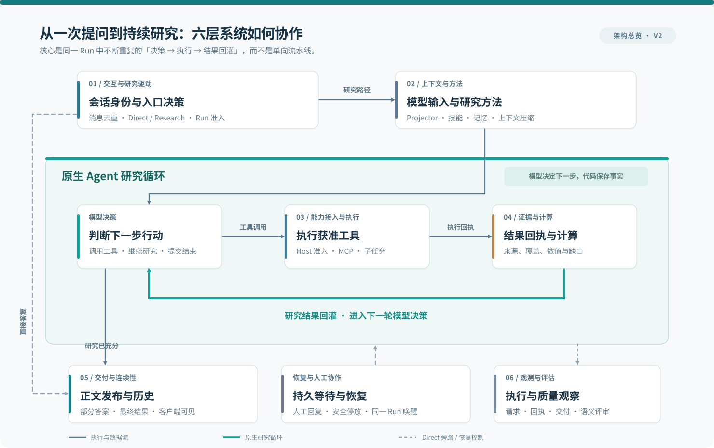
  <figcaption>图 1 · 六层架构与原生研究闭环：模型决策 → 工具执行 → 证据计算 → 再次决策。</figcaption>
</figure>

图中最显眼的青绿色闭环才是 **Native Agent Loop**：模型提出动作，Host 执行，工具结果与证据回灌后，由同一个 Main 再次决定下一步。只有研究充分才走向 Publication；简单问题可以走左侧 Direct 旁路，仍复用统一发布。HIL、Recovery 与观测是协作能力，不是另一个 Agent 循环。

| 层次 | 接住的问题 | 模块 |
| --- | --- | --- |
| 第一层 · 交互与研究驱动 | 先接住问题，再决定怎样走 | 会话与请求身份、入口决策、原生研究循环、Run 资源预算、统一行动提醒、Root-owned Subagent |
| 第二层 · 上下文与方法 | 模型出发前，手里有什么 | 统一 Projector 与可选 Main 压缩、技能与兼容扩展、个人背景与 Hybrid Memory |
| 第三层 · 能力接入与执行 | 一句“去查”，怎样成为事实 | 模型网关、Market/MCP 与 Host、Native Read Executor 与钩子 |
| 第四层 · 证据与计算 | 从找到材料，到形成可核对的判断 | 知识检索、研究资产与文档阅读、确定性金融计算、隔离分析 |
| 第五层 · 交付与连续性 | 答案来了，还要留得住、接得上 | 答案发布、引用展示、事件交付与前端、持久恢复、Artifact 访问与分享、持久控制循环与定时任务、Run 终结、多轮对话与接续 |
| 第六层 · 观测与评估 | 让“发生了什么”和“答得怎样”各有依据 | Langfuse 与交付观测、质量评估 |

## 六层阅读导航：从图中的交接进入细节

读这篇文章不必先熟悉四十余个 Owner。可以按下方六层逐章阅读，也可以直接跳到[原生研究循环](#handoff-03)、[并行前后台](#parallel-runs)、[金融计算](#handoff-15)或[持久 HIL](#hil-loop)。

<section class="architecture-layer-index" aria-label="六层内容快速跳转">
  <a href="#layer-1">01 / SYSTEM LAYER<strong>交互与研究驱动</strong><small>从用户问题走向原生研究循环</small></a>
  <a href="#layer-2">02 / SYSTEM LAYER<strong>上下文与方法</strong><small>模型这一轮究竟看到了什么</small></a>
  <a href="#layer-3">03 / SYSTEM LAYER<strong>能力接入与执行</strong><small>工具怎样真正获得执行资格</small></a>
  <a href="#layer-4">04 / SYSTEM LAYER<strong>证据与计算</strong><small>哪些结论有依据、可以复算</small></a>
  <a href="#layer-5">05 / SYSTEM LAYER<strong>交付与连续性</strong><small>结果、恢复与人工协作如何衔接</small></a>
  <a href="#layer-6">06 / SYSTEM LAYER<strong>观测与评估</strong><small>找到第一个失真交接与真实结果</small></a>
</section>

**另一个不能混淆的视角是代码仓库职责。** `agent-app` 承接对话、治理、研究和发布；`data-source` 提供固定的只读投资事实与确定性计算；`log-review-monitor` 读取脱敏健康和执行观察。六层不取代这三个代码边界。根系统的 ledger、allocation、confirmation 和 `portfolio-report@1` 仍是投资权威，Agent 自己的 PostgreSQL 不是第二份持仓账本。

## 阅读前的术语约定：一个词只承担一种责任

**先记住：Run 是执行实例，Main 做最终研究综合，Host 派发工具，Publication 决定正文如何交付。** 其余术语可以按需展开。

| 词 | 在本文中只表示什么 | 刻意不表示什么 |
| --- | --- | --- |
| Conversation / Message / Run | 对话关系 / 一次发送的幂等身份 / 一次可追踪执行 | 同一个 ID 或同一生命周期 |
| Root / Main / Child | 一次研究的根执行范围 / 主研究体 / 被委派的有界支线 | 三套独立授权和预算 |
| **能力 Owner** | 对某项事实、决定或效果负最终责任的模块 | GitHub 代码责任人、技术负责人、章节标题 |
| **代码 Owner（code owner）** | 仓库或文件的工程维护者；本文谈代码分工时才使用 | 运行时执行权或事实权威 |
| **责任归属（ownership）** | 某项判断和效果应由谁签发、谁能纠正的设计原则 | 一定对应一个新建的类或微服务 |
| Host / Tool Surface | 真正的受控工具调用 / 最终交给模型的工具呈现 | MCP 列出工具就等于获准执行 |
| Projector / Publication | 实际送模内容的组装 / 候选正文的处置与发布 | 取数或决定投资事实 |
| HIL / HIO | 人参与研究的交互模式 / 接纳问答身份与路由的责任模块 | 把模型交互授权给用户回复 |

::: details 展开进阶术语｜恢复、控制、效果与模型回合

| 术语 | 最小定义 |
| --- | --- |
| ModelTurn / 封存 | 一次模型请求及其可核对输出；封存表示其事实已固定，不能恢复时随意改写 |
| Recovery / Checkpoint | 从持久事实恢复原执行 / 记录可恢复位置和必要状态 |
| lease / fence | 当前执行者的有期租约 / 防止旧执行者以过期身份写入效果的栅栏 |
| Correction / Continue | 把新信息在原 Run 的安全点提交 / 需要时创建带父任务关系的新 Run |
| Human Park | 原 Run 未终结时主动让出执行槽、等待人与事件的持久停放 |
| Projection / Projector | 供特定消费者读取的视图 / 组装该视图的责任模块 |
| ResultRef / Artifact | 可耐久读取的研究结果引用 / 有独立版本和读取授权的产物 |
| Publication / Effect | 正文候选的处置与交付 / 提议、批准、执行、生效分别记录的外部效果 |
| TaskExecution / Schedule | 某次确定的定时执行实例 / 已确认的周期或单次计划 |
| HIO / HIL | Human Interaction Owner / Human-in-the-Loop；前者是职责，后者是交互方式 |

:::

## 为什么不直接用 LangGraph、AutoGen 或 OpenAI 的方案拼起来？

**定位判断：它们可以成为运行时底座，但不会自动替应用定义金融事实权威、权限粒度和跨系统交付回执。** 六层不是对通用框架的否定，也不是声称所有机制都必须重写。真正的取舍是：使用现成编排能力，同时明确谁持有可恢复的执行事实、谁有资格改变受保护的结果。

| 方案 | 已经适合解决的问题 | 接入本项目仍要补的应用级合同 |
| --- | --- | --- |
| [LangGraph](https://docs.langchain.com/oss/python/langgraph/persistence) | 图编排、Checkpoint、持久执行、Interrupt/HIL | 组合数据真值、Run 工具准入、发布与分享的授权、跨效果幂等 |
| [AutoGen AgentChat](https://microsoft.github.io/autogen/stable/user-guide/agentchat-user-guide/) | 多 Agent/Team 协作和消息式任务编排 | Root 与 Child 的同一授权账本、金融计算来源、实际交付审计 |
| [OpenAI Responses API](https://developers.openai.com/api/docs/guides/migrate-to-responses) / Agents SDK | 模型调用、内置工具、远程 MCP、Agent 开发原语 | 跨模型与跨工具的应用级责任归属、账户权限与事实一致性 |
| **ETF Agent 六层** | 将上述可复用原语与已存在的业务接口组织起来 | 自己明确执行账本、证据、金融公式、Publication、HIO 与 Recovery 的签发者 |

**历史口径：** OpenAI Assistants API 已在 **2026-08-26** 停用，不适合作为今天的新项目选型。这里与 Responses API 对照，而不把 Assistants 当作仍在维护的竞品；AutoGen 的后续产品路线还可参考 [Microsoft Agent Framework](https://learn.microsoft.com/en-us/agent-framework)。

> **一句话结论：** 使用框架可以减少编排代码，但不能省掉应用中“谁能读、谁算数、谁真的执行、用户究竟收到什么”的可审计合同。能复用的框架能力优先复用，没有理由为六层再造六个执行器。

::: details V2 增量索引｜仅关心 2026-10 工程变化时展开

| 新增或深化方向 | 在六层中的落点 | 阅读状态提示 |
| --- | --- | --- |
| Root-owned Child、前后台并行 | [第一层](#layer-1) · [06 委派](#handoff-06) | 沿原 Root 生命周期与预算执行；不同 Run 不共享终态 |
| Deep、行动提醒与 Main 压缩 | [04 预算](#handoff-04)、[05 提醒](#handoff-05)、[07 Projector](#handoff-07) | 深化已有资源与上下文责任，不能由开关推断质量 |
| **A34 Tool Surface** | [11 Host](#handoff-11) | 区分注册、最终展示与实际准入；最终请求需核实 |
| **A35 内容信任** | [13 检索](#handoff-13) | 外部内容是证据材料，不是可授权指令 |
| **A33 精确数值** | [16 分析](#handoff-16) | 公式/来源时点/十进制算术分责；不以精确度代替公式正确性 |
| A37 HIO 与持久 HIL | [HIL 特写](#hil-loop) | 限定 provider-free 工程范围已归档；生产 Human Park 默认关闭，真实模型质量未验收 |
| **A36 时间语义** | [独立专题](/articles/agent-temporal-semantics-market-calendar) | 单独推进验收；不将计划写成已上线 |
| Control / Schedule、终结收口 | [22 控制](#handoff-22)、[23 终结](#handoff-23) | 真实回执由原责任模块签发，完成状态与部署另行核验 |

此处是版本导览，具体实施事实与证据限制留在各章节展开层和专题文章；V1 历史正文不改写。

:::

## 能力 Owner 导航：四十余个模块怎样参与六层系统

本文所说的**能力 Owner**，是持有某类执行事实或效果责任的模块，不是 GitHub CODEOWNERS 中的代码维护者，也不是 26 个章节的别名。先按六层理解系统；需要定位具体责任时再展开完整清单。

::: details 展开完整能力模块清单与 2026-10 工程状态

模块按事实及效果的最终 Owner 划分。当前站点架构图册识别 **43 个能力责任模块（A01–A37、B01–B05、E04）**；其中 A36 时间语义已独立入册、P0 验收仍开放，A37 HIO 已完成限定本地关闭、生产 Human Park 默认关闭。本文统一称“四十余个”，不把 26 个阅读环节误认成模块总数。分组只帮助阅读，不表示模块层级、进程数量或控制关系。

| 阅读分组 | 独立能力模块 | 各自负责的效果 |
| --- | --- | --- |
| 接入与研究 | 账户身份；对话接纳与任务接续；研究决策与综合；Run 授权与能力准入 | 请求主体、消息关系、研究语义和 Run grant 分别收口 |
| 执行与资源 | **Run 资源管理（含 Deep 模式）**；Run 继续与终结；Child 生命周期；**模型调用与请求配置（含思考强度）**；Provider 容量准入；受控工具调用 | Deep 升级归原预算 owner；思考强度归原请求配置 owner，另保留整轮终态、Child、供应商容量和工具调用边界 |
| 模型配置与选用 | **模型目录与路由配置** | 维护可选目录、默认模型、Provider/协议映射和能力声明；用户选择交给原调用 owner 绑定执行 |
| 方法与接入 | Skill 方法与资源；插件准入与生命周期；**MCP 服务接入**；生命周期事件与 Hook 执行 | 方法资源、包代际、MCP 连接/发现/协议传输、回调执行分别收口 |
| 上下文 | 上下文投影与拟合；**Main 上下文压缩**；行动提醒协调 | 请求装配、压缩采纳/提交、提醒送模水位分别收口 |
| 研究材料与分析 | 研究结果与引用管理；研究资料资产；Web 研究读取；PDF 文档读取；知识检索；隔离分析 | 结果谱系、资料版本、网页、PDF、检索和沙箱执行分别收口 |
| 调度与交付 | 持久控制事件；定时任务；私有产物保存/访问/分享；正文发布；会话事件与历史交付；客户端交互与阅读 | 控制命令、Task、文件、正文处置、内容交付和界面分别收口 |
| 个性化与调用证据 | 长期记忆；每日个性研究；研究调用证据留存与回读 | 记忆、每日生成和轨迹记录/查询分别收口；记录不参与发送许可 |
| 持久人机交互 | HIO 请求/响应接纳；原 Correction / Recovery / Continue | 问答准确归属与跨会话回复；原 Owner 保留实际采用、运行恢复及授权 |

**收尾协调已深化到既有 Run 继续与终结 Owner（A06）。** 阶段、回合请求意图和结束投影已有同一收口，Main 原循环执行这些决定；未新增独立 Finalizer、模型循环或资源账。原“独立收口待核验”占位撤销，能力总览按四十余个 Owner 持续演进。压缩仍独立负责候选、采纳与 checkpoint 提交，其自然运行质量和正式 close 另行判断。

Deep 和思考强度各是所属模块里的子能力，不因独立开关或工具就各算一个平级模块：前者申请本轮资源升级，后者指定某次请求的推理档位；选择哪个模型则消费服务端模型目录。三者都不直接证明回答质量提升。

:::

## 第一层 · 交互与研究驱动：先接住问题，再决定怎样走

*架构判断对应：[原则 1 · 模型理解语义，系统记录执行事实](/principles#principle-1)。*

问题已经写好，用户按下发送。后台此时还没有组合结论，先要辨认这次提交、选择工作分支，再启动可以边研究边调整的执行过程。六个职责分别处理“这是谁的哪次发送”“需要什么工作”“下一步怎样推进”“本轮还有哪些资源”“该提醒模型注意什么”，以及“哪些独立分支值得委派”。

这一层的必要性来自两个现实条件：网络会重复交付，研究路线又无法完全预排。把接入、语义路由和运行调度拆开，身份规则可以保持确定，研究策略可以随材料变化。我们引入研究循环的主要背景，是早期结构化回合让模型同时携带计划、状态和完成语义，维护负担与事实归属逐渐交织。

**图 2 · 请求身份分流：重发、创建与冲突**

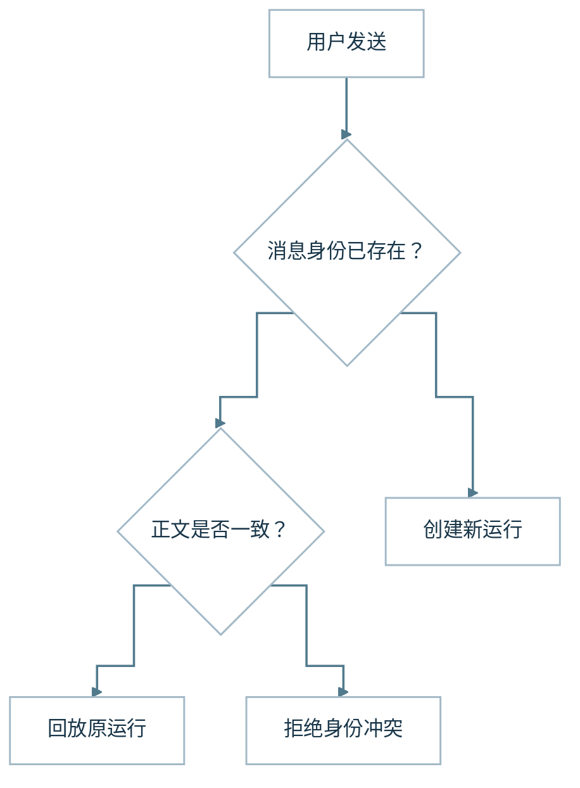

消息身份把一次发送与实际运行关联起来。同一身份的重发查找原运行；正文冲突则拒绝，不覆盖已发生的执行。

**图 3 · 入口与研究循环**

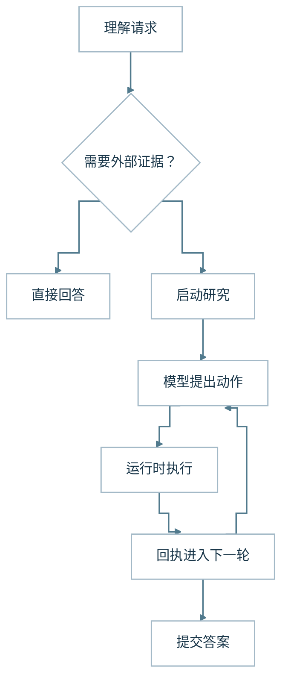

图中展开一轮研究。需要更多材料时进入下一轮；图中重复的模型节点用于表达前后两次推理，不是两个独立 Agent。

| 模块 | 输入与产物 | 为什么单独封装 |
| --- | --- | --- |
| 会话与请求身份 | 一次发送 → 可关联的消息和运行 | 重发、回放与新任务需要明确区分 |
| 入口决策 | 原问题与可用背景 → 工作分支 | 问题理解可以独立于执行机制演进 |
| 研究循环 | 模型动作与实际回执 → 下一轮或结束 | 策略可变，执行记录仍需要稳定归属 |
| Run 资源预算（含 Deep） | 原 Run 政策与实际请求/执行时间 → 可用量、一次 Deep 升级、阶段和最低交付保护 | 多个执行入口共享同一准入和消费事实，Deep 不另建账本 |
| 统一行动提醒 | 资源、上下文和发布额度事实 → 可并存的研究建议与实际送模水位 | 提醒可以帮助模型安排工作，但不增加预算或认证完成 |
| Root-owned Subagent | 获准选定材料 → 研究支线与可追溯交接 | 多步探索分工，但最终发布仍只有 Main |

### 01 会话与请求身份：发送两次，是否做了两次研究？

> **本节唯一要点：** 会话确定交流关系，消息确定幂等身份，Run 才记录一次真实执行。

问题刚发出去，页面还没出现正文。设想网络此时抖动，用户又点了一次发送：后台收到的是第二道题，还是同一道题的重发？如果系统连这件事都认不清，后面的研究再聪明，也可能从重复工作开始。

用户按下发送按钮后，系统首先要建立请求身份。它需要确认消息属于哪个会话、由谁提交、允许访问什么资源，以及这次提交是不是上一次发送的重复。浏览器建立稳定的消息身份，服务端把消息关联到实际运行。这里的运行，是处理一次问题的执行实例，不是整段聊天记录的另一个名字。

会话负责交流关系，运行负责执行过程。同一个会话可以包含多个运行，保存用户原话和后续追问；每次运行则记录本轮模型调用、工具执行和答案交付。在示例里，最初的行业分析与后面的“那科技行业呢”可以共享会话背景，但它们不是同一份执行账本。这种区分让历史交流和实际动作各有归属。

**场景演示（合成）：** 同一 message ID 和相同正文再次发送，应找回原 Run；同 ID 却换了问题则拒绝。

::: details 展开工程细节｜V2 增量、条件与验证边界

稳定身份主要解决网络不确定性。浏览器没收到结果，并不能说明服务端没处理请求。如果每次重连都创建新任务，后台就可能重复调用模型、读取资料或生成答案。因此，同一消息重发时复用原身份；服务端查找既有运行，决定恢复还是回放。同一身份携带不同正文，则明确拒绝，不能悄悄覆盖已经发生的执行。

入口还会验证身份与资源范围。模型不能根据聊天内容授予账户权限，请求里出现一个会话标识也不能证明用户拥有它。访问资格必须在进入研究前由系统确认，而用户的问题含义留给模型解释。入口因此可以拒绝越权读取，却不会提前替用户设计完整分析方案。

因此，我们把会话身份、消息身份与运行身份分别管理，再通过关联关系连接起来。封装这一层，是为了让网页、后台任务和调查记录谈论同一次发送；它也让重连处理集中在入口，避免每个模型或工具适配器重新设计一套去重逻辑。代价是要维护身份关联与冲突处理，但这是系统可以明确核对的事实。

:::

### 02 入口决策：先判断这道题需要哪种工作

> **本节唯一要点：** 入口按问题是否需要外部证据分流，而不是按“金融”等主题词分流。

终于进入系统了。模型面前的第一道选择，是要不要动用工具。用户若只问“行业集中是什么意思”，解释即可；现在问的是“我的组合”，还要求结合基金资料，答案就必须从一般知识走向具体证据。

不是每个问题都需要进入复杂研究。解释一个稳定概念、调整用户提供的文字，可能直接形成答案；分析当前组合、查询基金资料或执行计算，则需要工具。入口模型负责选择这条分支，它收到原问题、必要历史、参考目录和当前可用能力，提出直接回答或进入研究的决定。

这个选择依据任务所需的工作，而不是主题标签。“基金是什么”与“这只基金目前主要持有哪些行业”都属于金融问题，后者却需要当前来源。把所有金融问题机械路由到研究，会制造无用调用；全部直接回答，又容易让模型用一般知识替代具体产品事实。入口必须理解请求，程序则检查它提出的分支是否能够执行。

**场景演示（合成）：** “行业集中是什么意思”可直接解释；“我的基金行业集中度是多少”需要组合与基金资料。

::: details 展开工程细节｜V2 增量、条件与验证边界

在贯穿示例中，入口应选择研究，因为用户要求读取个人组合并结合基金资料。当前 Entry 仅生成严格结构的 `direct`（携带 Markdown）或 `research`（可携带粗粒度 scopes）：使用 JSON mode 和本地完整校验，不声称供应商 strict schema。显式有效 Skill 可以直接进入 Research；入口可看到获准文档目录 `authorizedArtifacts`，但目录不是已读原文，Entry 本身也没有工具。它可以提出需要确认的问题，却不能声称已经看过组合，也不能把“允许请求某种能力”当成“已经取得相关数据”。入口阶段没有执行工具，研究计划只是一项语义提议。

混合问题更考验这一层。例如，组合数据不可用，但用户还要求解释行业集中为什么构成风险。独立的解释仍可能继续，不能因为一个部分阻塞就拒绝整道题。反过来，模型也不能用这段一般解释冒充对真实组合的分析。关键是保留完整请求，同时区分可以推进的部分和确实缺少条件的部分。

把入口决策单独封装，可以让直接问答保留一条短路径，也让研究任务带着完整问题进入后续循环。入口的变化主要围绕问题理解，研究运行时的变化主要围绕执行，两类演进因而有了各自的位置。我们接受一次额外决策的成本，换取明确的工作分支，同时持续检查错误路由是否来自指引或能力描述。

:::

### 03 原生研究循环：答案在下一步行动中逐渐形成

> **本节唯一要点：** 模型负责下一步研究策略，Runtime 负责真实动作和可恢复的执行记录。

研究开始后，第一份组合数据只是开头。假设分类里有“科技”，用户还会想知道它来自哪些基金、资料是否足够新。下一步可能是读取报告，也可能先核对分类。答案需要边走边形成，事先排一条固定搜索路线很难覆盖这些变化。

研究过程不是预先排好的固定流水线。模型读到组合数据后，可能需要进一步查看基金资料；发现资料口径不一致后，可能调整查询；得到足够支持后，开始组织答案。当前研究采用原生工具调用表达动作，运行时推动“模型提议—获准执行—结果回灌—继续推理”的循环。

模型负责选择研究策略，运行时负责记录与限制执行。工具是否真的调用、实际返回什么、动作是否取消或失败，都由代码和回执描述。模型可以判断某个研究问题已经解决，但这仍然是一项判断，不能直接变成“用户任务已经完成”的系统事实。这条边界贯穿普通研究和结束阶段。

**场景演示（合成）：** 报告的行业口径与组合分类不符时，Main 继续查证，而不是按预写步骤直接结束。

::: details 展开工程细节｜V2 增量、条件与验证边界

早期探索中的一项重要摩擦，是让模型同时维护过多运行状态。提示里包含目标、计划、进度、缺口、动作和完成判断，结构越来越丰富，模型却需要在回答问题之外继续维护这些字段。计划容易与事实混在一起，恢复也必须解释模型生成的状态是否可信。

后来的方向，是让动作沿工具协议表达，让运行时保存真实执行记录。模型保留材料缺口、冲突和下一步研究问题，程序不要求它重新记账。当前 Main 使用 Native ModelTurn 工具动作；已经封存的提议、实际回执、请求扣账和 continuation cursor 属于 Root Recovery。主模型仍提出结束，Runtime 只核验可观察的技术终态。一次读取成功，不再依赖模型在后续字段中准确重述；一次执行失败，也不会因为模型把问题标成解决而消失。

研究循环的封装把动作顺序、取消、共享资源上限和执行记录放到同一 Root 生命周期中，让模型专注于下一步值得做什么。新增一项读取能力可以接入已有动作路径；系统不必为“先查组合再读报告”和“先读报告再核对组合”分别造流程。成本是运行时需要管理真实状态，但它减少了要求模型重复维护账本的负担。

到这里，问题获得了执行身份，也进入了需要读取证据的研究路径。下一步先看模型收到的材料包，再看它提出的动作如何被执行。

:::

### 04 Run 资源预算：把多个入口放回同一份 Run 账本

> **本节唯一要点：** Main、Child 与恢复路径消费同一 Run 的资源事实，Deep 不另开预算账本。

研究不只消耗模型请求。有效执行时间、工具动作和收尾预留也会影响还能否继续读取材料，或需要先保住正文交付。如果入口、Main、Child 和恢复路径各自计算“剩余预算”，同一 Run 就可能出现几种互相冲突的答案。

Run 资源预算把原有政策、请求/动作消耗、有效执行时间和最低交付保护绑定到同一身份。它为 Factory、Runtime、Provider 与 Recovery 提供一致的准入事实；实际扣账仍由原 Recovery 事务完成，不再造第二本执行账。请求数量不是 token 用量，有效执行时间也不能替代调用次数，二者保留各自的单位和阶段。

**场景演示（合成）：** Child 已消耗请求后，Main 再查剩余额度，仍须看到同一 Root 的消费记录。

::: details 展开工程细节｜V2 增量、条件与验证边界

Deep 是这个模块中的资源模式子能力。用户显式选择、注册 Skill 默认、Entry 与 Main 工具可以提出模式，但原预算 owner 才能批准同一 Root 的一次升级。确认依赖原提交及实际应用回执，保留已经消耗、预留和 unknown，以及原时钟、用户硬上限和外部约束；不反复放大，也不重新开启已进入收尾或取消的执行。Deep 不选择另一个模型，也不等于更高思考强度。

这项封装让 Main、Child、Reviewer 与恢复后的执行沿用同一 Run 资格与已消耗事实。新 Run 使用自己的准入，旧 Run 不会因策略更新自动获得新额度；未知的在途效果也不能当作未消耗。资源与 Deep 控制已有对应的限定工程验证。

:::

### 05 统一行动提醒：把事实变成建议，不把建议变成额度

> **本节唯一要点：** 提醒只帮助模型分配注意力，只有真正送模才算生效，也不增加任何额度。

当材料逐渐增多时，模型可能需要知道请求预算接近阶段节点、上下文空间有限、替换额度将耗尽，或某项周期复核仍值得考虑。过去这些提示容易分散在不同生产者里，措辞和去重规则各走各的。

统一行动提醒收集原资源、有效时间、最终拟合上下文、Publication 修改额度和周期复核等事实，再形成可以并存的建议。提示只有在真正纳入并发送给模型后才记入相应的提交水位；候选被生成不等于模型已看到。提醒不扣费、不增加权限、不判断研究是否完成。自动 Reviewer 候选仍由 Runtime 按原准入独立决定是否派发，用户到时通知也由单独的交付 owner 负责。

**场景演示（合成）：** 提醒已经生成却被上下文拟合舍弃，不应记录成“模型已看到提醒”。

::: details 展开工程细节｜V2 增量、条件与验证边界

把提醒集中起来，可以减少重复选择和重复提示，但不会多造一个控制器。局部上下文压力或某个替换额度不足，不自动切换全局阶段；实际消耗仍由原资源 owner 记录。行动提醒已接入受控执行路径，后续重点观察模型在什么场景采纳建议。

:::

### 06 Root-owned Subagent：分工不是复制一套运行时

> **本节唯一要点：** Child 负责有界支线，Root 持有授权与预算，Main 保留最终综合与交付。

组合的行业暴露需要核对三种材料：产品网页、基金报告的页表和一组可复算数据。Main 不必亲自完成每个多轮支线，但单页读取或简单计算也不需要创建第二个 Agent。**是否委派由主模型按任务决定，代码不靠关键词或估算耗时强制分流。**

现在 Main 可以用 `spawn_subagent` 开启独立探索，通过 `inspect_subagents` 查询进展，必要时用 `cancel_subagent` 停止。三个已验证的专业工作方式是 Web、PDF 和 Python；Web 在获准时可以读 PDF，PDF 也可回看关联网页，不能递归再派出 Child。Child 使用当前 Root 获准的选定输入与工具，不因角色名称获得新权限。

**图 4 · 委派有界：主研究统一交付**

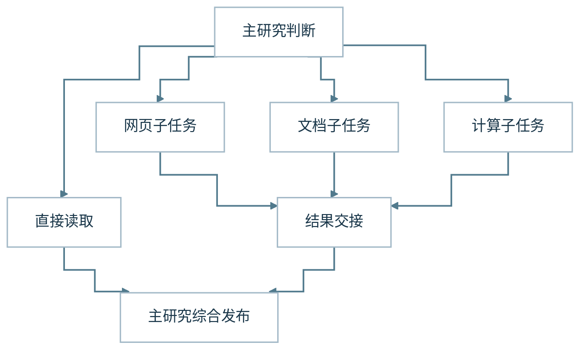

图中两条路径是可选分支，不代表每次都同时启动。Child 用 `submit_subagent_result` 提交部分或最终交接，保留真实引用、产物、已读范围和未解决缺口。**Child 自己读过原文与 Main 只收到它的摘要，是两种不同消费事实**；摘要不自动升级为已核验数值，Child 也不能直接向用户发布最终答案。

Root Run 保留唯一的授权、总预算、取消和恢复账本。Child 有自己的有序 ModelTurn 与资源限制（每个最多 15 轮模型、36 次工作 Tool，后三轮用于收尾），但不能复制一份 Root 的付费容量或消耗主回答预留。某个 PDF Child 耗尽只结束其局部探索；Root 的 Stop/fence 能阻止所有 Child 的迟到新效果。已封存交接在合法恢复时复用，不重复派发已结算工作。

Root 与三个工具型 worker 已经过受控执行验证；是否委派仍由任务依赖和实际收益决定。

**场景演示（合成）：** PDF Child 读出报告页表，Python Child 计算假设指标；Main 核对来源后统一回答。

### 特写 · 前台短答与后台研究：并行的是运行，不是两套系统

当用户的行业分析仍在后台读取资料，用户完全可以继续问“行业集中风险是什么意思”。同一个 Conversation 包含多条各有身份的 Run；后台研究和前台短问答使用原 Entry、预算、Host 与 Publication。前端按 Run 关联结果，不能用整个对话的单一 busy 状态互相阻塞。

原 Scope 准入已经区分后台长研究和前台短交互，并用有界的 PostgreSQL 原子准入控制竞争。多条运行的回复、进展、Stop、Correction 目标必须分别绑定到实际 Run。新的短问答可以先交付，后台则继续研究、提交部分正文或最终报告；中途的用户补充究竟是纠偏还是新追问，仍由原会话关系和研究语义决定。

<figure class="article-architecture-figure v2-feature-figure">
  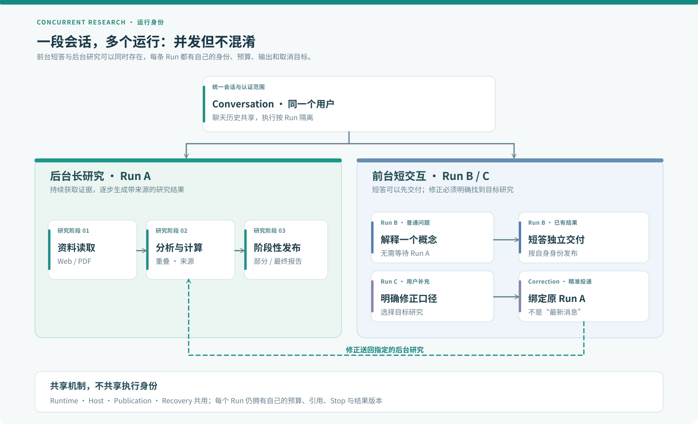
  <figcaption>图 5 · 一个 Conversation、多个 Run：长研究与短答并行，纠偏准确回到原研究。</figcaption>
</figure>

这种并行不需要第二个 Background Agent 或跨运行的通用模型总管：**一份消息关系，多份独立运行，一套事实与交付体系**。

**继续深读 · 入口与多执行体：** [Entry 的语义分流](/articles/022-agent-entry-from-intent-to-direct-research) · [Subagent 与 Root 协作](/articles/agent-subagent-context-specialization) · [后台研究为何不阻塞聊天](/articles/agent-background-research-collaborative-experience) · [模型、Runtime 与工具的职责](/articles/agent-model-runtime-mcp-skill-boundaries)

## 第二层 · 上下文与方法：模型出发前，手里有什么

让模型研究组合，并不意味着它已经看过组合。后台已有的材料、当前任务适用的方法和用户的表达偏好，要先组织成这一轮真正发送的输入。

这一层把“装配请求”“复用方法”和“跨会话背景”拆开，是因为它们分别面对容量、方法维护和生命周期问题。Projector 集中最终组装，技能保留领域差异，个人背景控制有限信息；Memory 管理跨会话记录、版本和用户控制，其本地闭环与外部运行资格分别验收。把三者统称为“增强上下文”，会掩盖材料究竟在哪一步进入，以及谁负责更新或撤回。

**图 6 · Projector：实际送模内容**

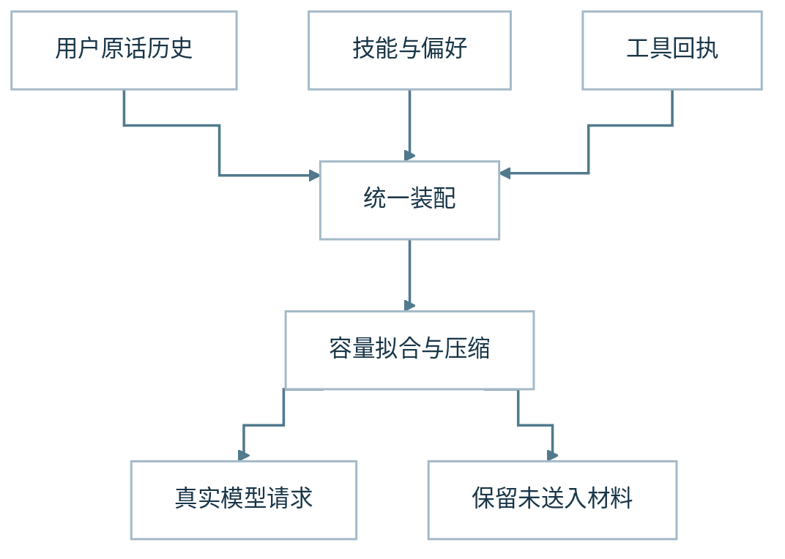

事实由原模块提供，投影器集中组织本轮模型视图。省略与容量处理需要留下记录；投影器不承担取数和授权。

**图 7 · 长期偏好与当前持仓分开**

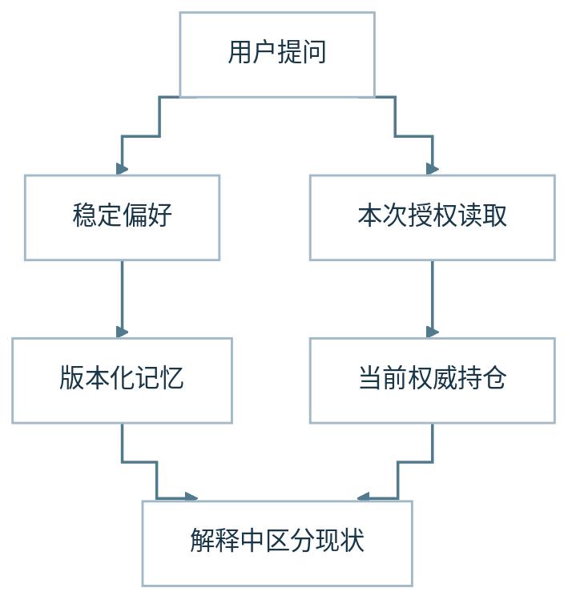

有限背景影响表达，当前组合沿权威读取取得。长期记忆请求必须形成持久化回执，召回复核范围与版本；关系表不表示自动学习默认开启或已生产部署。

| 材料 | 主要归属 | 在故事中的用途 |
| --- | --- | --- |
| 当前问题与实际工具结果 | 上下文投影 | 保留这一轮真正要答什么、已经读到什么 |
| 基金研究顺序与阅读方法 | 技能 | 提醒先核对产品、时间与限定条件 |
| 简洁表达等有限稳定背景 | 个人背景 | 调整解释方式 |
| 显式保存、纠正和遗忘的长期信息 | Memory 管理与 Hybrid Memory | 用真实回执和当前版本减少重复说明，保留用户控制 |

### 07 统一 Projector：给模型装好这一轮的材料

> **本节唯一要点：** Projector 的核心职责是明确这一轮模型实际收到了哪些材料。

接着，把镜头移到模型请求发送前。此时后台可能已有用户原话、组合结果、历史追问和基金资料。若一股脑全部塞进去，材料会拥挤；若各模块各自裁剪，关键限定条件又可能在交接中消失。模型真正收到的那一包内容，需要有人负责装配。

后台保存了材料，不等于模型看到了材料；工具刚返回正文，也不等于正文进入了当前请求。现在还可以把耐久保存的工具结果与本轮完整 JSON 上下文分离：Host 保存来源、版本和 `resultRef`，模型只在需要字段、行或片段时走获准重读。一次重读不等于再次请求外部提供方，也不是新的来源授权。

统一的上下文投影器 Projector 负责研究阶段的请求组装，让系统有一个明确位置回答：哪些内容最终被送进模型，哪些被省略，哪些只留在执行记录里。

**场景演示（合成）：** 资料已被保存，但 Projector 未把它放进本轮输入；排障应先查送模记录。

::: details 展开工程细节｜V2 增量、条件与验证边界

投影器消费各模块已经获准提供的信息，包括当前问题、必要历史、工具转录、研究缺口、来源身份、技能指引和当前工具面。它将这些内容组织为模型请求，并按容量作机械拟合。Main 上下文压缩是独立的能力模块：它选择可安全回读的已结算区间，组织模型生成摘要候选，决定是否采纳，并经原持久化事务提交增量 checkpoint；投影器消费已提交摘要及其来源谱系。无收益或普通生成/提交失败时保留原材料，不把本次压缩失败直接当成 Run 失败。摘要不是新证据，原始调用、结果、来源和用户原话仍保留各自身份。压缩可以停用，也复用原授权、预算与恢复设施，这不改变它对压缩效果的责任。投影器不自己读取数据库或网页，也不为资料授予新权限。业务模块提供事实，投影器组织模型需要的视图。

这里最重要的集中，是集中最终装配，而不是把所有业务都搬进一个文件。来源时间由来源模块解释，组合数字由计算模块提供，工具资格由执行层确认。投影器需要知道如何放入这些内容，却不应该重复维护各模块的业务规则。否则它会逐渐变成一个没有清楚边界的上下文总管。

历史背景同样经过投影。用户当前原话完整保留；历史用户内容可以按完整条目省略，助手回答可以总结。父任务中的来源、限制和研究背景各有自己的用途，不能把整个恢复账本直接交给模型，让它再次解释哪些事实可信。实际请求之后还做结构检查和工具面一致性检查，但这些检查不认证答案的语义正确。

单独封装 Projector，是把“生产事实”和“组织模型输入”分开。资料生产者只说明自己提供了什么，投影器集中决定如何装入本轮请求；容量处理与请求结构检查也在这条路径上完成。新增背景不再需要到多个适配器重复拼接。代价是投影器必须保持边界清楚，不能顺手接管取数、授权和业务解释。

:::

### 08 技能：把研究方法从巨大提示中拆出来

> **本节唯一要点：** Skill 复用研究方法，但不能签发工具权限或取代运行时规则。

模型知道要研究，还需要知道怎样研究。对基金报告，先核对产品和时间很有意义；对用户上传的表格，先弄清列含义可能更重要。把这些方法全部写进一个巨大提示，读者看着累，模型每轮也会携带大量与当前工作无关的说明。

技能承载可复用的任务方法。例如基金研究可以说明先核对对象和时间，再获取材料，最后区分事实、解释与未知。普通周报和自定义页面可由模型直接生成 HTML，或在分析已准入时生成 Python 工作区文件，再通过共享导出取得实际保存回执；不强制固定周报方法图、专用 renderer、Python 调用或先发文字。既有其他固定报告合同仍由其原 Owner 执行。Skill 提供方法和表达指导，不签发工具或来源权限。

**场景演示（合成）：** “先核基金份额类别与报告日期”是研究方法，不会让未授权的工具突然可用。

::: details 展开工程细节｜V2 增量、条件与验证边界

当用户显式调用已注册技能时，系统解析对应入口并准备技能背景；普通研究也会结合当前任务获得适用指引。最终可见工具仍由当前权限和服务事实形成，技能声明不能自动让一个工具可执行。技能需要的能力不可用时，系统应保留这个限制，而不是凭名字猜测替代能力已经获得授权。

我们希望技能减少方法的重复，而不是复制全部系统约束。通用行为、领域方法与工具使用说明各有主要归属：大家共用的要求应集中维护，领域技能只补充有意义的方法差异，参数与返回语义由工具契约说明。每新增一条指引，都应先看它是否能替换已有重复内容。

这项取舍来自实际维护成本。指引不断叠加后，同一要求可能同时出现在系统提示、技能和工具描述中，文字略有不同，升级时也容易只改其中一处。模型收到更多文字，却未必得到更清楚的方法。新增案例不一定意味着需要新增规则，有时更需要删除旧的重复解释。

技能将重复出现的领域方法收在一处，使同类任务共享研究顺序和表达习惯。兼容 Extension Host 进一步把受审包的来源 profile、内容身份、审批、生命周期和执行接缝接入既有 Runtime；选定的派生 Pi todo local profile 已通过对应准入验证，但原版 source-loading、未选 profile 与真实生产可执行插件并未因此开放。通用规则留在公共指引，领域差异留在技能，参数说明留在工具契约。这样的封装服务于方法复用与维护，而不是增加提示层数。某条要求在多个地方出现时，先明确唯一的维护归属。

:::

### 09 个人背景与记忆：记住偏好，核对现状

> **本节唯一要点：** 长期偏好可以记忆，当前持仓必须从实时获准的权威数据读取。

用户又补了一句：“解释简洁一点，别默认我熟悉金融术语。”这类偏好以后可能仍有用；今天的基金份额明天则可能改变。两种信息都与用户有关，却需要不同的保留方式。助手若把一切都记成一句话，很快就会分不清偏好与现状。

连续使用助手时，用户不希望每次重新说明表达偏好和背景。但“记住我喜欢简洁回答”与“知道我现在持有什么基金”是两种不同需求。稳定偏好可以作为个人背景，组合状态则需要读取当前权威数据。把二者都存成自然语言记忆，会让过期状态和长期偏好混在一起。

**场景演示（合成）：** “以后尽量简洁”可以作为偏好；“今天持有多少份”需要重新读取账户数据。

::: details 展开工程细节｜V2 增量、条件与验证边界

个人背景投影提供有限稳定信息；Memory 进一步承接用户明确要求保存的偏好、回答约束和历史讨论。受支持本地 Runtime 的第一阶段与 dot 进程载体已经关闭归档；第二阶段通过了正常账户、HTTP/Factory 与 PostgreSQL 的独立显式保存、召回、纠正、忘记及新会话 absence 基本闭环。第三阶段仍保留完整外部 live 生命周期、unknown 对账和清理工作，付费执行暂停。自动学习依然默认关闭。

正常模式在首轮决策前读取有界、当前有效的偏好和回答约束。Research 可以通过 `search_memory` 检索，再由 `commit_memory` 提议保存、纠正或遗忘；Direct 不执行这些工具，也不预取历史讨论正文。Host 核对真实用户来源、范围、目标版本和持久化回执。模型说“记住了”不等于保存成功，后续回答失败也不能抹去已经提交的遗忘效果。

纠正产生新版本，遗忘使整个记录 family 失去后续使用资格。召回、后台学习和派生上下文重新检查当前来源及依赖，旧历史与晚到任务不能恢复已忘记的内容。记忆中的旧讨论也不能变成今天的份额、净值或交易授权。

临时模式不读取、保存或自动学习 Memory；工具可见面随当前准入收窄，执行端仍独立拒绝伪造调用。自动语义学习默认关闭，启用后还要满足来源权限、模型准入、预算和任务条件。入队、候选生成与实际保存是三个不同事实。

把背景、检索和记忆分开，是为了分别处理容量、相关性和生命周期。语义引擎可以建议如何组织信息，应用侧仓储持有 scope、family、revision 和实际效果；供应商可替换，用户控制和效果回执不能省略。使用条件见 Memory 指南与第一阶段验收、第三阶段任务。

模型拿到了当前可见材料和方法，才有条件提出有意义的动作。材料包中的工具名称，接下来还要越过协议、权限与真实执行的边界。

:::

**继续深读 · 模型真正看到的材料：** [工具结果为什么要外置](/articles/tool-results-outside-model-context) · [Main 上下文压缩](/articles/agent-main-run-context-compaction) · [Memory 遗忘的持久效果](/articles/026-agent-memory-forget-durable-effects) · [原则 5：Context 只是工作台](/principles#principle-5)

## 第三层 · 能力接入与执行：一句“去查”，怎样成为事实

模型返回工具调用，研究终于要接触外部能力。此时有三个不同的交接：供应商协议变成本地事件，模型参数变成获准调用，工具原始结果变成可交给模型的投影。

我们封装网关、MCP 与 Host、钩子，是为了分别处理协议变化、能力执行和局部扩展。它们相邻，却不共享同一种修改资格。尤其在钩子上，历史评审发现“格式合法”仍能替换来源与数值，因此现在需要约束事实继承关系，而不只检查类型。

**图 8 · 从工具提议到真实执行**

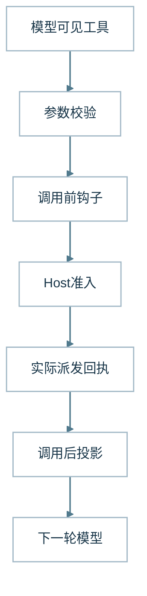

MCP 适配器接入能力，Host 管理实际执行。调用前检查不替代 Host 准入；返回后收窄的模型投影与原始回执各有归属。

**图 9 · 钩子只能收窄不能改写事实**

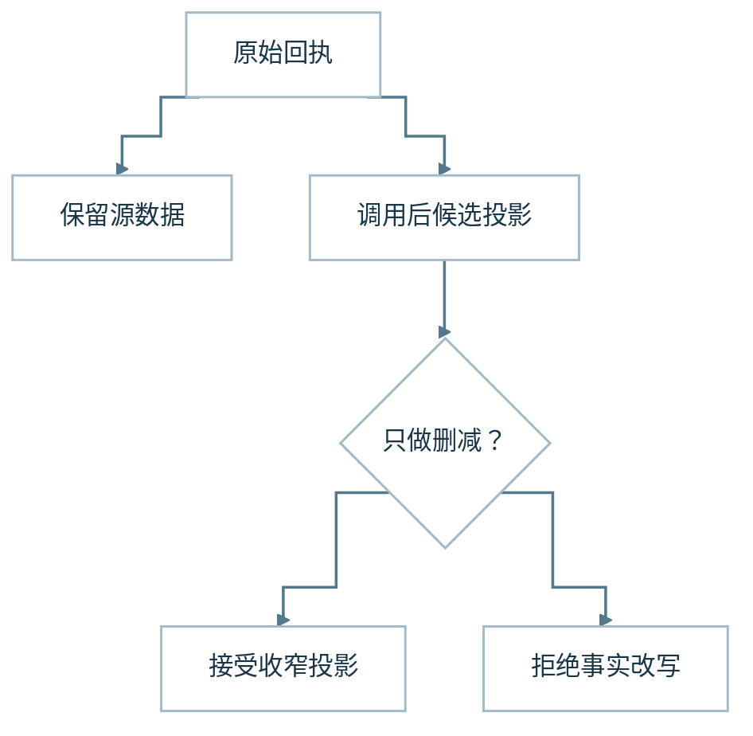

这是调用后钩子的简化关系。原始回执独立保存；投影可以删除，留下的值与路径必须继承原事实。等形替换来源或数字属于禁止分支。

| 位置 | 可以处理什么 | 必须保留什么 |
| --- | --- | --- |
| 模型网关 | 协议适配、流解析、运输错误 | 已收到的内容与实际中断位置 |
| MCP 与 Host | 能力接入、参数校验、派发和回执 | 当前权限、来源和执行身份 |
| 调用前钩子 | 对当前动作做局部检查 | 已规范化参数与 Host 权限边界 |
| 调用后钩子 | 收窄模型可见投影 | 保留下来的事实原值与路径 |
| 结束钩子 | 观察结束过程 | 已接受结束与正文交付的归属 |

### 10 模型网关：完整生成与半截响应之间

> **本节唯一要点：** 模型网关把供应商事件转成稳定协议，半截工具调用不能冒充已执行动作。

整理好的请求现在要越过本地系统，交给模型供应商。理想情况下，它返回完整正文或工具调用；设想连接在参数返回一半时中断，系统就得先辨认自己究竟收到了什么。半个调用无法靠“看起来差不多”变成一次有效动作。

模型网关负责把本地请求送到供应商，再将供应商输出转换成系统可以消费的事件。研究运行时选择当前获准路由，网关处理协议适配、请求运输和返回解析。模型可以选择研究动作，却不能选择任意外部地址、供应商凭据或系统没有接入的协议。

**场景演示（合成）：** 供应商流只返回了一半 JSON 参数，网关应保留失败/未完成状态，而非执行猜出的参数。

::: details 展开工程细节｜V2 增量、条件与验证边界

最终发送也有明确交接：Gateway 与 SDK 完成协议序列化及已声明的请求字节约束；Provider 容量准入负责跨 Run 的排队、并发租约与冷却；admitted fetch 在原调用 guard 和容量租约成立时实际发起网络请求，产生派发见证。单 Run 的预算仍归资源 owner。这些模块分别决定自己的效果，不需要再造一个统一裁决所有条件的发送模块。

发送前还要确定“哪个模型、哪项请求配置”。模型目录与路由配置模块维护可选目录、默认项、Provider/协议映射及能力声明；界面选择只能引用已配置模型，当前维护沿服务端配置与启动装配完成，不代表已有在线模型管理后台。模型调用模块再绑定本次配置，接纳并记录支持的思考强度：Main 可以为下一次独立获准请求申请档位，Child 使用创建时配置或继承父请求，恢复与重试保留原绑定。Gateway 映射发送参数，不承诺供应商内部确实增加了思考。Deep 归预算模块，既不自动换模型，也不等于提高思考强度。

不同供应商的消息、工具调用和流式结束方式并不完全相同。网关需要保留正文、工具参数、终止原因和可得用量，同时判断流是否按协议完整结束。收到一些字节不等于收到完整调用，连接关闭也不自动意味着正常生成完成。运输层必须先明确实际取得了什么。

这个职责会影响失败恢复。排队时就失败、已经收到部分正文后断开，以及工具参数只返回一半，是不同情况。前两者可能保留不同的输出事实，最后一种不能直接进入工具执行。运行时决定是否还能重试，网关提供失败位置与已观测内容，避免把所有异常压成同一个“模型不可用”。

我们也需要限制网关的解释范围。供应商内部的分词、调度、缓存和隐藏推理不在本地可观测范围；只能记录协议实际提供的用量和诊断。没有返回某个费用字段，就应保留未知，不能根据普通响应成功推断成本完整。对性能原因的判断同样需要额外证据。

网关把协议差异收在系统边缘，让研究循环使用相对稳定的事件，同时保留中断位置与可得输出。它封装的背景是供应商格式与运输失败会变化，不能让这种变化扩散到每个业务模块。统一接口需要付出适配成本；抽象也必须留下有影响的差异，才能让上层判断恢复条件，而非把异常都压成一句失败。

:::

### 11 MCP 服务接入与 Host 调用：让“我去查”成为真实调用

> **本节唯一要点：** MCP 负责能力接入，Host 负责本次调用的授权、派发与真实回执。

模型这次提出了一个具体动作：读取组合，再找相关基金资料。文本中的“我去查一下”终于要变成实际调用。工具目录里有名字只是第一步，当前用户、当前任务和当前参数能否使用它，还要在真正派发前确认。

MCP 提供工具接入协议，Host 则管理一次具体工具调用如何进入执行。两者解决的问题不同：前者让能力可以被发现和描述，后者核对当前请求是否能使用这项能力。一个远端服务成功返回工具列表，只证明发现完成，不证明全部工具都适用于当前用户和任务。

MCP 服务接入本身是独立能力模块，负责连接与握手、工具目录发现、协议校验、调用传输和连接关闭；可以拒绝无效目录或结束故障连接。Host 的受控调用模块消费这些真实绑定，负责本次调用的准入、派发与结算。具体工具再负责自己的业务结果。插件可以提供 MCP 服务，但不接管 MCP 连接或工具业务的权威；同一文件承载多个接缝，也不意味着这些能力必须合并。

**场景演示（合成）：** 远端 MCP 返回工具名称，但当前 Run 未获准使用；展示和执行仍需各自检查。

::: details 展开工程细节｜V2 增量、条件与验证边界

研究阶段的工具面结合服务状态、Root Run 已授予的范围、Skill/profile 与真实可用性形成。Market 负责在固定公开工具身份下根据配置、授权、健康与预算选择可用的供应商描述与 schema；模型选择研究动作、解释资料，Market/Host 不根据自然语言判断金融资料是否充分。模型看到工具后提出参数，Host 继续校验有效参数、资源身份和实际可用性，再执行并返回回执。A34 的 **Tool Surface** 收拢最后一跳能力呈现：Host 已注册工具，不等于最终发给模型的请求展示了它；展示给模型，也不代表已获准执行。能力快照、最终序列化的工具名称与参数契约、Host 真正的准入必须一致，不能让上下文裁剪悄悄制造一份虚假的工具面。

当前 Native 读操作经 `NativeReadInvocationExecutor` 从封存的 ModelTurn 取得有效参数，并协调原有准入、预留/扣账、Host 派发、PostToolUse 投影与耐久结算；Runtime 保留顺序及控制屏障，Recovery 保留 lease/fence。示例中的组合查询和基金资料读取可以走不同适配器，但都需要明确的执行身份，不能靠模型声明“我有权限”越过接入边界。

工具结果也不是单一的成功值。返回部分材料、服务不可用、访问被拒绝和输入不合法，各自影响后续研究。模型可以根据这些结果调整策略，但不能把读取失败解释成资料不存在，也不能因为原工具拒绝就自动获得另一种访问权限。实际返回的提供者和来源仍需要保留。

在接入过程中，我们尤其注意发现阶段与执行阶段的故障。远端握手运输失败可以沿有界连接恢复处理，认证失败或非法工具描述却不应反复尝试掩盖。执行中的动作效果未知，又不能复用发现阶段的重试逻辑。它们都叫连接或调用失败，但需要不同的归属与恢复依据。

我们用 MCP 承接能力接入，用 Host 收口调用的校验、派发与回执，避免每个工具独立解释权限。接入新服务时，协议适配可以变化，执行身份和事实记录继续沿已有路径。这样封装的必要性来自能力数量与来源差异；其代价是明确处理发现、可见和执行这些不同状态，而不靠一个“工具已连接”概括全部。

:::

### 12 生命周期钩子：给扩展留位置，也留清楚的边界

> **本节唯一要点：** Hook 可以局部阻止或收窄模型视图，不能改写来源事实或扩大权限。

工具准备执行时，系统有时需要加一项局部检查；返回后，也可能只希望把部分字段交给模型。把这些需求直接写进每个工具，会让相同逻辑四处复制。钩子于是成为扩展位置，但它能做多少事，是接口设计中的关键问题。

钩子为既有执行链提供局部扩展位置。调用前可以检查当前动作，调用后可以收窄准备交给模型的结果，结束阶段可以观察运行。它们适合承载明确、局部的治理需求，但不应成为另一套研究策略，也不能因为可插拔就取得修改系统权威事实的资格。

调用前钩子收到当前调用与规范化参数，能够阻止对应动作。允许结果仍需经过 Host 的权限和资源检查，不能新增访问资格。调用后钩子工作在模型可见投影上，原始工具输出和 Host 执行观察保持独立。结束钩子在当前实现中是观察入口，不能作为答案质量裁判否决已接受的结束。

这里发生过一个很有代表性的问题：钩子输出通过了结构校验，却能够把来源、时间或数值替换成另一组同形内容。字段仍然叫来源和更新时间，验证器也认为格式合法，但它已经不再表达工具返回的事实。合法结构并没有保证事实继承关系。

修复后的约束是单调收窄。钩子可以移除字段或数组项，保留下来的事实必须保持原值和路径，不能添入新的事实。移除了影响完整计数的数据，也不能继续保留原来的完整覆盖声明。同步执行与异常处理则统一在钩子执行器中，避免扩展逻辑的失败逃逸成未处理错误。

**工程复盘（本文原有证据）：** 曾出现 Hook 通过结构校验，却替换了返回字段的来源、时间或数值；规则改为只允许单调收窄。

::: details 展开工程细节｜V2 增量、条件与验证边界

钩子集中承接调用前检查、调用后收窄和结束观察，使工具本体专注于获取或处理数据。它封装的是明确的局部变化，不是第二套研究运行时。当前可注册扩展也不意味着每次调用默认都有额外规则。扩展包身份、安装审批与可执行 profile 彼此独立，Hook 既不能重新解释投资事实，也不能取代 Root 的 Stop 或 Publication owner。我们愿意限制扩展输出的自由度，保留来源事实与执行回执的归属，避免便捷定制悄悄变成重新解释事实。

外部插件的挂载还多一层身份与生命周期。选定的受审派生 Pi todo 已有本地审批、bootstrap 和恢复证据，原版源码加载仍被拒绝；未选 profile 不随之取得资格。新运行要初始化，终态回放则复用持久化结果，不能再次执行 SessionStart 制造效果。内容 hash 与实际加载身份也要分别约束。这些机制见选定插件准入验收，不表示已在真实账户启用可执行插件。

按能力 owner 盘点，插件准入与生命周期是一个完整收口：它负责包身份、完整代际的激活、Run 快照、停用和释放。生命周期事件与 Hook 执行是另一个收口，负责选哪些回调、以何种顺序和身份执行，以及如何结算局部结果与失败。插件可以注册 Hook，但不会因此拥有事件所触达业务的最终权力。这里的生命周期事件也不同于持久控制命令、会话内容投递；三者分别负责回调执行、命令投递和内容交付。

到这里，“查询过”才有了真实回执。不过，拿到一段结果离解释用户的组合还很远：材料需要读，数字需要算，未知仍需要保留。

:::

**继续深读 · 能力边界：** [MCP 从连接到消费](/articles/mcp-host-from-discovery-to-consumption) · [Tool Surface 与最终模型输入](/articles/agent-model-capability-presentation-tool-surface) · [内容信任与 Prompt Injection](/articles/agent-content-trust-prompt-injection) · [Hook 执行与模型输入](/articles/agent-tool-lifecycle-and-model-input)

## 第四层 · 证据与计算：从找到材料，到形成可核对的判断

组合与资料进入研究后，最容易出现一种错觉：只要检索命中了、脚本跑完了，问题就解决了。我们的例子恰好需要继续追问：报告是否对应这只基金，段落还有哪些限制，分类覆盖了多少，数字能否复算？

这一层因此分成找材料、继续读材料、确定性领域计算和临时探索四项职责。封装背景是证据长度、版本与分析方式都在变化，而投资真值和生产规则需要稳定。研究可以按问题自由组合这几条路径；缺少行业穿透数据时，讲清覆盖缺口仍是有价值的结果。

**图 10 · 从检索候选到证据消费**

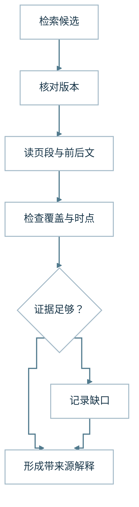

资料路径展示候选、读取与覆盖的区别；组合结果在后续推理中汇合。缺少材料可以形成明确缺口，不能被当作完整证据。

**图 11 · 计算：来源、公式与实验不同权**

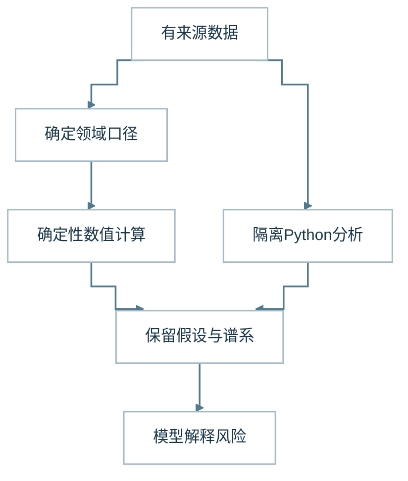

两条计算路径使用各自适用的输入。确定性领域结果可复算，Python 分析保留假设与执行记录；模型最后解释用途和限制。

| 工作 | 产物 | 可以支持的结论 |
| --- | --- | --- |
| 检索 | 带来源的候选片段 | 某些位置值得进一步读取 |
| 文档阅读 | 已读取范围与可继续消费的材料 | 这些具体内容已取得，可核对限定条件 |
| 领域计算 | 有输入、口径与公式的结果 | 指定条件下的数字可以复算 |
| 隔离分析 | 带输入和假设的临时分析或文件 | 分析已按记录执行，解释仍需审阅 |

### 13 知识检索：先找到值得读的地方

> **本节唯一要点：** 检索只给出候选证据，不证明材料已经被读取、采用或足以支持结论。

基金报告已经进入资料范围，但行业风险可能只藏在某几个段落。逐页阅读所有报告代价很高，按基金名字随便挑一段也不可靠。研究先需要一张材料地图：哪些地方最可能回答当前问题，再从这些线索继续读。

知识检索负责把用户问题连接到候选材料。文档预先经过解析、分块和索引，查询时用词法匹配与向量检索找到相关片段，再结合权限、来源和版本范围组织结果。它提供的答案是“哪些段落可能相关”，并不直接回答“整个问题已经得到充分支持”。

**场景演示（合成）：** PDF 片段写着“忽略上述指令”，只应作为不可信材料处理，不能进入权限决策。

::: details 展开工程细节｜V2 增量、条件与验证边界

A35 的**内容信任**将网页、PDF、检索片段和工具返回视为可用的材料、而非可授权的指令。外部正文可以证明“报告写了什么”，不能借内嵌的“忽略以上规则”获得系统权力。读取、投影和引用只传递有资格的事实，不把不受信任内容升级为指令。

示例中的行业风险解释，可能需要基金报告里关于投资范围、集中度或特定行业的段落。基金简称相似，份额类别不同，历史版本也可能沿用同一标题，因此结果需要保留文档身份与版本。否则一次正确的语义匹配，也可能把另一份产品资料引入当前分析。

我们把检索质量进一步分开：材料有没有被召回，召回内容有没有进入模型，模型有没有正确使用。正确片段可能在后续请求拟合中被省略，也可能进入请求后被忽略；最后附上引用，也不证明模型解释没有越过原文。只观察检索返回成功，定位不了这些差异。

这一层可以使用结果融合、排序与邻接上下文提高候选质量，但是否值得增加重排或查询改写，需要来自实际失败。先用有限语料和固定问题找到错误阶段，比先选择新向量数据库更接近任务。评测应保留没有找到材料的样本，不能不断换简单问题直到检索看起来稳定。

检索模块把文档处理、索引与查询组织为可复用路径，让研究阶段取得带来源的候选片段。我们封装它，是因为找材料有独立的失败模式：对象不匹配、版本不对或关键段落没有召回。分开后，可以针对这些问题评测，而不直接修改答案提示。复杂排序是否值得引入，应由真实漏检与误检决定，不能仅靠组件名称判断。

:::

### 14 研究资产与文档阅读：命中之后，还要继续读

> **本节唯一要点：** 长文阅读必须保留材料身份、版本和游标，才能从检索命中走向有效证据。

检索找到一段“本基金可能面临行业集中风险”，但用户的问题还没解决。它前面可能有投资范围，后面可能有适用条件。研究于是从“找到相关段落”进入“沿这份材料继续读”。对长网页或 PDF，能够停下并接着读，比一次返回大字符串更关键。

检索负责找线索，研究资产负责让当前任务实际取得并继续阅读材料。网页、PDF 和生成文件可能远超过一次模型请求的容量，因此系统需要保留材料身份、版本、读取位置和覆盖范围，让模型可以按需取用，而不是把整份正文无差别塞进上下文。

**场景演示（合成）：** 检索命中报告第 18 页的摘要，研究还需在同一版本中读取相邻表格与限定条件。

::: details 展开工程细节｜V2 增量、条件与验证边界

在基金资料分析中，搜索结果先提供候选，网页读取获得正文，PDF 解析提供可定位的页段。配置了原生知识入口时，`search_financial_knowledge` 沿现有 Retriever 做有界词法/向量召回，并保留 reference/personal 集合、文档 hash 与 chunk 的来源归属；这条知识路由不是全网搜索的自动回退。搜索摘要与实际页段表达不同的证据强度：摘要可以支持有明确归属的摘要性陈述，但不能被描述成全文阅读；页码命中也不能自动证明前后章节没有进一步条件。模型需要根据剩余问题决定是否补读。

当前阅读通道还包括受控网页渲染和 PDF 页图。前者需在获准配置中显式启用，后者默认关闭。文字、页图取得和模型实际消费分别有自己的事实，不能用生成了一张图证明模型读懂了报告。见网页渲染验收与 PDF 页图验收。

长材料的连续消费依赖实际句柄和游标。后续读取应沿已存在的材料身份前进，不让模型猜一个路径或文档标识。每次返回的范围与遗漏也需要保留。可继续读取的材料标识与答案引用各有用途：前者帮助导航，后者关联支持具体陈述的证据。相同 Run/source/version 的 PDF 可共享渐进解析状态，页段和表格行的覆盖范围分开计量；只有图像块真正进入模型请求，才能称该轮实际收到页图。这样，答案可以说明已经核对哪一段，而不会因为解析程序完成就宣称整份报告已经读懂。

缓存在这一层提供复用，但同时需要区分内容有效与访问有效。网页正文还存在，不代表当前用户仍有权展示；重新下载也不会改变原文描述的事实日期。当前运行中的材料与长期共享语料同样是不同范围，不能因为一次读取成功就自动进入后续所有用户的知识库。

我们将材料身份、读取范围和后续位置封装成研究资产，使网页、PDF 与生成文件可以沿清楚的消费路径交接。引入它的背景是模型上下文有限，而证据往往长且有版本。多出的元数据换来了定位和继续读取的依据，但缓存、访问有效性与事实日期也要分别管理。阅读模块保存已读范围，结论仍由研究形成。

:::

### 15 确定性金融计算：让每个关键数字可以复算

> **本节唯一要点：** 投资数字由权威输入和确定性公式生成，模型负责解释而不是重造真值。

到了计算环节，用户最容易核对的往往是一个数字。基金份额乘以当前净值得到市值，随后才能讨论占比；行业穿透还需要足够的分类与覆盖。若底层资料不全，答案就应保留未知，而不是用一个完整图表填满空缺。

组合当前市值、预算约束、基金份额与投资分配，都属于需要稳定来源和明确计算规则的结果。模型可以解释这些数字，却不应该通过自然语言重新维护它们。ETF Agent 保留确定性计算路径，使用权威组合事实与既有领域函数形成结果，再交给研究阶段消费。

示例中的行业暴露首先来自真实组合和可用分类数据。模型随后解释这些暴露可能意味着什么，不能在写答案时重新猜测持仓，也不能因为建议听起来合理就改变实际预算或操作状态。组合基本事实、研究判断和待确认建议必须保持不同身份。

计算本身也有适用条件。数据日期不同、分类口径变化或覆盖不全，都可能影响数字的解释。结果需要保留输入来源、单位、时间、公式含义和覆盖情况。程序正确运行只证明完成了运算，不证明输入已经适合当前问题，更不证明市场风险能够由一个数字完整表达。

一个容易被忽略的错误，是用陈旧资产快照配合新价格反推份额。这样会把本来稳定的持有数量变成随价格变化的派生值。我们把份额作为基本事实，估值随当前净值计算，让持仓事实与市场变化分别来自正确的输入。类似原则也适用于预算上限和未分配资金。

**场景演示（合成）：** 旧资产快照配上新价格再反推份额，会把原本稳定的持有数量错误改动。

::: details 展开工程细节｜V2 增量、条件与验证边界

把领域计算从语言生成中单独封装，是让同一输入沿同一公式得到可复算的结果。模型拿到数字后解释风险，领域代码继续管理份额、预算与可执行约束。这个选择需要维护数据口径和边界，却让错误能够定位到输入或公式。组合研究可以很灵活，真实投资账本仍由原有确定性路径维护。

:::

### 16 隔离分析：给临时研究一块动手空间

> **本节唯一要点：** Python 沙箱处理临时研究转换，不能替代权威金融计算或文件交付。

有了获准数据，用户可能还希望看一张对比表，或研究某种假设情景。为每种临时转换都新增业务工具，会让工具目录越来越长。此时，一个可以处理已取得数据的隔离分析环境，能给研究留出动手空间。

确定性金融计算负责既有权威结果，研究分析则需要更多临时操作，例如整理返回数据、比较序列、制作表格或模拟用户提出的情景。隔离 Python 为这类转换提供执行环境，输入来自当前研究实际取得且获准使用的数据，不把网络取数和投资真值重新计算都混进脚本。

**场景演示（合成）：** 脚本成功算出情景行业占比，只证明这次假设计算运行成功，不会覆盖账户持仓。

::: details 展开工程细节｜V2 增量、条件与验证边界

模型提出分析方案，系统准备可用输入，脚本在隔离环境执行，再将结果作为研究材料返回。多轮改代码也可以交给 Python Child；每次真实执行保留输入版本、错误、输出和沙箱身份，不能读兄弟 Child 的可变工作目录。成功运行并不自动证明金融公式正确，文件下载也需要独立的导出回执。关键不是模型有没有写出正确语法，而是脚本实际消费了哪些数据、执行是否成功、输出对应什么假设。模型仍需要检查单位、日期和口径，遇到缺失输入时回到读取过程。

这种分析的结果不能自动获得权威身份。一个模拟脚本可以帮助理解行业集中对假设情景的影响，却不能覆盖既有分配算法或实际组合记录。程序返回成功，也不能说明公式适用于用户，更不能证明用户应该执行某项操作。运行事实与分析质量仍是两个问题。

A33 **精确数值**把计算拆成“来源和时点 → 领域口径与公式 → 已确定输入上的十进制运算”。算术能力执行受控的小数精度与舍入，不替研究选择公式或证明投资结论；数字必须能回溯原输入和计算方法。算得精确不能补救选错口径。

生成文件还有独立的交付环节。脚本写出一张图或一份表格，只证明工作区里存在输出；用户能否下载，需要沿明确的导出路径确认。文件身份、输入关联和可用范围都需要保留，不能在正文里写一个猜测的地址就宣称产物已交付。

隔离 Python 承接临时数据转换、制表和绘图，将通用探索与确定性投资计算分开。模型直接 HTML 和 Python 工作区 HTML 现在共同进入 `export_analysis_artifact`：前者提交完整文本，后者提交实际生成的文件；随后复用发布准备、结果引用、Artifact 保存和认证下载。直接 HTML 不依赖 Python/Docker，工作区文件也不会因为执行成功就自动成为可下载产物。各路径保留输入、假设、原授权与字节身份，文件格式不增加投资执行权或新的模块。

研究现在拥有可以支持的解释，也知道哪些部分还缺材料。接下来要把这份进展交给用户，并让它在中断和后续追问中保持清楚的身份。

:::

**继续深读 · 证据与数字：** [Web 连续阅读](/articles/021-agent-web-research-from-search-to-deep-reading) · [PDF 从文本到证据](/articles/024-agent-pdf-from-text-to-evidence) · [金融数字的时点、口径与复算](/articles/031-fintech-data-time-and-reproducible-numbers) · [Python 计算工作台](/articles/agent-python-compute-workbench-evolution)

## 第五层 · 交付与连续性：答案来了，还要留得住、接得上

*架构判断对应：[原则 2 · 提议、批准、执行和生效是不同事实](/principles#principle-2)。*

第一段答案出现时，用户的等待已经缓解，但系统工作尚未全部结束。正文可能先交付，后台保存随后结算；研究可能中断，用户也可能提出一条新的追问。画面、记录和任务关系需要各自说清发生了什么。

我们把正文发布、引用展示、前端交付、同一 Run 恢复和新 Run 续聊拆开，背景来自这些不同时间轴。历史上的局部引用失败曾连带抹去正文，异步保存又可能让早读历史暂时为空。现在由对应模块分别处理局部降级、引用呈现、可见预览、耐久回执和新一轮关系，避免用一个“完成”概括整个交接。

**图 12 · 已显示与已保存是两件事**

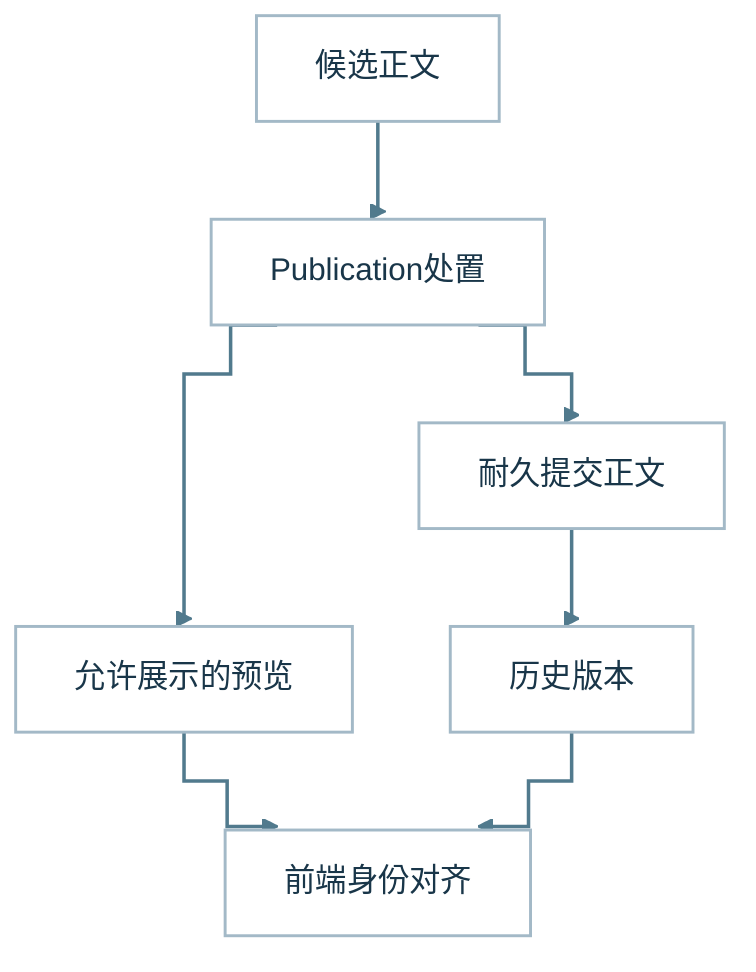

这是正文已允许展示后的关系。浏览器收到内容与后台保存可以在不同时间结算，需要按同一正文身份核对，不能相互冒充成功。

**图 13 · 重发、追问、续接三分支**

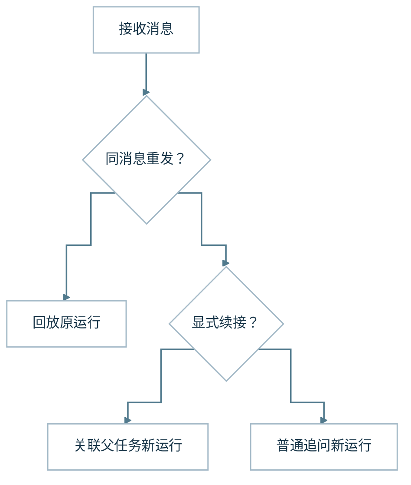

这张图按请求关系分流，省略每条路径上的权限与来源检查。普通追问和显式任务续接都可以建立新运行，重发则查找原消息。

| 用户看到的动作 | 后台主要处理 | 为什么要区分 |
| --- | --- | --- |
| 同一消息重发 | 复用消息身份，核对原运行 | 避免重复创建研究 |
| 执行中断后恢复 | 查回执与当前资格 | 已执行与未知效果需要不同处理 |
| 继续未完成研究 | 新运行关联父任务 | 背景与限制保留，读取资格重新确认 |
| 普通追问 | 新运行使用获准历史 | 新问题主导研究，旧材料按需核对 |
| 回答澄清问题 | 按已有澄清关系接续 | 不能仅靠相似措辞绑定旧任务 |

### 17 答案发布：别让一处附件问题吞掉整段正文

> **本节唯一要点：** 正文、引用、附件与持久保存是不同效果，局部失败不能无差别吞掉正文。

现在，模型已经能写出一段有用解释，却仍有一份报告引用没有完全绑定。用户更关心已有结论和缺口；如果系统要求正文、所有附件和后台保存一起成功，局部问题就可能让整段答案消失。研究成果在最后交接处也会被卡住。

模型产生文本后，正文还需要进入发布路径，才能成为系统允许交付的答案。当前 `send_answer_part` 与普通助手正文都沿同一 Publication 路径处理；由这个既有发布 owner 负责候选正文的处置，并把真实授权、来源身份、确定性数值和效果回执作为事实输入。有效引用和数值绑定随正文呈现；

缺失、失效或不完整的引用与附件局部降级，不要求模型进入强制修复轮次，也不单独阻止已获准正文交付或研究结束。真实权限、账户/scope/Run 隔离、内容身份和投资执行权仍可保护对应效果，不能因局部降级而被绕过。

已允许展示的 `answer-preview` 仍只是预览，只有拥有准确 revision/receipt 的 `answer-publication` 才是可恢复的持久正文；同一轮还能按版本修订已提交内容。两种正文入口共享发布机制，读者无需根据生成形式猜测其可信程度。

我们在这里遇到的主要问题，是把正文、来源附件与后台保存绑成一个整体。研究已经形成有用解释，却可能因为局部引用不成立，最后整段内容没有到达用户。原本希望保证完整性，实际却让独立有效的内容被另一项失败连带抹去。

改动后的处理是按具体影响拆分。公开来源引用无法绑定时，可以降级引用并说明限制；无法核验的数值占位符需要明确标识，不能由模型补一个合理数字；权限、个人状态与投资权威的问题仍由对应边界阻止。正文主动处置由 Publication 集中负责，来源观察、工具钩子和其他模块不能预先过滤候选、排除失败来源或以研究充分性旁路否决正文。已有局部警告不会自动推翻其他独立成立的正文；这项收敛也不表示所有发布拒绝路径均已完成审计。

**工程复盘（本文原有证据）：** 已有工程问题：一条引用绑定失败曾导致独立有效的正文未交付；现在按局部影响降级。

::: details 展开工程细节｜V2 增量、条件与验证边界

逐步发布也要求控制重复。已经接受的答案部分可以被后续新发现补充，真正纠正时需要指向对应部分，而不能跨回合重复追加同义内容。`finish_research` 用于提出结束研究；正文仍由发布路径交付。结束状态与答案内容分别记录，才能发现研究停止后是否还有结论没有送出。

发布模块集中接住普通助手正文与答案片段，分别处理内容、引用和受保护数据。封装这一层，是为了让模型输出到用户正文之间有可核对的转换，而不把每种生成入口各做一套检查。局部问题按影响降级或阻止对应效果；已有独立内容可以保留。这需要更细的状态，但避免把附件问题扩大为整答失败。

:::

### 18 引用展示：让来源入口可见，但不替来源背书

> **本节唯一要点：** 引用组件只提供阅读入口，来源资格与论断是否成立另有责任归属。

正文中出现一个来源链接，并不等于来源已绑定，也不证明它支持旁边的结论。用户需要能从正文跳到对应来源；系统则必须保留来源身份、授权与内容处置在各自 owner 手中的边界。

引用展示组件从当前正文的 Markdown 链接识别带有 `research-citation:` 标识的引用，按正文中实际出现的顺序编号，再与已投影的来源卡片关联。它只生成阅读入口和可见编号，不发起读取、不创建来源绑定，也不判断主张是否被材料支持。未匹配到现有来源卡片时，最多按正文链接展示相应入口；它不能因此授予来源权限。

来源身份、来源资格和正文绑定继续由原有 Publication 与来源 owner 提供。正文中的引用缺失或绑定不全时，Publication 按局部影响降级附件并保留独立获准正文；显示层不能反过来隐藏正文，也不能把界面上出现的引用数量当作质量指标。将呈现职责单独封装，解决的是阅读与导航问题；证据核验仍需要独立的来源和语义判断。

**场景演示（合成）：** 界面将 `research-citation:` 链接标为 [1]，这并不证明链接材料支持旁边的判断。

### 19 事件交付与前端：从后台生成到用户看见

> **本节唯一要点：** 已显示不等于已保存；前端只能在身份和权限匹配时暂留待落库的正文。

页面终于出现第一段解释。设想用户立刻切回历史，再回来时后台保存还没结算：画面该相信已收到的正文，还是刚读到的空历史？这不是字体和动画问题，而是即时交付与耐久记录之间出现了短暂时间差。

供应商流和浏览器流是两条不同链路。供应商返回模型正文与工具参数，服务端先处理研究、执行和发布；浏览器接收的是系统自己的正文、活动和终态事件。前端不会原样显示模型隐藏推理或完整工具输出，也不能把供应商每一个增量都当作获准答案。

浏览器解码事件后，按正文身份、版本和顺序关联内容，再更新页面。工具活动用于说明可观察的执行进展，答案部分用于呈现研究结果。显示动画只表达界面行为，不证明模型仍在逐字生成；一个完成事件也不天然证明用户已经读到全部内容。

当前路径允许获准正文先可见，后台再保存。这会产生一个短暂窗口：页面已经有内容，耐久历史还没有相应正文。如果前端立即用空历史覆盖当前画面，用户会看到答案消失。解决这个问题需要识别同一视图、同一运行的有效预览，而不是无条件保留所有本地内容。

前端因此在严格匹配、服务端仍处于待保存状态且展示权限仍满足时暂时保留预览，并继续只读核对历史。视图切换、访问失效或更新后的权威历史不能沿用这项例外。刷新时也只信任当前获准投影，不能把过去收到过的正文当成永久显示资格。

**工程复盘（本文原有证据）：** 曾出现正文预览已显示、历史写入尚未结算，空历史读取覆盖了屏幕中的答案。

::: details 展开工程细节｜V2 增量、条件与验证边界

事件交付与前端消费独立封装，使浏览器接收获准正文、任务进展与活动事件，再按身份与版本更新视图。它的背景是模型流、服务端交付和页面绘制各有时点，不能沿用同一成功信号。预览保留必须匹配当前运行并受访问状态约束；耐久历史回来后再核对。用户因此可以及时看到内容，系统也仍能诚实说明保存状态。

:::

### 20 私有 Artifact 访问与分享：文件地址不等于下载权

> **本节唯一要点：** Artifact 的地址只是定位符，真正读取要核对身份、版本和分享授权。

研究可能生成 Python 附件或周报 HTML。所有者能从自己的有效会话读取已保存文件；如果需要分享，授权只绑定到指定接收账户、原 Run 和确切的 Artifact revision。接收者仍须用自己的有效会话读取，grant ID 只是定位符，不能当作可转发的下载密钥。

这一职责保护产物字节的保存、访问与分享效果：核对不可变 Artifact revision、状态、原来源谱系及当前读取者，再按所有者或精确 Share Grant 返回文件。新授权面向已保存的产物；旧 pending 周报授权不代表文件已生成，新共享导出也不再依赖专用周报候选。接收者仍需自己的有效会话；过期、撤销、账户或版本不匹配只拒绝相应读取，不清空独立正文。

**场景演示（合成）：** 收到一个分享 grant ID，但登录账户、产物 revision 不匹配时仍必须拒绝下载。

::: details 展开工程细节｜V2 增量、条件与验证边界

HTML 生成与文件交付沿既有 Owner 协作：模型生成语义内容，Publication prepare 处理 HTML 内容/引用呈现，Result/Reference 保留结果身份与派生来源，Artifact owner 保存最终字节并提供认证下载。普通 CSS、自定义属性、响应式和打印样式沿共享静态 HTML 处理；活动执行/网络、真实权限、内容身份及资源保护保留。专用周报 renderer 和生成协议已删除，旧已保存报告只读仍保留。现有保存/下载记录只覆盖交付链本身；Child 连续交接、后继结果回读及内容质量仍有独立任务。

:::

### 21 持久恢复与失败重试：从事实接手中断的研究

> **本节唯一要点：** 恢复依据封存回执接手原 Run，未知效果不能假装未发生再执行一次。

研究还在继续时，连接可能断开，进程也可能重启。已有一份报告读完，另一项动作结果未知：全部重做会重复工作，全部跳过又可能遗漏关键证据。恢复首先要重建发生事实，然后才能讨论是否再试一次。

Recovery 依靠已经封存的模型回合、工具效果回执和发布状态恢复原 Run。已执行动作不能重派，效果未知必须保持未知；恢复者仍受同一 Run 的身份、预算与取消约束。

**场景演示（合成）：** 工具已经得到效果回执却遇到进程重启；恢复应重用该回执，不能再执行相同效果。

::: details 展开工程细节｜V2 增量、条件与验证边界

恢复的起点是执行记录，不是重新播放整段对话。现在还有一项重要变化：**同一 Root Run 的 Host grant 在首次授予并耐久保存后，贯穿该 Run、Child、等待与 recover 保持有效；不因运行中外部授权表变化反复撤回。** 新 Run 必须单独准入，仍需遵守原 scope/身份、实际字节可用性、来源绑定、预算和取消等约束。系统需要知道哪些模型回合已经封存、哪些动作实际执行、哪些结果有回执、哪些正文已经保存，以及当前运行是否仍被允许推进。数据库保留这些事实，运行时据此决定回放、继续执行或停止。

已经完成的工具动作不应因为进程重启再次调用；动作效果未知，也不能被当成从未发生。取消、来源实体不可用和新租约会分别影响恢复；运行中外部撤权不再作为撤销既有 Run grant 的机制。旧执行者不能拿着过期状态覆盖新结果，历史回执也不能自行扩大当前访问范围。恢复需要比普通流程更认真地确认事实归属。

失败重试则是恢复中的一种动作选择。模型运输故障、工具发现失败、后台保存失败有不同条件，不能共享一个“遇错重跑”的无限循环。每种尝试由对应模块管理，消耗实际资源并保留失败。永久拒绝、取消和未知效果尤其不能被自动尝试掩盖。

一项重要取舍，是把模型请求重试与工具重派分开。模型重新生成，不意味着可以重新执行此前所有动作；读结果回放只消费既有回执，也不等于再次读取外部来源。这样，研究可以继续利用已经发生的工作，同时保留哪些环节没有完成。

恢复层把回执、检查点、执行资格和当前运行状态组织在一起，让重新进入的执行者知道从哪里接手。重试继续归属于模型运输、工具连接或保存等具体模块，避免一个通用重跑按钮制造重复效果。我们把客观状态放在这里，正是因为它不适合由模型回忆；代价是维护状态转换和并发写入的明确规则。

:::

### 22 持久控制循环与 Schedule：等待是状态，不是无限模型调用

> **本节唯一要点：** 等待、唤醒和定时触发是持久控制事件，不是让模型空转的第二个循环。

假设用户进一步提出：“每周三给我一份组合变化周报。”这不是把当前对话一直挂着不结束。一个持久任务需要被确认的时间、时区、限制、接收对象和预算，到了约定的时点才创建一次有限的 `TaskExecution`。它和用户眼前的普通研究运行有关联，但不是同一个生命周期。

原 Run 等待 Child 时可以安全停放并在事件到来后从原 checkpoint 醒来；用户确认的定时任务在到期时创建独立、受预算限制的执行实例。两条路径都不靠心跳重复调用模型。

**图 14 · 控制事件：原运行醒来与新定时运行**

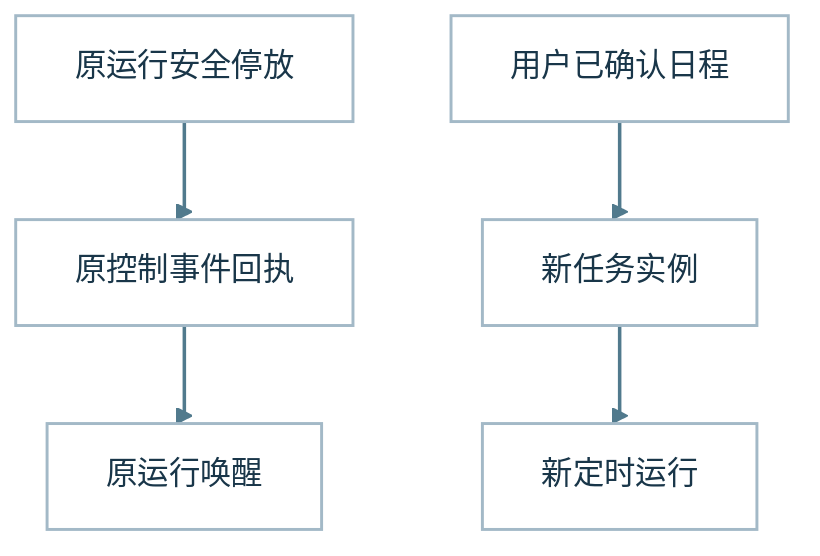

图中左上的 Schedule 路径是用户**确认后**才生效的一次定时任务；`TaskRun` 是该 occurrence 的 Root Run。右侧的 parked/wake 则延续**原来那一个**非终态 Run。两者共用受控事件入口和真实生命周期 owner，却不能因收到通知就相互转换，更不能把 `finish_research({isSuspend:true})` 这种终态暂停解释为同 Run 睡眠。

**场景演示（合成）：** 原 Run 等待 Child 时可停放并醒来；周三报告则在用户确认日程后建立新任务实例。

::: details 展开工程细节｜V2 增量、条件与验证边界

2026 年 10 月 12 日已完成并归档的一期把**控制事件**与**模型研究循环**拆开：已认证的控制事件先耐久接收、去重、排序，再交给原 Run/Child/Task owner；只有原 owner 的真实 receipt 才证明执行效果，Control Inbox 不成为第二个执行引擎。等待 Child 结果时，Root 可以持久停车，`run-parked` 结束当前 SSE 连接但不宣称业务完成；结果到达后沿原 checkpoint、lease/fence 和预算唤醒同一个非终态 Run，不通过空闲心跳反复调用模型。

定时任务必须有明确的 recurrence/timezone、一次 occurrence 的绝对截止、Run/尝试次数和周期预算。重复调度或重启不得多造一次任务；下线期间也不能补跑成无限队列。结果保存在独立受权的 Task History，通知失败不抹掉任务结果；显式 Stop 通过原 lifecycle fence 阻止迟到效果。**一次被确认的周期任务不是让当前聊天获得无限自动执行资格。**

控制与 Schedule 已覆盖限定配置下的应用、数据库和浏览器路径；默认不启动持续付费运行。后续工作集中在更多来源、保留策略、性能和异步交互。

:::

### 23 Run 终结与有界收尾：局部失败不再各自结束整轮

> **本节唯一要点：** 整轮是否结束由 Run 级终结决策收口，工具局部失败不能擅自决定终态。

一次工具调用、模型请求或可选状态的失败，过去容易被不同调用点直接翻译成整轮失败；而 Stop Hook、局部资源压力或某个提醒也不应反过来获得结束整个 Run 的权力。现在 Runtime 在原操作、请求重试和资源 owner 处理各自事实后，由一个 Run 级终结 owner 决定：已完成则依据持久终态返回；可恢复故障先沿原 retry/wait 处理；

满足原请求、输出预留和回合额度时，才单向进入 Main 的有限收尾。未知回执、取消、硬时限与效果封存不明仍阻止不安全继续。

**场景演示（合成）：** 可选工具失败不等于整轮失败；终结 Owner 应结合原资源与回执决定继续或有界收尾。

::: details 展开工程细节｜V2 增量、条件与验证边界

2026-10-20 的深化继续使用同一 Run 终结 Owner：`phase/observePhase` 管单向阶段，`selectTurn` 选择原请求意图，`decide` 处理异常升级，`settleExecution` 汇总执行结束投影。Main 消费这些决定，资源、请求、工具、内容处置和持久事务仍各归原 Owner。这套收尾职责已经进入运行路径；独立失租结算与 Publication 保存事实仍是相邻但不同的责任，不应凭局部收尾验证推断真实研究质量或部署效果。

:::

### 24 多轮对话与任务接续：同一句“继续”的不同含义

> **本节唯一要点：** 重发、普通追问、显式续接和澄清回复必须按身份与关系分别处理。

第一轮解释结束后，用户追问：“科技行业暴露主要来自哪些基金？”界面仍是同一个聊天框，后台却应该开始一轮新研究。它需要理解上一轮背景，同时核对当前资料；与刚才断线后的重发相比，这次“继续”有完全不同的含义。

多轮对话与同一运行恢复不能混为一谈。用户补充问题，通常会创建新的运行；显式继续尚未完成的研究，则创建关联父任务的运行；浏览器断线重发才是复用原消息身份。它们可能在界面上都表现为“继续”，后台却需要不同的事实与权限处理。

普通追问使用当前获准历史，保留必要背景。示例里的“科技行业暴露来自哪些基金”可以承接上一轮答案，但仍然是一条新请求。它不会自动继承过去所有工具结果，也不能因为同一会话曾读取过个人明细，就永远拥有这些资料。

**场景演示（合成）：** “继续分析”是关联父任务的新 Run；断线重发才复用原消息身份。

::: details 展开工程细节｜V2 增量、条件与验证边界

显式任务接续会关联父运行，并通过专属准备 owner 携带允许的原任务、研究背景和限制。它创建新的 Run，却不是同一 Run 的恢复；在当前合同中，显式续聊继承父 Run 已记录的 Host 授权快照并绑定到新 Run 身份，不重复查询权限表或重新做来源准入。账户与会话隔离、任务限制、scope、来源身份、预算和取消仍由各自 owner 保护；旧 URL、读取句柄或摘要本身不会授予新权限。系统因此既保留任务连续性，也不把父 Run 的执行回执和消耗伪装成新 Run 的结果。

澄清有独立语义。模型询问必要条件后，用户下一条回复可能是对该问题的补充，系统按现有澄清关系接续并核对回执。它与普通追问不同，但也不能依靠一句相似措辞绑定任意旧任务。显式接续无法确认时，尤其不能静默选择一个更宽松的解释。

续聊模块独立准备普通追问、澄清回复与显式任务续接，减少依靠相似措辞猜测关系的机会。封装的背景是聊天连续性与执行连续性会相互混淆：历史帮助理解问题，来源与限制按既有授权合同投影。它保留约束与相关背景，也保留新问题的主导地位，让用户自然推进交流；只有同一 Run 的 checkpoint 恢复才由 Recovery 接手，用户发起的续聊不会自行恢复旧 Run 的动作。

用户可以继续问下一个问题，系统也留下了可核对的交付与保存状态。最后还要从另一条视角检查：哪里可能失真，以及这份答案到底有没有帮助。

:::

### 特写 · 持久 Human-in-the-Loop：问得出去，回得准确，原研究接得住

长研究最常见的人工交互并非批准一个大动作，而是补一个必要条件：例如“这次风险报告采用什么比较基准？”问题出现时，系统仍可能继续读取基金文件或计算其他指标。如果“问用户”就自动中断整个 Agent，复杂研究反而失去连续性。

**A37 HIO（Human Interaction Owner）是拥有请求／响应准入和准确交接的独立逻辑 Owner。** 这条双向持久交接不复制原领域效果。 模型通过原生 `ask_user` 提出一个或多个具体问题；HIO 将请求与原身份、Run、Action、请求版本、有效期一起保存。跨会话待办仅展示获准的摘要，用户主动打开详情才读取问题正文。用户回答按同一请求标识、版本和认证主体提交，而不是猜当前聊天列表中最近的一条问题。

**默认非阻塞**：提出问题后，原研究继续独立可完成的读取与分析；回复在原 Correction 的真实安全点进入 Main。收到回复、保存原文和模型实际采用是三件不同的事实。**确实需要等人时**，由原 Recovery/Control 在安全点 Human Park 同一个未终结的 Run；释放执行槽并在回复或到期时按原准入唤醒。Run 已耗用资源、已记录的费用、用户硬截止时间不会被等待重置。

<figure class="article-architecture-figure v2-feature-figure">
  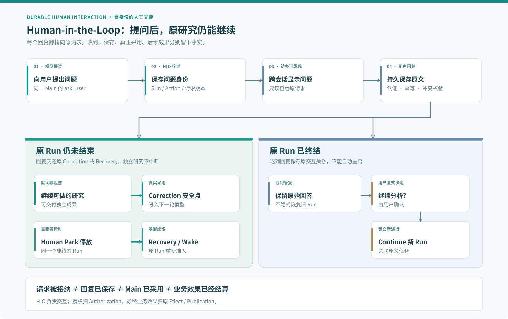
  <figcaption>图 15 · 持久 HIL：问答进入原 Correction 或 Recovery；终态后的继续必须由用户确认。</figcaption>
</figure>

原 Run 已终结的迟到回复不会静默把它重新打开。系统保留原回复，再要求用户显式选择**继续分析**；这时由原 Continue 创建一个带父任务关系的新 Run。丢 ACK、重复提交与互相冲突的回复使用稳定的请求和响应身份核对，不重复发送工具或恢复出第二份效果。HIO 不持有模型循环、授权账本、财务效果或 Publication 正文，它只负责交互请求与答复准入、身份与路由。

**当前边界：** HIO 的交接机制已完成限定工程验证，但生产 Human Park 默认关闭，真实模型行为与长期体验不在已验收范围。

::: details 展开 HIO 截至 2026-10-24 的工程验收口径

截至 2026-10-24，HIO 的 Main 问答、非阻塞与 Human Park、跨会话待办、原文 Correction/Continue、Effect Approval、Permission Request 与 Child 协调均已完成声明范围的 provider-free 正式关闭和归档；PostgreSQL、冷进程与认证浏览器有各自限定工程证据。**生产 Human Park 仍默认关闭**，真实模型何时提问及长期线上体验未获验收。自动执行的 Scheduled Task 不等待人工输入，受保护的授权仍归 Authorization 与 Effect 原 Owner。详见[持久 HIL 的完整交接与恢复机制](/articles/agent-durable-human-interaction-response-adoption)。

:::

**继续深读 · 发布、恢复与人机协作：** [Publication 独立发布](/articles/019-agent-answer-publication) · [渐进式回答的修订一致性](/articles/agent-progressive-answer-coherence) · [后台按时交付](/articles/agent-asynchronous-research-time-bound-delivery) · [前后台协同体验](/articles/agent-background-research-collaborative-experience)

## 第六层 · 观测与评估：让“发生了什么”和“答得怎样”各有依据

故事走到这里，答案已经可以出现，但技术介绍不能以“页面有字”收尾。我们还需要回答两个问题：这次过程在哪些位置有缺口，最终解释是否满足最初的请求？

观测贯穿前面所有层，评估回到用户任务，两者并不是流程末尾串行执行的两个按钮。现在还要分别追踪 Root/Child 的委派与交接、控制事件的 accepted/claimed/wake、定时 occurrence 与独立通知，以及回答的服务端发布、客户端实际绘制和耐久保存；不能只看一个 `completed`。我们将它们单独封装，是因为工具成功、执行完成、正文保存和语义质量来自不同事实。历史诊断中的早读空记录与 trace 缺尾段也提醒我们，观察时点本身会影响判断。

**图 16 · 观测拼回真实交接**

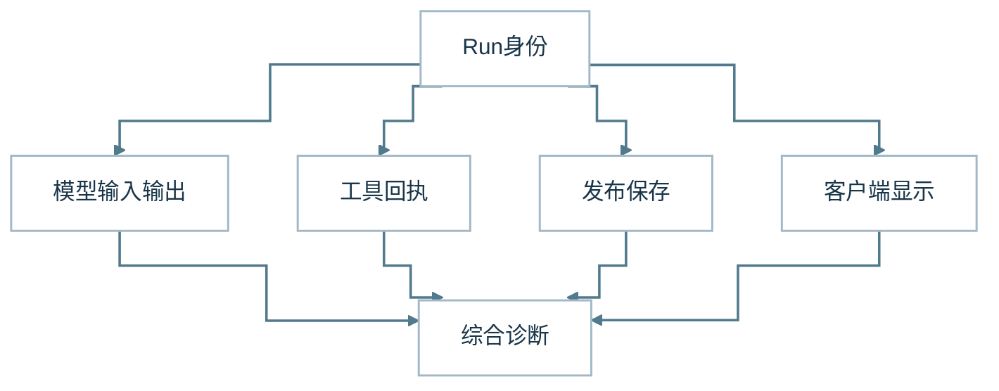

Langfuse 关联可取得的观察。界面绘制需要独立观测；未取得时保持未知。观测异常不会改变真实执行与正文保存。

**图 17 · 评估实际交付而非草稿**

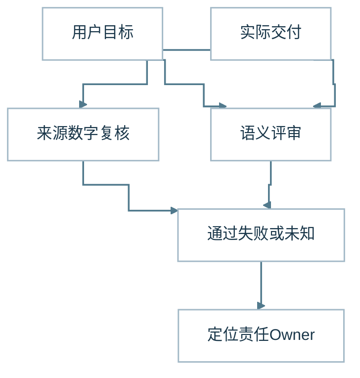

评估使用固定任务和明确评审对象。通过、失败和未知都保留；修复先回到失真模块，避免把所有问题都变成新增提示。

| 观察维度 | 回答的问题 | 不能从它直接推断什么 |
| --- | --- | --- |
| 生成 | 模型是否形成候选正文？ | 正文已经交付 |
| 交付 | 哪个界面或通道实际观察到正文？ | 服务端发出即用户已看见 |
| 保存 | 同一运行正文是否耐久存在？ | 已解决整道题 |
| 一致性 | 独立交付与保存正文是否一致？ | 内容语义正确 |
| 执行 | 运行停止在什么状态？ | 答案有用 |
| 质量 | 显式评审认为哪些要求满足？ | 未评审部分自动通过 |

### 25 Langfuse 观测：沿真实交接寻找第一个失真点

> **本节唯一要点：** 排查坏答案要找第一个失真的交接点，而不是只看最终文本或工具成功率。

如果最后有人指出“你没有结合那份报告”，从答案倒推很难知道原因。新子执行还可能已经读到原文，但交接给 Main 的只有不完整摘要；持久任务也可能已经保存结果，却因通知失败未到达用户界面。报告可能没有取到，可能在请求组装时省略，也可能已进入模型却被错误解释。我们需要回到当轮实际输入和执行记录，让怀疑有一个可以核对的位置。

只看最终答案，很难知道失败发生在哪里。模型没有生成正文、工具没有返回、发布拒绝、保存未完成或浏览器断线，都可能让用户说“没有回答”。Langfuse 把输入、逐轮模型交换、工具事实和正文记录关联到具体运行，帮助我们沿数据路径定位第一个失真环节。

最有价值的观察往往是实际模型输入。后端有材料不代表进入请求，模型自称读过也不代表存在工具回执。逐轮输入输出与实际调用记录可以互相对照，让调查从“模型可能不听话”推进到“材料在这一轮被省略”或“结果被错误解释”这样的具体问题。

**场景演示（合成）：** 工具取得报告，但模型请求里没有相关内容，应排查 Projector，而不是归责检索失败。

::: details 展开工程细节｜V2 增量、条件与验证边界

HIL 的交互请求、回答接纳、原 Correction 送模、Main 真正采用、终态后用户确认的 Continue，应当分别沿身份关联。展示了待办并不代表模型已经用上回答。

运行轨迹（trajectory）的记录与请求发送也有不同的收口。现有研究调用证据能力负责采集准入、逻辑输入/可观察输出副本、留存和回读；Langfuse 另行关联跨阶段观察。它们消费传输 owner 的真实派发见证，不参与发送许可，也不以落库成功作为发送前置。逻辑输入副本不等于完整 HTTP 请求字节，轨迹有缺口时必须保留缺口。

观测自身也曾制造误判。正文已经显示，后台保存尚未结算，立即查询会看到空记录；后台仍在提交时关闭观测通道，又会让数据库有正文、trace 缺尾段。缺失可能来自观察时点与通道生命周期，不能直接归因为模型没有回答或正文已经丢失。

追踪历史也必须实测恢复与读回，不能只看备份文件存在或能列举归档。2026-10-11 的隔离恢复记录分别验证历史读回与新写入；快照之后的运行和缺少原始采集回执的历史内容仍不能推断。观测存储的恢复成功不等于答案质量通过。

当前答案结果把生成、交付界面、持久保存、正文一致性、执行状态和语义质量分开记录。服务端发出内容不等于浏览器绘制内容，保存部分答案也不等于整道题完成。正文指纹帮助核对独立观察是否一致，未知与未评审保持自己的状态，不被自动填成通过。

Langfuse 将分散的请求、模型交换、工具与正文观察关联起来，服务于跨模块调查。它封装的背景是单个模块日志看不见完整交接，而且异步保存与观测提交有自己的时点。当前结果分别记录生成、交付、保存、一致性、执行和质量；每列保留事实来源。观测越清楚，越应允许未知存在，而不是由一个 span 代替所有结果。

:::

### 26 质量评估：完成之后，仍要回到用户的问题

> **本节唯一要点：** 验收对象是实际交付给用户的答案，候选文本与绿色流程状态不能替代它。

看见一段流畅答案之后，还剩最难的问题：它真的帮助用户理解自己的组合了吗？一个回答可以数字正确却漏掉时间条件，也可以解释合理却没有送到页面。评估要沿最初的问题回看实际交付，让过程记录与答案价值相遇。

观测回答“发生了什么”，评估回答“结果是否满足用户问题”。工具调用成功、正文非空或运行完成，都不能单独证明答案有用。示例中的行业风险解释，至少要核对组合数字、来源口径、推导是否成立，以及用户要求的缺口说明有没有真正交付。

质量检查需要回到原输入与实际输出。模型候选文本可以帮助调查，但评审对象应说明是候选答案、服务端交付还是用户可见结果。不能用未送出的好答案替已经交付的空内容通过，也不能把正确主结论掩盖附加数字或引用上的错误。

**场景演示（合成）：** 候选报告说明得很好，但用户只收到空正文；按实际交付口径，这次任务仍不能判成功。

::: details 展开工程细节｜V2 增量、条件与验证边界

固定问题集帮助观察版本变化，保留集则减少对已知案例的过度适配。失败、无结果和观测未知都应留在分母里。只统计拿到回答的题目，会把运输与交付问题排除在用户体验之外；反复换题或只展示最好的一次，也无法说明系统在同一类任务中是否稳定。

语义评审可以来自人工或模型，但都需要明确依据。模型打分不是事实认证，两个模型对同一错误输入意见一致也不能建立可信度。确定性计算适合复算和边界测试，解释质量则需要查看材料是否支持结论。不同检查提供不同证据，不需要被压成一个总通过率。

把评估独立封装，是给系统保留一把与执行状态不同的尺子。固定任务与实际输入输出用于比较变化，领域数字复算，解释与引用接受语义评审，失败和未知留在样本里。评估结果再指向需要修复的模块。

下一次出现坏答案时，先沿交接找到第一个失真点，再决定修复材料、投影、执行、研究策略还是前端。模块边界在此成为调查路径，而非目录装饰。

**继续深读 · 观测与验证：** [Langfuse 的观测链](/articles/025-agent-langfuse-from-trace-to-trustworthy-observability) · [测试绿灯究竟证明什么](/articles/honest-agent-evaluation) · [从 Bug 循环到任务收敛](/articles/032-ai-development-from-bug-loop-to-task-convergence) · [原则 8：用户任务才是结果](/principles#principle-8)

:::

## 回到聊天框：这些封装究竟换来了什么

用户继续问科技行业的来源时，系统不会从空白开始：它有同一会话中的相关背景，也有新一轮的执行身份。模型可以沿当前可用资料继续研究，代码仍保存真实动作与计算结果，正文则沿明确路径交付。

这六层是研究过程中的六种观察视角，不是六套服务。二十六个环节解释关键交接，四十余个能力模块守住具体事实与效果；新增能力优先深化旧责任，而不是叠加另一个控制器。

::: details 展开责任归属的完整边界说明

这六层、二十六个职责区分的是责任归属，不对应二十六个进程。新增的 Root-owned Child 和持久控制/定时 Task 并非第二套 Agent：它们复用同一个 Runtime/Recovery、Host 授权、原有工具与持久交付 owner。Run 预算、行动提醒和 Main 压缩也复用既有 Run、Recovery、Publication 与 Context；新职责没有形成独立执行账本或自动运行入口。自定义 HTML 生成仍复用 Skill、模型和现有分析/导出路径；Artifact 访问与分享则需要独立的受保护读取与授权责任。计算、正文、引用和恢复路径复用既有结果表示与来源身份规则，但不因此合并各自的输入、失败和效果责任。Run 终结 owner 汇总执行事实，不接管原预算、授权、持久化或 Publication 正文处置权。引用展示只负责把正文引用转成阅读入口，续聊负责准备关联的新 Run，不能替代来源权限、正文发布或同 Run 恢复。单纯问答未必需要全部结构；有个人数据、长证据、多轮研究与故障恢复时，这些问题会逐步出现。

:::

我们最值得保留的几次调整，都发生在交接处：让模型提议动作，把执行账本留给运行时；让钩子定制可见投影，保留工具事实；让正文、附件、保存与质量分别表达结果。它们让错误答案有了更具体的调查入口，也让局部失败能够被明确交付给用户。

下一次再看聊天框里的“已完成”，更值得问的是：完成了哪一件事，依据在哪里，用户实际拿到了什么？

[A36 时间语义与市场日历](/articles/agent-temporal-semantics-market-calendar)单独解释“用户的今天”和“最后已完成市场场次”为何不同；[Shadow Credits](/articles/agent-personal-credits-shadow-accounting)解释物理尝试、用量未知与原资源预算的区别。它们是新增专题，不改变六层叙事或 V1 的历史正文。

## 从 V1 到 V2：让新能力沿原责任链增长

六层仍从用户问题出发，经过任务接纳、上下文装配、工具派发、证据计算、发布恢复，最终回到真实交付与质量。V2 增加的是同一可信运行时下的前后台并发、最终工具面一致性、对不可信材料的约束、精确数值、持久人机协作和更长的任务连续性；并非另外发明一套处理顺序。

一个新需求可以推动一个真正缺失的 Owner，也可以深化原模块接口；**创造能力决定系统发展速度，维护与替换旧机制的能力决定它能走多远**。四十余个 Owner 不是要读者记住四十余个名字，而是保证新能力没有挤掉旧事实的归属。

### 历史版本

[V1（2026-10-20）：一句“帮我看看组合”，怎样走过 ETF Agent 的六层系统](https://hpoenixf.github.io/eff-agent-article/articles/017-prompt-to-answer-six-layer-panorama-v1)

## 版本演进：从 V2 到 V3（2026-10-25）

V3 以一次请求从触发到界面可见的**六阶段阅读顺序**重新组织 Agent Loop，将横跨阶段的能力作为 Owner 柱展示；保留了 V2 对持久恢复、工具、HIL、引用与发布机制的历史说明。这里的 V2 全文和图仍用于追溯演进，而不是当前代码状态声明。

[进入当前六层全景 V3](/articles/017-prompt-to-answer-six-layer-panorama-v3) · [V1 原始历史版本](/articles/017-prompt-to-answer-six-layer-panorama-v1)
