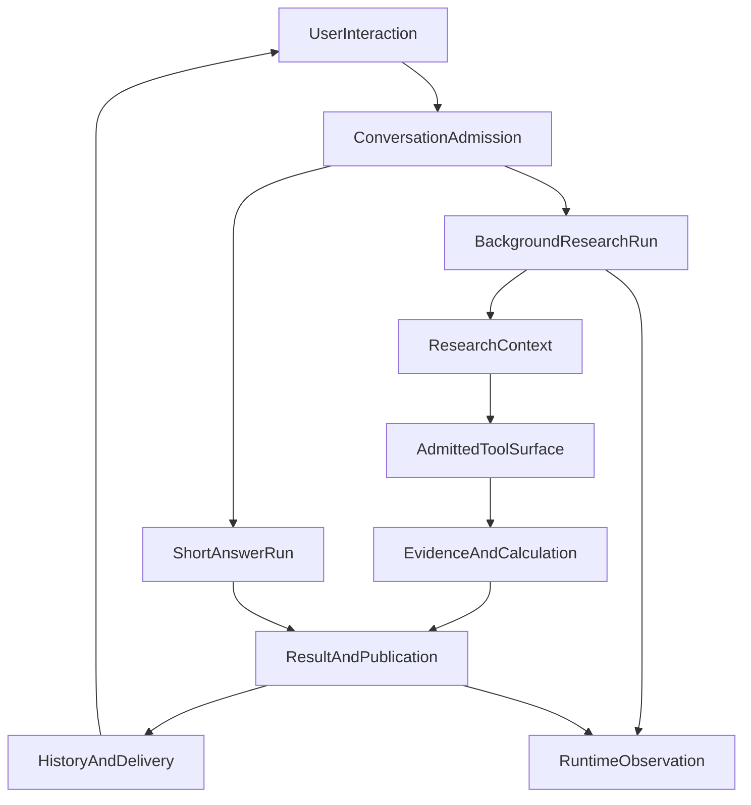
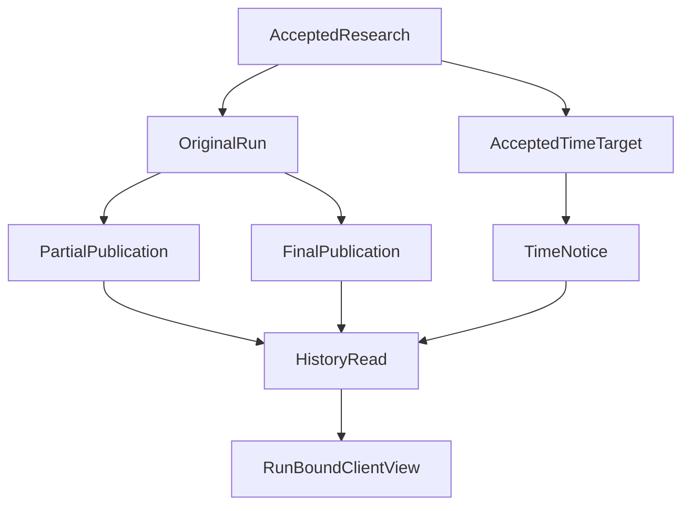
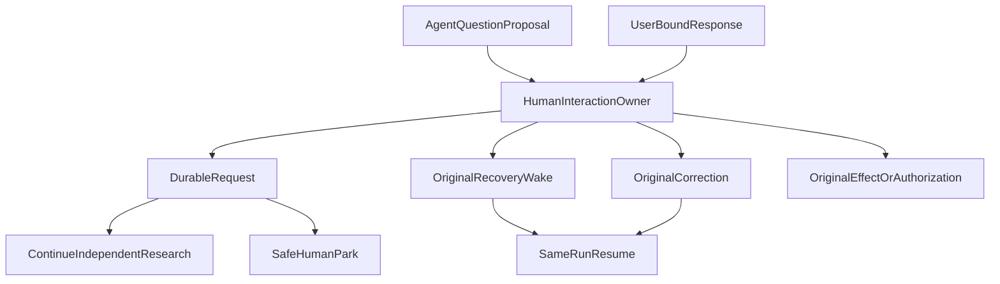

# 从一次提问到持续协作：ETF Agent 六层系统全景 · V2

> **V2 架构截面：2026-10-23。** 本文是系统演进的第二版，而非对旧文的覆盖或否定。它解释了从单轮研究到并发交互、长期交付的结构变化。本文涉及的 **HIL（Human-in-the-Loop）属于已完成设计、尚未完成产品实现的展望**；工程闭环、正式部署和真实模型研究质量不是一回事。

[阅读 V1：一句“帮我看看组合”，怎样走过六层系统](https://hpoenixf.github.io/eff-agent-article/articles/017-prompt-to-answer-six-layer-panorama-v1) · [V1 原版图文存档](https://hpoenixf.github.io/eff-agent-article/visuals/017-prompt-to-answer-six-layer-panorama/v1.html) · [最新 Owner 图册](https://hpoenixf.github.io/eff-agent-article/gallery) · [技术文集目录](https://hpoenixf.github.io/eff-agent-article/catalog)

## 一、为什么要有第二版：研究不再只有一条前台流水线

第一版从“帮我看看组合”出发，把 Agent 拆为交互与驱动、上下文与方法、能力执行、证据与计算、交付与连续性、观测与评估六层。这个划分依然成立，尤其是它坚持：**模型决定研究策略，代码负责授权与执行事实，独立的交付机制决定用户实际收到什么。**

但系统随后遇到的主要问题变了。用户发起一项复杂研究，研究需要持续读取资料、委派 Child、进行计算。如果用户在这时又问“行业集中度是什么意思”，不应该为了获得短回答而先取消大研究。若用户进一步说“把刚才的风险比较补上汇率因素”，这又不是一条无关的新问题。与此同时，浏览器可能离开，研究阶段性正文已经保存，定时通知还未到点，随后才交付最终报告。

**V1 主要描述一次研究怎样穿越六层；V2 进一步描述多条工作怎样共享一套可信运行时，又不互相抢夺身份、执行权和答案。** 我们没有为这些场景再造一个 Background Agent、Coordinator 大循环或第二套授权账本，而是把并发、交互、时间、结果都接回现有的能力 Owner。

用一个明确标注为**合成场景**的例子贯穿全文：

1. 用户要求“分析我的基金组合行业重叠，并给出依据”，选择后台 Research。
2. 原研究继续时，用户在同一对话问“行业集中度是什么”，系统独立作答。
3. 用户对后台任务提出明确的补充要求，系统把调整关联到目标 Run；普通新问题不会被默认为纠偏。
4. 研究先产生可阅读的部分成果，到达承诺时间时通知真实进度，随后按原身份交付最终结果。
5. **未来 HIL 场景（尚未实施）：** 研究途中若需要询问投资期限，可先继续独立工作，或在合法安全点等待用户回复，而不让一个审批按钮冒充真正的业务授权。

这五步并非一段真实线上录屏，更不表示所有能力已经一同上线。它是为了说明职责如何衔接的教学场景。

## 二、六层仍然存在，但它们不是六个进程

| 六层视角 | V1 主要解释什么 | V2 要增加的关键交接 |
| --- | --- | --- |
| 第一层：交互与研究驱动 | 消息身份、Entry、Native Loop、Subagent | 后台与短交互分别准入，按 Run 定向协调，明确的研究意图不被降为 Direct |
| 第二层：上下文与方法 | Projector、Skill、Memory、压缩 | 原始内容与指令身份分离；压缩、可见工具表面与来源谱系不能互相签发权威 |
| 第三层：能力接入与执行 | Gateway、MCP、Host、Hook | A34 核实模型最终实际看到的工具，A35 守住最终 SDK 请求的内容身份 |
| 第四层：证据与计算 | Web/PDF/RAG、Python、金融规则 | A33 负责精确数值操作，金融方法决定口径，结果与引用保持可追溯身份 |
| 第五层：交付与连续性 | Publication、History、Recovery、Schedule | 分段正文、后台视图、at/by 通知、持久接续；HIL 作为未来交互桥梁 |
| 第六层：观测与评估 | Langfuse、运行状态、质量评测 | 原物理 Attempt、已交付正文、评审样本分别核对，不能用一次绿测代替用户价值 |

这里的“层”是阅读顺序，不是模块、微服务或数据库的数量。独立能力总量按实时维护的 [Owner 图册](https://hpoenixf.github.io/eff-agent-article/gallery) 查看，不再把某天的 Owner 数硬编码成这篇长期阅读入口的架构真理。

图里的回到 UserInteraction 是后续新交互，不意味着一次 Run 能无限自我循环。六层之下始终使用不同 Owner 的事实：账户与消息、Run grant、预算、工具执行、来源、出版、恢复和评估各有归属。

## 三、第一层：从“这个对话正在忙”到“哪些 Run 各自在工作”

在 V1 的前台故事里，一次发送通常对应一次有序的研究和回答。初期页面容易用 `busy` 或 `activeRunId` 解释“现在能不能再输入”。一旦允许后台研究和多个短问，这样的单例假设会把不同用户意图混在一起。

新的并发会话入口将**短交互和后台 Research 作为独立准入类别**。在当前受控工程配置中，初始短交互上限是 3、后台研究上限是 1；还必须同时遵守整个 scope 的容量、原 Run 资源预算和 Provider 容量租约。它们不是三份可以互相挪用的额度。配置有开关且**默认关闭**，不能据受控浏览器/数据库验证宣称已经面向生产用户开启。

入口并不建立第二个分类模型。没有后台研究时保留 Direct/Research；有后台研究时，在已验证初始配置下采用 Direct/Coord。显式选择后台 Research 或 Deep 表示明确研究意图，可以走既有直入 Research 的路径，实际 Deep 资源批准仍由原预算 Owner 执行。

区分三种看似相同的“继续”格外重要：

- **新的短问**：产生自己的 Run，回答不附着在后台研究的最新 assistant 消息上。
- **对某个后台研究进行纠偏或 Stop**：目标必须明确指向合法的 Run，不能由“最近一条消息”猜测。
- **断线重连或同消息重试**：回到原执行身份和已发生回执，不新建 Run，也不能将未知的外部派发当成没有执行过。

这也是前端架构变化的核心。时间线上两个回答可能逆序完成；历史读取可能替换临时消息；旧快照还可能比新快照更晚抵达。UI 必须围绕 Run、Publication revision 和有序事件组织内容，而不是依赖数组末尾或一个共享 loading 状态。受控验收覆盖了这些交接与真实浏览器、PostgreSQL 路径，**但没有证明自然语言路由质量、长期线上并发或多后台真实执行**。

[专题：想聊就聊——后台研究和前台交互](https://hpoenixf.github.io/eff-agent-article/articles/agent-background-research-collaborative-experience)

## 四、第二层：给模型材料，不等于授予材料权威

研究继续时，Main 可能需要组合资料、Web/PDF 摘录、Python 的结果、Child 的摘要、用户背景和旧的已提交正文。A14 Projector 决定**本次送模材料怎样装配、拟合、保留来源身份**；A28 Main 压缩对已结算的历史轮次选择候选、采纳摘要并提交 checkpoint；A26 Memory 另管长期记录和遗忘。这些能力可以协作，却不能互相替代记录真值。

压缩的难点不只是减少 token。摘要可能保留一个推断，却丢了它的来源或前提；同 Run 恢复不能因此把它晋升为新的工具回执。工具结果外置、持久结果引用和实际送模投影各保留独立身份，必要时回到原始材料，避免“模型看见了一段摘要”被误读成“来源已经核验”。

V2 还补入**A35 内容信任与指令边界**。来自 Web、PDF、Child 或 Memory 的内容可以被模型分析，不会因出现在合法的消息结构里就自动成为当前用户指令，更不能提升到 Host system 指令。当前第一阶段通过最终 SDK 请求的结构身份核对守住这一类越界；这不等于能识别一切合法载体内的语义型提示注入。

因此，本层最重要的判断不是“把所有内容塞进上下文”，而是：**模型应当知道材料来自哪里；运行时只确认它确实知道的身份，不替模型裁定内容是否充分、可信或正确。**

[延伸：Main 压缩](https://hpoenixf.github.io/eff-agent-article/articles/agent-main-run-context-compaction) · [A35 内容信任](https://hpoenixf.github.io/eff-agent-article/articles/agent-content-trust-prompt-injection)

## 五、第三层：Host 接得上工具，模型最终也要看得见

V1 已经讲过 MCP、Skill、插件和 Hook：能力从服务发现到授权，再由 Host 执行。继续开发后我们发现，仅证明“系统登记了某个工具”是不够的。最终交给模型的一次请求，可能因为 Skill、原生工具或 Hook 的后期变换，暴露了过期目录、不同 Schema，甚至漏掉本已合法的能力。

A34 **Model Capability Presentation & Tool Surface** 因此负责两种非常具体的事实：Entry 阶段的受限 Host 能力简介，以及 Research 真正发送前稳定、有序、与已准入执行面一致的逻辑工具表面。它消费原 A04 授权、A11 调用、A31 MCP 服务接入、A12 Skill 等 Owner 的结果，**不再造一份工具权限表**。

如果最终请求的工具呈现与真实可执行面不一致，A34 可以拒绝本次请求准备；它不能因这一次失败结束整个 Run，也不能清空已经获准的正文。A10 仍拥有模型协议和物理发送，A29 仍拥有 Hook 调用生命周期，真正的工具回执仍归调用 Owner。

这与 A35 形成两个相邻而不同的保护：**A34 询问“模型看到的能力，是否就是 Host 当次准许使用的能力”；A35 询问“模型收到的指令与材料，有没有在变换中偷换身份”。** 它们都不决定研究问题的答案是什么。

[专题：A34 Tool Surface](https://hpoenixf.github.io/eff-agent-article/articles/agent-model-capability-presentation-tool-surface) · [MCP Host](https://hpoenixf.github.io/eff-agent-article/articles/mcp-host-from-discovery-to-consumption)

## 六、第四层：证据身份、金融方法和精确数值必须分开

用户问行业重叠时，模型要把一个主张拆成可追溯的来源、合适的分析方法和可复算的数字。Web/PDF/RAG 找材料，Python 工作台承担动态分析，领域方法确定诸如穿透、归因、费率或现金流等实际业务口径；A16 结果与引用管理保留来源/派生谱系，而不是让报告只留下一个看似合理的数字。

新增 A33 **精确数值运算（Numeric）** 只对显式的十进制量进行受控运算，包括同单位加减/比较、已绑定乘法、比例缩放和舍入。它能保证一次规定运算按合同执行，却**不会选择金融公式、推断单位、认证来源或决定投资建议**。如果一笔组合风险计算错误地采用了不适用的口径，再精确的小数运算也救不了语义错误。

这层的重要性是把三类问题分开调查：

- “数据来自哪里、是哪一版？”由原来源与结果谱系回答。
- “为什么采用这个计算方法、假设是什么？”由领域规则和研究模型解释。
- “在已确定输入与方法下算出的值是否正确？”由原计算 Owner 和必要时的精确数值操作核对。

独立的 Partial/Unknown 不能被当成完整结果；引用能跳转不意味着它支持正文所有推论。金融信息保留时间、口径与缺口，模型不得凭流畅措辞补出未获准的个人持仓事实。

[专题：金融数字的时点、口径与复算](https://hpoenixf.github.io/eff-agent-article/articles/031-fintech-data-time-and-reproducible-numbers) · [Python 结果消费](https://hpoenixf.github.io/eff-agent-article/articles/financial-agent-python-result-consumption)

## 七、第五层：答案、通知、恢复和人机对话不是一个状态

一次后台研究可能先提交部分正文，后产生完整报告。A23 Publication 决定正文的准备、修订与提交；A16 保留结果身份与引用；A24 History/Delivery 管有序读取和通知；A25 页面显示对应的 Run 与 Publication；A06 处理继续、收尾和技术终态。**“模型想好了”“服务端发出了”“数据库保存了”“浏览器显示了”是不同事实。**

新的异步交付还把用户时间约定与研究完成时刻分开。对于 `at`，最终定时通知不得早于约定时点；对于 `by`，系统需要区分有没有赶上期限。在目标时刻仍只有已提交的 partial 时，可以如实告知用户正在继续，之后再记录独立的 final。通知只读取原结果，不自行重跑研究或复制一套报告权威。

图片呈现和附件保存又是不同责任。HTML 可以经过原发布准备和 Artifact 保存/认证访问，但附件失败不得自行抹掉已合法交付的文字。恢复则依据原 checkpoint、Run 身份、租约和已结算效果继续：重建“发生过什么”，而不是让模型重新编一个漂亮的执行历史。

### 展望：按现行 Spec 设计的持久 HIL（尚未实现）

以上能力解决了“研究在后台继续、用户仍能聊天”。下一道工程题是：**Agent 在研究过程中真的需要用户输入或批准时，怎样提问、等待、收到回复并返回正确的工作，而不阻塞无关任务？**

2026-10-23 的 [Human Interaction Owner 设计](https://github.com/hpoenixf/etf-agent)选择一个双向的 HIO（Human Interaction Owner）。这一设计已写入 OpenSpec，**Stage A–D 的产品任务仍未完成**。以下用计划语气描述，不是产品现状：

**第一步：默认非阻塞提问。** 模型决定问什么和是否需要阻塞；新 `ask_user` 默认 `non_blocking`。用户未答时，原研究继续独立可做的工作，也可以带着真实缺口交付。不能因为提问了就阻止所有正文或强迫模型多转一轮。

**第二步：需要等待时由原 Recovery 停放。** 如果确实没有可推进的工作，模型可以提出 `blocking`；HIO 负责接纳有身份的交互请求，原 Recovery 在安全点对同一个非终态 Run 进行 Human Park。单个 Root 同时最多一个实际 Human Park；等待不会重置已使用的模型预算、真实费用或用户硬截止时间。能否释放并发槽位与 Wake 重新获取执行名额，仍由原 Scope、Deadline 与 Recovery 判断。

**第三步：回复必须精准路由。** 当前会话卡片与跨会话的待办入口应指向同一个原始请求。用户回复附带稳定的请求/版本/认证身份，而不是看聊天列表的“最新问题”。运行中的回答通过原 Correction 安全点进入 Main；等待中的回答通过原 Wake 恢复同 Run。如果原 Run 已终结且回答尚未采用，必须提示用户是否**继续分析**，明确同意后才可通过原 Continue 创建关联的新 Run。

**第四步：询问、批准和执行保持三种事实。** HIO 未来可以接入可申请的 Permission 与待批准的 Effect，但收到一句“同意”不等于权限已经授予，用户审阅旧参数不等于可以执行被替换的新参数。HIO 只接纳和转交请求/答复，Authorization 与 Effect Owner 依旧拥有实际准入和效果。Child 的咨询由 Main 协调，不自行向用户扩散通知；**自动执行的 Scheduled Task 明确禁止 HIL**，不能无限挂起等待人类来补批准。

这里的箭头表示**未来接口的职责连接**，不是所有分支必然同时发生。未收到响应、已收到但未被原 Owner 采用、审批已接受而操作仍未知，都必须分别保留。HIO 最重要的克制是：不建立第二个模型循环、不复制授权账本、不重新解释模型的研究充分性，也不让普通 Direct 问答强制经过交互中枢。

## 八、第六层：观测得到事实，评测才讨论答案有没有用

多 Run、多交付视图和未来 HIL 会使一条“completed”更不够用。一次运行至少涉及模型请求与物理 Attempt、工具执行及回执、Result/Reference、Publication 版本、History 重放、客户端显示，以及最终的语义质量判断。Langfuse 及持久的请求证据记录帮助寻找第一个失真的交接，但观测本身不签发执行权，也不能因为 span 缺尾段就认定答案没有保存。

独立的 DeepEval 或其他语义评审必须回到明确样本、原问题和**实际交付对象**。正确的工具调用不代表报告数字正确；一份已保存的优秀草稿若没送到用户，也不是成功交付。模型裁判的分数不能取代真实来源核查、确定性复算或用户价值判断。当前有限工程测试可以支持对应接缝的行为结论，不能推广成长期在线 SLA、完整投研质量或业务收益。

由此形成一条可操作的反馈路线：发现问题时，先确认用户收到哪一个 Run 的哪一版内容，再区分是材料没取得、没有送入模型、工具表面不一致、计算方法错误、内容没提交、通知没送达，还是模型的语义判断确实不足。修复归还真正拥有该事实的 Owner，不继续叠加一个包办一切的 Manager。

## 九、从 V1 到 V2，我们实际改变了什么

V1 让我们能够说明：为什么不是一个 Prompt 就能承载研究、执行、证据和发布。V2 让我们进一步说明：为什么新增后台、并发、审批和时间约定后，**不能靠追加第二套状态机来获得连续性**。

我们经历的变化不是“模块越来越多，所以系统越来越先进”。更难也更重要的是：

- 从“前台只有一个忙碌状态”，走向“会话里有各自独立身份的 Run”，把内容关联和执行权分开。
- 从“工具已经接上”，走向“最终模型请求与真实工具表面一致”，把能力声明和执行授权分开。
- 从“引用数字看上去合理”，走向“来源、方法、精确运算与结果身份分别可核对”，把工具回执和金融判断分开。
- 从“Run 结束后通知用户”，走向“部分正文、用户约定时间、最终结果和界面可见各自记录”，把交付承诺和运行终态分开。
- 从“模型问完就等待”，继续设计为“未来由一个双向 HIO 接纳交互，具体批准与恢复仍归原 Owner”，把询问和真实效果分开。

这些变化也有代价：更明确的身份、版本、租约、状态交接和边界验证。它们并不保证真实模型一定更聪明；但当新能力需要接入时，我们更有机会保留旧能力、撤退旧机制，并且准确判断一个结果究竟由谁负责。

**V1 是 2026-10-20 的架构快照，不是错误旧稿；V2 是 2026-10-23 的工程与设计截面，不是最终版本。** HIL 等尚未实施的部分，会等到真实交付发生后再更新其状态，而不是预先写成胜利故事。

[返回 V1：保留原始全文与原有链接](https://hpoenixf.github.io/eff-agent-article/articles/017-prompt-to-answer-six-layer-panorama-v1) · [前台与后台研究专题](https://hpoenixf.github.io/eff-agent-article/articles/agent-background-research-collaborative-experience) · [架构图册](https://hpoenixf.github.io/eff-agent-article/gallery) · [技术文章仓库（欢迎 Star）](https://github.com/hpoenixf/eff-agent-article)
