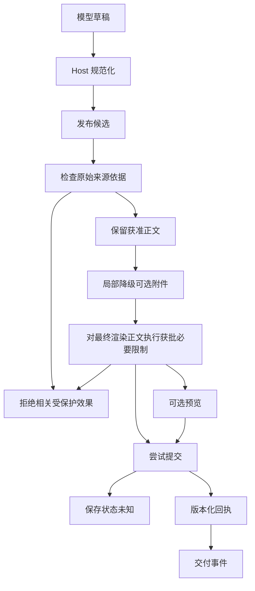

# Agent 已经生成答案，为什么还需要一个独立的发布系统？

模型已经写好一段解释，页面也显示出来了。刷新以后，它却不见了。另一次，同一修订的文字完全相同，来源提示却从“已确认”退回未知。这不一定是模型没写答案，也不一定是浏览器丢消息：**产生文字、暂时展示和保存这段文字，本来就是不同的事。**

Publication 要解决的是：把有资格交付的候选，变成带身份、修订、来源关系和原始回执的发布事实。下面从当前输入走到历史读回，把真实反例放回它所解释的设计决定里。模型仍负责组织论证；发布系统不裁判投资结论是否正确。

正文讨论原工程的多块发布机制。[Open ETF Agent v0.8 固定实现](https://github.com/hpoenixf/open-etf-agent/tree/2c096ce47be2161f97531170af07ef255872f8b1)只提炼单块正文、修订与持久化读回，不含预览界面、多块引用或动态来源撤销。文末分别给出它和另一固定公开快照的练习，不把两者拼成同一份验收。

<span id="一、模型有正文-不等于系统已经发布了正文"></span>

## 1. 什么时候一条消息不够用

短问答只有末尾一次返回时，“模型返回 → 存消息 → 显示”通常足够简单。研究应用却要先交付有根据的部分，继续查资料，再修订原段。此时至少要区分五种事实：

| 事实 | 谁能证明 | 不能推出什么 |
| --- | --- | --- |
| 模型提出候选正文 | 已封存的模型回合 | 不证明正文可公开 |
| 候选通过发布准备 | Publication 的当前校验 | 不证明已保存 |
| 临时预览发出 | 服务端的预览事件 | 不证明客户端收到或数据库已提交 |
| 版本化发布已提交 | 持久化 Publication 回执 | 不证明浏览器已经渲染，也不证明文章正确 |
| 客户端收到并展示 | 对应版本的交付、DOM 观测 | 不证明用户阅读或认可 |

选择独立 Publication，并不是因为流式协议不成熟，而是传输协议不拥有正文的业务事实。[SSE 的事件编号和重连机制](https://developer.mozilla.org/en-US/docs/Web/API/Server-sent_events/Using_server-sent_events)帮助客户端接续事件；它们不替应用定义“这一版已保存”，也不证明用户看见。

| 方案 | 更适合什么情况 | 本系统为什么没有只停在这里 |
| --- | --- | --- |
| 直接输出，末尾保存完整消息 | 短任务、一次性答复；中途丢失可接受 | 不能仅靠最后一轮结果表示前面已经提交的段落与修订 |
| 先保存，再展示 | 必须让所有可见正文都有持久回执，愿意等待保存完成 | 边界最简单；本系统希望首段更早出现，因此另设明确未保存的预览 |
| 正文与待发事件在同一事务保存 | 数据库更新需要可靠通知下游 | 解决写库/发消息双写，却仍要定义正文身份、来源和客户端版本合并 |
| 预览 + 版本化 Publication | 内容要提前展示、随后修订、断线后读回 | 要承担未保存内容消失、版本冲突和预览/回执合并的成本 |

[事务性 outbox](https://docs.aws.amazon.com/prescriptive-guidance/latest/cloud-design-patterns/transactional-outbox.html)是第三行的成熟做法：业务事实与待通知事件共同提交，消费者仍需应对重复与顺序。这里的正文、版本和当前交付事件也留在原事务；它与提前预览可以组合，不是二选一。提交后的通知回调异常不能把已确认写入改判为失败，也不能被说成“已经送达”。

若整个领域都需要从事件重建历史，[事件溯源](https://learn.microsoft.com/en-us/azure/architecture/patterns/event-sourcing)可能更合适，但会引入事件演进、重放与查询成本。这里需要的是范围较小的正文版本和原回执，不凭一张事件表就宣称全系统采用事件溯源。

<span id="二、两个正文入口-最终进入同一个发布归属方"></span>
<span id="还要检查谁能阻止候选抵达-publication"></span>
<span id="显示规范化不能改写原始输入"></span>

## 2. 两个入口，保留同一份原始身份

当前有两个正文入口：网关明确归一化的普通 Assistant Text，以及 `send_answer_part`。后者让模型提交完整 Markdown，必要时带 Host 发放的当前 `replaces` 目标；模型不用维护来源版本、数字通道、文本偏移或运行状态。含工具调用的模型回合也可以带普通正文。

两条入口有各自的候选身份，随后进入同一个 Publication。下面只是教学示意，不是真实持仓、来源编号或底层 wire payload：

```text
入口 A：模型普通正文
  “本轮先确认了组合配置，以下是可独立回答的部分……”

入口 B：send_answer_part
  markdown: “该基金的现有占比需要结合报告日期解释。[[cite:完整 Host 引用]]”
  replaces: <可选，Host 已发放的当前 publication ID>

Host：
  为每个候选建立运行内身份 → 校验 → 准备 → 发布
```

原始协议帧、隐藏推理、Entry 路由结果和未闭合工具参数，都不能因为“像答案”就进入正文链。不同正文不靠语义相似度删去一条；精确重复另有明确规则。

这里曾发生一个容易漏测的错误：直接调用 Publisher 的检查通过，Native 入口却先用控制字符、显示长度或空 `replaces` 拦掉候选。修复要验证的是**问题候选和随后独立正文都能抵达原处置方**，而不是只给底层函数增加测试。原工具身份、封存和总接收容量仍有效；不合法修订由对应效果的 owner 拒绝，不能让外围先吞掉所有正文。

NUL 字符还揭示另一层差异：内存里清理后能显示，不等于原始参数能按原表示存进 PostgreSQL。当前做法沿已有字段保存可还原的原始 JSON 文本，显示与派发复用机械规范化，读回不额外解码。否则界面看着正常，封存身份却已被改变。历史真实数据库检查分别覆盖原输入往返、清理后展示、保存和新连接读回。

<span id="四、校验分两层-机械合格-不代表文字论证成立"></span>
<span id="局部降级-不等于放松真正的授权"></span>
<span id="八、统一结构之后-还要收回外围正文否决权"></span>
<span id="第一轮统一结构-第二轮收回决定权"></span>

## 3. 坏附件局部降级，真实来源关系不能洗掉

Publication 使用统一的 `AnswerBlock` 结构契约，供运行时、发布、恢复与对话投影共同解析。内部块可以有文本或表格、角色及受控绑定；但普通模型写作入口不需要亲自维护这些结构事实。

第一层处理候选的**可提取正文与机械结构**：从显式文本或表格内容中提取可读部分，规范化模型填写的可选角色、标注和绑定，而不是让每个外围模块各自再做一套正文裁决。实质性依赖身份不能因格式归一化被抹掉；没有可安全提取的正文时，也不能凭空制造内容。

第二层处理**发布效果的真实资格**：当前 Run、账户、来源、内容和修订身份是否支持这一块的预览、提交或替换。它比“JSON 能通过 schema”更严格，但拒绝必须落实到受影响的效果，而不是将任何附件错误升级为整篇回答失败。

**引用需要原始资格。** 模型写下 `[[cite:...]]`，并不自动得到引用权。它必须引用 Host 实际发放的完整身份，由当前可用的证据视图解析；搜索命中、模型猜出的来源名、截短的编号，都不能冒充已经阅读和获准的材料。能够生成合法引用，也只说明绑定机制成立，不证明该资料足以支持整段推论。

**受控数值需要原始绑定。** 对组合等需要确定性来源的数值，Host 发放受控数字句柄，再按当前版本、作用域和来源将值渲染到回答里。无效句柄不会被随意猜成另一个值。另一方面，普通字面数字或模型计算出的派生比率不会因为没有受控句柄就一律禁止发表；它们可以按普通文字处理，但也**不会自动获得逐值正确性的认证**。

**来源提示跟着具体发布块走。** 没有有效行内引用，或者只有部分引用被确认时，系统可以给这一块 `sources_unverified` 或 `sources_partial` 提示。它不等于全篇不可靠，更不能仅凭来源提示把一次执行标记为 interrupted。已经提交的来源提示绑定到该块的修订和正文身份；旧格式或绑定不匹配时保留 unknown，而不是默认“无风险”。

### 局部错误要说明影响了什么

| 遇到的问题 | Publication 与原事实归属方怎样处理 |
| --- | --- |
| 行内引用不存在、已失效或附件超出容量 | 只降级对应链接/标记并保留来源提示；已有独立授权的正文继续展示。引用降级不会抹除实际私人来源依赖。 |
| 数字句柄无法确认、同一占位符绑定矛盾 | 对应位置显示 `[数值缺失]`；有效数值仍由 Host 原值渲染，普通字面数字不因此获得认证。 |
| 模型把私人资料标成公开，或写下“已经执行交易” | 模型标签和文字不会改变来源权限，更不能构成交易回执。真正的受保护来源或执行动作由原归属方拒绝。 |
| 一批候选里只有 A 依赖被拒绝的私人来源 | 拒绝 A 的受保护发布效果；不让 A 的失败连带删除独立获准的 B。 |
| `replaces` 缺失有效目标、版本冲突或修改额度耗尽 | 不能据此产生耐久替换，保留原已提交版本；错误目标不能改写成新的插入。草稿预览与额度的实现差异见第 5 节。 |
| 缺少必要来源、内容身份或继承依赖证明 | 拒绝对应受保护效果；不能通过删掉依赖来换取可显示正文。 |

可以用一个合成例子理解：模型提交了两块说明。A 的公开资料引用拼写错误，但文字本身不依赖未授权私人资料；B 则确实引用了一份未获准的私人报告。A 可以带着引用未核验提示交付，B 必须拒绝。系统不能因为 A 的坏引用吞掉 A，也不能因为 A 可交付就放行 B。

**容量也属于正文处置，而不是外围层的第二套否决权。** 在原有封存/传输字节上限内，超过 60,000 个显示字符的正文现在会进入 Publication，保留有界可读前缀并明确标注截断；引用目标和受控金额不能被截成虚假的半个有效值。这不意味着超大文本可以完整无损发布。


引用容量也按这个顺序处理：先确认资格，再按原顺序取最多八个有效引用。八个未知编号不该抢掉后面一个合法引用的位置；九个都合法时，第九个仍按容量局部省略。这个规则没有扩大资料访问权。

为什么不能让每层都“再保险”一次？历史生产函数的合成复现曾给出 65 条合法记录，外围只保留最近 64 条，还把第一条标成“引用来源无法验证”；真正起作用的是数量策略，错误信息却冒充来源判断。另一条路径中，底层保留了安全兄弟块，外层因批次未全部成功而抛错，又抹掉了部分成功。**统一 Schema 不等于统一处置权。**

因此，正文处置集中到 Publication，外围提供原始事实。Host 仍拥有来源与授权，存储仍拥有版本与并发修改，执行仍需要实际回执。不是把所有业务权限搬进一个模块，更不是为了可见而删除真实私有依赖。

60,000 字符也说明为什么历史不能改写成“从来如此”：早期契约曾拒绝 60,001 字符，后来的契约才改为总接收边界内的有界显示降级。今天解释截断机制，应保留这次选择变化，不能倒推旧断言必然漏测。

<span id="三、publication-的主流程-准备、预览和提交不是一个动作"></span>

## 4. 必要限制为什么要放在渲染之后

“删除外围正文否决权”不等于跳过已经获批的脱敏限制。一个真实反例是：raw Markdown 已经过滤，随后展开的 citation label 却带回不该公开的文字。检查原文正确，检查位置仍然错误。

当前准备顺序是：提取候选，执行获批的候选修订，核对原始来源与内容身份，渲染引用和受控数值，再对**最终渲染正文**执行必要限制。只有这之后，正文才能进入预览或保存。



图里有三类分支：

- 来源、身份或必要继承关系不成立，只拒绝相关受保护效果；独立块分别检查。
- 可选附件有问题，在正文中局部降级；获批必要限制失败、超时或要求确认，则不能回退未受限制的原文。
- 最终准备成功后，可先预览，也可直接提交；没有可确认数据库回执时，保存仍是未知或失败，不能制造版本回执。

普通建议、改写权和必要限制是三种不同权限。建议可以提供上下文；改写需要明确的 `publication:revise` 授权，必要限制需要 `publication:restrict`。通用 `required` 标记或 `tool:intercept` 不自动授予这些权力。原 reviewed generation、Hook registry 和有界执行机制继续提供权限与运行边界，无绑定的任意 Host 回调不能在这里取得正文处置权。

另一个容易忽略的问题是重复处理：预览时脱敏一次，保存时再调用一次 Hook，两份结果可能不同。当前短期准备缓存绑定原 Run、scope、正文、替换目标、registry 与 invocation 身份；预览与保存复用同一份最终结果，不能把已渲染文本当成新输入再解释。身份或渲染字节变化不能沿用旧批准；限制输出也不能凭空铸造新引用或数值权威。

历史上的 raw-only 脱敏失败由真实 PostgreSQL 检查暴露，推动了最终渲染限制。它证明的是这条暴露边界，不能顺带证明所有 Hook 都可被抢占，也不能代替真实模型质量评估。

<span id="五、一个块有三个关键坐标-身份、修订与展示位置"></span>

## 5. 修订靠三个坐标，不靠“最后收到的字符串”

一个块有身份、版本和位置三个坐标：

| 坐标 | 作用 | 为什么不能省 |
| --- | --- | --- |
| `publicationId` / 块身份 | 确定“修改的是哪一段” | 避免修订被当作新段追加 |
| `revision` | 确定该段的内容版本 | 防止旧事件覆盖新内容 |
| `deliveryOrdinal` | 确定该段在整篇中的位置 | 修订原段时维持原始顺序 |

下面是概念示例，不是实际 SSE 字段或数据库记录：

```text
首次提交：A，revision=1，deliveryOrdinal=2
修订同段：A，revision=2，deliveryOrdinal=2
新增一段：B，revision=1，deliveryOrdinal=3
```

对应的**合成内部发布事件**如下，不是模型输入或完整外层 SSE 格式：

```json
{
  "type": "answer_block_published",
  "id": "synthetic-section-A",
  "revision": 2,
  "deliveryOrdinal": 2,
  "content": {
    "type": "text",
    "text": "该比较仅说明示例资料中的差异，仍需核对报告日期。"
  }
}
```

原事务保留旧版审计，推进当前版本，并在原位置替换当前交付投影；不能把 A 的两个版本显示成两段结论。同一身份、同一修订却正文不同，是协议冲突，不是“后到的赢”。

精确重复规则刻意很窄：只有正文逐字相同、来源和依赖绑定及提示未变，且原 Run grant 与回执身份仍支持，才返回 `unchanged`、复用原回执，不新增修订、交付事件或额度消耗。语义相似不算，Markdown 空格改变也不算。同一 Run 不因后来 ACL 变化而重查或缩减既有授权；来源超出原 grant、绑定失配或正文身份不明，也不能靠文字相同复用回执。

**替换额度有一处尚未对齐的实现边界。** 默认值是单块两次、一次 Research 共八次，新增独立段不占这种修改额度。当前 Spec 已要求额度只限制耐久替换：目标或额度不满足时，独立获准草稿仍应可预览并明确未保存。但核对的生产路径仍在生成预览之前检查、预留修改额度，且保存失败不会释放已可见修改的预留；部分无效目标还会在准备阶段拒绝。因此不能把“超额草稿仍能显示”写成已经落地，也不能把旧的预览额度规则说成最终目标。两者都不允许捏造替换回执、删除原保存版本，或把错误 `replaces` 偷换成新增。

历史还有一个比版本号更直接的教训：一次真实模型运行里，`send_answer_part(replaces)` 返回 accepted，预览已有完整新版，Recovery 却仍是旧正文。原因是非 canonical Factory fallback 只有 commit，没有 replace 协调。把它归因成“模型只写过程、不写答案”必须撤回；提议接受不是持久替换。修复复用原目标坐标和 Recovery 的原子写入，不新增内容质量门。

<span id="六、真实问题一-同修订预览曾遮住已提交回执"></span>

## 6. 预览更快，但必须承认它可能没存下来

允许准备后先发 `answer-preview`，能缩短首段等待；选择保存后再展示则更简单，但所有可见内容都要等事务完成。这里选择前者，所以用户可能暂时看到未耐久保存的文字。失败时应说明未保存，不能在刷新后从缓存补出一份假提交。

2026 年 10 月 11 日的回归解释了合并规则为何不能只比较文字：实时预览和已提交候选拥有相同修订号，live map 却遮住了 durable receipt 的来源状态。文字没变，不代表两份记录有同等权威。

```text
较新的合法预览 > 较旧的已提交版本（仅用于当前临时显示）
同一修订的已提交回执 > 同一修订的预览元数据
独立且有效的历史展示／留存拒绝 > 受影响片段的可见性
```

第一行只允许较新预览暂时占据活动页面；第二行保留同修订的真实来源与版本事实。第三行是另有依据的历史摘录展示或留存限制，不是对同一 Run 刷新通用 ACL。历史事务、稳定 Run grant 和独立当前展示限制必须分别判断。

这个规则保留原候选表与回执，而非新建一套权限状态。它不解决旧运行中的并行超时，也不证明真实模型写作质量提升。若预览通知回调失败，原保存路径仍可在原取消、deadline 和执行权检查下继续；若提交后的通知失败，正文依然已保存，客户端是否显示则仍待实际交付证据。

<span id="七、真实问题二-数据库提交了-runtime-日志却还没写完"></span>

## 7. History 读已保存效果，不接管还在运行的任务

假设 A 的 Publication 事务已提交，正文、来源绑定、版本和交付事件都有了，进程却在 Runtime journal 写完之前退出。只重放 journal 会错误得出“没有 A”。正确做法不是让模型再写一次，而是按原 Run、块和回执读原 Publication。

读取顺序仍有严格边界：

1. 在入口核对读者与原 Run 的账户和 scope。
2. 按原 grant 核对正文、版本、事件和来源关系；B 继承 A 的来源，不能只查 B 表面的直接引用。
3. 按块保留独立验证成立的正文，沿已有交付渠道回读；适用的历史展示或留存限制只影响实际相关内容。
4. Runtime 终态、正文提交、客户端显示继续分别记录。缺 journal 附带信息，不自动否决原回执。

缺失必要原来源证明不能当成安全；经验证确实为空的来源集，也不能和完全未知混同。原内容无法验证、来源不在原 grant 或独立展示限制成立时，不允许退回未受保护缓存。

更意外的例子不需要进程崩溃：A 已保存、B 正预览，活动 lease 使执行恢复返回 pending，空 History 随后把 A 从页面抹掉。**不能接管执行，不等于不能读取已保存正文。** 当前 committed reader 不取得新 lease、不唤醒模型、不把 B 造为提交；活动页可保留 B 的未保存状态，冷页面只能回读真正提交的版本。

这组历史证据要分开看：实际 Next/Chrome 观察使用 Memory fixture；真实隔离 PostgreSQL 的新连接另行验证。它们不是一条“浏览器连 PG 再重启”的实验。更早的 10 月 11 日认证应用与隔离 PG 重启证据是另一组，验证 commit/journal 缺口和原始回执读回，不能混成今天全链已验收。

另一个历史反例是重复 Knowledge 绑定查询失败，遮住了独立已提交正文；恢复异常处理还擅自制造 failed 终态。解决办法是复用 canonical reader 已核过的递归关系，删除重复查询和异常分支的越权写入，而不是再加一个兼容层。真正的取消、权限拒绝和执行 fence 继续有效。

读取旧回答也不等于重算今天的组合：历史正文保留当时身份，新 Run 独立准入，另行取得历史摘录满足其读取条件；日期、单位和当下数值资格仍由金融计算负责。

A 已保存、后续研究 B 失败、客户端是否收到 A 未知，可以同时成立。发布效果已提交而工具回执失联时，应查询原身份，不把未知改成拒绝再盲目重试。独立展示限制改变当前可见效果，不倒改历史事务或原 Run grant。

<span id="把三个坐标缩成一个可运行的例子"></span>

## 8. 用公开切片观察身份、版本与进程恢复

不必先搭完整聊天界面，才能观察这些约束。公开版的 [Session 实现](https://github.com/hpoenixf/open-etf-agent/blob/2c096ce47be2161f97531170af07ef255872f8b1/src/session.mjs)把正文修订和当前交付位置放在同一个 SQLite 事务里：单个 Host 答案块的身份和位置保持不变，显式替换只推进修订号；正文完全相同，也要核对原运行与 Host 绑定后才能复用回执。文字没变、绑定变了，仍须明确替换。

下面在 Node 26.11.1 上运行过的本地示例使用合成回复和真实 SQLite，不需要模型账户。后续开发进度见 [main 入口](https://github.com/hpoenixf/open-etf-agent/blob/main/README.md)；复现这段机制时使用下面的固定提交：

```bash
git clone https://github.com/hpoenixf/open-etf-agent.git
cd open-etf-agent
git checkout 2c096ce47be2161f97531170af07ef255872f8b1
npm ci --ignore-scripts --no-audit --no-fund
npm run build
node dist/src/session-cli.mjs start --session runs/publication-demo --case durable-publication
# 将下面的 run-YOUR_ID 替换为上一条输出的 runId
node dist/src/session-cli.mjs publication --session runs/publication-demo --run run-YOUR_ID
node dist/src/session-cli.mjs publication-event --session runs/publication-demo --run run-YOUR_ID
```

启动结果中的 `publication` 是已提交正文的回执；再次执行读取命令，可以取得原正文、修订和当前交付位置，而不是重新生成回答。报告文件另有 Artifact 回执，不能拿它代替正文提交事实。这个例子保留的是发布机制，不是在评价合成回答的研究质量。

<!-- open-etf-case:publication@e1b8e4edde724548fab16d8ca4b205379bfa7f30 -->
### 分别回读正文、当前事件与报告

固定公开快照的[Publication CLI 用例](https://github.com/hpoenixf/open-etf-agent/blob/e1b8e4edde724548fab16d8ca4b205379bfa7f30/test/publication-cli.test.mjs)提供另一条观察入口：让多个 CLI 调用分别读正文、指定修订、当前事件和不可变报告。

在所链固定快照按 README 安装依赖后，运行：

```bash
node --test --test-concurrency=1 --test-name-pattern='^8\.2 local CLI starts same Runtime and separately reads body, current event and immutable Artifact$' test/publication-cli.test.mjs
```

用例核对正文等于原答案，指定修订和当前事件指向同一 Publication 回执；报告则通过 Artifact owner 按保存身份读回，并与 `report.md` 字节和摘要比较。正文提交身份没有被报告文件身份替代。

范围仍是单块正文、修订与本地 CLI 回读，不包含浏览器渐进显示、HTTP/SSE 发布产品层或模型答案质量验收。
<!-- /open-etf-case -->

### 真正中断进程，再读回原提交

公开单块实现把同一类时间窗口做成了[可复现的进程中断反例](https://github.com/hpoenixf/open-etf-agent/blob/2c096ce47be2161f97531170af07ef255872f8b1/test/publication-runtime.test.mjs#L70)：正文事务提交后、运行终态检查点写入前，实际终止进程；另一个进程沿原封存提议恢复，得到原正文和原回执，不新增修订，也不再调用合成模型。这不是用保存一份内存快照代替重启。

相邻的失败分支同样重要：正文已经提交，随后检查发现任务要求的报告并不存在，Run 仍然可以失败。此前正文继续可读，却不能据此宣称报告已经生成。[Runtime 的提交位置](https://github.com/hpoenixf/open-etf-agent/blob/2c096ce47be2161f97531170af07ef255872f8b1/src/runtime.mjs)把“正文已保存”和“整个任务完成”留在两个结算点，正是为了保留这两个同时成立的事实。

<span id="九、机制落地之后还有哪些边界"></span>
<span id="结语-回答是模型写的-发布事实必须由系统持有"></span>

## 9. 验收哪些关系，才能知道模块真的收住了责任

检查重点不是“页面终于有字了”，而是几组必须同时成立的关系：

- 问题候选抵达 Publication，独立兄弟不被批次失败吞掉；真正越权的相关效果仍拒绝。
- 渲染后必要限制在任何暴露之前生效，预览与保存同字节；失败不能回退原文。
- 原始输入能往返存储，修订保留身份和位置，精确重复不产生第二次效果。
- commit/journal 窗口和活动 pending 都不抹掉已确认正文；无回执草稿不能在冷 History 复活。
- 通知、任务终态和正文提交各有证据，不互相替代。

这与 [John Ousterhout 的模块化设计讨论](https://web.stanford.edu/~ouster/cgi-bin/cs190-winter18/lecture.php?topic=modularDesign)相通：封装的是调用方不再重复作出的决定。局部降级还要核对组合后会不会扩大失败，参见 [Google SRE：Addressing Cascading Failures](https://sre.google/sre-book/addressing-cascading-failures/)。

本文依据固定实现和分别标明的历史验证解释机制，不宣称线上零正文率下降，也不把工程检查当成投资语义或阅读体验验收。较早运行的首个异常仍有无法完整追溯之处；替换额度与草稿预览的 Spec/代码差异也仍须工程层解决。

可迁移的选择标准是：内容若要提前显示、后来替换、跨进程读回，就值得把发布事实从模型回合中分离。实现可以只是一个深模块，不一定要另建服务。只做末尾一次答复时，直接保存和返回往往更合适。

这正是[原则 3「提议、批准、执行、生效是不同事实」](/principles#principle-3)在正文上的应用：模型写回答，Publication 持有发布身份与原回执，交付层观察是否收到，Runtime 决定本轮执行如何结束。**“看到了”“存好了”“全部成功了”，不能被压成同一个状态。**
