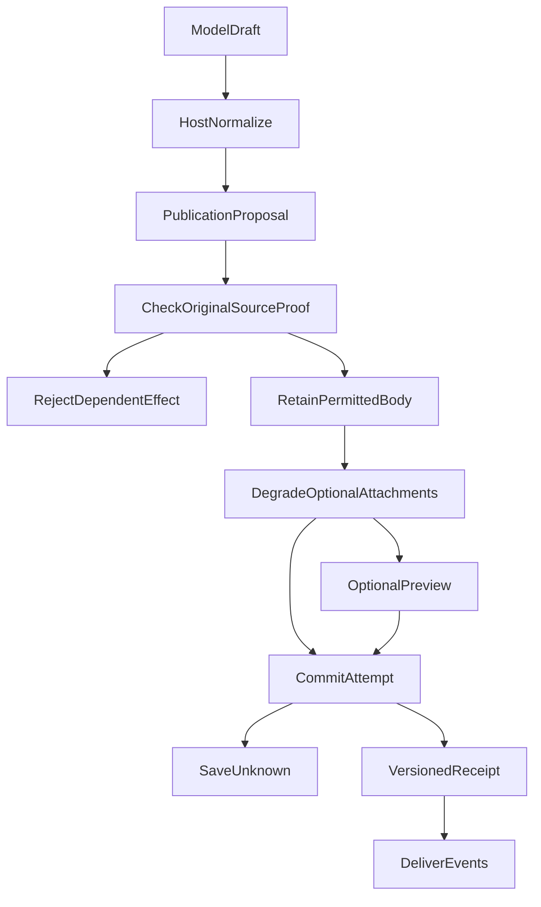

---
evidence:
  implementation: "Publication 机制已实施（按本文记录）"
  scoped: "受控调用链与 PostgreSQL 恢复案例"
  live: "用户端展示与研究语义质量另验"
---

# Agent 已经生成答案，为什么还需要一个独立的发布系统？

一个研究 Agent 先后查了组合、检索了资料，模型终于写出了回答。服务端已经拿到 Markdown，似乎只要把字符串转发给浏览器就可以了。

渐进回答、来源撤销和断线恢复让问题具体起来：正文可能已显示但还没保存；一段已提交，下一次模型调用仍可能失败；新预览和旧回执也可能同版本号却带着不同来源提示。若用最后一次模型调用的结果判断整篇答案是否存在，就会抹掉前面已经发生的事实。

2026 年 10 月的一次实际修复就暴露了这种错位：相同修订的实时预览，在重复内容比较时遮住了真正已提交回执的来源状态。另一次认证应用与 PostgreSQL 重启测试则发现，Publication 已提交正文而运行日志尚未写入时，单靠运行日志重建历史会丢掉这段回答。

这篇文章只讨论一个组件：**Publication（回答发布组件）为什么不能只是发消息，以及它怎样管理候选正文、校验、预览、持久化提交、修订和恢复。** 这是工程发布机制，不是一个自动判断投资分析是否正确的裁判。

到 2026 年 10 月，我们又遇到更深一层的问题：模型已经写出了可读正文，但 Runtime、Native 工具解析或恢复路径仍可能在 Publication 之前做出独立拒绝。我们因此把**正文是否保留、怎样局部降级、哪个发布效果必须拒绝**的处置尽量收回 Publication；原始授权、执行权限与持久回执依旧由各自的事实归属方掌握。

本文主体回顾原工程的发布机制与演进。文中补充的 [Open ETF Agent v0.8 固定实现](https://github.com/hpoenixf/open-etf-agent/tree/2c096ce47be2161f97531170af07ef255872f8b1)只提炼其中的单块正文、修订与持久化读回，不包含预览界面、多块引用或动态来源撤销；两者的能力范围不要混用。

## 一、模型有正文，不等于系统已经发布了正文

早期的问答接口容易把三个事件压成一次操作：模型返回文本、服务端保存消息、客户端展示文本。只要回答只能在末尾整体返回，这种简化在一段时间内可以工作。

但研究型 Agent 经常需要先交付有根据的部分，然后继续阅读资料，再修订已经发布的段落。这里至少出现五种不同事实：

| 事实 | 谁能证明 | 不能推出什么 |
| --- | --- | --- |
| 模型提出候选正文 | 已封存的模型回合 | 不证明正文可公开 |
| 候选通过发布准备 | Publication 的当前校验 | 不证明已保存 |
| 临时预览发出 | 服务端的预览事件 | 不证明客户端收到或数据库已提交 |
| 版本化发布已提交 | 持久化 Publication 回执 | 不证明浏览器已经渲染，也不证明文章正确 |
| 客户端收到并展示 | 对应版本的交付、DOM 观测 | 不证明用户阅读或认可 |

**最重要的变化不是增加了多少状态，而是不再让后一个阶段冒充前一个阶段的权威。**

如果删去独立 Publication，让模型回合或流式传输各自处理发布，结构契约、引用绑定、修订身份、保存顺序和恢复判断就会分散到多个调用方。Publication 所集中的是这些共性责任，而不是替模型判断哪个观点更有说服力。

## 二、两个正文入口，最终进入同一个发布归属方

这套系统经历过一次很实际的接口演进。

最初我们用显式的发布动作表达回答，后来把渐进回答工具收敛为 `send_answer_part`：模型只需提交完整的 Markdown，必要时给出一个由 Host 发放、仍然有效的 `replaces` 目标。它不再被要求填写来源版本、数字通道、文本偏移或运行状态。

再后来，我们发现要求“模型必须调用发布工具才允许出现正文”也不合理。经过网关明确归一化的普通 Assistant Text，同样可以成为候选答案；含工具调用的同一模型回合也可以带普通正文。两种入口有不同的候选身份，但**共用后续 Publication 校验与交付机制**。

例如，下列内容只是教学示意，不是真实持仓、来源编号或现行底层 wire payload：

```text
入口 A：模型普通正文
  “本轮先确认了组合配置，以下是可独立回答的部分……”

入口 B：send_answer_part
  markdown: “该基金的现有占比需要结合报告日期解释。[[cite:完整 Host 引用]]”
  replaces: <可选，Host 已发放的当前 publication ID>

Host：
  为每个候选建立运行内身份 → 校验 → 准备 → 发布
```

原始协议帧、隐藏推理、Entry 路由结果、未闭合的工具参数，都不能因为“包含一段像答案的文字”而进入发布链。对于真正不同的正文，系统也不靠语义相似度删除一条入口的内容；只有满足精确重复规则才复用已有身份。

Native 工具入口也必须让候选抵达发布处置方；它曾怎样绕过 Publication，见下文两轮治理复盘。必要的工具身份、原参数封存与总接收容量仍由原归属方保护。

这一步的取舍是：**让模型负责写什么，让 Host 负责这段文字是否有资格成为当前可展示、可持久化的答案。**

## 三、Publication 的主流程：准备、预览和提交不是一个动作

可以把当前关键机制缩成一张图。图中临时预览是可选的提前交付路径；不是所有 Publication 调用都必须先发预览。



**关系或判断条件：**

- **CheckOriginalSourceProof → RejectDependentEffect**：该块依赖的真实来源未获授权、身份不成立或必要继承依赖无法确认；只拒绝受影响的效果，独立块继续分别检查。
- **CheckOriginalSourceProof → RetainPermittedBody**：原始 Run、账户、来源及内容身份允许该效果进入展示准备；不是证明文字推论正确。
- **RetainPermittedBody → DegradeOptionalAttachments**：错误引用、无法验证的数值槽位及可选显示元数据就地降级，不自动吞掉合法正文。
- **OptionalPreview → CommitAttempt**：可先预览再保存；也允许从准备结果直接尝试提交，不要求必经预览。
- **CommitAttempt → SaveUnknown / VersionedReceipt**：数据库尚无可确认回执时不能冒充已保存；只有已提交事实才能产生版本化回执。

在当前实现里，发布适配层先把当前模型候选和本次实际允许的证据视图结合，得到可展示正文和依赖绑定。它可以在写库之前完成准备，并允许 UI 提前看到 `answer-preview`；真正的 `answer-publication` 则必须有已提交的版本化事实。

持久化路径不仅保存正文，还在原事务中处理块版本、来源及依赖关系、交付事件和运行约束。正常提交、修订、恢复都复用这个归属方。不能因为临时 preview 已经展示，就把它伪装成成功写入数据库。

为了降低首段等待时间，当前路径允许预览先交付、保存随后结算。这样做增加了一个必须正视的代价：**用户可能看到尚未耐久保存的内容。** 保存失败时要保留失败事实，不能在恢复后把临时预览当成已提交正文；某些已经发生的可见修改也不能因为随后保存失败就假装没有消耗过修改额度。

## 四、校验分两层：机械合格，不代表文字论证成立

Publication 使用统一的 `AnswerBlock` 结构契约，供运行时、发布、恢复与对话投影共同解析。内部块可以有文本或表格、角色及受控绑定；但普通模型写作入口不需要亲自维护这些结构事实。

第一层处理候选的**可提取正文与机械结构**：从显式文本或表格内容中提取可读部分，规范化模型填写的可选角色、标注和绑定，而不是让每个外围模块各自再做一套正文裁决。实质性依赖身份不能因格式归一化被抹掉；没有可安全提取的正文时，也不能凭空制造内容。

第二层处理**发布效果的真实资格**：当前 Run、账户、来源、内容和修订身份是否支持这一块的预览、提交或替换。它比“JSON 能通过 schema”更严格，但拒绝必须落实到受影响的效果，而不是将任何附件错误升级为整篇回答失败。

**引用需要原始资格。** 模型写下 `[[cite:...]]`，并不自动得到引用权。它必须引用 Host 实际发放的完整身份，由当前可用的证据视图解析；搜索命中、模型猜出的来源名、截短的编号，都不能冒充已经阅读和获准的材料。能够生成合法引用，也只说明绑定机制成立，不证明该资料足以支持整段推论。

**受控数值需要原始绑定。** 对组合等需要确定性来源的数值，Host 发放受控数字句柄，再按当前版本、作用域和来源将值渲染到回答里。无效句柄不会被随意猜成另一个值。另一方面，普通字面数字或模型计算出的派生比率不会因为没有受控句柄就一律禁止发表；它们可以按普通文字处理，但也**不会自动获得逐值正确性的认证**。

**来源提示跟着具体发布块走。** 没有有效行内引用，或者只有部分引用被确认时，系统可以给这一块 `sources_unverified` 或 `sources_partial` 提示。它不等于全篇不可靠，更不能仅凭来源提示把一次执行标记为 interrupted。已经提交的来源提示绑定到该块的修订和正文身份；旧格式或绑定不匹配时保留 unknown，而不是默认“无风险”。

### 局部降级，不等于放松真正的授权

这次收敛最重要的不是新增一种校验，而是把**附件缺陷、内容处置与真实效果拒绝**分开：

| 遇到的问题 | Publication 与原事实归属方怎样处理 |
| --- | --- |
| 行内引用不存在、已失效或附件超出容量 | 只降级对应链接/标记并保留来源提示；已有独立授权的正文继续展示。引用降级不会抹除实际私人来源依赖。 |
| 数字句柄无法确认、同一占位符绑定矛盾 | 对应位置显示 `[数值缺失]`；有效数值仍由 Host 原值渲染，普通字面数字不因此获得认证。 |
| 模型把私人资料标成公开，或写下“已经执行交易” | 模型标签和文字不会改变来源权限，更不能构成交易回执。真正的受保护来源或执行动作由原归属方拒绝。 |
| 一批候选里只有 A 依赖被拒绝的私人来源 | 拒绝 A 的受保护发布效果；不让 A 的失败连带删除独立获准的 B。 |
| `replaces` 缺失有效目标、版本冲突或修改额度耗尽 | 拒绝这一次修改、保留原已提交版本；错误修订目标不能被改写成新的插入。 |
| 缺少必要来源、内容身份或继承依赖证明 | 拒绝对应受保护效果；不能通过删掉依赖来换取可显示正文。 |

可以用一个合成例子理解：模型提交了两块说明。A 的公开资料引用拼写错误，但文字本身不依赖未授权私人资料；B 则确实引用了一份未获准的私人报告。A 可以带着引用未核验提示交付，B 必须拒绝。系统不能因为 A 的坏引用吞掉 A，也不能因为 A 可交付就放行 B。

**容量也属于正文处置，而不是外围层的第二套否决权。** 在原有封存/传输字节上限内，超过 60,000 个显示字符的正文现在会进入 Publication，保留有界可读前缀并明确标注截断；引用目标和受控金额不能被截成虚假的半个有效值。这不意味着超大文本可以完整无损发布。

这里的“统一”并不是把所有权限检查搬进 Publication：Host 仍提供真实来源与作用域事实，存储仍保证版本与并发修改，执行动作仍以实际回执为准。统一的是**候选正文的发布处置权**，不是所有业务权威。

换句话说，Publication 可以回答“这段内容能否按当前合同发布”，不能替代研究者或独立评测回答“这段投资分析是否正确”。

## 五、一个块有三个关键坐标：身份、修订与展示位置

渐进回答不是不断向页面 append 字符串。它更像一组可修订、可恢复的回答块：

| 坐标 | 作用 | 为什么不能省 |
| --- | --- | --- |
| `publicationId` / 块身份 | 确定“修改的是哪一段” | 避免修订被当作新段追加 |
| `revision` | 确定该段的内容版本 | 防止旧事件覆盖新内容 |
| `deliveryOrdinal` | 确定该段在整篇中的位置 | 修订原段时维持原始顺序 |

下面是概念示例，不是实际 SSE 字段或数据库记录：

```text
首次提交：A，revision=1，deliveryOrdinal=2
修订同段：A，revision=2，deliveryOrdinal=2
新增一段：B，revision=1，deliveryOrdinal=3
```

把上面的“修订 A”落成一个结构化事实，可以得到下列**合成的内部发布事件**。它不是模型输入，也不是外层 SSE 的完整传输格式：

```json
{
  "type": "answer_block_published",
  "id": "synthetic-section-A",
  "revision": 2,
  "deliveryOrdinal": 2,
  "content": {
    "type": "text",
    "text": "该比较仅说明示例资料中的差异，仍需核对报告日期。"
  }
}
```

数据库为修订保存版本历史，当前交付投影替换同一位置的正文，而不是把 A 的两个版本同时显示成两段结论。客户端收到同一发布身份、同一修订但正文不同的事件时，也必须视为协议冲突，不能默默以“最后到达者”为准。

为了防止模型反复发表同义内容，系统还有一个刻意狭窄的精确重复规则：正文完全相同、保护来源与依赖绑定及提示未变，并且当前授权再次通过时，才允许返回 `unchanged`，复用原回执，不新增修订、交付事件或修改额度。仅仅文字相似不算重复，Markdown 空格改变也不算；来源撤权后，旧内容即使逐字相同也不能绕过重新检查。

当前默认修改额度是单块 2 次、一次 Research 共 8 次；它限制修改已有块，不是禁止新增回答段。超限拒绝该次修改，不应抹去此前合法内容，或自动宣告整个研究失败。修订失败与首次发布失败是不同效果：不合法的 `replaces` 不能自动转成新块，原已提交正文也不会因一次修订失败而被删除。

### 把三个坐标缩成一个可运行的例子

不必先搭完整聊天界面，才能观察这些约束。公开版的 [Session 实现](https://github.com/hpoenixf/open-etf-agent/blob/2c096ce47be2161f97531170af07ef255872f8b1/src/session.mjs)把正文修订和当前交付位置放在同一个 SQLite 事务里：单个 Host 答案块的身份和位置保持不变，显式替换只推进修订号；正文完全相同，也要核对原运行与 Host 绑定后才能复用回执。文字没变、绑定变了，仍须明确替换。

下面在 Node 26.11.1 上运行过的本地示例使用合成回复和真实 SQLite，不需要模型账户。后续开发进度见 [main 入口](https://github.com/hpoenixf/open-etf-agent/blob/main/README.md)；复现这段机制时使用下面的固定提交：

```bash
git clone https://github.com/hpoenixf/open-etf-agent.git
cd open-etf-agent
git checkout 2c096ce47be2161f97531170af07ef255872f8b1
npm ci --ignore-scripts --no-audit --no-fund
npm run build
node dist/src/session-cli.mjs start --session runs/publication-demo --case durable-publication
# 将下面的 run-YOUR_ID 替换为上一条输出的 runId
node dist/src/session-cli.mjs publication --session runs/publication-demo --run run-YOUR_ID
node dist/src/session-cli.mjs publication-event --session runs/publication-demo --run run-YOUR_ID
```

启动结果中的 `publication` 是已提交正文的回执；再次执行读取命令，可以取得原正文、修订和当前交付位置，而不是重新生成回答。报告文件另有 Artifact 回执，不能拿它代替正文提交事实。这个例子保留的是发布机制，不是在评价合成回答的研究质量。

<!-- open-etf-case:publication@e0a6a29b7474a19c18b169c0e4a7eb0eb614504d -->
### 分别回读正文、当前事件与报告

固定公开快照的[Publication CLI 用例](https://github.com/hpoenixf/open-etf-agent/blob/e0a6a29b7474a19c18b169c0e4a7eb0eb614504d/test/publication-cli.test.mjs)提供另一条观察入口：让多个 CLI 调用分别读正文、指定修订、当前事件和不可变报告。

在所链固定快照按 README 安装依赖后，运行：

```bash
node --test --test-concurrency=1 --test-name-pattern='^8\.2 local CLI starts same Runtime and separately reads body, current event and immutable Artifact$' test/publication-cli.test.mjs
```

用例核对正文等于原答案，指定修订和当前事件指向同一 Publication 回执；报告则通过 Artifact owner 按保存身份读回，并与 `report.md` 字节和摘要比较。正文提交身份没有被报告文件身份替代。

范围仍是单块正文、修订与本地 CLI 回读，不包含浏览器渐进显示、HTTP/SSE 发布产品层或模型答案质量验收。
<!-- /open-etf-case -->

## 六、真实问题一：同修订预览曾遮住已提交回执

2026 年 10 月 11 日的回归案例尤其能说明为什么“正文一样”还不够。

当时运行时维护了实时候选和已提交候选。重复检测会查找当前可见的同一段正文，但早期比较中，实时映射可能盖住**同一修订号**的持久回执。于是即使文字一致，真正已提交的来源状态也可能丢失。

问题不是模型突然写错了文章，而是我们把两个不同可信度的记录放到同一个候选池里，却没有定义清楚相同修订的优先级。

修正后的规则可以简化为：

```text
较新的合法预览 > 较旧的已提交版本（仅用于当前临时显示）
同一修订的已提交回执 > 同一修订的预览元数据
当前来源拒绝 > 旧预览和旧回执的可见性
```

第二行尤为关键：已提交回执携带的是数据库确认的来源和版本事实，准备阶段的预览不能反过来给它补一个“看上去干净”的状态。第三行则提醒我们，**历史提交真实发生过，不等于被撤权的来源今天仍可展示。**

这次修复保留原候选与回执归属，没有另造发布状态或权限系统。已提交事实仍优先于同修订的预览，之前出现的并行超时和真实模型质量问题则不能靠修改回执优先级解决。

## 七、真实问题二：数据库提交了，Runtime 日志却还没写完

另一个更棘手的时间窗口发生在持久化提交与运行时日志之间。

设想同一段回答 A 的 Publication 事务已经提交，包含正文、来源绑定与交付回执；紧接着进程退出，Runtime journal 还没有记录到对应状态。重启后如果只重建 journal，就可能得出“没有 A”的错误结果。

正确的恢复不是让模型重新写 A，也不是把原先的预览强行标记为已保存，而是：

1. 按原运行、块身份和已提交回执，从 Publication 原归属方读取受保护正文。
2. 核对当前账户、来源和块之间的继承依赖；B 引用了 A 的来源，不能只检查 B 表面上的直接引用。
3. 能继续展示的部分走已有历史快照和交付通道；无法确认权限或已经撤销的部分保持受保护状态。
4. Runtime 的原执行终态、Publication 的提交事实和客户端是否展示，继续独立记录。

这里还有一个细节：旧回执没有当前来源状态的资格字段，不等于已确认来源安全；但确实已被验证为空的来源集合，也不应和完全未知混为一谈。

后续进一步把**历史展示与活动重放的原发布正文选择**归回 Publication：它使用原 Run 授权、受保护的正文及事件身份、实际来源关系判断哪些块仍可读取；某块原始内容或权限证明损坏，不应连带遮住其他已独立验证的块。Runtime journal 的附带细节缺失，不再自动成为再次拒绝全部原正文的理由。相反，原始内容无法验证、真实来源权限被拒绝时，依然不能退回不受保护的缓存或拼出一段“看起来正确”的历史回答。

这也避免另一种不必要的复核：**阅读旧回答不是重新进行当下的组合投资计算**。历史正文可以在原展示授权下保留其当时身份；新的分析或执行仍须检查当前资料和权限，不能借历史提交取得今天的数值权威。

2026 年 10 月 11 日的认证应用、隔离 PostgreSQL 与重启路径实际暴露并验证了这一类恢复缺口。修复包括读取原始受保护回执、重新检查继承来源，以及保留旧来源提示的 unknown 语义。

公开单块实现把同一类时间窗口做成了[可复现的进程中断反例](https://github.com/hpoenixf/open-etf-agent/blob/2c096ce47be2161f97531170af07ef255872f8b1/test/publication-runtime.test.mjs#L70)：正文事务提交后、运行终态检查点写入前，实际终止进程；另一个进程沿原封存提议恢复，得到原正文和原回执，不新增修订，也不再调用合成模型。这不是用保存一份内存快照代替重启。

相邻的失败分支同样重要：正文已经提交，随后检查发现任务要求的报告并不存在，Run 仍然可以失败。此前正文继续可读，却不能据此宣称报告已经生成。[Runtime 的提交位置](https://github.com/hpoenixf/open-etf-agent/blob/2c096ce47be2161f97531170af07ef255872f8b1/src/runtime.mjs)把“正文已保存”和“整个任务完成”留在两个结算点，正是为了保留这两个同时成立的事实。

## 八、为什么“后来的失败”不能抹掉“之前的提交”

现在再看开头的问题，答案就清楚了。

假设 A 已提交，随后模型继续研究 B 时供应商失败。系统可以同时记录：

```text
A：已提交 revision=1，当前授权下可读
B：未提交，原因需要继续核查
Run：failed 或 partial，按原执行终态记录
客户端：是否实际收到 A，依对应交付证据记录
```

这四行不是互相矛盾的“成功”和“失败”。A 的历史提交事实是真的，B 的失败也是真的；用户是否收到了 A，还需要交付链证明。后续失败不能把 A 的事务撤销成“从没发生过”，但同样不能把 A 的存在包装成“整个用户任务已经完成”。

具体来说，`send_answer_part` 的发布效果与模型工具回执是两个独立结算点。发布已经提交、回执写入却失败时，系统不能简单把这一轮改写为“已知发布拒绝”，再盲目重试原副作用。恢复时应沿原身份确认已结算效果，未知的执行继续保留 unknown。

反过来，来源撤权也不是“后来的普通失败”。它改变的是**当前展示资格**：原提交记录仍可审计，但受到撤权影响的正文不能因为曾经成功发布就继续向新客户端披露。

最后还要坚持一条容易被忽略的界限：服务端发出了 `answer-publication`，只能证明服务端交付动作；浏览器接收、DOM 提交、历史快照与用户实际阅读各有自己的观察位置。任何一个时钟或回执都不能替所有阶段签字。

## 九、为什么同一个发布系统要治理两次

机制集中之后，还需要回头检查：调用方是否仍能绕过它，独立决定正文消失？这也是此前两轮发布治理复盘留下的增量。

### 第一轮统一结构，第二轮收回决定权

第一轮治理分开了正文、引用、保存与任务状态，但这还没有收回所有入口上的正文处置权。随后的生产路径复现暴露了被外围过滤器隐藏的候选。

10 月 15 日的生产函数合成复现中，65 条均合法的历史记录只显示最近 64 条，第一条被“引用来源无法验证”替换。真正取得隐藏权的是数量策略，错误文案却把它说成来源问题。另一个复现中，底层发布保留了同批安全块，外层适配却因批次没有全部成功而抛错，重新抹掉了部分成功。

这两个例子暴露了同一问题：**共用同一 Schema，仍然可能保留多个正文决定者。** 第二轮因此删除外围候选过滤和未解决发布拒绝集合，不再围绕错误码扩大“可继续”名单。

### 还要检查谁能阻止候选抵达 Publication

一轮工程验证通过后，从原生工具入口复核，仍发现控制字符、显示长度和空 `replaces` 可以在 Publication 之前拦住候选；通用参数处理和钩子也可能成为第二个正文裁判。

新的生产入口检查通过脚本化模型网关，先送入问题候选，再送入独立正文，并观察发布准备是否收到两次提议。无效修订应抵达原处置方后拒绝该次修改，独立正文仍可交付；合法容量内的长文按显示容量截断，而不是在外围被整块吞掉。

这里有一次真实合同变化：第一轮曾将 60,001 字符判为应拒绝输入，第二轮才改为总接收边界内的显示降级。不能用新合同倒推旧断言必然漏测。判断重点是拒绝由谁作出、限制哪个效果，以及其他正文能否保留。

### 显示规范化不能改写原始输入

NUL 字符还暴露了持久化问题：内存里清理后可显示，不等于原始参数能按原表示存进 PostgreSQL。进一步解码存储字符串，又改变了封存身份。

最终沿已有字段保存可还原的原始 JSON 文本，展示和派发复用机械规范化，读回不擅自多解码。真实数据库检查分别观察原始输入往返、清理后的展示、保存和新连接的历史读回。

这类问题不能靠“页面终于有字了”验收。要同时检查候选是否抵达唯一处置方、原始参数能否往返持久化，以及重启后能否读回同一份发布事实。

模块化的价值是封装决定，调用方不再复制它；可对照 [John Ousterhout 的模块化设计讨论](https://web.stanford.edu/~ouster/cgi-bin/cs190-winter18/lecture.php?topic=modularDesign)。降级自身也可能引入失败，需核对它发生的层级和组合行为，参见 [Google SRE：Addressing Cascading Failures](https://sre.google/sre-book/addressing-cascading-failures/)。本文没有据此宣称线上零正文率下降。

## 十、机制落地之后还有哪些边界

当前实现已经将候选正文归一化、来源与版本校验、局部降级和发布回执集中到 Publication。受控生产调用链与 PostgreSQL 恢复验证覆盖了独立正文不中断、已提交版本不被旧预览覆盖、错误来源被拒绝，以及已保存内容的历史读回。

Publication 回答**谁有权发布、如何记录发布事实**；研究质量和阅读体验分别由相应环节评价。

这套机制也有成本：多出准备与提交两个阶段，需要维护修订身份、持久化事件、来源关系和预览/回执的合并规则；而统一正文处置权，还要求审查 Native 入口、运行时、钩子和恢复读取中隐藏的重复 veto。它不适合被理解为“所有聊天应用都必须照搬一个重型发布服务”。

一些较早运行的首个异常仍无法从历史记录中完整追溯，因此无法用现有记录解释每一次“没有正文”的原因。

可迁移的判断标准反而简单：**如果内容允许提前显示、后来修订、跨进程恢复，并且依赖可撤销的资料，那么“写出答案”和“发布事实”就值得分离；至于实现可以是一个深模块，也可以是独立服务。**

这里应用了[原则 3「提议、批准、执行、生效是不同事实」](/principles#principle-3)：模型给出候选正文，不等于 Publication 已接受、提交并产生可恢复的发布回执。把预览、提交与用户实际接收分别记录，才能避免后来的失败抹掉先前已成立的效果。

## 结语：回答是模型写的，发布事实必须由系统持有

回看这段演进，我越来越不愿意把 Agent 的输出当成一条不断增长的字符串。

模型负责组织解释，Publication 统一负责候选正文的提取、必要的局部降级与发布处置，并把允许发布的内容转成有身份、有修订、有来源绑定、可恢复的提交事实；交付层负责传输和展示这些事实，Runtime 负责本轮研究怎样结束，真正的授权和执行权仍留在各自原始归属方。它们应该协作，但不能相互冒充。

**一句话总结：可以先让用户看到有用内容，但不能让“看到了”“存好了”“全部成功了”变成同一件事。**
