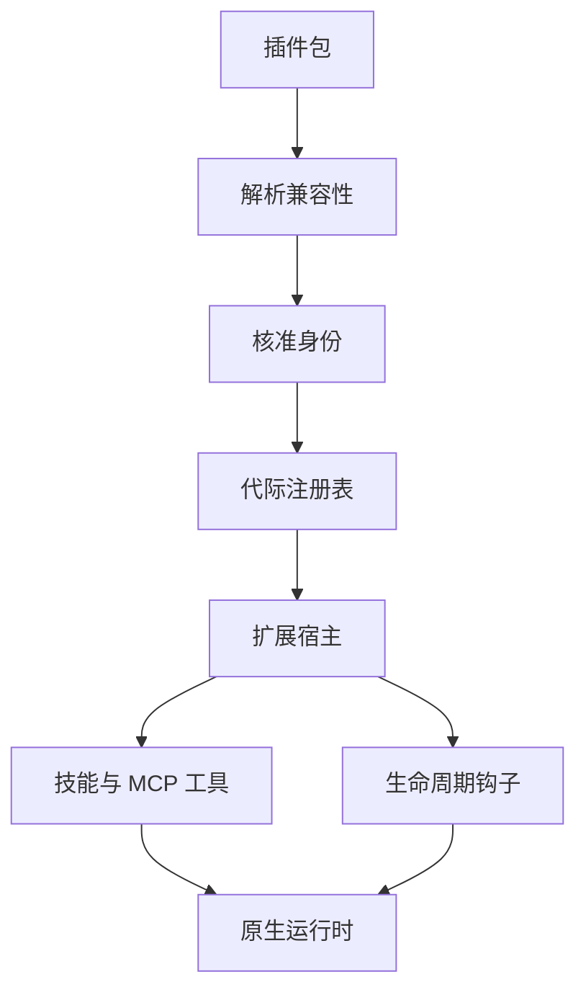

# Agent 扩展如何接入 Host：插件生命周期与运行时边界

一个 todo 插件连续收到三个“回调成功”，持久状态却只保存了一次。一个研究插件的 Stop 脚本返回 0，可能根本没审引用。一个插件的文件和依赖锁都没变，加载器仍可能解析到另一份代码。

这些有记录的反例说明，接入扩展不是给模型多放一个工具名。Host 要回答的是：**哪份能力被选进本次 Run，它的输出由谁消费，已经发生的效果怎样保存，什么时候才能释放资源。**

当前选择是让支持的插件进入自己的 Agent Runtime，复用原工具循环、预算、来源授权与恢复。Compatibility Profile 解释生态差异，Extension Host 连接这些行为。它不是启动另一个 Claude、Pi 或 Codex Agent 来代做任务，也不承诺完整兼容每个生态。

[Open ETF Agent](https://github.com/hpoenixf/open-etf-agent) 的公开 v0.7 切片只演示可信本地包的选择、激活、方法/来源读取、报告和清理。下面区分原工程当前通道、历史观察与这个可运行的较小例子。

## 1. 先选边界：并非所有能力都需要完整插件宿主

把一段研究方法交给模型，与把一个有会话状态的扩展搬进 Runtime，不是同一个成本级别。

| 接入方式 | 更合适的情况 | 需要承担的边界 |
| --- | --- | --- |
| 静态 Skill / 方法文本 | 主要价值是步骤、检查清单或资料导航 | 需要的工具与产物流程由 Host 另行提供；文字本身不执行回调 |
| 独立 MCP 服务 | 能力可清楚表达为工具、资源或提示，适合跨应用复用 | 服务保持自己的生命周期；客户端会话与本地插件状态不是自动同一份 |
| 直接使用原生态 Agent | 最重要的是原生态完整行为，接受它持有自己的执行循环 | 要显式处理任务交接、上下文、预算和结果身份；不是本 Host 原生扩展 |
| 本 Host 的 Compatibility Profile | 需要保留特定工具、Hook、会话状态或研究文件语义，同时复用本 Runtime | 要维护协议差异、权限与效果映射，明确不支持的 API 和版本 |

[MCP 架构](https://modelcontextprotocol.io/specification/2025-06-18/architecture)已经定义 Host、独立客户端连接、服务端工具/资源/提示与能力协商，也把安全和授权决定留给 Host。这里没有把它当成“无状态工具列表”；它只是不会自动解释 Pi 的 `SessionStart`、Claude Stop 或某个研究脚本的本地文件约定。

本项目选 Profile，是因为这些额外语义确有用途，而且希望研究仍由同一套 Runtime 结算。代价是兼容范围必须逐项说明，不能把一个 JSON Schema 当成运行行为已经相同。若只是取一份数据，直接 MCP 往往更省事。

<span id="一、插件不是一个-markdown-文件"></span>
<span id="六、绕了一圈-我们最终把-extension-host-做成了什么"></span>
<span id="公开切片怎样避免-只装好一半"></span>

## 2. 从包声明到本次Run：发布能力与保留代际

插件的输入不是只有工具定义。三个具体扩展需要不同的运行语义：

- Claude 的 **Hookify** 可以在工具执行前阻止操作，也可以在 Agent 准备结束时要求继续，并向用户发送提示。
- Pi 的 **todo** 扩展不只注册增删查工具，还维护状态，并在新会话开始时恢复。
- Codex 的 **cc-research** 带有完整的研究方法：分工、报告文件、综合写作和 Stop 阶段的引用审计。

它们要求的不是一种抽象。只定义一个统一的 Plugin JSON Schema，很难让这三类行为真正运行起来。

当前接入分为两件事：

**Compatibility Profile 负责解释外部生态的规则；Extension Host 负责把合法能力接入已有执行系统。**



Agent Plugins 1.0.0 提供了便携包的核心约定，Skill 和 MCP 是基础组件；Claude、Pi、Codex 自己的 Hook、工具、会话状态则由各自的 Profile 处理。OpenCode 也保留了 Profile 入口。

**我们并不追求对每个生态的完美兼容，而是优先支持有实际价值、能合理接入现有 Host 的能力。**

这让后续扩展有了一条重要原则：**插件可以提供方法、声明回调和请求工具，但不能因此重新定义我们的预算、来源授权、执行回执和恢复规则。**

一次新准入先核安装、审阅与内容身份，再暂存注册结果；异步初始化和 `PluginLoad` 成功后才发布该代际。这里原子的是**一个安装代际的注册集合**，不是所有安装的全局事务：其他安装可以继续，部分Profile也允许组件局部不可用，生产Codex另要求配置中的必需组件全部注册。审批归属、工具执行和预算仍各自留在原有模块。

升级和禁用还有一个反直觉的区别：**不再给新 Run 使用，不等于可以销毁旧 Run 正在使用的那一代。** 底层 registry 已为 Run 实现快照与代际引用保留，直连 Factory 的对应测试也覆盖这一点。禁用移除新准入入口，并终止尚未完成的初始化；被已有 Run 保留的代际不因此 abort 或清理，也不会改绑到新版本。原 Run 释放引用，且旧代际不再启用、无人持有时，才进入 drain。实际取消、deadline 与执行约束仍由原 Run owner 决定。

这也解释了为什么“已禁用”和“已完全释放”不能互换：仍有 Run 持有代际时，等待清理不能宣称 complete。同 Run 的稳定授权用于原选定范围，新 Run 或新版本仍要独立准入。

**正式接线还有一处已核实缺口。** Factory 已传入 Run 身份及准入代际，并在结束时调用释放接口；server 实际注入的 bootstrap facade 却只转发 scope，丢了 Run/代际参数，也未透传 `releaseRun`。这来自固定源码核对，尚未进行新的故障实验。因此上述保留语义是底层registry与直连路径已具备的行为，不能外推成所有生产通道都已贯通。旧包规范中的禁用栅栏描述也不能替代较新的 Run 生命周期合同；通用生产路径的代际保留仍待工程层补齐。

### 公开切片：整批能力不能只装好一半

扩展声明、激活和清理并不是 Agent 特有的发明。例如，[VS Code 的扩展说明](https://code.visualstudio.com/api/get-started/extension-anatomy)已经把声明式贡献、激活事件与 `activate` / `deactivate` 分开。这里要解决的本地问题更具体：**一批能力将进入同一个研究 Runtime，后面的包出错时，前面的包不能已经留下一套对模型可见的半成品。**

公开实现先检查整批描述符：包身份、工具重名、输入 Schema、Skill 正文身份、Hook 阶段与限制，以及所有选定文件的内容身份。全部通过以后，才开始激活第一个包。工具和 Skill 在描述符中先声明，不能等到 `activate` 返回时再偷偷增加；只有全部激活完成，接口才返回这一批冻结的能力与绑定。后一个包的声明不合法时，前一个包甚至不会开始激活。

如果错误发生得更晚——第一个包已取得资源，第二个包才激活失败——已经通过 `deferRelease` 登记的清理函数会按相反顺序执行。某个清理失败不阻止其余清理，结果保留 `PLUGIN_RELEASE_FAILED`，不把它写成完全释放。[生命周期用例](https://github.com/hpoenixf/open-etf-agent/blob/5f70dc0b4760ad70ef211f4823828ab2fee5c525/test/plugins.test.mjs)还保留了一个实际发现的重入反例：清理回调再次触发 `release` 时，旧实现可能重复执行清理。当前实现先保存共享的释放 Promise，再进入回调，让并发或非等待式重入复用同一轮清理。

这里的“原子发布”只指**这个接口交出的能力集合**，不是为任意 JavaScript 副作用提供事务回滚。可信包仍有本进程权限，必须及时登记自己取得的资源；这不是沙箱，也不能强制终止任意同步死循环。一次 Run 持有选定的函数引用、元数据和包绑定直到自己的生命周期结束；后来选择新版本，不会改绑已经运行的旧版本。释放同样不是对进行中任务的热卸载。

<span id="二、可信加载-校验的内容必须对应真正执行的代码"></span>

## 3. 哈希没变，为什么还可能执行另一份代码

引入第三方扩展后，锁版本、记录内容哈希、启动前校验是必要的，但还要问：**执行器最终加载的是不是被检查过的那份代码？**

Pi 的 TypeScript 扩展可以经 Jiti 加载。在一次受控模块解析反例中，插件和依赖的内容锁没有变化，运行环境中的链接却能影响实际解析目标。检查原始文件，不等于检查转换和加载后的可执行内容。

受审派生通道把原包、平台依赖、转换选项与 Host 身份绑定。实现先有界读取产物，核对长度和摘要，再将**同一份已验证 buffer 解码出的内容**交给固定加载器求值，而不是检查后按文件名重新打开。macOS ARM64 与 Linux x64 的依赖树仍须分别核对；同一个 lockfile 不保证平台包及安装产物完全相同。

```ts
type ExtensionGenerationIdentity = {
  scopeId: string;
  installationId: string;
  generation: number;
  contentHash: string;
  profileRevision: string;
};
```

这几个字段区分内容、安装实例与选定代际。**执行字节可信和某次 Run 有权使用它，是两个判断。** 新版本不能冒用旧批准；已有 Run 保留原绑定也不表示它已批准新版本。

这里还应分清私有完整设计与可运行的公开切片。公开 v0.7 的 [`plugins.mjs`](https://github.com/hpoenixf/open-etf-agent/blob/5f70dc0b4760ad70ef211f4823828ab2fee5c525/src/plugins.mjs)只接纳显式导入的可信本地 JavaScript 描述符，并校验选定模块文件哈希；它不提供上述受审 TypeScript 转换加载器，也不能认证任意第三方依赖闭包。

当前生产组合明确拒绝未经这条独立审阅通道确认的原源码加载。受审派生 Pi 通道只接受已配置的本地/状态行为；声明式 Codex 通道只接入已列明的 Skill、有限命令和报告工具，不把任意源码模块、MCP 配置或工具一并放行。底层适配器能用于某种资格实验，不代表默认生产启动已允许那条路径。

当前 Pi 适配通过 `PiHeadlessProcess` 承载受审模块实例，由原生命周期确认进程退出；这与公开切片的可信同进程 JavaScript 描述符不是同一执行形态。

同 buffer 求值解决的是“检查的与使用的是同一份”问题，不是代码沙箱。已观测的加载器摘要也不是对实际部署 Host 的所有缓存、加载钩子和执行链自动签发批准。若需求是运行不可信任意代码，必须另有真正的隔离方案，不能把内容锁改个名字就获得隔离。

<span id="三、hook-的价值在于效果被正确消费"></span>

## 4. 回调成功以后，还要找到它真正的消费者

Claude Hookify 参与 `PreToolUse`、`PostToolUse`、`UserPromptSubmit` 与 `Stop`，但同一个 Hook 名称不意味着输出具有同一种权力：

| Hook 产生的内容 | 应由谁结算 |
| --- | --- |
| 工具调用前的拒绝 | 原工具准入 |
| 执行后的结果修改 | 结果投影及复核 |
| 给模型的附加建议 | 下一次模型请求装配 |
| 面向用户的提示 | 既有交付事件 |
| Stop 阶段的继续意见 | 原 Run 终结边界 |

原始 Hookify 曾产生用户提示，却被 Host 当作错误；另一次使用**合成命令 Hook** 的受控验证中，工具失败建议已经解析成功，但没有进入下一次实际模型请求。后者不是原始 Hookify 的功能验收。这些例子指向同一项设计：**回调执行成功，不代表它的效果到达了正确的消费者。**

我们沿既有事件通道与异步上下文装配修正消费，不为 Hook 新建一套发布、授权或任务终结系统。工具原本失败就仍是失败；建议进入模型输入，也不能伪装成新的金融证据。检查点应该是实际工具动作、最终模型请求和用户可见事件，而不只是“Hook 被调用”。

这类检查适合从输出向后追一跳：附加建议有没有进入实际请求，用户提示有没有成为原交付事件，状态变更有没有落到原存储回执。反过来，若只需要提示文字，就不应因此给插件重新定义工具成功、发布正文或终结整次研究的权力。必要安全限制与获批执行仍沿原权限判断，生态事件名不能自动授予它们。

<span id="四、有状态插件-写入顺序与历史回放是两种契约"></span>

## 5. 状态写入要有序，历史读取不能重新初始化

Pi 的 todo 扩展提供了清楚的反例：一次受控运行中，**三个回调都成功，却只有一份状态保存回执，另有两次冲突**。问题在于多个写入共享同一插件实例状态。我们没有让所有插件工具全局串行，而是让带 `state:write` 权限的调用在相应回合内有序结算，只读调用继续允许并发。

另一个反例发生在 PostgreSQL 恢复：**回读已经终结的 Run** 曾误走新 Run 的初始化路径，再次触发带副作用的 `SessionStart`。修正后，两种操作明确分开：

- 真正的新 Run：触发初始化，从已存状态取得 todo，再依法产生新操作与回执。
- 已终结 Run 的历史回放：按原 Run grant 核对原持久回执和内容身份，遵守独立适用的展示限制，不再制造新的初始化效果。

这不是让所有恢复都跳过 Hook，而是用运行身份决定是否允许产生新效果。**工具允许并发，不代表副作用能并发提交；历史能够回读，也不代表可以重新执行。**

这里选择的是最小范围的顺序约束：对共享状态的写入结算排序，不把所有只读工具和所有插件都排成一条队。代价是同一状态上的写吞吐受到限制，但冲突不会再藏在多个看似成功的 callback 后面。若需要更高写并发，应由状态 owner 定义可合并操作或冲突策略，不能靠“工具允许 parallel”来推定副作用可并发提交。

<span id="五、研究型插件-保留工作方法-不另造文件系统"></span>

## 6. 研究文件要能交接，审计要能说明到底审了什么

Codex 的 `cc-research` 不只有几条 Tool 定义，而是包含计划、Researcher 收集 Sources/Claims、Synthesizer 写报告与 Stop 引用审计的一套工作方式。只把 Skill 文本放进上下文，无法让这些步骤真实交接。

我们保留兼容 Profile 的职责：例如原始 Skill 中带冒号的单行 `description` 曾被严格 YAML 解析器拒绝；适配器只对原生态接受的特定格式作有限解释，不在背后改写第三方原件或其内容哈希。更关键的是，研究用到的 `sources-*.jsonl`、`claims-*.jsonl` 与 `report.md` 不应该要求 Agent 取得任意 Shell 和工作目录权限。

因此，报告读写通过原 Artifact Owner 的有限接口完成：

```text
report_write_strand
report_write_document
report_read
report_view
```

每次写入带有明确的角色范围、逻辑身份、不可变版本和来源依赖；Child 只写自己获分配的记录，Synthesizer 使用原 Run 获准且身份固定的视图，Main 选择版本并协调结果。模型请求实际派发前，核对的是持久 Run grant、Child 已获准的子集、来源身份和执行条件，不因外部权限表后来变化重新缩减同一 Run 的授权。新 Run 或范围外的资源仍需明确准入；缺失字节、版本变化和内容哈希不符仍会造成读取失败。文件存在、引用了 source ID，都不能代替提交和授权回执。

这里也要区分**原始字节身份与结构化记录等价**：JSONB 读回可能改变对象键顺序，不能因此判定逻辑报告内容不同；而源文件哈希和签名字节仍必须精确一致。

以下审计结论来自原脚本、合成资料和脚本化 Gateway 的受控机械流程，不是真实模型研究质量或普通 HTTP 线上验收。

Stop 审计是最容易把“脚本跑过”误写成“研究通过”的位置。原始 `audit.py` 的 exit 0 可能是 complete/abandoned、过时输入或防循环等分支的跳过。正常 Skill 完成后的 complete bypass 仍保留，并不是一个强制质量门。脚本还读取文件修改时间，重新物化旧报告不能把原时间改成“刚生成”。

已记录的受控链路现在不只停在第一次反馈：原 Stop 对坏引用返回退出码 2，反馈进入下一次 Main 实际请求，Main 沿原文件效果保存一次修复；随后**独立准入的新审计事件**对精确修复后的七文件快照执行原脚本。它使用 `stop_hook_active=false`，六份控制与来源文件在报告修复前后保持相同身份；原坏引用退出码 2 与修复后的通过分别留证。继续回合自己的 `true / exit 0` 只记为防循环豁免，不能冒称审过新版报告。

这条特定同视图修复链已有受控验证，但它没有授予生产自动重审所有报告的权限，更不是任意 RootRun 的质量保证。每个新快照仍绑定原 view/report 回执、来源和继承关系、持久时间、实际 cwd/命令及输入摘要，并取得该次进程准入与效果确认。同事件已结算则复用回执，结果未知则不能盲目重发。

<span id="运行两个包-读回它们真正产生的结果"></span>

## 7. 运行两个包，读回方法、来源、报告与清理

[当前 main 的 README](https://github.com/hpoenixf/open-etf-agent/blob/main/README.md)是持续使用入口。下面则固定到已公开的 v0.7 提交，避免后来版本改变接口；本地资格记录使用 Node.js 26.11.1，包声明支持 26.8.1–26.x，但不是每个补丁版本都已在同一环境实测。

```bash
git clone https://github.com/hpoenixf/open-etf-agent.git open-etf-agent-plugin-demo
cd open-etf-agent-plugin-demo
git checkout --detach 5f70dc0b4760ad70ef211f4823828ab2fee5c525
npm ci --ignore-scripts --no-audit --no-fund
npm run session -- start --session runs/plugin-article --case trusted-plugins
```

首次安装可能访问 npm；示例使用合成文档和脚本 Gateway，不调用远程模型。SQLite、方法读取、工具执行和文件保存则真实发生。请使用新的示例 session 目录，不要指向现有研究数据。

[`example-plugins.mjs`](https://github.com/hpoenixf/open-etf-agent/blob/5f70dc0b4760ad70ef211f4823828ab2fee5c525/src/example-plugins.mjs)提供两个原创包：一个读取合成文档的方法与页面，一个读取明确标注为虚构数据的 ETF 方法与材料。它们没有启动另一个 Agent，也没有把 Skill 注册误当成方法已读；[`durable-demo.mjs`](https://github.com/hpoenixf/open-etf-agent/blob/5f70dc0b4760ad70ef211f4823828ab2fee5c525/src/durable-demo.mjs)先实际调用两份方法的读取工具，再取得来源，最后调用原来的 `save_report`。ETF 示例不是行情接入，更不是投资结论。

终端 JSON 中的 `directory` 指向本次 Run；打开其中的 `report.md` 和 `manifest.json`，可以核对报告、两份已取得的方法和两份原始来源。`receipt` 是实际文件回执，`pluginRelease.status` 是本轮插件清理结果；当前两个示例包没有申请额外外部资源，因而不能仅凭这里的 `released` 推断任意资源都能正确清理。要观察激活中途失败、逆序清理和清理错误，可以单独运行上面的生命周期用例，而不必跑完整项目测试：

```bash
node --test --test-concurrency=1 test/plugins.test.mjs
```

包绑定也写入同一个 SQLite Session。把下列 `run-YOUR_ID` 替换为 `start` 输出的实际 `runId`，可以检查 `definition.bindings.plugins` 中的包 ID、版本、描述符版本和内容哈希：

```bash
npm run session -- inspect --session runs/plugin-article --run run-YOUR_ID
```

[`runtime.mjs`](https://github.com/hpoenixf/open-etf-agent/blob/5f70dc0b4760ad70ef211f4823828ab2fee5c525/src/runtime.mjs)把发布后的工具与 Hook 接回原执行循环，结束时调用同一插件集合的 `release`。这是当前可以复现的能力：**可信包贡献进入真实方法/来源所有者，并沿原 Runtime 产生可读报告和清理结果**。包的生命周期与 Run 的持久取消、恢复仍是不同责任，后者可继续读[控制交接的公开切片](https://hpoenixf.com/eff-agent-article/articles/agent-control-events-durable-owner-adoption)；不能由一次插件示例推导多生态兼容、后台调度或真实模型采用质量。

<!-- open-etf-case:plugins@e1b8e4edde724548fab16d8ca4b205379bfa7f30 -->
### 验证两个包进入的是同一个 Host

固定公开快照的[插件集成用例](https://github.com/hpoenixf/open-etf-agent/blob/e1b8e4edde724548fab16d8ca4b205379bfa7f30/test/plugins.test.mjs)把两种可信包贡献交给普通 Runtime 和 Host，便于检查“加载了包”之后是否真的取得并保存了结果。

在所链固定快照按 README 安装依赖后，运行：

```bash
node --test --test-concurrency=1 --test-name-pattern='^7\.1 two trusted packages use the ordinary Host and acquired source/method owners$' test/plugins.test.mjs
```

用例实际读取两种方法与两份合成来源，保存报告并核对 `manifest.json` 中的两份来源、两种方法，最后检查包资源已释放。终端应显示这条精确测试通过。

这里检验的是可信本地包接入同一执行链；它没有把第三方代码变成隔离沙箱，也不代表 Claude、Pi、Codex 全生态兼容已经通过。
<!-- /open-etf-case -->

<span id="七、扩展能力由谁接管"></span>
<span id="技术下篇-多生态-hook-的实际执行"></span>
<span id="延伸材料"></span>

## 8. 扩展新增的是行为，不是第二套系统事实

选择 Host Profile 后，最重要的不是支持多少插件，而是新行为能否进入原有责任划分：

```text
Model       理解任务，选择下一步
Skill       提供研究方法与任务说明
MCP / Tool  提供可调用的具体能力
Plugin Host 装配第三方能力与生命周期
Runtime     负责执行、预算、取消和恢复
Application 持有用户、来源与持久化业务事实
```

检查可以沿用户路径组织：包初始化失败是否留下可见工具，升级后旧 Run 是否被静默改绑，回调建议是否进入实际请求，状态写入是否有对应回执，终态 History 是否触发了新的初始化，清理失败是否被准确记录。它们直接回答接入后的行为，而不是累加注册数或测试数来证明工程量。

[VS Code Extension Host](https://code.visualstudio.com/api/advanced-topics/extension-host)也区分本地 Node、Web 和远端宿主，并按能力和运行位置选择；这提醒我们“同一个扩展”不代表在任何环境都有同一执行条件。本工程的兼容 Profile、受审加载和公开可信包分别有自己的边界，不能混为所有平台上的统一沙箱承诺。

[原则 7「能力应当容易引入、撤退和替换」](/principles#principle-7)在这里意味着职责和生命周期可控。新增方法不重造 Runtime，停止新准入不抹掉旧 Run 的原绑定，释放结果要有证据。它不等于任意插件无代价热卸载。

插件案例保留 2026 年 10 月 12 日的原观察，代际与 Run 授权以当前实现校准；报告审计使用另行标明的后续受控链路。目录、文件和数据样例是教学简化。本文不把历史工程记录当作本轮新实验，也不由它们推导全生态兼容或真实模型采用质量。

多生态命令协议、Pi 原始 Factory、可终止子进程与持久效果另见 [《从 Claude、Pi 到 Codex：我们如何在自己的 Agent Runtime 中实现多生态 Hook？》](agent-multi-ecosystem-hook-execution.md)。本篇关注它们进入同一 Host 之后，哪些事实仍必须由原来的 owner 持有。
