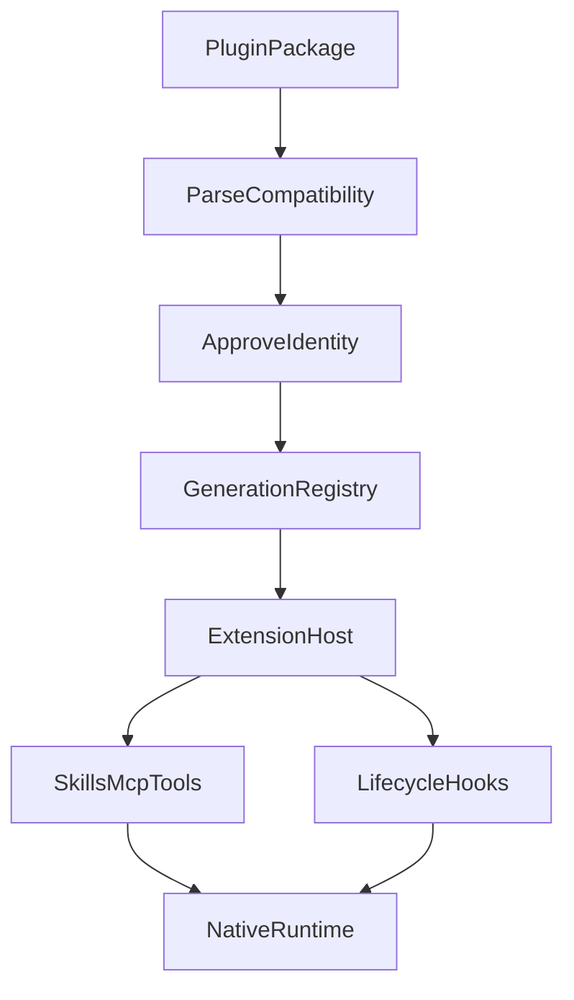

# Agent 扩展如何接入 Host：插件生命周期与运行时边界

最开始，我们的 ETF Agent 已经能调用 MCP 查询数据、通过 Skill 执行研究方法，还有自己的工具循环、生命周期钩子、执行回执和恢复机制。做一个特定的投资研究任务，这些能力已经不少。

但随着功能增加，我们发现另一件事：每增加一种能力，都要自己想怎么接入、注册、授权、运行、维护和升级。想要一个新的研究方法，得决定它怎样被模型发现、使用哪些工具、怎样保存成果；想在工具执行前增加检查，又要重新考虑生命周期、参数变换和失败恢复。

这有点像功能机时代：功能大多是厂商预装的，用户能做什么，取决于制造商是否愿意继续修改系统。

智能手机真正值得借鉴的，不是 App Store 的图标，而是**核心系统和第三方应用之间出现了一条相对稳定的边界**。应用可以持续增加，但不必每次都改造操作系统。

我们想让 Agent 也向这个方向发展：**核心负责执行与治理，能力通过插件持续加入。**

于是我们开始研究 Agent Plugins、Claude、Pi、Codex 等生态。但我们给自己定了一个约束：尽量让原插件运行在自己的 Agent Host 里，而不是再启动一个 Claude、Pi 或 Codex Agent 帮我们做任务。只有这样，扩展出来的仍是我们的 Agent，而不是几个 Agent 的拼接。

本文主体保留原系统接入第三方生态的设计与历史；现在还可以用 [Open ETF Agent](https://github.com/hpoenixf/open-etf-agent) 的公开 v0.7 切片，运行一次“选择可信本地包—发布能力—读取材料—保存报告—释放资源”的最小流程。它实现的是下面讨论的一部分生命周期，不是把原系统的 Claude、Pi、Codex 兼容层整体开源出来。

## 一、插件不是一个 Markdown 文件

一开始，插件似乎很简单：Skill 负责告诉模型怎么做，MCP 负责提供工具和数据。把两者放进一个包，就能扩展 Agent。

但真实的第三方插件往往还需要更多东西。

- Claude 的 **Hookify** 可以在工具执行前阻止操作，也可以在 Agent 准备结束时要求继续，并向用户发送提示。
- Pi 的 **todo** 扩展不只注册增删查工具，还维护状态，并在新会话开始时恢复。
- Codex 的 **cc-research** 带有完整的研究方法：分工、报告文件、综合写作和 Stop 阶段的引用审计。

它们要求的不是一种抽象。只定义一个统一的 Plugin JSON Schema，很难让这三类行为真正运行起来。

我们后来把插件接入分成了两件事：

**Compatibility Profile 负责解释外部生态的规则；Extension Host 负责把合法能力接入已有执行系统。**



Agent Plugins 1.0.0 提供了便携包的核心约定，Skill 和 MCP 是基础组件；Claude、Pi、Codex 自己的 Hook、工具、会话状态则由各自的 Profile 处理。OpenCode 也保留了 Profile 入口。

**我们并不追求对每个生态的完美兼容，而是优先支持有实际价值、能合理接入现有 Host 的能力。**

这让后续扩展有了一条重要原则：**插件可以提供方法、声明回调和请求工具，但不能因此重新定义我们的预算、来源授权、执行回执和恢复规则。**

## 二、第一类坑：文件 hash 没变，不代表执行的代码没变

支持外部代码后，最自然的做法是给插件和依赖做内容锁：固定版本，记录内容摘要，启动前重新校验，通过后才能执行。

这个设计很合理，但我们后来在 Pi 扩展加载中发现一个更底层的问题。

### 你校验的字节，可能不是加载器真正执行的字节

Pi 的 TypeScript 扩展可以通过 Jiti 加载。我们构造过一个 resolve-only 的反例：插件和依赖的内容锁保持不变，但运行环境中的链接会影响实际模块解析目标。

于是出现了一个危险的间隙：

```text
已检查的插件内容：不变
已检查的依赖内容：不变
实际 Loader 解析目标：可能变化
```

**内容相同，不等于执行身份相同。**

这促使我们把选定可执行扩展的加载推进到另一条路径：

```text
原始插件与依赖
  → 受控转换
  → 固定转换选项、运行依赖和 Host 身份
  → 验证最终执行字节
  → 从同一份已验证 Buffer 加载
```

我们称这类产物为受审派生产物（Reviewed-derived Artifact）。它解决的不是“TypeScript 怎样变成 JavaScript”，而是要回答：**究竟哪份经过检查的代码，真的被执行了？**

类似问题也出现在测试环境里。2026 年 10 月 9 日，原 Pi/Hookify 验收在 macOS ARM64 上被内容身份检查拒绝，尽管原始 lockfile 与 Linux x64 环境相同。

排查后发现差异集中在 esbuild 的平台包与安装器隐藏 lock 文件。我们重新构建并比较两个平台的依赖树，记录了 11 处差异，最终为两个平台保留分别验证的依赖集合，而不是放松内容锁。

这次经历让我意识到，插件版本不能只靠一串 SemVer 表达；安装实例、平台依赖、执行内容和当前代际都各有身份。

例如当前 Registry 持有的代际身份大致是：

```ts
type ExtensionGenerationIdentity = {
  scopeId: string;
  installationId: string;
  generation: number;
  contentHash: string;
  profileRevision: string;
};
```

可迁移的经验是：**动态执行系统需要将“批准的内容”“实际加载的内容”和“当前有权执行的实例”分开验证。**

公开 v0.7 对这里作了更窄的取舍：[`plugins.mjs`](https://github.com/hpoenixf/open-etf-agent/blob/5f70dc0b4760ad70ef211f4823828ab2fee5c525/src/plugins.mjs)只接受调用方已经显式导入的可信本地 JavaScript 描述符，重新读取指定模块文件并核对内容哈希。它没有实现上面的受审转换加载器，也没有证明依赖闭包或函数闭包状态与文件哈希等价；因此不能拿这条校验去认证任意第三方代码。这个范围较小，却允许我们把注意力先放在能力发布和清理是否正确。

## 三、第二类坑：Hook 已经执行，为什么没有产生预期效果？

Claude Hookify 是我们验证生命周期兼容时很有代表性的原始插件。

它参与 `PreToolUse`、`PostToolUse`、`UserPromptSubmit` 和 `Stop` 等事件。我们保留原包文件，尝试让这些事件通过 ETF Agent 自己的生命周期执行器生效。

最早碰到的不是加载失败，而是输出语义没有接好。

### 1. 原始 Hookify 发出了提示，Host 却把它当成错误

原始 Hookify 的一组匹配测试曾出现：

```text
command.unsupported-system-message
```

Hookify 返回的是一个面向用户的提示，而 Host 当时没有正确区分这类展示内容与执行控制。

但不同 Hook 的输出本来就有不同职责：

| 输出 | 应该交给谁处理 |
| --- | --- |
| 工具执行前拒绝 | 当前工具调用的准入边界 |
| 工具执行后的结果修改 | 结果投影与再次校验 |
| 给模型的附加建议 | 下一轮模型请求装配 |
| 面向用户的提示 | 公共交付事件 |
| 停止阶段的继续建议 | 原运行的 Stop / Completion 边界 |

我们没有给 Hookify 特别开一个展示系统，而是把提示接入已有的用户事件通道。即使提示展示失败，也不应该悄悄消除原来有效的拒绝或阻断决定。

**Hook 参加生命周期，不等于 Hook 有权接管整个生命周期。**

### 2. 失败建议已经解析出来，却没进入下一次模型请求

更隐蔽的问题发生在另一次真实 Factory 测试中。这里使用的是合成命令 Hook，用来检验 `ToolFailure` 的 `additionalContext` 投影，并不是把这个行为冒充为原始 Hookify 的完整能力。

测试中，工具确实失败了，Hook 适配器也执行了一次，建议被解析出来；但真正提交的下一次模型请求里，缺少那条已批准的建议：

```text
Actual next gateway request
lacks AUTHORIZED_FAILURE_SUGGESTION
```

这不是 Hook 没执行，而是**Hook 的结果没有穿过最后一段消费链路**。

修复集中在既有异步上下文投影和模型请求装配上。最终请求包含有来源归属的建议，但仍保留工具原始失败事实，不将它改写成成功，也不把失败信息伪装成新的金融证据。

这和我们后来在 RAG、工具结果、Memory 中反复遇到的问题很像：

**一项能力“产生了输出”，与“下一次模型真的消费了它”，是两种不同的可观测事实。**

因此，扩展机制测试不能只断言 callback 被调用，还应检查最终工具动作、模型请求和用户事件的真实结果。

## 四、第三类坑：Pi 让我们重新理解了插件状态

Pi 的 todo 扩展看起来只是一个小工具：添加待办、列出待办、在新会话恢复状态。正因为简单，它非常适合测试宿主是否真正理解有状态插件。

它连续暴露了两个问题。

### 1. 三次回调成功，为什么只保存了一条待办？

2026 年 10 月 9 日的原始 todo 测试，有过这样一组真实观察：

| 观察项 | 修复前 |
| --- | ---: |
| 插件回调成功 | 3 |
| 状态保存回执 | 1 |
| 状态冲突 | 2 |
| 最终持久化待办 | 1 |

回调都执行过，状态却没有按预期提交。原因并不神秘：几个写入同一插件实例状态的操作，进入了不合适的并发交错。

我们最后没有为整个 Agent 建立一个全局串行队列，而是复用 Native 执行器，把带 `state:write` 权限的工具在相应回合内作为有序单例结算；普通只读操作继续保持并发。

修复后，同一原始示例的状态按预期保存，修订号依次推进，终态回放没有增加新的写入。

这件事对插件系统非常重要：

> **工具允许并行执行，不代表它们的副作用可以并行提交。**

是否串行，应该看它们共同修改什么状态、依赖什么原始回执，而不是简单地按“插件调用”统一排队。

### 2. 已经完成的 Run，为什么恢复时又执行了 SessionStart？

随后我们用 PostgreSQL 验证原始 todo 的恢复。

第一轮已经保存了工具回执和状态。关闭原来的连接和 Factory，重新创建数据库连接、Registry 与 Factory，再回放**同一个已经终结的 Run**。

第一次实际测试失败了：

```text
hook.effect_recovery_unavailable
```

原因是：Host 按“启动新运行”的正常路径，先触发了带副作用的 `SessionStart`，然后才准备返回已提交的旧结果。

但这次只是终态回放，不应该新增生命周期效果，所以回放路径本来就没有新的 effect executor。

这让我们明确分出两条执行路线：

```text
真正的新 Run
  → SessionStart
  → 从旧状态恢复 todo
  → 正常调用工具并提交新回执

已终结 Run 的历史回放
  → 读取原持久化回执
  → 检查当前展示和授权资格
  → 返回既有结果，不再派发初始化 Hook
```

修复的关键不是把 `SessionStart` 禁掉，而是只在不该产生新效果的回放路径上跳过它。后续真正的新 Run，依然要触发原始回调并恢复待办状态。

同一条证据链里还有一处测试陷阱：最初的测试把临时发布内容当作已经持久化的结果比较。后来我们调整为等待真实后台写入，再以持久化回执作为恢复对照。

这两次修正指向同一个原则：

**恢复是消费已经发生的事实；重试或新运行才可能产生新的事实。**

有状态插件要想成为可长期使用的扩展，这个原则比“API 形状一样”重要得多。

## 五、第四类坑：Codex 插件要的不是几个函数，而是一整套研究方式

Claude 主要考验 Hook，Pi 主要考验工具与状态；到了 Codex 的研究插件 `cc-research`，我们遇到的是另一个维度。

这个插件的方法大致包括：

```text
创建计划
  → 分配 Researcher
  → 各自收集资料与 Claims
  → 汇总 Sources
  → Synthesizer 写报告
  → Stop Hook 检查引用
  → 按反馈修订并交付
```

如果只是把它的 Skill 文本塞进模型上下文，仍然无法支持这套流程。模型需要实际可用的产物读写、角色交接和审计输入。

### 1. 一个冒号，让原始 Skill 解析失败

cc-research 的原始 `SKILL.md` 包含带冒号和空格的普通 `description` 标量。我们使用的严格 YAML 解析器拒绝了它。

类似下面这个说明性例子：

```yaml
name: research
description: Research: a complete workflow
```

我们继续检查 Codex 自己的 Skill 解析器，发现它对这类特定描述字段存在有限的兼容处理：先严格解析，失败时只针对符合条件的描述标量做引用修复，再重新解析。

于是我们将这条行为限定在 Codex Profile 内：只处理明确的单行 `description` 情形，保留原始正文、原始文件字节和内容 hash，不对其他无效 YAML 做万能“自动修复”。

这是兼容开发很典型的一课：

**比起为某个插件偷偷改文件，更好的做法是理解原生态真实接受什么，再把差异收进有边界的适配层。**

### 2. 原插件需要文件，但我们不想给它一整个 Shell

cc-research 的研究结果围绕一组逻辑文件交换：

```text
runs/<id>/
  meta.json
  plan.md
  sources-web-1.jsonl
  claims-web-1.jsonl
  sources-web-2.jsonl
  claims-web-2.jsonl
  report.md
```

最简单的方式是给模型一个工作目录和 Shell，让它直接创建文件。但 ETF Agent 原来已经有 Artifact Repository、执行回执、来源权限与取消机制。再引入一个随意读写的 workspace，等于多建一套相互竞争的存储事实。

所以我们沿既有 Artifact owner 加了有限的 Host 报告工具：

```text
report_write_strand
report_write_document
report_read
report_view
```

每个文件都有受限类型、逻辑身份、不可变版本和原始来源依赖。一个 web-researcher Child 只能写被分配的 sources/claims；Synthesizer 只能读取当前获准的固定视图，并写自己的报告。Main 负责收集、明确选择版本和协调交接。

文件存在于磁盘，不代表它已提交；报告正文里写了 `source_ids`，也不代表它获得了那些来源的权限。

我们还发现另一个实际竞态：当某个资料生产者在 Main 的下一次模型请求即将派发时被禁用，只在早期工具读取时检查权限不够。最后需要在真实派发边界重新核对原始生产者和依赖。

这些问题促使我们把报告工具当成**带有来源与回执身份的文件操作**，而不是随手加几个读写文件的函数。

### 3. JSONB 改了对象键顺序，报告却被拒绝读取

做 PostgreSQL 恢复测试时又遇到了一个非常具体的问题。

报告对象经过 JSONB 保存和读取后，键的插入顺序可能变化。如果用序列化字符串判定相等，就会把实际上相同的结构化数据误判为不同。

例如下面是说明性例子：

```json
{"source":"A","version":1}
```

和：

```json
{"version":1,"source":"A"}
```

它们字节不同，作为普通 JSON 对象却表达相同的键值关系。

修复采用结构化深度比较：字段、类型、值和数组顺序照样严格检查，但不把对象键插入顺序当成持久化业务身份。

这里最值得借鉴的是：**先区分哪些内容必须逐字节一致，哪些内容只需要结构化等价。** 原始文件、来源 hash 和经过签名的字节有自己的精确规则；数据库读回的结构化记录有另一套等价规则。混用会带来奇怪的恢复故障。

### 4. Stop Hook 的退出码 0，也可能只是“没有做审计”

cc-research 还有一个原始 `audit.py`，通过 Stop Hook 检查报告引用。

分析脚本时，我们发现退出码 0 不一定意味着引用审计通过：防重入、完成状态、过期资料或其他跳过条件都可能正常退出。

因此：

```text
进程 exit 0
  ≠ 已经执行了引用审计
  ≠ 引用审计通过
  ≠ 研究内容正确
```

原脚本还依据文件修改时间判断新鲜度。如果 Host 把旧报告重新物化到临时目录，修改时间变成了“现在”，就可能无意中改变它的审计逻辑。

所以受控视图需要保留原始持久化时间，并让新的视图重新经过命令及工作目录绑定，而不是偷偷改路径、重置时间来让脚本通过。

这也是为什么兼容一个看起来简单的 Stop Hook，最后会涉及文件版本、时间语义、命令准入和下一轮反馈。原脚本完整修复链还在单独验收；这里讨论的是已定位的依赖与相应 Host 设计。

## 六、绕了一圈，我们最终把 Extension Host 做成了什么？

这段经历之后，再看 Extension Host，它的职责已经比较清楚。

**包发现**回答“包里有什么”：识别 Core、Skill、MCP 和选定的兼容 Profile。发现一个声明，不等于运行它。

**审批和内容身份**回答“目前哪份东西有权执行”：安装实例、审阅记录、内容锁、实际加载字节与授权都需要可核对。一个安装记录不能冒充当前批准；插件升级也不能沿用旧 generation 的执行资格。

**Generation Registry**回答“现在提供哪组能力”：异步初始化先暂存注册结果，确认成功后再原子发布，避免一个初始化到一半就失败的插件留下半套可见工具。

**Lifecycle 与工具适配**回答“回调怎么进入真实执行链”：Pre 的决定作用于调用前，Post 的结果作用于投影，提示走用户事件，Stop 走已有终止边界；工具统一受 Native 的身份、预算与取消约束。

**Durable Effects**回答“已经做过什么”：插件状态、文件写入和命令效果由原始执行回执结算，恢复复用已结算事实；尚未明确结算的效果不能仅凭 callback 成功或临时文件存在而变成“已完成”。

可以把它理解成一句话：

> **Extension Host 是外部生态与现有 Agent Runtime 之间的适配和治理边界，不是第二个 Agent。**

这让插件能继续扩展，但不必把每种插件的状态机、权限系统和工具循环全部塞进研究 Runtime。

### 公开切片怎样避免“只装好一半”

扩展声明、激活和清理并不是 Agent 特有的发明。例如，[VS Code 的扩展说明](https://code.visualstudio.com/api/get-started/extension-anatomy)已经把声明式贡献、激活事件与 `activate` / `deactivate` 分开。这里要解决的本地问题更具体：**一批能力将进入同一个研究 Runtime，后面的包出错时，前面的包不能已经留下一套对模型可见的半成品。**

公开实现先检查整批描述符：包身份、工具重名、输入 Schema、Skill 正文身份、Hook 阶段与限制，以及所有选定文件的内容身份。全部通过以后，才开始激活第一个包。工具和 Skill 在描述符中先声明，不能等到 `activate` 返回时再偷偷增加；只有全部激活完成，接口才返回这一批冻结的能力与绑定。后一个包的声明不合法时，前一个包甚至不会开始激活。

如果错误发生得更晚——第一个包已取得资源，第二个包才激活失败——已经通过 `deferRelease` 登记的清理函数会按相反顺序执行。某个清理失败不阻止其余清理，结果保留 `PLUGIN_RELEASE_FAILED`，不把它写成完全释放。[生命周期用例](https://github.com/hpoenixf/open-etf-agent/blob/5f70dc0b4760ad70ef211f4823828ab2fee5c525/test/plugins.test.mjs)还保留了一个实际发现的重入反例：清理回调再次触发 `release` 时，旧实现可能重复执行清理。当前实现先保存共享的释放 Promise，再进入回调，让并发或非等待式重入复用同一轮清理。

这里的“原子发布”只指**这个接口交出的能力集合**，不是为任意 JavaScript 副作用提供事务回滚。可信包仍有本进程权限，必须及时登记自己取得的资源；这不是沙箱，也不能强制终止任意同步死循环。一次 Run 持有选定的函数引用、元数据和包绑定直到自己的生命周期结束；后来选择新版本，不会改绑已经运行的旧版本。释放同样不是对进行中任务的热卸载。

### 运行两个包，读回它们真正产生的结果

[当前 main 的 README](https://github.com/hpoenixf/open-etf-agent/blob/main/README.md)是持续使用入口。下面则固定到已公开的 v0.7 提交，避免后来版本改变接口；本地资格记录使用 Node.js 26.11.1，包声明支持 26.8.1–26.x，但不是每个补丁版本都已在同一环境实测。

```bash
git clone https://github.com/hpoenixf/open-etf-agent.git open-etf-agent-plugin-demo
cd open-etf-agent-plugin-demo
git checkout --detach 5f70dc0b4760ad70ef211f4823828ab2fee5c525
npm ci --ignore-scripts --no-audit --no-fund
npm run session -- start --session runs/plugin-article --case trusted-plugins
```

首次安装可能访问 npm；示例使用合成文档和脚本 Gateway，不调用远程模型。SQLite、方法读取、工具执行和文件保存则真实发生。请使用新的示例 session 目录，不要指向现有研究数据。

[`example-plugins.mjs`](https://github.com/hpoenixf/open-etf-agent/blob/5f70dc0b4760ad70ef211f4823828ab2fee5c525/src/example-plugins.mjs)提供两个原创包：一个读取合成文档的方法与页面，一个读取明确标注为虚构数据的 ETF 方法与材料。它们没有启动另一个 Agent，也没有把 Skill 注册误当成方法已读；[`durable-demo.mjs`](https://github.com/hpoenixf/open-etf-agent/blob/5f70dc0b4760ad70ef211f4823828ab2fee5c525/src/durable-demo.mjs)先实际调用两份方法的读取工具，再取得来源，最后调用原来的 `save_report`。ETF 示例不是行情接入，更不是投资结论。

终端 JSON 中的 `directory` 指向本次 Run；打开其中的 `report.md` 和 `manifest.json`，可以核对报告、两份已取得的方法和两份原始来源。`receipt` 是实际文件回执，`pluginRelease.status` 是本轮插件清理结果；当前两个示例包没有申请额外外部资源，因而不能仅凭这里的 `released` 推断任意资源都能正确清理。要观察激活中途失败、逆序清理和清理错误，可以单独运行上面的生命周期用例，而不必跑完整项目测试：

```bash
node --test --test-concurrency=1 test/plugins.test.mjs
```

包绑定也写入同一个 SQLite Session。把下列 `run-YOUR_ID` 替换为 `start` 输出的实际 `runId`，可以检查 `definition.bindings.plugins` 中的包 ID、版本、描述符版本和内容哈希：

```bash
npm run session -- inspect --session runs/plugin-article --run run-YOUR_ID
```

[`runtime.mjs`](https://github.com/hpoenixf/open-etf-agent/blob/5f70dc0b4760ad70ef211f4823828ab2fee5c525/src/runtime.mjs)把发布后的工具与 Hook 接回原执行循环，结束时调用同一插件集合的 `release`。这是当前可以复现的能力：**可信包贡献进入真实方法/来源所有者，并沿原 Runtime 产生可读报告和清理结果**。包的生命周期与 Run 的持久取消、恢复仍是不同责任，后者可继续读[控制交接的公开切片](https://hpoenixf.com/eff-agent-article/articles/agent-control-events-durable-owner-adoption)；不能由一次插件示例推导多生态兼容、后台调度或真实模型采用质量。

<!-- open-etf-case:plugins@e1b8e4edde724548fab16d8ca4b205379bfa7f30 -->
### 验证两个包进入的是同一个 Host

固定公开快照的[插件集成用例](https://github.com/hpoenixf/open-etf-agent/blob/e1b8e4edde724548fab16d8ca4b205379bfa7f30/test/plugins.test.mjs)把两种可信包贡献交给普通 Runtime 和 Host，便于检查“加载了包”之后是否真的取得并保存了结果。

在所链固定快照按 README 安装依赖后，运行：

```bash
node --test --test-concurrency=1 --test-name-pattern='^7\.1 two trusted packages use the ordinary Host and acquired source/method owners$' test/plugins.test.mjs
```

用例实际读取两种方法与两份合成来源，保存报告并核对 `manifest.json` 中的两份来源、两种方法，最后检查包资源已释放。终端应显示这条精确测试通过。

这里检验的是可信本地包接入同一执行链；它没有把第三方代码变成隔离沙箱，也不代表 Claude、Pi、Codex 全生态兼容已经通过。
<!-- /open-etf-case -->

## 七、扩展能力由谁接管

回看这个过程，我们最初想解决的是“怎样使用更多第三方插件”。

一路下来遇到的，却是加载器身份、Hook 输出消费、状态提交顺序、终态回放、受控文件交换，以及外部脚本对时间和文件系统的真实假设。

这些坑看起来分散，其实都在反复回答同一个问题：

**一个外部能力接入后，究竟由谁负责使它的行为成为系统事实？**

我们现在更倾向于这样的分工：

```text
Model       理解任务，选择下一步
Skill       提供研究方法与任务说明
MCP / Tool  提供可调用的具体能力
Plugin Host 装配第三方能力与生命周期
Runtime     负责执行、预算、取消和恢复
Application 持有用户、来源与持久化业务事实
```

第三方插件可以定义自己的方法、工具和回调，但不能让我们丢失这些已有的系统边界。

智能手机之所以可以持续演化，不是因为系统里预装了所有应用，而是因为应用能接入一套可复用的运行基础设施。

Agent 也是一样。

**Agent 的持续进化，不取决于它内置了多少功能，而取决于它能否不断吸收新能力，同时让核心复杂度保持可控。**

---

这里真正用到的是[原则 7「能力应当容易引入、撤退和替换」](/principles#principle-7)：Extension Host 让新能力沿既有执行与授权路径接入，扩展的发布、禁用和退出不要求每次重造 Runtime。但「可替换」首先是职责与生命周期可控，并不等于任何插件都能无代价热卸载。

## 技术下篇：多生态 Hook 的实际执行

本篇介绍插件包、代际与 Extension Host 架构。独立下篇 [《从 Claude、Pi 到 Codex：我们如何在自己的 Agent Runtime 中实现多生态 Hook？》](agent-multi-ecosystem-hook-execution.md) 进一步讲清命令 Hook 的协议差异、Pi 原始 Factory、可终止子进程、持久效果与恢复。两篇互为补充。

## 延伸材料

本文以 2026 年 10 月 12 日的 ETF Agent 实现为窗口，所述故障来自有原始记录的工程验证；文中的目录、文件内容与数据样例为便于理解而简化。

- 插件生命周期、Pi 终态回放与执行字节复盘
- 插件审批事实与当前执行资格
- 平台依赖内容身份排查
- 第一阶段原插件/Hookify/Pi 的执行证据
- Codex 研究插件文件、Main/Child 与恢复验证
- Extension Package Registry 实现、Command Hook Lifecycle 实现、Report Adapter 实现
