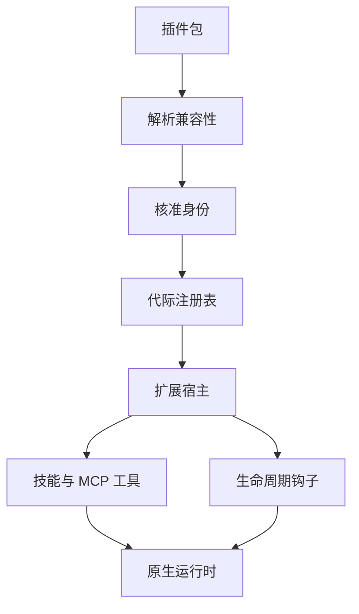

# Agent 扩展如何接入 Host：插件生命周期与运行时边界

最开始，我们的 ETF Agent 已经能调用 MCP 查询数据、通过 Skill 执行研究方法，还有自己的工具循环、生命周期钩子、执行回执和恢复机制。做一个特定的投资研究任务，这些能力已经不少。

但随着功能增加，我们发现另一件事：每增加一种能力，都要自己想怎么接入、注册、授权、运行、维护和升级。想要一个新的研究方法，得决定它怎样被模型发现、使用哪些工具、怎样保存成果；想在工具执行前增加检查，又要重新考虑生命周期、参数变换和失败恢复。

这有点像功能机时代：功能大多是厂商预装的，用户能做什么，取决于制造商是否愿意继续修改系统。

智能手机真正值得借鉴的，不是 App Store 的图标，而是**核心系统和第三方应用之间出现了一条相对稳定的边界**。应用可以持续增加，但不必每次都改造操作系统。

我们想让 Agent 也向这个方向发展：**核心负责执行与治理，能力通过插件持续加入。**

于是我们开始研究 Agent Plugins、Claude、Pi、Codex 等生态。但我们给自己定了一个约束：尽量让原插件运行在自己的 Agent Host 里，而不是再启动一个 Claude、Pi 或 Codex Agent 帮我们做任务。只有这样，扩展出来的仍是我们的 Agent，而不是几个 Agent 的拼接。

本文主体保留原系统接入第三方生态的设计与历史；现在还可以用 [Open ETF Agent](https://github.com/hpoenixf/open-etf-agent) 的公开 v0.7 切片，运行一次“选择可信本地包—发布能力—读取材料—保存报告—释放资源”的最小流程。它实现的是下面讨论的一部分生命周期，不是把原系统的 Claude、Pi、Codex 兼容层整体开源出来。

## 一、插件不是一个 Markdown 文件

一开始，插件似乎很简单：Skill 负责告诉模型怎么做，MCP 负责提供工具和数据。把两者放进一个包，就能扩展 Agent。

但真实的第三方插件往往还需要更多东西。

- Claude 的 **Hookify** 可以在工具执行前阻止操作，也可以在 Agent 准备结束时要求继续，并向用户发送提示。
- Pi 的 **todo** 扩展不只注册增删查工具，还维护状态，并在新会话开始时恢复。
- Codex 的 **cc-research** 带有完整的研究方法：分工、报告文件、综合写作和 Stop 阶段的引用审计。

它们要求的不是一种抽象。只定义一个统一的 Plugin JSON Schema，很难让这三类行为真正运行起来。

我们后来把插件接入分成了两件事：

**Compatibility Profile 负责解释外部生态的规则；Extension Host 负责把合法能力接入已有执行系统。**



Agent Plugins 1.0.0 提供了便携包的核心约定，Skill 和 MCP 是基础组件；Claude、Pi、Codex 自己的 Hook、工具、会话状态则由各自的 Profile 处理。OpenCode 也保留了 Profile 入口。

**我们并不追求对每个生态的完美兼容，而是优先支持有实际价值、能合理接入现有 Host 的能力。**

这让后续扩展有了一条重要原则：**插件可以提供方法、声明回调和请求工具，但不能因此重新定义我们的预算、来源授权、执行回执和恢复规则。**

## 二、可信加载：校验的内容必须对应真正执行的代码

引入第三方扩展后，锁版本、记录内容哈希、启动前校验是必要的，但还要问：**执行器最终加载的是不是被检查过的那份代码？**

Pi 的 TypeScript 扩展可以经 Jiti 加载。在一次受控模块解析反例中，插件和依赖的内容锁没有变化，运行环境中的链接却能影响实际解析目标。检查原始文件，不等于检查转换和加载后的可执行内容。

我们的选择是对需要转换的扩展保留受审派生产物：将原包、平台依赖、转换选项与 Host 身份绑定，检查最终可执行字节，并从**同一份已验证内容**加载。macOS ARM64 与 Linux x64 的依赖树也需要分别核对；同一个 lockfile 不保证平台包及安装产物完全相同。

```ts
type ExtensionGenerationIdentity = {
  scopeId: string;
  installationId: string;
  generation: number;
  contentHash: string;
  profileRevision: string;
};
```

这几个字段区分了被批准的内容、当前安装实例和实际有权运行的代际。**加载可信与当前获准执行，是两个判断。** 插件升级不能沿用旧代际的资格。

这里还应分清私有完整设计与可运行的公开切片。公开 v0.7 的 [`plugins.mjs`](https://github.com/hpoenixf/open-etf-agent/blob/5f70dc0b4760ad70ef211f4823828ab2fee5c525/src/plugins.mjs)只接纳显式导入的可信本地 JavaScript 描述符，并校验选定模块文件哈希；它不提供上述受审 TypeScript 转换加载器，也不能认证任意第三方依赖闭包。

## 三、Hook 的价值在于效果被正确消费

Claude Hookify 参与 `PreToolUse`、`PostToolUse`、`UserPromptSubmit` 与 `Stop`，但同一个 Hook 名称不意味着输出具有同一种权力：

| Hook 产生的内容 | 应由谁结算 |
| --- | --- |
| 工具调用前的拒绝 | 原工具准入 |
| 执行后的结果修改 | 结果投影及复核 |
| 给模型的附加建议 | 下一次模型请求装配 |
| 面向用户的提示 | 既有交付事件 |
| Stop 阶段的继续意见 | 原 Run 终结边界 |

原始 Hookify 曾产生用户提示，却被 Host 当作错误；另一次使用**合成命令 Hook** 的受控验证中，工具失败建议已经解析成功，但没有进入下一次实际模型请求。后者不是原始 Hookify 的功能验收。这些例子指向同一项设计：**回调执行成功，不代表它的效果到达了正确的消费者。**

我们沿既有事件通道与异步上下文装配修正消费，不为 Hook 新建一套发布、授权或任务终结系统。工具原本失败就仍是失败；建议进入模型输入，也不能伪装成新的金融证据。检查点应该是实际工具动作、最终模型请求和用户可见事件，而不只是“Hook 被调用”。

## 四、有状态插件：写入顺序与历史回放是两种契约

Pi 的 todo 扩展提供了清楚的反例：一次受控运行中，**三个回调都成功，却只有一份状态保存回执，另有两次冲突**。问题在于多个写入共享同一插件实例状态。我们没有让所有插件工具全局串行，而是让带 `state:write` 权限的调用在相应回合内有序结算，只读调用继续允许并发。

另一个反例发生在 PostgreSQL 恢复：**回读已经终结的 Run** 曾误走新 Run 的初始化路径，再次触发带副作用的 `SessionStart`。修正后，两种操作明确分开：

- 真正的新 Run：触发初始化，从已存状态取得 todo，再依法产生新操作与回执。
- 已终结 Run 的历史回放：读取原持久回执、检查当前展示资格，不再制造新的初始化效果。

这不是让所有恢复都跳过 Hook，而是用运行身份决定是否允许产生新效果。**工具允许并发，不代表副作用能并发提交；历史能够回读，也不代表可以重新执行。**

## 五、研究型插件：保留工作方法，不另造文件系统

Codex 的 `cc-research` 不只有几条 Tool 定义，而是包含计划、Researcher 收集 Sources/Claims、Synthesizer 写报告与 Stop 引用审计的一套工作方式。只把 Skill 文本放进上下文，无法让这些步骤真实交接。

我们保留兼容 Profile 的职责：例如原始 Skill 中带冒号的单行 `description` 曾被严格 YAML 解析器拒绝；适配器只对原生态接受的特定格式作有限解释，不在背后改写第三方原件或其内容哈希。更关键的是，研究用到的 `sources-*.jsonl`、`claims-*.jsonl` 与 `report.md` 不应该要求 Agent 取得任意 Shell 和工作目录权限。

因此，报告读写通过原 Artifact Owner 的有限接口完成：

```text
report_write_strand
report_write_document
report_read
report_view
```

每次写入带有明确的角色范围、逻辑身份、不可变版本和来源依赖；Child 只写自己获分配的记录，Synthesizer 使用当前获准的固定视图，Main 选择版本并协调结果。在模型请求实际派发前，还须重新核对可能已撤权的原始来源。文件存在、引用了 source ID，都不能代替提交和授权回执。

这里也要区分**原始字节身份与结构化记录等价**：JSONB 读回可能改变对象键顺序，不能因此判定逻辑报告内容不同；而源文件哈希和签名字节仍必须精确一致。

最后，原始 `audit.py` 的 Stop Hook 返回退出码 0，可能只是跳过了检查，并不证明引用审计执行，更不能证明研究正确。脚本还依赖原文件修改时间，受控视图不能靠重新物化文件把旧资料伪装成新资料。原脚本的完整修复链仍待单独验收。

**兼容一个研究插件，重要的不是把它的命令都运行起来，而是让方法、文件、来源与审计各自在原有执行事实中有准确位置。**

## 六、绕了一圈，我们最终把 Extension Host 做成了什么？

这段经历之后，再看 Extension Host，它的职责已经比较清楚。

**包发现**回答“包里有什么”：识别 Core、Skill、MCP 和选定的兼容 Profile。发现一个声明，不等于运行它。

**审批和内容身份**回答“目前哪份东西有权执行”：安装实例、审阅记录、内容锁、实际加载字节与授权都需要可核对。一个安装记录不能冒充当前批准；插件升级也不能沿用旧 generation 的执行资格。

**Generation Registry**回答“现在提供哪组能力”：异步初始化先暂存注册结果，确认成功后再原子发布，避免一个初始化到一半就失败的插件留下半套可见工具。

**Lifecycle 与工具适配**回答“回调怎么进入真实执行链”：Pre 的决定作用于调用前，Post 的结果作用于投影，提示走用户事件，Stop 走已有终止边界；工具统一受 Native 的身份、预算与取消约束。

**Durable Effects**回答“已经做过什么”：插件状态、文件写入和命令效果由原始执行回执结算，恢复复用已结算事实；尚未明确结算的效果不能仅凭 callback 成功或临时文件存在而变成“已完成”。

可以把它理解成一句话：

> **Extension Host 是外部生态与现有 Agent Runtime 之间的适配和治理边界，不是第二个 Agent。**

这让插件能继续扩展，但不必把每种插件的状态机、权限系统和工具循环全部塞进研究 Runtime。

### 公开切片怎样避免“只装好一半”

扩展声明、激活和清理并不是 Agent 特有的发明。例如，[VS Code 的扩展说明](https://code.visualstudio.com/api/get-started/extension-anatomy)已经把声明式贡献、激活事件与 `activate` / `deactivate` 分开。这里要解决的本地问题更具体：**一批能力将进入同一个研究 Runtime，后面的包出错时，前面的包不能已经留下一套对模型可见的半成品。**

公开实现先检查整批描述符：包身份、工具重名、输入 Schema、Skill 正文身份、Hook 阶段与限制，以及所有选定文件的内容身份。全部通过以后，才开始激活第一个包。工具和 Skill 在描述符中先声明，不能等到 `activate` 返回时再偷偷增加；只有全部激活完成，接口才返回这一批冻结的能力与绑定。后一个包的声明不合法时，前一个包甚至不会开始激活。

如果错误发生得更晚——第一个包已取得资源，第二个包才激活失败——已经通过 `deferRelease` 登记的清理函数会按相反顺序执行。某个清理失败不阻止其余清理，结果保留 `PLUGIN_RELEASE_FAILED`，不把它写成完全释放。[生命周期用例](https://github.com/hpoenixf/open-etf-agent/blob/5f70dc0b4760ad70ef211f4823828ab2fee5c525/test/plugins.test.mjs)还保留了一个实际发现的重入反例：清理回调再次触发 `release` 时，旧实现可能重复执行清理。当前实现先保存共享的释放 Promise，再进入回调，让并发或非等待式重入复用同一轮清理。

这里的“原子发布”只指**这个接口交出的能力集合**，不是为任意 JavaScript 副作用提供事务回滚。可信包仍有本进程权限，必须及时登记自己取得的资源；这不是沙箱，也不能强制终止任意同步死循环。一次 Run 持有选定的函数引用、元数据和包绑定直到自己的生命周期结束；后来选择新版本，不会改绑已经运行的旧版本。释放同样不是对进行中任务的热卸载。

### 运行两个包，读回它们真正产生的结果

[当前 main 的 README](https://github.com/hpoenixf/open-etf-agent/blob/main/README.md)是持续使用入口。下面则固定到已公开的 v0.7 提交，避免后来版本改变接口；本地资格记录使用 Node.js 26.11.1，包声明支持 26.8.1–26.x，但不是每个补丁版本都已在同一环境实测。

```bash
git clone https://github.com/hpoenixf/open-etf-agent.git open-etf-agent-plugin-demo
cd open-etf-agent-plugin-demo
git checkout --detach 5f70dc0b4760ad70ef211f4823828ab2fee5c525
npm ci --ignore-scripts --no-audit --no-fund
npm run session -- start --session runs/plugin-article --case trusted-plugins
```

首次安装可能访问 npm；示例使用合成文档和脚本 Gateway，不调用远程模型。SQLite、方法读取、工具执行和文件保存则真实发生。请使用新的示例 session 目录，不要指向现有研究数据。

[`example-plugins.mjs`](https://github.com/hpoenixf/open-etf-agent/blob/5f70dc0b4760ad70ef211f4823828ab2fee5c525/src/example-plugins.mjs)提供两个原创包：一个读取合成文档的方法与页面，一个读取明确标注为虚构数据的 ETF 方法与材料。它们没有启动另一个 Agent，也没有把 Skill 注册误当成方法已读；[`durable-demo.mjs`](https://github.com/hpoenixf/open-etf-agent/blob/5f70dc0b4760ad70ef211f4823828ab2fee5c525/src/durable-demo.mjs)先实际调用两份方法的读取工具，再取得来源，最后调用原来的 `save_report`。ETF 示例不是行情接入，更不是投资结论。

终端 JSON 中的 `directory` 指向本次 Run；打开其中的 `report.md` 和 `manifest.json`，可以核对报告、两份已取得的方法和两份原始来源。`receipt` 是实际文件回执，`pluginRelease.status` 是本轮插件清理结果；当前两个示例包没有申请额外外部资源，因而不能仅凭这里的 `released` 推断任意资源都能正确清理。要观察激活中途失败、逆序清理和清理错误，可以单独运行上面的生命周期用例，而不必跑完整项目测试：

```bash
node --test --test-concurrency=1 test/plugins.test.mjs
```

包绑定也写入同一个 SQLite Session。把下列 `run-YOUR_ID` 替换为 `start` 输出的实际 `runId`，可以检查 `definition.bindings.plugins` 中的包 ID、版本、描述符版本和内容哈希：

```bash
npm run session -- inspect --session runs/plugin-article --run run-YOUR_ID
```

[`runtime.mjs`](https://github.com/hpoenixf/open-etf-agent/blob/5f70dc0b4760ad70ef211f4823828ab2fee5c525/src/runtime.mjs)把发布后的工具与 Hook 接回原执行循环，结束时调用同一插件集合的 `release`。这是当前可以复现的能力：**可信包贡献进入真实方法/来源所有者，并沿原 Runtime 产生可读报告和清理结果**。包的生命周期与 Run 的持久取消、恢复仍是不同责任，后者可继续读[控制交接的公开切片](https://hpoenixf.com/eff-agent-article/articles/agent-control-events-durable-owner-adoption)；不能由一次插件示例推导多生态兼容、后台调度或真实模型采用质量。

<!-- open-etf-case:plugins@e1b8e4edde724548fab16d8ca4b205379bfa7f30 -->
### 验证两个包进入的是同一个 Host

固定公开快照的[插件集成用例](https://github.com/hpoenixf/open-etf-agent/blob/e1b8e4edde724548fab16d8ca4b205379bfa7f30/test/plugins.test.mjs)把两种可信包贡献交给普通 Runtime 和 Host，便于检查“加载了包”之后是否真的取得并保存了结果。

在所链固定快照按 README 安装依赖后，运行：

```bash
node --test --test-concurrency=1 --test-name-pattern='^7\.1 two trusted packages use the ordinary Host and acquired source/method owners$' test/plugins.test.mjs
```

用例实际读取两种方法与两份合成来源，保存报告并核对 `manifest.json` 中的两份来源、两种方法，最后检查包资源已释放。终端应显示这条精确测试通过。

这里检验的是可信本地包接入同一执行链；它没有把第三方代码变成隔离沙箱，也不代表 Claude、Pi、Codex 全生态兼容已经通过。
<!-- /open-etf-case -->

## 七、扩展能力由谁接管

回看这个过程，我们最初想解决的是“怎样使用更多第三方插件”。

一路下来遇到的，却是加载器身份、Hook 输出消费、状态提交顺序、终态回放、受控文件交换，以及外部脚本对时间和文件系统的真实假设。

这些坑看起来分散，其实都在反复回答同一个问题：

**一个外部能力接入后，究竟由谁负责使它的行为成为系统事实？**

我们现在更倾向于这样的分工：

```text
Model       理解任务，选择下一步
Skill       提供研究方法与任务说明
MCP / Tool  提供可调用的具体能力
Plugin Host 装配第三方能力与生命周期
Runtime     负责执行、预算、取消和恢复
Application 持有用户、来源与持久化业务事实
```

第三方插件可以定义自己的方法、工具和回调，但不能让我们丢失这些已有的系统边界。

智能手机之所以可以持续演化，不是因为系统里预装了所有应用，而是因为应用能接入一套可复用的运行基础设施。

Agent 也是一样。

**Agent 的持续进化，不取决于它内置了多少功能，而取决于它能否不断吸收新能力，同时让核心复杂度保持可控。**

---

这里真正用到的是[原则 7「能力应当容易引入、撤退和替换」](/principles#principle-7)：Extension Host 让新能力沿既有执行与授权路径接入，扩展的发布、禁用和退出不要求每次重造 Runtime。但「可替换」首先是职责与生命周期可控，并不等于任何插件都能无代价热卸载。

## 技术下篇：多生态 Hook 的实际执行

本篇介绍插件包、代际与 Extension Host 架构。独立下篇 [《从 Claude、Pi 到 Codex：我们如何在自己的 Agent Runtime 中实现多生态 Hook？》](agent-multi-ecosystem-hook-execution.md) 进一步讲清命令 Hook 的协议差异、Pi 原始 Factory、可终止子进程、持久效果与恢复。两篇互为补充。

## 延伸材料

本文以 2026 年 10 月 12 日的 ETF Agent 实现为窗口，所述故障来自有原始记录的工程验证；文中的目录、文件内容与数据样例为便于理解而简化。

- 插件生命周期、Pi 终态回放与执行字节复盘
- 插件审批事实与当前执行资格
- 平台依赖内容身份排查
- 第一阶段原插件/Hookify/Pi 的执行证据
- Codex 研究插件文件、Main/Child 与恢复验证
- Extension Package Registry 实现、Command Hook Lifecycle 实现、Report Adapter 实现
