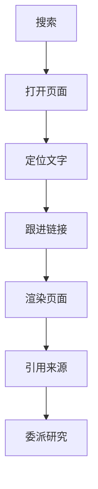
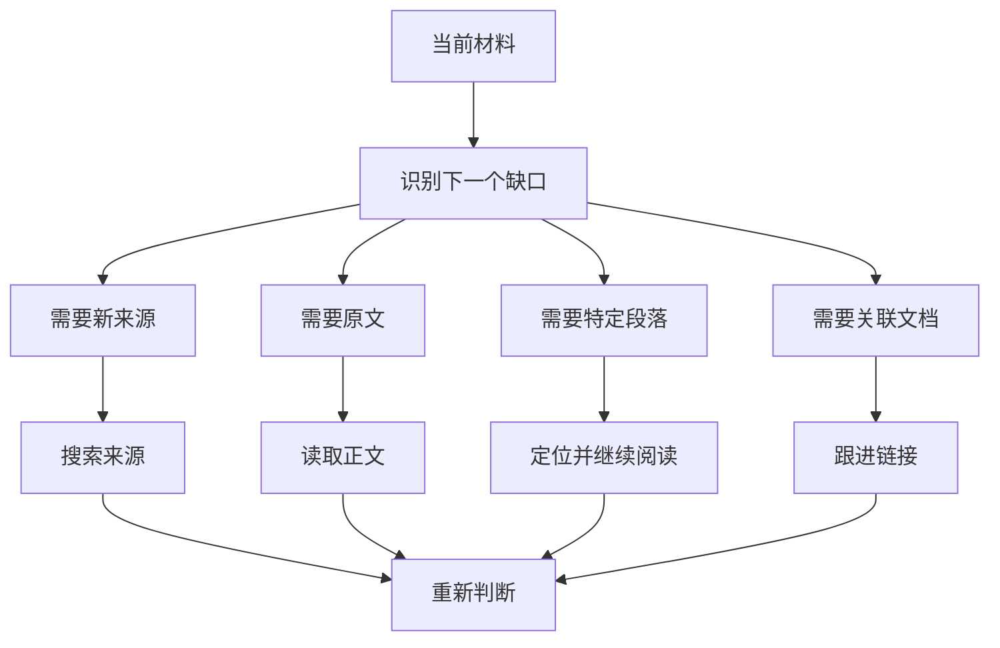
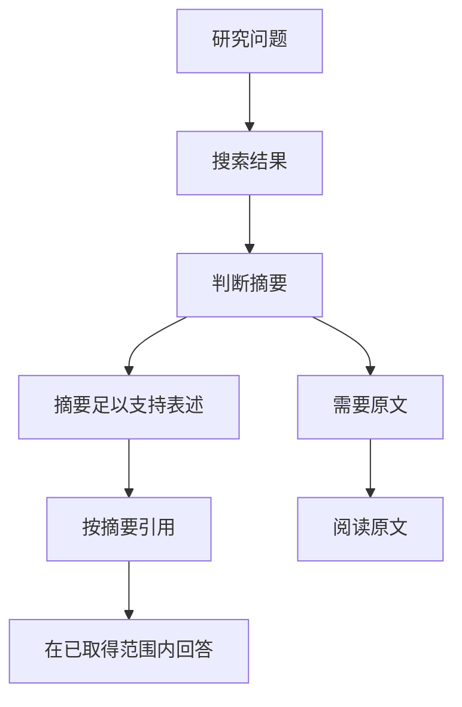
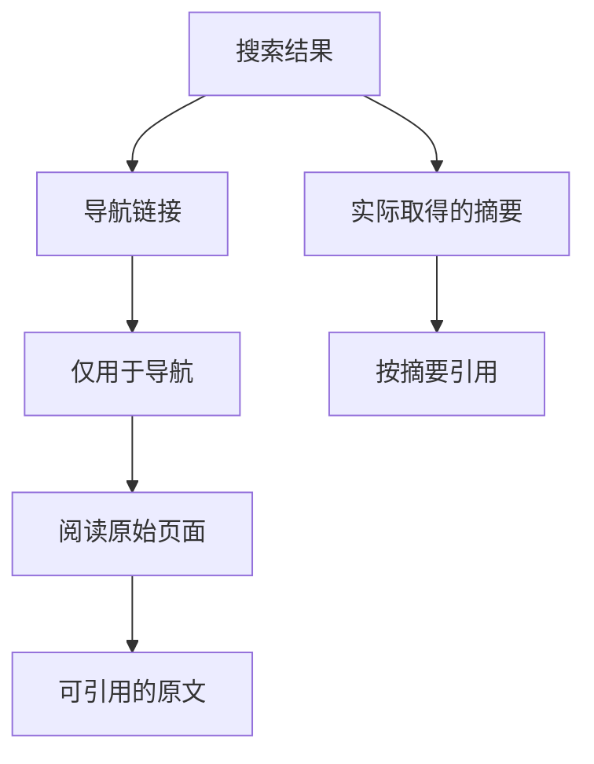
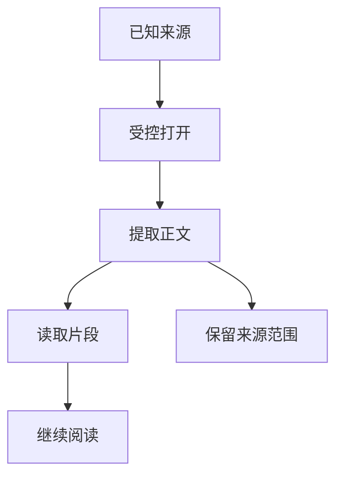
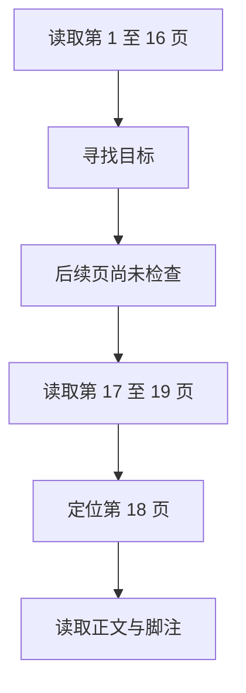
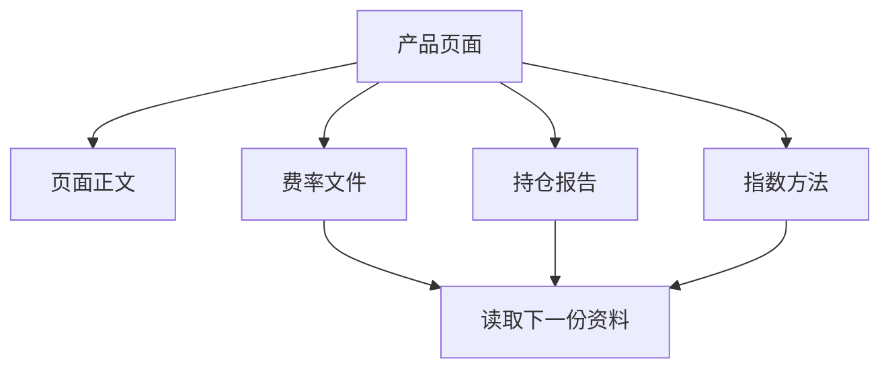
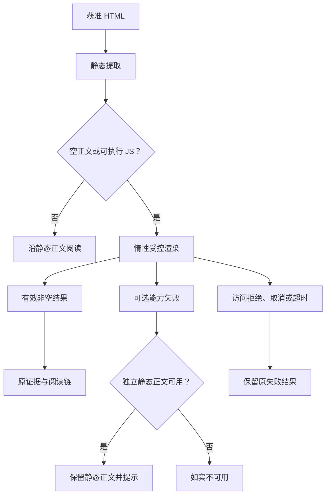
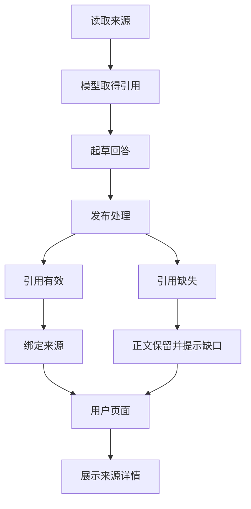
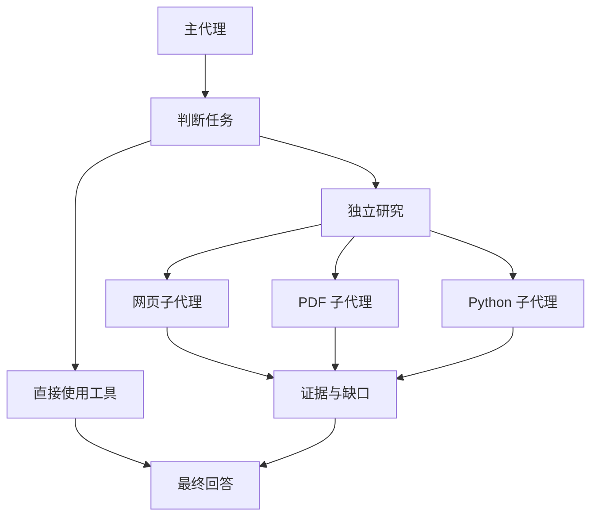

# 从“搜得到”到“读得下去”：我们怎样让 Agent 学会浏览网页

两只 ETF 投资相近市场。用户想知道费用、指数编制方法和持仓集中度有什么区别。

搜索很快找到了产品官网，却未必找到了答案：费用适用条件可能在另一份公告里，指数规则在指数公司网站，持仓在定期报告。即使成功打开报告，关键脚注也可能在尚未读取的最后一页。

这时继续搜十次，不一定比沿已有链接多读一段更有用。**网页研究的核心不是“能打开多少页面”，而是知道目前缺什么，并保留下一步能接着读的位置。**

当前系统提供搜索、阅读、页内查找、链接跟进、受控渲染和来源交付。下图是能力索引，不是每次都必须走完的流程；静态页面不必启动浏览器，单页问题也不必创建子 Agent。

本文的 ETF 比较是教学场景。下面标明日期或描述具体故障的部分，才是对应历史记录中的观察；它们不构成一次当前版本的完整基金比较验收。

## 1. 先判断缺口，再选择动作

| 目前已经有什么 | 下一步缺什么 | 合适的动作 |
| --- | --- | --- |
| 只有问题，没有来源 | 可用资料入口 | 搜索 |
| 已知官网、产品目录链接或用户提供的合法 URL | 正文 | 沿原来源引用读取，不必先搜索同一地址 |
| 已取得长报告 | 具体段落 | 查找，再读命中附近的上下文 |
| 页面上有费率公告或持仓报告入口 | 关联文件 | 选择已发现的链接并读取 |
| 已有材料足以支持有限表述 | 解释与交付 | 回答，并说清范围，而不是为调用工具继续探索 |

这些动作没有固定顺序。模型负责判断哪种缺口值得继续，宿主负责来源身份、访问条件和资源边界，不根据“查了几次”或“返回多少字符”认证证据充分。

搜索供应商的选择、缓存和有界回退由服务端管理。供应商可用不等于网络访问已获准；缓存命中也不会给新 Run 带来旧任务的权限。对于模型，重要的是提出合适的问题，并识别这次返回究竟是线索还是依据。

### 摘要可以有用，但不能冒充核对过原文

当前允许实际提供给模型、获准展示且带有效引用的搜索摘要支持有限表述，并明确它是“搜索摘要，未读取原文”。例如摘要足以说明一条消息的大意，就不必为了形式完整再打开页面。

比较 ETF 费用时，如果摘要没有份额、适用日期或费率口径，就仍需要原文。允许摘要引用，解决的是“有用信息不必因原页暂时不可读而全部丢弃”，没有把摘要升级成整份文档。

导航与依据要分开，即使它们指向同一个网址：

一个链接说明还能去哪里；一段摘要说明供应商实际返回了什么；一段已读正文才说明这次读取覆盖了哪部分原文。链接存在不是全文已经读过的证明。

## 2. 阅读返回的应该是片段与位置，而不只是“成功”

Browse 沿已登记的来源引用工作，提供 `read` 和 `find`。来源可以来自搜索、页面发现的资料链接、经过校验的产品目录，也可以来自已认证原用户消息中的公开 HTTPS URL。用户直接给网址，不需要系统为了取得来源引用再假装搜索一次；模型或页面中的任意文本也不能冒充原用户授权。

一次读取保留来源、内容身份、提取方式、时间信息、实际范围与继续读取的位置。得到一段正文，不代表页面已经完整提取，更不代表后面的模型请求必然装下全部内容。

历史上有过一个很直接的反例：通用 MCP 脱敏器把网页正文截到约 500 字，而静态提取不足也可能仍被表示为成功。接口返回字符串，研究所需的关键部分却不在其中。

当前方案将“网络取得了什么、提取了什么、实际返回了哪段”分开记录。片段没读完可以续读，不需要重新发现同一来源。正文尽量保留标题、列表和表格关系：对于持仓研究，“公司名”和“权重”能否对应，比字符数本身重要。

这也说明为什么不能只调整一个全局长度上限。网页字节、解析结果、单次阅读范围、工具序列化与模型输入各有自己的边界；上游拿到整页，不会自动消除下游的容量限制。返回应说明截断或未覆盖范围，不能把开头包装成全文。

## 3. 查找负责定位，续读负责取得依据

已经拿到年度报告，想找“跟踪误差”，再全网搜索可能又回到同一份文件。页内 `find` 用于当前可复用资料的文本定位，不是新的全网搜索，也不是自动理解整篇报告的语义检索。

一个命中应带来可读位置。下一步仍要读附近正文，确认数字的时期、口径和限定条件。命中的几个字本身不能替代上下文。

早期真实 19 页 PDF 验证中，初始读取只覆盖前 16 页；后续合法查找签发第 18 页位置，续读才取得目标内容和第 19 页尾注。当前路径已经具备更大的有界提取能力，但这个历史反例仍然说明同一件事：**“已查范围没有”与“整份文件没有”不是一个结论。**

HTML 在保留的文本快照内查找。对仍持有获准原始字节的 PDF，查找可以在预算内扩大页范围，不必重复下载。同一份材料的定位与续读因此可以接续，但要区分两个位置：命中 locator 用于读目标段落，find cursor 用于继续检查后面的范围。

如果文件内容变了、来源引用不再有效或容量耗尽，应返回相应不可用或覆盖边界，不能拿旧 cursor 指向新字节。实现支持复用，不等于已经量化了整项研究的耗时或 Token 收益。

## 4. 清理正文时，别把下一站也清掉

普通文章提取器希望去掉侧栏、导航和杂项。研究任务却可能恰好需要正文之外的“费率文件下载”链接。

2026 年 10 月的原测试曾重现：文章和表格都进入结果，文章区域外的补充文档链接却没有成为可跟进来源。清洗结果更干净，研究路线反而断了。

当前把**正文提取**与**候选链接发现**分开。候选从原始页面结构取得，经过有界筛选后登记来源关系；模型选择后才读取，不自动遍历所有链接。

图中的产品页、费率文件、持仓报告和指数方法是简化示意。链接是下一站的线索，不是它指向的资料已经取得，也不保证一定相关。

页内跳转使用查找位置，跨页跳转使用已经登记的资料书签。宿主解析真实地址、核对原来源关系及访问条件，模型不猜网址，也不维护点击坐标。重复目标、深度、数量和截止时间都受限制，不能变成无限爬站。

产品目录的官方 PDF 曾暴露同一种断点：结构化工具已经返回地址，却没有连接到 Browse 能消费的来源身份。修复应发生在这个交接处，而不是要求模型再搜一次官方文件。对应受控路径已出现直接跟进，后续回答仍曾重复搜索和过度展开；工具接通没有自动解决策略选择。

## 5. 默认渲染是有条件的附加读取，不是万能后门

静态 HTML 可能只有框架，也可能已经有一段正文，但另有内容由 JavaScript 生成。因此，当前默认 Browse 在来源准入后，遇到两种情况会尝试受控渲染：

- 静态提取的正文为空。
- 解析得到的 DOM 含可执行 JavaScript，包括适用的内联、外部和模块脚本。

JSON、LD+JSON 数据脚本与注释中的类似文本不触发。可执行脚本只是多读一次的信号，不证明静态正文一定残缺，更不证明运行脚本就会得到答案。

默认装配惰性共享经过审查的渲染器，纯静态读取不初始化 Docker。它不要求模型另选浏览器动作，也不会自动下载镜像；部署环境仍须具备原受支持的固定执行环境。PDF 与纯文本走自己的读取路线，不能因为没有网页脚本而被强制送进浏览器。

隔离容器不直接获得任意网络出口。页面所需资源经原 Host 读取器，保留 HTTPS、DNS、公网地址、重定向、来源和容量检查。登录、付费墙、CAPTCHA 或明确拒绝，不会因为“换成渲染”而消失。

### 两个不直觉的取舍

**拿到了脚本，不一定能正确运行。** 历史桥接曾丢失 CORS 响应头，跨域模块虽然已取得，浏览器仍拒绝执行。正确修复是保留上游浏览器策略，而不是补一个通配 CORS 头或放行整个 CDN。后来真实受控浏览器分别验证了允许 CORS 的执行与缺少 CORS 的不执行，不能只测 HTTP 字节已返回。

**渲染失败，不一定使静态正文也失效。** 初始化、可用性、大小或清理不确定等可选能力失败时，原 Browse 可以保留独立获准的非空静态正文并带警告。相反，取消、deadline、TIMEOUT 和保护性访问拒绝保留原结果，不能统称“失败就回退成功”。DOM 解析器、渲染器或辅助进程的局部异常，也不应抹去研究中其他独立材料；特定故障隔离的验证不代表所有原生崩溃都可恢复。

已有真实公开动态页观察证明渲染正文能进入下一次模型请求；同一观察还发现第一条作者和标签未进入正文投影，模型如实说明未读到。这是可工作的部分路径，不是对所有网站或全文完整性的承诺。

### 获取失败与渲染不足，是两条分支

显式配置时，当前还允许符合条件的原生页面获取失败进入一次受控 DeepSeek Fetch 回退。它解决的是“原生获取没有拿到材料”，渲染解决的是“已经取得 HTML，还需要执行页面脚本”。原生或缓存成功不会额外调用 Fetch；TLS、授权、403/429、提取拒绝、deadline 和容量等边界也不会因此得到旁路。供应商返回的内容不能替系统证明最终跳转地址或发布时间。

## 6. 为什么不用一个更完整的浏览器或抓取服务包办

这些方案并不互斥。选择应取决于需要的动作和愿意承担的边界，而不是工具越大越好。

| 方案 | 擅长什么 | 需要自己补足什么 |
| --- | --- | --- |
| Readability 一类静态正文提取 | 从已有 DOM 提取适合阅读的文章内容；不需要为普通页面启动浏览器 | 附件入口、动态内容、表格关系和实际覆盖范围 |
| Playwright 一类浏览器自动化 | 页面交互、截图、状态等待和更复杂操作 | 在产品中明确哪些动作获准、资源出口如何受控、如何留下来源事实 |
| Firecrawl 一类抓取服务 | 通过统一接口取得 Markdown、HTML、链接等表示，减少自建抓取接线 | 供应商边界、费用与失败语义，以及自身 Run 身份和证据合同的衔接 |
| 本系统的来源阅读链 | 围绕搜索、read/find、已发现链接与有限渲染，保留既有权限、预算和引用关系 | 自己维护解析和渲染环境；不覆盖通用登录、填表或交易操作 |

[Mozilla Readability](https://github.com/mozilla/readability)面向文章提取，也明确提醒使用者处理不可信内容；[Playwright Page](https://playwright.dev/docs/api/class-page)提供页面导航和交互能力；[Firecrawl Scrape](https://docs.firecrawl.dev/features/scrape)提供多种内容表示与可选页面动作。这是按当前需要比较方案，不是本项目对这些产品做过同题性能试验。

我们保留自己的窄阅读链，是因为研究更需要“这份数据从哪里来、读了哪段、能否接着读”，而不是把每个可点击元素都交给模型。可选供应商 Fetch 说明外部服务并未被一概排除，但它必须接到原来的身份与资源负责模块上，不能变成第二套访问规则。

## 7. 从读到资料到用户能核查，还隔着一条交付链

读取成功、模型看到材料、引用身份匹配、来源显示在当前回答旁，是不同事实。

几个历史反例说明，不能用一句“请多加引用”修复整条链：

| 现象 | 问题在哪里 | 当前处理方向 |
| --- | --- | --- |
| 把导航 ID 当已读原文 | 混淆来源层次 | 区分导航、已交付摘要与实际正文 |
| 模型只复制引用前几个字符 | 生成时丢失精确身份 | 提供完整可复制标记，不猜前缀对应谁 |
| 替换数值显示后引用错位、附近正文截断 | 发布文本变换 | 按最终显示文本重新定位 |
| 合法引用只显示“结构化来源” | UI 只支持公开 URL | 无公开网址时显示可核查说明，不编一个主页链接 |
| 切换失败的新会话仍显示旧来源 | 展示状态归属错误 | 绑定当前回答与修订，防止旧状态或迟到结果串入 |

一次真实修复样本中，37 个引用都使用了完整发放标识，当前答案的引用也能呈现；它只是一条成功样本，不保证后续不会再缩短引用。早期错误引用曾导致拒绝提交；当前公开来源引用不足时，尽可能保留独立获准的正文，单独标记引用缺口，而不是把格式问题扩大成全篇消失。

有效引用仍不认证解释正确。历史回答也曾引用合法、数值解释却互相矛盾。Web 模块要保留可检查的材料与读取范围，答案质量仍需结合具体问题评阅。完整的引用机制见[引用为什么不能单独证明可靠](ai-citations-do-not-prove-reliability.md)，不要把这里的浏览与展示观察升级成金融结论认证。

## 8. 复杂探索可以委派，但不要把来源一起省掉

读一个已知页面，直接调用工具即可。比较多份资料、反复定位长报告，才可能值得独立探索：例如一个子任务查费率与适用条件，另一个查持仓明细，Main 保持原问题和最终论证。

当前 Web、PDF、Python 可以进入同一套子任务执行机制，并不要求三种角色每次都启动或一定并行。它们仍使用原来的获准工具，不因委派扩大权限。

子任务应该交回发现、依据、实际读取范围、产物和未解决问题。历史交接中，Main 已完成的读取曾被遗漏；页面图像即使生成，也仍需证明进入了子任务的实际请求。**有结果，不等于接手者已经拿到结果。** 因而子任务接收必要目标、限制与选定材料，不复制整段主对话；Main 采用结论时仍要追溯依据。

独立上下文能隔开探索细节，代价是多一次交接、上下文装配和可能的重复取证。是否值得委派，应看具体任务的结果与开销，不把每个工具包装成 Agent。

## 9. 让研究接得上，而不是让调用次数长起来

回到 ETF 比较，合理的结束状态可能是：费用已经读到适用条款，指数方法已核对，持仓只覆盖某个报告期；答案按这些范围比较，并明确剩余限制。它不必把每一页都读完，也不能因为搜到了官网就说全部查清。

重建类似能力，优先检查五个连接：

1. 已有来源能否直接读取，而不是被迫重新搜索。
2. 阅读和查找是否保留实际范围、内容身份与继续位置。
3. 正文清洗是否保留必要的附件入口，同时不自动抓取所有链接。
4. 可选获取或渲染失败是否只影响自己的效果，并保留真正的访问拒绝。
5. 交接与交付后，用户是否仍能核查结论旁边的具体依据。

这些机制增加的是继续研究和诚实说明缺口的可能性。它们没有统一证明准确率、平均耗时或 Token 节省；读得更多也可能成本更高。真正值得评估的是目标材料有没有取得、关键段落有没有实际送达、结论是否受材料支持，以及未完成的部分有没有说清楚。
