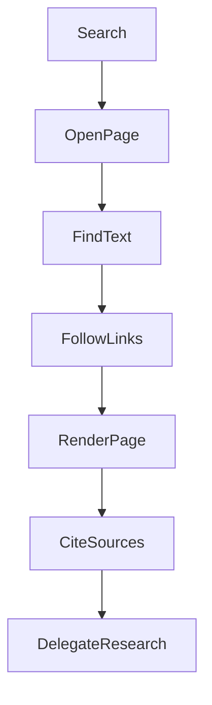
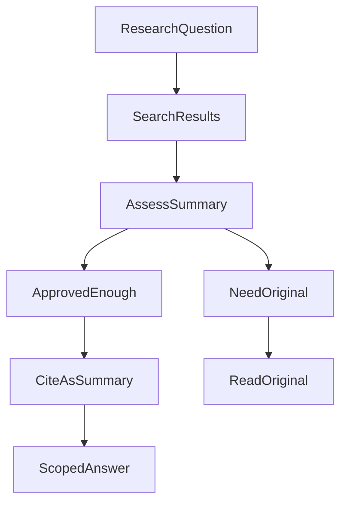
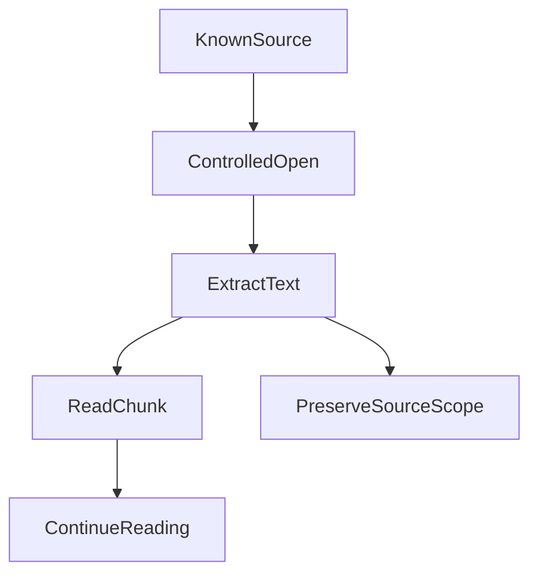
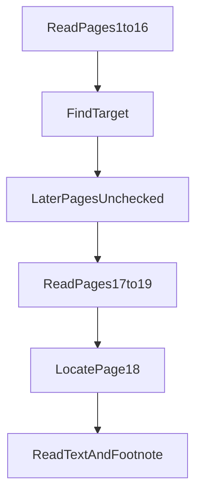
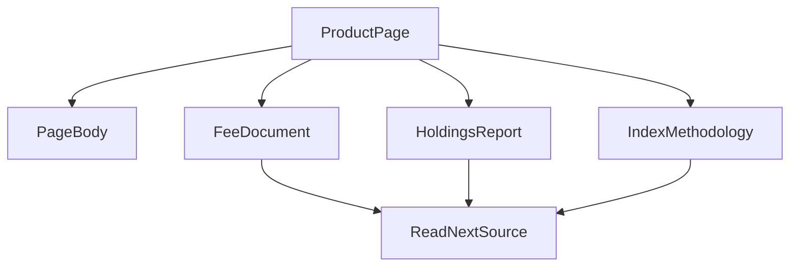
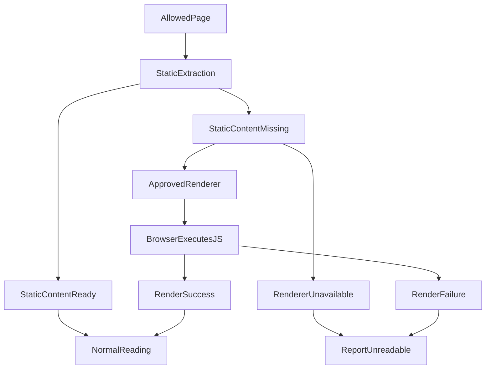
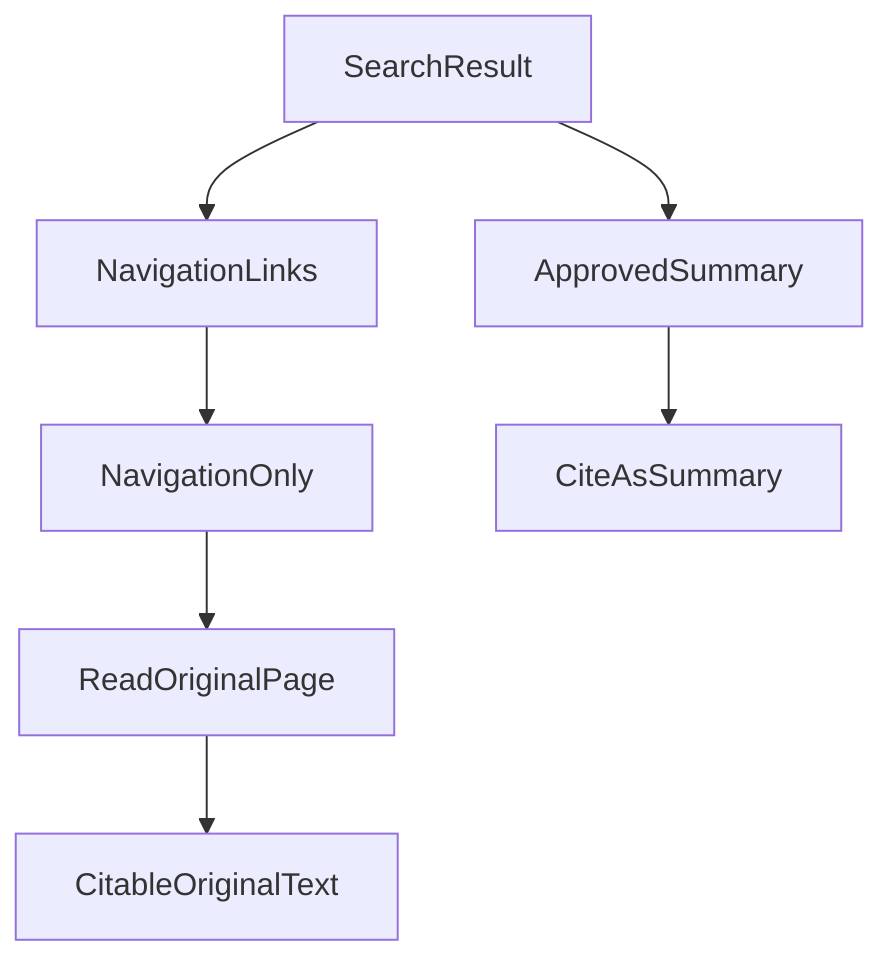
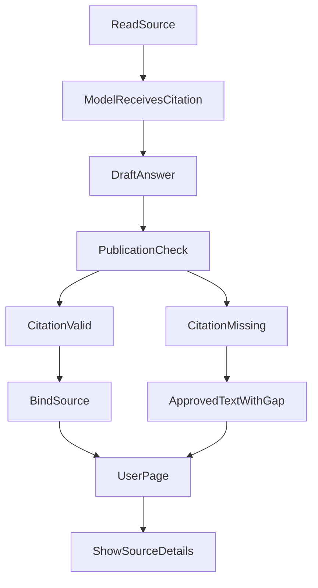
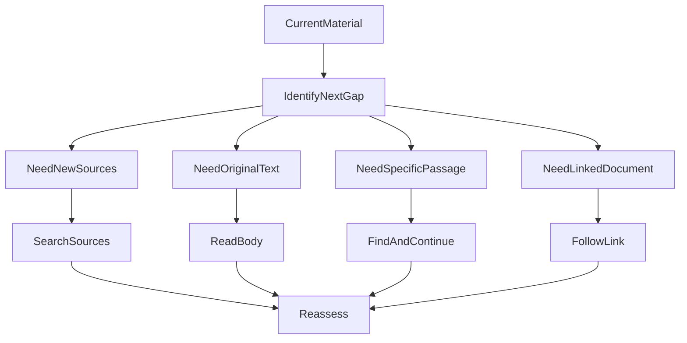
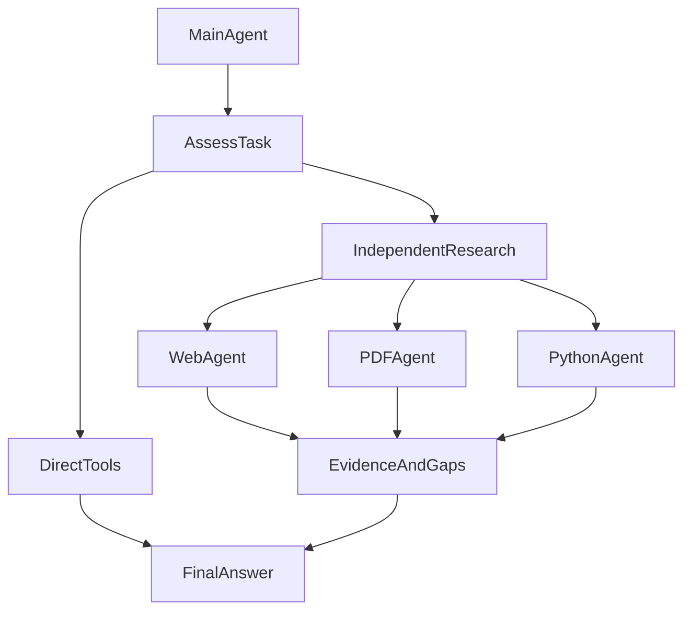

# 从“搜得到”到“读得下去”：我们怎样让 Agent 学会浏览网页

最初给 ETF Agent 接入联网能力时，我们首先解决的是搜索：根据用户的问题找到相关资料，再让模型整理结果。后来，我们陆续补上页面访问、页内查找、链接跳转和动态渲染，也开始处理一个同样重要的问题：怎样把查到的资料正确引用给用户。

最近，这些能力又逐步接入子 Agent，让复杂研究可以按需分工。但贯穿整个过程的目标没有变：不是建设一个“大而全浏览器”，而是让 Agent 能沿着线索读下去，最后交付有依据的回答。

**能够找到相关网页，与能够利用这些网页完成研究，中间还有很长一段路。**

以一个简化的研究问题为例：

> 两只 ETF 都投资相近的市场，它们的费用、指数编制方法和持仓集中度有什么区别？

搜索可能找到产品介绍页，但费用说明放在另一份文件里，编制规则来自指数公司，持仓明细又藏在定期报告中。即使找到了这些文件，模型也不一定已经拿到真正需要的段落。

我们需要补上的，不只是更多搜索结果，而是一组可以连续使用的阅读动作：**发现资料、打开资料、定位内容、沿链接深入，必要时再让页面运行起来，最后把实际依据交给用户核查。**

**先看整条演进路线：**

这张图表示能力逐步增加，**不是每一次研究都必须依次经过全部步骤**。例如，普通静态页面不需要启动浏览器，简单问题也不需要子 Agent。

## 一、搜索先解决“去哪里找”，而不是包办整个研究

早期实现比较依赖特定搜索服务。后来，我们把它逐步收敛成独立的搜索入口，统一结果和来源信息，由服务端管理供应商选择、缓存与有界回退。模型负责提出研究问题，不需要同时管理搜索服务的凭据和切换规则。

这一步的价值，是把“寻找资料”从某一家供应商的接口中分离出来。但搜索结果依然有自己的局限：标题和链接告诉我们哪里可能有答案，摘要提供局部信息，它们不等于整份原文。

这也不意味着所有搜索结果都必须再打开一次。

**当前实现允许带有效引用的、获准展示的搜索摘要支持注明摘要来源的表述，但不能把它说成已经核对过原文。** 只有当关键细节缺失、来源冲突，或者需要检查具体规则时，才继续访问页面。

例如，了解某条新闻的大致内容，可以先使用实际返回的摘要；比较基金费用时，摘要没有交代份额、适用日期和费用口径，就需要继续找原文。

因此，后续演进的方向不是“每次多搜几轮”，而是让 Agent 能判断下一步缺的是新线索，还是已有线索背后的详细内容。

从 Agent 的角度，搜索之后其实有两条合理路径：

是否需要继续读原文取决于具体问题；摘要是否具备引用资格，仍由实际交付和来源许可决定。

## 二、增加页面访问：不再停留在搜索摘要

页面访问能力补上之后，Agent 可以选择一个已发现的来源，取得正文，再决定是否继续研究。搜索与阅读由此成为两个不同动作：一个发现候选，一个取得内容。

我们保留了搜索和浏览两个主要入口。浏览工具通过“阅读”和“查找”两种操作处理资料，不要求模型为“搜索找到的网页”和“页面上发现的附件”学习两套不同的访问方法。

**访问能力的核心变化**可以用一条短链表示：

对研究任务来说，保留“读到哪一段”和“这一段来自哪里”，与获取页面内容本身同样重要。

### 第一个坑：工具说成功，模型却只拿到开头

早期实现中，我们遇到过一个很具体的问题：网页正文经过工具层的通用脱敏处理后，被截到了约 500 字。另一个问题是静态提取没有得到足够正文，却仍可能被表示为成功。

从接口视角看，工具运行了，也返回了字符串；从研究视角看，真正需要的信息可能根本没送到模型面前。

这让我们开始把问题分开看：页面是否访问成功，正文是否被提取，实际返回了多少内容，还有哪些部分没有读到。

现在，页面阅读可以返回有边界的正文片段，并提供继续读取的位置；一次没有读完，不需要把同一个问题重新扔给搜索引擎。正文提取也保留标题、列表和表格行等结构，而不是只追求得到一大段文字。

对于研究来说，“某家公司”和“对应权重”能否一起保留，比页面总共返回了多少字符更有意义。

**这一步的收益，是让 Agent 有机会核对原始材料，同时知道自己只读到了哪里，而不是把文章开头当成全文。**

## 三、增加页内查找：已经找到文档，就不要一直重新搜索

当资料变长，只有“打开并阅读”还不够。

假设 Agent 已经拿到一份年度报告，但用户只关心其中的跟踪误差。继续全网搜索，可能又回到同一份报告；把整份报告反复交给模型，也未必比直接定位目标段落更有效。

人的做法通常很简单：先用 Ctrl+F 找关键词，再读上下文。

我们把这个动作加入了同一套浏览能力。Agent 可以在已经读取、仍可复用的来源中查找关键词，取得匹配片段和阅读位置，再打开附近正文。**这里的查找是文本定位，不是又调用一次全网搜索，也不是自动理解整篇文章的语义检索。**

例如，查找“跟踪误差”后，下一步不应该只摘出命中的数字，而是阅读所在段落：它描述哪个时期、使用什么口径、是否附有限定条件。

### 第二个坑：前面的页面没找到，不代表后面的页面也没有

PDF 让这个问题变得特别明显。

在一次针对真实 PDF 文件的读取验证中，最初只覆盖前 16 页，继续检查后面的页面，才取得第 18 页的目标内容和第 19 页的尾注。文件一共 19 页，关键内容恰好不在最初的读取范围内。

如果查找只能覆盖初次提取的部分，模型就容易把“当前没有命中”误说成“文档没有这项内容”。

用前面真实的 19 页 PDF 验证经历来表示，查找与续读的关系更直观：

**命中负责定位，阅读负责取得依据。** 当查找范围还不完整时，没有命中不等于整份文件没有对应信息。

现在，已读取的 HTML 使用保留的文本快照查找；对于仍持有获准原始字节的 PDF，查找还可以在预算内继续检查后面的页面，不需要重新下载同一份文件。命中位置用于跳过去读，继续查找的位置用于扩大查找范围，两者不能混用。

这里的收益可以说得很具体：**针对同一份仍有效的资料，定位和续读不必重新进行网络发现与下载。** 但是否能降低整个任务的耗时和 Token 消耗，还取决于模型接下来怎样使用这些结果。

## 四、增加页面跳转：真正有用的资料，往往在下一层

如果说页内查找解决的是“答案在这份资料的哪里”，链接跳转解决的就是“答案可能在这份资料指向的哪里”。

回到 ETF 比较的例子。产品介绍页不一定直接列出所有费用和编制规则，但它可能提供基金文件、指数方法说明和持仓报告的入口。只会读第一页的 Agent，即使找对了官网，也可能停在真正答案的门口。

### 第三个坑：正文清理得更干净，却把继续研究的入口删掉了

在 2026 年 10 月的深度阅读测试中，我们发现，文章和表格已经进入结果，位于文章之外的补充文档链接却没有变成可跟进的来源。

正文提取原本是为了去掉导航和噪声，但研究任务需要的附件入口，不一定包含在“干净的正文”里。对普通文章阅读无关的区域，对继续研究可能非常重要。

因此，我们把正文提取和链接发现分开了。

下面是一份基金产品资料的**示意结构**，用于解释跨页探索，并非某个真实网站的完整目录：

以前只保留页面正文，可能遗漏费率文件链接、持仓报告和指数编制方法入口；现在正文与候选链接分开保留。**链接只是下一站的线索，访问之后的实际内容才是资料。**

当前实现会从原始页面结构中收集候选链接，同时生成可阅读的正文。正文之外的资料入口可以作为有界候选保留下来；模型选择其中一个之后，系统再执行下一次页面读取，而不是自动下载页面里的所有链接。

### 我们支持的“跳转”，不是任意操作浏览器

这里需要区分两种跳转。

**页内跳转**，是根据查找返回的位置，读取同一份资料中的目标段落。**跨页跳转**，是选择已经发现的链接，打开另一份资料。

跨页时，系统会把发现的链接登记成“本次研究里可用的资料书签”。模型选择书签，系统解析真实地址并检查访问条件；模型不需要猜网址，也不用自己维护点击坐标。

这让搜索结果、网页中的资料链接可以复用相同的阅读方式。跟进链接有层级、数量和时间限制，重复目标不会无限生成新的导航引用。页面指向某份文件，也不意味着文件内容已经读过或可以直接当作事实。

因此，这项能力首先解决的是资料之间的连续访问，不是登录、填表、下单或任意点击自动化。

### 第四个坑：系统已经有官方文件链接，Agent 却还在重复搜索

后来的产品目录接入又暴露了一个问题：结构化查询已经返回官方 PDF 地址，但这些地址没有转换成阅读工具能使用的来源引用。Agent 拿到了线索，却接不上下一步阅读。

我们补上这段连接后，经过校验的产品目录来源可以直接进入原有阅读链路，不必为了“让阅读工具认识它”再制造一次搜索。

相应验证和诊断中，已经出现了产品查询之后直接读取官方文件的路径。不过，后续答案仍有过度展开和重复搜索等问题；修好工具之间的连接，并不等于模型已经学会最优的研究策略。

**这一步很重要：搜索从唯一入口，变成了多个资料入口之一。已有线索能继续使用，就不必每次从搜索框重新开始。**

## 五、补上动态渲染：网页能打开，正文却还没出现

到这里，Agent 已经能够搜索、访问、查找和沿链接深入。但静态读取仍会遇到一类页面：下载到的 HTML 只有页面框架，正文要等 JavaScript 执行后才出现。

对用户来说，这只是一个普通网页；对静态读取器来说，可能始终只有“正在加载”。

我们因此增加了可选的页面渲染能力，但没有让浏览器取代所有静态读取。当前仍优先走本地静态提取，只有正文不足、来源允许，而且应用明确接入了受审渲染器，才尝试取得动态生成的内容。搜索开关打开，并不会自动启用这条路径。

**静态优先、动态兜底**的选择可以表示为：

这样做的目的不是“所有网页都使用浏览器”，而是让需要 JavaScript 的网页在符合条件时多一条读取路径。

### 第五个坑：换成浏览器，也不是一键解决

接入过程中，我们遇到过一个典型的前端问题：脚本文件虽然取得了，但中间处理丢掉上游 CORS 响应头，导致跨域模块无法执行。另一次问题涉及多层样式表依赖，第一层资源成功，并不代表后面的依赖也能正确取得。

这些问题说明，浏览器的价值不只是“能执行 JavaScript”，还在于尽可能保留页面原本的运行条件。不能为了让页面显示出来，就把它自己的访问限制一起关掉。

最终，我们让隔离浏览器负责运行页面和生成 DOM，外部资源则继续经过已有的受控读取通道。正文生成之后，再回到原来的提取、来源和后续读取链路，不另建一套研究流程。

2026 年 10 月 11 日的验证已经覆盖真实公开 HTTPS 页面、跳转、JavaScript 正文，以及正文进入下一次模型请求。它证明的是固定环境下的内容获取与交付能力，不代表所有动态网站都可读，也不等于模型回答质量已经提升。

**这一步带来的收益，是把一部分“找到了却读不到”的动态页面，接回 Agent 原有的研究过程。** 它不承担通用截图理解，也不负责绕过登录、验证码或付费墙。

## 六、最后一公里：找到了资料，为什么用户还是看不到正确引用？

研究走到这里，我们又发现一个容易被忽略的问题：**Agent 能够访问页面、找到数字，跟用户能够检查它引用了哪一份资料，并不是同一件事。**

最初我们更关注来源能否进入研究上下文。随着回答开始分批发布、支持修改和历史重载，引用逐渐变成了一条独立的交付链路：来源要确实被模型看到，模型要用正确的引用，发布系统要把它绑定到当前来源，最后网页还要把它显示在对应的回答旁边。

### 第六个坑：能跳转到来源，不代表它能支持一句结论

在早期研究诊断中，我们遇到过这样的情况：模型把搜索结果的标识，或者尚未具备引用条件的读取标识，直接放进答案，当作正式引用。那时的发布系统会拒绝这类提交。

这些反例让我们更明确地分开两件事：“这份资料可以继续访问”和“这段内容已经取得，可以作为回答的依据”。系统分别记录导航与引用，不因为模型写上一个链接，就把整份文件当作已经读过。

但这条规则后来又经历了一次调整。**不能直接把搜索结果当作已读正文，不等于搜索摘要一律不能引用。** 我们后来允许实际提供给模型、获准展示的摘要，以“搜索摘要 · 未读取原文”的身份成为有限依据。否则，原网页暂时读不到，反而会让一段有用的摘要也无法使用。

调整的重点不是放松事实要求，而是把信息的层次说清楚：摘要只能支持它实际包含的内容，不能冒充原文核对。

我们逐渐明确了两种不同的来源层次：

这张图刻意把“导航线索”和“实际取得的文本”拆开；它们可以指向同一个网址，却不能互相替代。

### 第七个坑：完整引用已经给了模型，它却只复制前面几个字符

我们还遇到过一个反复出现的问题：系统已经提供完整引用，模型却只复制前面几个字符。材料没有丢失，引用也就在上下文里，但最后写进答案的标识对不上原始来源。

从用户看到的现象，很容易把它误判成“来源没有查到”或者“网页没有显示引用”。实际上，问题发生在模型生成答案的那一步。

后来，我们没有让系统根据几个字符去猜来源，而是改进引用提醒，直接给模型可以复制的完整标记。一次修复后的真实测试中，模型生成的 37 个引用全部匹配了系统发放的完整标识，网页也呈现出了当前答案里的引用。

这只是一次成功样本，并不保证模型以后都不会再缩短引用。但它给了我们一个很实用的启示：**与其不断重复“请遵守规则”，不如让正确的操作更容易完成。**

### 第八个坑：引用有效，用户却只能看到一段普通文字

这可能是最影响体验的问题。一组历史回答核查发现：有的答案根本没有公开来源，有的引用被模型缩短；还有一题已经使用合法完整引用，前端却只显示“结构化来源”几个字，用户无法进一步查看。

原来的来源侧栏主要围绕网页链接设计，碰到没有公开网址的结构化数据，就不能自然展示。有效的来源已经走到了发布环节，却在界面上变成了不可检查的普通文字。

我们后来把来源展示跟**当前回答及其修订版本**绑定，而不是维护一个全局来源列表。公开网页或 PDF 可以指向真实地址；没有可公开 URL 的结构化来源，则提供可查看的说明，而不是猜一个主页链接。前端还要处理编号、触摸和键盘查看、正文替换与重新加载。一次浏览器验收甚至发现，选择加载失败的新会话时，旧会话的答案和来源会残留在新标题下——这说明引用的归属问题并不止于 Markdown 格式。

另一个问题发生在发布阶段：系统把数字标记替换成实际显示的数字后，文字长度变了，引用还沿用旧位置，结果连附近正文也被截短。修复时，我们让引用位置跟着最终文本重新计算。这个失败不是模型造成的，而是我们自己的文本处理破坏了内容。

引用的第二段旅程发生在**回答生成与展示之间**：

早期版本曾因错误引用拒绝发布；当前公开来源引用不足时，会尽可能保留已获准正文，并单独标明引用缺口。**引用校验不能替代用户最终能否检查来源的前端验收。**

### 有引用，不等于结论一定正确

走完这一圈，我们更清楚地区分了几件事：找到了页面、实际读到了哪段、模型是否拿到这段、引用有没有成功绑定，以及用户能不能打开或查看来源。它们需要协作，却不能相互代替。

尤其是**一个真实且格式合法的引用，只能帮助确认来源归属，不能自动证明模型把数据解释对了**。我们也遇到过来源引用合法、数值解释却互相矛盾的回答。这需要单独检查答案质量，而不是继续增加引用数量。

对用户最直接的收益不是“答案后面多了几个小标号”，而是可以在具体判断旁边检查：这句话来自搜索摘要、公开网页、PDF，还是一个没有公开网址的结构化来源；一旦来源不可用，也尽可能保留明确的局部提示，不把有依据的整段回答直接清空。

回头看，几次很不一样的故障，分别落在引用链的不同位置：

| 观察到的现象 | 真正卡住的地方 | 后来形成的处理方式 |
| --- | --- | --- |
| 搜索结果被当成已读原文 | 来源的阅读范围 | 区分导航、摘要和实际正文 |
| 模型把完整引用缩成前缀 | 模型写作环节 | 提供完整可复制的引用标记 |
| 数值显示后引用错位、正文截断 | 发布文本变换 | 按最终显示文本重新定位 |
| 引用有效却只显示普通文字 | 网页展示环节 | 兼容有 URL 和无 URL 的来源说明 |
| 切换会话后出现旧来源 | 前端状态归属 | 将来源绑定到当前回答及修订版本 |

这些问题无法靠一句“请模型多加引用”统一解决。

## 七、能力越来越多，模型的动作反而应该保持简单

回看这段演进，我们增加了很多底层能力，但不希望模型面对越来越多互不相通的工具。

网页研究仍然围绕“搜索”和“浏览”展开：搜索发现来源，浏览负责阅读、查找、续读，以及打开已发现的下一份资料。动态渲染是满足条件时的底层读取方式，不要求模型额外操作一整套浏览器。

将这些动作放进一个研究过程，可以这样理解：

**发现来源 → 读取内容 → 查找目标段落或跟进链接 → 结合新资料继续研究 → 组织回答与引用。**

从模型的视角，更重要的是判断**下一个信息缺口是什么**，而不是按固定顺序调用所有工具：

如果已经有足以回答的问题材料，就可以组织回答；不必为调用更多工具而继续探索。

是否继续查找、跟进链接或者开始回答，由模型根据任务和实际取得的内容判断，不是系统通过关键词或字符数认定“证据已经充分”。

这也不是一条每次必须从头走到尾的固定流程。简单问题可能停在搜索摘要；已知文档可以直接访问；长文档先查找再细读；遇到附件再跳转；静态内容不够时，才考虑可选的动态渲染。

我们希望每一个动作都回应一个明确的缺口：缺来源，还是缺正文？缺某个段落，还是需要下一份文件？只有这样，增加工具才有机会变成更好的研究，而不只是更多调用。

## 八、再往前一步：让子 Agent 分担复杂研究

当搜索、阅读和引用逐渐连起来，接下来的问题也变了：不是“有没有这个工具”，而是“所有细节是否都应该由主 Agent 一路处理”。

读一个已知页面，直接调用工具就够了。但要比较多份资料、反复定位报告，或者写代码计算并修正错误，局部探索就可能占据很多轮对话。我们因此开始把适合独立推进的部分交给子 Agent，让主 Agent 保持对用户问题和最终答案的关注。

### 已经做到哪一步？

目前，网页研究、PDF 阅读和 Python 分析已经接入同一套子 Agent 执行机制。主 Agent 可以委派任务、查看进展和停止子任务；子 Agent 使用已有的获准工具，交回发现、依据、产物和仍未解决的问题，最终回答仍由主 Agent 统一组织。

这些分工不是三套互不相通的系统。网页研究中发现 PDF，可以继续读取；PDF 研究需要核对原站，也能访问相关网页。简单的单页阅读、指定段落查找和现成计算，仍然可以直接调用工具，不必先创建子 Agent。

沿用前面的 ETF 比较，可以把“查清费用及生效条件”交给一个子任务，把“定位报告中的持仓明细”交给另一个；已经取得的数据需要计算时，再交给 Python 分析。这只是分工示意，不是每道题必须启动三个角色的固定流水线。

按需分工也可以理解为一个分叉，而不是所有任务都要经过的流水线：

分工只是执行方式的变化：**主 Agent 仍负责把各部分整理成一份可核查的回答**。这不暗示三个角色每次都会启动或一定并行。

### 分工不能丢掉前面辛苦保住的来源

子 Agent 不能只交回一句“我已经查过，结论是这样”。否则，主 Agent 虽然少看了过程，却也失去了检查结论的依据。

我们在交接中继续保留实际资料、读取范围和结果来源。历史调试中，主 Agent 已完成的读取曾在交接时被遗漏；对于页面图像，我们也必须检查它是否真的进入子 Agent 的模型请求，而不能只看是否生成了图片。**有了结果，不等于下一位已经拿到结果。**

因此，子任务只接收必要的目标、限制和选定资料，不复制整段主对话；主 Agent 使用交回的发现时，仍要能够追溯依据。核心执行、交接、停止与恢复已经有工程验证，但这些结果并不能证明多 Agent 普遍更快、更准或更省。

### 接下来更关心分工是否真正有用

后续会优先在真实基金比较和组合复核中检验这套协作：简单问题是否仍保持直接处理，复杂分支是否能独立推进，已经取得的资料是否被重复查找，最终引用是否仍然可检查。

长任务接续和按需复核，也会先看真实使用的收益与代价，再决定扩展范围。我们希望先验证“什么时候值得分工”，再扩展角色，而不是把每个工具都包装成一个 Agent。

**目标不是让多个 Agent 各写一份报告，而是让它们围绕同一个问题协作，最后由一个主线清楚的答案交付给用户。**

## 九、真正得到的收益，是让研究不必一次次重新开始

这轮能力建设的价值，不在于工具列表变长，而在于几个原本断开的环节被接上了。

将能力和用户能够感知的变化对应起来：

| 能力 | 用户研究中新增的可能性 |
| --- | --- |
| 搜索 | 能主动发现资料与相关来源 |
| 页面访问 | 可以检查摘要之外的原文 |
| 页内查找与续读 | 更容易定位长文档中的目标段落 |
| 跨页跳转 | 能继续寻找附件、报告和相关页面 |
| 动态渲染 | 在受审条件下读取部分 JavaScript 页面 |
| 引用与展示 | 可以核查回答所使用的具体来源 |
| Subagent | 复杂研究可按需分工、统一交付 |

这些是能力边界和已验证路径的变化，不等同于已经测得的总体准确率或效率提升。

**资料可以读得更深。** 搜索摘要后面有原文，原文后面有附件，长文档中有能够继续定位的段落。我们在具体测试和诊断中，找回了正文之外的补充文档入口，也让产品目录返回的官方资料进入了实际阅读。

**已有工作可以继续利用。** 页内查找和同一份获准 PDF 的续读复用当前资料，不必每次重新下载。模型可以把后续动作放在缺失部分，而不是不断重复最初的搜索。前者已经有实现支撑，后者仍需要通过真实任务检验模型是否做到。

**未读和缺失变得更容易区分。** 摘要、正文片段、查找命中、尚未检查的页面，不再被当成同一种“拿到资料”。这不能消除模型误解，但给了它更明确的依据来表达局限，而不是把“没读到”说成“没有”。

**资料更容易由用户复核。** 在已经读到的证据之外，我们把引用身份、回答修订和前端展示接了起来，让有来源的内容能指回正确的网页、PDF 或结构化说明，而不是只在工具日志里有一串内部标识。

我们还没有足够的统一样本，把这些变化换算成准确率、平均耗时或 Token 节省百分比。更充分的阅读也可能带来更多文本、更长的推理和更高的运行成本。

所以，下一步评价这套能力，不能只数搜索次数或读取字符数，还要看：目标资料是否取得，关键段落是否实际读到，引用是否能够被用户核查，问题是否得到回答，以及没有完成的部分是否被清楚说明。

从搜索到深度阅读，真正发生的变化是：**Agent 不再只有“找到几条结果然后回答”这一种选择，而是能够沿着已有线索，把研究继续做下去。**

从搜索摘要到原文段落，再到附件和子任务，能力增加后仍要回答两个实际问题：Agent 下一步读了什么，最终结论依据哪些材料。工具是否接通，可以用执行记录检查；回答是否有用，还得回到具体研究任务评估。
