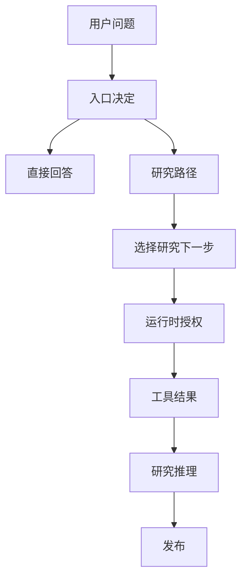
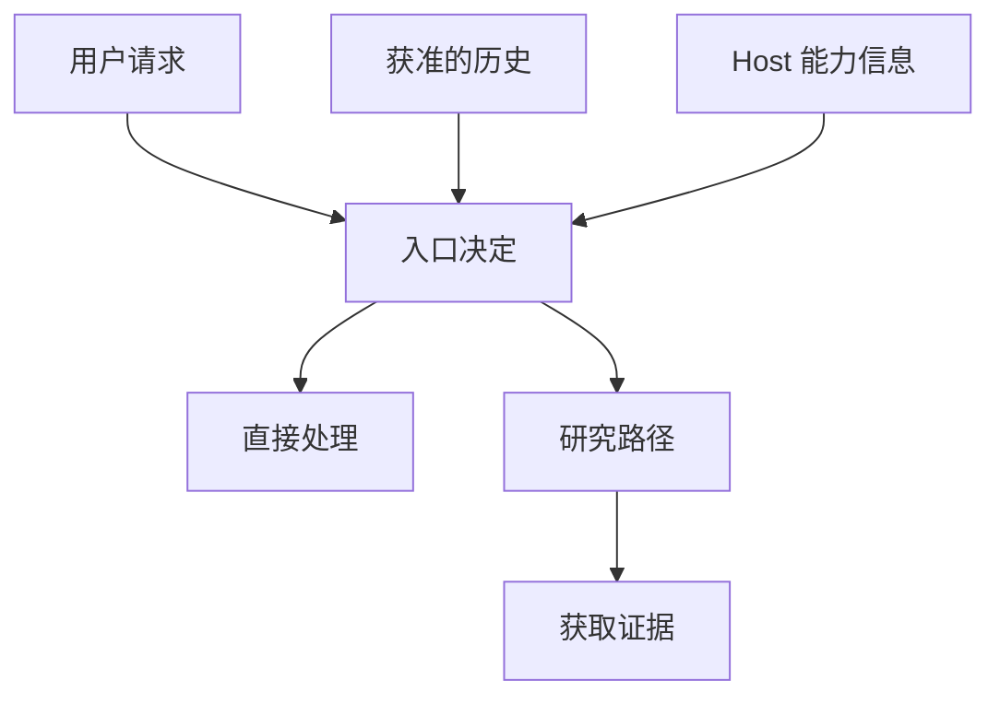
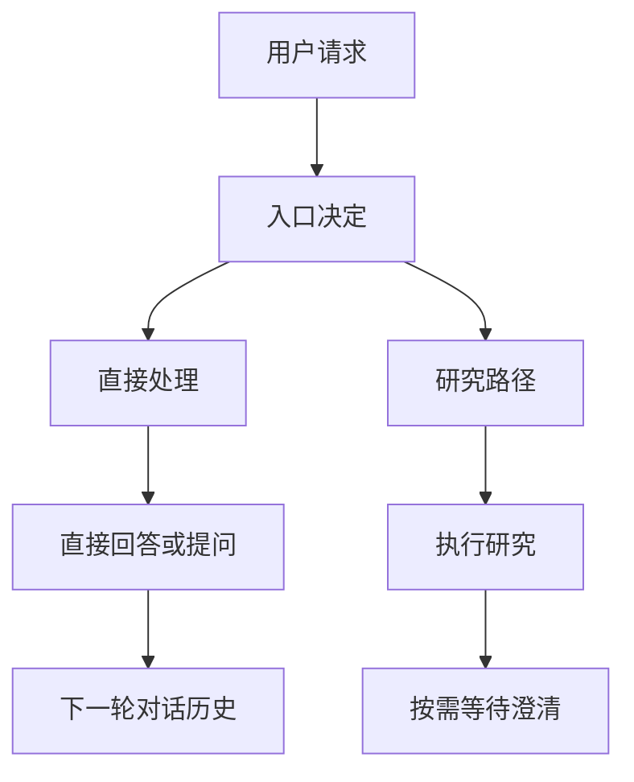
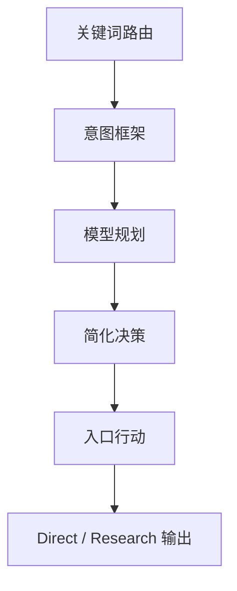
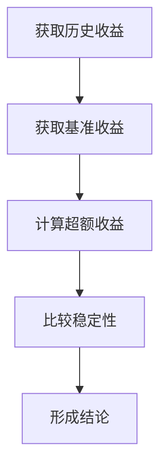
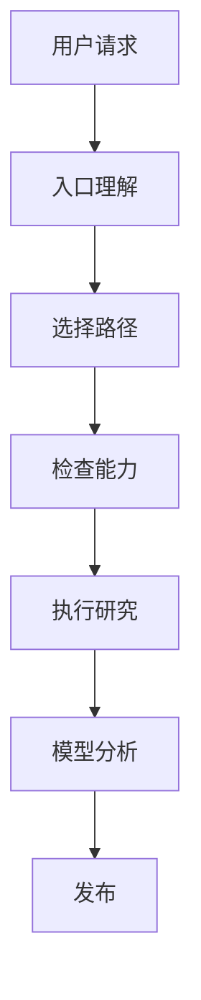

# 为什么我们把 Agent 的 Entry 越做越简单？

### 小决定、足够的信息，以及不能由模型替代的执行事实

“什么是指数增强基金？”通常可以直接解释。“我持有的两只指数增强基金，过去三年的超额收益谁更稳定？”却需要资料、时间口径、授权与计算。两句话都谈基金，适合的执行方式并不相同。

Entry 要解决的就是这个区别。我们曾把意图、实体、时间、研究计划甚至完成条件都塞进入口，也试过用原生工具动作表达路线。真正有用的收敛不是删到只剩一个 `if`，而是：**让模型作当前所需的有限决定，让实际执行的负责人证明权限、容量和结果。**

这篇先说明当前如何工作，再用真实反例解释选择。旧 Intent 与动作协议只作为设计证据，不是仍需兼容的运行路径。这也对应[原则 6「坚持最小充分机制」](/principles#principle-6)和[方法 1「新功能取舍」](/principles#method-1)：额外机制究竟保护了什么事实，又给正常请求增加了什么成本？

<span id="从-intent、planner-到-direct-research-一次-agent-入口架构的演进"></span>
<span id="四、为什么最后又回到了结构化输出"></span>
<span id="八、我们现在的-entry-究竟简化到了什么程度"></span>

## 一、当前普通 Entry：输出一个决定，不预写整个研究

普通新请求进入 Entry 时，模型看到原请求、获准历史和有限的 Host 上下文。直接解释、普通追问或无需外部核验的材料转换可以走 Direct；当前外部事实、个人持仓、必要的文档读取或需要调用可用计算能力的请求，需要进入 Research。

Direct 的核心形式是：

```json
{
  "kind": "direct",
  "markdown": "指数增强基金通常在跟踪指数的基础上，尝试获取超额收益……"
}
```

Research 可以申请当前允许的范围：

```json
{
  "kind": "research",
  "scopes": ["fund"]
}
```

没有需要额外申请的范围时，也可以省略 `scopes`：

```json
{
  "kind": "research"
}
```

这里的 `fund` 是示例，不是任何 Host 都必须提供的范围。省略范围也不是获得全部工具。Host 接纳提议后，Research 才在原权限、预算和实际工具结果中选择下一步；Direct 则交给原回答处理路径。



**这张图描述普通 Direct / Research 核心，不是所有当前交互模式。** 当前并发会话按 Host 快照的 `availableActions` 生成协议；允许协调时还有 `coord`，只针对明确列出的活动任务提议 inspect、correct 或 stop。短交互可能没有 Research，Sidecar 只能 Direct。动作可见仍不代表接纳或控制已成功。有效的显式 Skill、原 owner 准备的 Continue，以及特定显式研究入口，也不必重新让普通 Entry 猜一次路线。

统一的是职责，而不是永远固定两个字段：模型回答“现在提议什么”，Host 决定“这次实际能做什么”。

<span id="五、entry-越来越简单-为什么输入信息反而更多"></span>
<span id="entry-应该知道存在什么能力-但不必提前执行"></span>
<span id="一个真实案例-为什么模糊-pdf-没有进入研究"></span>

## 二、输出越小，为什么输入反而需要更完整？

如果用户要求计算收益相关性并导出图表，Entry 却不知道后续存在获准的分析或导出能力，它可能直接说“我做不了”。这个问题不能靠强迫所有请求进入 Research 解决，也不需要先执行一次完整研究再路由。

当前普通 Entry 使用有限发现信息：

| 输入信息 | 帮助 Entry 判断什么 |
| --- | --- |
| 当前用户请求与合法历史 | 用户究竟在问什么 |
| Portfolio 访问级别 | 当前是否具有某类个人数据读取资格 |
| 分析能力可用性 | 是否存在继续计算和导出的路径 |
| 已授权文档目录 | 是否存在可进一步读取的研究材料 |
| 扩展工具的有限发现信息 | 是否存在适合交给 Research 使用的能力 |

`portfolioAccess: details` 表达访问级别，不证明持仓存在或已经读过；文档 ID 与版本表明材料可进一步定位，不等于正文已经进入模型。扩展工具描述也只是发现，不是可在 Entry 调用的工具。分析与导出分别看可用性，能导出文件不自动意味着能运行 Python。



发现信息在原 Host 消息中有数量和字节上限，不能挤掉用户原文。当前实现对扩展工具与授权文档分别有有限条目投影，并在异步上下文准备后取得当前发现事实。来源披露本身仍要获准；不能因为稍后读取还有检查，就把目录元数据当成没有权限要求的内容。读取失败也不能被改写成成功的空目录。

这是一种折中：比只给最后一句话多一点上下文，比为每次问候预取持仓、行情和全部文档便宜得多。代价是发现目录可能不完整，缺席不能随意推断“系统绝无此能力”。普通入口也不因此加入一份完整 Skill 方法目录；用户明确选中的 Skill 沿专门的获准入口处理。

### 模糊 PDF：路由改善不等于研究成功

一次真实 PDF 诊断中，Entry 选了 Direct，没有读页图。代码显示 Research 有文档索引，Entry 没有同一份有限发现信息。这证明了上下文缺口，**不能单凭这一点断言它是模型选路的唯一原因**。

接入已有授权目录后，一次真实首问选择了 Research，并实际读取了页图。但转录仍不可靠，任务最终为 partial / request-budget-exhausted。发现入口、实际读取、模型选择和答案质量必须分别取证。我们没有把 PDF 正文或图片提前塞进入口，也没有为 PDF 再加一个分类模型。

<span id="结构化输出不等于完全相信模型"></span>
<span id="七、协议缩小以后-模型仍然会犯错"></span>
<span id="有效的-direct-被一个无关字段送进-research"></span>
<span id="长回答被前置解析器拒绝"></span>
<span id="结构错误不能随意变成研究任务"></span>

## 三、一个合法 JSON，还不是可执行的决定

供应商的输出约束可以减少格式错误，但本地仍要检查实际结束事件、唯一结构对象、字段、当前动作集合以及真实接纳。如下半截内容不是 Research 决定：

```text
{"kind":"research","scopes":
```

意外工具事件也不能被当作一个结构化提议。判断“完整”还不能机械等同于某一个 finish 标签：当前适配器允许**实际完整、可解析且符合 Direct 条件的正文**在 `finishReason=length` 时保留；截断的 Research 则不因此获准。正常模型响应已发生的计量事实，也不能因随后本地解析失败而被抹掉。

### 有效答案为何曾被送去重复研究？

历史诊断里，模型已经给出约 340 字的直接回答，却附带一个无关的 `null` 字段。旧处理拒绝整份对象，随后进入研究并重复搜索。真正的问题不是模型不会回答，而是无执行用途的附加字段获得了否决正文的权力。

现在**普通 Direct 路径**读取 `kind=direct` 和非空 `markdown`，不把其他注释变成权限，也不因它们拒绝有效核心。原失败响应的离线回放可用一次 Entry、零 Research 完成。这里必须说清范围：当前 coordination 与 `conversation-entry-snapshot@2` 路径仍要求严格 Direct schema，不能把普通分支的宽容投影当成全局规则。

另一条真实失败发生在更早的解析层：发布允许较长 Markdown，JSON parser 却沿用普通工具参数的较小字节上限。最终字符裁剪救不了已经被拒绝的输入，中文又更容易暴露字节与字符的差别。现在 Entry 使用回答所需的解析预算，普通 Native 工具参数保留自己的默认限制。应该逐层核对 transport、JSON parse、正文处理和 publication，而不是一次放宽所有容量。

### 传输重试与结构回退，是两种不同的决定

当前持久化生产路径只对原分类为可重试、由 runtime 拥有恢复的故障申请 Entry retry allowance；先向原 Store 申请，再等待或发起新请求，每次实际请求仍需自己的模型调用额度。可选路线切换还需要相应的已记录失败事实与既有合格路线。取消、owner 丢失或任意未知错误，不会因为“再试一次可能成功”就成为普通重试。

格式错误是另一条路。当前普通生产路径对特定 Entry 核心正文/Schema 失败可以由 Host 提议 Research 回退；Sidecar 不这样升级。如果当前会话需要后台 Scope 提升，必须由原 owner 在同一 Run 租约上接纳实际研究负载。容量不足就拒绝未获准的研究，不补造模型决定。缺少合格 Native 路线或持久恢复条件时，当前代码给出能力限制，也不会声称已经研究。

这里存在必须披露的规范差异：较早的统一语义 Spec 仍写着“至多一次完整格式修复后失败”和“Entry 传输零自动重试”；后续资源、供应商与会话合同以及当前生产代码已有上述有界重试和特定 Host 回退。本文描述固定代码中的现行路径，**不把旧条文与新实现写成已完全一致，也不宣称已自动完成一次格式重生成**。

这些恢复机制保住的是身份和资源边界，不证明每个格式失败都值得启动长研究。是否应该回退，仍要看原用户问题与路由评估。

<span id="为什么后来连-ask-user-都删除了"></span>

## 四、普通追问为什么不需要一个暂停工作流？

“这个怎么选？”可能只需要回答：“你是在比较两只基金，还是想了解基金选择方法？”用户接着补充即可。没有已开展的研究要保存，就未必需要一个独立的待答状态。

旧 Entry 专用 `ask_user` 曾把问题展示出来，却因专用父子关联没有正确保留历史，让下一轮看不到刚才的问题。继续补关联可以修这个 bug，但也让普通对话背上更多恢复责任。现在入口追问用 Direct，下一轮沿正常会话历史理解。普通文字选项不产生工具或来源授权，新轮次仍取当前权限。



研究中已经有工作需要延续时，专门的 `ask_user` 与恢复仍有价值；是否阻塞，要由该研究路径决定。普通追问不冒充用户已经回答，Research 的等待也不应被混成一次新的路由。选择这条边界的代价是：Entry 不提供一套独立的结构化问卷生命周期。若产品真正需要必填表单、超时或明确的待答对象，应该建立相应工作流，而不是假装所有问题都是普通聊天。

<span id="一、最初的想法-让入口一次理解整个任务"></span>
<span id="模型理解了语义-代码却又理解了一遍"></span>
<span id="三、我们甚至试过-让-entry-也使用原生工具调用"></span>

## 五、结构化输出、工具调用与 Intent，各自适合什么？

### 为什么一次路线决定没有继续使用三个工具？

我们曾让 Entry 原生调用三个互斥动作：

```typescript
direct_answer({ markdown: string })

ask_user({ questions: Question[] })

start_research({ scopes?: ResearchScope[] })
```

删除专门的入口澄清后，一度只剩：

```text
direct_answer
start_research
```

真实测试却出现过 **61 个相同的 `start_research`**，直到输出触及长度限制；当时研究还没开始，也没有读取持仓。单次 SDK 请求的限制并不等于模型只输出一个动作。这是该历史样本的协议问题，不是工具调用普遍不可靠的结论。

原生工具调用适合 Research 中的实际操作和多轮结果消费；一次有限路由用结构对象，少了无动作、重复动作和冲突动作的组合处理。代价是 Entry 与 Research 使用不同的输出协议，都要维护和校验。若入口本身就需要读取外部信息、连续执行多步，用一个有实际工具结果的 Agent 循环可能更自然，没必要为了追求“两分支”再套一层空路由。

[OpenAI 的结构化输出指南](https://developers.openai.com/api/docs/guides/structured-outputs)也区分用函数调用连接应用能力与约束模型回复结构。这支持按职责选协议，不意味着严格 JSON 能保证语义、权限或研究质量。

### Intent 并不是错误，提前固定全部语义才容易越界

旧 Intent v2 可以把自然语言变成便于固定处理器消费的对象。例如下面是历史思路的简化示意，不是当前 Entry schema：

```json
{
  "domain": "fund",
  "mode": "analysis",
  "subject": "portfolio",
  "operation": "compare",
  "time": "past_three_years",
  "ambiguous": false
}
```

对于少量清楚的业务类型，关键词、分类器或结构化 Intent 都可能更便宜，也更容易集成。问题出现在开放研究：相同“定投”一词可能是概念解释，也可能是制定计划；“之前买过什么”和“现在可以买什么”更不能按相同交易关键词处理。

历史语义探针还发现，模型判断之后，代码又用实体要求、关键词或展示白名单裁决一次：概念比较被不必要的实体约束拒绝，持仓自然表达没有命中规则，正常中文改写被当成无效展示。两套语义裁决器互相抵消，结构验证也被混成了意图判断。当前仍需要严格检查权限、结构和来源，但不让这些客观检查替模型重新解释用户目标。

下面保留的是设计演进概览，不是今日需要串行运行的多个阶段：



<span id="意图对象越来越像研究计划"></span>
<span id="六、入口应该提供研究起点-而不是规定研究过程"></span>

## 六、不预写计划，怎样避免复杂问题被漏掉？

入口的确需要保留用户问题，但“保留问题”不等于“在读资料前固定步骤”。比较三年超额收益时，下面的流程看起来合理：



一旦发现某只基金成立不足三年，或中途更换基准，就必须先调整比较区间与口径。若只是把计划当建议，Research 可以继续；若把它当强制执行图，入口的猜测反而阻止修正。

更复杂的任务也常被提前拆成下面这种清单：

```text
查询基金 A
查询基金 B
计算跟踪误差
比较费用
读取组合
分析重叠
生成调整建议
```

这适合步骤确定的业务工作流。对于证据驱动的研究，费用、跟踪误差与个人持仓可能有不同的数据可用性，不能因为一个私有部分缺授权就丢掉独立公开研究。

当前 `researchNeeds` 提供少量值得跨轮次保留的初始问题：

```json
{
  "kind": "research",
  "researchNeeds": [
    {
      "id": "fees",
      "need": "需要核对指定份额的费用与生效日期",
      "status": "open"
    }
  ]
}
```

need 与 status 都是模型判断，不是证据、权限或完成回执。完整原用户任务仍然保留，Research 可根据实际材料调整问题。这样少一个默认 Planner 调用，却也不再提供一份执行前就固定、可逐项验收的完整任务图。

[Anthropic 对工作流与 Agent 的比较](https://www.anthropic.com/research/building-effective-agents)把固定步骤、路由和动态任务分解分开讨论：明确分类适合专门路线，难以预知子任务时才需要动态分解。我们的取舍是让这种分解发生在有证据和工具结果的 Research 中；若任务本身是稳定审批或固定流水线，显式工作流可能更合适。

<span id="二、第一次转向-让模型理解-让-runtime-管理执行事实"></span>
<span id="回头看-我们真正修复的是什么"></span>
<span id="接下来仍有哪些问题"></span>
<span id="九、最后-更聪明的-agent-不一定需要更复杂的入口"></span>

## 七、判断 Entry 是否可靠，要观察哪条链？

以进入 Research 的一条路径为例：



这只是职责示意，不是证明所有门都按图顺序只执行一次。原权限和容量在实际派发时仍有各自检查。它要求分清以下负责人：

| 事情 | 更合适的负责人 |
| --- | --- |
| 理解用户想解决什么问题 | 模型 |
| 判断当前是否需要研究 | Entry |
| 判断有哪些工具可以使用 | Host / Runtime |
| 确认个人数据访问权限 | Host / Runtime |
| 记录工具是否真正执行 | Runtime |
| 根据新证据调整研究问题 | Research |
| 判断回答是否已经提交 | Publication |
| 判断回答是否正确 | 独立质量评价 |

历史问题可以归纳成一组可迁移的检查问题：

| 实际问题 | 后来的工程判断 |
| --- | --- |
| Entry 重复输出多个研究动作 | 单分支决策不必采用多动作协议 |
| 普通澄清丢失历史 | 普通追问复用正常会话历史 |
| 有效 Direct 被附带字段拒绝 | 只消费 Direct 真正需要的字段 |
| 长回答在发布前被解析器拒绝 | 逐层对齐解析和发布容量 |
| 结构错误回退可能绕过研究容量 | 由原 Scope 准入方按实际研究负载核验，不补造模型决定 |

表中 Direct 字段投影是上文限定的普通路径，不覆盖所有交互 profile。受控浏览器观察过容量拒绝和释放后的原研究完成；隔离数据库与界面回归覆盖了接纳和同 Run 错误回读，但末次界面修复没有新的浏览器复跑，不能写成完整交互已实测通过。原失败回放能证明某个有效回答不再被误送入 Research。这些都是有用的工程证据，但不能折算成当前所有请求的路由准确率。

更值得持续评估的是：简单问题有没有被送去重复研究？需核对最新事实的问题有没有被 Direct 猜答？混合问题能否保留独立可推进的部分？发现上下文是否足够，又是否挤掉了真正的用户任务？历史 PDF 的实际读取仍未完成可靠转录，正提醒我们不要把“走对门”写成“到达终点”。

入口变简单的目的，是把尚未知道的事留给真正会获得证据的阶段。当前的有限决定、必要发现和原执行 owner 一起工作，才构成可解释的路线选择；少一个字段或少一次模型调用，本身不是成功标准。
