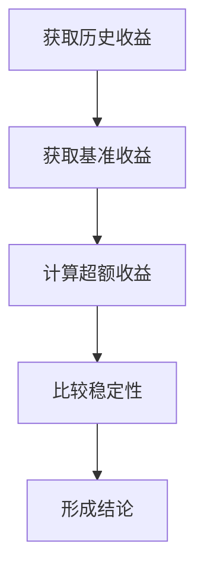
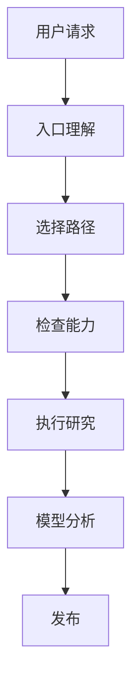
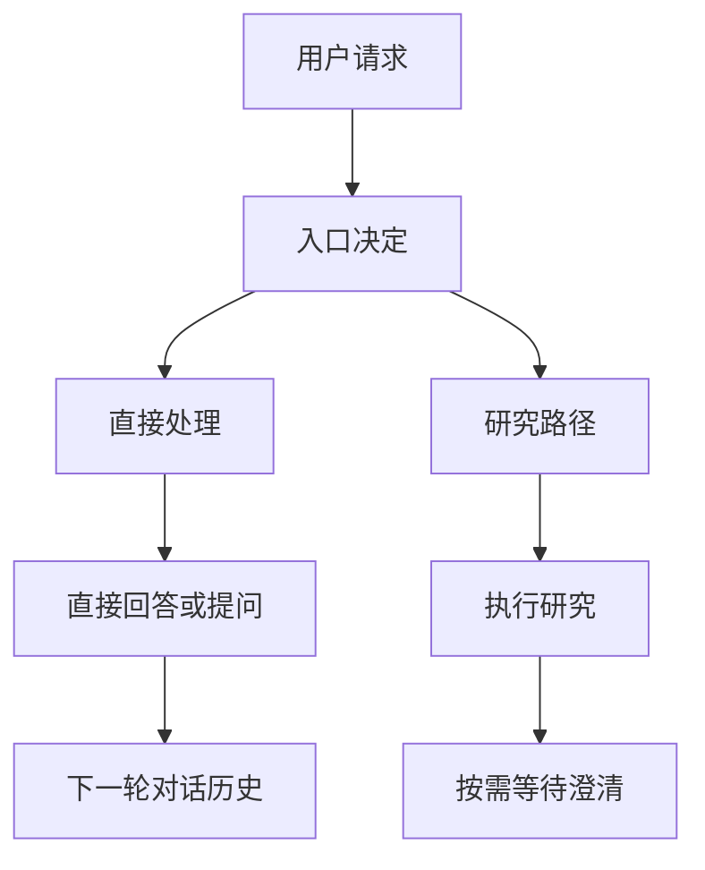
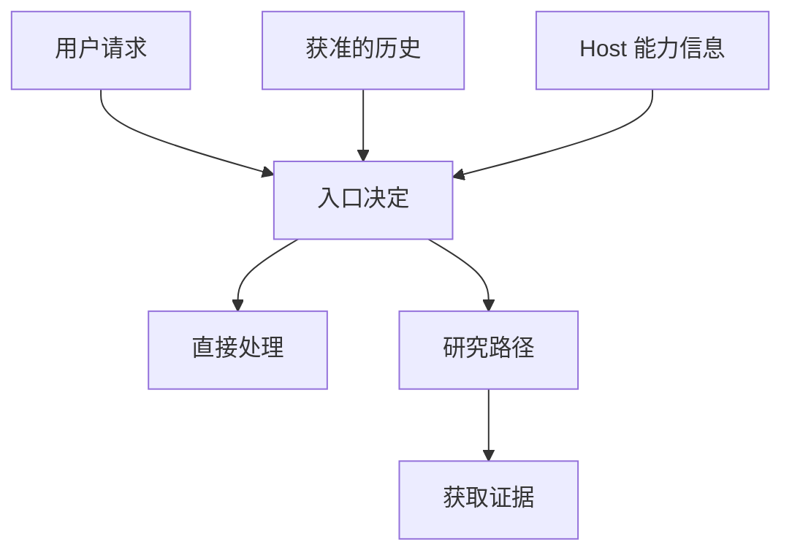
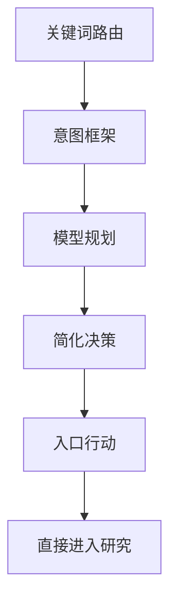
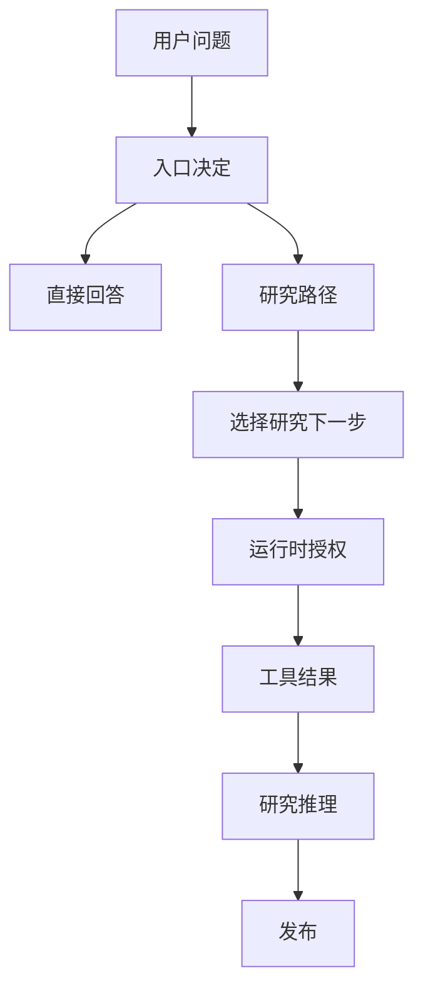

---
evidence:
  implementation: "Direct / Research 路线已采用（按本文记录）"
  scoped: "历史案例与入口行为观察"
  live: "路由选择质量仍需验证"
---

# 为什么我们把 Agent 的 Entry 越做越简单？

### 从 Intent、Planner 到 Direct / Research：一次 Agent 入口架构的演进

做 ETF Agent 的过程中，我们曾经花了不少精力解决一个看起来很简单的问题：

**用户发来一句话，Agent 应该直接回答，还是启动研究？**

例如：

> 什么是指数增强基金？

这个问题通常不需要查询实时数据，模型可以直接解释。

但如果用户问：

> 我持有的两只指数增强基金，过去三年的超额收益谁更稳定？

那就需要读取基金资料、确定比较区间、核对历史数据，甚至执行计算。

还有一些更复杂的情况：

> 这只基金怎么样？适合我继续持有吗？

这里可能同时涉及产品研究、个人持仓、风险偏好和投资建议。系统不能仅仅因为看到“基金”两个字，就决定应该调用什么工具。

一开始，我们希望入口尽可能聪明：识别意图、抽取实体、理解时间、拆分任务、生成计划、选择执行路径。

随着能力增加，入口也变得越来越复杂。

但经过几轮真实测试和架构调整，我们逐渐意识到：

**Agent 的入口越聪明，不一定意味着整个 Agent 越聪明。**

我们要求入口承担的许多事情，本来就可以在研究过程中完成，甚至应该由运行时负责。

最终，我们将 Entry 的核心职责收敛为两个基本选择：

**Direct：当前可以直接回答。**

**Research：需要进入研究流程。**

这篇文章想分享的，不是一套新的意图识别算法，而是我们为什么从复杂的 Intent 和 Planner 一路做减法，以及这个过程中遇到的实际问题。

回头看，这次 Entry 做减法正对应[原则 6「坚持最小充分机制」](/principles#principle-6)：模型已能在 Direct 与 Research 之间作语义判断，就不必再由入口预写整份研究计划。我们也借助[方法 1「新功能取舍」](/principles#method-1)追问：额外的 Planner、Validator 或 Gate 究竟保护了什么不可替代的事实，又给正常请求增加了多少成本？

## 一、最初的想法：让入口一次理解整个任务

最早的 ETF Agent 主要依靠关键词进行路由。

这个方案足够简单，在开发初期也很实用。

例如，检测到“持仓”就倾向于查询组合，检测到“行情”就走市场数据，检测到“定投”就进入相关功能。

问题是，自然语言并不总按照关键词组织。

“解释什么是定投”和“帮我制定一个定投计划”包含相同的关键词，却是完全不同的任务。

“我之前买过什么”和“我现在可以买什么”都涉及交易语义，但前者是历史查询，后者可能涉及投资建议。

否定、时间、指代和复合问题，也很难通过一组关键词稳定处理。

因此，我们引入了更丰富的 **Intent v2**。

它尝试将用户请求解析成一个语义对象，包含任务领域、操作模式、实体、时间、言语行为、否定和歧义等信息。

例如，简化后的意图可能是：

```json
{
  "domain": "fund",
  "mode": "analysis",
  "subject": "portfolio",
  "operation": "compare",
  "time": "past_three_years",
  "ambiguous": false
}
```

这是帮助理解的示例，不是当时协议的完整定义。

这套设计最初有充分理由。对于一个拥有少量固定能力的助手，先确定用户想做什么，再选择对应的处理流程，是很自然的架构。结构化意图还便于测试、调试和审计。

但后来出现了两个问题。

### 模型理解了语义，代码却又理解了一遍

我们希望模型负责理解用户的自然语言。

但实际运行中，模型生成语义判断后，后续代码仍可能根据关键词、实体类型或覆盖规则再次解释用户的意思。

例如，历史研究中我们遇到过：

- “比较指数基金和主动基金”这样的概念请求，被错误的实体要求或展示规则拒绝。
- “结合我现有持仓”这样的自然表达，没有被原有关键词判断正确识别。
- 某些普通中文改写，因为不符合展示文本白名单，被当成无效输出。

这不只是模型能力问题。

**我们宣称语义由模型负责，但系统中仍然存在另一套隐含的语义裁决器。**

而且，两者并不总能得出一致的结论。

### 意图对象越来越像研究计划

随着任务变复杂，我们陆续考虑将研究目标、任务范围、缺失信息、执行动作和完成条件都放入结构化决策。

这样看起来可以帮助 Agent 提前规划。但有一个问题：

**在还没有查询任何资料之前，Agent 往往并不知道真正合理的研究步骤是什么。**

例如，用户要求比较两只基金过去三年的超额收益。入口可能生成这样的计划：



但进入研究后，我们可能发现其中一只基金成立不足三年，另一只基金中途更换过基准。

这时真正应该做的，是重新确定比较区间和基准口径，而不是机械执行最初的步骤。

入口生成的计划可以作为建议，但如果运行时把它当成必须执行的流程，反而限制了 Agent 根据新信息调整研究方向。

于是，我们开始重新思考：

> **入口真的需要在第一轮就决定整个研究过程吗？**

## 二、第一次转向：让模型理解，让 Runtime 管理执行事实

在后续语义规划调整中，我们撤回了旧的重型意图设计，尝试让模型更直接地负责目标解释、任务范围和研究方向。

同时，把客观的执行事实交还给运行时。关键不是简单地删除字段，而是重新分配职责。

| 事情 | 更合适的负责人 |
| --- | --- |
| 理解用户想解决什么问题 | 模型 |
| 判断当前是否需要研究 | Entry |
| 判断有哪些工具可以使用 | Host / Runtime |
| 确认个人数据访问权限 | Host / Runtime |
| 记录工具是否真正执行 | Runtime |
| 根据新证据调整研究问题 | Research |
| 判断回答是否已经提交 | Publication |
| 判断回答是否正确 | 独立质量评价 |

这里有一个重要的区别：

**模型可以提出需要什么能力，但不能通过自己的输出创建这些能力的使用权限。**

例如，模型可以认为“需要查询个人持仓”，但不能因为输出了一个“允许访问”的字段，就让系统相信用户已经授权。

同样，模型不必提前预测每次工具调用是否会成功。实际执行结果会进入后续研究上下文。



随着这个分工逐渐明确，我们发现 Entry 不再需要提前描述研究过程中的全部状态。这为后面的进一步简化提供了基础。

## 三、我们甚至试过：让 Entry 也使用原生工具调用

随着 Research Runtime 转向 Native Tool Calling，我们曾尝试让 Entry 也通过模型原生工具调用表达决定。

当时设计了三个互斥动作：

```typescript
direct_answer({ markdown: string })

ask_user({ questions: Question[] })

start_research({ scopes?: ResearchScope[] })
```

想法很自然：既然研究阶段已经能通过原生工具调用表达动作，为什么入口还要维护另一套决策协议？

但 Entry 和 Research 存在一个重要区别。

**Research 可以在一轮模型响应中提出多个工具调用，Entry 却只需要完成一个分支决定。**

我们在真实测试中遇到过一个很典型的异常：

Entry 连续输出了 **61 个相同的 `start_research`**，最终触及输出长度限制。此时研究实际上还没有开始，也没有读取持仓数据。

问题出在入口承担了过多轮次协调，而不是工具调用本身。

它说明的是：对于只允许一个决定的入口，使用能够表达多个动作的协议，并不天然更简单。

系统还需要额外处理多个异常情况：没有动作、重复动作、冲突动作，以及输出截断时无法确认决策是否完整。入口越靠前，协议错误越容易阻止后续所有工作。

### 为什么后来连 `ask_user` 都删除了？

这也是一次有代表性的做减法。

最初，我们认为澄清应该拥有独立状态。例如：

> 你希望比较哪两只基金？

系统提出问题后进入 `clarify_pending`，等待用户回答，再恢复先前任务。

对于已经开展研究、需要等待补充信息的场景，这种设计是有价值的。

但如果用户只是问：

> 这个怎么选？

Agent 回答：

> 你是在比较两只基金，还是想了解基金选择方法？

这实际上就是一次普通对话。

我们发现，Entry 的专用澄清路径反而引入了额外复杂度。

在某些情况下，系统已经把问题展示给用户，但下一轮因为专用父子关联没有正确保留历史，模型反而看不到自己刚才问过什么。

当然，可以继续修复关联关系，甚至建立更完整的待答问题状态。但我们最终重新审视了需求：

**普通入口追问，真的需要一个独立的澄清状态机吗？**

答案是不需要。

于是，我们删除了 Entry 专用的 `ask_user`。普通追问直接使用 Direct 文字回答。

下一轮用户消息通过正常会话历史进入 Entry，由模型理解上下文。

图中的 Direct 分支会直接答复或追问，并在下一轮复用正常会话历史；只有进入 Research 且确实需要等待用户信息时，才保留专门的 `ask_user` 和恢复机制。



这次调整没有引入新的运行状态、数据库列或兼容协议，反而删除了部分 Entry 专用逻辑。

**不是所有多轮对话，都需要一个专门的工作流。**

## 四、为什么最后又回到了结构化输出？

移除专用澄清动作后，Entry 一度只剩下两个 Native actions：

```text
direct_answer
start_research
```

但后来我们还是选择回到结构化输出。

这不是回到最初那个复杂的 Intent JSON，而是让 JSON 只表达一个有限的入口决定。

目前有两个基本分支。

Direct：

```json
{
  "kind": "direct",
  "markdown": "指数增强基金通常在跟踪指数的基础上，尝试获取超额收益……"
}
```

Research：

```json
{
  "kind": "research",
  "scopes": ["fund"]
}
```

如果没有需要额外申请的研究范围，Research 也可以不提供 `scopes`。

```json
{
  "kind": "research"
}
```

上面展示的是两个分支的核心形式。`researchNeeds` 等可选研究问题可以补充起点，但不再要求入口生成完整计划。

这一变化非常重要。

入口不再需要告诉运行时：“我准备按照什么顺序调用工具，预计需要多少步骤，最后满足什么条件才能结束。”

它只需要决定：

**现在能直接回答，还是需要进入 Research？**

真正的研究仍然交给 Native Tool Loop。

### 结构化输出不等于完全相信模型

当前模型网关可以提供 JSON 输出模式，但这不意味着我们可以完全依赖供应商保证结果符合本地 Schema。

因此，系统仍然需要检查响应是否完整、是否正常结束、能否解析为合法对象，以及其中的字段是否满足当前约束。

例如，模型返回了半截 JSON：

```text
{"kind":"research","scopes":
```

系统不能因为出现了 `research` 字样，就认为已经取得有效决定。同样，意外工具事件、非法研究范围也不能直接产生执行效果。

需要注意的是：

**一次入口语义决策，不等于底层物理模型请求在任何异常情况下都只能有一次。**

运输失败可能触发有界重试，结构错误也需要明确处理。

我们的目标是避免为了选择研究方式而默认增加一个额外的 Planner 阶段，并不是承诺不会发生任何重试。

以前，结构化协议试图描述整个研究过程；现在，它只需要描述一个有限的入口决定。

## 五、Entry 越来越简单，为什么输入信息反而更多？

这是整个演进中，我觉得最有意思的一个转折。

我们一直在减少 Entry 需要输出的内容，但在最近的实现中，Entry 获得的必要上下文反而比最初丰富。

这看起来似乎矛盾。其实它们解决的是两个不同的问题：

**减少输出，是为了避免模型承担不必要的控制责任。**

**改善输入，是为了让模型有足够的信息作出合理判断。**

入口只有两个基本分支，不意味着它只需要看到用户的最后一句话。

### Entry 应该知道存在什么能力，但不必提前执行

例如，用户问：

> 帮我计算两只基金的收益相关性，并画出对比图。

如果 Entry 不知道系统具备获准的 Python 分析和导出能力，它可能直接回答“我无法绘图”，或者让用户自己计算。

如果它能够获得当前分析能力的有限可用性信息，就可以更合理地选择 Research。

因此，我们逐步让 Entry 获得几类必要信息。

| 输入信息 | 帮助 Entry 判断什么 |
| --- | --- |
| 当前用户请求与合法历史 | 用户究竟在问什么 |
| Portfolio 访问级别 | 当前是否具有某类个人数据读取资格 |
| 分析能力可用性 | 是否存在继续计算和导出的路径 |
| 已授权文档目录 | 是否存在可进一步读取的研究材料 |
| 扩展工具的有限发现信息 | 是否存在适合交给 Research 使用的能力 |

这些信息不意味着相应能力已经执行。

例如，`portfolioAccess: details` 只能表达访问级别，不能证明当前持仓数据存在。

文档目录也是如此。

**知道存在一份 PDF，不等于已经阅读过它。**



这里有一条很重要的原则：

**Entry 可以获得必要的能力发现信息，但不为了判断路由而提前读取所有业务数据。**

图中的 Direct 分支不触发研究取证；只有选择 Research 后，才按需取得证据。否则，一个简单的“你好”，也可能触发持仓、行情、知识库和外部服务查询。

这样不仅增加不必要的工作，也让简单对话依赖更多外部系统。

### 一个真实案例：为什么模糊 PDF 没有进入研究？

最近的一次 PDF 阅读测试就很有代表性。

用户希望 Agent 阅读一份模糊的 PDF，并提取其中的信息。

旧的 Entry 没有获得当前已授权的文档目录，最终选择 Direct，没有实际读取页面图像。

这并不是 PDF 阅读器完全没有能力。

我们检查发现，Research 已经能够取得相关文档信息，但 Entry 缺少同一份有限的发现数据。

于是，我们把已有的授权文档目录接入 Entry 上下文。

注意，这里没有把整个 PDF 正文甚至页面图像提前塞进 Entry。提供的只是当前获准发现的文档元数据。

修复后的一次真实诊断中，Entry 选择了 Research，后续也确实读取了 PDF 页图。

但研究最终仍然不完整：模型没有可靠完成转录，任务最终因请求预算耗尽而停止。

这个案例很好地说明了我们对 Entry 的新认识：

**补齐必要的入口信息，可以修复某些路由缺口，但不能保证后续研究一定成功。**

我们不需要因此恢复复杂的 Planner，也不需要在 Entry 中新增一个专门判断 PDF 的模型。只是把本来就存在、而且与路由有关的信息提供给了入口。

## 六、入口应该提供研究起点，而不是规定研究过程

现在，一个用户问题可能包含多个需要研究的部分。例如：

> 比较两只基金的跟踪误差、费用和底层持仓，再结合我的组合判断是否值得调整。

如果让 Entry 提前生成完整步骤，可能会得到这样的计划：

```text
查询基金 A
查询基金 B
计算跟踪误差
比较费用
读取组合
分析重叠
生成调整建议
```

但进入 Research 后，实际资料可能改变研究顺序。

也许某只基金的基准存在版本差异，导致跟踪误差暂时不可比。

也许个人持仓明细没有获得授权，但公开基金费用和跟踪质量仍然可以独立分析。

这时，最合理的做法不是重新生成整个入口计划，而是让 Research 根据实际取得的信息调整下一步。

目前 Entry 允许携带少量初始研究问题，例如：

```json
{
  "kind": "research",
  "researchNeeds": [
    {
      "id": "fees",
      "need": "需要核对指定份额的费用与生效日期",
      "status": "open"
    }
  ]
}
```

但这些问题只是模型提出的初始研究方向。它们不是已经核实的事实，不是执行权限，更不是必须严格按照顺序完成的任务图。

研究开始后，模型可以根据实际结果更新问题、补充证据或披露限制。

因此，我们现在更倾向于把 Entry 看作一个**研究入口**，而不是一个提前完成所有规划的控制器。

**Entry 负责决定是否开始研究，Research 负责决定研究如何继续。**

## 七、协议缩小以后，模型仍然会犯错

把 Entry 简化成两个基本分支，并不意味着问题就全部消失了。

我们后来仍然遇到几类值得分享的失败。

### 有效的 Direct，被一个无关字段送进 Research

一次真实诊断中，模型已经生成约 340 字的直接回答。

但它附带了一个额外的 `null` 字段。

此前的处理过于严格，整个决策被拒绝。随后任务进入研究路径，发生重复搜索和其他失败。

原本简单的问题变成了复杂研究。

这里真正值得思考的是：

**如果 Direct 只需要 `kind` 和非空 `markdown`，为什么一个不参与执行的字段能够否决有效答案？**

我们后来调整了 Direct 的字段消费方式。

在核心条件成立时，只提取真正需要的字段，不让无关附带字段触发额外研究。

针对原失败响应的离线回放表明，可以通过一次 Entry 完成，并且不启动 Research。

当然，这不意味着模型附带的任何内容都可以被接受。

忽略无关字段，不等于把它们转化为授权、工具参数或业务事实。

### 长回答被前置解析器拒绝

还有一个更隐蔽的问题。

Entry 的 Direct 可以生成较长的 Markdown，但某个阶段的严格 JSON 解析器，仍然使用普通 Native 工具参数的较小字节限制。

结果是：最终发布层明明允许这段文字，前面的解析阶段却先拒绝了它。

尤其对于中文内容，字节数与字符数并不相等。

这不是模型理解能力问题，而是多层容量约束没有对齐。

最后的处理方式，是让 Entry 使用适合自身回答容量的解析边界，而不是直接放宽所有工具参数的容量。

这个问题提醒我们：

**一次回答需要经过模型生成、协议解析、正文处理和最终发布。某一层允许，不代表整条链路都允许。**

### 结构错误不能随意变成研究任务

模型输出结构无效时，系统可以明确失败，也可能沿已有回退路径继续。但**能回退，不等于回退后自动取得新工作的资源资格**。

我们后来发现一个实际缺口：无效 Entry 响应回退到 Native Research 后，原 Run 仍可能保留短任务的 Scope 分类。实际启动的是后台研究，却可能绕过它应当遵守的后台容量准入。此时再追问“模型究竟想不想研究”已经解决不了问题，因为入口响应本身并没有给出可靠决定。

修复没有从残缺结果补造模型意图，也没有给回退研究开一条特殊通道。原 Scope 准入方在**同一个已取得租约的 Run** 上原子提升研究资格，Host 留下与原身份绑定的回退记录。若容量不足，只拒绝尚未获准的研究；前台独立交互与用户明确 Stop 仍由各自机制负责。重新打开 History 时，也只显示属于这次失败 Run 的有限公开原因，不向用户暴露任意内部错误。

受控浏览器与隔离数据库验证覆盖了容量拒绝、释放后继续以及错误原因回读。这证明了特定资源边界上的修复，不是所有格式失败都值得进入 Research，更不等于真实模型的路由质量已经提升。

**错误恢复一旦改变执行类型，就必须重新取得与实际工作相称的权限和容量证明。**

### 回头看，我们真正修复的是什么？

| 实际问题 | 后来的工程判断 |
| --- | --- |
| Entry 重复输出多个研究动作 | 单分支决策不必采用多动作协议 |
| 普通澄清丢失历史 | 普通追问复用正常会话历史 |
| 有效 Direct 被附带字段拒绝 | 只消费 Direct 真正需要的字段 |
| 长回答在发布前被解析器拒绝 | 逐层对齐解析和发布容量 |
| 结构错误回退可能绕过研究容量 | 由原 Scope 准入方按实际研究负载核验，不补造模型决定 |

这些问题有一个共同点：

**Entry 的可靠性不仅取决于模型是否理解正确，还取决于我们要求它遵守多少协议，以及程序如何处理局部偏差。**

## 八、我们现在的 Entry，究竟简化到了什么程度？

如果把整个演进放在一起，大致可以概括成下面这张图：



这不是简单地从复杂走向简单，而是逐渐厘清不同技术的适用范围。

**关键词规则**适合表达明确、确定性的规则，但不适合承担开放语义理解。

**结构化 Intent** 便于工程集成，但不应该将任务理解、研究规划和执行状态全部塞进同一个对象。

**Native Tool Calling** 适合 Research 阶段的实际操作，却不一定是表达一次入口分支决定的最佳工具。

**结构化输出**适合有限、需要明确解析的决定，但字段应该围绕当前决策，而不是模拟整个运行时。

我们最终不是放弃这些技术，而是把它们放到了更合适的位置。



图中 Direct / Research 的选择由 Entry 作出；进入 Research 后，研究过程会根据工具结果继续选择下一步。实际运行还存在恢复、预算、取消、来源权限和多轮上下文等机制。但这些不应该要求模型在入口提前生成一份完整的执行计划。

### 接下来仍有哪些问题？


例如，简单问题是否被错误送进 Research？需要最新资料的问题是否被 Direct 猜测回答？复杂混合问题能否保留独立可以推进的部分？

另外，能力发现信息也需要保持克制。提供太少，模型可能不知道系统能够做什么；提供太多，又可能让 Entry 逐渐变成一个新的复杂规划器。

回退后的容量准入已有针对性修复；至于一次格式失败是否真的值得启动长研究，仍需按原始用户问题评估。

这些问题都不意味着需要重新设计一个更复杂的 Intent。

相反，它们提醒我们：**在维持小协议的前提下，继续提高路由判断的质量，才是下一阶段更值得投入的方向。**

## 九、最后：更聪明的 Agent，不一定需要更复杂的入口

经过这轮演进，我们对 Entry 的理解发生了明显变化。

最初，我们希望入口能够提前回答很多问题：用户想做什么？需要哪些数据？应该调用哪些工具？要分成几个步骤？什么时候算完成？

后来，我们发现真正需要入口回答的问题可以更简单：

**当前是否足以直接回答？如果不能，是否需要进入能够继续获取信息、执行工具并调整研究方向的流程？**

当然，现实实现不只是一个 `if`。

它仍然需要必要的上下文、结构约束、授权检查和失败处理。但这些机制不应该要求模型在研究开始前，就生成一份完整的未来执行计划。

因为研究是一个不断获取新信息、不断修正判断的过程。在资料还没有开始读取时，就要求 Entry 决定全部步骤，并不一定合理。

对于我们的 ETF Agent 来说，逐渐明确的方向是：

**入口负责决定是否开始研究，研究过程负责决定怎样继续。**

这比不断扩展 Intent Schema，更符合我们现在对 Agent 的理解。

入口最后只保留一个决定：直接回答，还是开始研究。研究开始后，模型再根据拿到的材料选择工具、追查缺口或调整问题；入口的初步判断不会替它写死整条路线。
