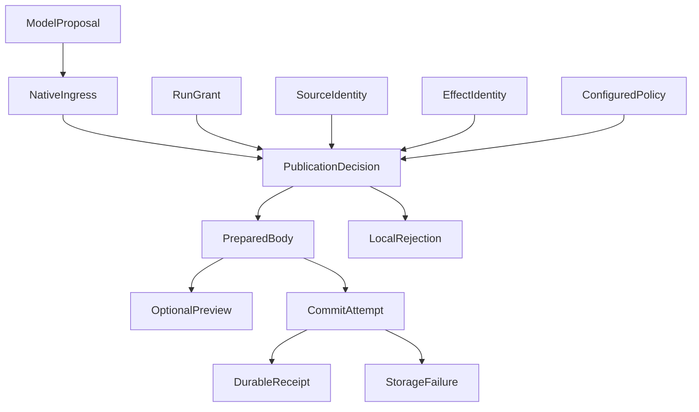

# Agent 发布治理为什么做了两次？问题不只是校验太严格

我们曾经给研究型 Agent 做过一次答案交付治理。

目标很明确：模型已经生成了回答，就不应该因为一个无效引用、某次工具调用失败，或者数据库暂时写不进去，让用户什么都看不到。为此，我们整理了规格，改造了来源降级和异步保存，让普通模型正文与显式回答工具进入同一个发布模块。

2026 年 10 月 6 日，这轮治理完成了工程验收：1,267 项离线测试、36 项隔离 PostgreSQL 测试，以及 301 项前置 Mock 测试通过。正文展示、持久化和语义质量也被明确拆成了不同事实。

然而，后续排查仍然找到了熟悉的问题：某些正文在发布前被拒绝，某些已经保存的回答在历史读取时被隐藏。等我们重新沿着整条调用链检查，才看清一个此前没有彻底解决的问题：

**系统虽然有一个回答发布模块，却不止一个地方可以决定回答不应该出现。**

第一轮治理不是白做了。它解决了不少具体问题，但没有完全收回散落在其他模块里的决定权。第二轮真正要改的，也不只是把几个校验条件放宽。

## 一、我们先统一了结构，却保留了多个决定者

这里的“发布”，指把模型生成的内容变成可展示、可保存、可修订的回答，而不是部署软件。负责这件事的组件，我们叫作 Publication。

在第一次答案交付治理之前，我们已经做过一轮结构收敛。运行时、发布模块、恢复模块和生产装配层，原本各自维护回答块的类型与校验：同一个表格字段，一处接受，另一处可能拒绝；同一段正文，在生成阶段合法，进入恢复路径后却不一定能被读取。

我们用统一的 `AnswerBlock` 结构契约，让不同信任边界复用同一套语法。

但当时的设计也明确保留了各层自己的判断：运行时继续检查模型声明的权威信息，发布层继续检查引用和数字，恢复层继续判断依赖是否满足恢复要求。Publication 负责提供拒绝事实，Runtime 决定修复、继续还是结束。

这解决了类型与结构不一致的问题，却没有自动解决职责归属。**统一结构能让大家使用同一本字典；统一职责还要明确，谁有权决定正文怎样处置。**

所有模块都调用同一个 Schema，仍然可能在不同阶段独立拒绝整块正文。错误类被移动到 Publication，也不意味着其他模块已经失去了过滤候选、阻断收尾或隐藏历史的能力。

10 月 6 日的专项治理进一步要求：坏公开引用只降级附件，普通正文能够展示，保存失败不阻塞即时交付。这些方向都正确，也产生了实际改善。问题在于，几个重要场景已经符合新规则，并不等于其他路径也符合。

## 二、一条“引用无法验证”的提示，把问题暴露了出来

10 月 15 日的排查中，有一条历史提示特别值得追问：

> 历史研究回答已隐藏，因为当前无法验证其引用来源。

读到这句话，很容易沿着引用、授权或资料失效去查。但生产代码显示，进入这条分支的原因并不只有来源问题：历史回放数量超限、读取预算耗尽、超时、工厂异常，以及无效回放结果，都可能让已有正文被这句话替换。

我们用实际生产函数和合成数据做了对照。其中一个场景包含 65 条均合法的历史记录，系统只展示最近 64 条，第一条被替换成“引用来源无法验证”的提示。

这时，改错误文案已经不够了。问题不只是说错了原因，而是**一个回放数量策略，实际取得了隐藏已保存正文的权力**。

另一个场景更直接。底层发布服务已经能够分别返回成功块和失败块，但外面的适配层仍然要求整个批次全部成功；少一个成功结果，就抛出异常。同一组输入，底层保留了安全块，经过外层包装后却没有可供预览的结果。正常原生工具通常一次提交一块，因此单块测试不一定碰到这个问题。

这两个反例改变了排查方向。我们不再只问“哪条发布规则太严格”，而是开始问：

**一段正文从模型输出到历史读回，究竟经过了多少个能够让它消失的地方？**

这也要求我们谨慎解释历史。生产函数中的合成复现能证明某条失败路径存在，却不能反过来证明每一次真实零正文都由它造成。不同版本、不同入口里的问题，需要分别定位，不能剪成一次连续事故。

## 三、局部失败，为什么会不断扩大？

重新审视这些路径后，我们发现，几种不同性质的事实曾经被混在一起。

一个引用标记解析失败，本来只能说明这个链接不能按可信引用展示。它不自动证明旁边的文字不可展示，更不能证明另外一段独立回答应该被删除。

一次修订目标不存在，本来只能说明这次修改不能生效。它不意味着原来已经提交的版本也失效了。

一份历史组合快照不适合参与今天的新计算，也不等于它不能继续作为“当时的分析记录”被阅读。

当这些事实被统一压成一个 `rejected`，再由外层推导整块、整批乃至整轮结果时，失败范围就会沿调用链扩大。

当时的运行时还保留了未解决发布拒绝集合 `unresolvedPublicationRejections`。某些引用拒绝会进入集合，影响正常收尾，迫使模型继续修复或进入最终输出阶段。于是，一个本可局部省略的附件，变成了另一次模型调用的前置条件。

让模型修复不是天然错误。模型确实可能需要修正正文、补充解释，或者重新选择合法目标。但机械附件能在本地降级，宿主漏传的来源身份也只能由宿主修复；这两类问题不应一律交给模型重写答案。

回头看，第一轮没有彻底治理好，至少有两个不同原因。其一，已经决定要局部降级的行为，没有贯彻到全部实际路径。其二，某些旧规则仍被当作合理保护保留下来，直到第二轮才重新讨论它们应该约束数值、来源或具体操作，还是有权拒绝整段自然语言。

**前者是实现没有完整落地，后者是设计认识发生了变化。它们不能都被归结为“当时少写了几个测试”。**

## 四、第二轮，不再围着错误码补例外

继续扩大可修复错误名单，是一种很直接的补救办法：这个错误可以继续，那个错误可以忽略，再给模型更清楚的提示。

但这样做有一个结构性问题：运行时仍然需要理解发布内部的错误分类，仍然保留“哪种错误可以让回答存在”的决定权。以后增加一种附件或修改一个错误码，运行时又要跟着调整。

第二轮选择了另一条路：**让 Publication 统一负责候选正文的提取、附件降级和发布处置；其他模块继续提供各自负责的事实，而不是再作一次正文裁决。**

我们删除了运行时中的候选预过滤、失败 ID 排除、冗余候选队列和最终重复检查，也删除了把局部错误汇总成全局收尾障碍的路径。恢复时，原始回答块的选择归到 `selectRecordedAnswerPublications`；恢复模块提供原记录、原授权和事件证明，不再另外维护一套正文筛选结果。

这与 John Ousterhout 在模块化设计课程中讨论的信息隐藏很接近：模块应封装某类知识或设计决定，而不只是把代码放进一个类或文件。如果调用方仍然必须理解并重复内部决定，形式上的封装并没有消除依赖。 [John Ousterhout：Modular Design](https://web.stanford.edu/~ouster/cgi-bin/cs190-winter18/lecture.php?topic=modularDesign)

下面的图只表达新提议的职责关系，省略了具体调用和持久化协议：



`RunGrant`、`SourceIdentity` 和 `EffectIdentity` 的箭头表示原授权、来源与操作身份等事实输入，不表示这些模块把自己的权威转让给 Publication。准备后的正文可以先预览，也可以直接进入提交；存储失败与发布策略拒绝是两种结果，不能互相冒充。

统一后的处理不再是“全部放行”，而是把影响范围说明白：

| 发生的问题 | 处理范围 |
| --- | --- |
| 公开引用无效或无法渲染 | 降级对应附件，保留来源限制提示，不自动拒绝独立获准正文 |
| 受控数值无法确认或绑定有歧义 | 对应位置显示数值缺失，不猜金额，不连带删除其他合法内容 |
| 真正的私人来源未获授权 | 拒绝依赖该来源的发布效果，不能通过删引用来绕过 |
| 修订目标或版本不成立 | 拒绝这次修改，保留原版本，不把修改悄悄变成新增 |
| 保存或传输失败 | 保留实际失败事实，不声称已保存或已送达，也不据此清空其他已经成立的发布结果 |

这些都是当前发布与恢复路径中分别处理的效果，而不是一个统一的“失败后继续”开关。

这里最容易被误解的是“独立”。A、B 是两个段落，不代表它们在来源上独立。如果同一模型上下文实际暴露了受保护资料，不能让模型说一句“这一段没有使用它”，就去掉依赖。独立性必须由宿主保留的来源与调用事实支持。

同样，普通文字可以展示，不意味着系统认证了文字的真实性。模型写下“已经完成交易”，并不会产生交易回执。执行权限和执行状态，依然由真正执行动作的模块决定。

## 五、测试已经通过，为什么还要重新打开治理？

第二轮也不是一次就做完的。

一轮正式工程验证通过后，我们重新从原生工具入口检查，发现仍有提议到不了 Publication：可读正文包含 NUL 字符、超过显示字符上限，或者可选的 `replaces` 为空时，都可能被前面的解析层直接拒绝。运行时也仍然会提前判断修订目标是否存在。

以下是一个合成输入，不是真实研究内容：

```json
{
  "markdown": "这里有一段完整的修订正文。",
  "replaces": ""
}
```

要修的不是“空目标也应该修改成功”。目标不合法，这次修改仍然必须拒绝。

真正的区别是：**由谁拒绝，拒绝什么，以及这次拒绝会不会影响下一段独立正文。**

因此，新的生产入口测试不再只是直接调用发布服务，观察它会不会返回成功。测试通过脚本化网关送入原生工具调用，先提交问题候选，再提交一段独立正文，并监测发布准备函数是否真正收到两次提议。

对于空修订目标，断言要求问题提议抵达发布模块后被拒绝，独立正文仍然交付；对于可处理的长正文，则要求发布模块按照显示容量保留可读前缀、明确标注截断。结束动作是否被接受、内容是否完整、正文是否保存，也分别检查。

这里还必须承认一次合同变化。第一轮的验证记录明确把 60,001 字符当作应当拒绝的超限输入；第二轮才进一步调整为：在总接收边界以内，让发布模块处理显示容量并明确截断。不能用今天的要求倒推当时那个断言必然是漏测。

随后，我们又发现通用 `PreToolUse` 钩子与参数别名处理，仍然可能在发布路径之前裁决正文。处理方式也不是删除所有钩子，而是将 `send_answer_part` 的发布策略接到既有发布装配层。显式配置的限制仍然生效，普通读取工具的钩子也继续工作；只是通用参数处理不再成为另一个正文决定者。

这一轮给我们留下了一个比“多写集成测试”更具体的检查方法：

**不只检查谁调用了这个模块，还要检查谁能够阻止调用抵达它。**

## 六、放行显示，不等于可以改写原始记录

把 NUL 从显示文本中去掉，看起来只是一个很小的修复。但它在真实 PostgreSQL 路径上又暴露了另一层问题。

内存里的提议能够继续处理，不代表原始调用参数一定可以按原表示写入数据库。显示侧清理之后，原参数的持久化仍然失败；进一步尝试解码存储字符串，又改变了原封存身份，导致保存不能成立。

最终处理并不是把所有数据都先“洗干净”，而是保留两种不同职责的表示：原始参数通过已有字段保存为可还原的原始 JSON 文本；用于展示和派发的值，复用发布侧的机械规范化。读回时保留原存储表示，不擅自多解码一层。

真实数据库测试随后同时检查了原始输入往返、清理后的展示、实际保存与新连接下的历史读取。

这个例子很能说明第二轮治理的边界：我们减少的是不必要的正文拒绝，不是取消证据身份、持久化一致性或审计要求。

如果只追求“页面终于有字了”，很容易把原始参数一起改写，或者在保存失败时伪造一个成功回执。那样只是把交付问题换成了更难排查的事实问题。

**可展示的表示可以规范化，已经发生的原始事实不能随意改写。**

## 七、我们改变的，不只是测试数量

第一轮有上千项测试通过，第二轮同样有大量回归。因此，测试数量本身无法解释第二轮为什么更有说服力。

差别在于，我们开始同时验证三个层次。

第一是**处置结果**：坏公开引用是否只影响链接，未知数字是否只影响对应位置，非法修订是否保留旧版本。

第二是**调用路径**：候选是否真正经过原生入口抵达 Publication，通用钩子是否仍然提前丢弃正文，适配层是否把底层的部分成功重新变成整批失败。

第三是**事实连续性**：已经准备的正文、服务端发出的事件、数据库中的提交和新连接读回的历史，能否沿原身份对应起来。某个坏事件不能掩盖另一个有完整证明的块，但身份或来源证明确实缺失的内容，也不能从不受保护的缓存补出来。

Google 的 SRE 书在讨论优雅降级时，也要求一起考虑触发条件、降级动作和实现层级，并提醒复杂降级机制本身可能引入新的失败。这里不是服务器过载问题，但相近的工程判断是：有降级分支还不够，必须验证它所在的层，以及它与其他保护机制组合后的行为。 [Google SRE：Addressing Cascading Failures](https://sre.google/sre-book/addressing-cascading-failures/)

第二轮最终冻结验证记录为 413 项前置 Mock、982 项补充离线测试和 118 项真实 PostgreSQL 测试通过，零跳过。比这些数字更重要的结果是：所覆盖的原生入口、发布策略、逐块拒绝、保存和历史恢复，已经按新的职责边界工作。

这轮完成的是声明范围内、不依赖真实模型调用的工程治理。它没有被写成生产零正文率下降的实验，也没有把首个异常仍缺失的旧研究记录追认成成功。已经修复的机制和没有取得的效果数据，应该保持不同结论。

## 八、治理留下的，应该是更难走错的边界

复盘这两轮工作，我不认为教训只是“第一轮还不够仔细”。如果结论停在这里，下一次很可能还是增加检查项、增加错误码，然后期待大家记得更多规则。

我们把后续发布相关改动的评审问题收窄到几个具体判断：这项拒绝依赖什么客观事实？它保护哪个操作或哪部分内容？为什么不能通过省略附件、标记缺失或保留旧版本来处理？拒绝之后，已经交付的内容、同批独立正文和历史读取会发生什么？这些要求已经进入开发约束，但它们不是一个新的运行时审批系统。 正文交付与发布处置约束

“代码里已经有这个错误码”不是必要性的证明；“这是一个安全检查”也不能省略对影响范围的解释。反过来，没有确认来源或内容身份，也不能为了让页面有字，就宣称这部分内容可以安全展示。

这套设计仍然有代价。Publication 必须处理提议规范化、真实来源事实、修订身份与逐块结果；测试也需要覆盖故障组合，而不只是成功路径。统一职责不是让一个函数无限膨胀，而是让调用方不再各自实现一份相同的决定。

对于只在末尾返回一个字符串、没有修订和历史恢复的简单问答，未必需要照搬这些机制。但当系统开始支持渐进回答、工具扩展、持久化和跨进程恢复时，正文就不再只经过一个出口。

第一轮治理教会我们，把正文、引用、保存与任务状态分开。第二轮进一步教会我们：**分开事实还不够，还要让决定这些事实如何影响正文的职责有明确归属。**

真正的收敛，不是架构图上只剩一个 Publication，而是其他模块不再绕过它，对同一段正文作出第二次裁决。
