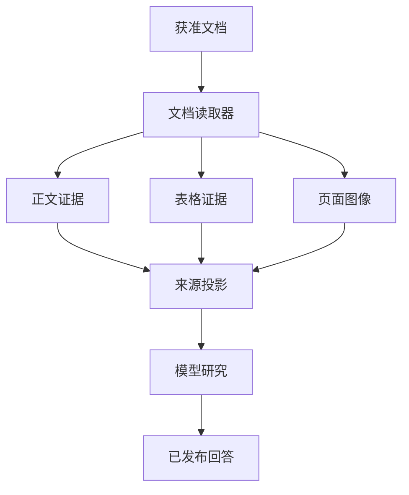

# PDF 读到了，不等于研究读完了

比较报告第一页与最后一页的指标，核对一张表的负号、单位和脚注，再判断报告是否提到某项风险。这三种问题需要的证据并不相同：搜索命中可以带你找到一页，却不能替你读完另一页；表格数字齐全，也可能丢掉决定其含义的表头。

当前 PDF Reader 围绕一个问题组织能力：**模型实际收到的材料，足以支持它正在作出的哪一种判断？** 文本是默认路径，表格结构和页图是按需补充，三者共享文档身份，却分别记录覆盖。它不是把每份 PDF 都先变成图片的流水线。

以跨页比较为教学场景：先取得获准文档，沿搜索结果拿到有效定位，读取两处正文；若单位依赖合并表头，补读结构或脚注；若页面只有扫描图，再申请该页图像。最后把实际交付范围与引用交给回答模块。只成功读取第一页时，正确下一步是继续取得另一处材料或缩小结论，而不是把“文件已解析”写成“全文已审查”。

下面解释当前路径的选择与代价。具体历史反例保留原观察范围，不把它们拼成一次已经通过的完整研究；文末的能力样本也不代表长期生产准确率。

## 在公开工程中复现最小 PDF 路径

Open ETF Agent 的 v0.11 固定公开候选将本文的一小段能力落到了[固定公开源码](https://github.com/hpoenixf/open-etf-agent/tree/9a00106703233754553acc04e49ead79fbe92cf9)：显式选取一个本地含文本层的 PDF，读取指定物理页，保留原始文件与页面文本的身份，再沿既有 Result、报告和 Artifact 路径交付。它复用 `pdf2json@4.1.0`，没有重新实现 PDF 解析器，也没有复制完整的研究阅读系统。

在该版本安装并构建后，运行 `node dist/src/cli.mjs --case local-pdf --output runs/article-pdf` 可读取内置合成 PDF 的第一页；加上 `--pdf-page 3` 可明确选择第三页。也可通过 `--pdf /absolute/path/document.pdf` 由操作者选择本地文件，工具调用只接收页码，不让模型选择路径或 URL。每次实验使用新的输出目录。

[独立安装与回读记录](https://github.com/hpoenixf/open-etf-agent/blob/9a00106703233754553acc04e49ead79fbe92cf9/docs/verification/integrated-install-pdf.safe.json)核对了合成文件第一页、第三页的报告、来源文本哈希与原始 PDF 字节；动作由脚本决定，解析、保存与独立进程回读真实发生。这不是模型理解或真实基金研究的验收，也不证明任意 PDF 都能正确提取。

**公开版目前没有本文后续讨论的 OCR、页面图像、几何表格、搜索导航、远程文件取得或活动解析跨进程恢复。** 下文说明原系统的更完整设计与当时观察；不能把这些更完整的能力算作 v0.11 已公开实现。

<!-- open-etf-case:pdf-local@e1b8e4edde724548fab16d8ca4b205379bfa7f30 -->
### 核对选定物理页与原始文件

[固定的 provider-free CLI/回读用例](https://github.com/hpoenixf/open-etf-agent/blob/e1b8e4edde724548fab16d8ca4b205379bfa7f30/test/pdf-cli.test.mjs)通过 CLI 与新的只读进程核对本地合成文本层 PDF。在该固定执行快照按 README 安装依赖后运行：

```bash
node --test --test-concurrency=1 --test-name-pattern='^11\.3 PDF CLI exits then a fresh process verifies page report and original binary$' test/pdf-cli.test.mjs
```

它只验证选定物理页文本、报告及原始 PDF 字节回读，不代表本文完整 Reader、OCR、页图、版面、表格、PDF 搜索、远程取得、多模态理解或活动解析恢复已经公开实现。
<!-- /open-etf-case -->

<span id="从能读取到能研究-我们如何把-pdf-阅读升级为可追溯的多模态能力"></span>
<span id="一、先复用研究链路-不为-pdf-另造一套-agent"></span>

## 1. 先选证据表示，再付出解析成本

| 需要确认什么 | 优先使用什么 | 还要保留的限制 |
| --- | --- | --- |
| 段落、日期与明确写出的数字 | 正文文本与有效页段定位 | 只代表实际返回的范围 |
| 行列归属、合并表头或脚注关系 | 同页结构化表格，配合原正文 | `no-tables` 不代表页面没有可用文字；识别成功也不保证语义正确 |
| 扫描字迹、图表与版面关系 | 获准环境中的按页视觉 | 渲染与实际送模分别确认，字符仍可能误读 |

PDF 首先是一种资料载体。它可以来自公开网页、获准的研究文件，也可能是工具返回的附件。虽然入口不同，我们希望它们都沿用既有的资料身份、来源权限和研究结果交付方式，而不是为每种文件另造来源、权限和交付系统。

这项选择使新增阅读能力主要改变**同一份文档能提供哪些证据表示**，而不是让 PDF 工具成为第二个研究系统。

最早遇到的障碍也说明为什么要这样拆分。一次读取约 3.85 MiB 的官方 PDF，在解析器工作之前就被通用网页的 2 MiB 响应限制拒绝。单纯提高全局上限可以暂时解围，却会顺便扩大普通网页的网络资源范围。

那次修复只在确认响应为 PDF 后，给文件取得、解码和解析输入采用相互一致的 10 MiB 上限；网页、解析时间、返回字符和模型上下文仍由原来的限制管理。这是当时版本对已知失败的修复，不意味着所有更大的 PDF 都能读取。本次取材代码的这一 PDF 路径上限已是 15 MiB，Spec 对应条款仍写 10 MiB，两者并不同步；这里不据此推断实际部署额度，也不把历史值当成今天的保证。

这里形成了第一个工程判断：**资料可以共享研究接口，资源策略却应该按实际内容类型约束。** 拿到文件，也不能自动获得无限解析、无限送模或越权阅读的资格。

<span id="二、从-搜到一句话-走向真正的长文档导航"></span>

## 2. 搜索只签发下一步位置，不签发“全文读懂”

几十页的报告不适合只靠一次全文返回。简单关键词查询适合找入口，但若问题是“有没有提及某项风险”，还必须知道查询扫描了哪里、实际读过哪里。

一次 WMO 报告研究中，模型给出了目标数值，自动评审也认为通过。但复查调用过程发现，它把关键词命中的范围理解为已检查的文档范围，并把没有实际读到的部分推断为“报告不存在相关内容”。答案里的一个数值可能正确，研究过程却并没有支撑这么大的结论。

扩大一次返回的文本容量不是根本解法。报告越来越长，更多字符既增加上下文压力，也不能告诉模型哪些页被搜索、哪些正文真正返回、哪些地方根本没有检查。

当前 Reader 把三个动作的结果分别说明：

- **搜索**提供查询命中与实际扫描范围，并在必要时通过绑定原查询的游标继续覆盖后面的页面。
- **定位**提供阅读器签发的有效页面或片段位置，而不是接受模型任意拼出的页码引用。
- **读取**返回实际可用的正文、来源身份与阅读范围；未读取的页面仍然是未读取。

这不是纯粹的接口形式变化。我们曾见过模型直接读取未获签发的页面，得到 `INVALID_LOCATOR`。对应的无模型调用重放保留了原非法请求，再沿合法搜索取得第 18、19 页的定位并成功读出正文；这证明恢复路径可走，不是该真实模型任务已经重跑通过。比起让无效引用悄悄生效，给出可行动的恢复步骤更符合研究需求。

还有一个更隐蔽的细节：解析器知道段落来自第几页，不代表模型最终看到的文字还保持原来的坐标。文本经过切片、容量裁剪或脱敏后，原始偏移就可能失效。我们曾看到真实回答把第 3 页引文标成第 2 页。当前页码范围跟随**最终实际交付的内容**重新计算；如果正文发生无法保持坐标的改写，就不再暴露旧的偏移。

因此，“文档已解析”“查询已覆盖”“页面已读取”“模型已收到”是不同的事实。它们合在一起，才有资格支持跨页比较和页码引用。我们没有因此声称全文搜索过一遍就等于模型读懂了一遍。

<span id="三、让结构化证据与文本阅读互补"></span>

## 3. 比较解析器，要比较同一句结论能否成立

金融报告的表格尤其需要保留语义。PDF 往往保存了字符和绘制位置，却没有告诉解析器哪几个数字属于同一列。正如 [pypdf 的文本提取说明](https://pypdf.readthedocs.io/en/stable/user/extract-text.html) 所指出的，文本提取与还原表格语义不是同一件事。

仅要求模型“仔细看表”，无法可靠补回输入阶段已经丢失的行列关系。当前 Reader 在同一份 PDF 的文本读取之外，按需提供表格结构：表格属于哪一页、实际返回了哪些行列、因容量不足省略了多少内容。

这个补充能力并不取代文本。当结构识别器返回 `no-tables` 时，页面文本有时仍可用于回答；当表格结构成功交给模型时，模型依然可能算错。我们在指数资料验收中就遇到过后者：准确的五行表格内容进入请求，最终计数仍然错误。

这让我们在诊断时不再把所有错误扔回 PDF Parser。结构是否提取、字段是否送达、模型是否理解、答案是否有依据，各自都有需要检查的环节。

另一种合理方案，是用成熟的文档转换器统一提取结构。[Docling 的架构](https://docling-project.github.io/docling/concepts/architecture/)把格式后端、转换 pipeline 和文档表示分开，[表格导出示例](https://docling-project.github.io/docling/_generated/examples/export_tables/)可把识别结果交给 DataFrame、CSV 或 HTML。需要离线批量整理文档、再供下游消费时，这种路线很直接；它也支持预取模型后的[离线使用](https://docling-project.github.io/docling/usage/advanced_options/#model-prefetching-and-offline-usage)。这说明它是一种可配置的替代方案，不是只能整篇扫描的黑盒。

我们本地已有按查询续读、实际交付范围与来源绑定，所以引入第二个解析器之前，要先证明默认路径究竟缺了什么。一次对照用**同一份公开 PDF、相同物理页和可人工核对的表头与脚注**比较既有 Reader 和 Docling。结果并非“新解析器必然更好”，也不是“原 Reader 全都正确”。指数资料中，原纯文本并未保住持仓的同行关系，既有表格读取才保住；Docling 取得单元格，却漏掉部分年度表头分类和脚注。另一份基金季报里，两者都保住了相关脚注，却都没有把跨页续表接起来；另一组被查页面的十行数据都在，Docling 的表头标记仍有缺口。**评价表格读取，要比较能否支持同一句研究结论，而不是谁提取了更多表。**

因此，当前 Docling 只作为**默认关闭的可选表格补充**接入：操作方需在受限离线环境明确启用，它只处理原本获准的页面，失败时不替换原 Reader 的结果。工程接线和有限公开样本已验证这条旁路可以使用，但尚未证明它改善金融研究质量，扫描/OCR 也不在此次对照范围。这里最值得复用的取舍是：**先证实默认路径缺少哪种关键证据，再决定是否引入第二个解析器。**

可选解析器的代价不只在依赖维护，还在资源协调。单个 Reader 的串行操作可以保护它自己的缓存和游标，却限制不了公开 PDF、研究资料和不同读取入口同时创建解析 Worker。当前文本和表格解析统一接到进程级有界执行入口：共同管理活跃 Worker 和排队容量，等待仍服从调用方的取消与绝对期限，Reader 自己则继续负责查询、缓存和来源。

这个改动并不是为了追求某个未经测量的吞吐百分比。它解决的是职责问题：**当能力成为多个入口共用的基础设施，资源上限就应由共同执行层持有，而不是分散在每个调用方。**

<span id="四、从读文字扩展到按需看页面"></span>

## 4. 页图可用、获准与实际发送，是三件事

即使具备长文档导航和表格结构，扫描件、图表和某些排版复杂的报告仍需视觉材料。按页补充让模型只在问题需要时看原始页面；如果任务要求离线全文 OCR，应选择相应转换流程，而不是把这个 Reader 当作整篇 OCR 引擎。

这里我们没有把“先渲染所有页，再全部送给模型”作为默认方案。对于文本清晰的报告，这既浪费解析和图像容量，也会让定位、页码与引用关系变得更难维护。

当前采用按页补充：文本读取仍是基础。页图渲染默认关闭，须明确启用已获资格的环境；表格结构和页面图像只在任务需要、原 Run 范围允许时加入。三种内容进入同一条研究证据链，但它们的实际覆盖范围独立记录。



图中的三条证据路径是可选能力，并非每次研究都要依次执行。

真正麻烦的是图像的**身份与发送时机**。当前同一 Run 使用 Host 已记录的 grant，暂停和恢复也沿用它，不在每次发送前重查当前 ACL。来源、scope、原始 PDF 内容身份、页图身份与请求的实际图像仍须对应；原授权不等于原文件一定还在，也不能授权另一项 Run。

这里有一段必须保留时点的历史：旧动态撤权合同下，一次并发反例中，来源已撤销，旧图像仍被发送。当时修复把当前来源核验与物理发起绑定到来源所有者的执行边界。今天已经不再以同 Run 即时撤权作为合同，但另一个教训仍成立：物理请求一旦发出，就应留下真实派发事实，不能因为后续事务失败而改写为“从未发送”。

另外一次扫描读取又暴露出纯视觉资料首次登记缺少内容哈希，导致后续一致性检查拒绝，真实模型输入中的图像数量是零。这种情况下，不能说视觉模型“看错了”：它根本没有收到图像。修复后的验收分别核对页面渲染、来源身份、请求中的实际图像与最终识别结果。

这也明确了能力边界：我们增加的是**受控的按页视觉阅读**，并没有因此建成独立的整篇 OCR 引擎，更不能把视觉接收成功等同于所有扫描数值都准确。

<span id="五、真正有用-必须由研究任务来证明"></span>

## 5. 错在取得、传递还是解释，要从实际材料分开查

工具返回成功只能说明某个步骤完成。实际诊断按材料取得、内容交付、模型解释、页码引用、最终回答逐层核对；哪一步已经成立，下一步才有明确的排查对象。机制是否改善回答，则需要真实模型任务单独观察。

2026 年 10 月中旬，我们在受控环境中使用真实模型，检验一组公开金融资料和具有独立答案的合成文档。几项结果很有代表性：

| 研究问题 | 实际观察 | 仍不能证明什么 |
| --- | --- | --- |
| 六页报告的日期、指标、结论与页码 | 完成读取并通过目标字段核对 | 不代表所有版式都能稳定处理 |
| 36 页报告的首尾指标比较 | 在九次模型请求内给出正确页码、数值和差值 | 不代表整份 36 页都经过深入语义审查 |
| 扫描财务表和图表 | 真实页面图像进入请求，指定数字、单位和趋势大体正确 | 扫描字符仍可能误读，解释仍可能超出原文 |

这些样本主要用于能力验收，不是大规模真实金融报告成功率统计。我们也看到扫描编号误读、表格解释越界、重复检索耗尽预算等局部失败。

更意外的是，一份短报告没有完成，真正阻断它的却不是 PDF Reader：旧测评脚本额外设置了四次模型请求限制，而产品 Runtime 当时允许更多请求。测评器先终止了合法研究。去掉冲突的外层限制后，该次六页任务才正常结束。

因此还要独立排查：测评器是否用自己的资源限制改写了被测行为。**工具执行、模型理解、研究完成，不能互相替代。**

<span id="六、现在的-pdf-reader-与最初有什么不同"></span>

## 6. 什么时候值得引入更复杂的 Reader？

只需从一份干净的文本层 PDF 读取指定页，直接提取文本通常更简单；公开练习保留的正是这一小段。需要离线全文结构转换时，可以先评估成熟转换器及其产物，而不必建设交互式研究导航。

当任务反复跨页比较、按查询继续阅读、交叉核对表头与脚注，或需要区分“没找到”和“没有读到”时，Reader 的查询、定位与覆盖记录才变得值得。代价是多维护查询状态、来源身份、解析队列和不同表示的覆盖，模型也可能需要更多轮阅读；这些开销不能仅凭架构图宣称已经换来更高成功率。

当前取舍可以浓缩成三个判断：

1. 先用足以回答问题的最简单表示，缺行列关系再加结构，缺视觉信息再加页图。
2. 对照同一页、同一表头与同一句待回答的主张，再判断第二个解析器有没有增量。
3. 答案错了，先核对实际送进请求的材料，再判断解析、模型理解或执行限制中的哪一环需要改变。

已经有真实模型样本完成多页阅读、跨页比较和部分扫描表格、图表问题，也有视觉误读、解释越界与复杂探索不收敛的记录。它们支持讨论具体机制，不支持长期生产成功率或整体成本收益的结论。

**搜索决定下一步去哪里读，Reader 说明实际交付了什么，模型负责解释材料；来源与覆盖事实不由模型自行补造。**
