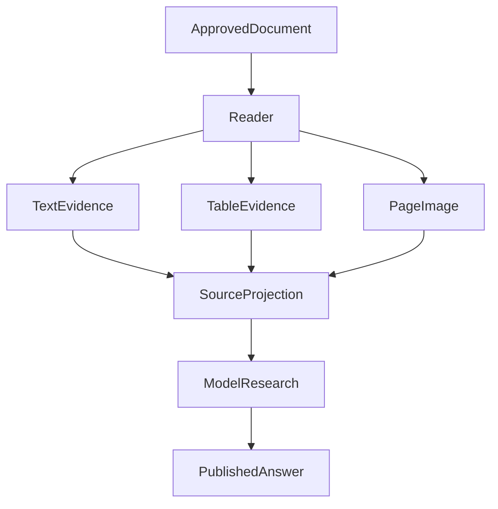

# 从能读取到能研究：我们如何把 PDF 阅读升级为可追溯的多模态能力

最初给投研 Agent 接入 PDF 时，我们要解决的问题很朴素：基金招募说明书、指数编制文件和财务报告经常以 PDF 发布，Agent 不能只看搜索结果里的几句摘要，就声称分析过原始资料。

所以第一版思路也很自然：取得文件，提取文字，把相关段落交给模型。

它足以回答一些简单问题，却很难应付真正的研究任务。例如，比较一份报告第一页和最后一页的指标、核对表格里的负号和单位，或者判断“报告没有提及某项风险”是否成立。问题逐渐不再是能否解析 PDF，而是**模型拿到的材料，是否足以支持它正在作出的判断**。

我们的 PDF 能力就是沿着这条需求逐步长出来的：先接入原始文件，再提供可继续的长文档导航，随后补上表格结构与页面视觉，最后把每一步变成可以核对的研究证据。

## 一、先复用研究链路，不为 PDF 另造一套 Agent

PDF 首先是一种资料载体。它可以来自公开网页、获准的研究文件，也可能是工具返回的附件。虽然入口不同，我们希望它们都沿用既有的资料身份、来源权限和研究结果交付方式，而不是每一种文件分别注册工具、分别维护引用、分别定义是否可信。

这项选择看似保守，却决定了后来的扩展方式：新增阅读能力时，主要改变的是**同一份文档能提供哪些证据表示**，而不是让 PDF 工具成为第二个研究系统。

最早遇到的障碍也说明为什么要这样拆分。一次读取约 3.85 MiB 的官方 PDF，在解析器工作之前就被通用网页的 2 MiB 响应限制拒绝。单纯提高全局上限可以暂时解围，却会顺便扩大普通网页的网络资源范围。

我们最终只在确认响应为 PDF 后，给文件取得、解码和解析输入采用相互一致的 10 MiB 上限；网页、解析时间、返回字符和模型上下文仍由原来的限制管理。这是当时版本对已知失败的修复，不意味着所有更大的 PDF 都能读取。

这里形成了第一个工程判断：**资料可以共享研究接口，资源策略却应该按实际内容类型约束。** 拿到文件，也不能自动获得无限解析、无限送模或越权阅读的资格。

## 二、从“搜到一句话”走向真正的长文档导航

文件可读之后，我们开始要求 Agent 处理几十页的报告。这时，直接抽取文本或者一次关键词搜索的局限变得明显。

一次 WMO 报告研究中，模型给出了目标数值，自动评审也认为通过。但复查调用过程发现，它把关键词命中的范围理解为已检查的文档范围，并把没有实际读到的部分推断为“报告不存在相关内容”。答案里的一个数值可能正确，研究过程却并没有支撑这么大的结论。

扩大一次返回的文本容量不是根本解法。报告越来越长，更多字符既增加上下文压力，也不能告诉模型哪些页被搜索、哪些正文真正返回、哪些地方根本没有检查。

我们于是把 PDF Reader 从“一次吐出文本”发展成可导航的阅读器：

- **搜索**提供查询命中与实际扫描范围，并在必要时通过绑定原查询的游标继续覆盖后面的页面。
- **定位**提供阅读器签发的有效页面或片段位置，而不是接受模型任意拼出的页码引用。
- **读取**返回实际可用的正文、来源身份与阅读范围；未读取的页面仍然是未读取。

这不是纯粹的接口形式变化。我们曾见过模型直接读取未获签发的页面，得到 `INVALID_LOCATOR`。后来沿合法搜索取得第 18、19 页的定位，再读取正文，路径才能继续。比起让无效引用悄悄生效，给出可行动的恢复步骤更符合研究需求。

还有一个更隐蔽的细节：解析器知道段落来自第几页，不代表模型最终看到的文字还保持原来的坐标。文本经过切片、容量裁剪或脱敏后，原始偏移就可能失效。我们曾看到真实回答把第 3 页引文标成第 2 页。后续修订让页码范围跟随**最终实际交付的内容**重新计算；如果正文发生无法保持坐标的改写，就不再暴露旧的偏移。

到这里，“文档已解析”“查询已覆盖”“页面已读取”“模型已收到”终于成为不同的事实。它们合在一起，才有资格支持跨页比较和页码引用。我们没有因此声称全文搜索过一遍就等于模型读懂了一遍。

## 三、让结构化证据与文本阅读互补

金融报告的下一个难题是表格。PDF 往往保存了字符和绘制位置，却没有告诉解析器哪几个数字属于同一列。正如 [pypdf 的文本提取说明](https://pypdf.readthedocs.io/en/stable/user/extract-text.html) 所指出的，文本提取与还原表格语义不是同一件事。

我们没有选择用一条更强的 Prompt 要求模型“仔细看表”，因为模型无法可靠恢复已经在输入阶段丢失的行列关系。取而代之的是，在同一份 PDF 的文本读取之外，按需提供表格结构：表格属于哪一页、实际返回了哪些行列、因容量不足省略了多少内容。

这个补充能力并不取代文本。当结构识别器返回 `no-tables` 时，页面文本有时仍可用于回答；当表格结构成功交给模型时，模型依然可能算错。我们在指数资料验收中就遇到过后者：准确的五行表格内容进入请求，最终计数仍然错误。

这让我们在诊断时不再把所有错误扔回 PDF Parser。结构是否提取、字段是否送达、模型是否理解、答案是否有依据，各自都有需要检查的环节。

表格接入也带来新的资源约束。单个 Reader 的串行操作可以保护它自己的缓存和游标，却限制不了公开 PDF、研究资料和不同读取入口同时创建解析 Worker。我们随后将文本和表格解析统一接到进程级有界执行入口：共同管理活跃 Worker 和排队容量，等待仍服从调用方的取消与绝对期限，Reader 自己则继续负责查询、缓存和来源。

这个改动并不是为了追求某个未经测量的吞吐百分比。它解决的是职责问题：**当能力成为多个入口共用的基础设施，资源上限就应由共同执行层持有，而不是分散在每个调用方。**

## 四、从读文字扩展到按需看页面

即使具备长文档导航和表格结构，扫描件、图表和某些排版复杂的报告仍然无法依靠文本提取解决。需求于是升级为：必要时让视觉模型看到原始页面。

这里我们没有把“先渲染所有页，再全部送给模型”作为默认方案。对于文本清晰的报告，这既浪费解析和图像容量，也会让定位、页码与引用关系变得更难维护。

新能力采取按页补充的方式：文本读取仍是基础；表格结构和页面图像在任务需要、当前渲染环境获准时才加入。三种内容进入同一条研究证据链，但它们的实际覆盖范围独立记录。

图中的三条证据路径是可选能力，并非每次研究都要依次执行。

真正麻烦的是图像的**身份与发送时机**。渲染成功不等于图像进入了模型请求；取得页面时权限有效，也不保证异步等待之后实际发送时仍然有效。一次并发反例中，资料来源已经撤销，但旧图像仍被发送。后续修订把当前来源核验和物理发起绑定到原来源所有者的执行边界，同时要求已发出的请求留下真实派发事实，而不是因为后续事务失败就改写为“从未发送”。

另外一次扫描读取又暴露出纯视觉资料首次登记缺少内容哈希，导致后续一致性检查拒绝，真实模型输入中的图像数量是零。这种情况下，不能说视觉模型“看错了”：它根本没有收到图像。修复后的验收把页面渲染、当前来源、请求中的实际图像与最终识别结果逐层核对。

这也明确了能力边界：我们增加的是**受控的按页视觉阅读**，并没有因此建成独立的整篇 OCR 引擎，更不能把视觉接收成功等同于所有扫描数值都准确。

## 五、真正有用，必须由研究任务来证明

前面的机制让 PDF 从可读取的文件，逐步变成可导航、可定位、可补充视觉信息的研究来源。但它们是否改善回答，需要在真实模型任务中单独观察。

2026 年 10 月中旬，我们在受控环境中使用真实模型，检验一组公开金融资料和具有独立答案的合成文档。几项结果很有代表性：

| 研究问题 | 实际观察 | 仍不能证明什么 |
| --- | --- | --- |
| 六页报告的日期、指标、结论与页码 | 完成读取并通过目标字段核对 | 不代表所有版式都能稳定处理 |
| 36 页报告的首尾指标比较 | 在九次模型请求内给出正确页码、数值和差值 | 不代表整份 36 页都经过深入语义审查 |
| 扫描财务表和图表 | 真实页面图像进入请求，指定数字、单位和趋势大体正确 | 扫描字符仍可能误读，解释仍可能超出原文 |

这些样本主要用于能力验收，不是大规模真实金融报告成功率统计。我们也看到扫描编号误读、表格解释越界、重复检索耗尽预算等局部失败。

更意外的是，一份短报告没有完成，真正阻断它的却不是 PDF Reader：旧测评脚本额外设置了四次模型请求限制，而产品 Runtime 当时允许更多请求。测评器先终止了合法研究。去掉冲突的外层限制后，该次六页任务才正常结束。

这让我们的验收顺序进一步改变：先核对资料是否取得、正文或图像是否实际送达，再检查模型解释、引用范围和最终交付；同时独立排查测评器是否用自己的资源限制改写了被测行为。**工具执行、模型理解、研究完成，不能互相替代。**

## 六、现在的 PDF Reader 与最初有什么不同？

最初我们要的是“把 PDF 的字交给模型”。现在我们关心的是“为具体研究问题交付可核对的证据”。

这段演进没有丢掉第一版的文本能力，而是逐层补齐：文件类别与资源限制、跨页导航与阅读覆盖、结构化表格、按需视觉、来源身份和最终内容坐标。新增的复杂度尽量放在原本拥有该事实的 Reader、解析执行器或来源所有者中，研究 Runtime 继续协调而不重新解释 PDF 内部语义。

已经有真实模型样本证明，部分多页阅读、跨页比较、扫描表格与图表问题能够完成；同样有证据说明视觉识别、解释覆盖和复杂任务收敛还不稳定。我们还没有得到长期生产成功率或整体成本收益的对照结论。

但最初的需求已经推动出一个可以持续扩展的设计：**搜索决定下一步去哪里读，Reader 说明实际交付了什么，模型负责解释材料，而来源与覆盖事实不由模型自行补造。**

当文档越来越复杂，这条边界比再加一个“更强的 PDF 工具”更值得保留。
