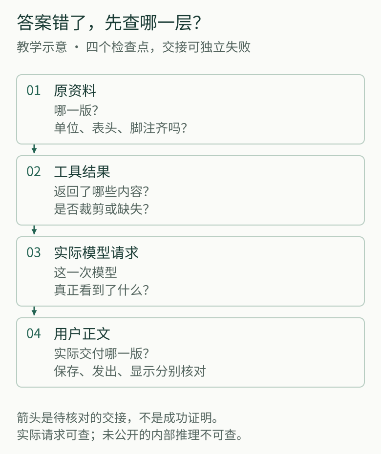
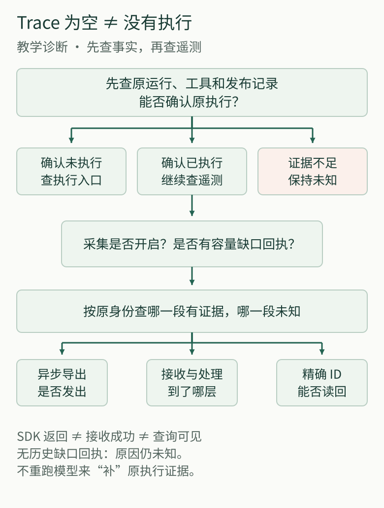
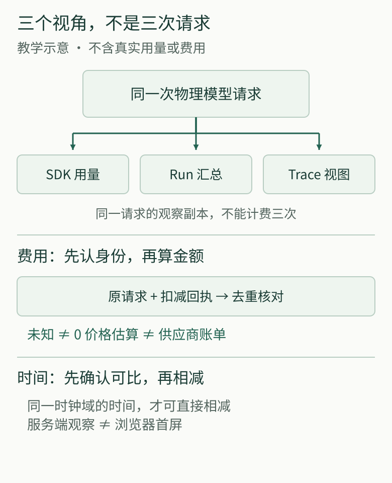

# Agent 可观测全景：从一次模型请求到可回查的研究事实

一份基金研究报告出错，Trace 却是一片正常：调用结束、工具成功、耗时为零。乍看是模型没有认真分析。但顺着原始记录回查，**有些所谓“0 ms”根本不是计时；有些“缺失的模型回合”其实执行过，只是在诊断链中丢了。**

这才是长研究可观测性的难题：记录越多，不一定越接近事实。关键在于**谁真正观察到了哪一段、数据怎样穿过多级投影、缺口在哪，以及诊断有没有悄悄改变执行结论**。

## 一、意外一：绿色 Trace 看不见的动作，可能早已完成

研究的一次请求至少经过四个位置：取得原文、形成工具结果、装配实际模型输入、发布与发送正文。错误可能发生在任意两点之间，单看“模型调用成功”无法定位。

在一次长研究回查里，Trace 缺少正文发布事件，原 Publication History 却存在合法的已提交正文。如果把“没有 Trace”理解成“没有执行”，重跑模型反而可能重复已经发生的工作。

我们的终态做法是把**业务事实留给原生产者**：Run、工具和发布记录由自身的存储与回执持有；OpenTelemetry / Langfuse 只接收有限、可关联的诊断副本。检索、模型调用、保存和交付分别以原 Run、物理请求、工具动作、正文修订关联。观测写入或导出失败，不得阻止一次原本获准的研究。

这不需要独立造另一套状态机，反而要求**观测端不参与授权和终结**。

## 二、意外二：“0 ms”可能只是程序不知道耗时

同一次实际研究中，19 条检索阶段事件被展示成 `0 ms`。原事件只表示结果已返回，没有处理开始时间；旧适配器在缺失时填了零。另一条 Native 诊断链把工具结束时才写入的 `createdAt` / `completedAt` 相减，也可能得到假零。

**缺失不能当快，实测零也不能一律当缺失。** 因此我们先保留三种状态：有原时钟测得的零、有原时钟测得的非零、没有可测区间的 unknown。旧历史没有原始时间事实，就不事后补算；OpenTelemetry 记录副本的 Span 区间也不自动等于业务工具执行区间。

后来新增的 `hostHandlerDurationMs` 才真正包围 Native Host 处理函数调用：从进入 Handler 前到其返回或抛错，包含函数内部等待和 Adapter；**不包括函数外队列、派发前授权、返回后的来源绑定与结果结算**，更不是供应商内部网络耗时。

在一轮最终 `partial` 中断的真实研究中，77 条 Host 生命周期读回了这个字段。这给排查提供了一个实测区间，却不能变成“整个 Run 的工具时间”：并行 Handler 区间会重叠，不应相加；未完成的 Handler 也没有可报告的完成时长。做延迟优化前先画清楚**计时归属**，比先画 P95 曲线可靠。

## 三、意外三：采集记录越多，关键请求越可能消失

长研究会产生密集的流式碎片、分页读取和工具状态事件。一次查询完成全部分页，显示 `complete`，但采集器先前因容量限制丢掉的正文和工具轮次不会恢复。还有一种容易忽略的竞争：次要的 read/gap 事件占满有限观察槽位，使后来的真实 model-request / usage 事实反而没有空间留下。

我们最终让不同重要性的事实在原有有界观测器中获得有限保留份额；投影侧按原身份有界读取，明确显示 overflow 与丢失，不能将“没有记录请求”当成“没有请求”。保存原文或工具参数不是默认出路——基金研究可能包含私有持仓和长篇披露，采集本身需要容量、隐私与保留期约束。

## 四、一次调用在三个页面出现，费用为什么不能乘三

模型网关的物理调用、Run 的研究进度和 Langfuse 的 Generation 可能都描述同一件事。把它们当三个模型调用求和，Token 与费用就会翻倍；恢复重放再生成一个新诊断 ID，又可能重复记账。

因此用**原物理请求 identity 与 Provider usage**作为计费观察的关联依据，Run 汇总不能伪装为第二次付费调用。同一请求出现冲突价格时保留冲突或未知，不选择看起来更完整的那个数。Provider 回报的已知费用小计可以展示，不能写成完整账单。服务器看到正文保存与浏览器首屏也不是同一个时钟事实。

## 五、为什么选 OpenTelemetry + Langfuse，而不是一切都交给平台

[OpenTelemetry 的 Trace 规范](https://opentelemetry.io/docs/concepts/signals/traces/)定义了 Span、事件、关联身份及其时间范围；[Langfuse](https://langfuse.com/docs/observability/features/token-and-cost-tracking)提供模型请求、Token、成本和回查界面。它们很适合作通用诊断底座，而不用在聊天产品里重做一套追踪 UI。

我们额外保留三个职责区分：

| 做法 | 优点 | 为什么不能代替原业务记录 |
| --- | --- | --- |
| 自动 Span 与平台计时 | 快速找到调用树、错误和大致等待位置 | Span 生命周期不必与 Host 实际 Handler、Publication 保存或用户渲染时间重合 |
| Langfuse 查询与图表 | 易于筛选 Run、比较样本和诊断费用 | `complete` 只说明当前可查询范围，不认证源头零丢失 |
| **原 Run / Gateway / Publication 记录** | 保留执行、结算、权限和正文修订的真正所有权 | 自身不是搜索友好的诊断平台，因此通过单向观测接口输出必要摘要 |

这是**复用成熟观测平台，但不将诊断反过来做成业务裁判**的取舍。额外代价是两类数据必须用原身份关联，还要管理日志脱敏、异步传送失败和采样缺口。

## 六、最容易忘记的运维问题：备份有了，历史却未必能查

一次 Langfuse 自托管恢复里，ClickHouse 系统诊断日志远大于需要保全的业务数据。清理之前先固定业务快照与表身份；恢复后即使磁盘有数据、表也能列出来，仍要按原 Run 找到**快照之前的一条实际历史记录**，核对事件、模型请求与发布内容。写入新探针的成功和读回旧研究，是两种不同检查。

这一经历让“可观测系统要可恢复”不再是运维口号：真正的交付物是**能根据原身份回查那次研究**，不是一份存在于磁盘的备份包。它也提醒我们：为了不丢日志而无限保存原提示词和金融资料，并不是正确答案。

## 七、下一次出现错误，我会先检查什么

看到报告里的错误数字，按原身份问四个问题：原公告的时点/单位对吗？工具结果保留了吗？模型最终请求中实际有这些内容吗？保存和展示的是同一修订吗？如果一环没有记录，就标出**准确的缺口**，不要从绿色 Trace 里猜出一个根因。

只有需要比较延迟时，才检查同口径的 Handler、Gateway、Run 与交付时钟；需要核成本时，才按原物理 attempt 去重和解释未知覆盖。

**我们选择的不是更多 Trace，而是更少虚构的业务事实：观察能帮人找到问题，却不拥有被观察工作的执行权威。**

---

<!-- agent-article-sync:guidance:start -->
## 延伸阅读与交流

[全景系列](/panorama) · [完整英文版](/en/articles/025-agent-langfuse-from-trace-to-trustworthy-observability) · [公开工程文章文集](https://github.com/hpoenixf/eff-agent-article)（欢迎 Star）。
<!-- agent-article-sync:guidance:end -->
