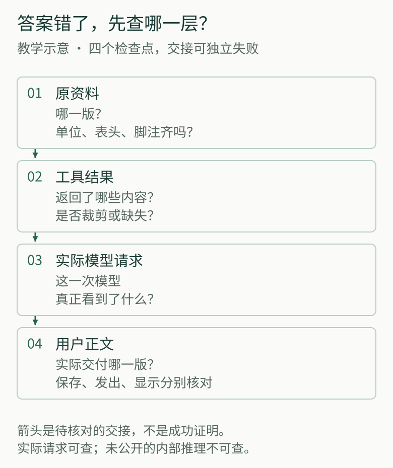
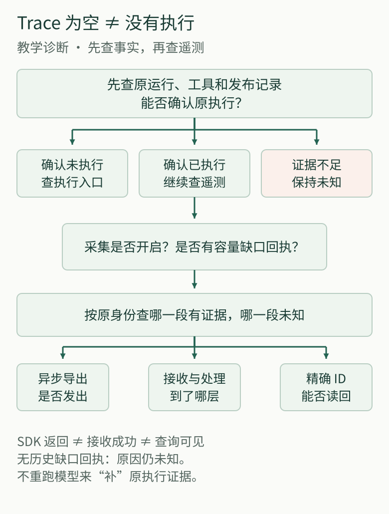
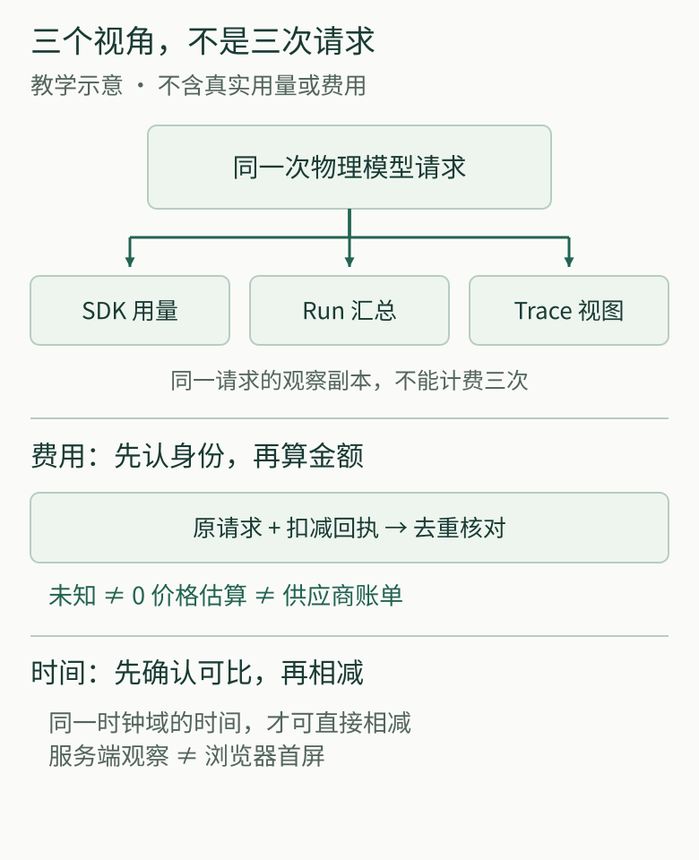

---
evidence:
  implementation: "观测与缺失治理已实施（按本文记录）"
  scoped: "合成 Trace、定向探针与隔离恢复"
  live: "长期采集完整性与真实研究效果未核验"
---

# Agent 可观测全景：从一次模型请求到可回查的研究事实

下面用一个教学任务开始：用户请 Agent 核对一份公告中的数字，生成带出处的报告。报告引用了正确的公告，数字却错了。接口没有报错，追踪页面也一片绿色。接下来应该换模型、改提示词，还是修读取工具？

只知道“调用成功”，还不足以作出这个选择。原文可能漏了单位，工具可能丢了脚注，模型可能没有收到完整结果，也可能读到了却理解错误。甚至模型生成的内容没错，用户看到的却是另一版正文。

**有用的 Agent 可观测性，要让我们找到判断第一次偏离事实的位置，并知道手中的记录还缺什么。** 本文沿这份报告说明怎样检查交接、怎样面对缺失，以及怎样验证观测工具自身。教学推演负责解释排查方法；文中另外标明的工程案例，则来自我们建设 Langfuse 观测链的实际记录。

## 一、先找到四次交接，再决定修哪里

追踪记录（Trace）可以把一项任务中的模型请求、工具调用和服务过程联系起来。但一条完整的调用树，仍不能代替内容核对。对于开头的报告，值得检查的是四次交接：

| 检查点 | 应当拿什么比较 | 比较后才能作出的判断 |
| --- | --- | --- |
| 资料到工具结果 | 公告的原版本、相关页，与工具返回的正文、表头、单位和脚注 | 原资料是否合适，读取过程是否漏掉了影响含义的内容 |
| 工具结果到模型请求 | 工具完整结果，与这一次实际发给模型的输入 | 资料是已经保存，还是模型这次确实看见了 |
| 模型请求到生成内容 | 实际输入，与模型返回的候选回答及请求结束情况 | 是理解或计算出了问题，还是输出被截断、请求途中失败 |
| 生成内容到用户正文 | 候选回答、保存版本、服务端发送和客户端接收记录 | 用户取得的是否就是已经核对过的那一版 |

*图 1 · 按原身份核对四个检查点：资料、工具结果、实际模型请求和用户正文。箭头表示需要检查的交接，不保证上游内容已经进入下游；模型候选、保存、发送与显示仍需分别核验。*

例如，公告写着“金额单位：万元”，工具只返回了数字。此时再要求模型“仔细计算”，并没有补上单位。如果工具结果保留了单位，实际请求却只装入数字摘要，应修输入组装；如果请求完整，回答仍用错单位，才进入理解、计算方法与核验策略的检查。这些是教学条件分支，不是对开头问题预设一个真实根因。

这种排查不要求取得模型未公开的内部推理。我们能够核对的是它收到的依据、返回的内容，以及周围程序实际做了什么。准确输入不是答案正确的保证，却能防止我们在错误的位置反复调参。

[OpenTelemetry 的可观测性说明](https://opentelemetry.io/docs/concepts/observability-primer/)区分日志、指标和追踪：指标帮助发现一类任务的异常变化，追踪帮助找到某项任务的等待与分支，日志补充具体位置的事件。用在这里，它们共同服务四次交接，而不是谁的页面更丰富，谁就能认证报告正确。

## 二、关联同一件事，但不要让诊断副本代替执行记录

核对两段记录之前，先确认它们说的是同一次动作。同一个工具可能连续调用多次，两个子任务也可能在相近时间读同一公告。工具名称相同、时间接近，都不足以证明结果对应。

我们因此把用户任务、一次运行（Run）、各次模型请求、工具调用与正文版本关联起来。若主代理把数字核对交给子代理，既要找到它所属的研究，也要找到子代理自己的请求和结果。父子关系解释“谁属于谁”，原始编号负责“这次对应哪次”。

但关联不等于合并职责。**工具是否实际执行、报告是否保存，查原系统的执行和保存记录；调用怎样推进、哪里等待或缺失，查遥测诊断记录。** 两者可以相互核对，不能互相冒充。

### 不止 Langfuse：这套观测链用了哪些技术？

可以把它看成四层，各管一件事：

- **原系统记录：业务 PostgreSQL 与本地脱敏追踪。** Run、工具执行和正文保存记录回答“实际发生了什么”；本地追踪补充排查线索。Langfuse 不取代这些原始记录。
- **OpenTelemetry：采集与传送。** 代码中的观测适配器用 OpenTelemetry SDK 把调用过程组织成可关联的片段，再通过 OTLP 导出及 Langfuse 的处理适配发送。这里是应用内的采集代码，不是另行部署了一台 OpenTelemetry Collector 服务。
- **Langfuse：查询与诊断。** Web 提供追踪搜索和详情页，后台 Worker 处理异步事件。它帮助我们看过程，但不负责裁定报告是否正确、正文是否已经保存。
- **Langfuse 的存储与队列：各有分工。** 独立 PostgreSQL 保存平台事务数据，ClickHouse 保存追踪等观测数据，Redis 承担队列与缓存，MinIO 提供对象存储。这套 PostgreSQL 与 Agent 的业务数据库分开，不是一个库包办全部职责。

这些依赖的分工可参照 [Langfuse 官方架构](https://langfuse.com/handbook/product-engineering/architecture)。读者不必先搭齐整套服务；先确定需要核对哪些事实，再选择采集、查询和保留方式。

最初，我们选择 Langfuse，是为了复用成熟的追踪搜索和详情页面，不在业务聊天页面里再造一套诊断界面。它与 Agent 使用独立入口和存储。这个选择解决了“去哪里看过程”，却没有把执行事实的决定权交给观测平台。

2026 年 10 月 30—31 日的长研究回查中，有一次 Trace 没有正文发布事件，原发布历史却能读回真实已提交文本。正确的下一步，是按原运行编号和访问权限核对保存记录，而不是重跑模型补一份回答，更不是补写一个并未采集到的事件。

这一点对有副作用的动作尤其重要：查询不到记录时，先确定原动作是否发生。否则，本来只是观测丢失，盲目重试却可能造成重复执行。

## 三、记录可以不完整，缺口不能伪装成结论

保存全部模型输入输出，似乎最方便排查。但研究请求可能带着长网页、PDF 和私人资料。内容采集应分别考虑授权、脱敏、容量和保留期，不能因为“将来可能排障”就默认留存所有原文。

真正的难点是：限制内容以后，还能否诚实说明自己观察到了什么？

2026 年 10 月的一次受控复查发现，我们的正文采集上限为 **256 KiB（262,144 字节）**：刚好达到边界仍可保留，多一个字节就拒绝。当输入和输出都超限时，读取端甚至可能不再展示整轮模型调用。原本只是“没有保存正文”，读起来却像“没有这次调用”。

提高上限只能延迟下一次触顶，也会扩大存储和隐私负担。我们保留容量限制，改为在正文无法保留时记录有限的调用编号、缺失发生在输入还是输出，以及采集器确实知道的原因。读取端据此展示调用与缺口，而不是把整轮删掉。

这也要求分清三种情况：已经采集到合法的 JSON `null`，是一个观察结果；已知因容量限制未采集，是一个有原因的缺口；旧记录没有留下原因，就仍是未知。不能根据今天的规则，为昨天的空白补造解释。

查询显示 `complete` 同样要问清楚：它可能只表示分页已经读完，并不保证源头把全部正文和协议事件都采下来了。长研究中的具体样本与阶段缺口，见[Trace 显示 Complete，为什么仍无法完整复盘](agent-trace-complete-observation-gaps.md)。

*图 2 · 空 Trace 先向原运行、工具和发布记录求证。只有确认执行发生，才继续检查采集缺口及异步遥测各阶段；证据不足保持未知，不用重跑模型补造原历史。*

回到公告报告。如果本次输入因授权或容量原因没有保留，我们就不能断言“模型肯定看到了单位”，也不能断言它没看到。可继续核对的其他记录仍然有价值，但关于实际输入的判断应停在证据边界。这比给空白填一个看似合理的原因更有助于后续改进。

## 四、观测链也会失败，要验证一条记录确实能走到查询端

当原执行记录表明模型请求已经发生，Trace 却找不到它，就该检查记录的采集与传送，而不是继续怀疑 Agent 没运行。

我们曾遇到这样的情况：观测开关已启用，Langfuse 页面也能访问，但实际请求没有对应记录。沿发送过程检查后发现，URL 拼接产生双斜线路径并触发重定向，错误发生在后台批量导出器；原先只观察同步异常的告警没有捕捉到它。

这个案例值得留下的，不是尾斜线的修法，而是一个容易漏掉的区别：**应用把事件交给 SDK、接收端接受事件、查询端能够读回，是不同阶段。** [Langfuse 官方架构](https://langfuse.com/handbook/product-engineering/architecture)中的对象存储、队列和后台 Worker，也说明了为什么接收之后仍有处理过程。

我们在实际导出边界补上有限、去敏的批次状态、关联编号和允许记录的 HTTP 状态，再让一条合成事件经过真实采集链，用同一个事件编号查询读回。这个探针不需要调用模型，也不需要修改原研究记录。

因此，检查时可以逐步收窄：采集器是否产生过事件？后台发送是否成功？接收后是否仍待处理，或处理失败？最后能否按准确编号查回？某一步证据不足就停在该处，不用下游空查询倒推所有上游都没发生。

探针能读回，证明的是当次路径可达，不能替历史缺失补票，也不能自动证明长期采集完整。但它给了我们一个小而具体的自检方法，不必为了监控平台再建设另一套大型平台。

## 五、同一次请求出现三遍，不代表花了三次钱

报告内容可以核对以后，另一类常见问题是：“这次为什么慢、为什么贵？”这里也要先认清记录对应的事实。

一次真正发往模型服务的请求，可能同时出现在 SDK 用量记录、整项研究的汇总和 Trace 页面里。它们是同一次请求的不同观察，不能逐行相加。重新导出旧记录也不产生新消耗；真正再次发起请求的重试，则有自己的请求身份。

*图 3 · SDK、Run 与 Trace 可以是同一次物理请求的三个视角，不能据此累加三次费用。按原请求及扣减回执去重；未知不作零、估算不作账单，同一时钟域内才直接相减，服务端观察不冒充浏览器首屏。*

我们把计量依据绑回原始物理请求编号及其扣减回执，而不是图表上的展示行。SDK 明确返回零，才能记为零；缺少用量就是未知。同一请求出现互相矛盾的费用时，也不能取最后一个数值，假装冲突已经消失。

按模型价格计算的金额应称为估算，而非供应商账单。[Langfuse 的用量与成本文档](https://langfuse.com/docs/observability/features/token-and-cost-tracking)也区分导入的用量、费用与按价格推算的数值。我们的受控合成请求链验证过部分身份与用量传递，并检查采样或导出故障不改变模型派发次数；它不是一次供应商对账。

时间也需要相同的谨慎。模型返回、正文保存、服务器发送、浏览器显示，测量的是不同阶段。只有原保存回执确认本次新提交，才能记录本进程观察到的新提交时间；恢复时读到旧正文，不能再记一次首次保存。跨进程的单调时钟不能直接相减，服务器的观察时间也不能冒充用户首屏时间。

如果要比较改动前后的延迟、错误率或成本，还应同时说明任务范围、时间窗、样本分母，以及有多少请求缺少记录。否则，漏采了慢请求的图表，可能看起来比采得完整的图表更好。

## 六、要依赖历史排查，就把“能恢复查询”当成要求

若只是短期调试，有限记录可能已经够用；一旦承诺日后能回查一份报告，就必须说明保留什么、保存多久、故障后怎样取回。保留期和备份策略应服务这项要求，而不是让观测数据无限增长。

一次存储故障中，我们按表核对发现：ClickHouse 的 `system.trace_log` 约 117 GiB，而需要保全的业务表数据 parts 约 286 MiB。两者统计对象不同，不能直接相加或推算一个“可节省比例”，但足以提醒我们先区分系统诊断日志与业务 Trace。[Langfuse 自托管说明](https://langfuse.com/faq/all/reduce-clickhouse-disk-size)也指出，内置系统日志表可能占据主要磁盘空间。

我们的处理顺序是先确认已有停机业务与元数据快照，再在授权范围内治理旧系统日志和保留策略，而不是直接删除整个观测卷。独立观测栈还需要明确的配置边界，避免继承业务进程的同名配置后连错目标。

随后进行隔离恢复时，归档虽然能列出文件，新实例却起初识别不到业务表。修复副本中的元数据关系后，我们没有止步于“表回来了”，而是选择快照之前的一条真实历史研究，沿原读取接口比较原实例与副本的事件、模型输入、回合和发布记录；该限定样本的结果吻合。

新写入路径则另行验证：通过真实 SDK 和后台处理链写入、读回一条合成事件。这是两个不同的问题——**旧记录还能否查询，新记录还能否进入。** 旧样本恢复成功不覆盖快照之后的研究，更不能让从未采集的正文重新出现。

因此，需要长期回查时，恢复演练的终点应是一项原研究可按原身份重新读取，而不是备份文件存在或数据库能启动。对于短任务，也不必为了追求“全景完整”先引入全部长期治理机制。

## 七、回到那份报告：先补哪一个缺口？

现在再看开头的数字错误，我们不必一上来就换模型：

- 原文的版本或单位就不适用，先修资料选择；工具遗漏表头或脚注，先修读取。
- 工具返回完整，实际请求却没有关键内容，修输入交接；输入完整但仍推理或计算错误，再检查理解与计算方法。
- 候选回答正确，保存或展示的版本不同，查交付链，不要求模型重新学会那道题。
- 关键记录缺失，先明确是已知漏采、传送问题，还是原因未知；向原执行记录核对，不把推测写成事故根因。

对自己的系统，可以从一次失败任务开始：选出上述四个检查点中真正需要的记录，让它们按原身份对应；对不能采集的正文留下有界、真实的缺口说明；再用一条可准确读回的探针验证观测链。只有长期回查、成本分析或更复杂协作确实需要时，再增加对应机制。

**可观测性的价值，不是让每个节点都亮绿灯，而是让下一次排障少猜一个关键事实，少修一个错误位置。** 它不能替我们判断所有答案，却能让“现在知道什么、还缺什么、下一步查哪里”变得具体。

---

<!-- agent-article-sync:guidance:start -->
## 延伸阅读与交流

[全景系列](/panorama) · [完整英文版](/en/articles/025-agent-langfuse-from-trace-to-trustworthy-observability) · [公开工程文章文集](https://github.com/hpoenixf/eff-agent-article)（欢迎 Star）。
<!-- agent-article-sync:guidance:end -->
