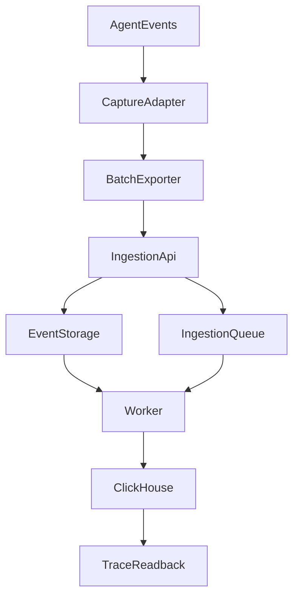

# 从 Trace 到可信观测：我们的 Agent 可观测体系怎样一步步建立起来

接入 Langfuse 时，我们的需求并不复杂：一次投研 Agent 可能发出十几轮模型请求、调用多种工具，最后只留下“研究中断”几个字。我们需要一个地方把这些过程看清楚，而不是靠散落的日志猜测。

于是我们为 Agent 部署独立的 Langfuse 页面，接入模型和工具调用。第一条合成 Trace 出现在控制台时，这个目标似乎已经完成。

真正开始用它排查复杂研究后，我们才发现：**能显示一条 Trace，与能够可信地解释一次研究，是两件不同的事。** 研究记录会在应用侧被裁剪，在异步发送时失败，在存储层膨胀，甚至在备份恢复后仍然无法被读取。

我们的观测体系因此经历了一次需求升级：从“看得到调用”，逐步走向“知道哪些事实被保留、在哪里丢失，以及出问题后还能否找回来”。

## 一、先复用成熟平台，再确定它不负责什么

第一阶段，我们没有在业务聊天页面里自建一套 Trace 搜索、调用详情和诊断 UI，而是采用 Langfuse 的独立 Web、Worker 和存储栈。它与 Agent Web 使用不同入口，也不复用投资业务数据库。

这不是因为部署没有成本。第一次启动就碰到了宿主机 PostgreSQL 端口冲突；将仅供内部服务使用的数据库端口留在 Compose 网络内，才解决了冲突。之后，我们通过真正的 SDK 发送合成遥测，在界面上确认记录可见。

这个结果证明了 UI 和基础发送链路可用，却没有证明真实研究的每轮输入都能完整采集，更不说明用户已经收到回答。

这里我们很早就明确了职责：Agent 自身的持久运行记录保存执行、预算、工具效果和回答提交等事实；Langfuse 提供跨模型请求和工具链路的诊断视图。两者可以相互核对，**但观测缺失不能倒推执行没有发生，Trace 存在也不能倒推回答已经交付。**

## 二、研究变长后，“记录调用”不足以解释失败

最初的模型和工具事件，在简单任务里还比较好理解；到了多轮投研，真正重要的问题变成了：工具返回的内容有没有进入下一次模型请求？模型生成的片段有没有通过发布模块？哪一步出现了不同于上游的结果？

因此，观测对象逐渐从孤立的函数调用扩展为一条带身份的执行链：同一 Run 里的模型轮次、实际工具派发、Host 结果投影、下一次请求和最终发布，需要能够按原始身份对应起来。

我们不希望通过日志文字去猜“这是同一次调用”。同名工具会多次运行，异步任务也可能有相近的时间戳；它们需要自己的请求和回执身份。与此同时，Langfuse 记录的是观测视图，真正是否提交了某次效果仍由业务持久记录判断。

这样，面对“模型明明查到了资料，最后却没回答”时，我们至少可以把问题收窄到可检查的位置，而不是笼统归因于模型能力。不过，更细的追踪很快引出下一个挑战：复杂 Agent 的输入和输出可能非常大。

## 三、可信观测的转折：必须把“缺失”也记录下来

为了控制存储和敏感信息暴露，我们对模型正文采集设置了字节上限。这本身是合理的，尤其研究请求可能夹带大量网页、PDF 或工具结果。

2026 年 10 月的一次复查却发现，应用侧的一条 256 KiB 捕获边界带来了意料之外的后果：序列化正文刚好 262,144 字节仍可保留，多一个字节就被拒绝。当输入或输出过大时，读取结果可能只剩 `null`；在双侧缺失的情况下，整理后的模型回合列表甚至可能漏掉整轮，而查询分页仍然显示完整。

我们最初可能会选择扩大上限，但这只会延后下一次触顶，而且扩大原文留存并不符合隐私和资源治理目标。

最终采取的办法是**限制正文容量，同时保留有界的缺失事实**。应用采集器在知道某次正文因容量被拒绝时，仍要携带准确的调用身份、输入或输出侧、已知原因和有限元数据。普通读取器将其恢复成可见的回合缺口，不能因为没有正文就把整个调用消失掉。

我们还专门修正了一个看似微小的区分：合法 JSON `null` 和“这个字段从未被记录”不能使用同一种缺失判断。前者是已经采集到的内容，后者是观测范围的空白。

这项调整带来的价值不是“采集率提升了多少”，因为我们没有这样的长期对照；它使已有大小限制下的观测**不再天然把缺口伪装成完整数据**。历史上从未留下过缺失回执的内容，则继续保持未知，不能因为现在机制完善就反推旧记录的缺失原因。

### 模型用量与费用：Trace 行数不等于实际调用数

后来我们遇到了另一种更隐蔽的观测错误：同一个物理模型 Attempt，可能同时出现在 Gateway 的 SDK 用量、一次 Run 的汇总，以及失败后重新导出的 Trace 中。如果把这些展示记录逐项相加，就会把一笔真实调用算成多笔。

2026 年 10 月 21 日的资源观测收口，把计量身份重新绑回**原 Gateway 的物理 Attempt 与原请求扣减回执**。Main、Child、重试分别留下自己的物理身份；Runtime 的整轮汇总只负责观察研究过程，不再伪装成额外的一次可计费 Generation。重放既有事实时沿用稳定身份，而不是因为重新导出又产生一份新消耗。

真正困难的还是缺口：SDK 明确返回零，应该记录零；没有返回 token，用量就是未知。相同 Attempt 的重复记录若给出互相矛盾的费用，应撤回该费用的确定性，而不是用最后一个值覆盖，再把它加进总账。已知部分按配置价格算出的金额也只能叫**估算**，不能写成用户最终收到的供应商发票。

[Langfuse 的 Token & Cost Tracking 文档](https://langfuse.com/docs/observability/features/token-and-cost-tracking)明确区分导入的 usage/cost 与按模型价格推算的值。我们在应用侧还要多守一道：先确认哪些 Generation 对应真实物理请求，以及每次请求的数据覆盖是否完整，才能讨论跨 Run 的聚合口径。

一次受控 Factory → Gateway → 合成 HTTP → OTEL Exporter → Langfuse 读取链路，验证了成功与失败研究中的原始 Attempt 身份、用量投影，以及采样关闭或导出失败不会改变模型实际派发次数。它证明的是这条工程链的非干扰与有限计量正确性，不是已核实了真实提供商账单或线上长期成本。

### 时间观测也必须带着自己的时钟

同次治理还区分了“本进程观察到一次新提交”与“这份内容最初持久化于何时”。只有原发布回执明确标记本次新增提交，才能记录 `commit-observed`；恢复重放、字段缺失或仅看到旧正文，都不能重新签发一次首提交时间。

同一单调时钟域内的持续时间可以比较，跨进程重启的两个单调时间戳不能直接相减。更不能把服务器观察的提交时刻叫作浏览器首屏时间。这些约束让性能图表少了一些看似精确、实则没有来源的数字。

## 四、从一个辅助页面，到必须独立治理的数据系统

当 Langfuse 开始承载真实研究诊断时，它自身的运行方式也需要升级。

最先暴露的是启动配置。我们的应用启动器会先加载业务环境变量，再通过统一入口启动 Langfuse。某次排查中，两个配置文件看起来都正确，实际 Compose 却继承了父进程的同名 `DATABASE_URL`，让独立观测栈连错目标。

只修一个变量并不能消除这类冲突。我们把隔离规则放到创建子进程的边界：读取 Compose 实际声明的插值键，复制父环境并剔除会覆盖观测栈自身配置的值；启动、重启和状态查询复用相同的处理。这样避免了不同入口分别拥有一套隐性配置优先级。

随后，一次 ClickHouse 存储故障让我们发现：连“观测数据占了多少磁盘”也不容易直接回答。

当时 Docker backing file 已分配约 164 GiB，服务伴随系统日志和文件系统错误反复出问题。最初若按整块虚拟磁盘估计保全空间，很容易把恢复卡在巨大的备份前提上。但按表核对后，发现 ClickHouse 的 `system.trace_log` 约 117 GiB、`system.text_log` 约 9.7 GiB；与此相比，需要保留的业务表数据 parts 约 286 MiB。这些数字属于不同统计层级，不能直接相加，却足以说明系统诊断日志和 Langfuse 业务 Trace 不能混为一谈。

[Langfuse 的自托管说明](https://langfuse.com/faq/all/reduce-clickhouse-disk-size) 也指出，ClickHouse 内置日志表可能占据主要磁盘空间。我们的处理因此不是直接删除整个观测卷，而是先确认已有停机业务与元数据快照，再在授权范围内处理旧系统日志、调整有限保留策略与输出轮转，保留需要恢复的业务记录。

这次工作没有证明底层文件系统故障的全部根因，也没有建立永久不会增长的硬容量上限。它真正推动的变化是：**观测平台不能只监控业务，也必须按正式数据系统的标准治理自己的配置、保留范围和恢复能力。**

## 五、有备份还不够，我们开始验证“历史能否读回来”

存储故障之后，我们对一份停机快照做隔离恢复。归档能够列出文件，但首次在新卷启动后，ClickHouse 识别到的业务表数量竟然是零。

问题不在于这次历史研究本身没有记录，而在于归档解引用了 Atomic 数据库元数据中的符号链接，恢复副本没有保留原来的数据库 UUID 关系。根据 [ClickHouse Atomic 引擎文档](https://clickhouse.com/docs/reference/engines/database-engines/atomic)，表 UUID 与数据存储目录存在明确绑定；文件看起来都在，并不足以保证元数据仍能正确找到它们。

我们没有在原业务卷上试错，而是在一次性隔离副本中恢复对应的元数据链接。随后，十四张业务表重新被识别。

但“表回来了”不是验收终点。我们进一步选择快照时间之前的一条真实历史研究，沿原来的读取接口比较原实例和恢复副本：十三组事件摘要以及模型输入、回合、发布和调用诊断投影吻合。快照之后才发生的另一条研究不纳入此次恢复承诺。

最后又单独验证新数据路径：通过真实 SDK、Worker 和 ClickHouse，写入并读回一条合成事件，不调用付费模型，也不修改原研究记录。

到这一步，我们才分别证明了两件事：**旧快照在限定样本中能恢复可查询的历史事实；新摄取链路在隔离验证里仍能工作。** 两者都不意味着早期从未采集到的正文会神奇地回来。

## 六、观测链也会坏，所以它需要最小的自诊断能力

恢复历史之后，还有一个特别典型的问题。一次研究确实发生了模型调用，Langfuse 查询却没有对应记录。配置开关已启用，页面也能访问，但这两个事实仍无法证明事件通过了 SDK 的后台发送。

沿实际 HTTP 请求继续追踪，才发现基础 URL 序列化增加了尾斜线，SDK 拼接 endpoint 后形成双斜线路径并触发重定向。失败发生在异步批量导出器中，绕过了原先只观察同步异常的告警。

我们没有为 Langfuse 再建一套大型监控系统，而是给实际导出边界补上有限的、去敏的结果观察：批次状态、精确关联身份及允许记录的 HTTP 状态。随后用零模型调用的合成探针经过真实 collector，再通过准确的 observation 身份查回结果。

这解决了新探针的发送可达性，不能回填之前那次研究的缺失 Trace。也正是这种区分，让观测系统失败时仍然能够提供有用诊断，而不修改 Agent 原始运行事实。

Langfuse 官方说明的摄取链本就包含 SDK、API、对象存储、队列、Worker 和 ClickHouse，各段之间存在异步处理；[官方架构文档](https://langfuse.com/handbook/product-engineering/architecture) 说明了为什么“SDK 调用返回”不等于“查询已经能看到”。

这张图只简化表示观测数据的主要路径；Agent 自己的 Run、工具效果和发布回执仍由原应用持久化系统负责，不因遥测系统缺失而改变。

## 七、现在我们如何判断一条 Trace 值不值得信任？

回看这段演进，Langfuse 没有从一个小工具神奇地变成所有运行事实的唯一来源。相反，我们越来越明确它的用途和限制。

| 逐渐升级的需求 | 建立的能力 | 关键边界 |
| --- | --- | --- |
| 看见模型与工具调用 | 独立平台和基础 Trace | 页面可见不等于研究完成 |
| 还原一次研究 | Run、模型轮次、工具、投影与发布身份关联 | 观测视图不替代原执行回执 |
| 理解记录缺失 | 正文上限、缺失元数据与读取投影 | 未捕获不能写成空值或零调用 |
| 长期维护观测栈 | 配置隔离、系统日志保留与范围化保全 | TTL 和服务健康不是完整恢复保证 |
| 故障后继续诊断 | 隔离恢复、历史比对与新摄取验证 | 恢复已保存内容，不能创造遗失正文 |
| 识别遥测自身故障 | 后台导出结果与合成读回探针 | 空查询不能倒推 Agent 未运行 |
| 解释模型用量、成本与时延 | 原物理 Attempt、稳定回执、估算/未知费用和原时钟 | Run 汇总、重放与观察时间不能冒充新增调用、账单或首屏 |

这一体系已经解决过具体工程问题：错误的继承配置被隔离；过大正文不再让已知调用无声消失；隔离快照恢复了可核对的历史记录；异步导出问题得到独立复现与新探针验证。它们分别发生在明确的环境与时间窗口内，不等于长期生产可用率、历史采集全量无损或供应商账单均已核实。

真正值得保留下来的，不是某个具体监控产品的部署脚本，而是一种判断方式：**当观测结果为空时，先确认它记录过什么、在哪层可能丢失、是否还能通过原身份独立读回，再对 Agent 本身下结论。**

观测工具的价值，从来不只是“把调用画出来”；它应帮助我们在复杂研究失败后，仍能分清已经发生的事实、尚未看到的部分和下一步需要检查的边界。

---

<!-- agent-article-sync:guidance:start -->
## 延伸阅读与交流

[在个人博客阅读本篇](https://hpoenixf.com/blog/025-agent-langfuse-from-trace-to-trustworthy-observability) · [公开工程文章文集](https://github.com/hpoenixf/eff-agent-article)（欢迎 Star）。
<!-- agent-article-sync:guidance:end -->
