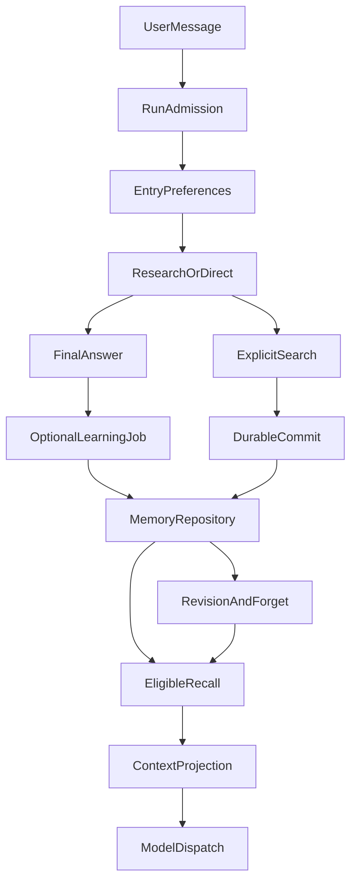

# Agent Memory 的完整生命周期：从记住偏好到安全遗忘

> **模块精讲 · 架构设计。** 讨论的是应用层跨会话记忆，不是模型参数中的知识，也不是对话上下文压缩。本文基于 ETF Agent 现有设计、代码与截至 2026 年 10 月的限定验证；合成示例会单独标明。

一个投研助手昨天记住了用户偏好低换手，今天却仍按高频交易的思路回答；用户让它改正后，它又在下一次会话中恢复了旧偏好。更棘手的是：用户说“忘掉它”，数据库已经完成遗忘，模型随后却回答失败。系统究竟应该相信聊天窗口、向量检索，还是持久记录？

这些表面上不同的问题，其实都指向一个工程事实：**长期记忆不是一张存放摘要的表，而是一条有权威来源、有写入与读取时机、允许更正和撤权的生命周期。**

我们最终将 Memory 分为三条相互协作的路径：**写入、召回和治理**。写入解决“该留下什么”，召回解决“下一次真正用到什么”，治理解决“过期、冲突和遗忘时谁说了算”。它们最终汇入同一次研究，却不共享一个含糊的“记忆成功”状态。

下文解释原系统的完整生命周期；末节再用 [Open ETF Agent](https://github.com/hpoenixf/open-etf-agent) 中已经能运行的公开切片，具体观察显式保存、更正、遗忘和未来输入资格。这个单写者文件库实验不等同于前文的 PostgreSQL、自动学习或完整召回服务。

## 一、先看全貌：三条路径，两种权威



上图是**职责关系简图，而不是每轮必经的顺序流程**：普通对话不一定提交记忆，自动学习也不一定启用；Direct 不调用 Memory 工具，Research 才可能执行显式搜索与提交。真正决定是否披露记忆的，是同一账户和运行授权下的当前记录资格。

系统里有两个不应混淆的权威：

- **模型负责语义解释**：这句话是长期偏好、一次性要求，还是历史讨论？新说法与旧说法是否讨论同一件事？
- **应用仓库负责可持久化事实**：谁的记忆、哪一个 family、当前 revision、真实来源、状态、过期时间，以及保存或遗忘到底有没有提交。

这使得语义引擎可以更换，应用却不必出现两份相互竞争的“最新记忆”。ETF Agent 复用了已有 PostgreSQL Memory 仓库，而没有为了向量检索另外建立一套可独立生效的记忆账本。

这里还要分清三个经常被统称为“记忆”的对象。当前会话历史记录刚才说过什么；Memory 保存有复用价值的偏好或历史讨论；RAG 检索外部知识材料。它们最终都可能进入上下文，但**当前基金持仓、净值、交易授权和执行状态仍各自来自专门的业务事实源**。

## 二、写入路径：明确指令同步生效，自动学习异步提议

“以后研究基金时先披露数据日期”与“这次先披露数据日期”只差两个字，却不应产生相同的持久效果。长期记忆首先需要决定**是否可以写**，其次才是**如何抽取**。

### 2.1 用户明确要求保存：搜索、定位、提交、回执

以下是一个**合成示例**：用户说“记住，以后做基金比较先写清楚费用口径”。

Research 首先在本账户范围内调用 `search_memory`，查找是否已有类似的回答约束。如果找到旧条目，工具返回由 Host 签发的目标引用；模型可以判断这是新偏好还是原 family 的修订，却不能自造一个目标 ID。随后 `commit_memory` 提交保存或更正，Host 再检查用户来源、scope、目标 revision 和持久操作身份。

真正的闭环是：

```text
明确用户请求
  → search_memory（找到现有 family 或得到可用空结果）
  → commit_memory（save / replace / forget）
  → 持久操作回执（saved / updated / forgotten / conflict / unknown）
  → 下一次 Run 独立检查是否可召回
```

回执既是用户界面可以报告结果的依据，也是故障恢复的依据。**模型说“记住了”不构成写入成功。** 如果提交结果未知，就不能一边说“已经保存”，一边依赖下一次任务去碰运气。同一个操作在回答中断后恢复，也必须根据原操作身份找回既有回执，不能无条件重做副作用。

保存失败不应把整个正常研究一起拖下水：本轮可以继续按用户要求答题，同时准确说明长期保存尚未确认。

### 2.2 普通聊天中的自动学习：不阻塞正文，也不冒充同意

显式“记住/纠正/忘记”需要同步回执；自动学习则适合放在合格回答的**持久终态之后**。语义模型根据获准的对话来源提出 save、defer 或 discard，而应用仓库核对真实用户来源、分类、scope、依赖关系和当前版本。

这里有三个不同概念：

- **候选（candidate）**：值得复核，但尚不能作为已生效偏好注入未来请求。
- **自动记录（automatic）**：仅在明确启用相应策略且通过校验后才可能生效，不伪造用户确认。
- **用户确认（user_confirmed）或明确请求（explicit_request）**：保留真实的确认或原始请求归属；二者不能通过模型复述相互转换。

我们的当前配置中 `MEMORY_SEMANTIC_MODE=disabled` 是默认值：**默认不运行自动语义学习，但显式 Memory 工具仍可使用**。配置为 `shadow` 时，语义提议可用于观察而不自动成为有效记忆；启用 `automatic` 需要另外的来源、预算与运行条件。

为什么不把记忆提取强行塞进聊天同步路径？因为用户要的是当前回答，不该为每轮潜在偏好额外等待一轮模型调用；同时，尚未获得的回答终态也不应被误写成一次已成功学习的事实。异步化并不意味着 exactly-once：任务可能重试，最终仍须依靠来源去重、版本检查和持久效果防重。

## 三、召回路径：检索命中不等于模型真的用过

早期 ETF Agent 已经有 Memory 表、候选管理、生命周期 API；但 2026 年 9 月底的一次基线核对发现，当时正常 Research 路径还没有真正消费这些召回内容。这件事比“选什么向量数据库”更能说明工程问题：**模块存在，不等于能力到达最终模型请求。**

我们目前让正常模式在首轮语义分支之前读取少量、有效的长期偏好；Research 还可以用 `search_memory` 查找有来源的历史讨论。Direct 不执行 Memory 工具，也不预抓 episodic 业务历史。临时会话或被策略拒绝的请求则不读、不写、不学习跨会话 Memory。

召回至少要通过以下几次判断：

1. **授权与身份**：本 Run 是否获准使用这个账户范围内的 Memory？不能让模型通过工具参数选择其他用户。
2. **记录资格**：scope、family/revision、状态、过期、遗忘以及来源依赖是否仍有效？旧向量命中不能绕开这些条件。
3. **本轮相关性**：当前是在续接上次讨论，还是在问一个新问题？偏好与 episodic 历史不应一股脑塞进来。
4. **上下文预算**：候选进入排序以后，还要经过有界选择和上下文装配；没装入最终模型请求就不能算“已使用”。

本项目默认上限为少量偏好与历史记录、约 4,000 字符的 Memory 上下文，而不是持续增长的全部聊天摘要。使用次数按**实际 provider dispatch** 计，不按检索命中、界面浏览或恢复回放计。

在检索技术选择上，关键词/结构化检索、向量召回、混合检索都可以作为候选发现手段；ETF Agent 的知识 RAG 已有向量与词法双路及 RRF，但**这不等于 Memory 当前也采用了同一套 RRF 管线**。Memory 的优先问题仍是有效来源和真实消费。我们不为了架构看起来统一，就默认引入新的 Memory 向量库。

性能约束同样由真实请求的 deadline 和取消信号管理，而不是另造一个与 Run 生命周期脱节的固定计时器。检索不可用时需要保守降级，并保留“库为空”与“读取失败”的区别。

## 四、治理路径：纠正、遗忘和过期为什么不是一种删除

一条用户偏好会变化。“长期持有”和“未来半年保留更多现金”可以同时成立，也可能涉及完全不同的约束。语义相似度无法独立判断它们应当合并为同一 family。

在 ETF Agent 中，记忆用 **family + revision** 表达版本关系；修订必须针对当前有效版本，过时目标发生冲突时不能覆盖较新的更正。模型可以提出“这是一条修订”，但真正的 compare-and-set 由 Host 与仓库执行。

遗忘则使整个 family 对**未来模型上下文**失去资格。普通偏好可以按策略到期或被低频淘汰；用户显式保存的 `response_constraint` 则不因普通 TTL/LFU 清理而被悄悄丢弃，仍允许用户主动更正或忘记。

这就产生一个容易被忽视的问题：记录正文不能继续用，但“用户已经更正过它”这个操作事实仍可能需要保留。我们在 10 月的来源投影核对中遇到过两个相反风险：

- 把旧版本相关内容全部隐藏，连合法更正的效果回执也无法解释。
- 因为存在更正回执，就错误地让被替代的旧正文重新取得披露资格。

处理方法不是给历史内容开通用后门，而是精确验证原操作回执、family、supersedes 关系和递增 revision：**可以说明发生过更正，不等于可以再次披露被撤销的内容。**

同一个原则也适用于已生成的摘要、历史结果、后台任务和索引。遗忘后新 Run 的上下文投影，不能把旧记忆从这些派生材料中“洗回来”；晚到的自动学习任务也不能换个 family ID 就恢复旧来源。另一方面，“未来不再使用”不等于承诺数据库备份、旧会话或已经交给模型提供商的内容被物理抹除。两种承诺需要不同的存储处置能力。

## 五、贯穿案例：从第一次偏好到最终遗忘

仍以基金研究为例，下面描述的是**用于解释系统分支的合成流程**，不是声称这段自然语言在每个模型上都已成功复现。

| 时间 | 用户输入或事件 | 系统应该留下什么 |
| --- | --- | --- |
| Run A | “以后比较基金，先写费用口径” | 显式保存成功后形成当前 response_constraint 与回执 |
| Run B | “比较这两只基金” | 在获准的范围内召回该约束，费用数据仍从当前来源查证 |
| Run C | “今天先看结论，费用放后面” | 仅覆盖本次表达顺序，不自动改写持久偏好 |
| Run D | “以后也改成结论优先” | 定位原 family，成功修订产生新 revision |
| Run E | “忘掉这个展示习惯” | 遗忘整个 family，之后新 Run 不再注入旧偏好 |

这五步真正值得记录的不是模型是否复述了“费用口径”四个字，而是**持久提交 → 新请求实际消费 → 更正 → 遗忘后不再披露**四种不同证据。一次回答可以碰巧遵循偏好，却根本没使用 Memory；一次模型确认也可以在数据库写入失败时显得非常流畅。

对于金融系统，Memory 还必须保持自己的位置：风险偏好可以辅助解释；当前持仓来自 Portfolio，净值和费用来自有时点及口径的可信资料，交易权限来自独立授权。**Memory 记住用户如何表达和考虑问题，不替业务系统决定用户实际拥有什么或允许执行什么。**

## 六、一次真实故障改变了我们对“成功”的理解

2026 年 10 月 9 日，Memory 的一次真实链路验收保留了一个反例：**遗忘已经持久提交，后续模型回答却未完成**；原定最后一次新会话查询因此没有执行。

如果把这整段操作只记成“任务失败”，恢复器就可能再次执行已经发生的遗忘。反过来，如果只看成功的数据库提交，又会错误地宣布后续模型行为、跨会话自然语言理解也全部通过。

我们改为分别观察：仓库是否提交及返回原回执、旧 revision 是否失去未来资格、下一次模型请求究竟载入了什么、历史派生内容有没有越权再披露。受控本地跨会话路径有正证据，但**那次未完成的真实模型链路不能被事后追认为成功**。

这与[原则 3「提议、批准、执行、生效是不同事实」](/principles#principle-3)相呼应：Memory 的提交和回答的交付分别有自己的真实状态。

它也解释了为什么 Memory 不能单靠对话文本恢复。持久效果可能已经发生，而最后一句“已忘记”尚未发出；用户下一次追问时，应根据真实效果作答，而不是重新猜一遍。

## 七、为什么没有照搬更完整的外部 Memory 引擎？

常见方案会把异步 Outbox、向量与关键词混合召回、四态去重、时间失效放在一起。Peak Lake 的[《Agent 长期记忆系统》](https://www.peak-lake.com/blog/agent-memory-system)就用“写入、读取、治理”三条线讲清了这些工程模式。这种拆法很值得学习，但不能忽略**具体系统的权威归属和数据规模**。

ETF Agent 的选择相对克制：

| 方案 | 好处 | 我们当前的取舍 |
| --- | --- | --- |
| 全量对话始终注入 | 接入简单 | 上下文膨胀，也无法可靠处理遗忘和来源 |
| 外部向量/图记忆引擎拥有最终状态 | 语义搜索能力丰富 | 可以作为未来适配器，不取得第二份授权和 revision 权威 |
| 应用仓库 + 有界召回 + 可选异步语义提议 | 生命周期、来源和恢复行为可明确归属 | 现有主路径优先；语义召回效果仍需实测决定是否升级 |

这不是认为向量检索或时间化记忆不重要。相反，我们希望把它们留在**实际召回遗漏或时间冲突已经可量化**时再选型：先拿到错误样本、候选命中、最终上下文和用户任务结果，然后判断是否值得引入新的查询与维护成本。模型的语义相似，始终不能等同于用户的版本授权。

## 八、验证到哪里，下一步该关注什么？

截至本文所依据的代码与运维记录，受支持的本地显式保存、更正、遗忘、跨会话调用与 PostgreSQL 路径已有限定验证；外部完整 live 生命周期和模型能否持续正确理解这些意图，仍需要独立完成。可选的 Hindsight 语义引擎尚未取得正式运行资格。自动语义学习的默认状态也是关闭的。

下一步真正有价值的指标，不是又增加多少 Memory 类或写多少测试，而是把实际任务沿生命周期测出来：候选是否误采纳、同族修订是否正确、有效记忆是否**真正送入模型**、误召回和上下文开销如何、遗忘后旧内容是否从历史摘要再出现，以及 p95 召回延迟对研究任务的影响。没有真实样本时，不声称检索质量已经提升。

回到开头：一套可靠的长期记忆系统必须做到**该写时有回执，该读时有授权，该改时有版本，该忘时未来不复活**。

这四件事比“模型看起来记得我”更难，却决定了长期陪伴的 Agent 能否真正被用户纠正和信任。

<!-- open-etf-agent:minimal-experiment:start -->
## 九、在公开代码里运行一次“保存—更正—遗忘”

现在，[Open ETF Agent](https://github.com/hpoenixf/open-etf-agent) 已经把这条责任边界做成可独立运行的本地实验。它不是把前文的 PostgreSQL 系统整套搬出来，而是用一个**显式选择、单写者的文件库**，展示保存、更正、遗忘和下一轮输入之间的关系。示例使用合成偏好，工具选择由固定脚本驱动；落盘、修订和读取则走真实实现。

从 [memory-tools.mjs](https://github.com/hpoenixf/open-etf-agent/blob/05c0dd2dc550f4f7e5da034340ff5c3159768fcf/src/memory-tools.mjs) 可以看到，模型参数里没有“我已获准”的开关。写入意图由宿主在模型参数之外绑定到具体库、操作、正文哈希或旧修订。[memory.mjs](https://github.com/hpoenixf/open-etf-agent/blob/05c0dd2dc550f4f7e5da034340ff5c3159768fcf/src/memory.mjs) 先持久化占用一次性意图，再发布新修订并更新当前索引。中途失败可能留下“意图已用、修订尚未完成”的部分效果；失败回执不能被解释为可以无条件重放。

使用 Node.js 26.11.1–26.x，在一个新的目录运行固定快照：

```bash
git clone https://github.com/hpoenixf/open-etf-agent.git open-etf-agent-memory-demo
cd open-etf-agent-memory-demo
git checkout --detach 05c0dd2dc550f4f7e5da034340ff5c3159768fcf
npm ci --ignore-scripts --no-audit --no-fund
npm run demo -- --case explicit-memory --memory-library runs/article-synthetic-memory
```

首次安装可能访问 npm；安装后的这个案例不调用远程模型。请给它一个新的合成库，或者一个没有活动条目的合成库，不要指向自己的真实记忆目录。示例发现已有活动条目会拒绝继续，不会先清空它们。

[`working-demo.mjs`](https://github.com/hpoenixf/open-etf-agent/blob/05c0dd2dc550f4f7e5da034340ff5c3159768fcf/src/working-demo.mjs) 会让三个独立 Run 依次完成保存、更正、遗忘。观察终端 JSON 中的 `memory.receipts`：同一条目的修订随操作递增，操作分别是 `saved`、`revised`、`forgotten`；`memory.current` 在遗忘后为空。库里的旧修订仍保留，最后的新修订是墓碑。随后保存的演示报告引用的是重新取得的合成原始页面，而不是把偏好记录当成研究证据。**可以读回的回执与当前资格，才是这次实验的输出，不是终端里一句“已经忘记”。**

公开实现还处理了一个容易漏掉的后继输入问题：删除当前检索结果并不足够，旧工具参数和派生便笺也可能把文字带回来。[`memory-projection.mjs`](https://github.com/hpoenixf/open-etf-agent/blob/05c0dd2dc550f4f7e5da034340ff5c3159768fcf/src/memory-projection.mjs) 在组装下一次模型请求时重新核对库、条目和修订；过期的有类型记忆、已结算写入参数及其 Hook 副本、依赖旧记忆的便笺都会撤去正文。原始执行历史不因此被改写。这个边界针对已识别的记忆依赖，不是全局搜索并抹除任意相同措辞，也不会删除已经导出的报告。

因此，这个公开切片已经能让读者检查**明确授权的持久写入、当前版本读取和遗忘后的输入撤权**；它尚不包含前文的认证 HTTP、PostgreSQL 或自动学习。[首批真实模型调用](https://github.com/hpoenixf/open-etf-agent/blob/d075068ac99a6c798d012c46bff4fe0c33eb9979/docs/verification/live-v01-v05-first-batch.md)没有触达记忆写入与遗忘，不能借那份报告给这里的跨会话表达能力背书。Runtime 是否按授权执行、留下什么效果，与模型是否把这些事实解释得准确，仍分别判断。
<!-- open-etf-agent:minimal-experiment:end -->

<!-- open-etf-case:memory@e0a6a29b7474a19c18b169c0e4a7eb0eb614504d -->
### 核对显式记忆的三份操作回执

若要在当前固定公开快照复查保存、更正、遗忘，可以从[CLI 入口](https://github.com/hpoenixf/open-etf-agent/blob/e0a6a29b7474a19c18b169c0e4a7eb0eb614504d/src/cli.mjs)运行下面的合成生命周期。

在所链固定快照按 README 安装依赖后，运行：

```bash
node src/cli.mjs --case explicit-memory --output runs/article-memory --memory-library runs/article-memory/synthetic-memory
```

先确认 `runs/article-memory/synthetic-memory` 是新的合成库路径或没有活动条目的合成库，不要使用真实个人记忆目录。终端 `memory.receipts` 应分别记录保存、更正、遗忘，`memory.current` 在最后为空；各 Run 的保存回执指向可读报告。

旧修订保留，遗忘改变后续使用资格。这仍是显式单写者文件库，不包括自动学习、认证多用户服务或真实模型的跨会话理解评测。
<!-- /open-etf-case -->

