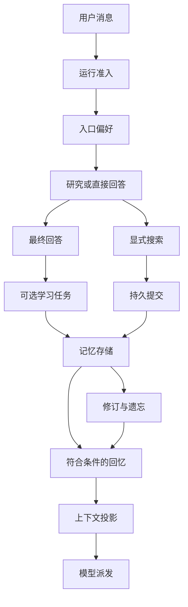

# Agent Memory 的完整生命周期：从记住偏好到安全遗忘

> **模块精讲 · 架构设计。** 讨论的是应用层跨会话记忆，不是模型参数中的知识，也不是对话上下文压缩。本文依据 ETF Agent 当前设计与代码，并保留截至 2026 年 10 月底的限定验证；合成示例会单独标明。

用户说“忘掉这个偏好”以后，系统需要回答三个不同的问题：下一次请求还会不会读到旧偏好？已经接纳这项偏好的历史研究是否也要改写？如果遗忘已提交，最后一句“已忘记”却没发出来，恢复时该不该再执行一次？它们分别涉及当前内容、历史输入和持久效果，不能用一次删除或一句模型确认共同回答。

这些表面上不同的问题，其实都指向一个工程事实：**长期记忆不是一张存放摘要的表，而是一条有权威来源、有写入与读取时机、允许更正和遗忘的生命周期。**

我们最终将 Memory 分为三条相互协作的路径：**写入、召回和治理**。写入解决“该留下什么”，召回解决“下一次真正用到什么”，治理解决“过期、冲突和遗忘时谁说了算”。它们最终汇入同一次研究，却不共享一个含糊的“记忆成功”状态。

下文解释原系统的完整生命周期；召回章节先运行一次已有库的只读消费，末节再用 [Open ETF Agent](https://github.com/hpoenixf/open-etf-agent) 中已经能运行的公开切片，具体观察显式保存、更正、遗忘和未来输入资格。这个单写者文件库实验不等同于前文的 PostgreSQL、自动学习或完整召回服务。

## 一、先看全貌：三条路径，两种权威



上图是**职责关系简图，而不是每轮必经的顺序流程**：普通对话不一定提交记忆，自动学习也不一定启用；Direct 不调用 Memory 工具，Research 才可能执行显式搜索与提交。真正决定是否披露记忆的，是同一账户和运行授权下的当前记录资格。

系统里有两个不应混淆的权威：

- **模型负责语义解释**：这句话是长期偏好、一次性要求，还是历史讨论？新说法与旧说法是否讨论同一件事？
- **应用仓库负责可持久化事实**：谁的记忆、哪一个 family、当前 revision、真实来源、状态、过期时间，以及保存或遗忘到底有没有提交。

这使得语义引擎可以更换，应用却不必出现两份相互竞争的“最新记忆”。ETF Agent 复用了已有 PostgreSQL Memory 仓库，而没有为了向量检索另外建立一套可独立生效的记忆账本。

这里还要分清三个经常被统称为“记忆”的对象。当前会话历史记录刚才说过什么；Memory 保存有复用价值的偏好或历史讨论；RAG 检索外部知识材料。它们最终都可能进入上下文，但**当前基金持仓、净值、交易授权和执行状态仍各自来自专门的业务事实源**。

## 二、写入路径：明确指令同步生效，自动学习异步提议

“以后研究基金时先披露数据日期”与“这次先披露数据日期”只差两个字，却不应产生相同的持久效果。长期记忆首先需要决定**是否可以写**，其次才是**如何抽取**。

### 2.1 用户明确要求保存：搜索、定位、提交、回执

以下是一个**合成示例**：用户说“记住，以后做基金比较先写清楚费用口径”。

Research 首先在本账户范围内调用 `search_memory`，查找是否已有类似的回答约束。如果找到旧条目，工具返回由 Host 签发的目标引用；模型可以判断这是新偏好还是原 family 的修订，却不能自造一个目标 ID。随后 `commit_memory` 提交保存或更正，Host 再检查用户来源、scope、目标 revision 和持久操作身份。

真正的闭环是：

```text
明确用户请求
  → search_memory（找到现有 family 或得到可用空结果）
  → commit_memory（保存 / 定向更正 / 遗忘）
  → 持久操作回执（saved / updated / forgotten / conflict / unknown）
  → 下一次 Run 独立检查是否可召回
```

图中是概念操作。当前工具协议用 `save` 或 `forget` 表示操作；更正是带 Host 目标引用的 `save`，并不是另一个 `replace` 操作。

回执既是用户界面可以报告结果的依据，也是故障恢复的依据。**模型说“记住了”不构成写入成功。** 如果提交结果未知，就不能一边说“已经保存”，一边依赖下一次任务去碰运气。同一个操作在回答中断后恢复，也必须根据原操作身份找回既有回执，不能无条件重做副作用。

保存失败不应把整个正常研究一起拖下水：本轮可以继续按用户要求答题，同时准确说明长期保存尚未确认。

为什么把显式操作放在 Research，而不是给入口分流再加一个 Memory 副作用？原设计要满足的是“本轮就诚实确认记住了”：全部推迟到回答之后，拿不到确认所需的回执；给 Direct 加持久写入，又会扩大它原本只答复的职责。复用现有 Research 工具、仓库和回执，能让同一条执行路径处理语义判断与提交，不强制再请第二个语义模型审核一遍。代价是显式操作占用本轮研究预算与延迟；先搜索也不能证明已经找全所有同义记录。

### 2.2 普通聊天中的自动学习：不阻塞正文，也不冒充同意

显式“记住/纠正/忘记”需要同步回执；自动学习则适合放在合格回答的**持久终态之后**。语义模型根据获准的对话来源提出 save、defer 或 discard，而应用仓库核对真实用户来源、分类、scope、依赖关系和当前版本。

这里有三个不同概念：

- **候选（candidate）**：值得复核，但尚不能作为已生效偏好注入未来请求。
- **自动记录（automatic）**：仅在明确启用相应策略且通过校验后才可能生效，不伪造用户确认。
- **用户确认（user_confirmed）或明确请求（explicit_request）**：保留真实的确认或原始请求归属；二者不能通过模型复述相互转换。

我们的当前配置中 `MEMORY_SEMANTIC_MODE=disabled` 是默认值：**默认不运行自动语义学习，但显式 Memory 工具仍可使用**。配置为 `shadow` 时，语义提议可用于观察而不自动成为有效记忆；启用 `automatic` 需要另外的来源、预算与运行条件。

为什么不把记忆提取强行塞进聊天同步路径？因为用户要的是当前回答，不该为每轮潜在偏好额外等待一轮模型调用；同时，尚未获得的回答终态也不应被误写成一次已成功学习的事实。异步化并不意味着 exactly-once：任务可能重试，最终仍须依靠来源去重、版本检查和持久效果防重。

## 三、召回路径：检索命中不等于模型真的用过

早期 ETF Agent 已经有 Memory 表、候选管理、生命周期 API；但 2026 年 9 月底的一次基线核对发现，当时正常 Research 路径还没有真正消费这些召回内容。这件事比“选什么向量数据库”更能说明工程问题：**模块存在，不等于能力到达最终模型请求。**

我们目前让正常模式在首轮语义分支之前读取少量、有效的长期偏好；Research 还可以用 `search_memory` 查找有来源的历史讨论。Direct 不执行 Memory 工具，也不预抓 episodic 业务历史。临时会话或被策略拒绝的请求则不读、不写、不学习跨会话 Memory。

召回至少要通过以下几次判断：

1. **授权与身份**：本 Run 是否获准使用这个账户范围内的 Memory？不能让模型通过工具参数选择其他用户。
2. **记录资格**：scope、family/revision、状态、过期、遗忘以及来源依赖是否仍有效？旧向量命中不能绕开这些条件。
3. **本轮相关性**：当前是在续接上次讨论，还是在问一个新问题？偏好与 episodic 历史不应一股脑塞进来。
4. **上下文预算**：候选进入排序以后，还要经过有界选择和上下文装配；没装入最终模型请求就不能算“已使用”。

**持久保留，不等于每轮完整注入。** 当前自动 profile 只取有效偏好，优先放回答约束，再按更新时间选择。它最多检查 32 个候选，保留至多 8 条，投影 JSON 合计不超过 8,000 UTF-8 字节；这些上限约束偏好快照，不包含所有历史讨论。超限时跳过整条，不从一句约束中间截断；后面的较短记录仍可能放得下。随后还要和 system、消息、工具及输出 schema 一起检查完整请求容量，当前用户原文不为 Memory 让位。

一个**合成例子**能说明差别：“以后先标数据日期”作为有效回答约束，可以在新问题没有重复这些词时进入 profile；一条很长的旧偏好则可能仍在库中，却未进入本次请求。**在库中、入选快照、实际发送是三个事实。** 使用观察按实际 provider dispatch 记，不按检索命中、界面浏览或恢复回放记，也不证明模型真的遵从了约束。

主动查询历史时，当前默认的 `search_memory` 走有界本地检查：偏好可以成为候选，episodic 讨论则需要摘要子串或精确记录／family 身份命中，再核对来源和容量。因此，用完全不同的说法续接旧讨论，可能漏召回。它不等于 ETF Agent 知识 RAG 已有的向量、词法双路与 RRF；两个模块服务不同输入，不能因为同叫“检索”就宣称实现相同。

可选语义排序提供另一条发现方式：不先用词法过滤候选，而让获准的本 Run 模型网关在一组有界、有效记录中选择已有引用。它增加了模型调用、延迟与依赖管理成本，并不消除候选范围限制。一个容易遗漏的地方是：**送入排序模型但最终没被选中的候选，也已经参与了这次处理**，不能只保留最终命中的来源。排序前后仍检查记录资格；语义相关不能替代 revision、来源或预算。默认语义模式关闭时，不能把这条可选路径说成正在运行。

性能约束跟随真实请求的 deadline 和取消信号。检索不可用时保留“库为空”与“读取失败”的区别，不把失败伪装成可放心新建记忆的空结果。

### 公开版：已有记忆，怎样才算真的读过？

[v0.14 的固定实现](https://github.com/hpoenixf/open-etf-agent/tree/a3e1059a78cf8a4f70fe89d61563980f3d24bc15)补的是一个消费入口：显式选中**已有、非空的本地库**，只读查询，让当前有效修订进入真正编码的 Gateway 请求。保存、修订、遗忘和投影检查早在 v0.5 就已存在；这里不另造一套记忆仓库，也不把搜索命中算成使用。

可以用一条合成偏好观察这段差别。以下步骤只在新的演示目录运行，不要换成个人记忆库。先用原 Memory 写入入口准备数据，再交给新的只读消费者；后文的 `explicit-memory` 生命周期示例最终会遗忘记录，不能拿它的空库代替这一步。

使用 Node.js 26.11.1（本例运行环境），在新的目录取得固定源码并构建：

```bash
git clone https://github.com/hpoenixf/open-etf-agent.git open-etf-agent-memory-consumer
cd open-etf-agent-memory-consumer
git checkout --detach a3e1059a78cf8a4f70fe89d61563980f3d24bc15
npm ci --ignore-scripts --no-audit --no-fund
npm run build
```

下面这一步**有意写入一条合成记忆**，显式意图仍由原库校验；不是让只读消费者自动建库：

```bash
node --input-type=module <<'JS'
import { openMemoryLibrary } from './dist/src/memory.mjs';
import { sha256 } from './dist/src/source.mjs';
const library = await openMemoryLibrary({ directory: 'synthetic-library', writable: true });
try {
  const text = 'SYNTHETIC independent preference: use exact physical page identities.';
  const receipt = await library.save({ text }, { intent: {
    explicit: true, libraryId: library.libraryId, operation: 'save',
    intentId: 'independent-memory-seed', origin: 'synthetic-independent-process',
    approvedTextHash: sha256(text)
  } });
  console.log(JSON.stringify(receipt));
} finally { await library.close(); }
JS
node dist/src/cli.mjs --case memory-recall --memory-library synthetic-library --query physical --output runs
```

观察终端的 `memory.consumed`：其中的库、条目、修订与哈希应对应刚保存的记录；`memory.requests` 分别记录实际请求的编码哈希和消费身份。检索前的请求没有这条消费记录，取得当前内容后的请求才有。`directory` 和报告回执指向原 `report.md`；报告会显示记忆身份，研究比较仍引用原始合成资料。查询完成后库里的字节不变。这里经过真实 Runtime 和 Gateway 编码，但回复由固定合成传输驱动，不代表真实模型已经理解这条偏好。

再把模式改为临时会话，并故意给一个不存在的库路径：

```bash
node dist/src/cli.mjs --case memory-recall --memory-library missing-library --query physical --temporary --output runs
```

这时 `memory.mode` 是 `temporary`，消费列表为空，独立的合成文档任务仍可完成。临时模式在打开、扫描或读取选中库之前生效，不先碰库再清空结果。反过来，启用记忆时，缺失、损坏或符号链接库会直接失败，不自动创建或修复。只读入口仅提供搜索、读取和列表工具，不取得写锁，也不授予保存权限。

可对照[只读模式选择](https://github.com/hpoenixf/open-etf-agent/blob/a3e1059a78cf8a4f70fe89d61563980f3d24bc15/src/memory-consumer.mjs)与[实际请求消费入口](https://github.com/hpoenixf/open-etf-agent/blob/a3e1059a78cf8a4f70fe89d61563980f3d24bc15/src/memory-recall-demo.mjs)。原投影检查仍负责剔除后续请求中的失效修订，但文件库修改与请求发送之间没有原子事务，已经发送的字节也不能撤回。报告只展示身份是这个合成例子的选择，不是禁止其他合法消费者使用记忆正文。日常入口见[当前项目 README](https://github.com/hpoenixf/open-etf-agent/blob/main/README.md)，本段命令则固定在上述版本。

## 四、治理路径：纠正、遗忘和过期为什么不是一种删除

一条用户偏好会变化。“长期持有”和“未来半年保留更多现金”可以同时成立，也可能涉及完全不同的约束。语义相似度无法独立判断它们应当合并为同一 family。

在 ETF Agent 中，记忆用 **family + revision** 表达版本关系；修订必须针对当前有效版本，过时目标发生冲突时不能覆盖较新的更正。模型可以提出“这是一条修订”，但真正的 compare-and-set 由 Host 与仓库执行。

遗忘使整个 family 不再有资格作为**当前记忆**注入新的模型请求。普通偏好可以按策略到期或被低频淘汰；用户显式保存的 `response_constraint` 则不因普通 TTL/LFU 清理而被悄悄丢弃，仍允许用户主动更正或忘记。

这就产生一个容易被忽视的问题：记录正文不能继续用，但“用户已经更正过它”这个操作事实仍可能需要保留。我们在 10 月的来源投影核对中遇到过两个相反风险：

- 把旧版本相关内容全部隐藏，连合法更正的效果回执也无法解释。
- 因为存在更正回执，就错误地让被替代的旧正文重新取得披露资格。

当前实现把这两种材料分开：下一次请求移除失效的旧 Memory 工具结果，连同可能含旧正文的调用参数一起移除；有效的新修订与更新回执则按自己的记录身份接受检查。正常替代造成的旧历史省略，不被误报为当前记忆库读取失败。缺失、跨范围、错 revision 或来源依赖失效仍不可用，不能因为标了 `superseded` 就放行。这样，模型能解释刚才发生了什么，却不会把旧偏好重新当作当前规则：**可以说明发生过更正，不等于可以再次披露被撤销的内容。**

同一个原则也适用于已生成的摘要、历史结果、后台任务和索引。遗忘后新 Run 的上下文投影，不能把旧记忆从这些派生材料中“洗回来”；晚到的自动学习任务也不能换个 family ID 就恢复旧来源。另一方面，“不再作为当前记忆使用”不等于承诺数据库备份、旧会话或已经交给模型提供商的内容被物理抹除。两种承诺需要不同的存储处置能力。


**历史报告、当前记忆和新 Run，要按各自的消费关系判断。** 用户能在获准的 History 中查看报告，不会自动授予另一项研究使用它的权限。但如果当前 Run 已经通过原历史入口接纳了某份报告，并持久保留精确正文、选择身份和完整来源关系，同 Run 唤醒会沿原回执继续使用这份历史输入。来源中的 Memory 后来被遗忘，不会让这份已接纳报告重新变成一次当前 Memory 读取；来源身份仍须保留，不能删除依赖或改称公开资料。

这项选择也有代价：**遗忘不会追溯改写同一 Run 已接纳的历史输入。** 它阻止旧偏好被重新取得为当前记忆，也阻止新 Run 借历史材料跳过自己的准入。缺失、跨范围或内容不符的历史回执仍不可用；固定 grant 不能补造报告，也不能把一次历史保留变成以后所有任务的通行证。

同一个来源身份还可能同时出现在历史报告和本轮新读出的偏好中。系统因此核对实际装入请求的材料，而不是看到来源曾在历史里就整项豁免：已接纳的历史正文沿原身份保留，独立读取的当前 Memory 正文仍检查 family/revision 资格。如果后者在装配完成后、发送前被遗忘，原派发入口拒绝这次失效披露，不撤销 Run grant，也不把已有合法回答改成从未发生。

这一分工已有 10 月底的受控 Factory 与隔离 PostgreSQL 观察：同 Run 唤醒保留已接纳历史正文及来源，而独立当前 Memory 的迟到遗忘仍在发送前被拒绝。输入与网关为合成；PostgreSQL 路径重建 Factory，但位于同一操作系统进程，不能据此推断任意跨进程恢复或真实模型表现。

## 五、贯穿案例：从第一次偏好到最终遗忘

仍以基金研究为例，下面描述的是**用于解释系统分支的合成流程**，不是声称这段自然语言在每个模型上都已成功复现。

| 时间 | 用户输入或事件 | 系统应该留下什么 |
| --- | --- | --- |
| Run A | “以后比较基金，先写费用口径” | 显式保存成功后形成当前 response_constraint 与回执 |
| Run B | “比较这两只基金” | 在获准的范围内召回该约束，费用数据仍从当前来源查证 |
| Run C | “今天先看结论，费用放后面” | 仅覆盖本次表达顺序，不自动改写持久偏好 |
| Run D | “以后也改成结论优先” | 定位原 family，成功修订产生新 revision |
| Run E | “忘掉这个展示习惯” | 遗忘整个 family，之后新 Run 不再注入旧偏好 |

这五步真正值得记录的不是模型是否复述了“费用口径”四个字，而是**持久提交 → 新请求实际消费 → 更正 → 遗忘后不再新取为当前偏好**四种不同证据。一次回答可以碰巧遵循偏好，却根本没使用 Memory；一次模型确认也可以在数据库写入失败时显得非常流畅。

对于金融系统，Memory 还必须保持自己的位置：风险偏好可以辅助解释；当前持仓来自 Portfolio，净值和费用来自有时点及口径的可信资料，交易权限来自独立授权。**Memory 记住用户如何表达和考虑问题，不替业务系统决定用户实际拥有什么或允许执行什么。**

## 六、一次真实故障改变了我们对“成功”的理解

2026 年 10 月 9 日，Memory 的一次真实链路验收保留了一个反例：**遗忘已经持久提交，后续模型回答却未完成**；原定最后一次新会话查询因此没有执行。

如果把这整段操作只记成“任务失败”，恢复器就可能再次执行已经发生的遗忘。反过来，如果只看成功的数据库提交，又会错误地宣布后续模型行为、跨会话自然语言理解也全部通过。

我们改为分别观察：仓库是否提交及返回原回执、旧 revision 是否失去未来资格、下一次模型请求究竟载入了什么、历史派生内容有没有越权再披露。受控本地跨会话路径有正证据，但**那次未完成的真实模型链路不能被事后追认为成功**。

这与[原则 3「提议、批准、执行、生效是不同事实」](/principles#principle-3)相呼应：Memory 的提交和回答的交付分别有自己的真实状态。

它也解释了为什么 Memory 不能单靠对话文本恢复。持久效果可能已经发生，而最后一句“已忘记”尚未发出；用户下一次追问时，应根据真实效果作答，而不是重新猜一遍。


公开工程提供了另一条更窄的恢复反例：[固定进程级测试](https://github.com/hpoenixf/open-etf-agent/blob/ff5b9273ef0d239e804f61792702cd2e94174be7/test/durable-runtime.test.mjs)在一次显式 Memory 变更的工具结果提交后终止执行进程，再由新进程接手原 Run；测试检查只发生一次工具派发、仅保留一份写入意图记录，结束后没有遗留的写入锁。这证明**持久效果不能因为执行者换了进程就被重做**。它并不证明真实模型能稳定理解“保存/更正/遗忘”，也不是认证账户的完整跨会话验收。

<span id="七、为什么没有照搬更完整的外部-memory-引擎"></span>

## 七、哪些方案更合适，为什么当前这样选？

Peak Lake 的[长期记忆工程文章](https://www.peak-lake.com/blog/agent-memory-system)以写入、读取和治理组织问题，并讨论混合召回与时间失效。这种分工值得借鉴；具体采用哪一层，则要看任务是否需要跨会话、怎样查找历史，以及谁负责更正和遗忘。

| 方案 | 更合适的条件 | 需要承担的工作 |
| --- | --- | --- |
| 会话历史与 checkpointer | 主要续接当前线程，任务和上下文有界 | 不会自动得到跨会话偏好库；仍要选择保留哪些输入 |
| 框架的跨会话 Store | 已使用相应框架，希望按用户或业务命名空间保存和检索记录 | 业务身份、版本、更正与使用资格仍需接入 |
| 专门 Memory 服务 | 实际任务需要更强的语义、实体或时间关系召回 | 需要把服务记录映射回宿主来源、生命周期和调用预算 |
| 现有 PostgreSQL 仓库 + 有界 profile／查询 + 可选语义提议 | 已有账户、来源、修订和回执体系，先把明确偏好闭环接入研究 | 默认历史发现较弱，来源依赖、容量选择和回执仍由应用维护 |

这里的备选并不是故意设弱的“外部引擎夺走所有权威”。[LangGraph 的 Memory 文档](https://docs.langchain.com/oss/python/concepts/memory)区分线程内状态与可跨线程的 Store；[Hindsight 的 Recall 文档](https://hindsight.vectorize.io/developer/api/recall)描述语义、词法、图和时间检索的组合。采用这些能力，也可以让宿主继续掌握准入和业务权威。本文没有做它们与当前实现的同口径效果或性能对测。

ETF Agent 当时选择复用现有仓库，是因为已经有 family/revision、账户范围、持久回执与用户管理入口。显式保存无需等待外部引擎接入，第一条语义适配路径也可复用现有获准网关。Hindsight 被保留为候选，而不是“记住一条明确偏好”必须先安装的前置服务。这个选择减少了状态迁移和双写，却把本地历史发现的局限、来源映射和治理维护留给了我们。

因此升级条件不是“架构不够先进”，而是看真实错误：如果同义改写经常找不到旧讨论，或时间／实体关系决定任务能否完成，就用这些样本比较更强召回；同时检查额外候选是否挤走当前问题、是否增大延迟。语义相似始终不能替代用户的修订授权。

<span id="八、验证到哪里-下一步该关注什么"></span>

## 八、采用这套设计前，先看真实边界

这套路径适合优先解决“用户明确要求保存、更正或忘记，并能解释结果”的系统，不是已经证明高召回率的通用记忆服务。当前本地显式操作、跨会话调用与 PostgreSQL 路径有各自限定的验证；完整外部 live 生命周期、模型能否持续正确理解这些意图，仍未完成同等验收。可选 Hindsight 适配尚未取得该运行资格，自动语义学习默认关闭。这些边界不抹掉已有的机械证据，也不由“测试通过”自动补齐。

评估时沿实际任务检查：候选是否误采纳、同族更正是否正确、有效记录是否真正送入模型、同义表达漏召回了什么、上下文和 p95 延迟付出多少，以及新 Run 能否借历史摘要重新取得已遗忘偏好。没有真实样本，就不声称检索质量已经提升。

可迁移的分工是：**写入看持久回执，召回看最终输入，更正看当前版本，遗忘看后续消费；已经接纳的历史输入按原身份保留。** 这比模型说“我记得”更具体，也让用户的每一次纠正都有可以追查的落点。

<!-- open-etf-agent:minimal-experiment:start -->
## 九、在公开代码里运行一次“保存—更正—遗忘”

现在，[Open ETF Agent](https://github.com/hpoenixf/open-etf-agent) 已经把这条责任边界做成可独立运行的本地实验。它不是把前文的 PostgreSQL 系统整套搬出来，而是用一个**显式选择、单写者的文件库**，展示保存、更正、遗忘和下一轮输入之间的关系。示例使用合成偏好，工具选择由固定脚本驱动；落盘、修订和读取则走真实实现。

从 [memory-tools.mjs](https://github.com/hpoenixf/open-etf-agent/blob/05c0dd2dc550f4f7e5da034340ff5c3159768fcf/src/memory-tools.mjs) 可以看到，模型参数里没有“我已获准”的开关。写入意图由宿主在模型参数之外绑定到具体库、操作、正文哈希或旧修订。[memory.mjs](https://github.com/hpoenixf/open-etf-agent/blob/05c0dd2dc550f4f7e5da034340ff5c3159768fcf/src/memory.mjs) 先持久化占用一次性意图，再发布新修订并更新当前索引。中途失败可能留下“意图已用、修订尚未完成”的部分效果；失败回执不能被解释为可以无条件重放。

使用 Node.js 26.11.1–26.x，在一个新的目录运行固定快照：

```bash
git clone https://github.com/hpoenixf/open-etf-agent.git open-etf-agent-memory-demo
cd open-etf-agent-memory-demo
git checkout --detach 05c0dd2dc550f4f7e5da034340ff5c3159768fcf
npm ci --ignore-scripts --no-audit --no-fund
npm run demo -- --case explicit-memory --memory-library runs/article-synthetic-memory
```

首次安装可能访问 npm；安装后的这个案例不调用远程模型。请给它一个新的合成库，或者一个没有活动条目的合成库，不要指向自己的真实记忆目录。示例发现已有活动条目会拒绝继续，不会先清空它们。

[`working-demo.mjs`](https://github.com/hpoenixf/open-etf-agent/blob/05c0dd2dc550f4f7e5da034340ff5c3159768fcf/src/working-demo.mjs) 会让三个独立 Run 依次完成保存、更正、遗忘。观察终端 JSON 中的 `memory.receipts`：同一条目的修订随操作递增，操作分别是 `saved`、`revised`、`forgotten`；`memory.current` 在遗忘后为空。库里的旧修订仍保留，最后的新修订是墓碑。随后保存的演示报告引用的是重新取得的合成原始页面，而不是把偏好记录当成研究证据。**可以读回的回执与当前资格，才是这次实验的输出，不是终端里一句“已经忘记”。**

公开实现还处理了一个容易漏掉的后继输入问题：删除当前检索结果并不足够，旧工具参数和派生便笺也可能把文字带回来。[`memory-projection.mjs`](https://github.com/hpoenixf/open-etf-agent/blob/05c0dd2dc550f4f7e5da034340ff5c3159768fcf/src/memory-projection.mjs) 在组装下一次模型请求时重新核对库、条目和修订；过期的有类型记忆、已结算写入参数及其 Hook 副本、依赖旧记忆的便笺都会撤去正文。原始执行历史不因此被改写。这个边界针对已识别的记忆依赖，不是全局搜索并抹除任意相同措辞，也不会删除已经导出的报告。

因此，这个公开切片已经能让读者检查**明确授权的持久写入、当前版本读取和遗忘后的输入撤权**；它尚不包含前文的认证 HTTP、PostgreSQL 或自动学习。[首批真实模型调用](https://github.com/hpoenixf/open-etf-agent/blob/d075068ac99a6c798d012c46bff4fe0c33eb9979/docs/verification/live-v01-v05-first-batch.md)没有触达记忆写入与遗忘，不能借那份报告给这里的跨会话表达能力背书。Runtime 是否按授权执行、留下什么效果，与模型是否把这些事实解释得准确，仍分别判断。
<!-- open-etf-agent:minimal-experiment:end -->

<!-- open-etf-case:memory@e1b8e4edde724548fab16d8ca4b205379bfa7f30 -->
### 核对显式记忆的三份操作回执

若要在当前固定公开快照复查保存、更正、遗忘，可以从[CLI 入口](https://github.com/hpoenixf/open-etf-agent/blob/e1b8e4edde724548fab16d8ca4b205379bfa7f30/src/cli.mjs)运行下面的合成生命周期。

在所链固定快照按 README 安装依赖后，运行：

```bash
node src/cli.mjs --case explicit-memory --output runs/article-memory --memory-library runs/article-memory/synthetic-memory
```

先确认 `runs/article-memory/synthetic-memory` 是新的合成库路径或没有活动条目的合成库，不要使用真实个人记忆目录。终端 `memory.receipts` 应分别记录保存、更正、遗忘，`memory.current` 在最后为空；各 Run 的保存回执指向可读报告。

旧修订保留，遗忘改变后续使用资格。这仍是显式单写者文件库，不包括自动学习、认证多用户服务或真实模型的跨会话理解评测。
<!-- /open-etf-case -->
