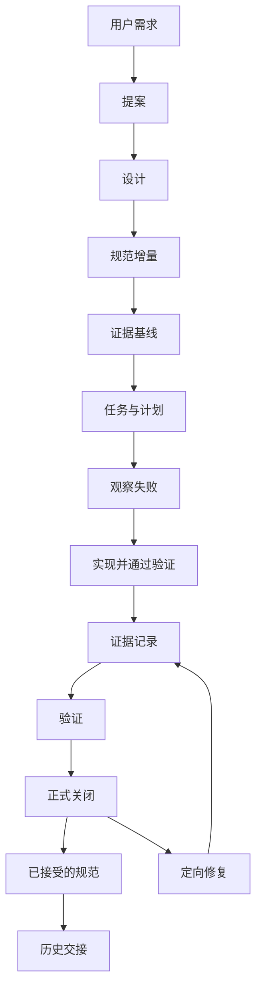

# 写了 Spec，为什么还不能说做完了？我们如何建立 AI Agent 的可验证研发流程

当 Coding Agent 可以连续完成需求分析、接口设计、代码实现和测试时，研发中的一个老问题反而更明显了：**谁来判断它真正做完了？**

例如，我们让 Agent 给投研系统增加一种研究数据来源，要求保留来源身份，失败后能够恢复，且不能越过原来的数据访问权限。Agent 可以新增模块、补上测试，最后说一句「已完成」。但这个结论仍然无法回答：实现是否符合最初的需求？失败路径是否被测到？测试跑的是哪个版本？权限边界有没有变？下一位 Agent 能否知道还有什么没证明？

我们后来把问题从「怎样让 Agent 写好一份 Spec」改成了「怎样让一项变更从讨论、实现、验证一直走到可追溯的关闭」。这套流程以 OpenSpec 为基础，结合 Superpowers 的设计与测试驱动思想，再为长期、多 Agent 协作补上证据、收尾和历史交接。

## 一、先区分两件事：现在的系统是什么，准备改成什么

[OpenSpec](https://github.com/Fission-AI/OpenSpec) 的一个重要思想，是区分现行规范和待实施变更。我们沿用了这个区分：

```text
openspec/
  specs/
    capability/
      spec.md
  changes/
    add-capability/
      proposal.md
      design.md
      specs/
      tasks.md
      plan.md
      evidence.md
      verify.md
```

这段目录是结构示意，并非每次变更都强制生成所有可选文件。

`openspec/specs/` 下的 accepted spec 描述**目前接受的行为契约**；`openspec/changes/` 下的 change 描述**这次希望改变的行为**。它们不能相互代替：Proposal 里提出的能力，还不能当成已经实现的能力；代码写完了，也不能自动当成规范已正式接受。

我们采用增量方式表达变更。`ADDED` 新增要求，`MODIFIED` 修改现有要求，`REMOVED` 删除现有要求，`RENAMED` 调整名称。它们的含义影响检查方式：一个待实施的 `ADDED` 要求尚未出现在 accepted spec 中是正常的；但 `MODIFIED` 和 `REMOVED` 应该能找到对应的旧要求，否则可能是分类错误，或现行规范本身存在缺口。

这个区分在长周期项目里尤其重要。一个 Agent 搜到上个月的 proposal，不应该把那份设计当作今天的系统事实。

## 二、Spec 流的核心不是文件顺序，而是每个阶段留下什么事实

我们使用自定义的 `superpowers-bridge` Schema 组织原仓库的研发过程；后文介绍的开源工具只抽取其中可移植的证据检查机制。整体可以概括为：



图中的两个关闭出口分别表示：声明范围内的正式验收成功，才进入规范同步和归档；没有达到验收条件，则保留失败或未验证状态，针对具体缺口继续处理。实际工作流还可以在明确需求前使用 brainstorm，在收尾时记录真正有价值的 retrospective，但没有必要为了齐全而机械地创建所有工件。

### Proposal：先定义问题，而不是先承诺实现

Proposal 最重要的是说清楚问题、范围、非目标、关键风险和验收路线。

我们会在这里提前区分普通变更和边界敏感变更，也会区分实现验收、独立的外部验收，以及真实模型调用所需的授权。举例来说，一个纯粹的验证视图生成器可以通过本地确定性测试证明行为；一个依赖真实供应商响应质量的研究功能，则不能拿同样的测试替代真实效果判断。

这避免了一个反复出现的管理问题：实施任务已经做完，却因为此前没有说清验证边界，在最后阶段不断往同一个 change 里增加新工作。

### Design：记录选择，而不是复制需求

Design 说明关键工程取舍：既有职责在哪里，为什么不用更小的修改，哪些状态必须持久化，失败如何处理。

例如，模型拿到一个缺字段的研究结果时，解决方式可能是修正数据适配，也可能是让模型在获准证据范围内继续研究。不能因为容易添加一个新校验器，就默认用它去判断「资料是否充分」——那本来可能是语义判断，并没有可供 Runtime 独立认证的事实。

我们会在设计评审中主动寻找反例，特别是新增拦截、状态、适配器或额外流程时，追问它保护了哪个不变量，又取代了什么旧机制。设计合理并不代表效果已验证，但记录这类判断，能让后来的 Agent 少走重复引入复杂度的路。

### Tasks：一个工作单元，不是四个重复 checkbox

我们一度很容易把每个 Scenario 机械拆成 RED、GREEN、REFACTOR、VERIFY 四项任务。看起来十分严格，却把 `tasks.md` 变成巨大的流程清单。

后来我们调整为按**共同职责、实现边界和测试集合**组织工作单元。一个工作单元可以包含多个行为断言，并共享一次真实的 RED → GREEN → 可选重构 → 验证过程。只有独立负责人、独立失败模式或验收路线确实不同，才有必要拆开。

现在 `tasks.md` 只负责工作状态；`plan.md` 在需要时说明执行顺序、测试入口及映射。测试命令和观察结果不再到处复制。

## 三、Evidence Ledger：不让 Agent 凭记忆重建测试结果

这是我们整个流程里最看重的一部分。

每个实质性 change 都维护 `evidence.md`。它必须在实施开始前建立基线或注明「未采集」，并在真正执行 RED、GREEN、集成检查时持续追加观测。

例如，一次经过简化的记录可能是：

```text
Evidence: EV-01
Task: 1.1
Phase: GREEN
Command: 定向测试命令
Result: 实际通过及测试范围
Revision: 运行时的源码身份
Artifact: 可定位的测试输出
Origin: observed-run
```

这里真正重要的，不是拥有一套看起来专业的字段，而是**每个结论都能回到当时实际发生的执行**。

我们区分以下几种情况：

| 情况 | 可以得出什么结论 |
| --- | --- |
| `observed-run` | 在记录的日期、环境和版本上，确实观察到一次执行结果 |
| `reused-historical` | 复用了过去某版本的证据；不能写成今天重新运行 |
| `blocked` | 某个验收分支因明确的前置条件不足而未执行 |
| `未采集` | 暂无对应观察，不得假装结果为零或已经通过 |

RED 也不是为了凑记录。测试必须真实运行，并因目标行为尚未实现而失败；数据库没启动、测试文件不存在、语法错误等，不等于业务行为得到了有效的 RED 证明。纯文档或检查型工作可以使用实际 CHECK，而不是制造假的 RED。

这种区别对于多 Agent 接力尤其重要：昨天的 GREEN 不会因为今天被另一位 Agent 读到，就自动变成今天这一版的 GREEN。

## 四、从「写一份 Verify」变成「从证据生成 Verify」

建立证据账本后，我们又发现一个很现实的问题：为了严谨，结果经常被复制进五六份文档。

`tasks.md` 更新状态，`plan.md` 复制命令，`evidence.md` 写一次结果，`verify.md` 再抄一遍。只要测试版本或结果改变，多个文件就可能产生漂移。

我们最终明确了每份文件的事实归属：

| 文档 | 唯一主要职责 |
| --- | --- |
| `proposal.md` | 问题、范围、关键决策与验收路线 |
| `design.md` | 关键备选方案、架构选择与风险 |
| `specs/` | 要求发生的可观察行为 |
| `tasks.md` | 工作单元及其完成状态 |
| `plan.md` | 必要的执行步骤和追踪映射 |
| `evidence.md` | 基线、实际观测、运行身份和局限 |
| `verify.md` | 基于证据的完成判断及剩余门禁 |

其中一项真实改造是让 `verify.md` 可以成为证据账本的生成视图：

```bash
npm run spec:verify -- --change example-change
npm run spec:verify -- --change example-change --check
```

这不是自动执行测试。生成器只是投影已有任务和观测，保留原始日期、版本与执行来源；手写 Verify 不会被覆盖。输入变化导致生成视图过期时，检查会报告陈旧，而不能装作它仍然反映最新证据。

我们还将结构检查改为按阶段执行：

```bash
npm run spec:lint -- --change example-change --stage plan
npm run spec:lint -- --change example-change --stage apply
npm run spec:lint -- --change example-change --stage verify
```

`plan` 检查任务标识等最低可操作性；`apply` 检查已完成任务的真实 RED/GREEN 或 CHECK；`verify` 再核对完成状态、证据和结论。这是一个**只读、结构性的检查器**，不代替实际测试，更不能证明模型回答质量。

我们没有让它重新扫描全部历史变更、重复核算所有文档的映射，或成为另一个全能验收引擎。

## 五、什么时候才算关闭？还有哪些事情不能借分？

正式 `spec:close` 是独立于任务勾选的验收动作：

```bash
npm run spec:close -- --change example-change
```

它依据该变更声明的验证路线运行需要的门禁。本地合同、真实集成、付费模型验证和产品发布，不能因为都有一个「PASS」就互相替代。

例如，`provider-free` 路线可以证明本地确定性合同、Mock 和被测调用边界在规定范围内通过。但它不证明真实模型的长期回答质量，也不等于生产发布。

第一次关闭之前，如果确实需要汇总静态阻塞，可以运行只读的 `spec:close:doctor`。它只负责静态就绪诊断，不运行付费模型，不把「静态 ready」提升为正式完成。

另一方面，**已经有成功关闭记录时，也不应该因为整理文档再次启动整套验收**。没有新的行为变化、具体失败或实际合同冲突，就复用已有回执，同步增量规范并归档。这样既保留验证纪律，也避免流程陷入「刚验证完，又因为补了一份总结而重新验证」的循环。

### 三种容易混淆的结果

| 场景 | 正确处理 |
| --- | --- |
| 全部实现任务打勾，但没有正式关闭 | 保留 `formal close: not-run`，不得宣称正式完成 |
| 本地合同通过，但真实供应商尚未验证 | 报告本地通过，真实质量继续未知 |
| 变更已完成且有成功关闭回执，只是归档未做 | 复用原关闭结果；不为维护文件重跑验收 |

真正涉及权限、隐私、资金执行等受保护不变量时，拒绝和验收仍然有必要。但它们也需要明确保护对象，不能把一个局部失效自动扩大成整轮有用工作都失败。

## 六、一次真实演进：我们为什么主动简化 Spec 收尾

2026 年 10 月初，我们专门改造了一轮 Spec 关闭与归档流程。当时的问题不是证据不足，而是**证据已经存在，收尾文档还在重复生产相同信息**。

旧流程同时存在手工维护 Verify、为满足归档而制造低价值历史记录等压力。于是我们做了两个选择：

第一，让 Verify 能从已经记录的任务与证据生成，同时防止覆盖手写内容和使用过期投影。

第二，让历史交接明确区分 `none`、`candidate` 和 `history`。不是每次格式修正、重复 Close 或测试重跑，都必须自动生成一篇正式工程史。

这项改动在原仓库留下了可定位的 RED/GREEN、定向测试与本地关闭记录；其效果是既有行为被更集中地维护，并可在对应测试环境中验证。它没有量化开发时间下降，也没有把本地关闭称作真实模型质量或发布验收。

这一点值得强调：**研发流程本身也需要通过复杂度审查。** 如果一项流程只会要求更多表格，却不能解释它保护了什么、减少了哪些不确定性，就应该考虑合并或删除。

因此，这套流程既需要[方法 4「完整设计与分期交付」](/principles#method-4)来区分目标方案与当前阶段，也需要[方法 5「验证与故障归因」](/principles#method-5)让每次关闭声明只由对应版本的真实证据支持。它们是设计与验证的思考工具，不意味着每个小变更都要经过同样沉重的阶段门。

## 七、从内部流程到独立工具：OpenSpec Evidence Kit

前面介绍的是 ETF Agent 自己的研发流程：它有内部的 `superpowers-bridge` Schema、`spec:close` 和项目专属验证入口。这套完整流程不适合原样搬进其他仓库。2026 年 10 月，我们把其中**任务与观测的结构检查、Verify 生成视图、已有完成记录读取**抽成了独立的 [OpenSpec Evidence Kit](https://github.com/hpoenixf/agent-engineering-suite/tree/3b515de2f30e25b1e0757243f3ce4d1be19b00b0/skills/aes-spec-flow/toolkit)（[v0.1.0](https://github.com/hpoenixf/agent-engineering-suite/blob/3b515de2f30e25b1e0757243f3ce4d1be19b00b0/docs/legacy/openspec-evidence-kit-releases.json)，MIT）。

原独立工具的 v0.1.0 是历史发布版本，发布元数据与原始 Git 历史已保存在统一仓库的 [迁移记录](https://github.com/hpoenixf/agent-engineering-suite/tree/3b515de2f30e25b1e0757243f3ce4d1be19b00b0/docs/legacy) 中；当前维护入口为 **Agent Engineering Suite 的 Spec Flow 模块**。原版本号不代表整套插件的兼容性或验收范围。下面的命令使用统一仓库源码，先按[当前安装说明](https://github.com/hpoenixf/agent-engineering-suite/blob/3b515de2f30e25b1e0757243f3ce4d1be19b00b0/docs/installation.md)取得源码，将 `AES_ROOT` 改成它的绝对路径，并在待检查项目目录执行。

这个版本要求 Node 26.11.1–26.x，不需要运行时依赖、数据库或模型调用。它能直接处理普通本地目录；[`evidence-driven` Schema](https://github.com/hpoenixf/agent-engineering-suite/tree/3b515de2f30e25b1e0757243f3ce4d1be19b00b0/skills/aes-spec-flow/toolkit/schema/evidence-driven) 是可选的 OpenSpec 适配，并不是把内部 `superpowers-bridge` 或正式关闭流程整体开源。

### 一条任务怎样形成可以检查的记录

下面是**虚构的格式示例**。假设项目中的 `openspec/changes/cache-fix/` 已有 `tasks.md`、`evidence.md`，检查命令执行后留下了本地 `result.txt`。最小任务和观测可以这样写：

```text
# tasks.md
- [x] 1.1 [check-only] 检查缓存结果文件

# evidence.md
## Observation Log
| Date / phase | Evidence ID | Task | Command | Actual result | Artifact | Revision | Origin |
| --- | --- | --- | --- | --- | --- | --- | --- |
| 2026-01-01 CHECK | EV-01 | 1.1 | inspect result.txt | passed: 示例检查 | result.txt | demo-revision | observed-run |
```

这里的关键是**有稳定任务标识、有序观测、对应的本地文件和原始版本身份**。普通已完成任务默认需要依序记录 `RED → GREEN`；`[check-only]` 用 `CHECK`，`[baseline-green]` 用 `BASELINE → VERIFY`，`[tests-after]` 则明确记录事后 `VERIFY`。历史导入的 `reused-historical` 不会冒充本次已完成任务的新观测。

将它接入项目后，可以逐阶段检查：

```bash
AES_ROOT=/absolute/path/to/agent-engineering-suite
node "$AES_ROOT/skills/aes-spec-flow/toolkit/bin/spec-evidence.mjs" lint --change cache-fix --stage plan
node "$AES_ROOT/skills/aes-spec-flow/toolkit/bin/spec-evidence.mjs" lint --change cache-fix --stage apply
node "$AES_ROOT/skills/aes-spec-flow/toolkit/bin/spec-evidence.mjs" verify --change cache-fix
node "$AES_ROOT/skills/aes-spec-flow/toolkit/bin/spec-evidence.mjs" verify --change cache-fix --check
node "$AES_ROOT/skills/aes-spec-flow/toolkit/bin/spec-evidence.mjs" status --change cache-fix
```

`plan` 关注任务标签与重复 ID；`apply` 检查已勾选任务是否有符合阶段顺序的记录及本地文件；`verify` 需要任务完整且证据可用，才会生成带输入摘要的 `verify.md`。`verify --check` 只对照视图是否陈旧，不重写文件。生成器不会覆盖手写 `verify.md`，也会拒绝越出选定变更范围、通过符号链接绕行的文件路径。

最后一条 `status` 有意做得更窄：它读取任务状态，以及项目**自行提供**的 `completion.json`。当任务已完成且记录格式有效时，它可以报告 `recorded-complete`，同时保留当时日期、版本和验证路线；不会为读取历史结论而重跑测试，也不会把旧临时测试产物缺失误判成新的执行失败。

### 为什么没有做成第二个验收系统

这次抽取保留了一个刻意的分工：**测试执行器产生观察，开发者或 Agent 记录事实，CLI 检查记录结构，是否接受变更由原项目决定。** `observed-run` 是记录者填写的来源标签，而不是工具对命令执行真实性的认证；`status` 看到了完成记录，也不等于重新验证了当时的代码或取得发布批准。

这样的工具更适合作为现有 CI 和 OpenSpec 流程中的一个小型检查环节，而不是接管测试、模型质量判断和发布权。源码、离线示例、字段格式与独立安装说明都在[开源仓库](https://github.com/hpoenixf/agent-engineering-suite/tree/3b515de2f30e25b1e0757243f3ce4d1be19b00b0/skills/aes-spec-flow/toolkit)中；Schema 的设计沿用 [OpenSpec](https://github.com/Fission-AI/OpenSpec) 的生态接口，并在 [NOTICE](https://github.com/hpoenixf/agent-engineering-suite/blob/3b515de2f30e25b1e0757243f3ce4d1be19b00b0/skills/aes-spec-flow/toolkit/NOTICE.md) 中列明 Superpowers 相关实践的影响。

完整的单独/整套 Skill 与 Codex 插件，以及其他研发模块如何配合，见 [Agent Engineering Suite 完整介绍](/articles/agent-engineering-suite)。

## 八、哪些项目适合这样做？

[GitHub Spec Kit](https://github.github.com/spec-kit/) 也强调从需求规范走向计划、任务和实现。我们的实践不是在这些方法之外另造一套标准，而是面向长期演进的 Agent 项目，补足「多轮执行怎样保存原始证据」「完成状态怎样不被混淆」和「验收如何及时收敛」。

对于简单的文案修改，这套流程不值得全部展开。一次内容检查和明确的 diff 可能就足够。对于跨接口、数据权限、持久化恢复和模型评测的改动，证据与阶段门则更有价值。

最后留下三个最值得迁移的判断：

1. **规范、代码、测试、关闭和发布是不同的事实。** 不要让一个 checkbox 代替它们。
2. **证据在执行时产生，而不是收尾时凭记忆重建。** 每次观察都保留自己的时间、版本与适用范围。
3. **验证是为了形成可信结论，而不是为了永远继续验证。** 同一事实只维护一处，没有新的实质变化就停止重复工作。

我们真正希望得到的，不是一个永远说「还不够严谨」的 Coding Agent，而是一个能够清楚回答：**什么已经证明、什么仍然未知，以及为什么现在可以结束。**

---

本文曾同步发布于个人博客；当前可从[正式中文阅读页](https://hpoenixf.com/eff-agent-article/articles/026-agent-spec-evidence-workflow)或[完整英文版](https://hpoenixf.com/eff-agent-article/en/articles/026-agent-spec-evidence-workflow)继续阅读。源文和后续工程讨论见 [GitHub 技术文集](https://github.com/hpoenixf/eff-agent-article)；欢迎 Star 支持。
