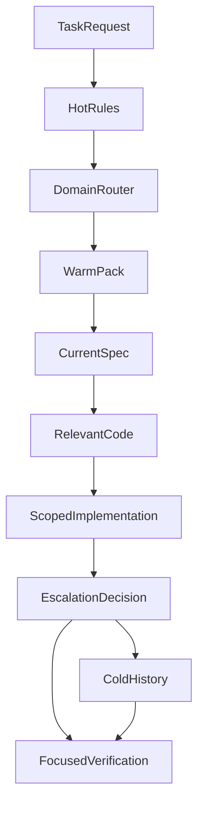
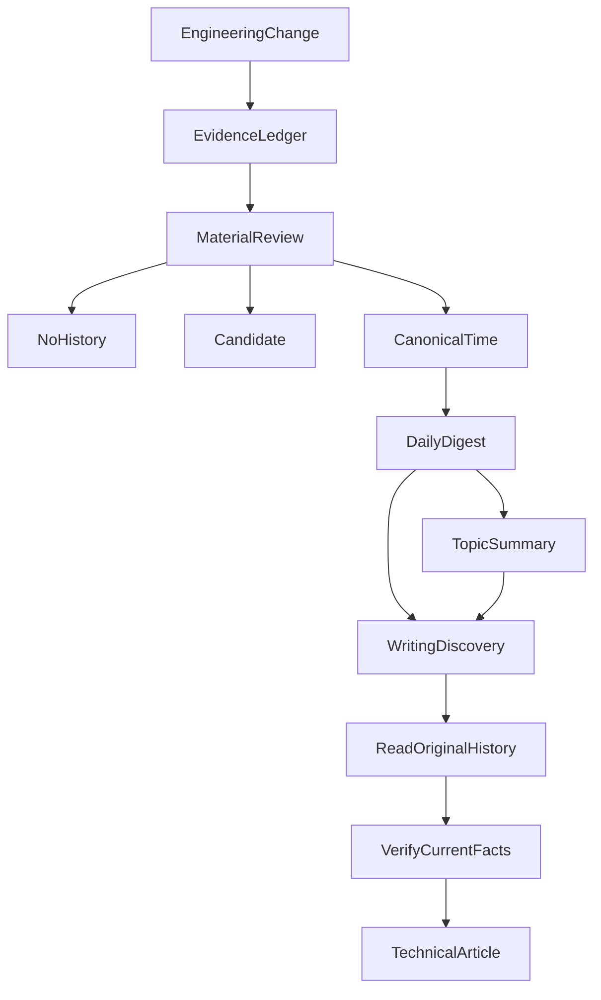

# 文档不是给 Agent 全部读完的：我们如何设计按需加载与长期工程记忆

随着项目发展，文档通常只会越来越多。最初只有 README；后来出现了架构设计、接口契约、测试策略、故障记录、Agent 工作规则，以及按日期归档的大量历史材料。

这本来是件好事。问题在于，Coding Agent 很容易把「文档很重要」理解成「开始任务前应该全部读完」。

假设现在只需要修复一个前端交互细节，而 Agent 在动手前依次读取投资计算模型、所有 Runtime 文档、完整项目历史和每一份归档 Spec。它确实获得了大量信息，却不一定更接近这次任务。

更危险的是，这些内容可能同时包含当前有效的约束、早已撤回的提案和过期的交接记录。**上下文越长，不意味着工程事实越准确。**

我们后来将文档流拆成两个问题：**Agent 应该怎样取得当前任务需要的知识，以及这次开发产生的经验应该怎样留给未来的 Agent？**

## 一、先把 AGENTS.md 从百科全书变回地图

最直接的做法，是把所有重要知识写进 `AGENTS.md`。这能减少遗漏，却也产生固定上下文成本：不管当前任务是否相关，这些规则都会进入默认阅读范围。

一旦任务开始由多个子 Agent 并行研究、评审或测试，重复阅读的固定成本会随角色数放大。

因此我们重新定义了根工作规则的职责：**全局文档保留跨任务的不变量与导航，详细知识由对应领域的文档承担。**

例如，投资数据的权威来源、权限和确认边界需要在每次任务中可见；某个 MCP 供应商的字段缺失策略，则没必要在每个 UI 任务里常驻。

我们使用类似下面的导航：

| 任务方向 | 主要读取入口 |
| --- | --- |
| 前端交互 | 前端任务包与相关 UI 契约 |
| MCP 和数据源 | MCP 任务包、相关接口规范和适配说明 |
| 投资计算 | 核心投资约束与当前计算契约 |
| Agent Runtime | Runtime 架构、对应 Spec 与测试 |
| 历史回归 | 当前调用链，再追溯必要的历史记录 |

这不是删除知识，而是改变知识进入上下文的时机。

## 二、Hot、Warm、Cold：三种阅读温度

在仓库中，我们为开发时上下文引入了 Hot、Warm、Cold 路由。

图中不是说每个任务必须访问 Cold。通常先读取 Hot 和当前领域的 Warm，再定位现行规范和代码；只有跨领域、遇到关键职责争议或需要追溯回归时，才有理由升级读取历史资料。

### Hot：不该被忽视的最小约束

Hot 层包含基础工作约束、Bootstrap 和入口导航。它告诉 Agent：这是怎样的项目、什么绝对不能越界、下一步去哪找资料。

它不是一份包含所有模块状态的长篇手册。

### Warm：匹配当前任务的知识包

Warm 层承载按领域划分的知识，例如前端、MCP、Memory、治理、测试和可观测性。

Agent 优先读取一个与任务匹配的主要任务包，再根据代码调用链和具体变更范围展开。跨领域任务可以再加入第二个包，不要求每次任务都从零读完全部领域说明。

### Cold：重要，但不默认读取

Cold 层主要放旧版 Spec、归档历史、大型评测产物和过期实验资料。

Cold 不代表资料没有价值；它代表内容具有明确的时间性，或者只有在特定排查中才需要它。

比如 Agent 排查最近一次恢复机制的回归，就有理由读取旧设计及当时证据；普通组件样式修改通常没有这个必要。

Anthropic 的 [Effective Context Engineering for AI Agents](https://www.anthropic.com/engineering/effective-context-engineering-for-ai-agents) 也讨论了上下文选择的问题。我们将类似的按需消费思想用在**开发 Agent 对仓库资料的读取**，而不是假设把所有项目知识常驻一定会提高正确率。

### 当时实际测到了什么？

在 2026 年 8 月的一次开发上下文治理中，两份常驻 Agent 规则文件的总行数从 **442 行下降到 164 行**，并留下路由结构与定向测试记录。

这个数字只说明当时的入口文档体积发生了变化。它不能直接证明真实计费 Token 下降相同比例，也不能证明长期开发速度提高了多少。

更重要的工程变化是：默认执行路径从「先读完整背景」变成了「先选领域，再读精确契约，必要时扩大范围」。

## 三、找到文档之后，还要知道它能证明什么

上下文加载只是第一步。更复杂的问题是：**不同文档如果互相矛盾，谁才拥有当前事实？**

想象下面的演进：

一次 Proposal 提议使用 A 方案，之后设计讨论改成 B，最后代码只实现了其中一部分。几周后，另一个 Agent 搜到了最早的 Proposal。如果它把「曾经建议」理解成「现在已实现」，就可能沿着错误的方向修改代码。

因此，我们不是只按模块分目录，而是先区分知识的职责。

| 材料 | 它主要回答的问题 |
| --- | --- |
| 工作约束与领域模型 | 哪些不变量必须遵守？领域概念是什么？ |
| Accepted Spec | 当前接受了怎样的行为契约？ |
| Active Change | 目前正在尝试改变什么？ |
| 当前代码和配置 | 实际版本如何运行？ |
| 测试和执行证据 | 哪个版本、环境下观察到了什么？ |
| ADR 与架构文档 | 为什么这样划分职责？ |
| History | 当时发生了什么，哪些经验值得复用？ |
| Handoff | 交接那一刻做到了哪里，下一步是什么？ |

这不是一张「永远由某种文件压过另一种文件」的简单优先级列表。问题不同，权威来源就不同。问运行时实际行为，要读代码和真实接线；问已接受的合同，要看 accepted spec；问当初为什么没有采用 A，要看设计记录或 History。

[Diátaxis](https://diataxis.fr/start-here/) 按读者需要区分教程、操作、参考与解释类文档。我们的划分与它关注的问题相似，但侧重的是持续开发中的**规范权威、版本时间和执行状态**，而不是直接套用四种文档形式。

只有知道一份资料承担什么职责，搜索结果才不会把旧决策包装成新命令。

## 四、History 不应该成为另一个巨大的日志系统

当多个 Agent 持续开发时，文档膨胀的另一个来源是历史记录。

每次修复、每次测试、每次正式关闭，似乎都值得写一篇复盘。如果全部保留，很快就会出现大量相似内容：

今天 RED，明天 GREEN，后天回归，第四天 Close，第五天又补了一条记录。未来的 Agent 需要在许多流水账里找到真正改变工程判断的那一次。

我们因此将 History 拆成几个不同的层次。

### Candidate：便宜的素材缓冲

某次任务有一个可能值得复用的经验，但当前证据不够，或者主题还没有独立价值，可以先留一条简短 Candidate。

Candidate 不是正式历史，更不意味着每次完成任务都要写。纯格式修正、重复验证和没有新判断的维护工作，默认可以不产生 Candidate。

### Time：记录当时发生了什么

正式的 Time 是一份可追溯的历史正文。它要说明背景、关键判断、实际结果和证据边界。

我们不会因为「测试通过了」就自动晋升。更重要的是：是否存在新的、非显然的工程判断？未来遇到类似问题能否复用？结果是否有足够事实支撑？既有历史是否已经覆盖同样的经验？

Time 承载历史事实，但它不替代当前代码或现行规范。

### Daily：每天只保留有意义的变化

Daily 不是 Time 文件目录的逐条副本。它将一天内同一主题的研究、修复、回归和关闭压缩成少量短卡。

例如，一个主题当天经历了四轮测试，最终判断仍然是「需要区分工具运输失败和数据本身不可用」，Daily 只需记录这一项判断的演进、结果范围和原始 Time 入口，不必分别写四次。

### Type：跨时间精读一个主题

Daily 回答「这一天发生了什么」，Type 回答「这个主题跨时间真正改变了什么」。

它只保留核心判断、几个重要阶段、代表性历史和可复用检查点。新一次 Close 或测试计数变化不会自动生成新阶段。只有出现新主题、改变核心判断，或者发现更合适的代表案例时才更新。

整条知识生产与阅读路线是：

图中的分叉代表：没有长期价值的材料可以不晋升；暂时有用但证据不足的材料进入 Candidate；真正形成可复用判断的材料才进入 Canonical Time。Daily/Type 是历史的压缩与导航层，不是另外两份权威事实副本。

## 五、一次例子：修复资料读取之后，哪些知识应该留下？

假设研究系统的一次网页阅读失败了：Agent 已经知道某个页面，但继续读取时无法沿着原来的来源身份恢复。

下面是教学简化流程，不是某一次线上故障的完整复现。

**第一步：读取当前事实。** Agent 从工作规则进入 Web 研究领域，再定位当前 Spec、实际读取模块和相关测试。它不需要先扫完整个月的 Web 故障记录。

**第二步：必要时追溯历史。** 如果来源身份设计不容易理解，才从 Type 找相关主题，沿代表性 Time 阅读过去的根因。这些历史帮助提出诊断假设，却不能直接证明当前实现仍然如此。

**第三步：进行定向验证。** 修复行为后，将实际 RED/GREEN、版本和结果写入本次 change 的 Evidence Ledger。未运行的真实模型质量检查，仍然明确标作未验证。

**第四步：决定是否沉淀。** 如果只是修复一个已知错误，且既有 History 已经解释过相同机制，继续补原证据即可。如果发现一种新的来源身份混淆方式，并且有可复用的判断和结果，才考虑晋升为 Time，由 Daily 压缩，并在必要时更新 Type。

未来另一位 Agent 遇到相似问题，只需从主题摘要找到关键历史，再回到当前代码核实。

**历史的价值是帮助下一位 Agent 更快知道该检查什么，而不是替它决定现在应该怎么改。**

## 六、Handoff 和 History 不是同一类记忆

在长期 Agent 协作中，我们还特别区分了 Handoff。

History 解释为什么这样设计、过去发生了什么；Handoff 则保存**交接时的可执行任务状态**。

一份合格的 Handoff 应能让另一位 Agent 找到：当前任务及对应规范、当时的分支和工作区、已改文件、实际测试记录、剩余阻塞、下一条具体命令，以及哪些范围不能擅自修改。

但带日期的 Handoff 不等于当前任务状态本身。接手时仍须重新检查当前工作区、任务队列和 Evidence Ledger，不能因为两周前的一份交接说「下一步运行 X」，就认为现在一定还应该运行 X。

因此，我们让当前项目状态和任务/证据文件承担最新进度职责；旧 Handoff 保留它所描述的那个时间点，不能无限更新到假装它一直代表现在。

这解决了两种完全不同的需求：

- **短期连续性**：一位 Agent 暂停后，下一位能恢复工作；
- **长期可复用性**：几个月后，一个与本次任务无关的 Agent 能理解关键工程判断。

用同一份文档同时承担这两种职责，往往只会让它越写越长。

## 七、为什么我们没有一开始就把所有文档扔进向量数据库？

知识越来越多，最自然的提议是全部向量化，让 Agent 语义搜索。

这种方法可以改善资料发现，却无法独立解决我们面临的核心问题：语义相似度不知道一份文档是旧 proposal、已撤回设计、当前规范还是某次实验快照。

而且开发任务往往已经带有大量结构化线索：目标模块、错误类型、Spec 名称、代码路径、任务 ID、测试命令。对于这些明确目标，Router 与精确读取的成本和理解难度都相对较低。

所以我们先采用简单的导航、任务包与历史压缩。语义检索可以在确实遇到跨领域资料难以发现的问题时加入，但它也应该先负责**找候选**，而不是自动替候选资料赋予现行权威。

这是一种范围选择，不是对 RAG 的否定。

## 八、知识保存得越完整，越需要明确停止条件

这套体系仍然需要维护：路由可能过期，领域包需要随接口变化，重要设计变更需要更新对应的当前文档，历史晋升需要判断是否真的有新增价值。

但我们刻意没有让每个 change 都生成一篇 History，让每次新测试都更新 Daily，让每一次话题被提及都修改 Type。

技术分享同样采用漏斗式取材：先从 Daily/Type 发现值得写的主题，挑少量代表性 Time 理解当时的原因，再回到现行 Spec、代码和测试核实事实。旧文章可以帮助去重，却不能替代对当前实现的核查。

最后，我们得到的并不是「把文档全部自动化」的系统，而是一套比较清楚的责任关系：

**当前规则在权威位置维护；Agent 按任务读取；实际执行进入证据；长期经验有选择地保存；未来的 Agent 从压缩后的入口重新发现并核实这些经验。**

在历史样本里，我们能够观察到常驻文档明显瘦身和相应路由规则落地。至于跨项目的 Token 节约、长期开发时间和错误率改善，仍需要独立测量，不能由文件行数推断。

对长期 Coding Agent 项目来说，我认为最值得先做的不是要求 Agent 「记住所有东西」，而是教会它三件事：**该读什么、该相信什么，以及什么值得留下。**

---

本文亦发布于 [个人博客](https://hpoenixf.com/blog/027-agent-context-document-history)。更多工程实践见 [GitHub 技术文集](https://github.com/hpoenixf/eff-agent-article)；欢迎 Star 支持。
