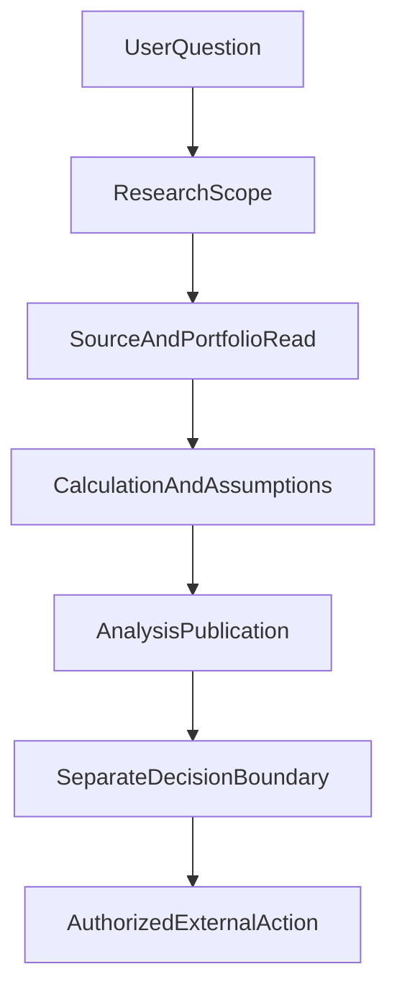

# 当 AI 开始谈“买什么”，研究助手离投顾和交易还有多远？

> **阅读说明：** 本文是产品与技术边界讨论，不构成法律意见、证券投资建议或相关金融业务资质声明。监管要求以现行正式法规和适用主体为准。

> 系列归属：**金融科技与合规（主）** · 系统架构与工程观点（兼）

让 Agent 查基金资料和让 Agent 替用户决定买基金，表面上可能只差一句提示词：“根据这些资料给出建议。”但从系统设计看，差的不是语气，而是**服务承诺、授权对象、事实责任以及最终谁能够产生经济后果**。

做个人 ETF 研究助手时，我们始终遇到一个容易被混淆的词：*帮助投资决策*。它可以是解释公开指数差异、指出组合重复暴露，也可能进一步成为针对某个用户的具体标的、数量和行动建议，甚至是下单执行。若将这些动作全部放进“投资分析”一类工具，模型回答再流畅，也说不清产品究竟在提供什么服务。

## 一、相似的问题，可能要求完全不同的权利

考虑三句话：

“沪深 300 和中证 500 的指数编制有什么差别？”通常可以在获准公开资料范围内做解释。

“结合我的持仓和期限，比较两种配置风险。”需要当前个人持仓和投资目标的使用许可，输出也应交代来源时点、假设和局限。

“按这个方案替我买入。”则已经要求改变外部账户资产状态。研究权限、用户表达了购买意愿、系统存在某个交易接口，都不能单独授予执行权限。

我们在 ETF Agent 里把模型理解的动作与 Host 实际准入分开；Native 研究能力本身没有自动交易的权威。当前论文讨论的是一种**只读研究系统的工程选择**，不能被读成我们已经具有证券投资顾问业务的资质，也不能被读成某项“推荐”只要加一句免责声明就一定合规。

## 二、法律上的业务边界，不能让模型靠关键词判断

[中国证监会《证券投资顾问业务暂行规定》](https://www.csrc.gov.cn/csrc/c101838/c1022038/content.shtml)自 2011 年起施行，涉及证券投资顾问业务的监管要求；[《证券期货投资者适当性管理办法》](https://www.csrc.gov.cn/csrc/c106256/c1653849/content.shtml)对向投资者销售证券期货产品或提供相关服务的经营机构提出了解投资者、产品服务分级、风险揭示和匹配等要求。

这里必须尊重它们的**主体和业务适用条件**。并不是所有公开金融知识问答都自动构成受监管的证券投资顾问业务，也不能据此推出所有场景的 AI 输出都必须转人工。究竟进入哪种业务，取决于提供者身份、服务内容、获利方式、适用司法辖区及具体监管安排，需要业务与法务确认。

工程系统应该先明确产品允许提供的服务类型，然后让相应准入和流程得到落实；不应让模型根据“用户似乎只是在聊聊”来绕过规定，也不应该用几条含有“买入”或“收益”的正则，把所有正常金融教育问题一刀切地拒绝。

## 三、从金融事实到行动，至少要经过三次不同判断

一条合理的研究路径可以这样拆：

第一道是**数据准入**：哪些公开文件可读，私人持仓是否在当前用户的获准范围内，资料是否过期。模型提出检索范围，但不能通过自己写一句“我已获授权”创造权限。

第二道是**解释与计算**：基金穿透后的风险暴露、费用、日收益率和回撤等量要明确数据窗口和计算方法。确定性计算可以减少某类数值错误，却不能自行决定用户应当持有什么仓位。

第三道才是**行动边界**：研究正文、一般性风险提示、个性化投资建议和实际执行，不能因为共享了一份报告，就共享相同的审批与确认方式。对于可能需要单独资格或更高授权的业务，必须由独立业务合同处理；没有具备该合同的动作就不应该被模型工具面假装提供。

图中最后的“AuthorizedExternalAction”只是边界示意，**不是当前 ETF Agent 已经具备交易能力的证明**。

## 四、合规不等于把所有有用回答都挡住

用户问一项公开基金指标，某个私人数据授权失败，不代表公开解释也应终止。对一份资料的来源资格未知，不应自动升级成模型“全文不准回答”。我们在多轮发布和授权治理中学习到：限制应当沿实际数据依赖与动作类型作用，而不是一处拒绝抹去整场研究。

这套做法有两个方向的风险。放得太松，模型会将没有来源、没有当前资格或没有业务授权的结论包装为专业建议；收得太紧，系统只能输出空洞的模板免责声明，用户反而得不到合法且必要的事实解释。

真实运行里仍存在过研究证据不足、数值结论不完整、来源引用未能逐项匹配等问题。我们可以诚实地交付被证实的部分和未知的部分，但不能把“系统拒绝了不确定事实”包装成“投资者获得了更高收益”。

## 五、监管主体和技术实践也不能混在一起

2026 年 6 月 18 日国家金融监督管理总局公布的[《关于银行业保险业人工智能安全开发应用的指导意见》](https://www.nfra.gov.cn/cn/view/pages/ItemDetail.html?docId=1261784&generaltype=1&itemId=4216)强调使用方责任和分类分级治理，其直接适用对象是所规定的银行、保险等机构，不能无条件代替证券领域监管规则。它与证券行业的要求可以形成技术治理的启示，但不能据一份指导意见宣布所有金融机构承担完全相同的法定义务。

技术团队更值得建立的是**可审查的业务能力边界**：谁是用户、访问什么资料、输出声明了哪些前提、是否产生了副作用、何时需要另一个合规业务流程。模型负责提议，产品合同负责许可，外部动作必须拥有相应可核验的确认与执行事实。

对于仅面向个人研究的 Agent，认清“我现在只提供研究，不代用户交易”并不是功能弱，而是让服务承诺与真实能力一致。对希望拓展到投顾或交易的团队，这个分界点也恰好告诉你：不能只增加一个买卖工具，而必须先重新确定产品、合规和执行责任。