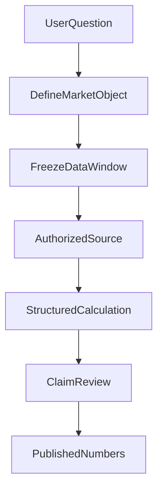

# 金融 AI 最危险的“专业感”：数据是真的，数字却算错了

> **阅读说明：** 文中的指数点位用于说明一次历史工程错误，不代表当前价格、投资观点或收益预测；真实错误样本不等于全系统验证。

> 系列归属：**金融科技与合规（主）** · 模块精讲（兼） · 系统架构与工程观点（兼）
>
> 2026 年 10 月 21 日按新增的 A33 Numeric、金融计算第一期及指标联邦化第二期补充。文中生产计算反例是安全测试输入，不是用户交易损失或线上投资效果认证。

许多投资问答的第一道防线是“给数字加来源”。但真实研发中更难发现的错误，恰恰发生在**正确数据已经进入模型之后**：资料是真的、时间窗口也给了，模型最后却写出了另一组数值，语言仍然像一份完整的研究报告。

我们的 ETF Agent 曾有过这样的真实记录：某个指数年度低点在已取得的 2025 年收盘价序列中是 **3589.44**，模型回答却写成 **3722.51**。更矛盾的是，文章另一处回撤计算已经使用过 3589.44。事后复查证明两张已读取的收盘表均含 243 条 2025 年交易日数据；错误出现在模型解释与组织最终答案的过程，而不是据此可以直接认定 Runtime 把正确行情吞掉了。

这个案例真正值得分享的不是指数点位，而是**有来源、会计算、能写报告，是三层独立能力**。后来我们还在组合调仓的实际计算生产者里发现了另一种错误：哪怕模型不参与计算，普通浮点和错误的比较时机，也可能把金额算错，甚至把现金不足的方案认定为可行。

这促使我们把两类责任分开：**A33 负责显式十进制运算和舍入，原金融领域负责决定该算什么以及结果能否用于方案。** 没有用一个“金融数值总管”代替两者。

## 一、金融数值首先要回答“这是谁、哪天、用什么口径算的”

“今年最低价”至少存在几个未说出口的条件：今年是自然年还是滚动一年，时间按交易所本地日还是用户所在时区，使用收盘价还是盘中最低价，是否复权，有没有停牌或缺失记录。

在基金研究里，同一个问题还可能是基金净值、指数价格、ETF 二级市场成交价或跟踪指数的收盘点位。即使数值来自真实供应商，只要把对象或时间窗换了，算术完全正确也会得出用户不需要的答案。

因此我们逐步把金融数据看成一组带身份的事实：instrument、字段、观察时间、样本窗口、供应商和缺失状态。引用标签能帮助回到来源，但它不能自动证明模型对时间条件的理解正确。

## 二、真实失败告诉我们：错的不一定是数据链路

那次错误最初很像典型的“上下文太长导致数据丢失”。我们自然会想加大窗口、重新读取、增加工具调用次数。然而，复查原模型请求与记录后，正确的 3589.44 不但存在于已取得数据里，还被模型在另一处采用。

由此可以排除一个过早结论：**不能仅凭最终答错，就说 Runtime 没有把数据交给模型。** 也不能反过来，因为看到了正确值，就说整篇分析没有问题。

后来一次独立计算交接能够把数值纠正为 3589.44，却错误地把表格 hash 当成可引用的来源 ID。计算准确了，引用链反而没有正确成立。再下一次真实复验里，模型部分引用变成合法身份的短前缀；系统没有偷偷把前缀“猜成”完整引用，而是保留未核验状态。

三个现象分别落在不同位置：数值解释、计算产物转交、引用身份。把它们统一称为“幻觉”，会让研发动作失去方向。

## 三、我们为什么坚持可复算，而不是依赖多模型投票？

对于平均值、回撤、相关性、区间极值这类确定性运算，重复问三个模型“你确定吗”不等于独立核验。若三次请求消费的是同一份错误口径，结果一致还可能增加错误自信。

更可靠的方式是对已取得且获准的结构化数据执行明确运算，并把计算窗口、字段和输出绑定在一起。例如计算一个日收盘序列的年度最低值，必须先把日期窗口限定到对应交易年，然后在非空收盘价上求最小值，并保留对应日期。用于价格与回撤的调整口径应另行声明，不可把两个序列混用。

这里的运算工具不应顺便决定“这个组合值得买”，它只负责在限定输入上提供可复核数值。模型继续负责解释意义、比较条件和不确定性；输出出现与运算结果不同的数字时，应具体定位到哪项主张，而不是让程序尝试理解全文“投资建议是否正确”。

## 四、A33 解决的是精确运算，不是投资判断

JavaScript 的 `number` 使用二进制浮点。金融系统里，问题不只在 `0.1 + 0.2` 的演示：当金额乘以费率恰好落在半分附近时，浮点误差可能改变最终舍入；在判断资金是否足够时，先把差额显示成两位小数又可能隐藏真实短缺。

我们在原组合计算生产者中加入了很小的 **A33 Numeric** 能力。输入保留明确单位和十进制字符串；运算以精确十进制系数进行，再按调用方传入的舍入政策得到结果及残差。下面是代码中安全固定样例的代表：

| 输入与动作 | 精确结果 | 该调用方声明的输出 |
| --- | --- | --- |
| 137 元 × 0.015 | 2.055 元 | 2.06 元 |
| 145 元 × 0.015 | 2.175 元 | 2.18 元 |
| −10.085 元，保留两位 | −10.085 元 | −10.08 元 |
| 比较 1.000 元与 0.999 元 | 差 0.001 元 | **严格不相等** |

第三行的舍入沿用该领域明确指定的“半值朝正无穷方向”，**不是**所有系统都应使用的金融默认规则。货币结算精度、计算精度和报表展示精度可以不同；A33 不替基金或券商选结算政策。

实现上，A33 提供同单位加减/比较、调用方显式绑定的乘法、比例缩放及舍入残差。它不从数字大小猜测元/分，不把人民币和美元相加，也不根据“份额 × 净值”这几个字擅自判断基金身份。份额所属产品及净值日期的关联仍须由原投资数据生产者确认。

现有 TypeScript Portfolio 方案消费这些运算；Python 的收益统计继续由自身方法处理。我们没有为“统一数值”额外建立一个网络服务或强制整个研究流程经过 TypeScript 数值核。

## 五、资金守恒要在业务含义上成立，不能只靠小数显示

组合调仓不是简单的“目标比例 × 总资产”。现金可能分别属于可用于买入的余额、受保护的储备、尚未结算的卖出款和模拟方案中的预算。把这些角色混在一起，即使最后凑出一条数值平衡等式，也可能是错误的方案。

在当前调仓情景的明确结算假设下，可以审查这样一条关系：

**期末可分配现金 = 期初可分配现金 + 允许用于本情景的卖出所得 − 买入金额 − 已计入的费用。**

这条关系只适用于明确的资金角色与结算设定；不能把冻结储备当可用现金，也不能因为模拟允许卖出，就自动假定实际款项已经到账。费用必须来自同一份明细，不能在现金和方案消费者里各扣一次。

最能体现精度价值的，是我们补上的合成反例：**预算、可用现金或受保护储备只差 0.001 元时，旧比较路径仍可能判为可行。** 新路径先比较精确量，再决定该方案是否满足约束。展示层把两边都格式化成两位小数，并不能把“不足”升级成“可行”。

此外，负半分的交易差额也在原查询路径下复现过 10.09 与独立期望 10.08 的偏差，并经过原生产者修复。这里的真实工程收益是“特定金额路径和可行性判定被修正”，不是证明每一种券商费用、持仓记录或真实交易均已核对。

## 六、费率、费用估算与实际扣费，是三种不同事实

金融计算的另一类错误甚至不来自精度，而来自**公式所适用的事实类型**。

| 类型 | 可以支持什么结论 | 不能直接推出什么 |
| --- | --- | --- |
| 明确假设的费用 | 在声明费率与交易前提下做情景比较 | 用户实际享受这一费率 |
| 依据给定适用条款计算的估算 | 在份额、渠道、有效期、基数等条件吻合时估算费用 | 该条款来源已经认证，或券商已经扣费 |
| 实际交易回执 | 说明该交易真实发生的扣费事实 | 可直接代替其他情景的预计费用 |

我们随后把费用语义收敛到原领域方法中，而不是让报表、Python 和 Portfolio 各自重写同一个费率规则。当前限定支持的规则包括**不含费计费基数上的比例费用**和**每笔固定费用**；没有支持的费内基数、分档与持有期条款，不能被一个“通用费率计算器”悄悄补齐。

对缺少必要条件的估算，结果是局部不可用；独立的假设情景仍可继续。条款匹配本身不代表来源真实，更不代表账户已经发生扣款。尤其要注意：基金净值已包含某些持续性费用的影响时，不能在同一净收益口径上再次扣除同一项费用；一次申赎成本与多年费用拖累也是不同的方法。

**算出一个符合公式的数，不意味着有资格把它称为用户的实际成本。**

## 七、金融指标为什么选择联邦，而不是中央 Metrics Manager

我们最初希望减少各处重复公式，后来发现：字段名字相同，并不表示方法语义相同。若把收益、费用、穿透覆盖、跟踪差都送进一个中央 Manager，再由它统一认定“正确”，不但需要迁移所有业务规则，还可能把不一样的东西错误合并。

例如跟踪差的旧记录若用小数差值 `0.02` 表示，应按其版本化方法展示为 2 个百分点；另一个结果若原值已明确是 2 个百分点，就不能再乘 100。价格指数走势和含分红的总收益率也不能因为都叫 `return` 就混算。

组合年化同样如此。对于具备连续、完整日历年度与共同币种及收益基础的情景，原归因方法可以将**组合逐期收益复利链接后再年化**。把各资产的 CAGR 乘以当前权重再求和，通常并不是那段历史组合路径的年化收益。当前代码中的这项能力仍是受限定的模拟代理指标，不能冒充真实账户的时间加权收益或资金加权收益。

因此，我们采取的是联邦式收敛：Portfolio 继续负责现金、约束和调仓；费用领域负责适用规则；Python 负责收益、归因与穿透；A33 只承担精确运算。**同义方法复用一个维护源，异义方法保留独立版本。** 已保存的历史报告保留当时结果，不在读回时调用今天的新公式重算。

这比“所有指标走同一个类”更克制，也更容易回答审计中的关键问题：这个数字来自哪套方法、谁有权改变它，以及不能据此推导什么。

## 八、真实金融来源不是一个万能认证印章

一份基金招募说明书可以证明产品的跟踪目标或费用条款在其文档时点怎样表述，但不能证明今天基金的二级市场价格；某个指数官网可以提供指数编制或当期样本数据，却未必能证明私人账户买卖行为。

所以来源治理除了“读过没有”，还要明确**来源权力范围**。在我们自己的受控数值链路中，私人持仓的权威不能从公开网页上一串碰巧相同的金额自动获得；公开文件的引用，也不能替代私人组合风险计算需要的实际持仓和时间窗口。

金融输出常有多种“真”同时存在：官方公告是事实，历史收盘数据是事实，计算结果是派生事实，用户实际投资盈亏又是另一条账本。将它们放到同一个看起来专业的 PDF 里，不会让它们天然互相验证。

## 九、别让一篇漂亮报告替一个未完成的研究盖章

截至 2026 年 10 月 21 日，我们已取得数值第一期和金融指标联邦化第二期的限定工程验证，也完成了首份 HTML 周报的独立文件交付验收；但自主组合研究仍存在整题 partial、数值解释或方法消费不足等历史问题。**这些验收属于不同工作流，不得互相借用。**即使后面能做到所有引用完整、数值再现，预测收益与投资建议质量仍需要独立验证，投资回报更不可能由这些工程回归直接推出。

这就是为什么金融 AI 的验收不能只问“是否给出一篇答案”。更应该抽出几条决定结论的数值，按原问题的对象、日期、取数口径和计算方式让它**由工具重新算出来**；再看模型是否忠实解释了那个结果。

在金融研究里，专业表达很便宜，**把数字正确地带过每一道交接并让别人复算**，才是难以靠文风替代的工作。第一期在所选路径里完成了金额/费用的精确修复、约束判定与消费检查；第二期在既有领域中完成了限定指标/费用语义的收敛。两期采用经授权的人工循证归档，正式 `spec:close` 均未运行；它们既不是全仓金融正确性证明，也不是自然模型、真实交易或投资建议质量认证。

我们还需要独立证明模型能否把合格结果正确解释，这个问题另见[《Agent 明明调用了 Python，为什么投研报告还是会算错？》](financial-agent-python-result-consumption.md)。算术、方法口径与模型解释分开验收，比宣布一篇格式漂亮的报告“已验证”更值得信任。

## 延伸阅读与交流

- [Python 结果为何仍可能被错误消费](financial-agent-python-result-consumption.md)：方法选择、数据资格、结果投影与模型解释。
- [金融 Agent 的可信证据链](financial-agent-trustworthy-evidence-chain.md)：从来源到计算、发布及历史的身份与口径。
- [Python：从工具到计算工作台](agent-python-compute-workbench-evolution.md)：计算隔离与实际执行能力。

更多文章见 [ETF Agent 独立阅读站](https://hpoenixf.github.io/eff-agent-article/)及 [GitHub 文章仓库](https://github.com/hpoenixf/eff-agent-article)。如果有帮助，欢迎 Star 或在 Issues 讨论其中的金融口径与工程反例。
