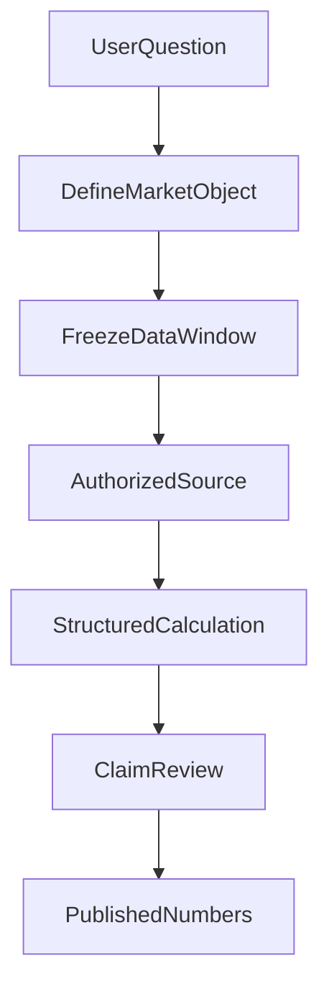

# 金融 AI 最危险的“专业感”：数据是真的，数字却算错了

> **阅读说明：** 文中的指数点位用于说明一次历史工程错误，不代表当前价格、投资观点或收益预测；真实错误样本不等于全系统验证。

> 系列归属：**金融科技与合规（主）** · AI 工程研发实践（兼） · 系统架构与工程观点（兼）

许多投资问答的第一道防线是“给数字加来源”。但真实研发中更难发现的错误，恰恰发生在**正确数据已经进入模型之后**：资料是真的、时间窗口也给了，模型最后却写出了另一组数值，语言仍然像一份完整的研究报告。

我们的 ETF Agent 曾有过这样的真实记录：某个指数年度低点在已取得的 2025 年收盘价序列中是 **3589.44**，模型回答却写成 **3722.51**。更矛盾的是，文章另一处回撤计算已经使用过 3589.44。事后复查证明两张已读取的收盘表均含 243 条 2025 年交易日数据；错误出现在模型解释与组织最终答案的过程，而不是据此可以直接认定 Runtime 把正确行情吞掉了。

这个案例真正值得分享的不是指数点位，而是**有来源、会计算、能写报告，是三层独立能力**。

## 一、金融数值首先要回答“这是谁、哪天、用什么口径算的”

“今年最低价”至少存在几个未说出口的条件：今年是自然年还是滚动一年，时间按交易所本地日还是用户所在时区，使用收盘价还是盘中最低价，是否复权，有没有停牌或缺失记录。

在基金研究里，同一个问题还可能是基金净值、指数价格、ETF 二级市场成交价或跟踪指数的收盘点位。即使数值来自真实供应商，只要把对象或时间窗换了，算术完全正确也会得出用户不需要的答案。

因此我们逐步把金融数据看成一组带身份的事实：instrument、字段、观察时间、样本窗口、供应商和缺失状态。引用标签能帮助回到来源，但它不能自动证明模型对时间条件的理解正确。

## 二、真实失败告诉我们：错的不一定是数据链路

那次错误最初很像典型的“上下文太长导致数据丢失”。我们自然会想加大窗口、重新读取、增加工具调用次数。然而，复查原模型请求与记录后，正确的 3589.44 不但存在于已取得数据里，还被模型在另一处采用。

由此可以排除一个过早结论：**不能仅凭最终答错，就说 Runtime 没有把数据交给模型。** 也不能反过来，因为看到了正确值，就说整篇分析没有问题。

后来一次独立计算交接能够把数值纠正为 3589.44，却错误地把表格 hash 当成可引用的来源 ID。计算准确了，引用链反而没有正确成立。再下一次真实复验里，模型部分引用变成合法身份的短前缀；系统没有偷偷把前缀“猜成”完整引用，而是保留未核验状态。

三个现象分别落在不同位置：数值解释、计算产物转交、引用身份。把它们统一称为“幻觉”，会让研发动作失去方向。

## 三、我们为什么坚持可复算，而不是依赖多模型投票？

对于平均值、回撤、相关性、区间极值这类确定性运算，重复问三个模型“你确定吗”不等于独立核验。若三次请求消费的是同一份错误口径，结果一致还可能增加错误自信。

更可靠的方式是对已取得且获准的结构化数据执行明确运算，并把计算窗口、字段和输出绑定在一起。例如计算一个日收盘序列的年度最低值，必须先把日期窗口限定到对应交易年，然后在非空收盘价上求最小值，并保留对应日期。用于价格与回撤的调整口径应另行声明，不可把两个序列混用。

这里的运算工具不应顺便决定“这个组合值得买”，它只负责在限定输入上提供可复核数值。模型继续负责解释意义、比较条件和不确定性；输出出现与运算结果不同的数字时，应具体定位到哪项主张，而不是让程序尝试理解全文“投资建议是否正确”。

## 四、真实金融来源不是一个万能认证印章

一份基金招募说明书可以证明产品的跟踪目标或费用条款在其文档时点怎样表述，但不能证明今天基金的二级市场价格；某个指数官网可以提供指数编制或当期样本数据，却未必能证明私人账户买卖行为。

所以来源治理除了“读过没有”，还要明确**来源权力范围**。在我们自己的受控数值链路中，私人持仓的权威不能从公开网页上一串碰巧相同的金额自动获得；公开文件的引用，也不能替代私人组合风险计算需要的实际持仓和时间窗口。

金融输出常有多种“真”同时存在：官方公告是事实，历史收盘数据是事实，计算结果是派生事实，用户实际投资盈亏又是另一条账本。将它们放到同一个看起来专业的 PDF 里，不会让它们天然互相验证。

## 五、别让一篇漂亮报告替一个未完成的研究盖章

截至我们这轮记录，自主组合研究仍有整题 partial、部分来源/计算与正常 HTML 交付未完成的情况；个别专项获得了可复核计算或文件交付，只能按其范围记账。即使后面能做到所有引用完整、数值再现，预测收益与投资建议质量仍需要独立验证，投资回报更不可能由这些工程回归直接推出。

这就是为什么金融 AI 的验收不能只问“是否给出一篇答案”。更应该抽出几条决定结论的数值，按原问题的对象、日期、取数口径和计算方式让它**由工具重新算出来**；再看模型是否忠实解释了那个结果。

在金融研究里，专业表达很便宜，**把数字正确地带过每一道交接并让别人复算**，才是难以靠文风替代的工作。我们已经有了部分工程实践，也依然保留那些未被证明的质量结论。这比把一份格式漂亮的报告宣布为“已验证”更值得信任。
