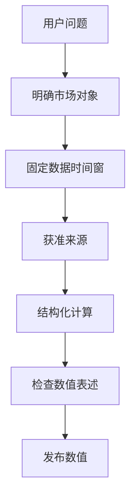

# 金融 AI 最危险的“专业感”：数据是真的，数字却算错了

> **历史案例：** 文中的指数点位取自 2025 年工程复盘，并非当前行情。

> 阅读分类：**架构设计与系统思考 → 金融研究与业务责任（主）** · **金融科技 × Agent（跨分类专题）** · 模块机制（关联阅读）

> 本文依据截至 2026 年 10 月 21 日的精确计算与指标联邦化工程阶段；计算反例使用安全测试输入，不是用户交易损失。

**金融 AI 最危险的数字，有时不是编造出来的，而是从真实资料中取出、再用错误口径解释的。** 对投资研究来说，先明确对象、日期、单位和分母，再核对运算，最后确认文字解释；三步中任何一步错了，都可能让一份专业报告产生误导。

ETF Agent 的一次真实研究里，2025 年某指数的已读取收盘序列最低值是 **3589.44**，模型却回答 **3722.51**；它在另一处回撤计算中甚至正确使用过 3589.44。两份已读表各有 243 个交易日记录。这次事实指向数值解释与组织的问题，而不能直接推定 Runtime 吞掉了数据。

另一类受控反例发生在不经模型的费用与现金计算中：精度和约束判定本身也可能出错。因此，我们将**确定性十进制运算**与**业务上应该计算和比较什么**分开负责，不让单一“金融数值总管”替代领域判断。

## 一、金融数值首先要回答“这是谁、哪天、用什么口径算的”

“今年最低价”至少存在几个未说出口的条件：今年是自然年还是滚动一年，时间按交易所本地日还是用户所在时区，使用收盘价还是盘中最低价，是否复权，有没有停牌或缺失记录。

在基金研究里，同一个问题还可能是基金净值、指数价格、ETF 二级市场成交价或跟踪指数的收盘点位。即使数值来自真实供应商，只要把对象或时间窗换了，算术完全正确也会得出用户不需要的答案。

因此我们逐步把金融数据看成一组带身份的事实：instrument、字段、观察时间、样本窗口、供应商和缺失状态。引用标签能帮助回到来源，但它不能自动证明模型对时间条件的理解正确。

## 二、真实失败告诉我们：错的不一定是数据链路

那次错误最初很像典型的“上下文太长导致数据丢失”。我们自然会想加大窗口、重新读取、增加工具调用次数。然而，复查原模型请求与记录后，正确的 3589.44 不但存在于已取得数据里，还被模型在另一处采用。

由此可以排除一个过早结论：**不能仅凭最终答错，就说 Runtime 没有把数据交给模型。** 也不能反过来，因为看到了正确值，就说整篇分析没有问题。

后来一次独立计算交接能够把数值纠正为 3589.44，却错误地把表格 hash 当成可引用的来源 ID。计算准确了，引用链反而没有正确成立。再下一次真实复验里，模型部分引用变成合法身份的短前缀；系统没有偷偷把前缀“猜成”完整引用，而是保留未核验状态。

三个现象分别落在不同位置：数值解释、计算产物转交、引用身份。把它们统一称为“幻觉”，会让研发动作失去方向。

## 三、我们为什么坚持可复算，而不是依赖多模型投票？

对于平均值、回撤、相关性、区间极值这类确定性运算，重复问三个模型“你确定吗”不等于独立核验。若三次请求消费的是同一份错误口径，结果一致还可能增加错误自信。

更可靠的方式是对已取得且获准的结构化数据执行明确运算，并把计算窗口、字段和输出绑定在一起。例如计算一个日收盘序列的年度最低值，必须先把日期窗口限定到对应交易年，然后在非空收盘价上求最小值，并保留对应日期。用于价格与回撤的调整口径应另行声明，不可把两个序列混用。

这里的运算工具不应顺便决定“这个组合值得买”，它只负责在限定输入上提供可复核数值。模型继续负责解释意义、比较条件和不确定性；输出出现与运算结果不同的数字时，应具体定位到哪项主张，而不是让程序尝试理解全文“投资建议是否正确”。

## 四、A33 解决的是精确运算，不是投资判断

JavaScript 的 `number` 使用二进制浮点。金融系统里，问题不只在 `0.1 + 0.2` 的演示：当金额乘以费率恰好落在半分附近时，浮点误差可能改变最终舍入；在判断资金是否足够时，先把差额显示成两位小数又可能隐藏真实短缺。

我们在原组合计算生产者中加入了很小的 **A33 Numeric** 能力。输入保留明确单位和十进制字符串；运算以精确十进制系数进行，再按调用方传入的舍入政策得到结果及残差。下面是代码中安全固定样例的代表：

| 输入与动作 | 精确结果 | 该调用方声明的输出 |
| --- | --- | --- |
| 137 元 × 0.015 | 2.055 元 | 2.06 元 |
| 145 元 × 0.015 | 2.175 元 | 2.18 元 |
| −10.085 元，保留两位 | −10.085 元 | −10.08 元 |
| 比较 1.000 元与 0.999 元 | 差 0.001 元 | **严格不相等** |

第三行的舍入沿用该领域明确指定的“半值朝正无穷方向”，**不是**所有系统都应使用的金融默认规则。货币结算精度、计算精度和报表展示精度可以不同；A33 不替基金或券商选结算政策。

实现上，A33 提供同单位加减/比较、调用方显式绑定的乘法、比例缩放及舍入残差。它不从数字大小猜测元/分，不把人民币和美元相加，也不根据“份额 × 净值”这几个字擅自判断基金身份。份额所属产品及净值日期的关联仍须由原投资数据生产者确认。

现有 TypeScript Portfolio 方案消费这些运算；Python 的收益统计继续由自身方法处理。我们没有为“统一数值”额外建立一个网络服务或强制整个研究流程经过 TypeScript 数值核。

## 五、资金守恒要在业务含义上成立，不能只靠小数显示

组合调仓不是简单的“目标比例 × 总资产”。现金可能分别属于可用于买入的余额、受保护的储备、尚未结算的卖出款和模拟方案中的预算。把这些角色混在一起，即使最后凑出一条数值平衡等式，也可能是错误的方案。

在当前调仓情景的明确结算假设下，可以审查这样一条关系：

**期末可分配现金 = 期初可分配现金 + 允许用于本情景的卖出所得 − 买入金额 − 已计入的费用。**

这条关系只适用于明确的资金角色与结算设定；不能把冻结储备当可用现金，也不能因为模拟允许卖出，就自动假定实际款项已经到账。费用必须来自同一份明细，不能在现金和方案消费者里各扣一次。

最能体现精度价值的，是我们补上的合成反例：**预算、可用现金或受保护储备只差 0.001 元时，旧比较路径仍可能判为可行。** 新路径先比较精确量，再决定该方案是否满足约束。展示层把两边都格式化成两位小数，并不能把“不足”升级成“可行”。

此外，负半分的交易差额也在原查询路径下复现过 10.09 与独立期望 10.08 的偏差，并经过原生产者修复。这里的真实工程收益是“特定金额路径和可行性判定被修正”，不是证明每一种券商费用、持仓记录或真实交易均已核对。

## 六、费率、费用估算与实际扣费，是三种不同事实

金融计算的另一类错误甚至不来自精度，而来自**公式所适用的事实类型**。

| 类型 | 可以支持什么结论 | 不能直接推出什么 |
| --- | --- | --- |
| 明确假设的费用 | 在声明费率与交易前提下做情景比较 | 用户实际享受这一费率 |
| 依据给定适用条款计算的估算 | 在份额、渠道、有效期、基数等条件吻合时估算费用 | 该条款来源已经认证，或券商已经扣费 |
| 实际交易回执 | 说明该交易真实发生的扣费事实 | 可直接代替其他情景的预计费用 |

我们随后把费用语义收敛到原领域方法中，而不是让报表、Python 和 Portfolio 各自重写同一个费率规则。当前限定支持的规则包括**不含费计费基数上的比例费用**和**每笔固定费用**；没有支持的费内基数、分档与持有期条款，不能被一个“通用费率计算器”悄悄补齐。

对缺少必要条件的估算，结果是局部不可用；独立的假设情景仍可继续。条款匹配本身不代表来源真实，更不代表账户已经发生扣款。尤其要注意：基金净值已包含某些持续性费用的影响时，不能在同一净收益口径上再次扣除同一项费用；一次申赎成本与多年费用拖累也是不同的方法。

**算出一个符合公式的数，不意味着有资格把它称为用户的实际成本。**

## 七、金融指标为什么选择联邦，而不是中央 Metrics Manager

我们最初希望减少各处重复公式，后来发现：字段名字相同，并不表示方法语义相同。若把收益、费用、穿透覆盖、跟踪差都送进一个中央 Manager，再由它统一认定“正确”，不但需要迁移所有业务规则，还可能把不一样的东西错误合并。

例如跟踪差的旧记录若用小数差值 `0.02` 表示，应按其版本化方法展示为 2 个百分点；另一个结果若原值已明确是 2 个百分点，就不能再乘 100。价格指数走势和含分红的总收益率也不能因为都叫 `return` 就混算。

组合年化同样如此。对于具备连续、完整日历年度与共同币种及收益基础的情景，原归因方法可以将**组合逐期收益复利链接后再年化**。把各资产的 CAGR 乘以当前权重再求和，通常并不是那段历史组合路径的年化收益。当前代码中的这项能力仍是受限定的模拟代理指标，不能冒充真实账户的时间加权收益或资金加权收益。

因此，我们采取的是联邦式收敛：Portfolio 继续负责现金、约束和调仓；费用领域负责适用规则；Python 负责收益、归因与穿透；A33 只承担精确运算。**同义方法复用一个维护源，异义方法保留独立版本。** 已保存的历史报告保留当时结果，不在读回时调用今天的新公式重算。

这比“所有指标走同一个类”更克制，也更容易回答审计中的关键问题：这个数字来自哪套方法、谁有权改变它，以及不能据此推导什么。

## 八、真实金融来源不是一个万能认证印章

一份基金招募说明书可以证明产品的跟踪目标或费用条款在其文档时点怎样表述，但不能证明今天基金的二级市场价格；某个指数官网可以提供指数编制或当期样本数据，却未必能证明私人账户买卖行为。

所以来源治理除了“读过没有”，还要明确**来源权力范围**。在我们自己的受控数值链路中，私人持仓的权威不能从公开网页上一串碰巧相同的金额自动获得；公开文件的引用，也不能替代私人组合风险计算需要的实际持仓和时间窗口。

金融输出常有多种“真”同时存在：官方公告是事实，历史收盘数据是事实，计算结果是派生事实，用户实际投资盈亏又是另一条账本。将它们放到同一个看起来专业的 PDF 里，不会让它们天然互相验证。

## 九、A33 有了独立主文，但不替金融领域“认证数字”

截至 2026 年 10 月 31 日，A33 的精确十进制协议可以从原来的金融案例中独立讲清：输入是带明确单位的十进制字符串，乘法必须有维度绑定，舍入返回 exact、rounded 与 residual，同单位比较不因展示精度而丢掉 0.001 的差异。

**图：相同的精确金额，因来源或业务条件不同，可能得到不同的合法结论。**

~~~mermaid
flowchart TD
    A[原来源: 对象/日期/币种/份额] --> B{领域前提成立?}
    B -- 否 --> X[局部不可用: 保留缺口]
    B -- 是 --> C[A33 精确十进制运算]
    C --> D[原领域复核分母/费用/残差]
    D --> E{可作为当前组合指标?}
    E -- 是 --> F[保留派生金额及口径]
    E -- 否 --> G[保留假设结果和限制]
~~~

以基金份额乘单位净值为例：相乘得到 2.055 CNY、结算显示 2.06 CNY、舍入残差 +0.005 CNY，这三个值可以由 Numeric 在给定政策下确定。**但如果份额日期和净值日期不一致，结果仍可能不具备“当前估值”的业务资格。** 金融领域必须决定时间对齐、样本覆盖、可允许的代理数据和失败后是否给出假设估算。

因此，A33 新主文与本篇不是替代关系：[数值核的单位、舍入与残差](/articles/agent-numeric-kernel-exact-units-rounding)专讲一项精确计算如何成立；本篇继续讲多个真实金融数字在时间、口径和来源上为何不能自动互相验证。B03 的组合计算、现金约束和账本仍是独立业务权威。

## 十、数字可信的最后一道检查，是它能否支持投资判断

截至 2026 年 10 月 21 日，精确运算、金融指标口径和首份 HTML 周报文件交付各有范围明确的工程验证；自主组合研究在整题完成、数值解释与方法消费上仍留下历史缺口。

下一次审查投研报告，我更愿意抽出**真正会改变结论的两三个数字**，依次问：数据属于哪个标的与时点？采用哪个收益、费用或约束定义？能否从合格输入独立复算？模型的最后一句解释，有没有超出结果能够支持的范围？

这也说明为什么计算模块与研究者需要不同的职责：前者保证在给定前提下精确执行，后者负责选择合适的方法并忠实解释它。若前提不成立，重新计算十遍也不会得到有意义的投资比较。

**数字有来源，是起点；口径能复算、结论有边界，才有资格被用于判断。** 金融数值的技术机制可以继续阅读[Python 结果消费](financial-agent-python-result-consumption.md)，但不能因为报告生成得漂亮，就提前宣布投资研究质量已经通过。

## 延伸阅读与交流

- [Python 结果为何仍可能被错误消费](financial-agent-python-result-consumption.md)：方法选择、数据资格、结果投影与模型解释。
- [金融 Agent 的可信证据链](financial-agent-trustworthy-evidence-chain.md)：从来源到计算、发布及历史的身份与口径。
- [Python：从工具到计算工作台](agent-python-compute-workbench-evolution.md)：计算隔离与实际执行能力。

更多文章见 [ETF Agent 独立阅读站](https://hpoenixf.com/eff-agent-article/)及 [GitHub 文章仓库](https://github.com/hpoenixf/eff-agent-article)。如果有帮助，欢迎 Star 或在 Issues 讨论其中的金融口径与工程反例。
