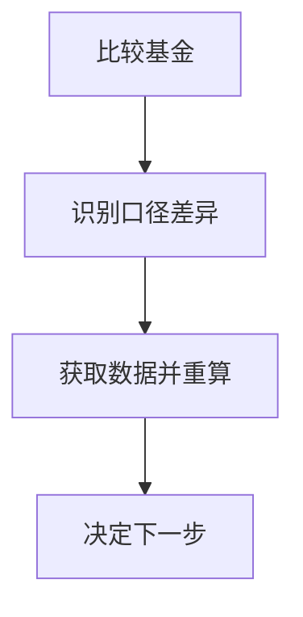
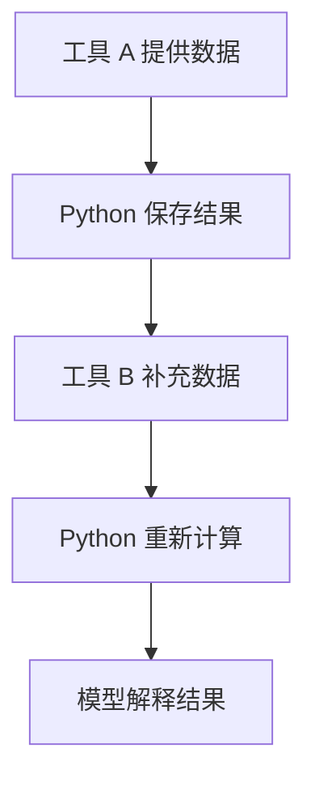

# 从工具调用到自适应研究：让 Agent 边查、边算、边调整

用户问：“两只 ETF 过去一年，哪只收益更高、回撤更小？”

最容易实现的路线是分别取数、运行 Python、输出两个指标。最容易漏掉的问题却在计算之前：A 给的是复权序列，B 给的是未复权价格；两者还可能覆盖不同日期。程序完全可以顺利运行，答案却没有回答用户提出的比较。

**自适应研究的核心，是让新证据改变下一步，而不是让工具按顺序全部运行一次。**

本文用这个教学场景串起当前方案：模型维护工作问题，通过原有工具获取材料，Python 接收明确的数据输入，在隔离环境里整理和计算，再把结果交回研究。这个例子不是一次已通过验收的真实 ETF 运行；文中的历史反例会另行标明。

<span id="先看一个研究为什么需要改变路线"></span>

## 1. 新结果为什么应该改变研究路线

同一个用户问题，拿到不同结果后，下一步应该不同。

| 发现 | 应该改变什么 |
| --- | --- |
| 收益口径不同 | 先确认或统一口径，不能把两个现成数字并排放置 |
| 起止日期不同 | 检查覆盖，明确能否支持“一年”，不能暗中缩短窗口 |
| 数据已齐，只有结构和单位不同 | 转入整理与计算，继续搜索不会解决格式问题 |
| 回撤异常 | 检查缺失值、单位与输入来源，而不是只美化计算结果 |
| 完整年度数据无法取得 | 给出能支持的部分，明确一年期结论仍缺什么 |



图里是简化的决策循环，不是固定的生产流水线。一次计算可能暴露新的取证需求，也可能说明资料已经足够，可以进入解释或结束。

这里有一个真实的历史动因。早期一项文档问答诊断中，模型检索四次仍漏掉适用期间，继而把“返回片段没有”扩大成“文档没有”。在同一个索引里改用定向查询，却能找到相关段落。问题不只是工具不够，而是没有根据已经得到的反馈改写要查的问题。这个旧反例解释了设计方向，不代表当前版本必然复现，也不能证明增加工作笔记就能消除它。

<span id="给研究留下问题-比给它写死步骤更有用"></span>

## 2. 保存待回答的问题，不把它变成执行计划

`researchNeeds` 保存模型当前认为重要的工作问题。例如：

```json
{
  "items": [
    {"id": "return-basis", "need": "确认两只 ETF 的收益序列口径可比", "status": "open"},
    {"id": "period-coverage", "need": "确认数据覆盖用户要求的过去一年", "status": "open"}
  ]
}
```

每项只有 `id`、`need`、`status`。状态为 `open`、`resolved`、`unresolved` 或 `not_needed`，模型通过 `set_research_needs` 更新判断。新证据可以让已经解决的问题重新打开，也可以让原本计划的问题变得不再需要。

为什么不写成“搜索三次、读两页、运行一次 Python”？因为工具次数是动作，不是目的。权威材料一次就说明了口径，后续搜索可以省掉；十次调用仍没解决口径问题，也不能因为做了很多事就算完成。

当前分工是：

- **模型判断研究方向。** 缺事实就取证，数据已齐但需要转换就计算，证据已有就形成有边界的解释。这些是思考提示，不是新的固定路由字段。
- **宿主系统保存和约束状态。** 它检查格式、容量和更新事实，不判断某个问题是否真的解决，不让笔记授予工具或来源权限。
- **原始用户要求始终保留。** 删除一个 need、提交空清单，都不会删除“一年”这个要求，也不会认证任务完成。

没有可用清单时，系统可以沿用完整原始问题，不强迫先加一次规划模型调用。笔记放不下时，也不能为了保住笔记而挤掉受保护的原始材料。

<span id="我们踩过的一个坑-问题清单更新了-不等于研究进步了"></span>

### 清单全绿，为什么还可能没有收尾

2026 年 10 月 9 日的诊断保留了两个相反案例：一条策略检查已经是 `not_needed / not_needed / resolved`，仍反复发布，最后由 QA 取消；另一条咨询保留 `unresolved`，却给出了有用的“输入不足”说明并正常结束。

因此，当前 Runtime 不把 needs 状态设为发布或结束的门槛。未解决的问题可能确实阻挡结论，也可能已经到了应向用户说明限制的时候。

同样，**笔记没有变化不等于研究没有进展**。连续读三份材料核对同一个口径，问题文字完全可以不变。旧实现曾把“清单仍与初始值相同”单独当作提醒理由；当前只保留基于实际轮次、调用事实的周期提示和收尾检查，不要求模型为显示进度而改写笔记。这里验证的是提示契约，不是已经测得的答案质量提升。

<span id="python-怎么从一次计算-变成研究中的接力工具"></span>

## 3. 为什么另建隔离计算，而不把代码塞进 Skill

原有可信 Skill 脚本擅长执行预先审查的方法，但它的执行入口不是任意模型代码的沙箱。把模型刚写的脚本存进可信包再运行，相当于借一个可信身份执行不可信内容。

当前 `run_analysis_python` 把两种信任分开：模型可以编写临时分析代码；宿主提供经过准备的本地隔离环境、固定依赖和资源限制。取数仍走原有工具，Python 本身不能新增网络、数据库、MCP 或模型调用权限，也不能临时安装包。

已有权威的确定性计算入口时，应优先使用。Python 负责长尾整理、比较和分析，不取代持仓事实、投资配置或执行决策的原有负责模块。

选择本地隔离，主要是为了把私有材料留在现有执行边界内，复用原来的授权、调用回执和结果交付。这不是说托管计算能力更弱，而是避免为这一条研究链再引入另一套数据处理和生命周期管理。

<span id="第一段-从工具结果接到-python-输入必须指得清楚"></span>

## 4. 从工具接到 Python：引用要同时说明“是哪份数据”和“能不能使用”

模型可以显式指定输入：

```json
{
  "inputs": [
    {"name": "etf_a.json", "toolCallId": "call_etf_a"},
    {"name": "etf_b.json", "toolCallId": "call_etf_b"}
  ]
}
```

宿主核对后，把这次输入放进只读 `/inputs`。这里有两种不同的语义。

| 输入方式 | 实际指向什么 | 不能假装什么 |
| --- | --- | --- |
| 当前 Run 的 `toolCallId` | 那次已完成调用实际进入模型输入的投影视图 | 不能借调用 ID 取回当时隐藏或省略的原文 |
| 授权保存视图的 `resultRef` 与明确选择 | 绑定版本、内容和来源的保存数据，可比模型可见正文更完整 | 不能因为模型知道引用字符串，就认为它已经读过数据或拥有新权限 |

第二种方式让模型决定算什么，而不必先逐行读完所有数据再抄进代码。**计算使用过数据，与模型阅读过正文，是两种不同的事实。**

权限依据是当前 Run 已封存的授权范围，包括适用的子任务子集。同一 Run 内消费已经获准且身份未变的数据，不重新查询外部当前 ACL。仍然要核对 Run、scope、回执或保存视图、内容哈希、来源依赖和可用字节。外部权限变化不能被误写成同一 Run 的自动失效条件；反过来，引用也不能授权外来、被篡改或本来未获准的数据。新的 Run 另行准入。

容量同样属于输入语义。当前配置允许最多 32 个命名输入、合计 4 MiB，仍受所选读取范围和其他传输限制约束。超限应明确拒绝，不能悄悄留下前半张表。模型主动选择一个日期区间，与系统为了装得下截掉后半段，是两回事。

在 ETF 示例中，输入处理至少应该留下：序列采用什么口径、实际覆盖哪段日期、哪些数据因缺失而不能参加比较。把这些信息连同数据交给计算，后面才知道数字回答的究竟是哪一个问题。

<span id="第二段-从一次计算接到下一次计算-靠文件延续"></span>

## 5. 从一次计算接到下一次：保存文件，不保存隐形变量



同一健康执行中的后续 Python 调用可使用 `/workspace` 文件，但每次都启动新的解释器。第一次得到 `aligned` 变量，第二次不会自动继承它；需要继续使用就明确写成文件。

```python
# 示意：本次已完成口径核对和日期对齐。
aligned.to_json("/workspace/aligned.json", orient="table", date_format="iso")
```

后续调用重新读取：

```python
import pandas as pd

aligned = pd.read_json("/workspace/aligned.json", orient="table")
```

模型可以在两次计算之间调用普通工具补材料，再让新输入和这个文件一起参与重算。Python 不直接调用那些工具；下一步研究行动仍由模型选择。

这里的“同一执行”比“同一研究任务”更精确。当前会话按宿主封存的 `executionId` 区分：Main 与不同子任务不共享工作区。同一根任务当然需要合作，但不应该因此能读取兄弟任务的临时文件、导出它的产物，或混合彼此的来源依赖。

这来自一个实际的设计修正：以根任务创建单一会话，会把 Main 和 Python 子任务的 scratch、generation 与 lineage 混在一起。仅在测试里分配几个独立假工作区还不够，真实 runner 也必须能承认对应容量。身份隔离和机器是否容得下更多工作区，需要分别验证。

同一工作区的执行按序进行，避免并发改写文件。服务重启、沙箱丢失或 generation 失效后，不能把原路径名当作文件还存在的证明。**持久回执能说明发生过什么，不等于临时工作目录也持久化了。**

<span id="第三段-从-python-接回研究-输出也要可以继续使用"></span>

## 6. 哪些成熟方案更适合，为什么这里选择文件状态

下面是按当前需求做的方案比较，不表示这些产品都曾被团队部署或做过效果对照。

| 方案 | 更适合的情况 | 本系统的取舍 |
| --- | --- | --- |
| 固定脚本或工作流 | 输入、公式和步骤稳定，需要一致执行的标准业务 | 保留权威方法；不为长尾临时分析把所有问题都提前写成脚本 |
| Jupyter 持久内核 | 人在回路中连续探索，希望保留变量、快速试验和展示结果 | 每次新解释器减少隐含内存状态；代价是显式保存和读取中间文件 |
| OpenAI Code Interpreter 等托管计算 | 希望服务提供隔离执行、容器与文件管理，并接受相应数据处理边界 | 本地执行与既有授权和回执相连；代价是自己维护镜像、资源监督、健康检查和清理 |
| 每次完全无状态的计算 | 计算很小，一次可重建全部输入，不值得管理中间状态 | 保留文件避免每轮重做所有整理，但不承诺跨重启恢复工作区 |

[Jupyter 的内核与交互会话](https://jupyter-notebook.readthedocs.io/en/latest/notebook.html#opening-notebooks)说明了持久交互的价值；[OpenAI Code Interpreter](https://developers.openai.com/api/docs/guides/tools-code-interpreter#containers)提供可创建、复用并管理文件的隔离容器，同时也有容器失效后的状态限制。它们不是错误方案，只是状态、运维与数据边界的选择不同。

我们选择的中间点是：文件足以承担多轮研究的接力，解释器内存不成为第二套必须恢复的状态。它并不自动让计算可复现。要复算，仍需保存输入身份、代码、环境和明确的中间产物，不能只保留一句“上次算成功了”。

<span id="把数据算过一遍-不能把它的来历算没了"></span>
<span id="连贯不只是保存文件-还包括知道失败后能不能接着做"></span>
<span id="时间口径-也必须跟着研究一起走"></span>

## 7. 输出不是越长越好，截断也不应该伪装成完整结果

计算应该告诉后续研究：实际窗口、采用口径、有效样本、异常和限制，以及能够支持的数字。把整个表打印出来，既浪费上下文，也可能把关键结论埋掉。

当前 stdout/stderr 的合计预览上限是 64 KiB，stderr 最多保留 16 KiB；最终进入模型的工具结果还受原有外层消息容量约束。因此不能把 64 KiB 理解成每次必然全部送给模型。预览达到上限，不会单独导致计算终止，但必须明确标记部分输出。合计输出超过 2 MiB 的硬上限，则进入资源终止处理。这些是配置边界，不是性能测量。

这个区别很重要：一段被截断的文本，即使碰巧仍是合法 JSON，也不能冒充完整表格交给下一次计算。大数据应显式写文件，或沿合格的完整保存结果路径消费。

三种产物各有职责：

- **工作区文件**：供同一健康执行继续加工，不自动成为持久交付。
- **可引用的返回结果**：符合完成状态、完整性和执行元数据要求后登记，供后续选择读取；不是所有 stdout 前缀都合格。
- **显式导出的文件**：通过原有导出与交付检查交给用户，不因为生成了图表或 CSV 就获得原始证据身份。

回到 ETF 示例，最有用的返回可能是“共同窗口只有九个月，一年期结论尚不支持”，而不是一张格式漂亮但悄悄缩短了样本的排名表。

<span id="如果要重建类似系统-先把这六件事接起来"></span>
<span id="最新证据让我们更确定了什么"></span>

## 8. 算过的数据仍然有来源，失败后的文件也可能真实存在

工作区按保守方式累积输入与原始暴露的来源依赖，不做逐单元格血缘追踪。这样会比精细依赖图保守，却不会因为转存 CSV、经过几轮 Python，或把数值复制进代码常量，就忘记这些数值从哪里来。

同一 Run 的执行继续使用已记录的授权，同时保留内容和来源身份检查。后续文件交付、保留或新的 Run 读取，遵循各自入口的规则，不能从“曾经算过”推导永久可用。

方法资料与业务数据也要区分。宿主验证过的当前 Skill 方法说明，不应被误认为未知业务数据；模型自行给文本贴上“方法”标签则没有这个作用。类型区分依靠真实的材料身份，而不是文本看起来像什么。

失败后的状态更容易被误解：

| 结果 | 下一步能相信什么 |
| --- | --- |
| 普通代码异常，进程已停止且文件检查完整 | 可以根据诊断改代码；之前已经写下的文件可能仍在，没有自动回滚 |
| 尚未执行的输入或容量拒绝 | 没有运行代码；不能把这次拒绝当作新计算结果，也不应无故破坏此前健康状态 |
| 不知道执行是否停止，或无法确认文件状态 | 使对应工作区失效，不能冒险继续依赖中间文件 |
| 恢复时已有完成回执 | 回放原结果，不重新执行代码；回执也不能复活丢失的 scratch |

所以“自动重试直到成功”不是可靠性的替代品。真正需要知道的是：代码有没有开始、哪些效果已经确定、还能从哪里接着做。

时间也属于输入的一部分。任务保存的时间锚点与当前参考时间不同；重查一次不会让旧事实变新。普通生产路径不能仅凭任务时间宣称知道用户时区，缺少可信时区时应保留未知。“过去一年”必须说明相对于什么时间、用了什么区间，而不是跟着最后一次查询悄悄移动。

## 9. 重建类似系统时，先连接什么

先保留完整任务和少量工作问题，再打通一条能说明输入、执行、输出与下一步的研究链：

1. **让新发现改变行动。** 区分缺证据、缺转换和缺解释，不把动作清单当成研究成果。
2. **让输入有明确身份。** 区分可见投影与保存视图，按当前执行的授权范围准入，超限不截样本。
3. **让接续状态看得见。** 同一健康执行内用文件延续，不靠隐藏变量，也不共享兄弟任务的 scratch。
4. **让输出保留问题的边界。** 返回实际窗口、口径与缺口，区分预览、完整结果和交付文件。
5. **让失败和结束都诚实。** 普通异常可以修，状态不确定就停用工作区；有用的限制说明也是合理终点。

历史诊断确实观察到模型选择多轮计算，也观察到重复发布、错误推断和无法收敛。它们跨越不同版本，并不是一次当前版本的质量对照实验。工程契约能验证隔离、身份和回执，不能替模型认证公式、资料充分性或答案质量。

自适应研究的价值，最终要落在这个问题上：**新拿到的材料是否改变了下一步，并让用户得到更可信、更清楚的回答？**
