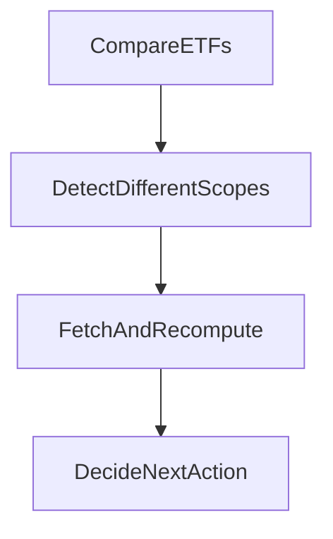
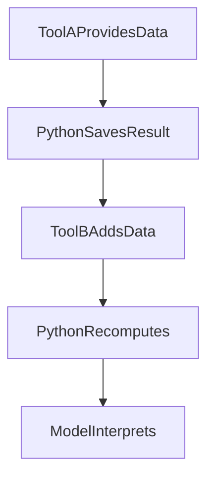

# 从工具调用到自适应研究：让 Agent 边查、边算、边调整

给 Agent 接上搜索、行情、文档和 Python，它就能做研究了吗？

刚开始，我们容易把研究想成一串工具调用：先搜索，再阅读，再计算，最后总结。工具越多，流程越完整，看起来就越接近一个研究员。

但真正做起来，会遇到一个更具体的问题：

工具已经返回了很多东西，Agent 却不一定知道下一步该做什么。

它可能继续搜索已经找到的事实，也可能把不同口径的数据直接拿来比较；可能成功跑完一段 Python，却没有发现输入不足以支持结论；还可能把问题全部标成“已解决”，然后继续绕圈。

我们逐渐把注意力从“能调用什么工具”，转向了另一件事：

**刚得到的结果，能不能改变它对问题的理解，进而改变下一步行动？**

这也是工具调用进化成 Adaptive Research 的关键。Python 则在其中承担了一项很具体的工作：把不同工具拿回来的材料接起来，把它们变成可以检查、比较和继续研究的中间结果。

## 先看一个研究为什么需要改变路线

假设用户问：

> 两只 ETF 过去一年，哪只收益更高、回撤更小？

下面用这个问题解释机制，它是一条贯穿示例，不是一次已经通过验收的真实运行。

一个预先写好的流程可能是：

查 ETF A → 查 ETF B → 算收益和回撤 → 给结论。

实际拿到数据后，事情却可能变成这样：

| 新发现 | 下一步为什么需要改变 |
| --- | --- |
| A 返回复权序列，B 返回未复权价格 | 先核对收益口径，直接计算会得到不可比的数字 |
| 两个序列的起止日期不同 | 检查覆盖范围，不能悄悄把“过去一年”改成更短的窗口 |
| 数据已经齐了，但结构、单位不一致 | 需要整理和计算，继续搜索不会解决问题 |
| 计算得到一个明显异常的回撤 | 回头检查缺失值、价格单位和数据来源，不能直接采用结果 |
| 仍然拿不到其中一只的完整年度数据 | 给出能够支持的比较，并说明一年期结论的缺口 |

**研究路线怎样根据发现改变**



新结果会影响下一步：继续补资料、调整计算，或者说明限制并结束。这是简化示例，不是固定流程。

工具返回的结果，在这里不只是用来填充答案。它还在不断改变研究路线。

原本以为缺的是一个收益数字，读完材料后发现，真正缺的是“这两个数字能不能比较”。原本以为还要继续查资料，整理完输入后发现，剩下的是一次计算。

如果 Agent 只能沿着最初的计划走，工具再丰富，也很容易做出一条流畅但错误的研究链。

## 给研究留下问题，比给它写死步骤更有用

我们的做法，是让研究保留一份简短的工作问题，也就是 `researchNeeds`。

例如：

```json
{
  "items": [
    {
      "id": "return-basis",
      "need": "确认两只 ETF 的收益数据采用可比较的口径",
      "status": "open"
    },
    {
      "id": "period-coverage",
      "need": "确认数据足以覆盖用户要求的过去一年",
      "status": "open"
    }
  ]
}
```

每项只有 `id`、`need` 和 `status`。状态包括 `open`、`resolved`、`unresolved`、`not_needed`，模型可以通过 `set_research_needs` 更新当前判断。

这里记录的是“还需要弄清什么”，而不是“接下来必须调用哪三个工具”。

这个差别很有用。

如果问题写成“搜索三次、读取两个页面、运行一次 Python”，完成这些动作很容易被误认为完成研究。可如果问题写成“确认两组数据是否采用同一收益口径”，读到一个明确说明口径的权威结果后，后面几次搜索可能根本不需要了。

反过来，即使已经调用了十次工具，只要口径仍然不清楚，这个问题就没有因为忙碌而得到解决。

我们让模型在重要结果、失败、冲突，以及从查找转入阅读、分析或综合时，重新检查当前缺口。判断时可以区分三种情况：

| 当前缺口 | 合适的行动 |
| --- | --- |
| 事实或输入还没有拿到 | 继续获取相关证据 |
| 输入已经拿到，但还不能直接回答 | 比较、归一化、聚合或计算 |
| 数据和计算已有，剩下的是解释 | 回到证据与问题，形成有边界的判断 |

这三类是帮助模型思考的概念，当前实现没有把它们做成新的固定路由字段。

原始用户问题也始终保留。模型删除某条工作问题，不能顺手删除用户的要求；把状态改成 `resolved`，也不能替代证据。

## 我们踩过的一个坑：问题清单更新了，不等于研究进步了

问题清单听起来很合理，但接下来很容易产生另一个误解：

只要它不断更新，研究就在进步。

最新一批 CLI 实测让这个判断变得更具体了。

这批记录覆盖 90 次运行，其中 70 次有标准正文采集。在这些正文片段里，19 次运行选到了 71 次模型撰写的问题清单更新。它说明问题清单确实被模型使用了，但不能据此计算问题解决率，也不能证明更新本身改善了答案。

其中两个案例尤其有启发。

一条策略检查里，问题已经被评估为 `not_needed / not_needed / resolved`，模型仍然继续修订，最终由 QA 终止。

另一条组合调整咨询里，仍然保留一个 `unresolved` 问题，却给出了有用的“输入不足”说明，并结束研究。

这两个案例放在一起，提醒我们：

**问题有没有全部变绿，与用户有没有得到当前能够支持的回答，是两件事。**

一个尚未解决的缺口，可能确实阻挡结论；也可能已经无法在当前输入条件下解决，此时说明限制本身就是合理结果。已经全部解决的清单，则可能漏掉了原始要求，也可能没有帮助模型判断何时该停止。

因此，运行时 不把这些状态当作完成判定，也不会因为还有 `unresolved` 就强制继续调用工具。

提醒机制也经历了一次调整。

之前，只要问题清单与初始清单相同，就可能反复提醒模型重新检查。这隐含了一个判断：清单没变，研究可能没有进展。

但连续读取不同材料时，问题完全可能不变。原来要核实一个口径，读了三份材料以后仍然在核实这个口径，并不奇怪。

10 月 9 日的代码因此撤掉了“清单相同”这个独立触发条件，保留根据已经完成的轮次和工具调用事实产生的周期提醒，以及收尾时的检查。

提醒要求模型复核证据、缺口和下一步行动；它不要求模型为了显得有进展而改写笔记。

这里的教训很简单：工作问题可以帮助研究保持方向，但不能拿笔记的变化代替研究的变化。

## Python 怎么从一次计算，变成研究中的接力工具

到这里，Adaptive Research 解决的是“下一步为什么要改变”。

Python 解决的则是：当下一步需要整理、比较或计算时，怎么让已经拿到的数据接得上，计算之后又怎么继续。

只给 Agent 一个执行代码的入口，通常还不够。

第一段代码算完了，第二段代码可能拿不到变量；前面的工具返回很大，模型可能只见到摘要；计算结果可能只是一长段打印内容，下次又得从对话里重新抄一遍。

我们在代码里能看到的演进，是先建立当前研究内的显式输入和文件工作区，再通过按需结果引用，让计算能够消费授权保存的数据，并把合适的计算输出交回后续研究。

已有权威的确定性计算入口时，应优先使用；Python 用于整理和分析获准数据，不能替代投资核心的配置、金额和执行决策。

这条接力分成三段。

**工具与 Python 怎样接力**



第二次 Python 读取前一次保存的文件和新数据，变量不保留。各次工具调用由模型选择；图里仍是前面的简化 ETF 示例。

### 第一段：从工具结果接到 Python，输入必须指得清楚

模型可以通过 `toolCallId` 指定已经返回并进入当前模型输入的工具结果：

```json
{
  "inputs": [
    {
      "name": "etf_a.json",
      "toolCallId": "call_etf_a"
    },
    {
      "name": "etf_b.json",
      "toolCallId": "call_etf_b"
    }
  ]
}
```

宿主系统 核对对应回执、可读状态和当前权限后，才把数据放到 Python 的只读输入目录：

```text
/inputs/etf_a.json
/inputs/etf_b.json
```

这里有一个容易忽略的限制：`toolCallId` 输入消费的是当前实际投影出来的结果，不能绕过上下文裁剪，偷偷取回工具最初返回的隐藏原文。

后来增加的 `resultRef`，补上了另一条路径。

数据可以保存在上下文之外。模型明确选择一个结果引用，宿主系统 重新检查当前授权，再把完整视图或明确选择的部分交给计算。Python 因此可以处理模型没有逐行阅读的数据。

这与“让模型先读完所有数字，再把数字写进代码”很不一样。模型负责决定算什么，数据通过引用进入计算。

但引用只是定位结果的方式，不是权限凭证。当前实现仍然检查运行归属、来源与依赖，不能因为过去拿到过引用，就永远继续使用。

容量也不能含糊处理。当前一次计算最多接收 8 个显式输入，总输入上限是 512 KiB。超过限制会拒绝，不能截掉后半段数据，再假装它是完整样本。

明确选择一段日期或一页数据，与系统为了装得下而截断数据，也必须区分。前者可以是分析设计，后者会悄悄改变计算对象。

### 第二段：从一次计算接到下一次计算，靠文件延续

同一条健康运行中的 Python 分析会话会共享工作目录：

```text
/workspace
```

但每次执行会启动新的 Python 解释器。

所以，第一次执行里创建了：

```python
aligned = ...
```

第二次执行不能直接沿用这个变量。

需要继续使用的中间结果，要写成文件：

```python
# 示意：aligned 是本次执行完成口径核对、日期对齐后的表。
aligned.to_json(
    "/workspace/aligned.json",
    orient="table",
    date_format="iso"
)
```

下一次执行再明确读取：

```python
import pandas as pd

aligned = pd.read_json(
    "/workspace/aligned.json",
    orient="table"
)
```

这使研究可以分阶段进行。

第一轮 Python 整理两个工具返回的数据，留下规范化结果。模型阅读计算摘要后，发现其中一组收益口径还需要补充说明，于是调用外部工具获取相应材料。第二轮 Python 再把新输入与已有文件接起来，重新计算。

这时 Python 承担的是两个工具之间的连接。第二次计算会同时使用已经保存的中间文件和模型重新获取的新材料。

Python 本身没有直接调用搜索或行情工具。需要什么新材料，由模型判断，再通过当前允许的工具获取。

文件延续也有明确范围：它属于当前运行中的健康分析会话。服务重启、会话失效或进入新的运行，都不能假定原来的工作目录还在。

我们还让同一会话内的计算串行执行，避免两段代码同时改写中间文件。每次返回会带上执行状态、工作区状态，以及受限的文件变化清单，后续步骤可以据此判断是否还有可靠的工作区可用。

连续分析的基础，是明确知道哪些东西被保存了，而不是期待解释器替我们记住一切。

### 第三段：从 Python 接回研究，输出也要可以继续使用

计算完以后，模型需要知道的不只是“代码退出了没有”。

回到 ETF 的例子，好的输出应该告诉它：

- 实际比较了哪个时间窗口；
- 哪些输入没有通过口径或覆盖检查；
- 已经能够支持哪些数字；
- 哪些结论仍然不能下。

因此，我们更倾向于返回小而明确的结构化摘要，而不是把所有行都打印出来。

当前 stdout 和 stderr 合计只有 8 KiB。大表应保存在工作目录，需要交给用户的文件再显式导出。把整张表打印到 stdout，不能代替保存完整结果。

符合条件、已经完成且带有有效执行与工作区元数据的返回输出，可以被登记为后续可引用的结果。这样，研究不仅能接着使用原始工具数据，也能使用前一步已经整理或计算过的结果。

但这不是“工作区里所有文件自动变成结果引用”。

工作区文件用于当前会话内继续加工；可引用结果来自符合条件的已返回输出；导出文件则用于交付。这几条路径承担不同的工作，不能混在一起。

这一段接力完成以后，Python 的结果会重新影响研究：

计算发现共同窗口不足一年，就重新检查覆盖问题；发现数据正常、数字可比，就进入解释；发现异常值，就收窄下一次需要获取的证据。

**计算产出新的判断材料，Adaptive Research 再根据这些材料决定下一步。**

## 把数据算过一遍，不能把它的来历算没了

Python 接在多个工具之间之后，还有一个更难的问题：

后面的结果，到底依赖了前面的哪些数据？

如果原始来源已经不可访问，或者权限被撤销，不能因为数据已经写进一个 CSV，就继续把它当作可用输入。

因此，计算会保留来源和依赖关系。使用保存结果时，还会绑定结果引用与内容哈希；执行记录则保留代码哈希和环境信息。再次执行、导出，以及下载产物时，都有对应的当前权限检查。

当前依赖跟踪采用工作区层面的保守累积。它不是逐单元格追踪每个数字的来源，但不会因为经过几轮 Python，就把前面使用过的数据依赖忘掉。

这也解释了为什么不能把数据从对话里抄进 Python 常量，就认为它与原始来源脱离了关系。数据换了一种写法，来源限制仍然存在。

最新代码还补了一个相关边界：当前绑定的 Skill 方法资料，应当与外部业务数据区分。

分析说明、操作方法、返回空数据的控制信息，不应该一概被当作来历不明的业务来源，进而让后续计算无法进行。但这项区分依赖 宿主系统 能验证它确实属于当前绑定的 Skill；模型自己把一段文本称作“方法说明”，并不能建立这个身份。

计算流程里，数据和方法都要接得上，也要分得清。

## 连贯不只是保存文件，还包括知道失败后能不能接着做

我们曾在实测中看到，模型遇到 Python 代码错误后修改代码继续计算。这样的行为很有价值，但需要执行环境给出清楚的失败信息。

一个已经停止、状态确定的普通代码错误，与一个不知道是否仍在运行的执行，不应该采用同样的处理。

如果代码失败，但执行已经结束、工作区状态确认可用，后续可以根据错误信息修正代码。前一次失败也可能写过文件，所以来源依赖不能随意清空。

如果执行状态不确定，或者工作区无法确认安全可用，就不能继续相信里面的中间结果。当前实现会使工作区失效。

还有一类“继续”，发生在恢复或回放时。

已经完成并留有回执的调用，回放时使用已有结果，不重新执行 Python。新的计算调用则仍然是一项新执行。不能用“代码和参数看起来一样”作为任意复用结果的理由，因为工作目录和输入状态可能已经变化。

这种处理看起来没有“自动重试到成功”那么顺滑，却让研究真正知道自己是从哪里接着做的。

## 时间口径，也必须跟着研究一起走

这次代码审查还看到一个与比较直接相关的修复：把任务时间与当前参考时间区分开。

长研究中，查询发生的时间会变化，工具返回的市场时间、新闻发布时间、材料适用日期也各不相同。重新查询一次，并不会让旧事实自动变成新事实。

最新实现把运行保存的任务时间锚点与当前参考时间分开；时区只接受明确、可信的调用方输入。普通生产路径目前提供任务时间锚点，不能据此声称已经知道用户时区。缺失时区时保留未知，而不是套用某个市场或部署环境的时区。

回到“过去一年”的比较：不仅要算出一个数字，还要知道这个窗口是相对于哪个任务时间、采用什么口径建立的。

新的数据可以改变研究判断，但不能悄悄改写原来的问题。

## 如果要重建类似系统，先把这六件事接起来

完整照搬一个 Agent 框架，并不是起点。先建立下面这些连接，已经能形成一条可继续的研究链。

1. **始终保留原始任务。** 工作笔记可以修改，用户要求和限制不能跟着消失。
2. **保存简短的当前工作问题。** 允许根据新证据更新，不把状态当作完成或授权凭证。
3. **给数据稳定的身份。** 区分当前可见工具结果与授权保存的结果，每次消费都检查归属、权限、覆盖和容量。
4. **建立运行内的分析工作区。** 输入只读，中间结果落文件；解释器可以重启，文件承担接续；执行按会话串行。
5. **让计算返回可检查的材料。** 既有数字，也有实际窗口和限制；需要继续使用的结果保留引用与依赖。
6. **在重要结果和阶段变化后重新判断。** 下一步可能是继续读、继续算、解释已有证据，也可能是说明限制并结束。

同时保留两种判断：

模型判断当前缺口意味着什么；宿主系统 判断哪些输入和动作当前允许、执行状态是否确定。

让模型判断研究方向，不意味着让它决定数据权限。让 宿主系统 检查执行成功，也不意味着让它把“代码成功”升级成“分析正确”。

## 最新证据让我们更确定了什么

截至 10 月 9 日，代码已经具备这条链的关键连接：工作问题、证据反馈、Python 显式输入、运行内文件接续、授权结果引用，以及计算依赖的延续检查。

新一批 90 次 CLI 运行中，21 次运行出现了 Python 工具提案，其中 8 次在多个研究 turn 中出现。它说明模型确实会多次选择计算，但这些计数来自工具提案，不能当作执行成功率。

问题清单也确实被使用和更新了。但真实案例同时说明：清单更新、计算成功、研究收敛和答案正确，仍然需要分别判断。

这批实测跨越多个服务版本，而且发生在最新提醒与时间修复之前。因此，我们还不能拿它宣称最新修改已经提高质量，更不能说系统已经稳定完成各种端到端研究。

我们现在更清楚的，是应该怎样组织研究：

工具拿回材料，Python 把材料接成可以检查的中间结果，模型再根据新发现调整问题和行动。缺口得到解决时继续形成结论；缺口无法解决时，把边界讲清楚。

Adaptive Research 的价值，就发生在这些连接之间。
