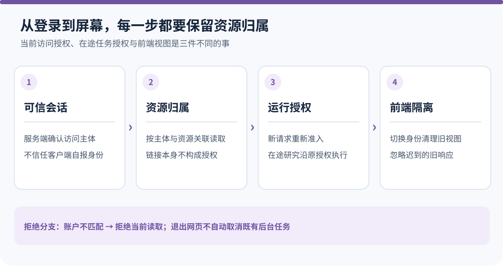
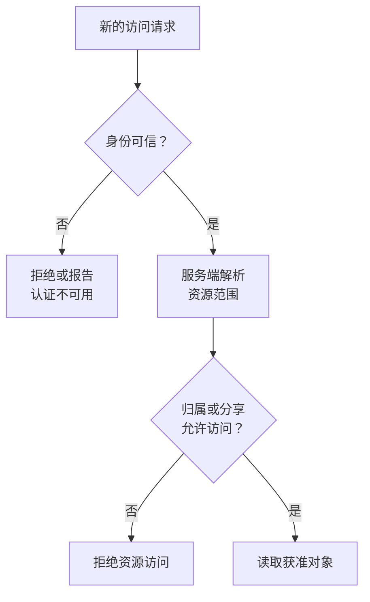
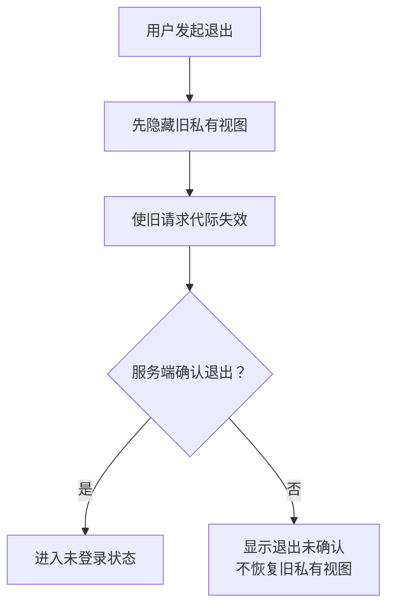

# 同一个 Agent，怎样确保每个人只看到自己的研究？

一位用户上传了基金资料，让 Agent 在后台分析。另一位用户也登录了同一个应用，并拿到前者报告的链接。服务端应该返回什么？

“已经登录，所以可以访问”显然不够。但把链接藏起来、在页面上过滤列表，也没有解决问题：请求仍然可能直接抵达服务端，旧页面里也可能还留着上一位用户已经加载的内容。

Agent 让这个普通 Web 安全问题变得更长了。研究会跨多次工具调用，用户可能中途退出，后台任务仍在运行；后来打开历史和下载报告，又是新的访问请求。

**因此，账户接入的核心不是增加一个登录页，而是让每个读取和效果都说清楚：谁在访问，访问哪份资源，依据哪项授权。** 下面用两位用户访问同一项研究的教学场景，解释 ETF Agent 当前的具体分工与取舍。


<picture>
  <source media="(max-width: 640px)" srcset="../visuals/agent-account-identity-private-scope/overview-mobile.svg" />
  
</picture>

*图：身份、资源授权和浏览器视图隔离。概览按职责组织，不是某次任务的真实调用记录。*

[放大查看完整图](../visuals/agent-account-identity-private-scope/overview.svg)

## 一、身份可信，不等于资源可读

先区分四个容易混在一起的对象。

| 对象 | 回答的问题 | 不能代替什么 |
| --- | --- | --- |
| 账户 | 这个主体是谁？ | 不能证明浏览器当前仍持有有效会话 |
| 登录会话 | 本次请求是否代表这个账户？ | 不能证明它有权读取所有报告 |
| 资源范围，简称 Scope | 这份会话、资料或产物归属哪个范围？ | 不能因为客户端填了范围，就认定其身份可信 |
| 一次研究的授权记录 | 这个任务被允许使用哪些能力与资料？ | 不能授权另一位用户或另一项研究 |

Scope 在这里是资源隔离范围，不是一个必须发给模型理解的新业务概念。服务端要能根据可信主体推导它，并让资源读取按这个范围执行。

[OWASP 的授权指南](https://cheatsheetseries.owasp.org/cheatsheets/Authorization_Cheat_Sheet.html)强调了同样的基础区别：认证与授权不是一回事，访问检查需要覆盖具体请求和对象。使用成熟认证库能帮助验证会话，却不会自动替应用建立报告、研究资料和任务之间的归属关系。

在 ETF Agent 中，账户模式是明确启用的能力，而不是给原本的个人数据换个名字。已有个人范围不会因为一个账户登录，就被自动认领。尤其是根投资系统里的持仓真值，它并不会因为聊天记录按账户隔离，就自动变成一套支持所有用户投资账户的多租户账本。

这个限制值得提前说明。否则，团队可能在聊天层实现了 `userId`，却在底层仍然读取同一份个人持仓，最后误把界面隔离当成业务数据隔离。

## 二、可信身份只建立一次，但要沿正确的请求传下去

最危险的一种简化，是把浏览器传来的 `userId` 或 `scopeId` 直接用于数据库查询。即使前端只会发送当前用户编号，服务端也不能把这种约定当成信任依据。

当前 HTTP 入口先通过服务端认证适配器取得会话身份，再让后续路由复用这个请求内的身份。试图用查询参数或自定义请求头覆盖用户、范围和已验证身份的请求，会在入口被拒绝。

这里的复用只限于**同一请求已经取得的可信结果**，不是跨请求缓存一张永不过期的通行证。认证服务暂时不可用时，接口返回不可用；不能为了让页面继续展示，悄悄降级到默认个人账户。

对修改操作，还要校验请求来源。这与“用户已经登录”解决不同问题：有效会话不等于用户有意从任意站点发起修改。来源检查也不能替代对象授权，二者各自保留。



这张图没有把模型放在授权路径上。模型可能提议读取一份资料，但“这是我的文件”这句话不能建立账户身份，工具参数中的对象编号也不能证明归属。

## 三、把范围放进读取条件，不要先取出来再藏住

假设用户甲的报告编号为 `report-x`。用户乙提交这个编号时，系统不应先按全局编号取出完整报告，再依赖前端判断“不是我的，别显示”。内容一旦进入响应、日志或模型上下文，页面隐藏已经太晚。

更清楚的接口形状，是让调用方同时提供服务端解析的范围与目标身份。例如以下教学伪代码：

```text
身份 = 验证当前请求的会话
范围 = 根据可信身份解析资源归属
结果 = 在该范围内读取指定报告
```

重点不是具体 SQL 写法，而是**资源标识与可信归属必须一起进入访问判定**。不可猜测的编号可以降低暴露机会，却不是授权检查的替代品。

对于 Agent，这条链还要继续延伸。会话存在，不代表其中任意 Run 都属于当前范围；有权读某份保存的报告，不代表有权重新获取报告引用的私人原始资料；拿到旧工具结果的标识，也不意味着新的任务自动继承旧任务权限。

缓存也一样。两个用户输入相同问题，不足以证明他们可以共享同一份私有结果。缓存键要体现实际隔离边界，返回时仍要保留资源归属检查。不能为了提高命中率，先合并不同用户的研究，再靠输出过滤补救。

定向分享是一个明确例外，而不是整体范围的开放。它可以让接收者取得某个固定产物版本，但不把接收者变成所有者，也不开放原会话、原始资料和其他附件。需要扩大的权限，应由对应能力明确接纳。

## 四、最容易讲错的一点：当前请求与在途研究不是同一生命周期

用户开始研究后退出登录，后台任务应该立即取消吗？管理员改变一个来源的准入配置，已经接纳的研究应该在下一次工具调用时重新申请吗？

这些不是认证库能替产品回答的问题。

项目早期曾采用更广泛的当前权限复查：研究执行、恢复和发布时，再询问当时的账户或来源状态。它的直觉很合理——权限变化尽快影响后续工作。但长研究已经取得的资料、尚未读取的已授权资料以及恢复后的状态，可能因此被不同消费者反复裁决。

现行设计选择把一次 Run，也就是一次独立研究执行，作为有明确范围的授权生命周期。Host 接纳任务时记录其获准来源和能力；同一个 Run 后续执行使用这份记录，不因外部权限表变化重新缩减。需要增加范围时，仍由原授权入口显式接纳，不能由模型自行扩权。

**这不等于以后都不做权限检查。** 检查依然存在，只是要问清楚当前动作依赖哪一项权利。

| 操作 | 应依赖的授权事实 |
| --- | --- |
| 新 HTTP 请求读取私有会话或下载文件 | 当前可信会话、目标归属及适用分享条件 |
| 已获准研究在原范围内继续执行 | 原 Run 的授权记录、真实执行状态与资源约束 |
| 新研究复用旧报告或旧资料线索 | 新 Run 自己的准入，不能借旧缓存自动放行 |
| 显式取消一项研究 | 原任务的取消与结算机制，而不是猜测用户是否还在线 |

同 Run 授权稳定，也不保证某份资料永远存在。字节丢失、文件到期、内容身份改变或外部工具不可用，仍然是具体的读取失败；它们不能被伪装成“权限被撤销”，也不能反过来让其他独立合法结果全部消失。

这是一项有代价的产品选择。它不会把来源权限配置变化自动追溯为已接纳研究的即时撤权。因此，必须在初次准入时控制好范围，并保留真实的取消、期限和资源限制。**需要权限一变就在途生效的系统，不能直接照搬这套生命周期。** 它需要另外设计明确的撤权和在途结算规则，而不是同时保留两种互相冲突的解释。

## 五、退出登录时，前端也在处理一条安全边界

设想用户甲正在查看报告，点击退出。服务端稍后确认退出成功，但在这段时间里，一个较早发出的会话检查或报告请求才返回。如果前端直接把它写回当前状态，就可能重新显示已经应该退出的内容。

这不是“后端有没有鉴权”的重复问题。后端处理请求时可能完全正确，错误发生在**哪个浏览器身份接收了这个晚到结果**。

当前账户边界在退出开始时，先隐藏旧的私有子树，再异步请求服务端退出。同时推进请求代际，使先前启动的身份检查不能覆盖新状态。账户或会话变化时，会清理用于定位上一次对话的本地提示；这些提示始终不是服务端权限凭据。



实际页面还会在重新获得焦点等时机核对身份。这里的意义不是宣称所有权限变化都能瞬时传到每个标签页，而是把“身份还未知”“当前匿名”和“认证服务不可用”保留成不同状态，不用旧内容冒充已经核实的当前视图。

对开发者来说，可以把同一原则应用到数据请求：发出请求时记住它属于哪个账户与会话代际；提交结果前核对这个代际是否仍然有效。取消网络请求能够节省工作，但不能代替最终写入状态前的归属检查，因为响应可能已经完成。

退出登录也不应被客户端偷偷解释为“用户取消了已经接纳的后台研究”。查看权、登录会话和任务执行分别拥有自己的状态。用户要停止研究，应得到明确的停止入口和操作结果，而不是依靠关闭浏览器来猜测任务是否终结。

## 六、怎样证明隔离，而不只证明登录成功？

最有价值的验证，不是反复用同一个账户打开自己的页面，而是保持目标资源不变，改变访问主体和生命周期条件。

可以从一个最小矩阵开始：甲可以读取自己的报告；乙即使知道同一编号也不能读取；乙获得指定版本的分享后，只能取得那个版本；分享撤销后，新的读取被拒绝。模型输出里包含资源编号，也不能改变这些结果。

随后补时间方向的反例：旧会话退出后再次请求；新账户登录时旧响应才到达；已有授权的研究继续执行，但另一个新研究没有相同来源权限；当前会话仍有效，但目标资源属于另一范围。

观察时不能只看状态码。还要检查私有正文、来源片段与工具数据有没有在拒绝之前进入不该进入的消费者；前端有没有短暂保留旧内容；后台是否把视图断连错当成任务取消。

项目已有账户、HTTP、数据库与浏览器接缝的本地验证材料，但它们不代表生产部署的全部访问路径都安全。代理转发、缓存、静态文件服务、对象存储与邮件回调，需要在实际部署中分别核对。一个正确的应用路由，无法为绕过它的直达地址提供保护。

## 七、公开教学版为什么没有“顺便支持多用户”

[Open ETF Agent 的固定 v0.15.2 说明](https://github.com/hpoenixf/open-etf-agent/blob/34124cefc6df289e08518173789210b45a716451/README.zh-CN.md)明确定位为本地、单用户、合成案例。它的[阅读入口](https://github.com/hpoenixf/open-etf-agent/blob/34124cefc6df289e08518173789210b45a716451/src/reader-cli.mjs)只打开操作者选择的运行目录，并声明仅供 loopback 使用。

读者可以用它理解“重新阅读不执行研究”，但不能把本地 Session、文件目录或随机标识理解成本文的账户认证与私有范围实现。把服务监听地址改成公网，也不会自动补出这些能力。

因此，本文没有提供一条声称能够安装完整多用户系统的公开命令。公开代码对应的是更窄的单用户边界；账户模式、私有资源和指定接收者分享属于完整系统的工程设计。后续公开能力应以[当前 main](https://github.com/hpoenixf/open-etf-agent/blob/main/README.zh-CN.md)及其真实接线为准。

## 结语：身份不是一个字段，而是一条不能接错的关系

两位用户可以使用同一个 Agent，但不能因此共享同一份私有上下文。可信会话告诉服务端谁在发请求，资源范围确定对象归属，任务授权决定一次研究能做什么，前端则保证结果不会被交给已经变化的身份。

把这些关系讲清楚以后，登录、退出、分享和取消就不必挤进一个含糊的“用户状态”。每个动作有自己的效果，也有自己的失败方式。

**真正值得检查的不是“请求里有没有 userId”，而是这个身份从哪里来、在哪个边界被使用，以及直到最后一份内容呈现时，它是否仍然属于正确的人。**

关于任务与对话身份的区别，可接着阅读[对话接纳与任务接续](https://hpoenixf.com/eff-agent-article/articles/agent-conversation-admission-task-continuation)；关于一次研究的授权范围，可阅读[模型会理解，代码才授权](https://hpoenixf.com/eff-agent-article/articles/011-model-understands-code-authorizes)。