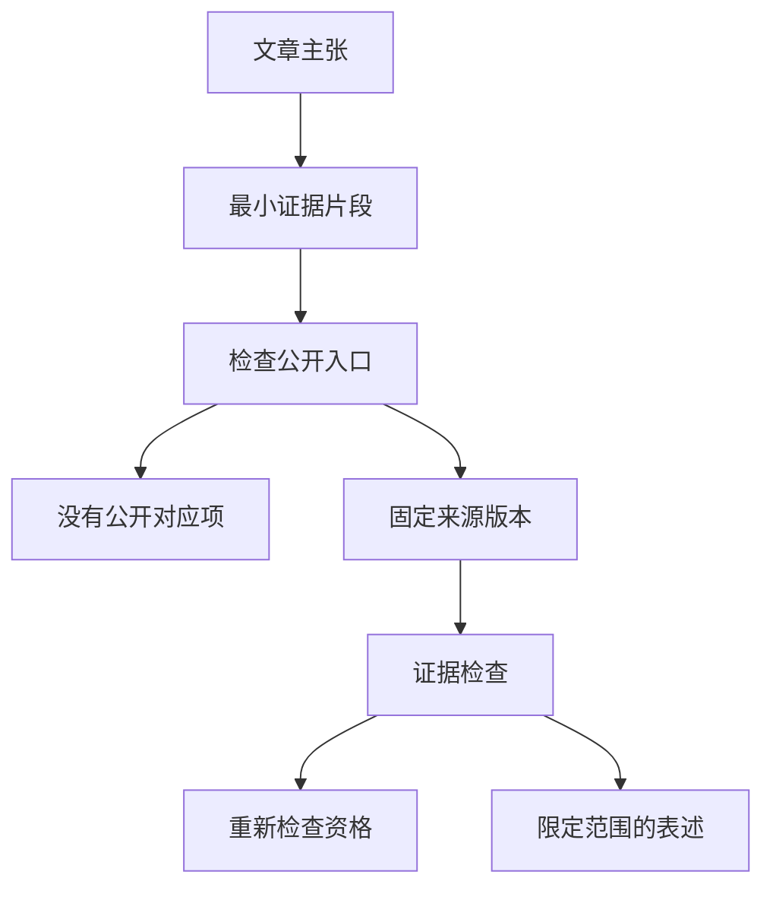

# 文章说能运行，代码真的支持吗？——技术文章与开源实现的证据契约

技术文章很容易给人一种错觉：文章写得完整，GitHub 仓库也存在，技术方案就已经得到了验证。但这三件事并不等价。

假设你读到一篇 Agent 长期记忆文章：它介绍保存偏好、更新记忆、响应遗忘请求，最后附上开源仓库。你准备照着运行，却发现文章讨论了自动学习，示例只有手动保存；仓库已经升级，不知道文章说的是哪一版；README 写着测试通过，却没说验证了哪段行为。

这未必意味着文章写错了。更常见的问题是：**技术主张、实际代码、运行版本和验证结果之间，缺少一条可以核对的关系。**

最近整理 [Open ETF Agent](https://github.com/hpoenixf/open-etf-agent) 的公开工程时，我尝试把这条关系明确下来。目标不是为每篇文章附上长长的测试报告，而是让读者能回答三个实际问题：**它在哪里实现？我怎样运行？运行结果究竟证明了什么？**

## 一、为什么只贴 GitHub 地址还不够？

最早写技术分享时，讲清方案、给出片段、最后贴一个仓库链接，通常就够了。但项目持续演进后，三个细节会逐渐变成问题。

**`main` 不是固定版本。** 今天代码只有文件检索，下个月加入数据库，之后又增加恢复。半年前的文章如果只链接到 `main`，读者看到的可能已经是另一套入口。[GitHub 的永久链接说明](https://docs.github.com/en/repositories/working-with-files/using-files/getting-permanent-links-to-files)区分了可变分支和固定 Commit。

因此，文章最好同时保留两个入口：固定 Commit 回答“写作依据是哪份实现”，当前 `main` 回答“现在从哪里开始”。前者保存历史，后者方便使用。

**文章讨论范围可以大于公开代码。** 一篇长期记忆文章可能讨论自动学习、跨会话召回和安全遗忘，而公开教学仓库只实现显式保存、修订与遗忘。这是合理的最小化选择，但不能因为名字都叫 `Memory`，就把完整系统的能力归给最小示例。

**测试通过不等于整篇文章成立。** “遗忘后旧记忆不进入下一次请求”可以用代码检查；“模型会识别所有值得保存的偏好”“长期摘要完全准确”需要完全不同的证据。绿色测试标记不能自动证明后两者。

一条仓库链接只能说明代码在那里，不能替所有技术声明作证。

## 二、用 Agent Memory 做一个可运行的例子

[ETF Agent 的 Memory 专文](https://hpoenixf.com/eff-agent-article/articles/026-agent-memory-forget-durable-effects)讨论应用层记忆的写入、召回与治理。其中的关键判断是：**遗忘不只是聊天窗口说一句“我忘了”，而是要改变旧记忆进入未来模型输入的资格。**

要解释这个判断，不必先搭建账户系统、向量数据库和自动学习平台。先看一个标明为**合成数据**的例子：

> 以后比较基金时，先说明费用口径。

现在只检查三个动作：保存这条偏好，修订它，再遗忘它。每一步留下实际操作回执；遗忘后，核对未来的输入，而不只是检查“已删除”的提示。

[Open ETF Agent v0.5 固定源码](https://github.com/hpoenixf/open-etf-agent/tree/05c0dd2dc550f4f7e5da034340ff5c3159768fcf)提供了 `explicit-memory` 演示。它使用明确选择的本地合成记忆库和预设的显式操作意图，运行保存、修订、遗忘三个独立 Run，保留本地操作回执并检查后续输入的处理。

这个最小实现没有完整账户级 Memory 服务，也没有自动语义学习或真实模型自主决定保存什么。**它证明的是一段范围明确的 Runtime 行为，而不是完整的长期记忆平台已经公开。**

### 读者怎样动手？

在新的演示目录准备 Node.js 26.11.1–26.x，然后执行固定 v0.5 README 对应的命令：

```bash
git clone https://github.com/hpoenixf/open-etf-agent.git
cd open-etf-agent

git checkout --detach 05c0dd2dc550f4f7e5da034340ff5c3159768fcf
npm ci --ignore-scripts --no-audit --no-fund
npm run build

npm run demo -- --case explicit-memory --memory-library runs/selected-synthetic-library
```

安装依赖可能访问 npm，示例本身使用离线合成输入，不需要真实模型密钥。请选择新的空记忆库，不要把自己的个人 Memory 数据交给历史演示。CLI 会输出实际的 Run 产物目录，读者可以查看报告与操作回执；[当时的验证记录](https://github.com/hpoenixf/open-etf-agent/blob/05c0dd2dc550f4f7e5da034340ff5c3159768fcf/docs/verification/v05-demo-receipts.json)则提供历史参照。

最值得观察的不是模型写出了一句漂亮回答，而是**哪项状态真的被提交，哪条记忆以后不能再进入模型输入**。

后续公开代码增加了读取已有 Memory 库的候选入口，这不能反过来证明 v0.5 当时已有同一能力。每个阶段都要按自己的真实范围介绍。

## 三、能力第一次出现，与什么时候通过验证，是两个问题

假设显式 Memory 在 v0.5 已存在，后来修复了相关测试，并在一个更新的代码快照上重新验证。文章应该归到哪一版？

两个时间身份都值得保留，但它们回答的问题不同。

在 Open ETF Agent 的[文章与代码映射](https://github.com/hpoenixf/open-etf-agent/blob/main/docs/articles-and-code.zh-CN.md)中，使用了这组字段：

| 字段 | 回答的问题 | Memory 示例 |
| --- | --- | --- |
| `since` | 这段最小能力首次公开出现在哪里？ | v0.5 |
| `verifiedAt` | 已登记的验证回执绑定哪份固定源码？ | `e1b8e4e` |
| `target` | 实际运行哪个目标？ | `explicit-memory` |
| `scope` | 结果覆盖到哪段行为？ | 合成输入的显式保存、修订和遗忘 |

可以把 `since` 理解成能力的出生记录，`verifiedAt` 理解成某次体检记录。

**后来体检通过，不代表能力那天才出生；新的体检也不能把旧版本尚未实现的功能补回历史。**

`verifiedAt` 还不等于“今天刚刚重跑”，也不意味着所有新版本自动合格。它仅记录对应证据所使用的固定源码身份。

把这两件事混在一起，就容易让文章用今天更成熟的系统，改写昨天真实发生的工程历史。

## 四、文章、代码和验证：连成一条链，而不是另造演示引擎

确定最小能力后，下一步才是建立对应关系。

Open ETF Agent 维护了结构化的[覆盖清单](https://github.com/hpoenixf/open-etf-agent/blob/main/docs/verification/article-coverage.json)：文章用稳定的 slug 定位，关联已有 CLI 场景或测试目标，并保留适用范围和验证身份。

这份清单并不负责重新实现研究功能。**它登记哪些已存在的真实入口，能够支持哪些有限的公开声明。**

为什么不为每篇文章另写一套演示程序？因为那样即使演示成功，也可能只是新程序正确，并不能证明原来的 Runtime 真实调用链成立。

整个判断可以概括为：



图中两次检查各有两种结果：没有公开入口，明确标记“无公开对应”；已有入口但源码或回执不匹配，不能借用旧证据，先重新验证或收窄声明；只有代码、入口与证据匹配，才展示相应的有限能力。

这里有三个容易忽视的选择。

### 允许“无公开对应”

一篇文章可能讲完整的专家管理，公开仓库却只有脚本化 Child。两者相关，但不是同一能力。直接标注“无公开对应”，比借用相邻功能的成功回执填满覆盖率更有价值。

### 入口必须走得到，产物必须看得见

只有一个类、函数或 Spec，不等于读者已经能完成任务。应该说清命令、输入条件、实际产生的报告或回执，以及怎么观察成功、部分完成或失败。

对于 Memory，这个位置是 `explicit-memory`；其他能力可能对应固定 CLI 或独立测试。形式可以不同，但结果必须有可核对的落点。

### 旧证据不是新代码的免费通行证

上周测试通过，本周如果改了相关源码、依赖锁文件、示例输入或验证程序，旧回执仍存在，但适用范围可能已经改变。

因此，项目把固定 Commit、运行目标、源码与输入的内容指纹、执行回执联系起来。内容指纹可以理解成“这次验证到底用的是哪一份文件”的标记。相关文件改变时，需要重新判断旧证据是否适用，并在必要时重验。

**证据不仅有结果，还有时间、版本和适用范围。**

## 五、自动检查能做什么，不能做什么？

结构化映射让程序可以承担一些重复、确定性的工作。

[`check-article-coverage.mjs`](https://github.com/hpoenixf/open-etf-agent/blob/main/scripts/check-article-coverage.mjs)会核对条目、运行目标、历史版本血缘和原始验证回执，也能生成中英文的映射表。它区分两种操作：

```bash
# 核对现有登记和固定证据，不重新执行所有示例
node scripts/check-article-coverage.mjs

# 显式重跑受限的既有 CLI / 测试目标
node scripts/check-article-coverage.mjs --smoke
```

第一条是检查“这份既有证明材料仍然对应所声称的对象”，第二条才包含实际执行。不能把前者说成“刚刚重跑全部通过”。

`verified` 也只表示某段有限的 Runtime 行为获得了相应验证，不表示整篇文章已经被自动做过语义审稿。程序擅长检查文件、命令、版本和结构是否一致；文章对方案的解释是否合理、英文是否准确、模型是否真正理解用户意图，需要另外的审阅或运行证据。

**确定性问题交给程序，语义和工程取舍仍由人判断。**

## 六、代码正确，网站上的文章就一定是最新版吗？

还没有。技术文章从源文件走到读者屏幕，也是一次交接。

Open ETF Agent 的代码、技术文集和正式站点由不同仓库承担。代码更新后，文章可能仍引用旧版；文章合并后，站点又可能继续发布上一份固定快照。

因此，至少要分清：

| 对象 | 应该核对什么 |
| --- | --- |
| 代码仓库 | 某个固定版本实现了什么 |
| 文章仓库 | 中英文源稿分别写了什么 |
| 正式阅读站 | 读者实际打开的正文来自哪次发布 |

最近公开文集的维护，就涉及旧博客链接、英文阅读入口和图表兼容。这些修订没有增加新的 Runtime 能力，却直接影响读者能否找到正确内容。

目前的做法是由 [eff-agent-article](https://github.com/hpoenixf/eff-agent-article) 保存唯一正文源，再通过既有博客发布链锁定具体 Commit，在 `hpoenixf.com/eff-agent-article/` 发布可阅读的中英正文。这样可以区分“源码已提交”“发布构建完成”和“线上页面确实更新”。

这不是每个个人博客都必须照搬的基础设施。只有当文章、版本和渠道逐渐增多，人工复制容易失步时，这类固定来源机制才值得投入。

## 七、普通开源项目，从四件小事开始就够了

1. **固定文章依据的 Commit。** 保留历史源码入口，再另给当前 README 方便新读者入门。
2. **为关键机制保留一个最小运行例子。** 不必完整产品，但应清楚写出输入、命令、可观察产物和边界。
3. **把测试结论写成具体行为。** 与其写“全部通过”，不如写“原进程退出后，另一进程仍能读取原报告”。合成输入就直接标注合成。
4. **代码升级时回头核对旧文章。** 旧证据还适用就保留，范围改变就修订；验证输入变化时再决定是否重新执行。

等文章数量确实增加，再把这些关系收敛成一份清单，让脚本接管重复工作。没必要为一篇文章先建一套验证平台。

## 结语：可信不意味着无所不能

好的技术文章首先让人理解：为什么值得解决这个问题、旧方法当时为何合理、什么新事实改变了设计取舍。

固定源码和验证证据的作用，是让读者进一步核对**能够被代码检查的那部分事实**，而不是取代文章的解释。

固定版本、可复现执行、文件指纹和来源追溯都是已有工程方法。Open ETF Agent 的实践，是把它们用在“文章到底声称了哪一段可运行能力”这个具体问题上。

**好的文章让人理解方案；可核对的文章，让人知道应该相信方案的哪一部分。**

读完以后，读者不必接受“整个 Agent 已被证明正确”的笼统结论，但应该能自己回答：机制在哪一版实现、哪次验证对应什么、我能运行什么、还有哪些只是设计或尚未公开。
