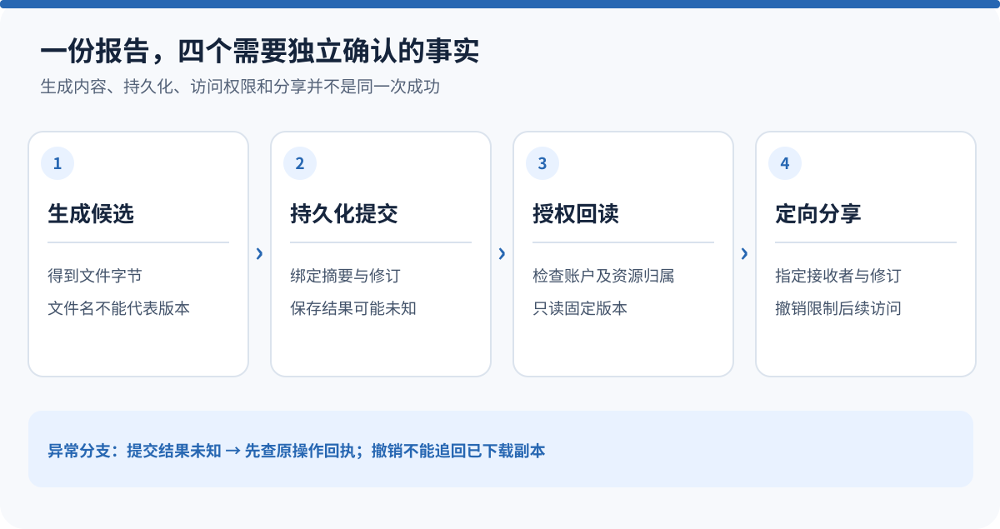
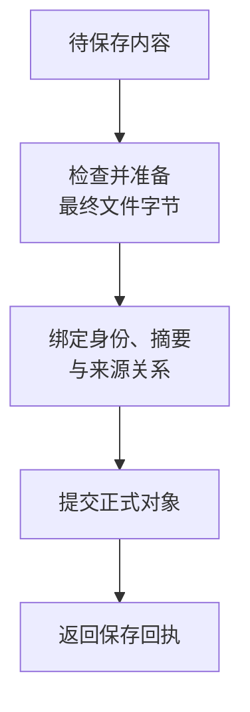
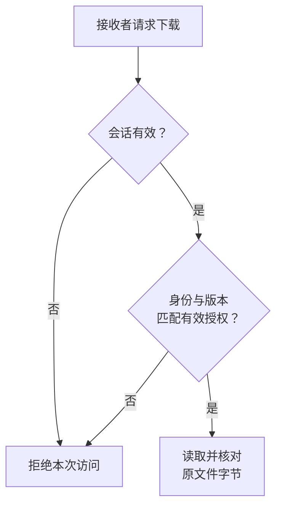

# 报告已经生成，为什么还不能直接分享？

设想这样一个场景：Agent 为你生成了一份基金比较报告，你把它分享给同事。十分钟后，你补充了一个条件，Agent 又生成了一份报告，文件名仍然叫 `comparison.html`。

同事第二次打开原链接，应该看到哪一份？如果你撤销分享，他还能不能继续下载？假如生成时界面报了超时，文件究竟没有保存，还是已经保存、只是回执没有回来？

这些问题无法靠“把文件放到一个目录，再返回 URL”完整回答。

**文件交付需要同时确定三件事：保存的是哪份内容，谁可以取得它，这次操作究竟发生到了哪一步。** 本文以 ETF Agent 的文件链路为基础，用上述教学场景解释三者如何协作；它不沿用某一次真实用户研究的内容。


<picture>
  <source media="(max-width: 640px)" srcset="../visuals/agent-artifact-version-access-sharing/overview-mobile.svg" />
  
</picture>

*图：版本、归属与定向分享的关系图。概览按职责组织，不是某次任务的真实调用记录。*

[放大查看完整图](../visuals/agent-artifact-version-access-sharing/overview.svg)

## 一、先确定交付对象：文件名不是版本，链接不是权限

在一次短演示里，`report.html` 似乎足以代表产物。但只要允许重新生成、后台执行或分享，这个名字就变得含糊：它表示文件用途，不能回答“是哪一次生成的哪一份内容”。

我们把正式保存的文件称为 **Artifact，也就是可持久回读的产物**。它除了文件名，还要保留所属账户范围、生成任务、内容类型、字节大小、内容摘要、生产者和保存期限。内容摘要通常由最终文件字节计算，用来检查读回的内容是否仍与保存时一致。

这里容易过度简化。相同的字节摘要只能说明内容一致，不能单独证明所有者相同、来源相同，更不能证明接收者有权下载。权限和生成关系仍然需要自己的记录。

下面是一个教学化的关系描述，不是实际 API 请求：

```json
{
  "file": "comparison.html",
  "savedVersion": "第一次生成的固定版本",
  "owner": "报告所有者",
  "recipient": "获准读取的同事",
  "permission": "仅下载这个版本"
}
```

第二次生成可以继续使用同一个显示文件名，但必须有自己的产物身份。原分享记录绑定第一次生成的版本，不能因为“最新报告”变化，就自动扩大到后来出现的内容。

对于金融研究，这个区别尤其重要。新版可能补入私人持仓，改变比较期间，或者纠正了旧结论。接收者获准看到旧版，并不意味着所有者已经同意把这些新增信息交给他。

## 二、保存的关键，不是写出文件，而是提交可核对的对象

文件可能由模型直接组织，也可能先经过计算工作区生成。两种生产方式可以共用保存链，但临时工作区里的文件不能直接冒充已经交付的附件。

在当前实现中，保存前先检查内容类型、文件名、大小和来源关系。对于需要规范化的 HTML，还要以**规范化之后的最终字节**重新计算大小与摘要。否则，生产者交来的摘要可能对应一种表示，用户下载的却是另一种表示。

随后，将文件字节和与之对应的元数据一起封装，先写入临时文件，再通过文件系统提交步骤让正式对象可见。这样做主要防止一个问题：只有一条“文件已保存”的元数据，却没有与之匹配的实际内容，或者元数据指向后来被替换的字节。



图中每一步都仍可能失败。回执应出现在正式提交之后，而不是模型说“生成完成”之后。下载则是另一项操作：重新按产物身份读取，检查所属范围、任务绑定、保留期以及字节是否发生变化。

这里采用的是本地文件存储的具体实现，并不是一个跨数据库与对象存储的全局事务。如果以后换成对象存储，元数据和字节分开写，就需要重新设计提交点、失败观测与补偿。不能把本地的一次提交直接宣传成任意存储组合下的原子性保证。

我们此前在 [HTML 交付复盘](https://hpoenixf.com/eff-agent-article/articles/agent-html-evolution-challenges)中已经遇到过“文件保存了，用户仍然拿不到”的问题。把对象可靠地保存下来，解决的是交付链的一段；它不代替后续访问控制和真实读取。

## 三、超时之后，为什么不能马上再生成一份？

假设文件系统已经提交了报告，但上层调用在收到保存回执前超时。此时界面知道的是“这次请求没有正常返回”，而不是“文件一定不存在”。

当前保存链区分三种事实：尚未提交、已提交，以及结果未知。它们来自实际保存过程，而不是让模型在错误文字里猜。

| 已观察到的事实 | 系统可以怎样表达 | 后续处理的重点 |
| --- | --- | --- |
| 明确在提交前失败 | 本次未保存成功 | 修正输入或重新发起获准保存 |
| 已有可信提交回执 | 文件已经保存 | 核对访问或展示链，避免重做内容 |
| 提交期间超时、回执缺失 | 暂时无法确认保存结果 | 先沿原操作身份核对，不能认定不存在 |

这也解释了为什么“重试”不是一个万能按钮。若重试会再次生成内容，就可能得到两份不同报告；若重新保存使用新的身份，就可能产生重复附件。仅有幂等这个词，也不意味着系统已经能对任意生成操作做到恰好一次。

在具有稳定操作身份、能够精确回读的路径上，可以先核对既有结果；没有足够事实时，就保留未知状态，而不是虚构一份旧文件回执。对于取消与晚到提交，也应由原保存操作处理清理和结算，不能让另一个请求随意删除“看起来多余”的文件。

这里的取舍是明确的：宁可告诉用户“结果还未确认”，也不要用自动重跑把不确定性隐藏起来。

## 四、下载检查的是当前访问者，不是重新做一遍研究

报告保存后，访问请求需要回答一个新的问题：**当前这个人，有权读取这份已保存文件吗？**

所有者下载时，服务端从可信会话解析账户范围，再核对产物与原任务是否属于这个范围。接收者下载时，则需要同时满足指定接收者身份和精确分享记录。

这里有两个身份不能混淆：文件所有者决定去哪里定位内容，当前访问者决定是谁正在读取。服务端为了找到所有者的文件而使用其存储范围，不代表接收者已经变成所有者。审计和后续访问判断仍应保留真实访问者。

另一条容易误用的规则，是把历史下载当成最新数据查询。当前持仓快照变了，不应因此把昨天合法保存的静态报告判为不存在。重新研究今天的组合，才需要取得今天适用的事实；下载旧报告，应如实交付旧内容及其历史语境。

同样，当前下载请求的权限检查，不能反过来改写生产任务已经记录的研究授权。当前实现让同一次研究沿原授权范围执行，而新的文件访问仍检查自己的会话、对象归属和分享条件。两个生命周期分别成立，才能同时避免越权和误杀历史结果。

当然，文件已经到期、被删除或字节身份不成立，是实际不可读状态。不能因为原研究曾获准，就凭摘要重造一份“相同”的历史文件交给用户。

## 五、定向分享的核心，是指定人、指定版本和有限权利

为什么不直接给同事一条临时下载链接？

这是一个合理备选，而不是天然错误的设计。例如 [Amazon S3 的预签名 URL](https://docs.aws.amazon.com/AmazonS3/latest/userguide/using-presigned-url.html)可以提供限时访问；其文档明确说明，这类 URL 本质上是持有者可使用的凭据。它适合相应的分发需求，但“拿到链接的人可用”和“只有指定账户可用”是两种不同产品语义。

我们的定向分享选择后者。记录绑定所有者、接收者、原任务、产物及其固定内容摘要。接收者必须使用自己的有效会话；服务端检查记录是否过期或撤销，再读取指定版本。



图中的最后一步仍会检查文件存在性、保留期和内容身份。分享授权有效，不保证文件一定还在；文件还在，也不保证分享仍然有效。

这份授权只允许取得指定文件，不会顺便开放原始持仓、完整会话、其他附件或整个研究任务。文件内如果已经包含敏感信息，必须在允许分享时处理，不能指望“只授予下载权”自动完成内容脱敏。来源材料的再分发要求，也不会被一个分享按钮消除。

**分享固定对象的代价，是新版不会自动推送给旧接收者。** 这看起来少了一点方便，却避免了新数据在用户不知情时进入既有分享范围。产品需要“持续共享最新版本”时，应另行设计明确的持续授权，而不是悄悄改变一次性分享的含义。

## 六、文件还没生成、分享已经撤销，分别怎样处理？

后台研究可能很久。用户在文件尚未生成时，就指定“完成后让这位同事查看”。此时可以登记待绑定的分享意图，但不能签发一份实际上不存在的可下载文件。

现行待绑定路径先保存服务端确认的交付选择身份。只有对应结果提交后，才能把它绑定到确定产物和摘要。**待绑定不是一个更宽松的授权状态，它根本还没有可交付的字节。** 它也不是一个保证未来任意结果都被共享的订阅。

再看三个条件变化：

| 条件变化 | 正确结果 | 不能偷偷发生的事 |
| --- | --- | --- |
| 所有者生成了新版报告 | 旧分享仍指向旧版 | 让原接收者自动获得新增私人内容 |
| 分享先到期，文件还在保留期内 | 后续分享读取被拒绝 | 因文件存在就忽略授权期限 |
| 文件先到期，分享尚未到期 | 报告不可下载 | 用分享记录延长文件保留期或自动重建 |

撤销也是针对后续访问。它不能追回已经下载到接收者设备上的离线副本，也不能被描述成远程销毁。对于正在传输的下载，是否中断又是单独的流传输策略，不能从“后续请求会被拒绝”推导出当前连接一定立即断开。

## 七、公开代码能帮助读者复现哪一段？

完整的账户定向分享，不在本文对应的公开教学版本中。公开版适合先观察更基础的一段：**报告和附件有固定身份，重新阅读取得的是保存的字节，而不是再次调用模型生成。**

在 [Open ETF Agent 的固定 v0.15.2 源码](https://github.com/hpoenixf/open-etf-agent/tree/34124cefc6df289e08518173789210b45a716451)中，[Artifact 存储](https://github.com/hpoenixf/open-etf-agent/blob/34124cefc6df289e08518173789210b45a716451/src/artifacts.mjs)分别保存对象和报告修订：修订绑定报告、附件及来源快照。[只读阅读入口](https://github.com/hpoenixf/open-etf-agent/blob/34124cefc6df289e08518173789210b45a716451/src/reader-cli.mjs)打开指定运行目录，不进行新的模型调用。

按照该版本 README，在 Node.js 26.8.1–26.x 环境下，可使用下列步骤。它们是固定版本的文档与入口对照，不是本次写作环境中新跑的结果。

```sh
git clone https://github.com/hpoenixf/open-etf-agent.git
cd open-etf-agent
git checkout 34124cefc6df289e08518173789210b45a716451
npm ci --ignore-scripts --no-audit --no-fund
npm run build
npm run demo -- --case document-compare

# 用上一条命令打印的实际运行目录替换占位符
npm run serve -- --run runs/run-YOUR_ID
```

示例使用合成资料和脚本化模型响应，报告目录包含 `report.md`、`manifest.json` 与运行记录。阅读服务仅供本机使用，不能把它直接暴露到公网后宣称具备本文的多账户分享能力。后续使用以 [当前 main 的说明](https://github.com/hpoenixf/open-etf-agent/blob/main/README.zh-CN.md)为准，固定版本与新版本命令不要混用。

## 结语：先定义“交给谁的哪一份”，再设计分享按钮

回到最初的两份 `comparison.html`：同事打开旧分享，应拿到原本获准的版本；新内容需要新的明确分享。超时以后，先确认原操作是否已提交；撤销以后，阻止后续访问，而不许诺追回离线文件。

这套设计没有把文件系统变成一个研究判断器，也没有让下载接口重新审核整个研究过程。它只把交付对象、访问关系和操作事实分别固定下来。

**生成解决“写出了什么”，产物管理解决“留下了哪一份”，访问与分享解决“现在可以把它交给谁”。** 三者接得上，一份报告才真正成为用户可以持续使用的结果。