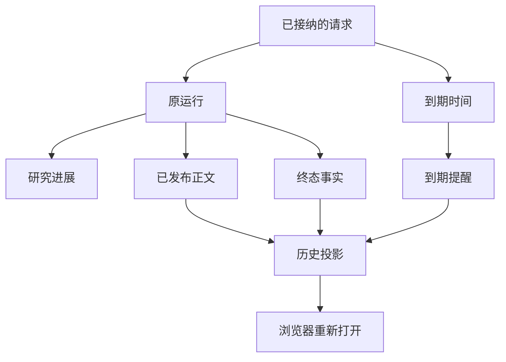

# 研究还没结束，用户已经离开了：Agent 怎样按时交付真实成果？

“帮我研究一下组合的风险，十分钟后告诉我结果。”

十分钟的研究，对 Agent 并不算长；但对用户来说，未必值得一直守着聊天窗口。用户可能提前离开，研究可能提前完成，也可能到了约定时间仍只有一部分结论。

最简单的实现看上去是把 Run 放到后台、完成后弹个通知。我们原本也已经拥有 Native Research、分段回答、SSE、持久化 Recovery 与 History。问题却出在另一处：**后台能继续执行，不代表系统知道什么时候、以什么内容履行用户的交付约定。**

这次改造的独立增量并不是发明后台队列。我们把三种长期混在一起的时点分开：**研究产生可用正文、用户约定的通知时间、研究最终完成**。它们各自有原始事实，可以交错发生，却不能相互覆盖。

## 一、从一次聊天，变成一次带时间约定的研究

以前的研究大致遵循一条线：用户提问，模型调用工具，运行时发布阶段性回答，最后结束。浏览器连接断开后，系统可以保留原 Run 的执行和已提交内容；用户回来时可以读取 History。这已经能解决“刷新页面，答案没了”的一部分问题。

但是它没有回答：

- 研究第三分钟就完成，用户要求“十分钟后告诉我”，要不要提前通知？
- 第十分钟只有正式提交的阶段性正文，通知该写“完成”还是“未完成”？
- 第十二分钟终于完成，能不能把原来逾期的记录改成成功？
- 用户离开后再打开页面，会不会为了恢复显示而重复调用模型？

我们没有把这些问题交给模型从自然语言里猜状态，而是由原 Conversation/Run 接纳经过验证的时间事实，让原有执行、发布和历史能力继续工作。具体的两种时间语义是：

| 用户约定 | 交付语义 | 提前完成时 |
| --- | --- | --- |
| “十分钟**后**告诉我” | `at`：在目标时刻通知 | 允许提前保存、读取正文；最终目标通知等到约定时刻 |
| “十分钟**内**告诉我” | `by`：争取最晚在目标时刻交付 | 有合法最终结果就提前通知 |
| “十分钟内做不完也告诉我” | 到点仍要给真实状态 | 可以报告已有 partial、running 或 missed，不能把进度文字当成果 |

时间锚点来自已接受的原用户消息。刷新、重连和模型后续回复不会重新定义这份约定。模型可以提出要怎样研究，但没有资格用自述改写 Host 的时钟和已提交状态。

## 二、先完成，不意味着现在就应该通知

这是第一处容易被低估的差异：**正文何时可读，与目标通知何时到期，不需要一致。**

在 2026 年 10 月 22 日的一次受控浏览器验收中，`at` 场景的研究正文在 05:43:27 UTC 已保存并可读取，目标时间是 05:44:57 UTC。系统没有提前发送最终的定时通知，而是等到原始目标时间。另一条 `by` 场景，则在目标时间之前完成并发出最终通知。

假如把通知写成“Run completed 的事件处理器”，这两个承诺就会被误实现为同一种行为。反过来，若到点再唤醒模型重新生成一遍总结，就可能制造多余的模型请求、重复正文及不同版本。

我们选择让到期通知**读取原本已经保存的结果身份**。正文如何校验和提交仍由 Publication 负责；通知不复制、修饰或重新认证一份研究报告。

这才是 `at/by` 的工程意义：不是多两个枚举值，而是把“研究的完成时刻”和“用户的交付时刻”分别持久化、分别消费。

## 三、到期还没做完：可以继续，但不能假装按时完成

比提前完成更典型的复杂研究，是到期仍在运行。

强制停止可以兑现“准时结束”，却可能浪费即将完成的研究；什么都不通知则违反了“十分钟内给我结果”的约定。我们采用的是第三种策略：**先依据当时的已提交事实通知用户，再让原研究依照已有授权和资源条件决定是否继续。**

例如，到期前模型已正式发布一段可以独立阅读的风险分析，但穿透核验尚未结束。到点时系统可以告诉用户：已有阶段性结果，完整研究未完成。这里的“已有”必须有 Publication 回执；`send_research_update` 写下“接近完成”或“资料已核验”，都不自动算正式结论。

在实际合成验收里，到期时保留了一份已提交的 partial，通知记录为 running/missed；同一个 Run 后来完成，又产生独立的 final 通知。**后来的 completed 没有追改前面的 missed。**

这避免了一个经常被状态字段掩盖的事实：任务最终完成，和它是否满足原始时间承诺，是两个不同问题。

继续研究也有条件。如果用户禁止超时继续、Run 额度耗尽，或者原有租约/授权不允许再派发，系统不能因为还有未解决问题就无限运行。只有在同一合法 Run 的后续模型轮次中，模型才可以选择继续、收窄或结束；时间到了并不会凭空创建新的 Run、权限或预算。

## 四、离开、恢复与重读，不是再执行一次研究

异步交付的第二个难点出现在页面上：用户离开后再回来，客户端怎样知道该展示什么？

如果重连就是重发提示词，可能重新跑 Entry、重复工具调用，甚至得到另一份结果。因此我们保留原 Run、Control、Recovery、Publication 和 History 的身份，客户端只消费当前账户有权读取的持久事件与正文。

这里有一处必须说明的区别：图里的 `ResearchProgress` 是可展示的模型进度提议；`PublishedBody` 是正式正文，`TerminalFact` 是执行终态，`DueNotice` 才是到期通知。图只是展示它们共用原 Run 关联和最终历史入口，不意味着它们共享一次状态写入。

实际执行中，我们还验证过另一条窄路径：一个已合法停放的 Native Run，沿原 Timer/Control、Checkpoint 和租约，在新进程中恢复并完成；没有重做已结算的 Entry 和 Child。它说明可以利用原恢复基础设施，而非添加一套独立 Background Agent Runtime；但不代表任意生产进程崩溃都已获得恢复保证。

对于前端，直接收益不是“增加一个 loading 动画”，而是不用把在线 SSE 连接当成事实源。页面可以重开、读取持久身份、去重展示同一个通知，再跳转到原 Run 的已提交正文。

## 五、进度消息、正文和通知，在 UI 上也要分清

三种信息适合出现在同一个聊天页面，却不能画成同一种消息。

**研究进度**可以由模型通过 `send_research_update` 描述“正在核对持仓重叠”。运行时负责有界接纳、归属、可展示性和事件身份；它并不因此证明相关持仓已完成核验。

**正式回答**来自原 Publication，可以包含可阅读的阶段性结论及后续修订，相关来源与数字仍受原有内容合同处理。

**任务通知**来自 Host 对目标时间、已提交结果和技术状态的读取，例如“已到期但研究仍在继续”。它说明什么时候发生了什么，不自行评定这份研究的投资价值。

在客户端，这三类数据还需要一致的事件去重和历史回放。SSE 负责实时传输，不能代替持久数据库或当前查看资格。[MDN 的 SSE 说明](https://developer.mozilla.org/en-US/docs/Web/API/Server-sent_events/Using_server-sent_events)解释了事件流的运输与重连基础；我们需要在应用层额外处理的，是同一账户、Run 和通知身份下的读取与显示。

这也是为什么文章应归入 **A24 会话事件与历史交付**，并与 **A25 客户端交互与阅读**关联：A24 持有投递、历史和重放事实，A25 负责把它们呈现在用户可以理解的界面里。它不是新建一个“异步前端模块”，也不是取代 A09 的定时任务。

## 六、真正的浏览器验收，纠正了我们对“已经完成”的判断

初期单元和组件验收虽然能够覆盖状态分支，但某个借用其他场景的浏览器 Fixture，定时通知入口仍返回 503。仅凭组件观察，不能证明真实页面已经接好正式的定时通知服务。

最后我们使用真实 Chrome、原 Next 页面、Better Auth 合成账号、独立 PostgreSQL，以及原有 Account/Conversation/Control/History 接线走通受控路径。这个过程还发现两处浏览器专有的导入路径使页面返回 HTTP 500；按照现有前端约定修复后，原页面才正常显示通知。

实际验证包含几个具体结果：

- `at` 的正文提前可读，而通知仍按原目标时间发出；`by` 可以提前通知。
- 到期的 partial 与后来完成的 final 作为不同事实留在同一个 Run 的历史中。
- 离开、刷新、重开和 390×844 尺寸的页面重新加载后，原通知及正文仍可阅读；Stop 不会抹掉已提交的 partial。
- 第二个认证账号读取原用户的正文与通知时收到 404，不会因知道链接而取得查看权。
- 四个脚本模型 Run 各有一次 Entry 和两次 Main 请求；通知重试及 UI 重读没有增加模型请求。

这些证据有明确边界：脚本模型保证了可控制的输入输出，但不认证真实模型的进度措辞和研究质量；测试中的定时轮询频率不能外推为生产交付延迟，Chrome 的移动尺寸测试也不等于所有真实移动设备已经验收。

这条交付链已在受控工程环境中验证，但尚不能据此承诺实际研究的交付时延、长期服务水平或用户满意度。

## 七、为什么不再造一个 Background Manager？

一种看上去更独立的方案，是让 Background Manager 自己保存任务、结果、通知和重试。

但我们已经有 Run 的执行与恢复、Publication 的正文、Control 的事件和 A24 的历史投递。再造一份后台结果状态，就必须决定：两份记录冲突时谁才是真的？通知失败时要不要重跑研究？用户 Stop 时到底停止哪一个“任务”？

所以这次只扩展原有机制，**不为后台交付创造第二份答案和执行权威**。这与 [Temporal Workflow Execution](https://docs.temporal.io/workflow-execution)重视持久事件与可恢复执行的思路相邻，但我们并没有接入 Temporal，也没有宣称重实现了一套通用工作流引擎。

**这里需要区分历史验收时点。** 本篇当时证明的是：一项已启动的研究在用户离开页面后，仍能履行 `at/by` 时间约定、保留阶段成果并在重开时读回；那次验收没有覆盖同一会话中的短问并发。后来我们在独立的[后台研究并发交互实践](agent-background-research-collaborative-experience.md)中实现并受控验证了前台短问独立响应、向原研究定向纠偏和乱序结果归属。这是另一条工程证据，不能倒填为此次定时通知的验收结果，也不等于真实金融研究质量已因此通过。

## 结语：守住时间约定，比把模型藏到后台更重要

后台执行、SSE、数据库事务和持久恢复都不是新概念。真正值得复盘的，是它们在 Agent 研究中发生交错时，怎样履行同一个用户承诺。

研究提前完成，用户可以提前读正文，但 `at` 通知不必提前。到了 `by` 时间还没完成，系统必须如实交付当时可用的成果或明确缺口。后来终于完成，也不能把原先的超时记录改成准时。用户重新打开页面，应当读回原成果，而不是重新开始研究。

**一次研究可以持续进行；一次交付约定却不能在继续执行、浏览器断开和最终完成之间被悄悄改写。**

这是这次异步交付真正独立于定时任务、渐进式回答和 Publication 的工程价值。

---

延伸阅读：[定时研究](https://hpoenixf.com/eff-agent-article/articles/agent-autonomous-scheduled-research)、[渐进式回答](https://hpoenixf.com/eff-agent-article/articles/agent-progressive-answer-coherence)与[独立 Publication](https://hpoenixf.com/eff-agent-article/articles/019-agent-answer-publication)分别解释周期任务、正文组织与正式发布；本文聚焦已启动研究的时间约定、离线交付与客户端重读。

更多工程案例见 [ETF Agent 工程文集](https://github.com/hpoenixf/eff-agent-article)。如果这些实践对你有帮助，欢迎为文集点一个 Star。
