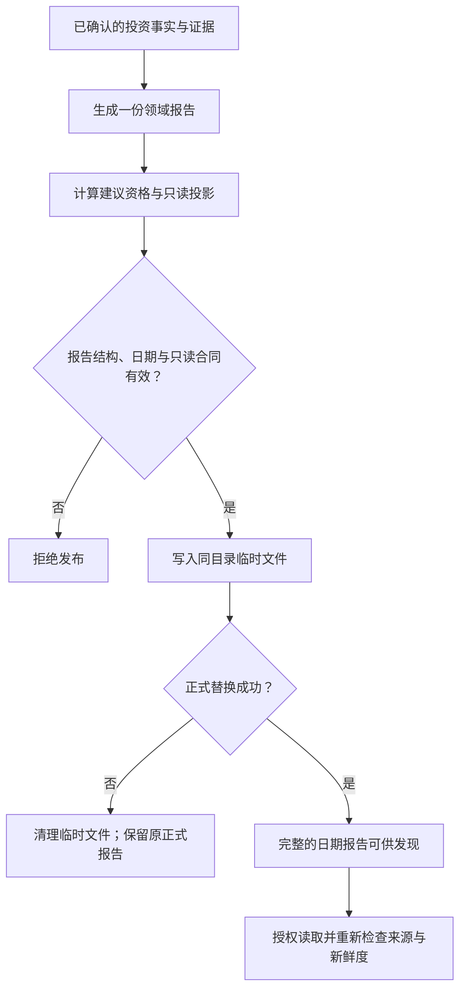

# 一份组合报告，为什么不能边算边写？

早上生成了一份基金组合报告，里面有持仓、现金、市场证据和定投建议。下午系统又生成同一天的简版摘要。晚上，Agent 打开早上的正式报告，看到的却可能是下午摘要的内容。

文件没有损坏，JSON 甚至完全合法；错的是**它已不再属于早上那次生成**。这不是模型幻觉，而是报告身份、输出路径和读取约定没有对齐。

ETF Agent 曾在受控临时目录与 SQLite 验证中发现过这一类同日覆盖：正式报告 A 已进入历史记录，轻量报告 B 随后写入同一个日期文件名，A 的历史路径便指向了 B。修正办法不是给模型加一句“注意时间”，而是让正式报告和辅助产物拥有不同的可发现范围。

要理解这个修复，先要明确一份报告究竟代表什么。

## 一、报告不是六个临时结果的拼接

组合研究会陆续得到持仓、现金、市场数据、约束、建议和质量提示。如果把它们独立写成多个“最新文件”，读取者可能拿到周一的持仓、周二的净值以及周三的建议，最后拼成看似完整的今天。

当前私有实现把根投资系统的正式读取结果收敛为一个版本化的 `portfolio-report@1` 合同。它不是一篇由模型自由撰写的投资评论，而是一份确定性的、可校验的**业务快照**。

| 报告内容 | 它说明什么 | 不能被理解为什么 |
| --- | --- | --- |
| `actual` | 当前已记录的持仓、现金、待结算事项及展示投影 | 本次建议已实际交易 |
| `evidence` | 市场来源、估值覆盖、数据健康和使用限制 | 有证据就代表投资结论正确 |
| `dca` | 定投金额建议、约束与未分配部分 | 资金已被扣除 |
| `plan` | 基于当前事实的未来只读推演 | 已经改变持仓或激活策略 |
| `advice` | 一般分析、金额建议等各层资格 | 模型获得执行权限 |
| `quality` | 报告质量提示和结构校验结果 | 所有来源及金融语义已被证明正确 |

这个划分解决的是**一次输出的完整性与语义隔离**。例如，历史持仓份额可以被记录下来，但净值过期时，依赖该净值的精确买入金额可能失去资格。系统应收回相应建议，而不是删除真实份额，也不能保留一个看似确定的买入数值。

这与[确定性基金计算](./agent-deterministic-fund-allocation)各有职责：计算模块决定金额与约束，报告生产模块决定怎样把已获得的领域结果组装、校验并发布为同一份快照。

## 二、同一个“今天”，其实包含几种不同的时间

下面是一份**教学用节选**，用于说明身份和日期，省略了正式合同必需的其他字段，不是可直接导入的完整报告。

```json
{
  "schemaVersion": "portfolio-report@1",
  "reportId": "synthetic-run-a",
  "evidenceVersion": "evidence:synthetic-run-a",
  "generatedAt": "2026-09-14T03:00:00+08:00",
  "reportDate": "2026-09-14",
  "snapshotDate": "2026-09-13",
  "plan": { "readOnly": true, "stateChanged": false }
}
```

这里至少有四种不能混同的信息：

- **生成时间** `generatedAt`：这次报告实际何时生成。
- **报告日期** `reportDate`：按现行合同的 `Asia/Shanghai` 自然日从生成时刻得出，用于日报正式文件命名。
- **持仓基线日期** `snapshotDate`：根投资事实取自哪一天；不因为今天生成新报告就自动变成今天的持仓。
- **净值或来源时间**：每只基金、每类证据仍有自己的时点，不能被统一的报告日期覆盖。

此外，`reportId` 绑定本次生成身份，`evidenceVersion` 标记所用证据版本关系。它们不是“数字一定正确”的证明，也不等同于文件字节的内容摘要。

如果读取者只展示“今日报告”，而隐藏 `snapshotDate` 与过期证据，用户就可能把昨日份额配上不适用的旧净值，误认为这是今天可执行的金额。

## 三、先决定可以说什么，再生成完整报告

领域生产者根据已有基金份额、已确认的投资事实、现金及市场证据生成日报输入。报告组装时，会计算估值可靠性和金额建议资格，并把不同结果放进相应字段；不应把“某个值可展示”直接升级为“该值可用于下单”。

例如，以下是**合成场景**，并非真实账户或实测收益：

| 基金 | 原持仓事实 | 估值情况 | 本次报告应如何表达 |
| --- | --- | --- | --- |
| 甲 | 已确认 100 份 | 净值在适用期限内 | 保留份额，可在规则允许时形成金额建议 |
| 乙 | 已确认 80 份 | 净值过期 | 保留份额及旧时点，撤回不合格的精确金额 |
| 丙 | 已确认 50 份 | 仅有带标签的估算 | 可以按估算资格展示，不自动当作正式估值 |

当必要预算、投影前提不足时，现行生产代码会把只读推演标记为 `unavailable`，而不是凭空补出未来份额。单只基金金额失格后，原预算中未被分配的部分仍要保留，不能用平均分配悄悄消掉。

这里最重要的不是 JSON 字段多，而是把“实际有多少”“推演可能怎样”“目前能否给金额建议”分开。报告生产不会把推演写回账本；账本写入和用户确认仍属于另一项独立的投资事实责任。

## 四、原子发布究竟保护了什么？

报告组装完成后，先由结构解码器检查版本、必填身份、日期一致性、主要分区与 `plan.readOnly = true`、`plan.stateChanged = false`。不合法的候选不能以正式报告身份发布。

对于结构有效的候选，当前文件生产路径是：**写同目录临时文件 → 替换日期正式文件 → 返回路径和报告身份**。



*图：报告生产与读取的职责交接。这里的原子性只描述正式文件替换时的可见性，不表示整条链路是一个事务。*

一个针对中断的工程测试会在重命名之前主动抛出错误：此时先前有效的正式报告仍可读，未完成的临时文件被清理。对读取者来说，关键是**不应看到半份新报告**。

不过，这个实现没有声称完成跨磁盘、数据库和消息系统的分布式事务；代码中的写文件、重命名及随后写入报告历史存储，也不是同一个提交动作。是否具备断电级持久性、并发写者协调等保证，还需按文件系统和部署环境单独论证。

## 五、真正踩过的坑：原子替换正确，报告身份仍然错了

前面提到的同日覆盖很容易被“写入成功”掩盖：

1. 正式运行 A 写出 `portfolio-2026-09-14.json`，历史存储保留 A 的内容和文件路径。
2. 同日轻量运行 B 也使用相同文件名，原子替换掉 A 的正式文件。
3. A 的历史记录仍有原来的内容，但其 `sourceJsonPath` 现在指向 B 的字节。两份单独的数据都合法，**跨对象的对应关系却不合法**。

现行处理让轻量运行写入独立的 `lightweight/` 子目录。正式消费者只在批准的报告根目录中发现日期文件，不递归把辅助报告当作新的根投资权威。这样，B 不再覆盖 A 的正式文件，历史路径也不再被这个轻量入口改写。

需要特别注意：**日期文件名仍代表“该日正式可发现版本”，不是不可变的每次运行版本 ID。** 同一日新的合规正式发布可以替换当天正式文件；要回看某次旧运行，应使用它自己的保存记录与身份核对，不能仅凭旧路径假定内容永远不变。

这类问题说明，原子写入解决的是“旧文件或新文件”的完整可见性，不能单独解决“读取的是不是原来那一版”。

## 六、Agent 只能在只读入口消费它，不能重新签发金融真值

报告发布后，Agent 不是直接扫描任意本地文件，也不能把模型文字当成账本更新。现行私有读取链从配置允许的报告目录发现文件，检查报告结构、日期和来源路径，生成限定字段的只读投影，再由投资数据 MCP 等原有读取通道提供给研究过程。

这一步仍有自己的检查：报告可能结构合法但超过新鲜度要求；持仓可能可陈述，但某项金额建议不合格；估算展示也不能自动升级成正式净值。读取者保留 `reportId`、`evidenceVersion` 和来源标识，但不会因为合同名叫“原子报告”就忽略这些条件。

因此必须区分三个常被混为一谈的判断：

| 判断 | 谁负责 | 成立之后还不知道什么 |
| --- | --- | --- |
| 这份 JSON 结构完整、替换时未露出半成品 | 报告生产与文件写入 | 来源是否真实、新鲜 |
| 这份报告哪些字段能用于当前查询 | 授权读取与投资领域规则 | 模型是否准确解释 |
| 最终回答怎么组织和提交给用户 | 研究模型与正文发布机制 | 用户是否批准真实投资操作 |

这也是它与[研究产物保存、访问和分享](./agent-artifact-version-access-sharing)、[Agent 正文发布](./019-agent-answer-publication)的区别：前两者负责用户可取得的研究产物与文字，组合报告负责的是**先给研究系统一份可信边界明确的投资事实视图**，而不是另建一套聊天 Publication。

## 七、下一次设计报告生产，至少检查这四种反例

可以把四个问题作为工程验收入口，而不是只测“能成功写出 JSON”：

1. **中途失败**：新候选写到一半或替换前中断，旧正式文件是否仍完整？
2. **同日多入口**：正式运行、轻量运行和历史记录是否可能重新指向同一个可变文件？
3. **时点失配**：报告日期是今天、快照和基金净值却较早，读取者能否保留这种差异，而不是自动升级为“今日可执行”？
4. **证据不足**：金额资格不成立时，实际份额、一般研究、只读推演的 unavailable 状态和未分配余额是否各自正确保留？

当前私有仓库有针对结构、原子中断、同日覆盖、资格收回和只读读取的受控测试及工程记录。它们支持上述机制讨论，但不能被当作真实金融建议准确率或生产级崩溃恢复的统计结论。公开的 [Open ETF Agent 教学仓库](https://github.com/hpoenixf/open-etf-agent) 也不等于完整公开了本文的根投资账本与组合报告生产链。

**一份好的原子报告，不是“永远不会错”的 JSON，而是让每个消费者知道：它是哪次生成、引用哪个时点、哪些内容只是推演，以及文件被替换之后还必须核对什么。**
