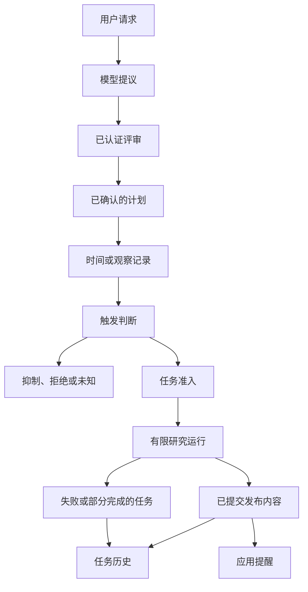

# Agent 不必一直在线思考：我们怎样让研究在对话结束后按时继续？

“每周三晚上帮我检查一次持仓，发现重要变化再提醒我。”

难的不是让模型说“好的”，而是浏览器关闭或服务停了几小时以后，系统该补哪一期、沿用哪次批准，以及怎样判断一份报告究竟有没有生成。

当前设计持久保存的是**用户确认的约定**，并在时间或条件到达时申请一次有限研究。这里最值得解释的取舍是：宁可留下明确缺期，也不自动补发一堆旧研究；读不到条件不当作 false；丢回执不当作未执行。下面按当前执行路径展开，最后用两个公开切片查看进程交接与单次机会。

<span id="五、从触发到报告-六个事实不能合成一个成功状态"></span>

## 1. 从约定到通知，先分清六个事实

先看当前完整路径：Schedule 保存确认定义并判断机会，Task 承担这次工作的期限和总预算，有限 Run 做研究，Publication 保存正文，Task History 与 Notice 分别负责回读和通知。



图中的 `TriggerDecision` 不意味着每个触发条件都能走向 `TaskAdmission`。只有版本、权限、资源、冷却和重叠限制全部满足，才走准入；其他状态记录拒绝、跳过或未知，不启动模型。研究中若失败，也保留已发生的 Task 与合法成果，而不是逆向删除触发事实。

核心的六种事实是：定义已确认、时间或条件已到达、Task 已获准、Run 已执行、报告已提交、通知已投递。它们分别由原 Owner 负责。

Task 可以根据明确的持久续接意图创建后继 Root Run，但所有 Root 仍在同一个 Task 截止时间和预算范围内；一次 Run 失败、自然语言说“继续”或 SSE 断连，都不自动获得新 Run 的权限。

历史报告也不写回当初确认日程的那段聊天。每个 occurrence 对应独立的 Task History 记录，用户稍后阅读或明确发起追问，是另一条经认证的读取或对话入口。

<span id="二、先把一条自然语言约定变成可确认的定义"></span>

## 2. 只确认执行链真正能约束的定义

我们把用户想要的长期安排拆成两步：**Agent 提议，用户确认**。

提议阶段可以提出触发时间、时区、研究说明、资料范围、交付位置和资源限制；但只有用户在认证入口确认了版本化的有效定义，系统才允许未来无人值守地发起任务。

一条教学示例可以这样展示，不代表实际 API JSON：

| 项目 | 确认后的约定 |
| --- | --- |
| 触发 | 每周三 20:00，按指定 IANA 时区解释 |
| 工作 | 核对已授权的组合快照与基金资料，输出本期回顾 |
| 研究上限 | 每次有限的模型请求、工具尝试、截止时间与共享额度 |
| 交付 | 独立 Task History 中保留报告，App 通知指向已提交结果 |
| 生效 | 只有当前经用户确认的定义修订可以生成后续任务 |

这样做还有一个非常实际的好处：修改描述不必总是推翻整个历史，而改变来源、条件、权限或执行限制时，必须重新看清并确认有效范围。旧任务保留自己原先的定义版本，不能因为新编辑而被悄悄“升级”。

系统保留原来的 `once`、`weekly` 语义与哈希，同时增加明确版本的新时刻与间隔定义。对不支持的类型或版本，直接拒绝激活，不猜测一个最接近的调度方式。

**能够写进表单，不等于执行链能保证。** 当前指定 `sourceIds`、`methodIds` 或 `skillIds` 的非空限制还不能由执行准入完整强制执行，因此原定义服务在保存、评审、确认时明确拒绝，不能先让用户确认，再把限制降成提示词。即使策略处理试图清空这些字段，原提议中的限制也不能被擦掉。上面的持仓回顾是需求示意，不代表任意限定来源的周报已经可用。

自动执行也不开放运行中人机交互：不呈现 `ask_user`，人工交互入口同样拒绝来自这类 Task/Root/Child/插件的问答、Permission 或 Effect 等待。缺少必需输入或批准时，不执行对应效果；仍可交付独立可用的部分和缺口，再按原期限结算。日程创建时的确认，与无人值守执行中无限等用户，是两回事。

这个选择让使用门槛更明确，却牺牲了中途澄清的便利。需要每一步临时批准的任务，更适合交互式流程，而非把聊天里的等待悄悄变成后台停车。

<span id="三、日历给出执行机会-不保证每个机会都有一份报告"></span>

## 3. 漏一期，还是恢复后排队补三期？

设想每小时研究一次，服务停了三小时。恢复时最重要的选择不是扫描频率，而是：补齐三份旧报告，还是只尝试当前这一期？我们选择后者，承诺尽力提供当前研究，不承诺每期历史齐全。

当前调度定义可以表达四类时间安排：原来的 `once`、`weekly`，以及后来增加的指定时刻 `at`、带 UTC 起点的 `interval`。间隔有最小支持精度和明确终止条件，包括取消前有效、截至某一时刻或累计固定数量的日历机会。

这里存在一个不易察觉的区别：**三个日历机会，不等于三份成功报告。** 某个机会因为服务停机、仍有任务在执行或超过允许的补偿窗口而跳过，不会为了“凑够三次成功”在后面无限追加。

按间隔计算的触发点锚定 UTC 已流逝时长；按周安排则遵循指定时区的民用时间。遇到夏令时不存在的时刻会跳过，重复出现的时刻按既定规则只触发一次。把两者混成“上次执行完成后再延迟多久”，既会导致时间漂移，也会改变用户原本确认的约定。

两个后台实例同时发现同一个时间槽时，由稳定的 occurrence 身份与数据库准入竞争决定结果，而不是每个进程都各自启动研究。错过多个槽位时，先找权威观察时间之前、越过持久消费边界的最新自然槽位，再检查原宽限期、权限、预算与重叠。如果最新槽位不合格，不往回找一份“还能跑”的旧期；旧 Task 尚未结束时，新槽位按 overlap 记录并消费，旧 Task 结束也不延迟重放它。

这有真实代价：History 会留下缺期，而不是补齐的报表。换来的是恢复后不会为已过时的时点堆积研究，也不会为了凑成功次数延长原来的三次计划。若业务必须补齐每一小时账目，就需要明确的补数策略，不能沿用这里的选择。

原正常应用的受控运行已自主经过三个 120 秒 interval 槽位，保存三份独立报告；重启检查没有产生第四份补偿任务。这说明指定装配中的时间与消费规则成立，不是精确准点交付保证，也不衡量长期周报价值。

<span id="四、条件监控不能让模型每隔一分钟猜一次"></span>

## 4. true → 超时 → true，为什么不能再触发一次？

条件监控里最危险的简化是把读不到数据当作“不满足”。假设观察依次为 true → 超时 → true：中间若记成 false，就会凭一次网络问题制造新的“假→真”边沿。

我们没有选择“每次读取行情都调用模型，让模型判断是否达到条件”。当前实现把条件表示为有版本的只读来源、带单位的数值比较和有限组合谓词。比较由代码完成，模型只有在研究任务正式获准后才参与分析。

一条简化规则是：

> 指定标的、币种与价格单位；当经过时效验证的观察值小于等于 5,000 时，申请一次研究。

为什么必须记录标的、单位、币种、`asOf` 与观察身份？因为一份过期的价格、另一币种的数字、来源读取超时，都不应该自动被解释为“没有达到阈值”。

因此条件结果是三值，而不是布尔值：

| 观测结果 | 含义 | 能否凭此发起研究 |
| --- | --- | --- |
| `true` | 有效且同口径的观察满足条件 | 还要经过 Task 准入 |
| `false` | 有效观察明确不满足条件 | 不发起，可作为以后重新满足的前置状态 |
| `unknown` | 数据过期、读取失败或口径不匹配等 | 不发起，也不伪造一次由真变假的边沿 |

接下来还有两种不同的触发模式。

`firstMatch` 只在条件匹配**并且原 Task 真正创建成功后**锁存。如果数据满足条件但因权限或额度没有获准创建 Task，不能谎称已经触发成功；一旦正式创建，之后研究失败或通知重试都不允许自动再触发一次。

`everyEdge` 则观察首次满足或明确的“假→真”变化，受冷却期、重叠和额度限制。冷却期内的边沿被记录为压制，并不偷偷排队到冷却结束后补发；持续为真也不会每次轮询都重跑研究。`unknown` 更不能用来重新武装边沿。

当前支持的条件来源是**合成 `mockQuote`**，不是已接好的真实行情。正常应用与真实 PostgreSQL 的条件验证分别取得 firstMatch 一次、everyEdge 两次的报告与通知交接；它与前面的 interval 三槽来自不同版本和验证窗口，不能拼成一次运行。实际行情来源仍需单独接入并核对单位、货币、时效、权限和未知物理读取。

<span id="六、进程重启和丢失-commit-回执-才是调度真正难的部分"></span>

## 5. 丢回执之后，先找原事实

最危险的时刻，不是正常的每分钟扫描，而是一个 Worker 已经向数据库提交准入事实，进程却没收到成功响应。第二个 Worker 如果把“我没看到回执”当成“上次没有执行”，就可能重新创建任务或重复调用模型。

我们因此把观察读取与短事务分离：慢速来源 I/O 在数据库锁外发生，回来时携带原 revision、fence、lease 与观察 identity；事务内重新核对仍生效的确认、授权和资源限制，再把观察回执、条件状态与原 Task/Control 意图一起提交。

如果数据库实际提交了，但测试包装器丢掉提交后的 ACK，恢复只能按原 receipt 判断，不得以新的身份重来。取消或重新确认定义以后，迟到的旧观察也不能穿越原 fence 影响新版本。

**条件观察本身另有预算。** 一次轮询即使返回未知也占用了真实的读机会，不能因为“没查到”就退款；同时，这一笔轮询预算不能冒充已经消耗的模型研究预算。提高日程定义的未来上限也不自动给当前扣费周期充值。

最终通知同样有自己的 outbox、投递身份和重试。通知失败可以重试那份已提交报告的引用，不能借此再次运行研究。这是我们最想避免的一类“重试表面成功，后台多做了一轮工作”的隐患。

| 看到什么 | 可以做什么 | 不能推导什么 |
| --- | --- | --- |
| 已知事务回滚 | 在原约束内重试原操作 | 获得新预算或不同身份 |
| COMMIT 已发生，客户端 ACK 丢失 | 先读原 occurrence/Task/receipt，再继续原工作 | 没收到回复就等于没有提交 |
| 外部模型或通知结果未知 | 保留未知，由原执行或投递方核对 | 本地唯一约束保证远端只执行一次 |

原 PG 验证确实提交了事务，再由测试 wrapper 丢弃 ACK；它不是物理网络断包实验。局部去重让重启找到同一个 Task 与 outbox，不提供外部 exactly-once 保证。这一边界比“重试会自动修好”更有用：不知道是否发生时，下一步是找原事实，而不是再做一遍。

<span id="一、为什么-定时调用-agent-不是定时研究"></span>

## 6. Cron、工作流服务与现有 Task，各适合哪里？

简单定时器并不天然错误。若只是固定机器上每日执行一份可重复的批处理，没有用户范围、长期版本或外部效果未知的问题，cron 调用幂等脚本通常最省事。需求增长以后，先看看已有基础设施，而不是默认自建。

| 选择 | 更合适的条件 | 仍要由应用回答的问题 |
| --- | --- | --- |
| cron / Kubernetes CronJob | 已有批处理或集群；按时启动独立作业 | 哪一版用户授权、业务效果是否已经发生、结果如何回读 |
| Temporal Schedule + Workflow | 跨服务、长生命周期流程，需要丰富重叠、补期与耐久执行能力 | 业务授权、模型调用未知结果与报告/通知语义 |
| 既有 Schedule + Task + Run | 已有这些持久身份与准入，希望定时只是同一研究链的入口 | 自己维护时间、事务、取消和观测边界，能力面更窄 |

[Kubernetes CronJob](https://kubernetes.io/docs/concepts/workloads/controllers/cron-jobs/)已经提供时区、启动期限和并发策略，并提醒作业需要幂等，因为调度可能重复或漏建。它不只是“一根定时线”，但其 Job 身份仍不能替代研究的授权与来源版本。

[Temporal Schedule](https://docs.temporal.io/schedule)独立于 Workflow，支持 Skip、缓冲等重叠策略与 catch-up 配置；暂停未来调度也不同于暂停已启动流程。若这类工作流需求占主导，采用成熟服务通常比继续扩展小型调度器合理。原文引用的 [Workflow 执行模型](https://docs.temporal.io/workflow-execution)仍是有用背景。

我们沿原 Task/Run 建入口，是为了让一个机会复用同一套预算、租约、取消、发布与恢复，而不是让新执行器和旧 Runtime 同时判断谁可以继续。代价是要自己验证这些连接，并明确不承诺全量补期、真实行情条件和所有无人值守交互。这是现有架构下的选择，不是对工作流平台的性能优劣评测。

## 7. 用两个公开实验分别看进程交接与时间准入

### 先把独立执行缩到一个可运行的例子

如果只想理解“提交进程退出以后，谁继续执行原来的工作”，不必先部署整套日程系统。[Open ETF Agent v0.9 的固定实现](https://github.com/hpoenixf/open-etf-agent/tree/dad9c6e64f32c3d7579aea96613776b40917ec6d)只提炼这一层：提交一个明确身份的 Run，另一进程拿到原 Session 的执行租约，再进入同一个 Runtime。本文前面的日历、条件触发、Task History 和通知仍是原 ETF Agent 的完整能力，不因这个小切片而一并成为公开版功能。

使用 Node 26（README 声明的支持区间）在新目录中取代码后，可以运行下面的合成示例；[这一历史切片对应的 README](https://github.com/hpoenixf/open-etf-agent/blob/e888ee911ca784d6488f33def31abf225293719a/README.md)提供使用入口。

```bash
git clone https://github.com/hpoenixf/open-etf-agent.git
cd open-etf-agent
git switch --detach dad9c6e64f32c3d7579aea96613776b40917ec6d
npm ci --ignore-scripts --no-audit --no-fund
npm run build
node dist/src/session-cli.mjs submit --session runs/worker-example --run original-example --case durable-publication
node dist/src/session-cli.mjs work --session runs/worker-example --run original-example
node dist/src/session-cli.mjs publication --session runs/worker-example --run original-example
```

`submit` 写下请求、绑定、额度和截止时间后就退出，不调用模型或工具。`work` 是另一个进程：它读取两份合成资料、保存报告并提交正文；最后一条命令只读原正文与回执，不重新研究。示例的模型动作由脚本给出，SQLite 提交、文件和进程交接则实际执行。原来的 30 秒截止时间从提交时开始，等到执行进程启动才重新计时会改变任务本身。

这里最容易混淆的是停止原因：Worker 收到 SIGTERM，并不等于用户取消研究。已封存的动作可以留给下一进程；但模型请求已经发出、结果又没有可靠落盘时，恢复不会猜测“应该没成功”而再发一次。这个区别可以沿[薄 Worker 入口](https://github.com/hpoenixf/open-etf-agent/blob/dad9c6e64f32c3d7579aea96613776b40917ec6d/src/worker.mjs)进入原 Runtime，并在[实际进程中断用例](https://github.com/hpoenixf/open-etf-agent/blob/dad9c6e64f32c3d7579aea96613776b40917ec6d/test/worker-process.test.mjs)中观察。它守住的是原身份与已发生效果，不是给不确定请求加一个自动重试按钮。

<!-- open-etf-case:worker@e1b8e4edde724548fab16d8ca4b205379bfa7f30 -->
### 让提交进程退出后再执行原 Run

固定公开快照的[Worker CLI 用例](https://github.com/hpoenixf/open-etf-agent/blob/e1b8e4edde724548fab16d8ca4b205379bfa7f30/test/worker-cli.test.mjs)把“提交已落盘”和“实际开始执行”拆成两个进程，直接检查它们是否仍指向原来的工作。

在所链固定快照按 README 安装依赖后，运行：

```bash
node --test --test-concurrency=1 --test-name-pattern='^9\.1 submit exits before a separate work process drives and reads the original Run$' test/worker-cli.test.mjs
```

`submit` 返回时 Run 是 `ready`、没有 owner，模型与工具用量均为零；随后独立 `work` 进程完成同一个 Run，Publication 修订为 1。再次 `work` 只回读终态，不新增用量或正文修订。

这条测试不设置日历触发、不创建 Task 队列，也不验证通知或多 Worker 并发；它只检查独立执行、原身份和终态回读。
<!-- /open-etf-case -->

### 再向前一步：一次确认，只关联一个原 Run

Worker 解决了“谁继续执行”，还没有解决“这次时间机会到底获准创建哪一个 Run”。公开 v0.18 的设计为此比较了三条路：独立调度库加执行器，会让 occurrence 与 Run 分两次提交；导出准备好的 Run 对象交控制器重建，会产生第二个准入入口；实际选择是由原 Runtime 准备不可变定义，让原 Session 在一次同步短事务里同时建立 Run 和机会关联，执行仍交原 Worker。这个取舍可以直接沿下文同版设计核对，不是对完整私有实现的替代描述。

[v0.18 无模型验证使用的固定源码](https://github.com/hpoenixf/open-etf-agent/tree/b1d2431a6b86bd0120f2fe5acb531ef928e92de2)补的是这一小步，不是整套日历产品：可信调用者确认一个 UTC 时刻、IANA 时区和允许迟到的窗口，再显式调用 `schedule-wake`。

确认记录保留原问题、资料、工具权限和预算。时间到了，原 Session 在同一个短事务里插入原 Run 和本次机会的关联；两个进程重复唤醒，仍得到同一个身份。关联完成只表示任务已落盘，不表示研究成功。真正执行继续交给原 Worker，完成后的正文与附件仍从原 Publication 和 Reader 读取。

这也让失败有了具体含义：早到不创建 Run；超过迟到窗口记为错过，不补发新任务；确认回执丢失后按原确认身份查询，不续期、不刷新预算。取消先发生就不创建 Run；如果已创建，则沿原取消入口处理，保留已发生的用量和已经提交的报告。

在该固定提交的新目录中按 README 安装依赖，可以运行[跨进程交付场景](https://github.com/hpoenixf/open-etf-agent/blob/b1d2431a6b86bd0120f2fe5acb531ef928e92de2/test/schedule.test.mjs)：

```sh
node --test --test-concurrency=1 --test-name-pattern='^18 different-PID Worker completion, readonly Publication and original Reader exact bytes$' test/schedule.test.mjs
```

这条合成场景让另一个进程执行原 Worker，再只读正文和报告字节，不需要模型账户。手动接口可从[CLI](https://github.com/hpoenixf/open-etf-agent/blob/b1d2431a6b86bd0120f2fe5acb531ef928e92de2/src/session-cli.mjs)中的 `schedule-confirm`、`schedule-wake`、`schedule-inspect` 和 `schedule-publication` 进入；完整范围见[同版设计](https://github.com/hpoenixf/open-etf-agent/blob/b1d2431a6b86bd0120f2fe5acb531ef928e92de2/openspec/changes/v18-schedule-occurrence/design.md)。

这个切片使用显式选择的 schema5 新库，不迁移旧库，也不装后台服务。机器重启后仍需要调用者再次执行 wake；周期计划、行情条件、通知和上文完整 Task History 不在其中。单个合成闭环不能替代独立真实调用与发布核验，也不意味着电脑会自行在约定时间醒来。


更直接的操作方式见[同版手册](https://github.com/hpoenixf/open-etf-agent/blob/b1d2431a6b86bd0120f2fe5acb531ef928e92de2/docs/schedule-occurrence.md)。在独立目录选择一个未来时刻并确认：

```sh
INSTANT="$(node -e 'console.log(new Date(Date.now()+60000).toISOString())')"
node src/session-cli.mjs schedule-confirm --session runs/schedule-demo --schedule one-shot --revision 1 --instant "$INSTANT" --zone Asia/Shanghai --lateness 60000
```

保存返回的 `reference.confirmationHash`。确认只保存身份，不会启动后台等待；到选定时刻，在允许迟到窗口内将下面的 `CONFIRMATION_HASH` 替换为该值再执行：

```sh
node src/session-cli.mjs schedule-wake --session runs/schedule-demo --schedule one-shot --hash CONFIRMATION_HASH
node src/session-cli.mjs schedule-inspect --session runs/schedule-demo --schedule one-shot --hash CONFIRMATION_HASH
node src/session-cli.mjs schedule-publication --session runs/schedule-demo --schedule one-shot --hash CONFIRMATION_HASH
```

过早调用不会替你等待，错过首次物化窗口也不会自动挪到下一次。已提交后重复 `schedule-wake` 仍沿原 occurrence 和原 Run 读取，不另开研究、不刷新预算。报告与 Reader 的原字节回读、同 Run 终态重放保留在[无模型 CLI 资格回执](https://github.com/hpoenixf/open-etf-agent/blob/b1d2431a6b86bd0120f2fe5acb531ef928e92de2/docs/verification/v018-schedule.safe.json)中。

真实模型路径则从[原 Schedule API](https://github.com/hpoenixf/open-etf-agent/blob/b1d2431a6b86bd0120f2fe5acb531ef928e92de2/src/schedule.mjs)进入：[该版本固定真实任务记录](https://github.com/hpoenixf/open-etf-agent/blob/b1d2431a6b86bd0120f2fe5acb531ef928e92de2/docs/verification/v018-real-ten.safe.json)先确认时间，确认与到期前检查都不派发；实际到期后显式唤醒一次，由原 Worker 和 Admission 继续同一个 Run，再沿 Publication 交付并由只读 Session Reader 冷读原报告。这回答的是“获准的时间机会能否接上原任务”，不是“后台是否会替用户准时启动”。

[较早的真实调用记录](https://github.com/hpoenixf/open-etf-agent/blob/b1d2431a6b86bd0120f2fe5acb531ef928e92de2/docs/verification/v018-release.safe.json)仍独立保留。上面的 CLI 演示是无模型验证，不能把 API 的真实调用记录移作 CLI 真实模型验收，也不能把冷读的零调用扩大为整个任务零调用。这些路径不证明后台自动唤醒、周期调度、金融质量或通用断电恢复。

<span id="七、我们究竟验证到了哪里"></span>
<span id="结语-长期运行的应是约定-不是推理循环"></span>

## 8. 定时底座成熟，不等于周报已经有用

这些机制把时间机会、真正执行和实际交付分开，允许一次确认后的后台工作保持有限身份。它们没有证明每份报告都能识别重要变化，也没有让真实行情接入、部署后的长期可靠性或多期投资论点自动完成验收。

采用之前，应先决定业务能否接受缺期、是否需要执行中追问、哪些限制可以真正强制执行，以及外部结果未知时由谁核对。若这些答案还没定好，多加一种定时表达式只会让系统更容易反复运行不明确的工作。

长期保留的应是约定与原事实，不是永不结束的推理循环。

---

<!-- agent-article-sync:guidance:start -->
## 延伸阅读与交流

[在个人博客阅读本篇](https://hpoenixf.com/blog/agent-autonomous-scheduled-research) · [公开工程文章文集](https://github.com/hpoenixf/eff-agent-article)（欢迎 Star）。
<!-- agent-article-sync:guidance:end -->
