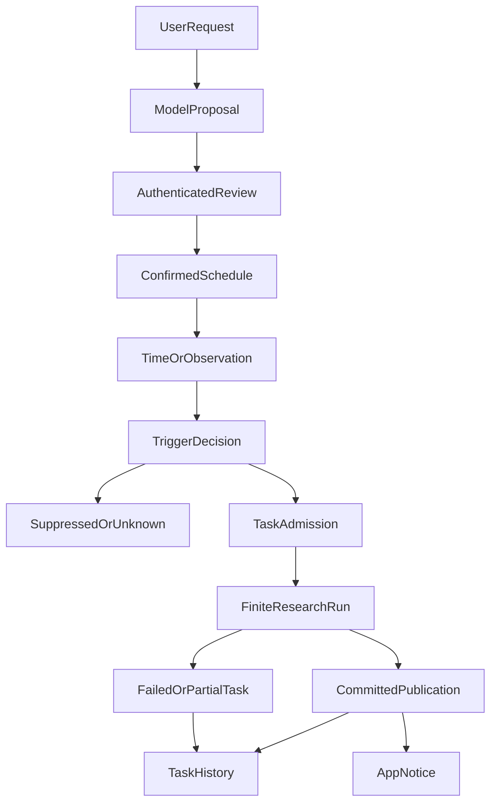

# Agent 不必一直在线思考：我们怎样让研究在对话结束后按时继续？

“每周三晚上帮我检查一次持仓，发现重要变化再提醒我。”

对话里的 Agent 很容易回答“好的”。困难在于：等浏览器关闭、服务器重启、下一次时间到来时，这句话究竟由谁记住、谁有权启动研究、又如何保证不会把同一份报告生成两次？

最初，我们只需要处理用户当前这一轮请求。后来，ETF Agent 开始支持不依赖聊天连接的研究任务：用户确认一次，后台在约定的机会启动有界研究，报告进入独立历史，通知失败也不重新跑模型。

我们最终没有把模型循环改造成一个永不结束的后台进程，也没有通过外部 cron 不断模拟用户发消息。**持久的是用户确认的任务定义，不是一次永远运行的 Agent；每次到期只获得一次候选执行机会，真正是否启动研究仍由原有授权与资源规则决定。**

## 一、为什么“定时调用 Agent”不是定时研究

假设每周调用一次聊天接口，把相同的提示词交给模型。这当然可以启动新请求，但很难回答几个必要的问题：

- 用户确认过哪一版任务？后来改了数据范围，是立即生效还是需要重新确认？
- 同一个时刻被两个 Worker 扫到，能不能只创建一个研究任务？
- 上周的研究尚未结束，本周又到点，是并行执行、补发还是跳过？
- 研究已经提交报告，通知服务却失败，重试应当重新研究还是只补发通知？
- 用户暂停的是未来的日程，还是要取消正在执行的任务？

这些并非提示词的理解问题，而是长期执行的身份、授权、状态和资源问题。模型可以帮助解释“我想每周回顾什么”，却不能凭一句“明白了”创造无限期后台执行权。

成熟的工作流系统同样重视持久时间与执行状态，例如 [Temporal 的 Schedule 与 Workflow 机制](https://docs.temporal.io/workflow-execution)。我们借鉴的是“时间触发、耐久执行和业务效果分开”的思路，而不是宣称自己采用了 Temporal，或者重新实现一套通用工作流平台。

## 二、先把一条自然语言约定变成可确认的定义

我们把用户想要的长期安排拆成两步：**Agent 提议，用户确认**。

提议阶段可以补全触发时间、时区、研究说明、资料范围、交付位置和资源限制；但只有用户在认证入口确认了版本化的有效定义，系统才允许未来无人值守地发起任务。

一条教学示例可以这样展示，不代表实际 API JSON：

| 项目 | 确认后的约定 |
| --- | --- |
| 触发 | 每周三 20:00，按指定 IANA 时区解释 |
| 工作 | 核对已授权的组合快照与基金资料，输出本期回顾 |
| 研究上限 | 每次有限的模型请求、工具尝试、截止时间与共享额度 |
| 交付 | 独立 Task History 中保留报告，App 通知指向已提交结果 |
| 生效 | 只有当前经用户确认的定义修订可以生成后续任务 |

这样做还有一个非常实际的好处：修改描述不必总是推翻整个历史，而改变来源、条件、权限或执行限制时，必须重新看清并确认有效范围。旧任务保留自己原先的定义版本，不能因为新编辑而被悄悄“升级”。

系统保留原来的 `once`、`weekly` 语义与哈希，同时增加明确版本的新时刻与间隔定义。对不支持的类型或版本，直接拒绝激活，不猜测一个最接近的调度方式。

## 三、日历给出执行机会，不保证每个机会都有一份报告

定时并不只剩“每周一次”。

当前调度定义可以表达四类时间安排：原来的 `once`、`weekly`，以及后来增加的指定时刻 `at`、带 UTC 起点的 `interval`。间隔有最小支持精度和明确终止条件，包括取消前有效、截至某一时刻或累计固定数量的日历机会。

这里存在一个不易察觉的区别：**三个日历机会，不等于三份成功报告。** 某个机会因为服务停机、仍有任务在执行或超过允许的补偿窗口而跳过，不会为了“凑够三次成功”在后面无限追加。

按间隔计算的触发点锚定 UTC 已流逝时长；按周安排则遵循指定时区的民用时间。遇到夏令时不存在的时刻会跳过，重复出现的时刻按既定规则只触发一次。把两者混成“上次执行完成后再延迟多久”，既会导致时间漂移，也会改变用户原本确认的约定。

两个后台实例同时发现同一个时间槽时，由稳定的 occurrence 身份与数据库准入竞争决定结果，而不是每个进程都各自启动研究。错过多个槽位时，只考虑宽限期内最新一个合法机会，不形成补发风暴。

## 四、条件监控不能让模型每隔一分钟猜一次

指定时间还不是全部需求。用户可能想要：“当某项指标首次满足阈值，再做一次研究。”这意味着先观察外部事实，再判断是否值得创建研究任务。

我们没有选择“每次读取行情都调用模型，让模型判断是否达到条件”。当前实现把条件表示为有版本的只读来源、带单位的数值比较和有限组合谓词。比较由代码完成，模型只有在研究任务正式获准后才参与分析。

一条简化规则是：

> 指定标的、币种与价格单位；当经过时效验证的观察值小于等于 5,000 时，申请一次研究。

为什么必须记录标的、单位、币种、`asOf` 与观察身份？因为一份过期的价格、另一币种的数字、来源读取超时，都不应该自动被解释为“没有达到阈值”。

因此条件结果是三值，而不是布尔值：

| 观测结果 | 含义 | 能否凭此发起研究 |
| --- | --- | --- |
| `true` | 有效且同口径的观察满足条件 | 还要经过 Task 准入 |
| `false` | 有效观察明确不满足条件 | 不发起，可作为以后重新满足的前置状态 |
| `unknown` | 数据过期、读取失败或口径不匹配等 | 不发起，也不伪造一次由真变假的边沿 |

接下来还有两种不同的触发模式。

`firstMatch` 只在条件匹配**并且原 Task 真正创建成功后**锁存。如果数据满足条件但因权限或额度没有获准创建 Task，不能谎称已经触发成功；一旦正式创建，之后研究失败或通知重试都不允许自动再触发一次。

`everyEdge` 则观察首次满足或明确的“假→真”变化，受冷却期、重叠和额度限制。冷却期内的边沿被记录为压制，并不偷偷排队到冷却结束后补发；持续为真也不会每次轮询都重跑研究。`unknown` 更不能用来重新武装边沿。

当前这条条件链已经有真实 PostgreSQL 与正常应用装配下的**合成 `mockQuote`**验证；它不是已开通的实时股票行情监控服务。外部行情供应商的授权、实时性与物理故障资格仍需要独立接入和验收。

## 五、从触发到报告：六个事实不能合成一个成功状态

我们复用现有 Schedule、Task、Run、Control、Publication、History 和 Notice 的权威记录，而没有增加第二个调度数据库或一个新的“长期在线 Agent Runtime”。

图中的 `TriggerDecision` 不意味着每个触发条件都能走向 `TaskAdmission`。只有版本、权限、资源、冷却和重叠限制全部满足，才走准入；其他状态记录拒绝、跳过或未知，不启动模型。研究中若失败，也保留已发生的 Task 与合法成果，而不是逆向删除触发事实。

核心的六种事实是：定义已确认、时间或条件已到达、Task 已获准、Run 已执行、报告已提交、通知已投递。它们分别由原 Owner 负责。

Task 可以根据明确的持久续接意图创建后继 Root Run，但所有 Root 仍在同一个 Task 截止时间和预算范围内；一次 Run 失败、自然语言说“继续”或 SSE 断连，都不自动获得新 Run 的权限。

历史报告也不写回当初确认日程的那段聊天。每个 occurrence 对应独立的 Task History 记录，用户稍后阅读或明确发起追问，是另一条经认证的读取或对话入口。

## 六、进程重启和丢失 COMMIT 回执，才是调度真正难的部分

最危险的时刻，不是正常的每分钟扫描，而是一个 Worker 已经向数据库提交准入事实，进程却没收到成功响应。第二个 Worker 如果把“我没看到回执”当成“上次没有执行”，就可能重新创建任务或重复调用模型。

我们因此把观察读取与短事务分离：慢速来源 I/O 在数据库锁外发生，回来时携带原 revision、fence、lease 与观察 identity；事务内重新核对仍生效的确认、授权和资源限制，再把观察回执、条件状态与原 Task/Control 意图一起提交。

如果数据库实际提交了，但测试包装器丢掉提交后的 ACK，恢复只能按原 receipt 判断，不得以新的身份重来。取消或重新确认定义以后，迟到的旧观察也不能穿越原 fence 影响新版本。

**条件观察本身另有预算。** 一次轮询即使返回未知也占用了真实的读机会，不能因为“没查到”就退款；同时，这一笔轮询预算不能冒充已经消耗的模型研究预算。提高日程定义的未来上限也不自动给当前扣费周期充值。

最终通知同样有自己的 outbox、投递身份和重试。通知失败可以重试那份已提交报告的引用，不能借此再次运行研究。这是我们最想避免的一类“重试表面成功，后台多做了一轮工作”的隐患。

## 七、我们究竟验证到了哪里

这次能力不是只有一份 Spec。

原生时间调度的受控验证中，正常应用确认后自主经过三个 120 秒的 interval 槽位，保存三份独立完成报告，并验证重启后没有多出第四份补偿任务。条件调度的另一组合成运行验证了 `firstMatch` 一次、`everyEdge` 两次的实际报告与通知交接。两组属于不同源版本与验证窗口，不能拼成同一次运行。

受控 PostgreSQL 运行验证了并发竞争、确认／取消边界、提交后丢失 ACK 的恢复，以及轮询次数耗尽后不会自动追加额度；实际长期运行效果仍须在具体部署与通知链路中观察。

这些结果足以说明：**在指定应用装配与合成输入范围内，Schedule 能在会话之外启动有限任务，保留结果，并在重试中遵守原身份。**

它们不代表已部署用户日程、外部行情条件监控、真实付费模型的长期任务成功率，也不代表每周投研报告已经具备成熟的投资判断。尤其“仅重要变化才通知”、投资论点的多期版本与用户更正，属于仍待完成的 Weekly Review 产品验收，而不是 A09 调度基础尚未实现。

## 结语：长期运行的应是约定，不是推理循环

如果从零开始，我会先问“这项工作何时获得用户授权、何时生成稳定任务身份、失败后怎样恢复”，再决定用哪种定时器。

我们没有让 Agent 永久在线等待下一个时间点，而是让**被确认的长期约定**维持状态，让每个独立、有限、可恢复的 Run 完成具体研究。

这条区分也解释了为什么定时能力可以先于完整周报产品成熟：前者保证约定何时、如何、在什么权限下产生研究机会；后者还必须证明每一份报告真的帮助用户判断持有逻辑是否发生变化。

---

<!-- agent-article-sync:guidance:start -->
## 延伸阅读与交流

[在个人博客阅读本篇](https://hpoenixf.com/blog/agent-autonomous-scheduled-research) · [公开工程文章文集](https://github.com/hpoenixf/eff-agent-article)（欢迎 Star）。
<!-- agent-article-sync:guidance:end -->
