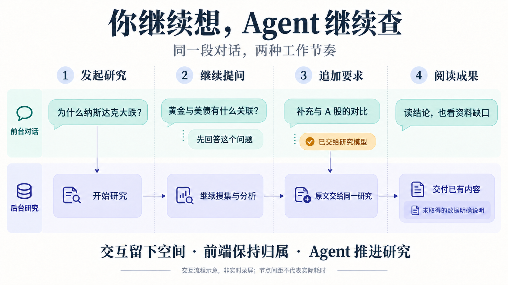
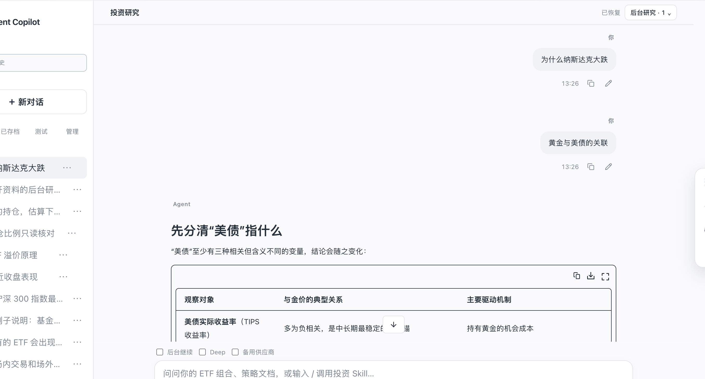
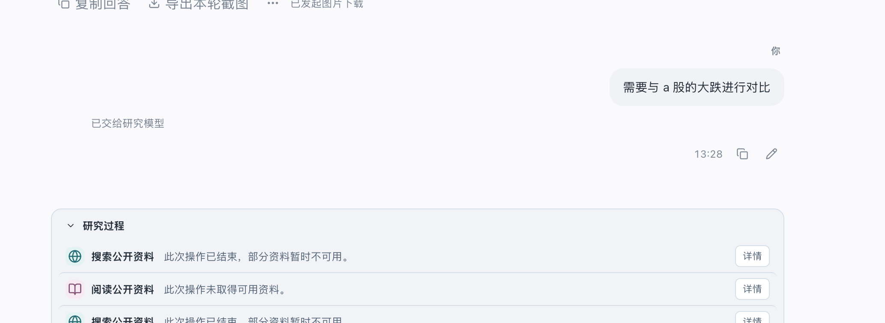
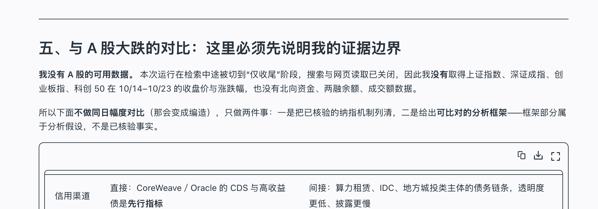

# 想聊就聊，没收 AI 对话框的中止按钮！一天让你的 Agent 支持异步后台深度研究

给 ETF Agent 做研究时，我先问了“为什么纳斯达克大跌”，随后又问“黄金与美债的关联”，中途补充了“需要与 A 股的大跌进行对比”。

这三条消息需要不同的处理方式：第一条启动研究，第二条可以独立回答，第三条要交给正在进行的研究。如果对话框只有一个全局“正在生成”状态，后两条消息就很难自然地插进来。

这次改造主要解决这个问题：后台研究继续运行，前台仍能发送新问题，追加要求也能找到对应的任务。页面右上角有后台研究入口，黄金与美债的回答出现在主对话里，A 股对比的要求则显示“已交给研究模型”。

标题里的“没收中止按钮”，指的是用户不必为了继续聊天，先停掉上一项工作。主动停止任务的能力仍然保留，只是放到了对应研究旁边。

*流程示意：独立短问单独回答，明确的追加要求交给原研究。图中间距不表示实际耗时。*

项目此前已经有工具调用、研究循环、正文发布、历史记录和恢复能力。这是标题中“一天”所依赖的基础。这里讨论的是在已有 Agent 上接通并发交互，完整研究能力的建设还有更长的前期投入。即使这些基础已经存在，真正接起来时，消息归属、执行寿命和结果交接仍然需要重新梳理。

## 一、Personal Agent 的工作，开始超出一次问答

2025 年发布的 [ChatGPT Pulse](https://openai.com/index/introducing-chatgpt-pulse/)已经将个性化异步研究作为产品能力：结合对话、记忆与反馈，在后台准备之后交付的更新。[Claude Cowork 的产品介绍](https://claude.com/product/cowork)则强调任务委托、过程可见，以及执行中途仍可调整方向。

这些产品的具体做法各有不同，但都在处理持续工作与即时交流之间的关系。用户给出目标以后，任务可能运行较长时间；这期间，用户仍会产生新的问题，也可能改变原来的要求。

这给 Personal Agent 带来了一项具体的交互要求：系统需要区分“我现在想和你聊什么”与“你正在替我做什么”。长期记忆可以保存偏好，工具可以扩展执行能力，但如果一项研究占住了整个输入框，用户仍然只能按单任务的节奏使用它。

我们已有的后台能力，最初解决的是断开页面订阅后研究能否继续。前端却仍然通过单个 `busy` 状态和当前 Run 组织输入，研究期间的新消息容易沿既有纠偏路径处理。执行已经可以脱离页面，交互仍围绕一个当前任务展开。这是本轮设计的起点。

*研究入口保留在顶部，主阅读区展示另一条问题的回答。*

## 二、先决定一段对话里可以同时发生什么

设计讨论中，我们考虑过几种方案：让新消息抢占旧回答，短问题排队串行处理，或者用一个长期运行的前台 Agent 统一协调所有工作。

新消息抢占旧回答可以维持单任务状态，但用户随手问一个概念，就会影响已经交出去的研究。串行处理能减少乱序问题，却仍需要等前一条回答完成。常驻前台 Agent 则会引入另一套持续增长的上下文和生命周期，还要与既有研究、控制、恢复机制协调。

最后采用的方式是：同一段对话容纳多个有独立身份的执行。短交互有自己的执行范围，长研究沿原有研究循环运行。前端持续接收输入，每项结果仍能对应到发起它的消息。

这个选择直接影响到运行寿命。HTTP 连接或事件流负责把进度送到页面，服务端记录负责已经接纳的任务。用户切换会话、收起面板或发送新问题，都不等同于停止研究。真正的停止需要明确指向某个任务，并交给原有控制机制处理。

这也限定了本轮要增加的东西。我们复用了原有 Run、研究调整、停止、续做、恢复和正文发布机制，没有再建立独立的后台任务账本或结果管理器。新增的主要是原消息与任务之间的关联、交互入口可选的动作，以及按任务组织的页面视图。

保留这些归属有实际作用：刷新页面时可以读取原结果，停止时可以找到原执行，调整要求时可以进入原研究。否则每多一份“后台状态”，就得再解决它与原运行记录不一致时如何处理。

## 三、有后台任务，不代表下一句话就是追加要求

这一点是入口设计里最容易被界面状态掩盖的地方。

“正在研究纳斯达克”和“用户现在问黄金与美债”，都是已知事实，但前者不能决定后者的含义。仅凭页面忙碌，就把新消息交给原研究，会把独立讨论和任务调整混在一起。

我们仍然让原来的入口模型判断普通输入，只根据当前任务与可用能力，给它提供合适的动作范围：

| 输入与上下文 | 处理方式 |
| --- | --- |
| 普通问题，没有本会话的活跃研究，且容量允许 | 直接回答，或进入研究 |
| 已有后台研究，当前不能再启动另一项 | 直接回答，或提出针对已有研究的查看、调整、停止操作 |
| 用户明确选择后台研究或 Deep | 直接进入原研究准备路径，省去普通路线分类 |
| 在指定研究面板里提交调整 | 已经确定目标，直接进入原调整机制 |
| 点击指定研究的停止按钮 | 直接交给控制机制，不需要模型理解 |

表中的协调操作，在实现里叫 Coord。它是原入口的一种决策结果，不对应一个新的常驻 Agent。没有后台任务的普通问答，不需要为了支持这项功能，多经过一次模型分类；已有后台时，也只增加必要的任务概况。

自然语言中的指代仍然需要处理。如果用户说“把那个改一下”，目标不清楚，就正常询问。若用户提出另一项独立研究，而后台容量已满，则说明无法接纳，不能擅自把它变成对旧研究的补充。

显式后台研究与 Deep 也有不同含义。前者选择执行方式，后者提出研究深度偏好，实际资源仍由已有预算机制决定。明确要求研究之后，不再由普通分类器把它降回短答；但系统也不会为了显得“深度”，强制做没有必要的工具调用。

## 四、追加一句话，需要保留原文和交接身份

主对话和研究面板都能提交调整，这两个入口最后必须汇合到同一个处理机制。否则一份要求可能产生两份修订记录，页面刷新或请求重试后，也难以判断到底送达了几次。

普通消息先按原流程保存，再交给入口模型。模型如果判断它是在调整研究，只提出操作及目标；真正交给研究的内容从已保存的用户消息中读取。模型不需要重写一份“整理后的要求”，以免原文中的限制在转述时丢失。

交接记录同时关联源消息、这次入口决策和目标 Run。源消息仍然留在原对话位置，目标研究的调整回执引用它，不再复制一条用户消息。

这样才能处理一个常见的网络问题：服务端已经保存调整，客户端却没有收到确认。重试时，系统应当读回同一份回执，不能重新调用入口模型，再给原研究增加一次修订。

还有一种更细的情况：一条消息同时包含独立问答和任务调整。例如“把研究范围缩小，并解释一下夏普比率”。解释可以正常交付，调整则以实际处理结果为准。即使目标任务恰好结束，导致调整未能应用，已经生成的独立解释也应保留。

*追加消息与交接反馈保留在对话中，研究过程另有自己的状态。*

因此，“已收到调整”和“已交给研究模型”需要区分。前者说明要求已保存，后者对应后续模型请求确实带上了要求。模型是否充分执行了它，仍然要看研究结果。

## 五、并发回答各自使用提交时的上下文

允许多个问题并行后，上下文也不能继续被理解为一份随时共享、随时变化的聊天记录。

假设两个短问题几乎同时提交，第二个回答先完成。页面可以先显示它，但不能因此让第一个回答看起来像是参考了第二个回答。模型实际收到的输入，在请求提交时就已经确定；显示顺序不会追溯改变这份输入。

我们采用的是有边界的历史快照。短交互可以看到本次请求取得的、允许使用的已提交历史，以及本会话后台任务的必要概况；后台尚未提交的分析和完整工具过程不会因为在同一页面里，就被全部装进短问上下文。

反过来，前台的每一句闲聊也不会自动注入正在运行的研究。只有明确交接的调整，才会通过原纠偏机制进入后续模型请求。在一次独立的真实机制验证中，三个短回答与后台研究确实重叠执行，短回答正文没有出现在后台模型输入里，而定向调整的原文进入了输入。这对应的是两条有意区分的路径。

它也解释了为什么“第二个方案怎么样”这类指代需要谨慎：如果所指回答还没完成，系统就没有那份结果可以理解。合理的处理是询问或说明尚无结果，而非从将来的页面顺序补出模型当时不存在的理解。

Personal Agent 需要连续上下文，但连续性仍要建立在实际发生的消息和已取得的结果上。

## 六、并发额度是一类资源，研究预算是另一类

设计最初采用的配置是三个短交互、一项后台研究。我们专门讨论过：这两个数应当是部署配置，不能散落成前端和入口模型里的常量。

同时，一项后台研究的初始限制，也不能把数据结构固定成“唯一后台任务”。任务概况、控制目标和结果视图仍按 Run 集合组织。这样后续扩展时可以保留现有身份关系；但真正允许多项后台研究同时执行，还需要另外验证容量竞争、恢复和交错投递，不能只改一个数字。

这里还存在三种不同的额度：

- 同一账户或个人作用域中，可以同时接纳多少项任务。
- 某次研究还能使用多少请求、时间和工具资源。
- 供应商当前还能接收多少模型请求。

三者都影响能否继续工作，但计量对象不同。允许启动一项后台研究，不等于供应商此刻一定有空位；提高并发上限，也不会补充已有研究的预算。

作用域容量还要跨越浏览器标签、不同会话和服务实例。只在一个页面数后台卡片，或者只在单个进程里维护计数，都不足以做实际接纳判断。因此，原有并发准入被扩展为持久化的分类占用，由服务端统一协调竞争。

这里确实踩过一个坑。首次真实并发观察中，短交互还有可用名额，请求却因数据库锁竞争被立即拒绝。原先的“尝试取得锁，失败就返回”把短暂的事务占用表现成了准入不可用。修复继续使用原有事务与客户端期限，让短事务在有界范围内串行完成。等待的是准入检查的锁，不是把用户任务偷偷排进一个研究队列。

短交互转入研究时，也需要按同一个 Run 完成交接：后台接纳提交成功以后，才能释放原短交互占用。若先释放，再申请后台，中间失败就可能留下不准确的容量记录；若重新创建执行，又会引入重复请求和计费风险。

停止按钮和明确目标的调整入口不依赖短交互槽位。即使聊天容量已满，用户仍需要能控制已经接纳的研究。自然语言的“帮我停掉刚才那项”，因为还要经过模型理解，则仍需要短交互容量。这是保留直接控制入口的一个实际理由。

## 七、前端按任务组织内容，不能再依赖“最后一条回答”

并发之后，消息数组里相邻的问答不一定属于同一次执行。“最后一个 assistant”或“最新 Run”这样的便利判断，也不再可靠。

当前视图通过 Run 关联原始问题、回答、工具进度和控制操作。后发问题可以先完成，用户仍能看出它回答的是哪一句；某项研究的工具进度晚到，也只能更新那项研究对应的区域。

历史记录中有一个具体的交接故障：请求发出后，页面先创建临时回答行。历史读取随后返回，把它替换成正式消息；但后续流式内容仍按临时消息 ID 更新，于是正文更新找不到正确位置。修复需要沿原 Run 找到当前承载回答的消息，同时保留正文自身的发布身份。

另一个问题出现在完成时刻。结束信号已经到达，数据库中的结果视图却尚未更新。如果前端立即结束观察，页面仍可能停在空白或运行中。这里复用了有界的只读补查，等待原持久记录跟上，没有为读取结果重新发起模型研究。

乱序也可能发生在两次历史读取之间：较早发出的请求，反而在较新快照之后返回。若一律以“最后收到的响应”为准，旧快照就可能覆盖新内容。这条路径通过页面读取序号避免旧响应覆盖新响应；正文和工具记录仍以服务端返回的事实为准。

因此，验证异步页面时，我们会刻意安排后发问题先完成、历史先替换临时行、旧读取最后返回。单纯顺序发送、顺序完成，很难暴露这些交接问题。

界面呈现则尽量简单。后台入口放在顶部，展开面板独立滚动，进度原位更新。主对话和后台面板使用同一份研究结果，两个入口不各自保存一份正文。用户关闭面板只改变视图，原任务继续按自己的状态运行。

## 八、中断一次请求，与停止整项研究要分开

运行中的调整还有一层前端看不到的复杂性：要求到达时，模型可能已经在生成，工具也可能已经发出。

新要求不能直接改写已经提交给供应商的请求。原纠偏机制先保存要求，在允许切换的位置阻止过时的后续动作，保留已经完成的有效工作，再把完整要求放进下一次模型输入。对于符合条件的在途请求，可以尝试协作式中断，但外部是否真的停止、产生了多少用量，都要保留实际状态。

后续另一轮真实 ETF 对比，暴露了这里的错误。调整已经保存，并触发了当前模型请求的中断；中断原因经过适配层后被压成普通的取消错误，运行时随后进入只允许收尾的阶段。研究明明还有可用额度，却失去了继续查资料的路径，最终只交付了部分内容。

这里的失败发生在请求与整轮任务的交界处：调整机制只需要让当前请求让位，运行时却按更大范围的终止处理了它。

当前修复保留原纠偏机制记录的中断原因，再通过已有的后续请求准入继续研究。真正的用户停止、截止时间和资源限制仍然优先；旧请求的未知用量也不会被抹掉。针对这条路径的工程回归已通过，原题的完整真实模型验收仍在继续。这一状态与前面截图中的使用体验分别记录。

更广一点看，设计中还区分了三种看起来都像“接着做”的动作：

| 动作 | 如何处理 |
| --- | --- |
| 运行中追加或修改要求 | 在原 Run 中交接，继续使用原授权与资源范围 |
| 同一次运行的恢复 | 沿原身份和检查点处理已发生、未发生及未知的效果 |
| 研究结束后明确要求续做 | 由原续做机制判断资格，再创建有关联的新运行 |

如果调整真正送达前，原研究已经结束，就应报告无法应用。不能自动把它改成续做，也不能悄悄换到另一项研究。用户主动停止后，同样不能被一条迟到的调整重新启动。

## 九、这轮体验完成了什么，还缺什么

回到最初的例子，前台黄金与美债的解释可以独立阅读，A 股对比要求也进入了原研究。但报告没有取得完成同日比较所需的 A 股行情和资金数据，最终提供的是有明确限制的分析框架。

*调整要求已交接，完整的数据比较仍未完成。*

这处缺口需要保留。交互上的连续性已经可以观察到，研究是否充分回答了问题，还要继续检查资料获取和后续执行。两者有联系，也有各自的问题。

为本文补录演示时，新研究还遇到了后台容量已满。系统明确返回未接纳、未排队，没有覆盖原任务。这个限制也说明，输入框可以持续接收新的意图，并不意味着所有工作都能无限并发。

这轮架构讨论最终落到了几个具体选择上：原任务继续拥有执行和结果，入口负责理解新消息与它的关系，控制交接保留原文和身份，前端按同样的身份组织不同节奏的内容。它们共同支持了同一段对话中的委托、插问和调整。

接下来要继续解决的是资料缺口，以及调整要求到达后能否完成剩余研究。对用户来说，这些问题应当体现在对应任务的进度和结果里，不必再通过中止整个对话来处理。

---

延伸阅读：[异步研究的时间约定与离线交付](agent-asynchronous-research-time-bound-delivery.md)讨论何时交付与如何重读；[渐进回答的连贯性](agent-progressive-answer-coherence.md)讨论正文怎样持续完善。本文聚焦并发会话中意图、执行与视图的关系。

<!-- agent-article-sync:guidance:start -->
## 2026-10-26 · 后续验收与 Sidecar 的分界

本文最初演示的部分研究结果仍保留原状。此后原并发会话变更取得了**限定的正常真实交互资格化并归档**，验证前台短问、定向纠偏与后台 Run 的既有身份关系；这不等于那份需要完整行情、计算与 History 的基金研究已经合格。

另外，Sidecar 参考侧聊是不同的产品设计：它希望从 Main 打开独立且可恢复的小对话。当前仅有**默认关闭的 Stage A 主干基础接线**，原 Stage A/B/C 验收任务仍开放；Sidecar 不因正常并发会话通过而自动可用，也不应替代 Main 的原授权与结果提交。

## 延伸阅读与交流

本文也收录于 [ETF Agent 工程手记](https://hpoenixf.com/eff-agent-article/articles/agent-background-research-collaborative-experience)，另有[完整英文版](https://hpoenixf.com/eff-agent-article/en/articles/agent-background-research-collaborative-experience)。如果这些工程记录对你有帮助，欢迎在 [GitHub 文集](https://github.com/hpoenixf/eff-agent-article)点个 Star，方便后续阅读。
<!-- agent-article-sync:guidance:end -->
