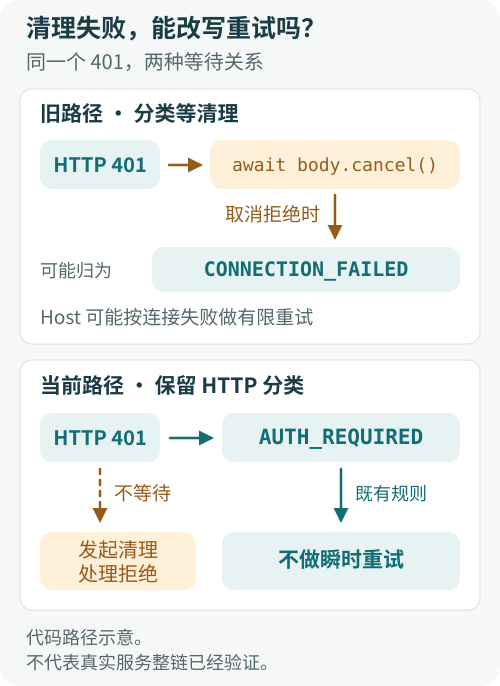
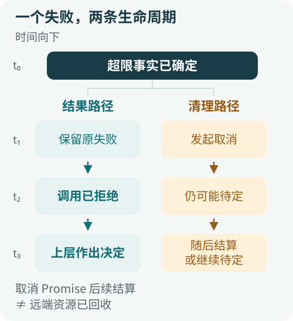
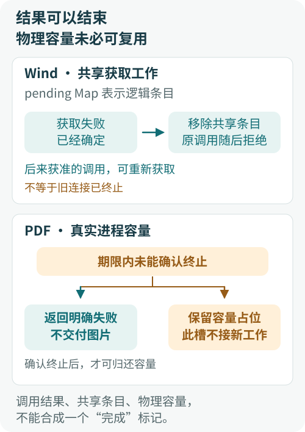

# 失败已经确定，为什么还返回不了？清理与结果结算的责任边界

读取网页时，响应已经超过大小上限；连接远端 MCP 服务时，服务器已经返回 401。接下来应该发生什么？

直觉上很简单：停止读取，释放资源，再告诉调用方“超限”或“需要认证”。于是代码先 `await cancel()`，再抛出原来的错误。它看起来很负责：失败归失败，善后总要做完。

问题恰恰出在“做完”。如果取消操作一直没有完成，已经确定的失败也交不出去；如果取消本身失败，调用方还可能收到另一个错误，并按错误的分类发起重试。

**一个 `await` 不只安排执行顺序，也让被等待的操作参与决定：结果何时返回，以什么身份返回。** 清理是否应有这份决定权，取决于接口承诺完成什么。

下面沿 ETF Agent 的 Web、MCP 与资源管理路径拆开这个问题。案例来自工程修复及受控复现，代码做了教学简化；它们说明实际依赖关系，不是线上事故的复述，也不代表公开教学仓库已包含同样实现。

## 一、一个看起来正确的 await，为什么让失败无法返回？

### Web 超限：错误已经有了，调用却还没结束

一个有大小上限的网页读取器，要同时约束压缩前后的字节数，避免小体积压缩响应解出过大的正文。超过上限后，后续数据已经不再需要，取消读取很合理。

旧路径的问题可以缩成三行：

```ts
const failure = new Error("response too large");
await reader.cancel();
throw failure;
```

`throw failure` 能否执行，取决于 `cancel()` 返回的 Promise。

- **fulfilled**：取消 Promise 正常完成，随后交付超限错误。
- **rejecting**：取消 Promise 拒绝，执行流提前跳走，超限错误可能被取消错误取代。
- **pending**：取消 Promise 仍未结算，执行流停在 `await`，后面的错误无法传出。

在真实的网页读取路径中，这两个后果都有对应的受控反例：解码后的超限分支直接等待取消，取消拒绝会进入外层解析错误处理，最终把“响应过大”改成“内容格式异常”；另一条编码字节超限路径已经写了 `.catch(() => undefined)`，仍被 pending 的取消卡住。

原因是 `.catch` 只能处理拒绝，不能使一个待定的 Promise 完成：

```ts
await reader.cancel().catch(() => undefined);
throw failure; // cancel 一直 pending，这里仍然到不了
```

如果底层取消永不结算，又没有独立的外层返回通道，这次调用就可以一直无法返回。失败已经知道了，却被清理的完成时间扣在函数内部。

### MCP 401：清理失败，还可能改变下一步动作

旧版远端 MCP 的发现流程有一条更容易忽略的路径：收到 HTTP 401 后，先取消响应体，再将失败分类为 `AUTH_REQUIRED`。

顺序写成这样，分类就落在了清理之后：

```ts
if (response.status === 401) {
  await response.body?.cancel();
  fail("AUTH_REQUIRED");
}
```

401 已经是确定的 HTTP 事实，但分类函数尚未执行。取消如果拒绝，外层可能只看到一个普通连接异常，将它归为 `CONNECTION_FAILED`；取消如果悬挂，认证失败也迟迟传不出去。

错误分类在这里不是提示文案。现有 Host 会对 `TIMEOUT`、`CONNECTION_FAILED` 做有限重试，而认证失败不属于这类瞬时错误。于是，一次清理异常可能把“需要修正认证”变成“再连一次试试”。

当前修复保留原有 HTTP 判定、权限约束和重试规则，只让响应体取消不再挡在原分类前面。401 的意义由 HTTP 响应决定，不能交给响应体的清理结果重新解释。

<figure class="diagram-frame diagram-static">
  
  <figcaption>图 1：清理异常可能改变的不只是错误文案，还有上层的重试决定。旧路径只画取消拒绝这一分支。 <a class="diagram-original" href="../visuals/cleanup-result-ownership/http-classification.svg" target="_blank" rel="noopener noreferrer">放大查看完整图</a></figcaption>
</figure>

## 二、清理如何获得了不属于它的决定权？

这类代码通常没有额外的策略判断，也没有显眼的 `deny`。决定权藏在等待关系里。

### 等待关系决定返回时间

只要调用方必须等清理完成，清理就拥有推迟结果的能力。把它放进 `catch`，这个能力仍在；移进 `finally` 也一样。异步函数必须执行完 `finally` 才会完成，里面的等待仍然是返回路径的一部分。

JavaScript 的 [`Promise.prototype.finally`](https://developer.mozilla.org/en-US/docs/Web/JavaScript/Reference/Global_Objects/Promise/finally) 也有同样的约定：回调返回的 Promise 会被等待；回调抛错或返回拒绝的 Promise，还会改变后续结果。“无论成功失败都执行”并不保证“不影响成功失败”。

### 异常传播决定失败身份

先有超限、认证失败或连接超时，再发生取消错误。哪个错误应该成为调用方的主失败，需要按接口语义决定。

对拒绝一个已经超限的响应而言，字节数已经足以作出判断。清理错误可以作为另一项观察，却没有理由把这个判断改成格式异常。对一个承诺“资源已关闭”的接口而言，关闭失败则可能正是主失败。不能仅凭它出现在 `catch` 里，就机械地把它吞掉。

### 失败身份又影响重试与降级

MCP 的例子说明，改写错误会改变控制流。本地 TEI 服务的重排序路径还有一条相近的边界。

重排序是检索的可选步骤。适配器读到过大的响应后，应交还这个失败，让上层 Retriever 按原规则保留候选和引用身份，退回确定性的排序结果。旧超限分支已经发出了 `abort`，却仍等待 `reader.cancel()`；发出中止信号，并不会自动完成另一个 Promise。

修复后，适配器不再因这个取消 Promise 而推迟原超限错误，并释放自己持有的读锁。这里不能推导出“旧版整个检索永远不返回”：Retriever 原本还有独立的截止时间。准确的变化是，适配器能在已知失败处交还控制，不必让调用方等到另一个外层期限来兜底。

### 共享等待会把一次失败传给后续调用

Wind MCP 连接获取把同一端点的并发请求合并到一个 `pending` Promise，避免重复连接。获取本身已有超时：连接与定时器通过 `Promise.race` 竞争。

但定时器获胜，只意味着那次竞争结束，不意味着包住它的整个函数已经结束。旧路径在捕获连接失败后继续等待 `client.close()`，随后才进入 `finally`，删除该端点的 `pending` 条目。

因此，时序可能是：

1. 连接获取超时，主失败已经确定。
2. 进入 `catch`，等待关闭；关闭一直 pending。
3. `finally` 没有执行，共享获取条目仍然存在。
4. 后来的同端点调用找到旧条目，继续等待同一个已经失败却尚未交付的获取过程。

**超时只覆盖了竞争的那一步，善后又接上了一段无界等待。**

当前路径启动关闭并处理其失败，不等待关闭 Promise，再抛出原获取错误、移除失败的共享条目。后来获准的调用因此可以重新获取连接。这没有增加自动重试次数，也没有证明旧连接已经在远端终止。

## 三、结果结算与资源清理应该怎样分离？

先把三个经常混写的事实拆开：

- **失败已知**：代码已经取得足够信息，例如实际字节数超过上限。
- **调用已结算**：调用方持有的 Promise 已成功或拒绝，可以执行下一步。
- **资源已回收**：相应资源的释放条件已经得到确认。

知道第一个，不代表第二个已经发生；第二个发生，也不自动证明第三个。

对“读取一份符合限制的响应”这个接口，超限就足以拒绝结果。它仍要尽力清理自己的响应体，但无需把“底层取消完成”追加成“报告超限”的前提。当前修复可以抽象为下面的写法：

```ts
// 教学写法：说明错误路径的控制关系，不是新增的清理框架。
function startCleanup(cleanup: () => Promise<unknown>): void {
  try {
    void cleanup().catch(() => {
      // 如需记录清理失败，另行处理，不覆盖本次主失败。
    });
  } catch {
    // 兼容会同步抛错的清理实现。
  }
}

if (tooLarge) {
  const failure = new Error("response too large");
  startCleanup(() => reader.cancel());
  throw failure;
}
```

这个示例同时区分了三件事：发起清理、处理清理拒绝、不等待清理完成。只有 `void` 而没有拒绝处理，可能留下未处理的 Promise rejection；只有 `.catch` 而保留 `await`，则仍会等待。同步抛错还需要另外保护。

清理函数如果在返回 Promise 之前就同步阻塞，以上写法也无法让它变成非阻塞调用。它切断的是对 Promise 结算的等待，不会自动隔离任意代码的执行成本。

<figure class="diagram-frame diagram-static">
  
  <figcaption>图 2：调用已结算与清理 Promise 已结算分开观察；两者都不能单独证明远端资源已经回收。 <a class="diagram-original" href="../visuals/cleanup-result-ownership/lifecycles.svg" target="_blank" rel="noopener noreferrer">放大查看完整图</a></figcaption>
</figure>

两条生命周期描述的是两种完成条件，不要求增加一个统一的清理管理器。当前修复仍在原有调用路径里完成：结果及时交付，取消 Promise 的后续行为另行看待。

[WHATWG Streams 的底层取消语义](https://streams.spec.whatwg.org/#underlying-source-api)本来就区分消费者不再需要数据与底层清理完成。取消失败通过取消操作返回的 Promise 表达，不会因此把已经关闭的流再改成错误状态。即使流在本地已经关闭，远端服务是否停止计算，仍需要另一种证据。

### 等待清理也是合理选择，关键是完成承诺

有些接口就是要保证：返回时，子任务已经结束，相关资源已经不再占用。此时等待不是多余的负担，而是契约的一部分。

例如 Python 官方文档明确说明，[`asyncio.wait_for`](https://docs.python.org/3/library/asyncio-task.html#asyncio.wait_for) 在超时后会等待任务实际取消，因此总等待时间可能超过设定的 timeout。这是选择了更强的取消完成语义，不能因为它等待就判成设计错误。

另一种选择是给清理单独的有限等待窗口。它适合希望尽量确认回收、又不能无限阻塞的接口，但必须说明窗口到期代表什么：可以是“清理结果未知”，不能直接当作“资源已释放”。它也会把这段窗口加入调用时延。

因此，评审时最该问的是：**这个 API 返回，究竟承诺业务结果已经确定，还是连资源回收也已经确认？** 先回答这个问题，再决定清理应当被等待、限时等待，还是与结果交付分开。

## 四、Owner 该负责什么，不该负责什么？

这里的 Owner 指有依据作出某项决定、并对该决定负责的现有组件。划清责任，不需要把所有错误再交给一个更大的 Manager。

在前面的路径里，责任可以按已掌握的事实分开：

- 读取器掌握字节数，决定本次响应是否超限。
- MCP 发现流程掌握 HTTP 事实，交付认证或连接失败的准确分类。
- Host 按已有策略决定是否重试；Retriever 决定可选排序失败后的降级。
- 一次任务运行的生命周期掌握整体执行事实，决定继续、收尾或终结。

清理负责处理自己有权处置的资源。它不应仅因为处在这些组件的返回路径上，就顺带改写其他组件的决定。

### Wind 的逻辑槽，可以释放；PDF 的物理槽，未必可以

“失败就尽快释放槽位”听起来像一个通用规则，但槽位代表的承诺不同，规则也不同。

Wind 的 `pending` 条目表示“同一端点正在共享哪次连接获取”。获取已经失败，就应让这次共享等待结束。移除条目不是对旧连接物理状态的确认。

PDF 图像渲染的并发槽约束的是实际工作进程。如果旧进程还在运行，却把槽腾给新进程，表面上的并发数没有超标，真实资源占用却可能叠加。

所以，这条渲染路径采用了不同的做法：先终止工作进程，并确认子进程关闭、进程组消失，再归还容量；在既定期限内无法确认，就返回“清理未确认”，不交付图片，也不释放对应占位。后续请求可能因此不能获得这份容量，代价是真实的，但它保住了资源上限的含义。

这与结果和清理解耦并不冲突。**可以给调用方一个有界的失败结果，同时继续把资源容量记为不可用。** 调用结果、共享等待条目和物理容量，不能合成一个“完成”标记。

<figure class="diagram-frame diagram-static">
  
  <figcaption>图 3：同样叫“槽位”，代表的承诺不同。结束结果等待，不意味着可以复用尚未确认归还的物理容量。 <a class="diagram-original" href="../visuals/cleanup-result-ownership/slot-contracts.svg" target="_blank" rel="noopener noreferrer">放大查看完整图</a></figcaption>
</figure>

### 进入 finally，不等于取得共享资源的所有权

还要检查另一个问题：谁有权执行清理？

既有 Run 资源路径曾有这样一组受控反例：同一运行的第二次进入被执行租约拒绝，或者旧执行者的租约已经失效，外层 Factory 仍在 `finally` 中清理共享的 PDF 引用和游标。对自己而言，它正在退出；对真正有效的执行者而言，工作还在继续。

这个错误与是否等待清理无关。即便清理瞬间完成，它也删错了东西。

修复把共享清理的依据放回原有 Session：只有通过租约围栏检查、成功取得终态或取消结果的执行者，才走相应的共享资源清理。Factory 仍可回收本次自己分配的独占工作区；借用的工作区由调用方负责。

围栏检查的意义是核实执行资格仍然有效，防止过期执行者继续影响后继者。不能因为某个对象最先创建了资源，就假定它在任意时刻都仍有处置权；也不能因为代码走到 `finally`，就认为它拥有这个 Run 的全部资源。

### 局部结果与整个 Run 的终结，也有边界

清理不应覆盖一个已经成立的持久结果，局部模块也不应凭一次失败独立宣布整个 Run 结束。前者保护结果事实，后者保护决定范围。

[《当每个模块都能说“不”》](./agent-veto-authority-and-run-termination.md)讨论了局部拒绝、阶段预算与 Run 终结的分工。这篇文章向下再看一层：即使没有显式否决，等待依赖也可能让一个局部清理步骤拦住结果交付。

当前 Run 路径仍有被等待的清理调用。其异常不会覆盖已持久化的结果，与所有 Run 返回路径都已不受清理延迟影响，是两项不同的结论，不能混称为“Owner 已统一解决清理”。

一个有效的 Owner 边界至少要能回答：我依据哪些事实作决定，我能处置哪些资源，以及我现在是否仍有资格处置它们。

## 五、修复后如何证明可靠？

最容易漏掉的问题，往往藏在测试替身过于配合的地方。如果所有 `cancel()`、`close()` 都立即成功，错误路径看起来总是很顺。

应当让同一条业务失败路径遇到三种取消行为：

| 取消行为 | 要验证的关键问题 |
| --- | --- |
| pending | 主失败能否在取消仍待定时交给调用方？ |
| rejecting | 调用方拿到的是否仍是原失败及原分类？ |
| fulfilled | 正常清理时，原本正确的行为有没有被破坏？ |

RED→GREEN 要证明具体行为改变：把同一负例放回旧代码，先观察断言失败，再让修复后的代码满足原有断言。短看门狗用于发现“原失败还没有交付”，不作为生产时延承诺。

历史负例并不是整张矩阵全部变红。Web 的编码超限分支已经吸收取消拒绝，它暴露的是 pending 等待；解码超限还暴露了错误被替换。MCP HTTP 失败矩阵中的 fulfilled 控制原先就通过，pending 和 rejecting 才区分出修复效果。Wind 旧路径也已保护关闭时的异常，新增的关键反例是关闭悬挂导致获取不结算。

这些差别说明为什么要保留正向控制：测试既要发现新问题，也要证明没有把已经正确的行为一并改掉。

### 要在清理仍待定时作断言

pending 测试有一个重要的编排细节：自己掌握一个可释放的取消 Promise，先观察主失败，再释放取消。不能为了让测试退出，提前把清理 Promise 完成，然后才断言业务调用已经结束。

对 Wind，还要在旧关闭仍待定时发起后来一次合法获取，确认它不会继续复用失败的共享等待；让旧连接迟到完成，再确认它不能覆盖后来成功的缓存。单个等待者取消，也不应取消其他等待者仍在共享的连接。

对 PDF，容量断言恰好相反：终止尚未确认时，后续工作不能占用同一份容量。清理拒绝时，应返回清理未确认并保留占位。

同时检查清理是否按预期发起、原失败是否保留、读锁是否释放，以及权限、字节上限和原有重试规则有没有变化。这些观察比一个总通过数更能说明修复了什么。

### GREEN 证明到哪一层，就写到哪一层

MCP HTTP 失败测试经过真实安装的 SDK，但响应和响应流由测试构造；Wind 的连接与关闭行为由 SDK 替身控制。它们能检验对应调用路径的等待关系、分类和共享状态。HTTP 分类与 Host 重试规则分别验证，尚未将 401 发现路径与 Host 组合起来验证完整重试链路。

更重要的是，**主失败能够返回，不等于资源回收已经成功。** 取消被调用、信号已经中止、读锁已经释放，各自只证明相应的本地事实。要判断远端请求是否终止、资源是否持续积累，还需要清理完成的独立观察和相应运行证据。

采用结果与清理解耦的代价也在这里：结果路径不再被清理拖住，但清理未完成的问题仍然存在。若长期回收未知会影响容量，就应继续追踪它，而不是把一个不再被等待的 Promise 当作已经不存在的工作。

回到开头那个 `await`，代码审查可以沿着三个问题往下问：

1. 清理永远 pending，已经确定的失败还能返回吗？
2. 清理拒绝，会不会改写主失败、重试分类或后来调用的机会？
3. 不等待之后，是否误把尚未确认的物理资源、外部效果或共享所有权当成已经释放？

**让结果及时、准确地结算，同时保留清理的真实状态。** 两件事分开负责，调用方才能拿到它该有的决定权，资源约束也不会随着一个 `void` 悄悄消失。
