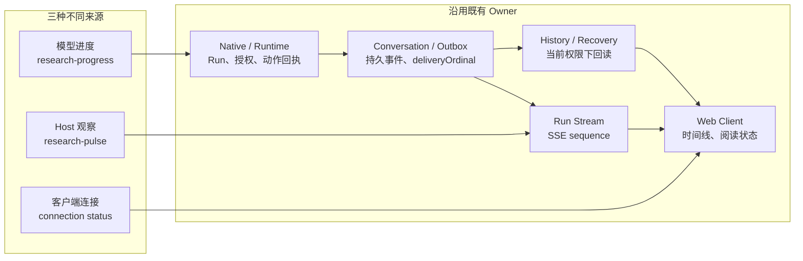

# Agent 客户端不只是展示 SSE：如何呈现可信的研究过程

用户提交一项基金比较，页面开始出现文字。随后他又问了一个短问题，刷新页面，回来时打开一条引用，最后决定停止仍在进行的比较。

单独看，每一步都很普通。放在同一条交互链上，问题才显现出来：后到的回答应该落在哪条问题下面？历史读取能否覆盖刚刚看到的新内容？点击停止之后，页面应该显示“正在停止”，还是直接宣布“已停止”？而当研究持续几分钟，页面上那句“正在研究”究竟是谁说的？

**Agent 客户端的核心工作，是把用户操作、任务进展和研究结果稳定地对应起来。** SSE 只是其中一种实时传输方式。浏览器接到了字符串，并不意味着它已经正确呈现了一次研究。

下面沿三步展开：先确定任务与正文的身份，再处理用户操作和阅读，最后进入长研究特有的进度与重连。前半段建立客户端的通用判断，后半段用 ETF Agent 的具体机制解释取舍。

## 一、客户端需要自己的状态，但不能替其他模块宣布事实

先区分传输与应用。SSE 通过持续连接把服务端事件送到浏览器，`EventSource` 提供接收事件和连接重试的机制；任务属于谁、正文是哪一版、操作是否生效，则需要应用自己定义。即使换成轮询或 WebSocket，这些问题仍然存在。

一种清楚的组织方式，是把状态分成两类：**客户端维护交互状态，服务端提供任务与内容事实。** 输入草稿、弹层、滚动位置、当前选中的研究和待回执操作属于前一类；研究是否创建、答案是否保存、资料是否仍可读属于后一类。

用户点击发送，可以立即看到消息正在提交；但是否已经创建研究，要等接纳结果。点击停止，可以立即禁用重复点击并显示请求中；但请求发出不代表原研究已经停止。打开一个引用详情，可以由客户端控制展开和焦点；但哪些资料允许当前用户查看，不能由这个展开动作自行决定。

| 页面上的事情 | 客户端负责什么 | 不能凭界面动作推断什么 |
| --- | --- | --- |
| 输入与发送 | 保存当前草稿，展示提交及失败状态 | 消息已被接纳、研究已创建 |
| 任务控制 | 指向具体研究，发送操作，展示回执 | 请求发出就等于操作完成 |
| 正文更新 | 合并同一正文的正确修订，维持阅读连续性 | 页面有字就等于已经持久保存 |
| 历史重开 | 读取当前有权查看的原结果 | 旧缓存仍然拥有查看资格 |
| 引用核查 | 展示获准材料、版本和限制 | 有引用就等于结论正确 |

对应到现有架构，正文发布、会话事件与历史交付、来源与引用资格各有自己的负责者。客户端消费这些事实，组织可操作、可阅读的界面，不重新裁定发布资格和研究结论。

*职责示意：客户端及时回应操作，但任务状态与内容资格仍从各自的原始事实取得。*

[放大查看完整矢量图](../visuals/a25-client/m-boundaries.svg)

## 二、先把回答放回正确的 Run，再处理正文修订

当回答可以乱序完成，“最后一条消息”就不再是身份。Run 才是一次被接纳的任务执行；它不等于整个聊天会话。一个短问先完成，原研究随后继续输出，二者必须沿各自 Run 找到正确的回答位置。

ETF Agent 的并发交互中，曾出现临时回答行被正式 History 消息替换，而后续流式更新仍指向旧临时 ID 的问题。修复不是再复制一份回答，而是沿原 Run 找到当前消息身份。

*归属示意：完成先后可以变化，问题、回答和控制目标不能因此串线。*

[放大查看完整矢量图](../visuals/a25-client/m-identity.svg)

同一条回答还可能不断修订。页面已经显示正文 P 的第二版，较早发出的 History 请求这时才返回第一版，不能因为它后到就把屏幕退回旧内容。反过来，读者主动打开历史第一版，也不应该被客户端悄悄升级成当前最新版。

**当前视图的合并与历史版本的浏览，是两个不同动作。** 预览已经显示但保存回执尚未到达时，客户端可以在同一 Run 和阅读范围内短暂保留它并继续核对；只有匹配的持久事实才能确认保存。明确的权限拒绝优先于暂存预览。

*合并示意：比较同一正文对象的修订；明确的权限拒绝优先于暂存预览。*

[放大查看完整矢量图](../visuals/a25-client/m-revisions.svg)

## 三、让操作和阅读连续地接下去

### 新消息到达时，保住原阅读位置

长研究不断产生回答和进度时，有两个容易打断阅读的细节：

- 新进度到达时，不应强制把正在阅读旧回答的用户滚到页面底部；可以保留阅读位置，并提供“有新进度”的入口。
- 临时 assistant 消息身份替换成正式保存身份时，同一个 Run 的“研究过程”展开状态不应复位；另一个 Run 则应保持自己的阅读状态。

### 发送、补充和停止，沿各自回执更新

从某项研究面板发起“补充要求”时，客户端已经知道目标，应携带明确的 Run 和上下文，不要把一个明确的界面操作退回给模型重新猜。只有用户从全局输入发起、目标确实不清楚时，才需要澄清。这样“调整原研究”和“提出一个新问题”不会因为文字相似而被混为一谈。

操作回执也要对应实际发生的事情。“要求已收到”只说明输入得到接纳；“已交给研究处理”说明它进入后续处理；“报告已按要求更新”则需要结果本身支持。不能为了给用户积极反馈，把三者压成一个“已完成”。

旧消息的接纳回执不能清空用户后来输入的新草稿；点击停止只能先显示请求中，不能提前宣告任务已停止。页面需要及时响应，但最终状态要跟随对应操作的回执。停止通常影响后续工作，并不撤销已发生的动作，也不删除已保存的回答。

### 引用与焦点，也要跟着当前内容走

正文修订后，引用详情必须对应正确版本。引用入口让读者能回查原文，却不替结论的正确性背书。

键盘和触屏也属于这条阅读链：折叠区要正确表达展开状态，对话框要处理焦点进入、关闭和返回触发位置。它们不需要让用户学习内部 Runtime 术语，只需要让任务、内容和下一步动作始终对得上。

## 四、长研究中，先分清屏幕上的三类信号

| 信号 | 谁产生 | 可以表达什么 | 不能证明什么 |
| --- | --- | --- | --- |
| 模型研究进度 `research-progress` | 模型通过原 Native Tool 提出，经 Runtime 接纳 | “AI 进度（未经独立核验）”：模型认为自己正在做什么 | 资料已读完、计算正确、研究完成百分比 |
| Host 临时状态 `research-pulse` | 原 Run/Stream 根据当前可观察事实产生 | “系统状态”：最近观察到的状态，或明确的未知 | 模型此刻仍在思考、任务一定会完成 |
| 客户端连接状态 | 浏览器本地观察 | “连接状态”：正在重连、暂时无法取得新消息 | 服务端已经停止、取消或完成 |

### 长时间没有新消息时

当一项模型请求或工具调用持续较久，页面可能很长时间没有新的模型进度。此时最容易做错的，是让浏览器一直显示“正在研究”，或者每隔一段时间再调用模型生成一句“还在工作”。

我们的选择更克制：当原 Run 的观看流仍然附着、没有新的有意义状态时，Host 可以约每 30 秒发出一条临时观察。如果无法确认当前阶段，就明确写“当前执行状态未知”，而不是猜测模型正在思考什么。

这条 Host pulse 与模型进度不同：

- 它来自系统当前能够观察到的事实，不是模型自述。
- 它进入原 Run Stream 的同一事件队列，不创建第二套序号。
- 它是临时事件，不写入 Outbox/History；用户重连后不会收到此前错过的心跳。
- 它不触发新的模型请求，也不增加研究预算。

因此，HTTP 每十秒发送的 `: heartbeat` 仍然只是传输保活；用户可见的 `research-pulse` 才是系统状态提示。两者不能混为一谈。

停止、停放、人工交互等待、取消、终结或观看连接结束时，临时状态都必须收口。浏览器自己的连接提示则只说明它暂时无法取得新消息，不推断服务端已经停止。

## 五、从模型提议到屏幕出现：四个事实、两种顺序

在 ETF Agent 中，一条模型进度沿现有执行与交付链经过四个阶段：

1. **提出**：模型通过受控工具提交一段有界文本。这只是模型的陈述。
2. **接纳并结算**：原 Runtime 检查 Run、权限、内容是否可展示以及终结状态，再由原动作链结算并取得稳定的 `updateId`。
3. **持久提交**：Conversation/Outbox 保存该事件，并分配持久顺序 `deliveryOrdinal`。
4. **实时显示**：附着的 Run Stream 通过 SSE 发送，客户端将其投影成时间线中的一行。

页面应展示已取得回执的阶段；缺少哪一步，就把状态留在哪一步。

同类更新也要按效果身份去重。两条 `kind=progress` 但 `updateId` 不同，是两次独立陈述；同一身份、同一封存请求的重试，才是同一个效果。若仍然使用 `runId + kind` 作为唯一槽位，“先查了什么、后发现什么”就会被覆盖成最后一句话。旧合同已经覆盖掉的历史也不能凭新协议补造。

还要区分两种顺序：

- **持久顺序**：`deliveryOrdinal` 由原 Conversation 为已提交的模型进度分配。重开后，History 按它恢复真实记录。
- **实时顺序**：`sequence` 由当前 Run Stream 的事件队列分配，只对这条连接内的事件顺序有效。重连后的新连接可能重新开始序号，不能把它当作跨连接的全局历史游标。

前面的 Host 临时状态只使用实时顺序，因此断线后没有可供补发的持久记录。

这两种顺序各自服务于具体承诺：当前连接内有序交付，重开后恢复持久事件。

## 六、最难的竞态：History 晚回来，却可能比 SSE 更旧

考虑一个经过针对性验证的竞态：浏览器先发起 History 请求，随后 SSE 收到一条新的进度并显示；稍后 History 返回，却没有这条进度。

这行缺席可能是因为快照在事件提交前就开始读取，也可能是因为原身份或当前权限不再允许展示。**缺席本身既不能证明“从未发生”，也不能证明“永远合法”。**

直接用 History 覆盖整个界面，会抹掉刚看见的合法进度；直接相信所有曾经显示过的 SSE 文本，又可能让已撤权的内容继续留在页面上。

实际采用的办法更克制：原 SSE 发送权限检查通过后，传输层可以为这条确切的会话、范围、Run、持久顺序和正文提供短期、仅限当前进程的回执。若较晚的 History 缺少这行，客户端只向原负责方有界核验这份**已经显示过的具体回执**，不允许拿任意文本或猜测的 ID 查询，也不创建第二个权限 Owner。

| 核验结果 | 当前视图如何处理 |
| --- | --- |
| 原身份与内容仍匹配 | 保留该行 |
| 明确不再有效或回执无效 | 只移除该行，不影响独立回答和其他 Run |
| 未知、超时或网络失败 | 只在当前 Run、当前阅读代际内暂存已显示行，等待后续真实 History；不能升格为永久授权 |

回执来自当前进程，服务重启后可能无法继续验证。旧回执失效不等于内容必然被撤权；后续合法的持久 History 仍可独立展示原事件。迟到的核验结果也不能跨过取消、终结、账户切换或新的阅读代际，重新“复活”旧行。

还有一个容易被忽略的来源问题。第二轮研究可能确实把第一轮的回答放进了模型请求，但这并不自动证明随回答带入的所有来源、版本和附件都具有同样的展示资格。只凭一个来源 ID，或只凭“History 读到了”，不足以证明完整的输入谱系。

我们的修复落在原 History → 实际请求拟合 → 新 Run 来源关联这条链上：只有原身份、版本和真正进入本轮请求的材料得到原 Owner 证明，才允许相应进度继续展示；其他材料仍保持未知。这里的经验是：**一条关于研究过程的陈述，也可能依赖来源身份；保存过的历史不等于本轮请求完整、合法地使用了它。**

最重要的是，可选进度核验不能挡住独立答案。即使某条进度暂时无法确认，已经获准的正式回答也应该继续交付。Progress 服务于研究，不应该变成新的终结权。

## 七、Progress 的协作边界：独立能力，不新增执行权威

这里需要区分两个概念：**能力（capability）描述用户能获得什么；Owner 描述谁对某个事实或效果拥有最终决定权。** 在 ETF Agent 的架构里，一个模块不是一个文件或目录，而是一个完整能力及其负责效果的最终 Owner。

Progress 值得拥有独立的领域语义：它有自己的来源类型、事件身份、时序、可见性和展示规则。但它没有一项脱离原 Run 生命周期、需要自己决定准入、持久化、恢复与终结的独立效果。因此它应该是一项跨模块能力，而不是再增加一个 Progress Manager。

它们沿用的职责如下：

| 环节 | 原有职责负责什么 | Progress 在这里做什么 |
| --- | --- | --- |
| Model / Native Tool | 研究策略与受控工具提案 | 提出一条简短进度，不直接发送 SSE |
| Runtime / 原 Action Owner | Run 身份、权限、终结围栏与动作结算 | 检查当前 Run 和展示资格，签发原动作回执与 `updateId` |
| Conversation / Outbox | 持久事件、幂等身份与历史交付 | 保存已接纳的模型进度及 `deliveryOrdinal` |
| Run Stream | 当前连接的事件队列与 `sequence` | 统一发送模型进度和临时 Host 状态 |
| History / Recovery | 按原身份和当前权限读取、恢复事实 | 重开时恢复真实持久进度，不补造错过的临时心跳 |
| Web Client | 交互、时间线与阅读状态 | 标注来源，合并同一 Run 的可见内容 |

这条链可以画成一项能力横跨多个既有 Owner，而不是由新模块接管所有事情：

*图 1 · Progress 是跨越既有 Owner 的能力合同；模型进度、系统观察和客户端连接不会共享同一种权威。*

这些原有 Owner 已经负责准入、事件身份、持久化、终结围栏与重连读取。再建一个 Progress Manager，只会重复裁决，或把原本清楚的职责重新集中起来。只有当 Progress 真的获得独立生命周期、跨产品订阅者，或自己的保留与查询政策，才值得重新评估独立模块。

## 八、这些机制怎样逐步形成，又验证到了哪里？

这套机制是随着问题逐步补齐的，并非一开始就需要完整铺开：

| 阶段 | 当时遇到的问题 | 留下的设计选择 |
| --- | --- | --- |
| 2026 年 10 月 10 日 | 长研究缺少时间感与进度表达 | 时间提醒进入下一次已获准的模型请求；模型经 `send_research_update` 提议进度；异步交付仍走原任务与通知链 |
| 10 月 25 日 | 同类更新在 Native、事件收集、Memory/PostgreSQL 身份与 Web 投影中按 `kind` 覆盖；较早更新被后续慢工具拖住 | 为每次已接纳更新保留独立身份，按原事件链及时、有序交付 |
| 11 月 2—3 日 | 三条更新已显示，迟到 History 仍能抹掉一行；显示过也不等于永久可读 | 区分实时、持久与当前读取资格，增加原回执的有界核验 |

最初设计中的 3/5/8 分钟只是软提醒，后续固定门槛已由统一提醒 Owner 收敛，不是当前硬阈值。时间提醒不额外调用模型，也不把报时或进度文字变成正式答案或完成判断。

### 实际观察到了什么

验证让原 Native、Conversation、HTTP/SSE、隔离 PostgreSQL、History 和浏览器在同一条本地受控路径里交错工作。使用脚本模型与合成资料，覆盖了多条同类进度的有序显示、长时间等待、History 回读与恢复、并发 Run、连接状态不确定、窄屏、键盘操作和不强制滚动等场景。一次超过 95 秒的前台等待观察中，页面出现了三条相隔约 30 秒的 Host 未知状态；独立的控制器测试也确认 Host pulse 不会额外触发模型请求。

这些观察支持限定路径中的身份、顺序、回读与展示行为，尚不能推导真实模型文案质量、生产数据库或时延表现、用户信心提升。它们也不是线上部署证明；屏幕阅读器与语音播报尚未验收。

### 公开教学代码能看到哪一段

本文引用的 Open ETF Agent 固定 v0.21 提供本地单用户的普通顺序人机问答：问题和回答沿原任务关联，用户显式继续同一个 Run，并读回持久报告。它不是私有产品的完整 Web 客户端，也没有公开上述 Progress 时间线和 SSE 交付链。读者可以从[公开 README](https://github.com/hpoenixf/open-etf-agent/blob/main/README.md)与[v0.21 固定源码](https://github.com/hpoenixf/open-etf-agent/tree/427315b5554b1c9af8fa50b8ab622747045e691a)了解这一公开版本的范围；[普通问答合同](https://github.com/hpoenixf/open-etf-agent/blob/427315b5554b1c9af8fa50b8ab622747045e691a/docs/human-interaction.md)展示了另一项跨模块能力如何复用原任务，而不是创建第二套执行器。

## 九、如果从头再做一次，我会先做得更少

这段工程演进最值得迁移的，不是一套必须照搬的 Progress 子系统，而是按用户承诺逐步增加机制：

1. **短任务只交付答案。** 不要为了统一界面，让每次普通问答都生成进度事件。
2. **出现长时间等待时，先给出保守状态。** 复用原 Run 和 Stream；系统不知道当前阶段，就说未知，不要伪造百分比。
3. **确实需要保留多条模型进度时，再引入独立效果身份与持久顺序。** 不要把“最新阶段”槽位误当成完整历史。
4. **真实出现 SSE/History 竞态时，再增加有界的原回执核验。** 核验留在原授权和历史 Owner 内，不另造权限系统或第二份历史账。
5. **让进度保持可选、可降级。** 某条进度未知或不可展示，不应阻断独立合法的答案、文件或报告交付。

回到开头那项基金比较：短问题的回答落在自己的位置，原研究的进度标清来源，迟到的历史不随意覆盖新版本，停止与补充都有明确目标和回执，引用与滚动也跟得上读者。

**可信的客户端，是让任务、内容和操作始终对得上。** Progress 只是这条交互链的一部分；该说未知时说未知，该交付的独立答案继续交付。

## 延伸阅读

- [Agent 客户端交互全景：从提出问题，到读懂结果、继续研究](./agent-client-interaction-panorama.md)：从用户旅程理解提问、等待、干预、阅读与重开。
- [异步后台研究与前台并发交互](./agent-background-research-collaborative-experience.md)：讨论长研究期间如何继续聊天、补充要求和定向控制。
- [研究还没结束，用户已经离开了：Agent 怎样按时交付真实成果？](./agent-asynchronous-research-time-bound-delivery.md)：区分研究执行、正文发布与通知时间。
- [Agent 问完用户之后：持久人机交互如何接回原研究](./agent-durable-human-interaction-response-adoption.md)：解释回答接收、采用与原任务恢复。
- [Agent 引用系统设计：从来源签发、版本绑定到独立复核](./ai-citations-do-not-prove-reliability.md)：解释来源身份与结论支持的区别。
- [MDN：Using server-sent events](https://developer.mozilla.org/en-US/docs/Web/API/Server-sent_events/Using_server-sent_events)：SSE 的传输与重连语义，不是应用层恢复合同。
- [W3C WAI-ARIA APG：Disclosure Pattern](https://www.w3.org/WAI/ARIA/apg/patterns/disclosure/) 与 [Dialog Pattern](https://www.w3.org/WAI/ARIA/apg/patterns/dialog-modal/)：折叠区和模态对话框的交互约定。
