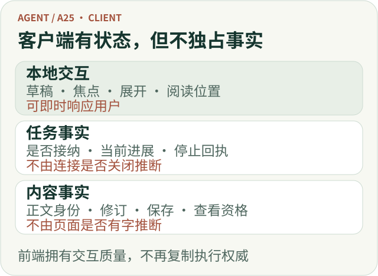
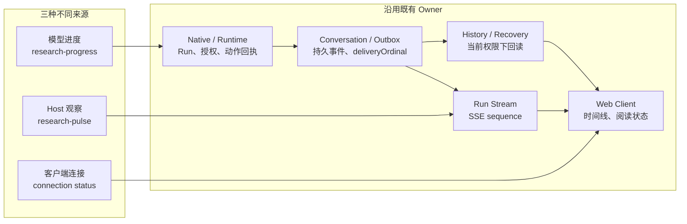

# Agent 客户端不只是展示 SSE：如何呈现可信的研究过程

用户提交一项基金比较，页面开始出现文字。随后他又问了一个短问题，刷新页面，回来时打开一条引用，最后决定停止仍在进行的比较。

单独看，每一步都很普通。放在同一条交互链上，问题才显现出来：后到的回答应该落在哪条问题下面？历史读取能否覆盖刚刚看到的新内容？点击停止之后，页面应该显示“正在停止”，还是直接宣布“已停止”？而当研究持续几分钟，页面上那句“正在研究”究竟是谁说的？

**Agent 客户端的核心工作，是把用户操作、任务进展和研究结果稳定地对应起来。** SSE 只是其中一种实时传输方式。浏览器接到了字符串，并不意味着它已经正确呈现了一次研究。

长任务又把这个问题推进了一层：客户端不只要显示结果，还要解释一项尚未完成的工作。它必须区分模型对自己工作的描述、系统能够观察到的运行状态，以及浏览器当前的连接情况。否则，界面看起来很活跃，用户却不知道哪些话值得相信。

本文沿 ETF Agent 的长期工程演进解释这件事。私有产品的完整 Web Progress 实现与公开教学仓库的 CLI 能力不是同一范围，文末会明确区分。

## 一、客户端需要自己的状态，但不能替其他模块宣布事实

“前端不要再造一套状态机”容易被误解成“前端不应该有状态”。实际恰好相反：输入草稿、弹层、滚动位置、当前选中的研究、尚未收到回执的按钮操作，都需要明确的本地状态。

需要避免的是：**用这些本地状态替代任务的真实状态。**

用户点击发送，可以立即看到消息正在提交；但是否已经创建研究，要等接纳结果。点击停止，可以立即禁用重复点击并显示请求中；但请求发出不代表原研究已经停止。打开一个引用详情，可以由客户端控制展开和焦点；但哪些资料允许当前用户查看，不能由这个展开动作自行决定。

| 页面上的事情 | 客户端负责什么 | 不能凭界面动作推断什么 |
| --- | --- | --- |
| 输入与发送 | 保存当前草稿，展示提交及失败状态 | 消息已被接纳、研究已创建 |
| 任务控制 | 指向具体研究，发送操作，展示回执 | 请求发出就等于操作完成 |
| 正文更新 | 合并同一正文的正确修订，维持阅读连续性 | 页面有字就等于已经持久保存 |
| 历史重开 | 读取当前有权查看的原结果 | 旧缓存仍然拥有查看资格 |
| 引用核查 | 展示获准材料、版本和限制 | 有引用就等于结论正确 |

对应到现有架构，正文发布、会话事件与历史交付、来源与引用资格各有自己的负责者。客户端消费这些事实，组织可操作、可阅读的界面，不重新裁定发布资格和研究结论。

*职责示意：客户端及时回应操作，但任务状态与内容资格仍从各自的原始事实取得。*

[放大查看完整矢量图](../visuals/a25-client/m-boundaries.svg)

## 二、Progress 为什么做了这么久：问题从“没有提示”变成“提示是否可信”

最初的需求很自然：研究可能持续几分钟，模型需要知道时间在流逝，用户也需要知道任务还在推进。2026 年 10 月 10 日的第一轮设计，把三件事分开：

- Host 的时间提醒在下一次已经获准的模型请求中出现，不为报时额外调用模型。
- 模型可以通过受控工具 `send_research_update` 提出简短进度。
- 用户约定的异步交付时间，仍由原任务与通知链处理。

这一步解决的是“能不能表达”。它没有把模型的进度文字塞进正式回答，也没有让“到时间了”自动变成任务完成。

随后，问题从表达转向保存。10 月 25 日对现有实现的检查发现，同类进度可能在 Native 暂存、公共事件收集、Memory/PostgreSQL 事件身份和 Web 投影中按 `kind` 覆盖。一次较早的更新还可能等到同一模型轮中后续慢工具结束后才送达。HTTP 每十秒发送的 SSE 注释心跳维持的是传输通道，用户看不到，也不能据此知道研究到了哪一步。

于是设计目标变成：**模型已经获准的多条进度更新，能否各自保留，并在后续慢操作结束前按顺序出现？**

11 月 2—3 日的实现与浏览器验证又暴露出下一层问题：即使三条更新都出现，晚到的 History 快照仍可能让其中一条消失。显示过一次，也不能成为重连后永久可读的凭据。实时到达、持久保存和当前有权读取，必须分别处理。

这段演进最重要的变化，不是“加了一种 SSE 消息”，而是把 Progress 从一个不断刷新的阶段标签，变成了有身份、有时序、受当前权限约束的过程信息。

## 三、Progress 是独立能力，但不需要独立 Runtime Owner

这里需要区分两个概念：**能力（capability）描述用户能获得什么；Owner 描述谁对某个事实或效果拥有最终决定权。** 在 ETF Agent 的架构里，一个模块不是一个文件或目录，而是一个完整能力及其负责效果的最终 Owner。

Progress 值得拥有独立的领域语义：它有自己的来源类型、事件身份、时序、可见性和展示规则。但它没有一项脱离原 Run 生命周期、需要自己决定准入、持久化、恢复与终结的独立效果。因此它应该是一项跨模块能力，而不是再增加一个 Progress Manager。

先把屏幕上可能出现的三类信号分清：

| 信号 | 谁产生 | 可以表达什么 | 不能证明什么 |
| --- | --- | --- | --- |
| 模型研究进度 `research-progress` | 模型通过原 Native Tool 提出，经 Runtime 接纳 | “AI 进度（未经独立核验）”：模型认为自己正在做什么 | 资料已读完、计算正确、研究完成百分比 |
| Host 临时状态 `research-pulse` | 原 Run/Stream 根据当前可观察事实产生 | “系统状态”：最近观察到的状态，或明确的未知 | 模型此刻仍在思考、任务一定会完成 |
| 客户端连接状态 | 浏览器本地观察 | “连接状态”：正在重连、暂时无法取得新消息 | 服务端已经停止、取消或完成 |

它们各自沿用原有职责：

| 环节 | 原有职责负责什么 | Progress 在这里做什么 |
| --- | --- | --- |
| Model / Native Tool | 研究策略与受控工具提案 | 提出一条简短进度，不直接发送 SSE |
| Runtime / 原 Action Owner | Run 身份、权限、终结围栏与动作结算 | 检查当前 Run 和展示资格，签发原动作回执与 `updateId` |
| Conversation / Outbox | 持久事件、幂等身份与历史交付 | 保存已接纳的模型进度及 `deliveryOrdinal` |
| Run Stream | 当前连接的事件队列与 `sequence` | 统一发送模型进度和临时 Host 状态 |
| History / Recovery | 按原身份和当前权限读取、恢复事实 | 重开时恢复真实持久进度，不补造错过的临时心跳 |
| Web Client | 交互、时间线与阅读状态 | 标注来源，合并同一 Run 的可见内容 |

这条链可以画成一项能力横跨多个既有 Owner，而不是由新模块接管所有事情：

*图 1 · Progress 是跨越既有 Owner 的能力合同；模型进度、系统观察和客户端连接不会共享同一种权威。*

为什么不建一个 Progress Manager？因为它一旦成为真正的模块，就必须回答：谁有权接纳进度、谁分配稳定身份、谁保存事件、谁决定终结后还能不能发、谁在重连时裁定历史。原有 Owner 已经负责这些事实。新 Manager 只能重复裁决，或把原本分散但清楚的权威重新集中起来。

未来如果 Progress 获得独立于 Run 的生命周期、跨产品订阅者、自己的保留/查询政策，或者需要成为多个系统共享的事件服务，再重新评估独立模块才有意义。**现在需要独立的是能力语义，不是另一套执行权威。**

