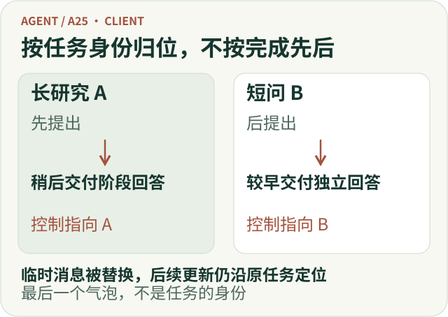
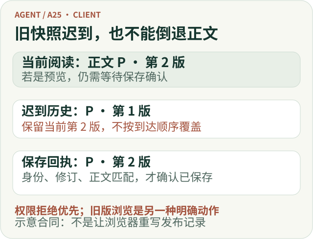

# Agent 客户端不只是展示 SSE：一次研究怎样被正确呈现？

用户提交一项基金比较，页面开始出现文字。他又问了一个术语问题，随后刷新页面，回来时打开一条引用，最后决定停止仍在进行的比较。

单独看，每一步都很普通。放在同一条交互链上，问题才显现出来：后到的回答应该落在哪条问题下面？刷新读回的内容能否覆盖刚刚看到的新版本？点击停止之后，页面应该显示“正在停止”，还是直接宣布“已停止”？

**Agent 客户端的核心工作，是把用户操作、任务进展和研究结果稳定地对应起来。** SSE 只是其中一种实时传输方式。浏览器接到了字符串，并不意味着它已经正确呈现了一次研究。

在 ETF Agent 的职责划分中，客户端负责交互与阅读。本文以既有客户端机制和公开工程记录为例，解释这项职责；文中的验收场景是设计检查方法，不是本次重新执行的测试报告。完整产品客户端与独立的 Open ETF Agent 教学实现也不是同一套交付范围。


*职责示意：客户端及时回应操作，但任务状态与内容资格仍从各自的原始事实取得。*

[放大查看完整矢量图](../visuals/a25-client/m-boundaries.svg)

## 一、客户端当然有状态，但不能替其他模块宣布事实

“前端不要再造一套状态机”容易被误解成“前端不应该有状态”。实际恰好相反：输入草稿、弹层、滚动位置、当前选中的研究、尚未收到回执的按钮操作，都需要明确的本地状态。

需要避免的是：**用这些本地状态替代任务的真实状态。**

用户点击发送，可以立即看到自己的消息正在提交；但是否已经创建研究，要等接纳结果。点击停止，可以立即禁用重复点击并显示请求中；但浏览器关闭了网络连接，不代表原研究已经停止。打开一个引用详情，可以由客户端控制展开和焦点；但哪些资料允许当前用户查看，不能由这个展开动作自行决定。

这几项职责可以放在同一张页面上，却不应混为同一个判断：

| 页面上的事情 | 客户端负责什么 | 不能凭界面动作推断什么 |
| --- | --- | --- |
| 输入与发送 | 保存当前草稿，展示提交及失败状态 | 消息已被接纳、研究已创建 |
| 任务控制 | 指向具体研究，发送操作，展示回执 | 请求发出就等于操作完成 |
| 正文更新 | 合并相同正文的正确修订，维持阅读连续性 | 页面有字就等于已经持久保存 |
| 历史重开 | 读取当前有权查看的原结果 | 旧缓存仍然拥有查看资格 |
| 引用核查 | 展示获准材料、版本和限制 | 有引用就等于结论正确 |

对应到现有架构，正文发布、会话事件与历史交付、来源与引用资格各有自己的负责者。客户端消费这些事实，组织可操作、可阅读的界面，不重新裁定发布资格和研究结论。[1][2]

这种分工并不会削弱前端。它让前端真正拥有的是**交互质量**，而不是一份容易与服务端分叉的执行记录。

## 二、当回答可以乱序完成，最后一条消息就不再可靠

一个问题、一条连接、一段回答的原型，通常可以用“当前 assistant 消息”承接所有增量。只要始终串行，这个办法并不难理解。

但用户不一定按这个模型使用产品。他可以先发起长研究，再问一个很短的问题；短问先完成，长研究随后才补上阶段结果。此时，最新收到的正文未必属于界面上最后一条问题。

因此，页面需要保留三种关系：用户原问题属于哪次执行、回答属于哪次执行、每段已发布正文属于哪个内容对象。这里的 Run 可以简单理解为**一次被接纳的任务执行**，并不等同于整个聊天会话。

ETF Agent 的并发交互记录中，有一个很能说明问题的故障：页面先创建临时回答行，历史读取随后用正式消息替换它，流式更新却仍然指向旧临时 ID，导致后续回答找不到承载位置。修复的关键是沿原 Run 找到当前消息，而不是再复制一份回答。[3]

这给前端实现带来两个直接约束。

首先，视图位置不能充当业务身份。数组下标、最后一个气泡、当前打开的面板，都不适合决定事件归属。即使为了阅读体验调整展示顺序，回答仍要保留“回复了哪条问题”的关系。

其次，临时 UI 身份被正式身份替换时，事件路由也要完成交接。历史回读不是把组件整体换掉就结束了；它还影响后续增量、停止操作、错误提示和引用详情的目标。

同样的约束适用于没有发送成功的草稿。草稿至少要跟随账户和会话边界；会话 A 的迟到响应，不能把内容恢复进会话 B。旧消息的接纳回执，也不能顺手清空用户随后输入的新文字。[3]



*归属示意：完成先后可以变化，问题、回答和控制目标不能因此串线。*

[放大查看完整矢量图](../visuals/a25-client/m-identity.svg)

## 三、实时事件与历史回读，合并的是同一份回答

实时流解决“现在发生了什么”，历史读取解决“目前能够重新取得什么”。它们会交错到达，不能各维护一套互不相干的正文。

MDN 对 SSE 的说明包含事件类型、事件 ID 与重连机制，但这些传输能力并没有替应用定义正文修订、查看权限和历史合并规则。采用原生 `EventSource` 或其他流式客户端时，都要单独处理应用层的内容身份。[4]

对一段回答，最重要的不是收到多少个片段，而是知道它属于哪个 Run、哪个正文对象，以及该对象的哪个修订。修订号只在对应对象的合同内有意义，不能把不同回答的版本号放在一起比较。

例如，页面已经显示正文 P 的第二版，较早发出的历史请求这时才返回第一版。不能因为它后到，就把屏幕退回旧内容。反过来，如果读者主动打开的是历史第一版，客户端也不应该把它悄悄升级成当前最新版。

**当前视图的合并与历史版本的浏览，是两个不同的用户动作。**

预览与保存之间还有一段容易忽略的时间差：文字已经显示，持久化回执尚未到达；紧接着历史读取暂时没有返回正文。此时，立刻清空界面会造成“刚出现的答案消失了”，直接把预览视为已保存又会制造虚假交付。

合理处理是：在同一查看范围、同一 Run、身份与内容严格对应的条件下，暂时保留可见预览，并继续有限度地只读核对；只有匹配的保存事实才能把它确认为持久内容。版本冲突或身份不匹配不能靠“文字看起来差不多”合并。

这里还有一个优先级更高的边界：**保留预览不能对抗当前权限。** 账户切换、明确的访问拒绝和资料撤权，不能被当成普通的历史读取延迟。缓存不是一份永久有效的授权。[1][2]

因此，合并逻辑应集中在明确的视图投影层，而不是分散在消息组件、历史组件和来源组件各自的副作用里。渲染层拿到的是已经对齐身份的阅读模型，不需要再猜一次正文归属。



*合并示意：比较同一正文对象的修订；明确的权限拒绝优先于暂存预览。*

[放大查看完整矢量图](../visuals/a25-client/m-revisions.svg)

## 四、连接、任务和正文，要在界面上分别说清楚

一个全局 `loading` 无法表达长研究中的所有情况。

网络断开时，任务可能仍在运行；任务后来失败时，前面已经保存的阶段回答可能仍然有效；任务执行结束时，客户端也可能还在等待历史视图补齐。

这不意味着要把所有内部状态暴露成十几个徽标。页面只需告诉用户与下一步有关的区别。

连接异常时，可以显示“连接暂时中断，正在重新读取进展”，不要直接给研究盖上失败印章。已有阶段结果、剩余部分未完成时，应保留仍获准展示的正文，并明确未完成的范围。读取失败时，则说明当前无法确认最新状态，而不是把旧页面包装成实时结果。

停止也是同样的道理。停止一项研究通常影响后续工作，并不等于撤销已经发生的动作，更不等于删除已保存的回答。ETF Agent 的异步交付记录已经把停止、阶段正文和后续历史读取分别处理。[1]

从组件角度看，这些区别应当有各自的数据来源；从用户角度看，它们可以压缩成一句准确的提示。**内部区分是为了减少界面的误导，不是为了让用户学习内部术语。**

## 五、发送、补充和停止，需要各自的操作回执

一个研究正在进行时，用户的新输入至少可能有三种含义：问另一个问题、补充当前研究、回答研究提出的澄清问题。停止任务则是另一种明确的控制动作。

最稳妥的交互，是在已有上下文能够确定目标时直接携带目标。例如，在某项研究面板内点击“补充要求”，输入框就应清楚显示它正在调整哪项研究；没有必要再让语言理解重新猜一次目标。用户从主输入框发出含糊的调整时，才需要澄清对象。[3]

操作回执也要对应实际发生的事情。“要求已收到”只说明输入得到接纳；“已交给研究处理”说明它进入后续处理；“报告已按要求更新”则需要结果本身支持。不能为了给用户积极反馈，把三者压成一个“已完成”。

重复点击与重试同样需要分工。客户端可以合并进行中的点击、防止按钮连按，但真正的重复请求识别要依靠服务端合同。仅在浏览器里设置一个布尔变量，不能保证刷新或重连后不重复执行。

草稿也应遵循精确确认：回执确认的是哪次提交，就只处理那次提交对应的编辑状态。发送失败可以保留原草稿，发送成功不能清空一段更晚输入的新内容。

这部分并不要求增加复杂的审批面板。多数情况下，一个明确的任务标签、一条准确的回执，以及失败后可理解的恢复动作就够了。

## 六、正文、引用和阅读位置，共同构成一份结果

客户端不能只保证文字没有丢，还要保证用户读到的关系没有错。

正文从第一版变成第二版后，对应引用也必须属于第二版。不能显示新结论，却继续打开旧版本的核查材料；不能因为两个段落出现相同数字，就在浏览器里推断它们引用了同一次计算。

ETF Agent 的引用设计强调，来源身份、引用对应与材料是否支持结论是不同问题。客户端应提供核查路径，但不能把一个引用图标渲染成“已经验证正确”的徽章。[2]

对读者而言，最有价值的详情往往只有几个问题：当时到底读到了什么，材料是哪一版，有没有截断或缺少上下文，以及怎样打开原来源。网页现在的内容与当时保存的片段，也应有明确区分。

交互形态不必只有一种。短内容可以就地展开，较长材料可以用侧栏或对话框；关键是能用键盘和触屏操作，而不是把全部信息藏在悬停提示里。采用折叠模式时，应正确表达展开状态；采用模态对话框时，应处理焦点进入、关闭及返回原触发位置。W3C 的 Disclosure 与 Dialog 模式分别给出了相应约定，不能混用两套交互语义。[5][6]

阅读位置也值得单独设计。用户已经向上查看引用时，新正文到达不应不断把他拉回底部。可以保留当前位置，并提供“有新内容”的入口。正文修订影响当前展开详情时，应让详情跟随准确版本重新取得，或明确提示内容已更新，不能无声混接。

这些是推荐的阅读交互要求；不能从一个来源弹层可以打开，就推断所有流式修订、焦点迁移和移动设备组合都已经验收。

## 七、验收应从容易错位的交接开始

只看“发送后页面出现回答”，很难发现客户端最重要的问题。更有辨识力的是让不同事件发生交错，再观察用户最终看到什么。

下面是一组适合客户端交互与阅读的验收场景，不是通过情况清单：

| 场景 | 应观察的结果 |
| --- | --- |
| 后发短问先完成，原研究随后继续输出 | 两份回答对应各自问题，控制操作不串线 |
| 新正文先到，旧历史请求后返回 | 当前视图不被旧正文覆盖，不重复追加回答 |
| 预览已显示，保存回执稍后到达 | 同一内容完成确认，不闪退、不冒充提前保存 |
| 研究中途停止或失败 | 准确显示后续状态，保留仍获准读取的已交付部分 |
| 切换会话或账户后旧响应到达 | 草稿、正文和来源都不能进入错误范围 |
| 阅读引用时正文发生修订 | 核查对象不跨版本错绑，键盘操作与阅读位置可继续 |

纯数据合并可以通过确定性测试覆盖；真实的 Tab 顺序、焦点恢复、滚动和窄屏布局则需要浏览器观察。某一层通过，并不能替另一层作保证。

这里的目标也不是用前端测试证明研究结论正确。它要证明的是：**用户实际看到并操作的，确实是对应任务、对应版本、当前允许展示的内容。**

## 八、公开代码可以先复现哪一段？

Open ETF Agent 提供了报告、来源与附件的本地回读示例，可以用来观察“重新阅读保存结果，不重新生成结果”这一基础边界。历史 v0.6 的[固定提交说明](https://github.com/hpoenixf/open-etf-agent/blob/7480b656b18192e6d6b44aab65255b970d58e6f8/README.md)保留了当时的实现与限制；持续使用入口以[当前 main 的模块指南](https://github.com/hpoenixf/open-etf-agent/blob/main/docs/module-guide.md#v06-read-download-and-verify-over-real-http)为准。

下面采用 2026 年 11 月 2 日读取的当前 main 文档步骤，要求 Node.js 26.8.1–26.x 与 npm。安装依赖可能联网，默认示例使用合成材料，不需要模型密钥：

```bash
git clone https://github.com/hpoenixf/open-etf-agent.git
cd open-etf-agent
npm ci --ignore-scripts --no-audit --no-fund
npm run build
npm run demo -- --case document-compare
# 将 run-YOUR_ID 换成上一步输出的实际 Run 目录名
npm run serve -- --run runs/run-YOUR_ID
```

根据公开指南，示例会在独立 Run 目录生成报告和记录；本地读取服务会打印访问地址，读者可查看已登记报告、来源窗口及相关附件。这里引用的是文档步骤，本次文章编写没有重新执行该示例。[7]

这个 reader 只监听本机 loopback 地址，没有面向公网的身份认证；它是本地阅读示例，不是可以直接对外部署的网站。

这段公开实现不是完整产品客户端：不能由本地回读服务推出多账户聊天、前台并发、SSE 恢复和全部产品交互已经公开交付。它适合先理解结果身份与阅读边界，再把这些约束带回自己的客户端设计。

回到开头：用户问完问题，继续聊天，刷新页面，核查引用，再停止原研究。一个可靠的客户端应让这些动作自然衔接，而不要求用户知道后台如何执行。它的工程价值，就在这些看似普通、却最容易错位的交接里。

用户旅程见配套文章[《Agent 客户端交互全景：从提出问题，到读懂结果、继续研究》](./agent-client-interaction-panorama.md)。

## 参考与延伸阅读

[1] ETF Agent，[研究还没结束，用户已经离开了：Agent 怎样按时交付真实成果？](https://hpoenixf.com/eff-agent-article/articles/agent-asynchronous-research-time-bound-delivery)

[2] ETF Agent，[Agent 引用系统设计：从来源签发、版本绑定到独立复核](https://hpoenixf.com/eff-agent-article/articles/ai-citations-do-not-prove-reliability)

[3] ETF Agent，[异步后台研究与前台并发交互实践](https://hpoenixf.com/eff-agent-article/articles/agent-background-research-collaborative-experience)

[4] MDN，[Using server-sent events](https://developer.mozilla.org/en-US/docs/Web/API/Server-sent_events/Using_server-sent_events)。这里引用传输与重连语义，不把它当成应用层恢复协议。

[5] W3C WAI-ARIA APG，[Disclosure Pattern](https://www.w3.org/WAI/ARIA/apg/patterns/disclosure/)。

[6] W3C WAI-ARIA APG，[Dialog (Modal) Pattern](https://www.w3.org/WAI/ARIA/apg/patterns/dialog-modal/)。

[7] Open ETF Agent，[当前 README](https://github.com/hpoenixf/open-etf-agent/blob/main/README.md)与[模块指南](https://github.com/hpoenixf/open-etf-agent/blob/main/docs/module-guide.md)。代码与文档取材日期：2026 年 11 月 2 日；main 是可变入口。
