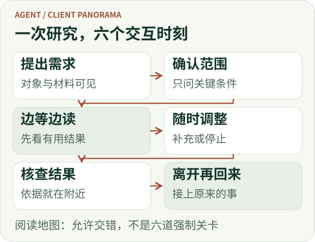
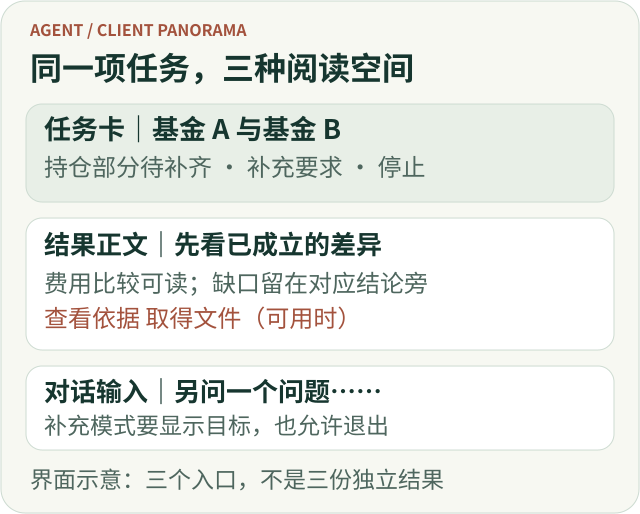
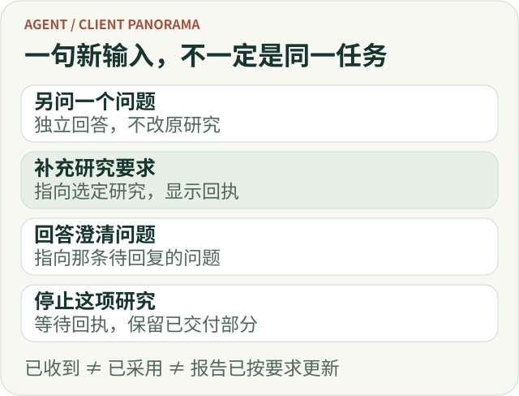
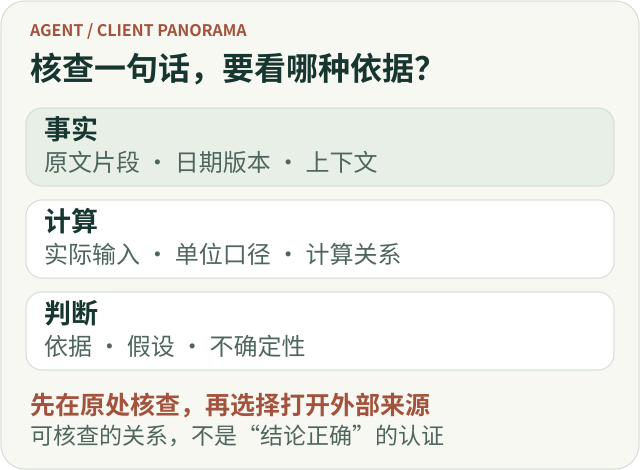
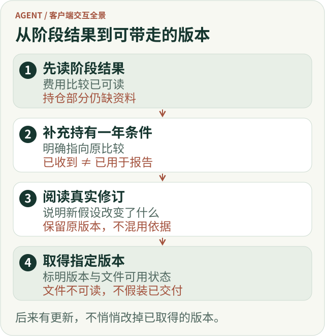
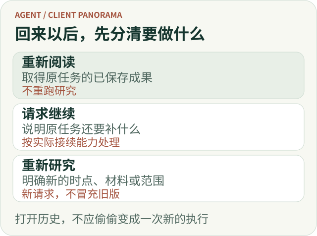
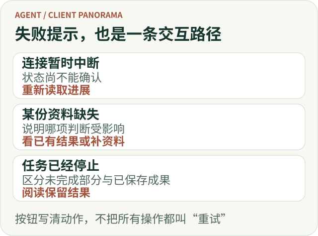

# Agent 客户端交互全景：从提出问题，到读懂结果、继续研究

一份报告出现在页面上，并不意味着一次使用已经完成。

用户还可能不知道：系统有没有读懂自己的限制，等待时能不能问别的问题，刚才补充的要求是否被采用，结论中的数字从哪里来，以及关闭页面以后去哪里继续看。

**Agent 客户端要组织的，是一段可理解、可干预、可续接的协作过程。** 好的体验不仅让结果出现，也让用户在过程中始终知道自己交代了什么、现在能做什么，以及下一步应该怎样判断。

下面用一个教学情境贯穿全文：

> “比较我选的两只基金，重点看持仓重合和费用，先给我关键差异。我可能会离开一会儿，回来继续看。”

这里不使用真实基金数据，也不推导投资结论。ETF Agent 已有的并发对话、渐进回答、引用阅读和异步交付实践提供工程背景；本文进一步讨论交互取舍。示例文案与布局是设计表达，不代表每个细节都已在产品中实现。

整条使用路径可以概括为：**提出需求 → 确认范围 → 研究与阶段阅读 → 必要时补充或停止 → 核查与取得结果 → 离开后重开 → 继续追问。** 这些环节允许交错发生，用户不必等到最后一步才获得价值。

*用户旅程概览：这些动作可以交错发生，不是要求每次提问通过六道关卡。*

[放大查看完整矢量图](../visuals/a25-client/p-journey.svg)

## 一、从一个问题开始，而不是从一张配置表开始

对于这项基金比较，用户首先想表达的是“比较什么、重点看什么”。输入入口应该帮助他说清楚，而不是要求他先理解研究深度、工具组合或模型设置。

最基本的界面可以仍然是聊天框，但要让已经选中的对象和材料可见。例如，输入区附近展示两只基金的名称、已选资料和本次研究的范围；用户可以移除选错的材料，也能看出哪些个人信息将被用于这次请求。

**可见的上下文比隐形的自动理解更重要。** 如果系统悄悄沿用旧会话里的基金、日期或账户，用户很难发现后面的分析已经偏离了本意。

资料进入过程也需要准确反馈。文件上传完成，最多说明传输结束；文件是否能够读取、是否只有部分内容可用，是另一件事。界面不宜在上传结束时就显示“已完成分析”。失败时应保留用户的问题，并把无法使用的材料单独指出。

不过，不必为了严谨，把每次提问都变成必填表单。明确的对象与限制可以随消息一起展示；确实会改变结论、又无法合理确定的条件，再进入澄清。

### 三种空间，围绕同一项任务协作

对话、任务卡和报告，分别回答不同问题。对话保留用户问了什么、改了什么；任务卡说明现在到哪一步、还能怎样干预；报告负责解释发现，并为核查依据提供稳定位置。它们不必变成三个独立页面，更不应各维护一份需要手工同步的研究结果。

可以把任务卡放在对话上方，只写“基金 A 与基金 B · 持仓比较待补齐”，旁边提供“阅读已有结果”“补充要求”和“停止”。报告仍是主要阅读去处。用户转去问一个无关的术语时，任务卡让原研究仍然找得到，却不遮住新回答。这是一种信息布局建议，不代表新增页面已经实现。

在手机上，优先露出任务名称、影响判断的缺口和一个最有用的动作，次要操作再收起。详细过程可以按需展开；来源详情可以临时替换阅读区，不必勉强并排。关闭详情后回到同一句结论。窄屏需要保留的是任务关系，不是桌面的列数。

*教学布局，不是产品截图。任务卡帮助干预，正文帮助判断，对话帮助表达新的意图。*

[放大查看完整矢量图](../visuals/a25-client/p-workspace.svg)

## 二、需要问用户时，只问会改变研究的条件

假设两只基金的资料披露日期不同。系统可能需要确认：用户想按最近可取得的资料比较，还是要求严格对齐某个时间点？这会影响结论能否成立，值得问清楚。

相反，“你喜欢详细还是简洁”“是否需要表格”“要不要风险提示”并不总值得逐个阻塞研究。能够采用合理默认的展示偏好，可以先执行，再允许用户调整。

好的澄清应同时给出问题的原因和可选择的路径。例如：

> “两份持仓资料的日期不同。可以先比较各自最近披露的数据，并标明日期差异；也可以等你指定同一个比较时点。”

这比单独问“请选择时间范围”更容易回答，因为用户知道自己的选择会改变什么。

用户回复以后，也应能看见采用后的研究范围。没有必要让他重新读完整聊天记录，才能确认系统是否仍然在比较正确的对象。

对于依赖用户回复的任务，可以显示“等待你确认比较时点”；对于能够继续完成独立部分的任务，则可先交付不依赖该条件的内容。是否能继续，取决于任务本身，不应由一个统一的“等待中”画面决定。

## 三、等待时，让用户理解进展，而不是观看运行日志

研究开始以后，最容易做的是展示一个不断变化的状态区：正在搜索、调用工具、分析中、生成中。

它可能证明系统还在活动，却未必帮助用户判断是否值得继续等待。

对这个基金比较，真正有用的进展更接近：已经取得哪些比较材料、还有哪一项关键信息缺失，以及是否已经能回答一部分问题。比如“费用资料已取得，持仓比较还缺另一只基金同类口径的披露”，比连续几条工具调用记录更贴近用户的任务。

这里要注意措辞的来源。系统只能在确有相应事实时说“已取得”；一段计划或自述不能自动升级成核验完成。无法可靠估算剩余时间时，可以说明正在等待什么，不必制造一个不断走向 99% 的进度条。

页面可以把信息分成轻重两层：默认展示简短进展、关键阻塞和已有成果；用户主动展开时，再查看更细的过程。模型切换、请求重试和工具参数没有必要成为普通读者的必经内容。

**更早出现有用回答，比更早出现一段“我将开始分析”更值得追求。** ETF Agent 的渐进回答实践也把“首次有用回答”与“首次输出文字”分开：先回答已有依据的重要子问题，后续围绕同一篇回答补充或修正，而不是每一步都再写一份小报告。[1]

于是，等待可以逐渐变成阅读。费用部分已经足以说明差异时，用户可以先看它；尚未取得的持仓材料保持明确缺口，不必等所有工作结束才展示任何成果。

### 第一份结果出现后，操作入口也应该改变

还没有成果时，“查看进展”可能有用；已有依据的费用比较可以阅读后，“先看费用差异”就比继续展示转圈更有意义。关键日期仍待确认时，可以把问题放在受影响的部分旁边，而不是用一张等待画面替换整份报告。

这形成了一段很小、却重要的交互推进：等待有原因，阶段成果有入口，未解决条件有回复位置。不要为了让任务卡显得活跃而加一个百分比。没有可靠进度估算时，诚实的缺口比虚构的完成比例更能帮助用户采取行动。

## 四、研究还在做，用户仍然应该能够说话

看到某个费用术语，用户可能顺手问一句：“这个费用和申购费有什么区别？”

这不一定是在修改原比较。要求用户先停止研究才能提问，会把协作过程重新变成单线程等待；把所有新输入都塞进原研究，又可能改变原来的任务。

因此，界面至少应该帮助用户分清四种动作：提出一个独立问题，补充原研究，回答某个待确认问题，以及停止指定任务。

不一定需要四个永久占位的输入框。一个普通聊天入口，加上研究卡片里的“补充要求”和待确认问题旁的回复入口，通常就能把大部分意图表达清楚。进入补充模式时，输入框应显示明确的目标，例如“补充到：基金 A 与基金 B 的比较”，同时允许退出这个模式。

用户说“把持有一年时的费用也放进去”，系统可以回显这条补充，并说明当前处于什么阶段。已收到不等于已经用上，用上也不等于报告已经完成更新；需要等待结果才能确认的事，不应提前写成成功。

ETF Agent 的既有并发实践采用了相近的分工：独立短问单独回答，明确的补充交给原研究，停止操作指向具体任务。用户能继续说话，并不意味着系统承诺无限并发；容量不足时，应明确说明新任务没有被接纳，不能悄悄把它并入另一项研究。[2]

停止按钮也无需消失。它应该属于对应任务，并清楚说明影响范围。收起任务面板、切换会话和关闭网页，则应当与主动停止区分开来。真正允许离页继续执行的产品，还需要把这一点明确告诉用户；不支持时就不能暗示支持。

*交互分流示意：目标明确时直接携带目标，不让用户每次重新解释自己正在修改什么。*

[放大查看完整矢量图](../visuals/a25-client/p-intents.svg)

## 五、结果开始出现时，先让人读懂，再考虑动画

阶段回答进入页面以后，用户关心的已经不只是“还在工作吗”，而是“这些内容对我的问题意味着什么”。

对这个教学案例，可以先呈现已经有依据的关键差异，再说明比较依据和仍缺的材料。结论需要保持条件完整：不能把“当前取得的资料显示……”压缩成无条件的最终判断。

正文的组织也不应完全照抄研究执行顺序。用户通常不需要按“第一次搜索、第二次阅读、第三次补充”理解两只基金。他需要的是费用怎样比较、持仓重合能说明什么，以及哪些部分暂时不能判断。[1]

布局上，可以让回答保持一条稳定的阅读主线。过程区域按需展开，来源在相关结论附近可进入，下载和后续操作放在成果旁边。窄屏上不必复制桌面的多个并排面板；先保证正文、任务状态和必要动作能顺序读到。

流式更新尤其需要尊重阅读位置。用户已向上查看前面的内容时，后续文字到达不应反复把页面拉到底部。一个“有新内容”的提示，比强制抢走滚动位置更符合正在阅读的任务。

修订也不必每次都弹窗。真正影响判断的变化，可以用简短的更新说明指出，例如“持仓比较已补齐，原先未确认的部分现在有了依据”。这类说明必须来自实际变化，不能为了制造活跃感而固定重复。

## 六、想核查一句话时，不要先把用户赶出报告

假设用户读到“这两只基金的某类风险暴露较为接近”。他可能只想确认：这句话依据哪些材料，有没有忽略披露日期，究竟是记录中的事实还是进一步的判断。

如果点击引用立即打开一张长网页，读者还要重新找段落、找表格，再返回报告定位刚才那句话。链接虽然存在，核查路径却没有真正完成。

更合适的入口是先在当前阅读环境里展示相关材料。原文片段、来源日期或版本、读取位置和必要限制放在一起；“打开原来源”保留为一个清楚的独立动作。当前网页可能已经更新，因此原来源页面与当时用于研究的材料不应被混称为同一份内容。[3]

不同结论还需要不同的核查方式。

**事实陈述**适合查看原始材料和上下文。**计算结果**需要看实际使用的输入、单位、口径和计算关系，而不仅是一个来源标题。**分析判断**则需要说明依据、假设和仍然存在的不确定性；它不能被包装成原文已经直接说过的话。

没有留存原始片段时，应当直说。不能现场生成一段貌似原文的文字填上空白；重新获取材料或额外发起分析，也应该是另一个可辨认的操作，而不是“展开详情”的隐藏副作用。

同样，一条引用失效不应自动抹掉整篇仍可合法阅读的正文，但资料不可用与访问权限撤回也不能一概而论。界面要显示正确的缺口，不得继续从旧缓存展示当前不允许查看的内容。[3]

这些入口还必须真正可操作。短详情就地展开，长材料放在侧栏或对话框，都可以成立；不能只依赖鼠标悬停。键盘用户应能打开、阅读、关闭，并回到原来的操作位置。W3C 的折叠与模态对话框模式提供了不同的交互约定，具体组件应选择一致的模式实现。[4][5]

核查的目标是让用户有条件判断这句话，不能因为界面展示了来源，就替用户宣布研究已经正确。

*核查路径示意：展开原有材料与重新研究是不同动作；来源可读不等于结论已经正确。*

[放大查看完整矢量图](../visuals/a25-client/p-inspect.svg)

## 七、交付一份结果，也要让用户知道怎样取得它

有些用户在聊天页面读完就够了，有些用户需要把报告带走，或者保留一个以后能够重新打开的版本。

这时，复制正文、下载文件和保存结果，不应该被混成一个含义不明的“完成”按钮。

复制意味着取得当前可复制的文字；下载需要有实际可读取的文件；保存或收藏则应清楚说明保存的是什么。对于仍在更新的报告，用户尤其需要知道自己取得的是当前哪一版，之后的新修订是否会改变已经保存的内容。

产品支持附件时，应在结果附近展示文件名、格式和可用状态。正文已经能读，但某个附件生成失败，可以单独说明附件缺失；没有必要把整次研究判为毫无成果。反过来，一个文件保存成功，也不能证明用户已经能够打开它。

这些功能不是所有客户端都必须第一天具备。只有聊天阅读需求时，可靠的历史入口可能已经足够；确实存在交付与流转需求，再增加版本明确的下载、收藏或分享能力。分享还需要独立检查访问范围，不能把“我看得到”理解成“任何拿到链接的人都看得到”。

*一次交接示意：收到补充要求不等于报告已改；只有真实修订才提示变化，只有可读取的文件才提供下载。后续更新不应悄悄替换用户已取得的版本。*

[放大查看完整矢量图](../visuals/a25-client/p-handoff.svg)

## 八、用户离开之后，回来应接上原来的事

用户可能在持仓比较尚未完成时关闭页面。一个承诺后台研究的产品，应让他知道任务是否继续、以后从哪里找到结果，以及需要他回复时会怎样提醒。

重新进入时，最重要的不是重放一遍打字动画，而是迅速恢复理解：这是什么任务，最后完成到哪一步，有哪些结果已经能读，还缺什么，是否需要我做决定。

页面应该读取原任务的已保存结果，而不是悄悄把原问题再发一次。否则，用户以为自己是在打开历史，系统却开始了另一项研究，内容和费用都可能改变。ETF Agent 的异步交付实践明确区分了离页、重开、通知与研究执行，历史重读不以重新生成报告为前提。[6]

通知本身也不应该变成另一份报告。它只需准确说明发生了什么，并把用户带回对应任务和结果；通知被发送，不代表用户已经读过正文。

当用户约定时间时，语言差异要反映到交互里。“十分钟后提醒我”与“十分钟内给我结果”不是同一件事。提前完成是否通知、到点仍未完成时怎样说明，都应与原约定一致。已有阶段结果就指向阶段结果，还没有结果就说明当前状态，不能把“接近完成”当成交付。[6]

最后，重新打开仍然是一项当前的访问请求。换了账户、权限变化或材料撤回以后，旧链接不应自动恢复原来的阅读资格。对用户可以只解释“当前无法访问这份材料”；不必在界面展开权限系统的内部实现。

### 让用户认得出自己回到了哪里

重开时，应该能看见原问题、当前可读结果、相较先前真正影响判断的变化，以及仍等待回复的事项。一个日期或“已更新”标签，不足以解释究竟是持仓部分补齐了、结论改变了，还是只有附件变得可用。知道变化时说明实际变化；不知道时展示已保存版本，不编造一段更新摘要。

通知也使用同一任务名称，并进入对应结果或待回复问题。用户有多项研究时，“你的研究有新进展”往往不够明确。关闭通知不应停止任务，阅读报告也不应悄悄把尚未回答的澄清标成已解决。

*重开路径示意：先恢复原任务的理解，再由用户选择是否继续或重新研究，不自动重新执行。*

[放大查看完整矢量图](../visuals/a25-client/p-return.svg)

## 九、出现问题时，告诉用户影响和下一步

研究型产品无法把所有失败都消除，但可以避免把不同问题画成同一个红色横幅。

网络断开时，用户需要知道任务状态暂时无法更新，而不是被告知研究一定失败。某份资料无法取得时，需要知道哪项比较受到影响，而不是收到一条无法理解的工具错误。任务停止时，则需要知道还有哪些结果已经保留下来。

好的错误提示尽量回答三个问题：发生了什么、现有成果受到什么影响、接下来可以做什么。没有证据的恢复承诺，不应写进按钮文案。

尤其要谨慎使用“重试”。重新读取页面、再次提交未被接纳的问题、继续原任务、另开一次研究，是不同动作。按钮应该尽可能告诉用户将发生哪一种；不能把重复执行隐藏在一个看似无害的刷新动作后面。

某些动作可能影响外部数据或产生费用时，还要考虑前一次是否已经发生。客户端不能因为没有看到回执，就认定操作从未执行。这类不确定性需要明确处理，不能用无限自动重试掩盖。

局部失败也不应扩大成整体失败。已有可靠依据的费用比较可以继续阅读，缺失的持仓部分单独标注；但不能为了保住“完成”状态，把原本要求的持仓分析悄悄从任务里删掉。

*失败交互示意：先说明对当前成果的影响，再给出实际支持的下一步；不可用按钮不应许诺恢复。*

[放大查看完整矢量图](../visuals/a25-client/p-recovery.svg)

## 十、继续追问时，保留讨论对象，不偷偷改变依据

用户回来读完报告，可能问：“如果只看持有一年，刚才的结论会怎样？”

这句话有明确的讨论对象：刚才那份比较及其条件。客户端可以让用户从某段结论、某个表格或整个结果发起追问，并显示引用的是哪项内容。只把一句脱离上下文的“为什么”送出去，会让系统重新猜测。

接下来，还要分清三种追问：解释旧结论、沿用原资料改变假设并重新计算，或按新资料重新研究。解释旧结论应保留原报告的时点和依据；把持有期限改为一年，需要明确新假设及其计算结果，不能让新回答冒充原结论；重新取得资料，则要说明新的资料时点和比较条件。只有这些区别确实影响结果时，才值得显式确认，不必让所有追问都经过一张版本选择表。

反馈也应指向具体对象。用户认为某个数字有问题，和他觉得报告太长，不是同一类反馈；修改后的回答也不应继续继承针对旧版本的评价。

更不能因为用户点了赞，就默认把报告中的事实写入长期记忆，或者向他声称系统已经学会了某种投资偏好。反馈、纠错和长期保存是不同操作，需要各自可理解的边界。

至此，一项研究才真正从单次生成变成可以持续使用的成果：能提出问题，能在过程中纠偏，能核查答案，能离开再回来，也能在保留上下文的情况下继续讨论。

## 十一、先做一条完整路径，再决定增加多少界面

覆盖完整流程，不意味着每个产品都需要同时拥有任务中心、通知中心、来源侧栏、报告库和复杂的控制台。

对于简单问答，一个输入框、一份可读回答、必要的来源和明确的失败状态就可能足够。任务开始跨越等待与离页，才需要稳定的任务入口和历史续接；用户确实会边研究边聊天，再加入明确的并发交互；结果需要流转，再增加文件和版本化交付。

决定这些增量的，应当是用户任务中的真实断点，而不是希望把后端所有能力都展示出来。

验收也可以沿着同一个教学任务进行：用户能否确认比较对象，是否知道还缺什么，补充要求有没有指向正确研究，能否在结论附近核查依据，离开后能否回到同一份成果。页面没有报错只是起点，用户能独立完成这些动作才更接近交互目标。

回到最初的问题：用户把两只基金交给 Agent 比较，期间问了一个术语，补充了持有期限，离开了一会儿，回来读报告并核查来源。他不需要知道背后调用了多少次模型、使用了哪些执行组件；他需要的是每一步都知道发生了什么，并保有继续、调整或停止的选择。

**让复杂研究变得可协作，而不把系统复杂度转嫁给使用者，这才是 Agent 客户端全景应该呈现的主线。**

## 参考与延伸阅读

[1] ETF Agent，[Agent 的渐进式回答：怎样保持研究过程连贯](https://hpoenixf.com/eff-agent-article/articles/agent-progressive-answer-coherence)。

[2] ETF Agent，[异步后台研究与前台并发交互实践](https://hpoenixf.com/eff-agent-article/articles/agent-background-research-collaborative-experience)。

[3] ETF Agent，[Agent 引用系统设计：从来源签发、版本绑定到独立复核](https://hpoenixf.com/eff-agent-article/articles/ai-citations-do-not-prove-reliability)。

[4] W3C WAI-ARIA APG，[Disclosure Pattern](https://www.w3.org/WAI/ARIA/apg/patterns/disclosure/)。

[5] W3C WAI-ARIA APG，[Dialog (Modal) Pattern](https://www.w3.org/WAI/ARIA/apg/patterns/dialog-modal/)。

[6] ETF Agent，[研究还没结束，用户已经离开了：Agent 怎样按时交付真实成果？](https://hpoenixf.com/eff-agent-article/articles/agent-asynchronous-research-time-bound-delivery)。

机制深挖见配套文章[《Agent 客户端不只是展示 SSE：如何呈现可信的研究过程》](./agent-client-interaction-and-reading.md)。取材日期：2026 年 11 月 2 日。
