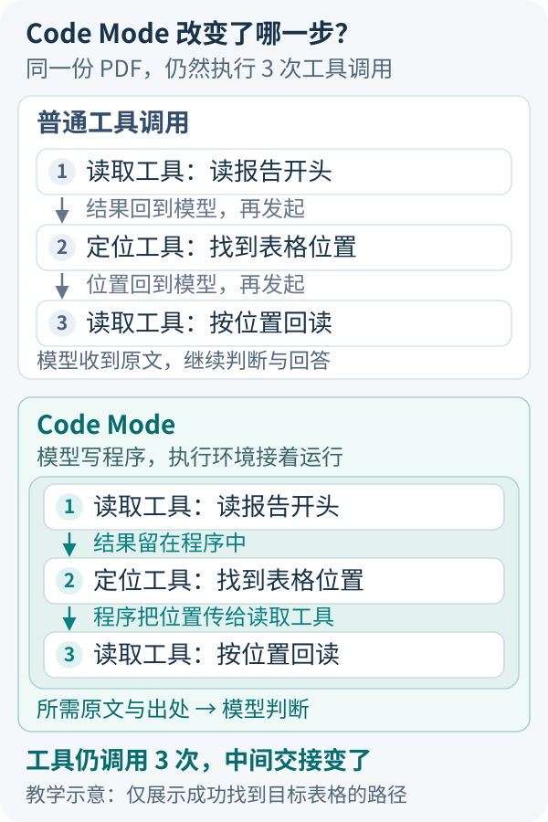
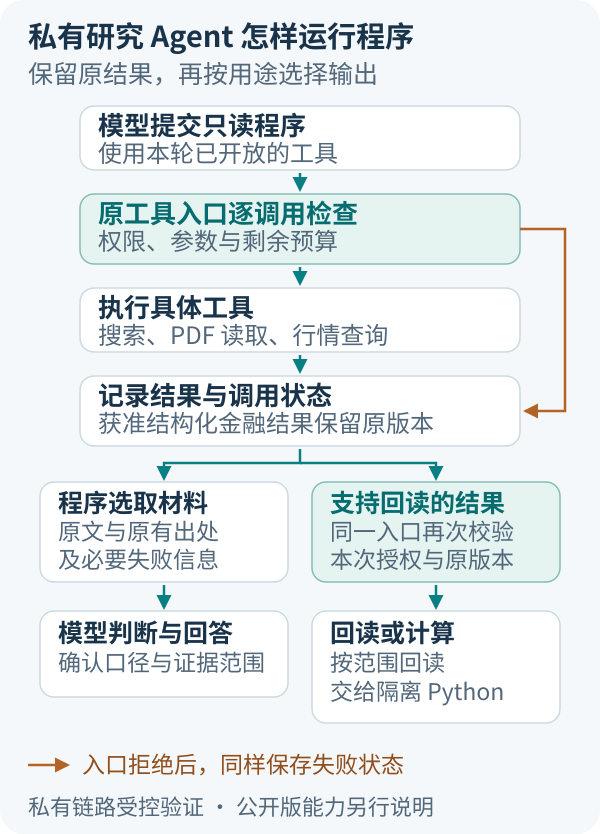

<div><a id="claude-code-的-code-mode-搬到研究-agent-值得吗"></a><a id="claude-code-的-code-mode搬到研究-agent-值得吗"></a></div>

# Code Mode 是什么：让 Agent 用代码串起工具调用

让一个 Agent 查资料，它通常需要调用搜索、文件读取或行情查询等工具。模型决定调用什么，工具完成实际操作，再把结果交给模型。

**Code Mode 在这条流程中加入了一种做法：模型先写一小段程序，由执行环境运行它，让几个工具调用在程序内部接起来，最后再把需要的结果交回模型。**

这里的代码用于完成眼前的任务。例如，找到一份报告中的某张表，再把表格原文读出来。它可以保存上一步返回的位置、决定是否继续读取、筛选要返回的字段。

下面始终围绕一个问题展开：**已经选好一份 VOO 的公开报告，怎样找到截至 2025 年底的一年、五年和十年税前回报？** 先看执行过程，再看我们在 ETF Agent 中的试验。试验的结果也会说明：把调用写成程序，与真实任务因此更快、更省，中间还有一段距离。

## 一、普通工具调用，模型怎样一步步找到答案

假设 Agent 已经有了正确的报告，但工具每次只返回一部分内容。它先读开头，没有看到收益表，于是继续定位和读取。这个过程可以写成四步：

1. **模型要求读报告开头。** 读取工具返回封面、费用和投资策略等内容，还没有目标表格。
2. **模型要求搜索表格标题。** 搜索工具返回一个位置标记，意思是“这里可能有你要的表”。
3. **模型要求读取这个位置。** 读取工具返回表格原文，以及对应的文件、页码和来源。
4. **模型理解原文并回答。** 它确认报告期、税前回报口径和各列含义，再组织答案。

前三步中有两种不同的工作。决定找哪份报告、确认哪列数字回答了问题，需要理解任务；把搜索工具返回的位置传给读取工具，则通常可以用明确的程序完成。

普通工具调用当然也可以并行。两份互不依赖的报告，可以在同一轮一起读。这里的困难是：**下一次读取的位置，要等上一次搜索返回以后才知道。** 在上面的逐步路径里，这个位置先交给模型，再由模型填进下一次工具调用。

如果这一段只是传递位置，能不能让程序直接接过去？这就是 Code Mode 在这个例子中的用处。

<div><a id="claude-code-把哪一步交给了代码"></a><a id="让模型写调用顺序"></a></div>

## 二、换成 Code Mode，中间发生了什么

模型可以把前三步写成下面这样的程序。它先读取文件，再按标题定位，最后拿到位置并回读原文。

以下是**教学伪代码**，函数和字段经过简化，用来说明执行关系，不是项目的可直接运行接口；读取错误的处理也作了省略。

```javascript
async function findReturnTable(report) {
  const first = await pdf.read({ report, maxChars: 3500 });
  const match = await pdf.find({
    report: first.reportRef,
    text: "Average Annual Total Returns"
  });

  if (!match.found) {
    return { status: "not_found", searchedPages: match.searchedPages };
  }

  return await pdf.read({
    report: first.reportRef,
    position: match.position
  });
}

const evidence = await findReturnTable(selectedReport);
```

模型把这样的代码提交给执行工具，执行环境运行它，再把 `evidence` 交回模型。`selectedReport` 就是任务开始时已经选好的报告。

`first.reportRef` 表示刚才实际读过的那份文件。`match.position` 是搜索工具产生的位置标记，可以先把它理解成一个书签。程序拿到书签后，直接继续读取；不需要模型单独接手，把书签再抄进一次调用。

这段程序执行期间，三个角色各有工作：**模型写出调用程序，执行环境按程序运行，工具真正读取和搜索资料。** 程序返回的仍是工具取得的原文及出处。模型拿到它们后，继续判断表格是否符合问题，而不是因为命中了标题就直接认定答案正确。

注意，示例里依然执行了三次工具调用。改变的是中间结果的去向：前两次由程序消费，最后需要的材料才交回模型。如果未命中，程序返回已搜索的范围，模型再决定换关键词、扩大读取范围或改找别的报告。



*图 1：以需要三次工具调用的收益表查询为例，改变的是中间由谁接续；程序结束后，模型仍要判断原文。一次普通读取就够用的任务无需走完这条链。* [打开完整图](../visuals/agent-code-mode-read-only-tool-orchestration/execution-comparison.svg)

Claude Code 的 Code Mode 就采用模型生成 JavaScript、执行环境运行代码的方式，入口名为 `REPL`。截至 2026 年 11 月 28 日，官方仍将它标为默认关闭的实验功能；代码可以串联调用、并行执行，也可以选择返回的内容。[官方机制说明](https://code.claude.com/docs/en/code-mode) · [工具参考](https://code.claude.com/docs/en/tools-reference)

## 三、它可能省下什么，要分别看

最容易混淆的是下面三件事。

**第一，中间有几次需要模型接手。** 逐步路径里，模型读完搜索结果，再发起下一次读取。程序路径可以直接传递位置，省掉这次机械交接。不过，如果程序失败，或结果需要重新判断，模型仍然要继续参与。

**第二，数据源实际被调用了几次。** 程序里写了三次工具调用，系统仍需执行三次。把它们包进一次程序执行，不会自动减少下载、查询和工具计费。也不代表整个用户任务只需一次模型请求。

**第三，有多少内容交回模型。** 程序可以只返回需要的那一页，避免把封面、定位结果和其他无关正文都放进模型上下文。但程序本身也要生成，筛选规则也可能出错。是否减少总 token、费用和等待时间，需要把这些开销一起测量。

Code Mode 也能写循环、并行查询和字段筛选。它的价值取决于任务里是否真的存在这些可交给程序的动作。如果调用之间的主要工作是判断来源是否可信、两种金融口径能否比较，仍需要模型或已经定义好的业务规则来处理。

<div><a id="先把一种链路做实"></a></div>

## 四、为什么不直接做一个“找到并读取”的工具

对刚才的任务，开发者完全可以提前写一个 `find_and_read`：模型给出报告和关键词，工具内部负责定位并回读。模型不必每次临时写代码。

这也是合理的选择。三种方式适用的条件不同：

| 方式 | 调用步骤由谁决定 | 适合什么情况 |
| --- | --- | --- |
| 普通工具调用 | 模型看结果，再决定下一步 | 一次读取就够，或每一步都需要新的理解和判断 |
| 固定组合工具 | 开发者提前写好步骤 | 流程稳定、反复出现，例如在同一份报告中定位并读取原文 |
| Code Mode | 模型为当前任务生成程序 | 组合方式经常变化，但很多中间动作可以用条件、循环和变量明确表达 |

例如，今天只查一份报告，明天需要遍历几份已选定的报告，后天又要把某次查询返回的代码交给行情工具。组合变化多时，Code Mode 可以表达这些不同的调用关系。相应地，系统也多了需要管理的程序：参数可能写错，循环可能过长，某个工具可能超时，程序还可能把重要内容筛掉。

我们曾对一个候选的 `find_and_read` 做过固定调用顺序的回放。VOO 收益表的外层读取调用由三次变为一次，两边各取得一次 PDF，也都记录了两次读取预算扣账；SPY 的首页费率则仍只需一次普通读取。组合工具省去了交接，内部工作和预算没有随之缩减。这个独立验证的候选实现尚未参加后文同版本的真实模型对照，不能把回放结果当成已发布能力或实际效率结果。

对于一个长期稳定的“定位后读取”流程，我会先考虑固定组合。只有调用组合的变化本身已经成为需求，才值得为临时程序增加执行管理。

<div><a id="保留读取回执-把证据交给模型"></a><a id="保留读取回执把证据交给模型"></a></div>

## 五、在 private 中，我们怎样把想法跑起来

引入 Code Mode 以前，私有版 ETF Agent（下文简称 private）已经有普通工具的并行调用，也能把取得的数据交给隔离 Python 计算。我们要补的是另一段能力：**程序拿到前一次工具的真实结果后，能继续选择分支、组织后续调用，并把需要的材料交回模型。**

围绕这件事，我们从 PDF 原型走到现有研究执行流程，再验证后续回读和计算。下面四个问题，决定了这条路径怎样落地。

### 同一段程序，能否根据结果决定继续还是结束

固定的 `find_and_read` 由开发者预先写好步骤。为了确认程序确实具备更灵活的组合能力，我们还验证了一个有条件分支的例子：首次读取返回的状态表明材料已够用时，程序直接返回，总共只调用一次工具；需要补充时，同一段程序再并行执行两次独立读取，合并结果后返回，总共调用三次。

这里用的是真实隔离 JavaScript 执行器，工具返回合成数据，模型调用顺序由测试预先安排。它验证了“程序能读取状态、改变分支、等待后续结果”这条执行关系。真实模型会不会为任务写出并选择这样的程序，还要另做对照。

这也明确了它与 Python 的分工：程序编排负责继续取材料；数据已经到手后，计算仍可交给既有的 Python 工具，不需要为了 Code Mode 再建一套分析环境。

### 怎样让程序继续使用原来的工具规则

早期原型可以直接调用读取接口，足以观察脚本和 PDF 的行为。接进真实研究流程时，我们选择复用已有工具执行器。当前 private 的入口叫 `run_tool_program`，模型提交 JavaScript，程序通过工具代理发出请求，再由原执行器处理实际调用。

因此，程序里面每一次搜索、读取和获准的行情查询，仍然要检查工具是否开放、参数是否合法、预算是否足够，并留下执行记录。预算指本次任务允许使用的调用额度。程序的运行时间、内存、调用次数和返回大小也有限制。这里说的是 private 当前实现的接入方式，不能从“能运行 JavaScript”推导出可以任意访问网络、文件或数据源。



*图 2：程序组织调用，原执行器逐次检查并记录；精简结果交给模型，已接入回读的结构化原结果可供后续复核。图示为 private 的实现关系，验证范围见本节。* [打开完整图](../visuals/agent-code-mode-read-only-tool-orchestration/runtime-and-evidence.svg)

接入时，一个受控回归测试暴露了收尾问题：程序已经返回，但它发起的一次读取还没结束。关闭脚本环境会取消这次未完成的调用，而原执行器仍在处理它，导致本该继续的模型步骤没有收到结果。我们调整了收尾顺序，让执行器处理完这些内部调用的状态，再交回程序结果。已经合法取得的内容应当保住，仍然未知的状态也要如实保留。

这个例子说明，只让脚本成功返回还不够；它发起的操作也属于同一次研究，需要沿原来的执行和恢复规则收尾。Orca 0.5.22 的公开设计也提供了一个较窄的参考：`run_script` 仅开放四个本地只读工具，并由宿主逐次检查调用。[Orca 设计说明](https://github.com/echoVic/orca-agent/blob/v0.5.22/docs/superpowers/specs/2026-11-18-code-mode-design.md)

Claude Code 同样保留具体工具的权限规则与 Hook，但自动模式分类器看不到执行时才算出的参数值，shell 沙箱也不自动覆盖 JavaScript 等调用。具体能访问什么、怎样隔离，仍要核对执行环境。[权限与隔离说明](https://code.claude.com/docs/en/code-mode#permission-checks)

### 只返回少量数据后，下一轮还能不能复核

把相同入口扩展到基金历史行情和标的资料后，程序可以并行取数、选择字段，再返回少量内容。接下来出现了一个更实际的问题：下一轮模型想核对原始行，只有来源链接还不够。

原来的结果回读路径主要识别模型直接发起的读取。程序内部的读取已经留下来源和执行记录，却还没有一份能被后续正确取回的原结果。小结果尚可直接带回数值；大结果超过一次返回能携带的大小后，这个缺口就更明显：模型既拿不到全部内容，也没有可用的原结果引用。

我们把程序内部获准的结构化金融读取接入已有结果存储，并分别核对内存与 PostgreSQL 路径。补齐后，同一次研究可以按范围读回当时的版本，无需重新访问供应商；同账户的另一轮研究也不能拿旧引用越过原授权。

随后又接了一步 Python：从普通读取和程序读取的结果中选取相同两行合成净值，交给真实隔离 Python 计算，两条路径得到一致结果，并保留各自的原输入身份。无效引用在进入计算前就被拒绝。这里验证的是本地 PostgreSQL、原结果回读和隔离计算之间的接力，金融数据是合成的，不能据此评价真实研究质量。

这让两个容易混淆的对象分开了：**来源引用说明“数据出自哪里”，原结果记录说明“这次具体取得了哪份数据”。** 程序可以只向模型交回精选内容，系统仍应能找回原材料。对 PDF 而言，还要保留原文上下文、文件版本和页码；搜索未命中或读取被截断，也不能改写成“报告没有披露”。

### 程序怎样知道当前工具接受哪些参数

工具名称相同或用途相近，供应商要求的参数也可能不同。例如，一个接受 `ticker`，另一个接受 `symbol`。只给程序一个工具名，仍可能让它猜错字段。

private 因此提供了 `describeTool(name)`：程序按名称查阅本轮已经开放的工具定义，再依照实际参数构造请求。受控测试中，同一个脚本能根据两份定义分别发出合法请求；隐藏工具查不到，过大的定义返回明确状态，其他合法读取仍可继续。这是对已有工具的查询，不会因为知道一个名称就增加权限。

这些代码已进入 private 主线，`run_tool_program` 需要显式、受审启用；行情读取等更宽范围也需要单独审阅。本次材料没有提供生产账户已启用的证据，不能把合并代码当作默认上线。

公开版也要单独核对：本文检查的 Open ETF Agent v1.0.6 中，未找到等价的 Code Mode 调用入口。因此，上述实践来自 private，前面的伪代码用于解释机制。[公开版本核对入口](https://github.com/hpoenixf/open-etf-agent/tree/89205ac08ddfa53cefefcce5b6d0bfd78e5eb219) · [当前 main](https://github.com/hpoenixf/open-etf-agent/tree/main)

工程路径接通之后，接下来要问的是：模型自己选择工具时，会不会用好这段程序？

## 六、我们的试验，实际说明了什么

理解了调用关系，再看数据就容易一些。我们先测固定路径的回传量，再让真实模型自己选择工具。这两组试验回答的问题不同。

<div><a id="两份-pdf-三条路径"></a><a id="两份-pdf三条路径"></a></div>

### 固定路径：回传内容可以减少，但简单问题不必绕路

这部分保留[早期离线试验记录](https://github.com/hpoenixf/eff-agent-article/blob/83ecfe73859fcb531feb2e8ed391ab69c7d0d88f/articles/agent-code-mode-read-only-tool-orchestration.md#两份-pdf三条路径)中的对照数据。试验使用了两份发行人公开 PDF：VOO 的 2026 年 4 月 28 日简式招募说明书，以及 SPY 截至 2026 年 9 月 30 日的事实表。文件字节被冻结，两条路径使用同一个读取接口和真实 PDF 文本提取，关键词与读取上限相同。[VOO 原始资料入口](https://personal1.vanguard.com/pub/Pdf/sp968.pdf) · [SPY 原始资料入口](https://www.ssga.com/library-content/products/factsheets/etfs/us/factsheet-us-en-spy.pdf)

逐步路径先读 3,500 字符，再定位、回读，三次结果都交回调用方。程序路径执行相同的三次调用，只交回最后的结果。另一个对照是直接读取：费率题使用第一次短读，收益表题则把单次上限扩大到 22,000 字符。

| 查询目标与 PDF 物理页 | 逐步路径回传 | 程序路径回传 | 单次读取回传 |
| --- | ---: | ---: | ---: |
| VOO 年度运营费用 0.03%，第 2 页 | 14,303 B | 5,327 B | 7,449 B，短读 |
| SPY 总费用率 0.0945%，第 1 页 | 15,521 B | 5,611 B | 8,404 B，短读 |
| VOO 税前回报表，第 6 页 | 14,279 B | 5,316 B | 17,401 B，扩大读取 |

表中统计的是交给调用方的工具结果 JSON 字节，不含内部审计字段。逐步路径和程序路径取得了相同目标页与原文，内部都执行三次工具调用，各获取一次 PDF 字节。这里没有调用模型，因此这些数字不能直接换算成模型费用或响应速度。

两道费率题尤其有价值：答案已经在第一次短读里，普通调用就能完成任务。即使程序最终返回的字节更少，也没有理由强迫任务多走定位和回读两步。

VOO 第 6 页的收益表更适合讨论取舍。扩大一次读取能拿到表格，操作次数少；按位置精读也能拿到，最终回传约 5.3 KB。选择哪条路径，要同时考虑工具操作开销、回传内容和后续判断，单看某一列无法决定。

<div><a id="开放以后-模型会怎么用"></a><a id="开放以后模型会怎么用"></a></div>

### 真实模型：工具开放了，模型未必用得合适

随后，我们让同一个真实模型分别回答 VOO 收益表和 SPY 费率两道问题。每题各跑一次普通路径、一次开放 Code Mode 的路径，使用相同权限和运行预算。这里的模型调用是真实的，搜索和 PDF 工具使用冻结的公开样本，恢复存储使用本地内存；它不是完整的在线研究基准。

| 问题 | 普通路径的模型请求数 | 开放 Code Mode 后 | 模型实际怎样做 |
| --- | ---: | ---: | --- |
| VOO 收益表 | 17 | 17 | 调过一次程序，但程序内的搜索因预算耗尽失败；目标原文最终由普通读取取得 |
| SPY 费率 | 9 | 10 | 始终使用普通工具，没有调用程序 |

这里的请求数包含传输失败的尝试，不等于模型做了多少次有效的研究判断。四次回答都取得了所问数值，并带有对应发行人引用，但两对样本没有显示请求次数下降。全部 53 次请求中，有 9 次传输失败且缺少用量记录，所以也无法据此比较完整 token 和费用。

这个结果没有否定程序编排的机制。它说明工程路径可以执行以后，还要验证模型是否会选择合适的路径、能否正确写出程序，以及程序是否真的取得任务所需的证据。固定组合工具也需要进入同一版本、同样问题的对照，才有条件判断哪种办法更合适。

## 七、怎样判断自己的 Agent 是否需要它

从实际运行记录里挑一条任务，看模型在两次工具调用之间做了什么。

如果它只是把上一步返回的位置、标识或游标填进下一次调用，这一段就值得尝试程序化。先看能否做成一个清楚、稳定的组合工具；当这类组合随任务频繁变化时，再考虑开放 Code Mode。

如果它需要理解新材料、挑选报告期、辨别份额类别或处理相互冲突的口径，就要保留相应的判断过程。调用写得更紧凑，并不会自动完成这些研究工作。

回到最初的 VOO 问题，Code Mode 可以让程序接过“读开头、找标题、按位置回读”这段连续操作。模型得到原文后，仍要回答：这是用户需要的报告和统计口径吗，证据是否足够？只有任务结果、完整成本和等待时间的对照都支持采用，我们才有理由把一条可行的执行路径变成默认选择。
