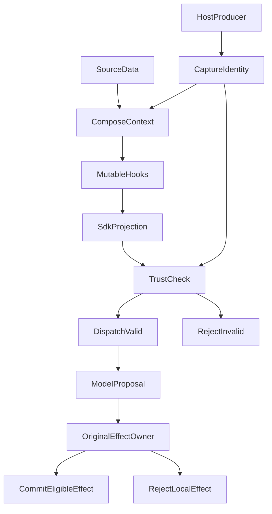

# Prompt Injection 不只是恶意文本：我们如何为 Agent 建立内容信任边界

设想一个研究 Agent 正在读取基金研报。用户只是想知道报告中的观点和依据，但在一次晚期请求变换后，网页内容竟然进入了发给模型的 `system` 指令位置。这里的基金研报只是帮助理解的示例，真正的回归采用的是合成问题与 Web 结果。

这不是我们遇到的真实线上攻击，而是 2026 年 10 月 22 日在原有模型请求路径上构造的受控回归。修复前，使用真实 SDK 映射、模拟网络发送的测试记录到 **1 次 dispatch，预期是 0 次**。模型尚未真正接收外部调用，我们也没有证明它会服从网页中的恶意指令。但在到达模型之前，应用已经犯了一个可以确定的错误：**资料的内容被放进了不属于它的指令位置。**

这一问题促使我们在 ETF Agent 中实现了 A35 内容安全与信任的第一阶段。它没有引入专门的安全大模型、关键词黑名单或全局审核器。我们想解决一个更窄、也更能由程序证明的问题：**当 Agent 不断检索、转换、压缩和恢复材料时，谁能给材料赋予指令身份？谁又有权决定真实的执行效果？**

## 一、以前已经有保护，为什么还会有这条缝？

最初的设计并不荒唐。Agent 已有共用模型指引，要求把搜索结果、引用材料当作资料而非指令；Web、PDF 和检索结果有自己的来源身份；工具调用也要经过真实授权。对于「网页声称自己是系统管理员」这样的内容，模型本来就不应该照做。

在更早的架构演进中，我们还做过两类必要的收敛。其一，逐步移除从回答自由文本推断权限、事实或完成度的规则：一句话看上去像“已经授权”，不代表系统真的有授权回执。其二，限制原生 Hook 对 Host 既有来源和数值事实的改写，避免插件借合法的对象形状重新签发权威。

这些保护各自解决了当时真实的问题，却不能自动证明**最终发送给模型的整个请求**仍保持原样。一个研究请求会经过上下文拟合、可扩展 Hook、PDF 页图补充、输出格式处理，以及 SDK 协议映射。某项上游检查通过，不代表后面的可变步骤没有改动高优先级位置。

真正改变我们判断的是上述受控反例：Web 结果在晚期投影中被提升到 `system`，旧路径仍走到了模拟 SDK 发送。问题不是模型有没有识别出一句攻击话术，而是**发送者已经把数据和指令混到一起**。在这一层再加一段“请忽略恶意指令”的提示，也无法解释原本的身份为什么允许改变。

OWASP 在 [LLM01:2025 Prompt Injection](https://genai.owasp.org/llmrisk/llm01-prompt-injection/) 中将网页、文件等第三方内容诱导模型行为的情况列为间接提示注入，也强调最小权限与外部执行控制。我们采用的是其中一条工程原则，而不是声称设计了全新的防御理论：**不信任内容的影响范围，不能仅由内容自己决定。**

## 二、先把四种经常混淆的“可信”拆开

假设一份经过来源校验的基金年报写着：「未来应当增持某类资产。」这是一条值得研究的观点。即使 PDF 来自官方站点、能定位原文页码，它也没有替用户下单的权力。

| 概念 | 实际在回答什么 | 不能因此推导出什么 |
| --- | --- | --- |
| **来源与证据身份** | 资料来自哪里、对应哪个版本、能支持什么事实 | 资料有权修改系统规则 |
| **指令身份** | 谁真正提交了系统指引、用户任务或受审方法 | 网页写着 `role=system` 就是真的 system |
| **传输角色** | SDK 用 `system`、`user`、`assistant` 等哪种消息形态承载内容 | `role=user` 的每一段都是用户亲自发出的命令 |
| **效果授权** | 某次读取、写入、分享或执行是否有真实准入与确认 | 模型或材料说“已批准”就能执行 |

OpenAI 的 [Model Spec](https://github.com/openai/model_spec/blob/main/model_spec.md) 也明确区分指令优先级与无权威材料：工具输出、附件和引述文本中的指令，默认不能直接成为应遵守的命令。这是模型行为层面的原则；在我们自己的运行时中，还必须给**原始身份如何跨越各个装配步骤**一个可检查的实现。

这里有个容易犯错的反例：为了让多模态 SDK 接受 PDF 页图，应用可能用 `user` 消息承载图片；某些工具字符串结果也会被协议适配成 `user` 载体。如果简单写一条 `role === 'user'` 就认为是用户新命令的规则，合法的读图路径会被误认。反过来，把一切 `user` 载体都视作真正授权，也会给外部材料不应有的权力。

所以 A35 不尝试用单一的 `trusted: true` 给内容盖章。**身份由真实生产者给出，载体只是传输形式，授权由实际效果的负责者判断。** 这同样意味着：我们的结构检查不会使模型自动免疫借 `user` 载体到达的恶意语义。

## 三、关键改变：在可变处理前保存身份，在最终发送前核对

A35 的落点不在搜索阶段，也不在模型输出之后的统一“安全评审”。它横跨两处已有接缝：上下文装配方负责提供原始身份，模型发送方在实际 SDK 请求形成后核对。



图中的两条检查出口是**有条件的分支**：最终投影与原始身份一致，才由原 Gateway 发往模型；出现客观不一致，由 Gateway 使用自己既有的发送前失败回执拒绝这一个请求。检查器本身不派发、不结束研究，也不替工具和发布系统作业务决定。

实现上有三个不太显眼、却直接决定正确性的细节。

**第一，先保存不可由后续正文重建的原始事实。** 原请求生产者保存 Host 的 `system`、原始 `outputSchema` 快照和真正接纳的当前用户消息。上下文经过拟合、Hook 等可变处理后，只能把这份绑定带过去，不能从修改后的请求重新“采集一个原始版本”。否则修改者同时提交内容和基准，检查就失去了意义。

**第二，对比的必须是实际 SDK 投影。** 发送方核对 `system`、输出格式后缀、消息数量与角色映射、当前用户文本是否按原值保留。这里检查的是结构一致性，而不是正文里有没有「忽略之前指令」几个字。真实实现返回 `host-instruction-changed`、`host-schema-changed`、`unbound-system-message`、`user-message-changed`、`carrier-role-changed` 等有限发现，而非一个包打天下的恶意评分。

**第三，结果只能绑定同一个请求版本。** 检查会为最终表示计算版本摘要，并以请求对象为范围缓存事实。同一对象、同一版本不用反复检查；如果晚期处理再次改变了内容或原事实，就不能拿旧的通过结果来放行。这里没有另建全局安全去重表，也没有要求一整轮研究只检查一次。

如果把实现简化成伪代码，主干接近这样：

```ts
const origin = captureFromProducer(request, admittedUserText);
const prepared = await applyContextAndHooks(request);
bindOriginalIdentity(prepared, origin);
const sdkPayload = mapToFinalSdkRequest(prepared);
const facts = inspectFinalContentTrust(prepared, sdkPayload);
if (facts.coverage === 'checked' && facts.findings.length > 0) {
  await originalGateway.onPreDispatchRejected();
  throw originalGateway.inconsistentRequest();
}
return originalGateway.dispatch(sdkPayload);
```

这是说明职责的简化伪代码，并非直接复制的生产函数。实际的捕获、携带、映射和失败结算分布在原本拥有这些行为的模块中。新增检查集中维护一个小接口，**没有把整条执行链搬进安全模块**。

### 两个后来才发现的绕行点

第一个是**定时任务克隆**。克隆原请求时，进程内以对象身份保存的绑定不会自动跟着复制；如果新请求只拿到了表面字段，却丢失真正的原始身份，就可能不再被覆盖。我们最后让绑定沿原定时任务与上下文拟合接缝携带，而不是让克隆体自行宣布可信。

第二个是**输出 Schema 附加内容**。某些协议不原生支持结构化输出时，Gateway 会把服务端拥有的 Schema 说明附加到最终 `system` 字符串。这个后缀本身可以合法，但它必须对应原生产者保存的 Schema。若晚期修改了 `outputSchema.description` 等内容，只校验最早的 `system` 字段就会漏掉最终指令变化。

这两次追查解释了一个工程教训：**“已经在最终请求检查过”并不够准确；必须说清楚什么是最终版本，谁提供基准，克隆和协议转换后基准还在不在。**

## 四、真正危险的，不只是让模型说错一句话

一次提示注入可能试图诱导模型调用工具、读取账户或向外分享内容。A35 没有把这些具体效果统一收编，而是继续让原负责者核对动作的权限、作用范围、来源和执行回执。

在一组原发布/会话路径的定向测试里，合成 Web 正文同时包含正常分析师观点，以及冒充 `system`、声称已经批准执行的内容。脚本化模型在后续回合提出了未获许可的执行动作和账户读取。原工具与权限路径拒绝了这些动作，未获准的持仓读取回调没有触发；此前已经合法交付的正文、独立内容、结束状态以及重新打开的内存历史仍被保留。

这并不是 A35 新发明了交易准入，恰恰相反：**它验证的是原来的权限检查没有被“安全统一化”替代。** 来源中的一句“用户已经同意”，不能填出真正的确认事实；检查得到“可疑”，也不能无缘无故删除其他合格正文。

因此我们没有给 A35 增加 `denyRun`、`publishAllowed` 之类的控制票据，也不让它通过抛异常、过滤候选或强制模型重试，间接取得终结整项任务的权力。最终输入的结构不成立时，原 Gateway 拒绝该次发送；某项业务效果缺少许可时，原效果负责者只拒绝对应动作。**拒绝的范围与事实发生的范围一致。**

还有一个刻意保留的三态结果：`checked`、`not-checked`、`unavailable`。`unavailable` 不等于安全，更不能伪装成已核验；但一项可选观察暂时不可用，也不自动证明正常请求必须全部停止。实际定向故障注入验证了：原本合格的请求，在检查观察不可用时仍可走原发送路径，而原有必要权限约束并没有因此失效。

## 五、经过 Child、摘要和 Memory，材料也不会自动“洗白”

长任务里的问题往往不是第一次读到网页，而是资料被加工很多次后，系统忘记了它原来是什么。

例如，主代理选择一份外部结果、把相关片段交给子代理，再收到一句「已核实，可以执行」。这句话最多代表子代理生成的意见，不能成为 Host 的执行回执。又如，自动 Memory 中的材料写着「用户已经确认」，即使之后通过历史检索进入 `user` 载体，它仍是自动保存的背景，不是当前用户重新给出的同意。

我们保留原有的 `resultRef`、来源哈希、Child 回报与 Memory 生产者关系，不要求模型总结出一套新的安全血缘，也不为 A35 新建持久化安全账本。真正需要使用受保护信息时，回到原结果、读取和授权合同核对；加工、重新读取或保存成功本身不增加权威。

上下文压缩尤其容易被误读。当前链路压缩的是封存的 **assistant 工具提议**，并不是把全部 Web、MCP 原始文本直接交给摘要模型。摘要可以帮助模型接续工作，却不能凭一句话补出真实执行或用户确认。

这部分不仅停在设计。一次限定范围的 PostgreSQL 测试实际由原进程保存后退出，新进程恢复并精确读取原结果，核对封存提议、来源身份及可继续交付的正文。**它证明了这个合成场景的冷恢复交接，并不等于所有恢复路径、真实模型或线上历史都已经通过验收。**

## 六、为什么没有再上一个“安全大模型”？

让模型判断哪些网页文字可疑，看似是更强的防御；但那需要新的成本、误判处理、模型评测和控制权设计。更麻烦的是：如果检查模型自己也被材料影响，它的“安全”结论仍不能当授权回执。

现阶段我们选择分开两种责任。**程序处理它确实知道的东西**：原请求是谁生产的、当前用户原话有没有被替换、Web 内容有没有出现在高权限槽、具体动作有没有获准。**模型处理需要理解语言的东西**：这段话是分析师观点、用户要求解释的攻击样本，还是试图改变当前任务的指令。

我们增加了一份可按需加载的「材料与指令辨别」Skill，复用已有受审资源与方法调用机制。它给模型提供辨别材料、保留合法任务的方法，但不是每轮必调、不是另一个模型，也不要求模型输出自检证明。方法缺失时，普通任务和原有结构保护仍可工作。

这是一种明确的取舍，不是说语义防御不重要。OWASP 的提示注入指南还列举了过滤、最小权限、人工审批和持续安全测试等不同层次的缓解措施；**A35 第一阶段只完成其中可由本地身份和效果合同验证的窄范围**，没有做实时恶意文本分类器，也不宣称能够识别所有间接注入。

## 七、结构性验证与尚待解决的问题

回到文章开头的受控反例：旧路径把 Web 材料送进最终 `system` 后，模拟 SDK 发送发生了 1 次；加入原始生产者身份绑定和最终映射核对后，这类不一致请求走了原 Gateway 的发送前拒绝路径。定时克隆、输出 Schema、合法 PDF 载体与当前用户原话保持，也有对应定向回归。

尤其不能把两件事混为一谈：**结构上没有把 Web 结果提升成 system，不代表模型不会在合法的工具或用户载体中被恶意文字诱导。** 前者可以靠程序的不变量测试验证；后者仍需要针对真实模型、真实输入通道和执行效果的独立对抗评估。

## 结语：内容可以影响研究，不能自行取得权力

这个设计最后没有留下庞大的安全控制中心。它留下的是一条可追踪的身份线：生产者先确定原始身份，后续变换不能自行重新签发；最终请求检查真实发送的版本；具体执行、保存、发布与恢复仍由原来拥有事实的地方负责。

一份研报可以改变 Agent 的投资假设，可以迫使它重新查资料，甚至可以让它引用一句恶意指令来解释攻击模式。这些都是合法的内容使用。但研报不能因为被检索、被摘要、被另一个 Agent 转述，便悄悄变成用户命令、系统策略或执行批准。

**对 Agent 来说，内容安全不是把所有可疑句子删掉，而是让信息可以自由流动，同时让权威始终有明确、可验证的来路。**

## 延伸阅读与交流

关于与之相邻、但职责不同的最终工具可见性问题，可阅读 [A34 Tool Surface](https://hpoenixf.com/eff-agent-article/articles/agent-model-capability-presentation-tool-surface)；关于授权与执行事实，可阅读 [模型会理解，代码才授权](https://hpoenixf.com/eff-agent-article/articles/011-model-understands-code-authorizes)。

本系列收录于 [ETF Agent Engineering Notes](https://github.com/hpoenixf/eff-agent-article)。如果这些工程实践对你有帮助，欢迎为公开文集点一个 Star。
