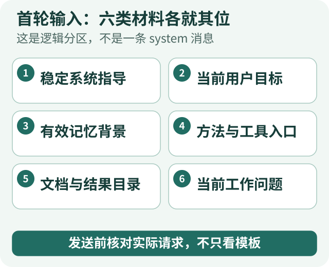
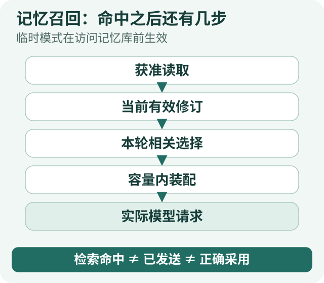
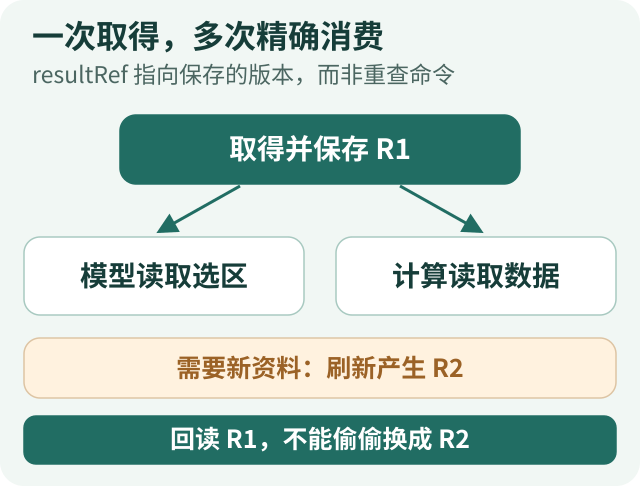
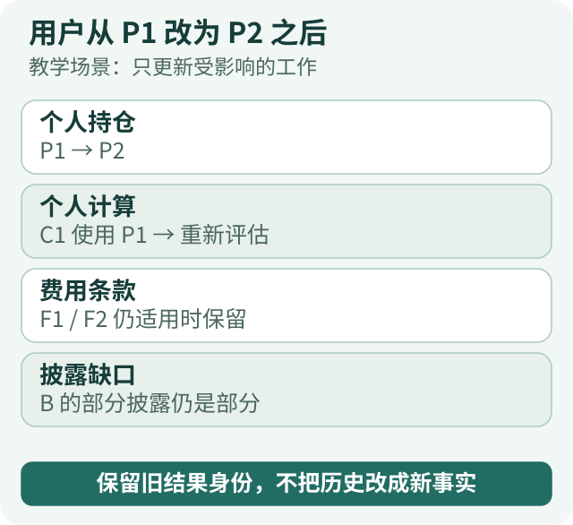
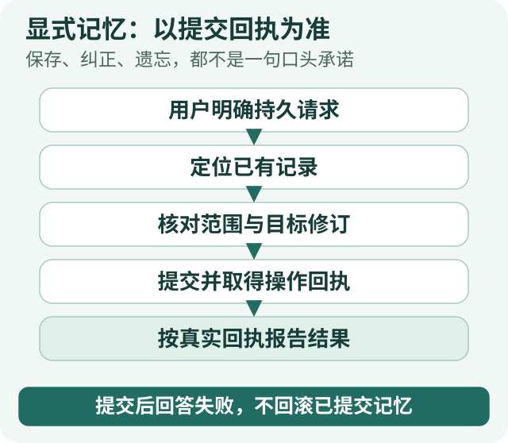
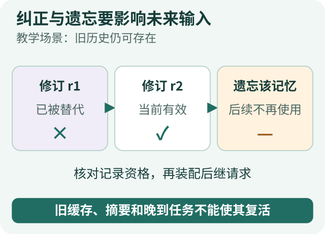

# Agent 上下文治理全景·行动篇：从首轮输入到长期记忆，怎样真正落地

[全景系列](/panorama) · [原则篇](/articles/agent-context-governance-principles) · [行动篇](/articles/agent-context-governance-actions)

一个 Agent 需要知道目标、当前依据、行动边界、历史入口、未知信息的取得路径，以及离完成还差什么。但这些要求不会自己变成一份好的模型输入。

真正落地时，要回答更具体的问题：系统提示词里写什么？记忆在什么时候读？工具返回了一大张表，要不要每轮都带着？用户更新了条件，哪些材料继续有效？模型说“记住了”，我们如何知道真的保存了？

**实现的主线，是在每次调用模型之前，从有效任务、获准材料和真实执行记录中构建当前工作视图；行动以后，再让新的观察和变更进入下一轮。** 系统提示词提供稳定指导，记忆形成跨任务积累，工具结果与进度支撑当下推进。它们不是一个不断增长的字符串。

下面沿一个教学任务展开：用户比较基金 A、B 的费用与持仓重叠，要求结合上传的个人持仓生成带依据的报告，不执行调仓；研究中途上传新持仓，并明确要求以后基金研究报告不要默认压成短答。场景、输入别名和代码示例均用于教学，不是生产接口或一条实际运行记录。项目经验来自 ETF Agent 的已有实现与文章，不能将全文当作公开教学仓库的完整功能清单。

本篇不是一份必须逐项开启的机制清单。解释一个基金费用术语，直接回答可能就够；比较具体基金的费用与持仓，才按需读取条款、披露并计算；只有多轮修正、资料过长或中断恢复成为真实需求时，才考虑持久工作状态、压缩或子代理。**先选择能完成任务的最小路径，再由可观察的失败决定是否增加机制。**

## 一、先保留任务本身，再决定第一轮给什么



*图 1：这是逻辑分区，不是一条 system 消息。发送前核对实际请求，不只看模板。* [放大查看](../visuals/agent-context-governance-actions/01-first-request.svg)

任务刚开始，不要急着搜索，也不要先摘要用户要求。先让原始请求、明确限制、用户提交的材料和任务身份有可回到的记录。需要一个紧凑任务说明时，可以从这些原件构建，但不能让说明替代原件。

教学任务的有效要求可以表达为：

```text
任务：比较基金 A、B 的费用与持仓重叠。
个人输入：用户本次上传的持仓快照 P1。
交付：一份可核对来源、口径和限制的报告。
限制：只研究，不执行调仓。
当前缺口：份额、适用费用、可比持仓披露尚待核对。
```

这不是预设工具执行计划。查到费用后可以先形成相应结论；没有完整持仓时可以扩大检索，也可以限定回答范围。用户原文中无法确定的部分，应保留疑问，而不是在生成任务说明时悄悄补成默认事实。

随后才选择第一轮输入。一个实用的划分是：

| 输入 | 初始处理 | 后续如何变化 |
| --- | --- | --- |
| 系统提示词 | 提供必要的稳定指导 | 随受审版本更新，不随每段网页和记忆改写 |
| 当前用户要求 | 保留目标、约束及可访问原文 | 明确修正进入后继请求，旧版本保留来源 |
| 相关长期记忆 | 仅在准入允许时选择当前有效的少量背景 | 按本次任务相关性选择，纠正与遗忘影响后续资格 |
| 方法和工具 | 给出本阶段需要的方法或发现入口、实际可用工具契约 | 随已准入能力、选用方法和真实可用状态调整 |
| 文档和结果 | 先给足以导航的目录与必要片段 | 根据问题读取，保存版本与覆盖 |
| 工作进度 | 初始问题或明确的尚未开始状态 | 由实际结果和模型的可修订判断共同更新 |

这里区分的是职责，不要求新增六张表或一个上下文总管理器。已有会话、工具、记忆、结果和运行记录可以继续各守自己的责任，在请求装配处形成一份一致的视图。

## 二、写系统提示词：把稳定指导与动态材料分开

### 一份有具体信号、又不硬编码研究路线的提示词

系统提示词要说明怎样工作，却不应替模型预写每一道题的完整步骤。下面是一份压缩过的教学模板，四个区块分别表达背景、行为原则、工具指引与输出要求：

```xml
<background_information>
你协助用户完成有依据的研究。当前目标、资料和能力由本轮输入提供。
你的任务是理解问题、选择研究路径、比较证据并组织结果。
</background_information>

<instructions>
围绕用户当前目标推进；区分目标、约束和可以修订的计划。
区分原始资料、计算结果、历史记忆、工作假设与先前回答。
资料不完整或存在冲突时，识别具体缺口及其影响，不补造事实。
用户修正条件后，重新判断受影响的工作，保留仍然适用的依据。
</instructions>

<tool_guidance>
根据实际提供的工具契约选择行动，不假设不存在的能力。
需要原先取得的材料时，使用受控回读；需要新事实时再获取或刷新。
缺的是用户选择时提出问题，不以无关检索代替。
保存、修改、遗忘等操作，以真实工具回执为准；结果未知就保留未知。
</tool_guidance>

<output_description>
按用户要求交付；关键判断带上适用条件和可核对依据。
区分已回答的部分、尚未解决的问题与下一步所需信息。
格式可以适配任务；本区不替代工具参数中的正式输出协议。
</output_description>
```

XML 在这里用于分区，不是权限机制，也不是必须使用的格式。使用 Markdown 标题也可以；应用仍须将可信指令、用户消息与工具资料放在各自正确的载体中，不能仅凭一层标签把外部文字升级为系统命令。

产品当前能力、用户姓名、持仓数据、今天的日期和旧记忆不应直接焊进这段稳定模板。它们来自不同来源，按任务装配。基金比较的份额与披露口径属于领域方法，可以放进相关 Skill；参数形状和工具用途应由工具契约清楚表达。

ETF Agent 将入口判断与持续研究的指导分开，研究方法也按既有入口或按需读取路径进入上下文。普通读取一份 Skill 正文，并不自动把正文重新注入为系统指令。这个选择的重点是来源与作用保持明确，而不是将每种文本都提升到最高优先级。[3]

### 用少量例子表达选择，不用边角清单替代判断


*图 2：具体到能指导判断，不预写全部路线。用户、日期、持仓、记忆按轮装配。* [放大查看](../visuals/agent-context-governance-actions/02-system-prompt.svg)

可以在方法说明中放一个典型示例：A 有完整持仓、B 只有前十大披露时，可以解释已知共同持仓，但不能称为完整重叠率；费用条款完整时，费用部分仍能独立回答。例子让“部分可回答”变得具体，而不要求模型匹配几十个固定分支。

例子里的基金和数值必须标成示范，不参与当前用户分析。几类有代表性的任务与反例，比把每次失败都追加成一条永久禁令更值得维护。Anthropic 的原文也建议从最小充分提示出发，依据实际失败补充清楚的指令和代表性示例，而不是堆积所有边角情况。[1]

修改时，先定位失败在哪里。如果内容根本没送到模型，修输入；如果工具职责不清，修工具说明；如果是本领域的方法问题，优先修相关 Skill；只有跨任务都成立的行为缺口，才值得进入稳定系统提示词。维护时可以对照修改前后的实际请求，检查指导是否重复、是否在正确阶段出现，再用同类任务比较效果。文本变短或结构检查通过，不能代替实际效果的比较。

## 三、准备首轮请求：先处理记忆准入，再装配实际可用能力

### 记忆先检查是否能读，再决定读哪些

假设用户此前保存过“回答默认简短”。本次要求深入比较时，不应不加区分地注入全部历史，更不能让这条旧偏好覆盖当前要求。

首轮可以先读取少量当前有效的偏好或回答约束，再按任务需要查找相关历史。临时模式则应在任何记忆库读取之前生效：既不召回，也不保存或自动学习；不能先读完，再让模型承诺不用。授权失败、读取不可用和库确实为空，也要保留不同结果。[4]

在候选选择上，先排除不属于当前范围、已失效或被遗忘的记录，再考虑与当前问题的相关性、适用时间和容量。关键词或向量检索只是候选发现方法，不是记录仍然有效的证明。少量明确偏好可以前置；长篇历史讨论更适合按需查找。

一个进入模型的记忆片段，至少要能说明它是什么背景。例如：

```text
记忆背景：用户过去通常希望先给结论，再解释依据。
来源：用户明确提出的长期回答偏好。
用途：辅助组织表达；本次明确的深度要求优先适用。
本次未载入：与基金比较无关的其他历史讨论。
```

这是给模型的语义说明，不要求把所有存储元数据都塞进去。后台仍需要保留准确身份、修订、来源与有效状态，以便在内容改变或恢复时重新定位。

### 工具呈现既不能扩权，也不能隐藏仍然可走的路



*图 3：临时模式在访问记忆库前生效。检索命中 ≠ 已发送 ≠ 正确采用。* [放大查看](../visuals/agent-context-governance-actions/03-memory-consumption.svg)

工具执行端验证当前调用是否获准，模型可见工具集则应反映本轮真实能力。两者需要一致，不能一边展示已不可用的工具，另一边让模型反复撞墙；也不能因为搜索失效，就移除读取已保存结果的合法入口。

保持工具名称、用途、参数和返回语义清楚，优先解决职责重叠，不必机械追求最少数量。能力较多时可以提供受控发现入口，发现后仍须正常准入。工具描述中的“可以查询”不是新的授权，目录中的文件名也不是已读证据。[3]

### 看一份首轮工作视图，而不是只看 Prompt 文件

对教学任务，首轮可见内容大致如下。它是逻辑分区，不是要求所有内容拼进一条 system 消息：

```text
稳定指导：当前版本的系统提示词。
当前任务：比较 A、B；采用 P1；交付报告；不调仓。
有效记忆：先结论后依据；不覆盖本次详细分析要求。
方法入口：基金比较方法的简短说明，必要时读取正文。
资料入口：上传快照 P1、A/B 文件目录及其时点；目录不等于正文已读。
工具：本次获准且可用的读取、检索、计算、交付及必要记忆操作。
工作状态：费用与可比持仓问题尚待核实。
```

发送前应检查实际请求，而不只检查最初装配的对象。后续容量处理、扩展回调和模型适配，可能改变工具、材料和消息表示。关键问题是：原任务和修正还在不在，工具契约是否一致，新读取的内容有没有被变回一个空引用，记忆是否仍是获准使用的当前记录。

## 四、每次缺信息，先判断该回读过去，还是取得新观察

### 为资料保留两种入口：发现与深入读取

模型发现缺口后，需要能理解下一步去哪找。文档目录可以先返回产品、版本、披露时期、章节与页码；搜索结果提供候选来源；只有进一步读取才能获得所需正文。不要把标题命中写成“已核对报告全文”。

一个查费用的过程可以很短：确认份额，定位费用章节，读取适用条款，必要时查看脚注。持仓重叠则可能需要更多范围与结构化数据。工具应允许根据问题扩大读取，而不是固定“只读前三页”或每次整本返回。

这里也要分清问题类型。用户问“上次为什么那样判断”，先回到当时的报告、资料和计算；需要新一期披露，才去获取新版本；缺一个由已有数据可以算出的指标，则调用计算；缺用户选择，就提问。

### 把结果保存为可回读版本，避免一切都经过模型搬运

ETF Agent 的结果读取路径保留获准的结果版本，并通过 `resultRef` 与 `read_tool_result` 支持后续回读。下面使用教学别名解释它，而不是展示可直接调用的真实引用：

```json
{
  "resultAlias": "R_B_1",
  "source": "基金 B 的某期持仓披露",
  "dataAsOf": "2026-06-30",
  "representation": "top-10-holdings",
  "readStatus": "excerpt-read",
  "selection": {
    "fields": ["instrumentId", "weight"],
    "offset": 0,
    "limit": 10
  },
  "coverage": "仅覆盖来源披露的前十大持仓，不是完整基金持仓"
}
```

真实引用由宿主生成，并绑定原结果身份；回读要核对范围、版本和可读性。刷新应形成新版本，而不是静默改写 `R_B_1` 所指的材料。即使同名查询参数一样，也不能把新的外部结果当成原快照。[2]

大表格可以直接交给获准的计算工具。模型指定结果引用及选区，计算端读取原数据，返回结果、口径、输入身份和限制。模型需要核查异常记录时，再回读特定范围。减少的是无意义的复制，不是删除计算依据。

### 让覆盖信息一直跟到最终输入



*图 4：resultRef 指向保存的版本，而非重查命令。回读 R1，不能偷偷换成 R2。* [放大查看](../visuals/agent-context-governance-actions/04-result-reread.svg)

曾有一次受控排查，50 条记录只剩 20 条进入实际模型请求。[2] 这说明“工具调用成功”不够：取回数量、过滤和分页、字节截断、目标记录身份，以及最终请求中的表示，都可能改变覆盖。

如果只拿到 B 的前十大，模型应知道当前能够计算的是已知共同持仓，不是完整重叠率。完整读取一份局部披露，仍不等于覆盖完整对象。对开放互联网搜索，更不能把返回若干条结果当成“相关资料已找全”。

当前刚读到的关键内容不应在装配时无声退出；较早结果可以缩成可精确回读的引用，但要保留选区、来源与覆盖。**取得了、存好了、引用可用、正文送到了，是不同环节。** 任何一个环节都不能替其他环节作证明。

## 五、新证据和用户修正到来后，更新的不只是聊天历史

假设研究已取得费用条款，并按持仓 P1 生成一个个人暴露计算。用户现在上传 P2，说“之前的持仓过时了，按这个算”。

把这句话追加到末尾，只完成了信息保存，还没有说明下一步该使用什么。一个更有用的更新是：保留用户修正与 P2 的身份，在当前视图中说明个人输入已变；原计算仍保留它采用 P1 的事实；把受影响的研究问题重新带到待处理状态。

| 对象 | 变化前 | 用户修正后 |
| --- | --- | --- |
| 个人持仓 | P1 | 当前任务改用 P2；P1 保留为历史 |
| 费用条款 | 对应已核对份额的来源 F1、F2 | 没有相关条件变化时可继续使用 |
| 个人暴露计算 | 输入 P1 的结果 C1 | 不能直接当作基于 P2 的结论，需要重新评估或计算 |
| 基金 B 持仓披露 | 只有前十大 | 不因用户上传 P2 就自动变成完整披露 |
| 工作问题 | 正在综合比较 | 更新个人暴露，保留完整重叠分析的原缺口 |

代码可以记录确切输入版本与已知依赖，但哪些论证受影响，不一定能从一个通用规则机械判断。明确的领域计算可以由领域逻辑处理，更复杂的结论仍需要模型或审阅者重新检查；不能假定已经拥有一套自动识别全部语义影响的系统。

### 便签维护当前问题，回执维护执行事实



*图 5：教学场景：只更新受影响的工作。保留旧结果身份，不把历史改成新事实。* [放大查看](../visuals/agent-context-governance-actions/05-user-correction.svg)

ETF Agent 用 `researchNeeds` 保存模型可修订的研究问题，并通过 `set_research_needs` 更新。下面仅示意它适合表达的内容：

```text
费用：条款已取得，当前份额口径下可以作比较。
基金重叠：缺 B 的同期间完整披露，完整重叠率仍未确认。
个人暴露：用户改用 P2，原计算需要更新。
交付：先给有依据的费用结论，再整理最终报告。
```

模型标记一个问题已解决，是研究判断；工具返回可读结果、计算完成、报告保存，则各有真实记录。便签不能靠删除问题消除用户要求，也不能用“已保存”代替保存回执。[5]

更新便签也不必成为每轮强制动作。简单任务或状态未变化时，可以直接继续。重要的是在关键证据、冲突、用户修正或阶段变化后，后继请求能够获得有用进展，而不是一份已经过时的计划。

## 六、让记忆真正生效：写入、召回、纠正和遗忘要连到后续请求

记忆不只在任务结束时发生。显式“记住”“改正”“忘记”可能在对话任意时刻出现；可选的自动学习则可以沿合格回答的持久终态触发。两条路径不能混为“模型看过，就自动存了”。

### 显式保存：语义由模型理解，成功由持久操作回答

用户说“以后写基金研究报告不要默认压成短答，要讲清依据与口径”，表达了持续的回答偏好。用户只说“这次讲详细些”，则可以只影响当前回答。系统需要区分两者，不能因为一次任务中频繁出现某种写法就认定永久偏好。

ETF Agent 的显式路径由研究阶段在本账户范围内搜索已有记忆，再提议保存、修订或遗忘；宿主检查真实用户来源、目标版本和持久操作。其逻辑可以概括为：[4]

```text
用户明确的持久请求
→ 搜索并定位已有记忆或确认可用的空结果
→ 提议新增、替代或遗忘
→ 检查范围、来源、目标修订及操作身份
→ 提交并取得回执
→ 根据回执报告结果
```

一个便于理解的存储示意如下。字段用于说明设计，不是项目原样接口：

```json
{
  "kind": "response_preference",
  "scope": "本账户",
  "family": "research-answer-depth",
  "revision": 2,
  "content": "基金研究报告应讲清依据与口径，不默认压成短答",
  "origin": "explicit_user_request",
  "sourceRef": "用户原消息 M2",
  "status": "active",
  "supersedes": { "revision": 1 }
}
```

记忆条目要能回答谁提出、适用在哪、当前是哪一版、为何仍有效。一次模型推断不能自行变成 `user_confirmed`；保存失败或结果未知时，也不能对用户说“以后都记住了”。本轮仍可按明确要求继续工作，但长期生效尚未确认。

### 自动学习：先是候选，不是悄悄改写系统提示词



*图 6：保存、纠正、遗忘，都不是一句口头承诺。提交后回答失败，不回滚已提交记忆。* [放大查看](../visuals/agent-context-governance-actions/06-memory-effects.svg)

普通研究中产生的经验，未必都是用户偏好。模型说“用户大概很保守”，可能只是自己的解释；一次成功任务采用了某个方法，也不等于以后每次都必须这样做。

可选自动学习应从获准的来源提出候选，保留语义判断与持久事实的区分。ETF Agent 的通用默认配置关闭自动语义学习，但保留显式记忆操作；观察模式可以保留候选而不自动生效，自动模式还依赖独立配置、来源与资源条件。[4]

工作笔记也不是自动学习的同义词。`researchNeeds` 负责本次研究的问题清单；跨独立任务的自主笔记可以记录项目探索与决策，但需要明确的保存和再读取路径，不能直接冒用用户偏好的身份。若要把经验沉淀为 Skill，应经过方法审阅与适用范围确认，而不是让模型自动追加全局系统指令。

### 召回：相关只是其中一道条件

下一次用户要求深入分析时，系统先验证当前记忆记录，再将相关修订放入实际请求。命中旧的 revision 1，并不意味着可以绕过 revision 2；相似度再高的被遗忘记录，也不能重新成为有效背景。

可以用一条实际消费链检查召回：**合法候选 → 当前有效记录 → 本轮相关选择 → 容量装配 → 实际模型请求**。每一步都可能减少内容，也可能失败。检索返回空、不获准访问、读取超时以及因容量未装入，不能统一伪装成“用户没有记忆”。

模型接收到了记忆，仍不代表它正确采用。可以另外检查回答是否遵循本次深度要求，但不要用“搜索命中次数”代替这项判断。ETF Agent 的使用记录按照实际派发统计，而不是把浏览、检索命中或历史重放都算成一次模型使用。[4]

### 纠正与遗忘：要阻止旧内容通过其他路径回来

纠正时保留修订关系，后续选择当前有效版本；遗忘时则使相应记忆失去未来使用资格。需要关注的不只有原记录：旧搜索结果、缓存、历史摘要、工作便签和晚到的学习任务，都可能携带它的派生内容。

在项目的生命周期设计里，记忆来源与依赖关系使后续投影能够检查这些派生材料，而不是仅从界面删掉一行。[4] 具体实现可能选择过滤、重新生成或暂不提供受影响材料；选择取决于系统能否可靠定位依赖，不能靠简单替换一个关键词保证遗忘完整。

同一研究的既有授权，也不意味着旧内容永远有效。运行授权与记忆的内容修订是不同事实：用户已获准使用本账户记忆，仍不应继续使用后来被纠正或遗忘的版本。新任务的权限则独立检查。

一个值得检查的场景是：遗忘操作已经提交，随后回答失败。下次进入时，应根据真实记忆状态继续排除该内容，不能因为聊天窗口没有收到“已忘记”就回滚操作。反过来，模型先说了“已忘记”，但写入未提交，也不能把那句话当成事实。

## 七、长任务减负：让旧内容退出，但保留继续工作的条件



*图 7：教学场景：旧历史仍可存在。旧缓存、摘要和晚到任务不能使其复活。* [放大查看](../visuals/agent-context-governance-actions/07-memory-lifecycle.svg)

### 先区别存储、驻留和回读

系统能够保存很多数据，不代表模型应该始终携带它们。保存容量、自动放入请求的工作集容量、一次显式读取的容量，分别回答不同问题。不要为了减少自动注入，顺手把获准资料变成再也取不到的内容。

减负时可以先处理重复或较旧、且能够精确回读的工具结果。引用保留来源身份、版本、原选区与覆盖；本轮刚取得的关键材料、必要用户修正和正在使用的依据，需要在相应决策中可见。

在一轮真实研究观察里，Main 的 37 次原生请求中有 20 次显式读取，相同读取结果在后继消息中又累计出现 279 次。它们是重复携带，不是额外执行 279 次外部查询。后来对较旧的可回读结果采用更小的工作集，在受控请求对照中减少了超过 30,000 字节；这只能证明装配变化，真实费用还要考虑缓存、回读及最终任务效果。[2]

因此，不能只问单次请求缩短多少。过早移走有用内容，可能导致反复回读；保留全部内容又可能让历史噪声持续累积。应对照同一任务的整体耗时、质量与调用开销选择策略。

### 确实需要摘要时，把它当作有损工作表示


*图 8：先保留回到原件的路径。摘要描述工作，不改写证据与效果。* [放大查看](../visuals/agent-context-governance-actions/08-working-set.svg)

语义压缩与原文回读不同。摘要会选择和改写信息，所以应限定它能够处理什么、必须保留什么，以及失败时如何回到原表示。

ETF Agent 的同 Run Main 压缩选择有原始依据的已结算旧工作组，保留近期轮次与用户原文，结果引用仍来自真实回执。这里的摘要输入主要是已经封存的模型工具提议，而不是宣称能够概括全部原文与隐含思考。摘要描述旧工作线索，不能凭一句“已经查完”证明执行成功。[6]

采用前还要把摘要和引用放回完整请求，检查实际净收益与输入身份；不够省、放不下或来源不匹配，就保留原表示或按已有容量路径处理。生成摘要本身消耗资源，不能在没有收益时无限重试。

一旦采用，记录它替代的区间、来源、版本与请求身份，让后续重建能对回原件。同一次研究的压缩与跨研究会话历史整理也要分开：前者服务当前执行，后者提供下一次任务的历史背景，不重新发起旧任务，也不自动把旧便签变成本轮进度。

### 子代理和恢复，都是重新构建合适的局部视图

委派费用核对时，提供基金身份、份额、局部目标、必要限制和获准资料即可，不必复制全部私人持仓、长期记忆和其他探索历史。子代理带回判断、适用条件、依据与未决项，主代理再把它接回整体任务；一句“费用更低”不足以完成交接。[7]

恢复时也不是只发送一段摘要加“继续”。应读取原任务及修正、有效输入版本、工作状态、已提交结果和资源事实，并恢复系统支持的接续点。未知效果不能自动重做，已提交的记忆操作和报告也不能凭本地缺少成功提示就被撤回。

这些方式改变的是模型当下携带的材料。它们都不应该重新发明用户目标、原始证据或已经发生的操作。

### 子代理、压缩和回读：从可选方案开始

对于两只基金的费率和持仓重叠比较，默认方案是**单 Main 加必要工具**。若短的原始材料已经足以回答问题，就不必为了「治理」将它外置后再回读。只有独立资料确实造成上下文干扰，或并行探索产生可比较的收益，才考虑子代理：它会新增模型调用、任务交接、结果身份和失败路径。压缩也不能只看一轮 Token 减少，还要算摘要调用、后继回读和错误恢复的成本。

## 八、沿着一项任务检查，而不是给每个模块单独打勾


*图 9：局部视图更小，关键联系不能消失。核对实际输入、真实效果与最终交付。* [放大查看](../visuals/agent-context-governance-actions/09-handoff-and-check.svg)

一套机制都存在，仍然可能在交接处失效。可以用下面几类输入，在实际请求、工具回执和最后报告之间做对照：

| 检查场景 | 要看的具体变化 |
| --- | --- |
| 相同主题，一个要求简短，一个要求深入 | 系统指导保持适用，当前要求真实进入请求，长期偏好不覆盖本次要求 |
| 来源给出 50 条，关键记录放在尾部 | 目标记录和覆盖信息能够追踪到实际输入，局部结果不被说成全集 |
| 中途从 P1 改为 P2 | 用户修正与新版本进入下一轮，重新计算实际使用 P2，旧结论保留原归属 |
| 保存长期偏好后开启新会话 | 有持久回执，当前修订可召回且真正进入请求，而不只显示在管理界面 |
| 纠正或遗忘后仍保留旧历史 | 新请求不再自动采用旧偏好，派生材料和晚到任务不能恢复旧资格 |
| 使用临时模式 | 记忆读取、写入与自动学习均不发生，而不是加载后口头承诺不用 |
| 压缩或子任务交接后继续研究 | 当前目标、关键修正、未决问题和可回读依据仍在，摘要不变成执行证明 |
| 工具结算或保存后中断 | 接续读取原事实，未知效果保留未知，已完成效果不无条件重复 |

这些检查有不同性质。输入身份、范围、版本与操作回执可以进行确定性核对；有没有理解费用例外、是否真正回答用户问题，则需要模型或人工的独立评审。不要用前一种检查通过替代后一种。

观测也不必复制所有私人原文。普通记录可以保留请求身份、组成、版本、容量、表示类型和省略原因；需要查看具体内容时走受控读取。对于无法取得的观测，保留缺口，不能从“没有日志”推断“没有发生”。

最终交付应回答开头那项任务：采用了哪份个人输入，费用按什么口径比较，持仓重叠覆盖到哪里，哪些问题没有解决，以及报告是否真的可取得。记忆帮助表达和接续，系统提示词帮助稳定判断，二者都不能代替这份成果本身。

### 把任务质量与机制成本放在一起比较

可以保持用户问题、基金资料版本、模型配置和评价标准一致，比较基础 Main 与按需启用回读、压缩、子代理的候选方案。既检查报告是否回答原题、数字及来源是否正确、披露范围是否诚实、报告是否交付，也记录调用次数、Token、延迟和失败类型。没有足够的真实配对，就只能提出设计假设，不能声称多专家更好或成本已经显著下降。

还要观察**正常路径税**：高级能力没有触发时，普通请求是否仍携带额外的工具说明、状态与协调逻辑？如果长期增加负担，却没有可观察的任务收益，就应考虑合并、按需激活或退出。授权、来源与防止副作用重复等硬约束仍须保留，不能被简单的成本模型抵消。

## 结语：把做法放回同一条任务链

接到任务，保存原要求，构建稳定指导与当前目标；在允许范围内选择有效记忆，呈现可用工具与资料入口；围绕缺口发现、读取和计算；让新证据和用户修正改变后继输入与进度；需要长期积累时完成真实记忆操作；内容增多后有选择地减负，分工和恢复都继续沿原事实接续。

这就是系统提示词、记忆、检索、结果引用、便签、压缩和子代理共同工作的方式。落地的重点不是把它们逐项装齐，而是检查每一次信息交接是否仍然支持同一个有效目标。

**从下一次实际模型请求开始检查：它知道该做什么吗，拿到了所需依据吗，能够找回过去和探索未知吗，记忆与进展还是当前有效的吗？** 能把这些问题对回真实输入和真实结果，上下文治理才从一组理念变成可维护的工程。

## 参考与延伸

[1] Anthropic（2025-09-29），[Effective context engineering for AI agents](https://www.anthropic.com/engineering/effective-context-engineering-for-ai-agents)。系统提示词、代表性示例及上下文工程的参考；本文中的模板是教学示例，不是原文摘录。

[2] [工具查到的数据，为什么不一定要给大模型看？](https://hpoenixf.com/eff-agent-article/articles/tool-results-outside-model-context)。版本化结果、覆盖、回读及本文引用的两类输入观察。

[3] [Agent 有这个工具，模型为什么还是看不到？](https://hpoenixf.com/eff-agent-article/articles/agent-model-capability-presentation-tool-surface)与[Model、Runtime、MCP、Skill 的责任边界](https://hpoenixf.com/eff-agent-article/articles/agent-model-runtime-mcp-skill-boundaries)。方法、工具与最终请求的职责关系。

[4] [Agent Memory 的完整生命周期：从记住偏好到安全遗忘](https://hpoenixf.com/eff-agent-article/articles/026-agent-memory-forget-durable-effects)。显式操作、可选学习、当前修订、派发消费与遗忘边界。

[5] [为什么 AI Agent 也需要《思考，快与慢》？](https://hpoenixf.com/eff-agent-article/articles/agent-thinking-fast-slow-research-needs)。可修订的研究便签与任务路由。

[6] [同 Run 上下文压缩](https://hpoenixf.com/eff-agent-article/articles/agent-main-run-context-compaction)与[跨 Run 会话历史压缩](https://hpoenixf.com/eff-agent-article/articles/agent-conversation-history-compaction-source-boundaries)。两种历史处理的不同输入和职责。

[7] [Subagent：上下文隔离与专业化](https://hpoenixf.com/eff-agent-article/articles/agent-subagent-context-specialization)。局部视图与研究交接。


---

两篇均可独立阅读：[原则篇](/articles/agent-context-governance-principles)侧重整体判断，[行动篇](/articles/agent-context-governance-actions)展示具体做法。

开源工程实践见 [Open ETF Agent](https://github.com/hpoenixf/open-etf-agent)。若这些文章对你有帮助，欢迎 Star 关注；公开实现的实际范围以仓库说明为准。
